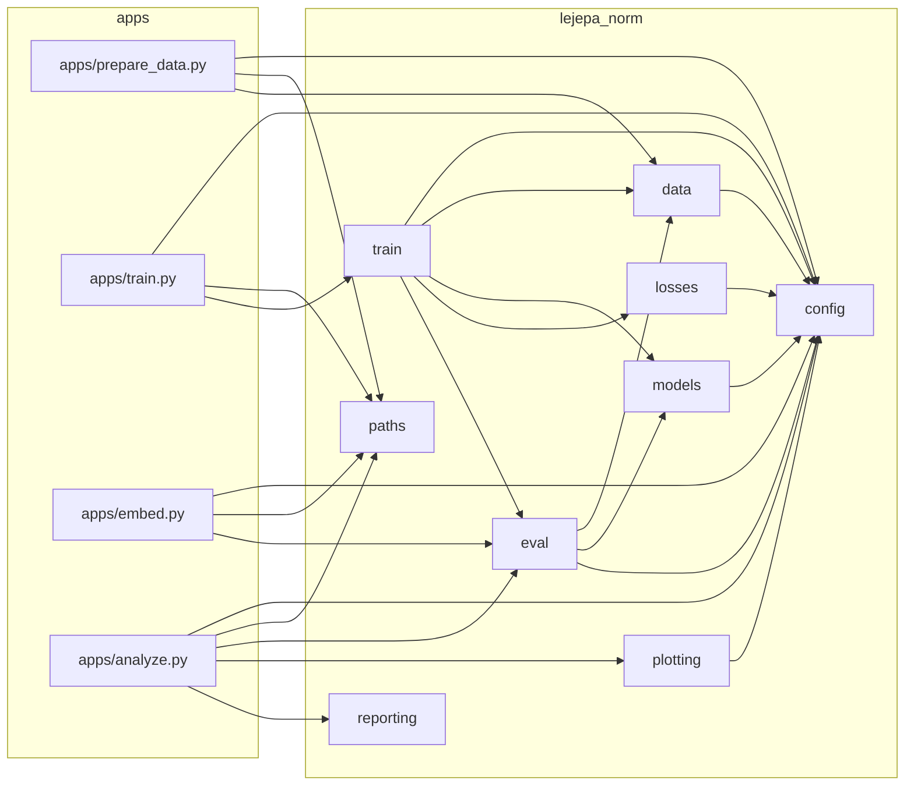
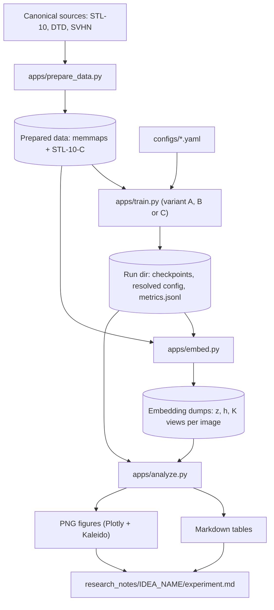

# Architecture

Update these diagrams in the same PR as any change that alters module dependencies
or the flow between apps.

## Module dependencies

Arrows point from a module to what it imports.

## Data and experiment flow

Only `config` and `paths` exist as of M0; the remaining modules and apps land in
later milestones (see the Technical Design).
