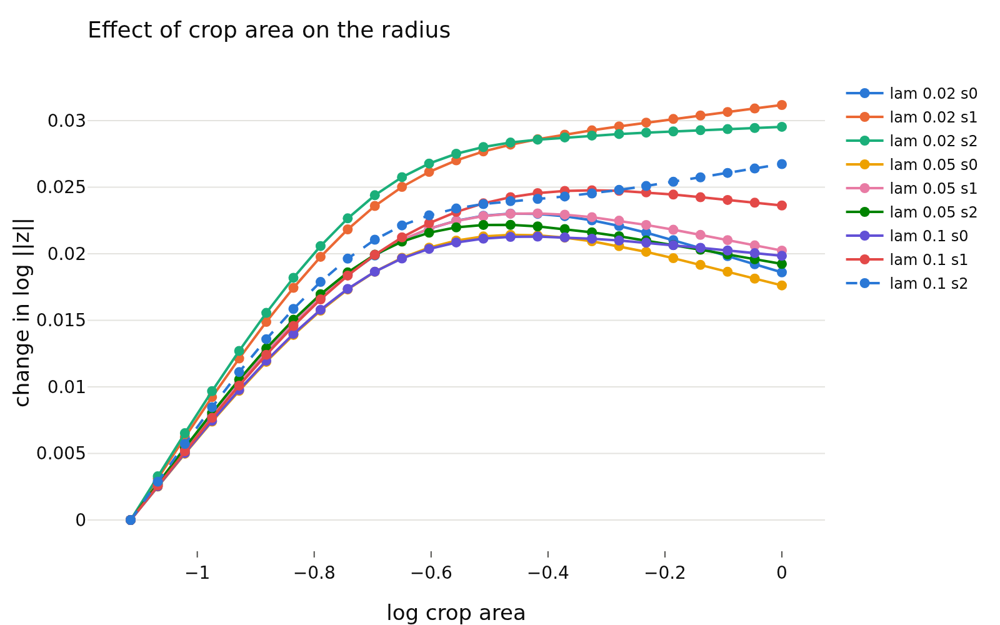

# radius_aug_regression: what explains the within-image variation of the radius?
- **Branch / version:** `radius-aug-regression` @ `4ea8a89` (analysis code); the dumps were written by the embed change in `32f3926`. Pre-registration: `preregistration.md`, committed in `ab4f1d2` before any analysis code existed.
- **Run datetime (UTC):** 2026-10-30T18:04Z (note generation; SLURM jobs 2278059-2278067 embed, 2278418-2278426 analysis)
- **Command(s):**
  ```bash
  # re-embed (one job per checkpoint; new dump names so the existing dumps are untouched)
  for lam in 0.02 0.05 0.1; do for s in 0 1 2; do run=radius_marginal_lam${lam}_s${s}
    sbatch --export=ALL --cpus-per-task=4 --time=02:00:00 slurm/embed.sbatch configs/base.yaml \
      augreg_${run} ${LEJEPA_NORM_RUNS_DIR}/${run}/last.pt --sets stl10_test --set eval.num_views=8
  done; done
  # analysis (one job per checkpoint)
  for run in radius_marginal_lam{0.02,0.05,0.1}_s{0,1,2}; do
    sbatch --export=ALL slurm/aug_regression.sbatch configs/base.yaml radius_marginal "${run}"
  done
  # note (tables and figure generated by the app; LEJEPA_NORM_NOTES_DIR pointed at this worktree)
  python apps/analyze.py --config configs/base.yaml --aug-regression radius_marginal \
    --note radius_aug_regression/aug_regression.md
  ```
- **Datasets:** STL-10 ([canonical](https://cs.stanford.edu/~acoates/stl10/), [HF `tanganke/stl10`](https://huggingface.co/datasets/tanganke/stl10); canonical archive used): `test` (8000 images, 8 random global views each) for the regression, `train` center views as the labeled bank of the frozen linear probe.
- **Backbone:** ResNet-18 from scratch ([HF architecture reference](https://huggingface.co/timm/resnet18.a1_in1k), weights not used); `last.pt` of `radius_marginal_lam{0.02,0.05,0.1}_s{0,1,2}` (Variant A). z only (LeJEPA's product is z).

## Question

How much of the within-image variation of the view radius `log ||z||` is explained by the view's augmentation parameters, and does the radius carry information about the view (whether the probe is right, how far the view is from the image's typical direction) beyond those parameters? Background and predictions P1-P5 are in `preregistration.md`.

## Setup (deviations from the base config)

Nine checkpoints re-embedded on clean `stl10_test` with K = 8 global views per image (96 px crops of scale 0.3-1.0, flip 0.5, color jitter 0.8, grayscale 0.2, blur 0.5 with sigma 0.1-2.0); the augmentation parameters of every view are saved with the embeddings. The primary model has an image fixed effect (within-image regression), 15 covariates (crop log-area as a restricted cubic spline, log aspect, center offset, area x blur, flip, jitter gate and factors, grayscale, blur gate and sigma). 1000 image-bootstrap replicates, 5 image folds. Sanity check of the saved parameters against the sampler constants: crop area 0.296-1.0, flip 0.498, jitter 0.798, grayscale 0.199, blur 0.497, sigma 0.1-2.0.

Deviations from the pre-registration: (1) the per-image crop-area slope is a two-stage estimate (per-image slopes, sampling variance subtracted), not a mixed model; its correlation with the image mean is attenuated by the noise of the slopes and is not interpretable beyond "no sign of a relation". (2) In part C the `both` score uses the point-estimate coefficients (not refitted per bootstrap replicate); the bootstrap resamples images for the AUC. (3) Seeds are not pooled; every checkpoint is a row.

## Results

<!-- BEGIN GENERATED: analyze.aug_inputs -->
### Inputs

Runs: `radius_marginal_lam0.02_s0`, `radius_marginal_lam0.02_s1`, `radius_marginal_lam0.02_s2`, `radius_marginal_lam0.05_s0`, `radius_marginal_lam0.05_s1`, `radius_marginal_lam0.05_s2`, `radius_marginal_lam0.1_s0`, `radius_marginal_lam0.1_s1`, `radius_marginal_lam0.1_s2`.

Unit files missing:

None.
<!-- END GENERATED: analyze.aug_inputs -->

<!-- BEGIN GENERATED: analyze.aug_verdicts -->
### Pre-registered checks

| check | checkpoints |
|---|---|
| P1 area effect rises | 9/9 |
| P2 CV R2 linear >= 0.3 (7 needed) | 0/9 |
| P2 trees add <= 0.10 over linear | 9/9 |
| P3 `r` retains the AUC (0 means P3 holds) | 9/9 |
| P4 signs agree over seeds (lambdas) | 3/3 |
| Reading of the pre-registration | rejected (P2 fails) |
<!-- END GENERATED: analyze.aug_verdicts -->

<!-- BEGIN GENERATED: analyze.aug_r2 -->
### Within-image R2 of the augmentation parameters

`within R2`: share of the within-image variance of `log ||z||` explained by the parameters (in-sample, with an image-bootstrap 95% interval); `CV` columns are held out over image folds; `within share of var` is the share of the total variance that is within-image (the rest is the image effect); `slope sd` is the estimated sd of the image-specific log-area slope (two-stage estimate with the sampling variance removed; deviation from the pre-registered mixed model) and `corr(slope, mean)` its correlation with the image mean (attenuated by noise); `view acc` is the frozen linear probe's accuracy on the augmented views.

| lambda | seed | within R2 [95%] | CV R2 linear | CV R2 trees | within share of var | slope sd | corr(slope, mean) | view acc |
|---|---|---|---|---|---|---|---|---|
| 0.02 | 0 | 0.058 [0.053, 0.064] | 0.05751 | 0.06298 | 0.09759 | 0.06616 | -0.01301 | 0.7887 |
| 0.02 | 1 | 0.062 [0.057, 0.068] | 0.06173 | 0.06827 | 0.08965 | 0.06489 | -0.02867 | 0.789 |
| 0.02 | 2 | 0.094 [0.088, 0.101] | 0.0934 | 0.09669 | 0.09417 | 0.06584 | -0.02026 | 0.7878 |
| 0.05 | 0 | 0.091 [0.085, 0.097] | 0.09002 | 0.09941 | 0.1119 | 0.06038 | -0.008577 | 0.7995 |
| 0.05 | 1 | 0.085 [0.079, 0.092] | 0.08469 | 0.09645 | 0.1075 | 0.06225 | -0.03067 | 0.799 |
| 0.05 | 2 | 0.116 [0.110, 0.123] | 0.1157 | 0.1234 | 0.1148 | 0.06243 | -0.01893 | 0.7991 |
| 0.1 | 0 | 0.125 [0.118, 0.133] | 0.1248 | 0.1339 | 0.1266 | 0.059 | -0.02489 | 0.7916 |
| 0.1 | 1 | 0.127 [0.119, 0.134] | 0.1259 | 0.1338 | 0.1277 | 0.05816 | 0.002944 | 0.7929 |
| 0.1 | 2 | 0.125 [0.117, 0.132] | 0.1245 | 0.1357 | 0.1271 | 0.05792 | -0.00839 | 0.7936 |
<!-- END GENERATED: analyze.aug_r2 -->

<!-- BEGIN GENERATED: analyze.aug_blocks -->
### Block partial R2 per augmentation type

Drop in within-image R2 when the block (and the area x blur interaction for crop and blur) is removed; 95% image-bootstrap intervals. Shares overlap (parameters are correlated) and do not sum to the total.

| lambda | seed | crop | flip | color | grayscale | blur |
|---|---|---|---|---|---|---|
| 0.02 | 0 | 0.018 [0.016, 0.021] | 0.000 [0.000, 0.000] | 0.003 [0.002, 0.004] | 0.017 [0.014, 0.020] | 0.021 [0.018, 0.024] |
| 0.02 | 1 | 0.029 [0.026, 0.033] | 0.000 [0.000, 0.000] | 0.004 [0.003, 0.005] | 0.018 [0.015, 0.021] | 0.013 [0.011, 0.016] |
| 0.02 | 2 | 0.021 [0.019, 0.024] | 0.000 [0.000, 0.000] | 0.004 [0.003, 0.005] | 0.022 [0.019, 0.025] | 0.050 [0.045, 0.055] |
| 0.05 | 0 | 0.018 [0.016, 0.021] | 0.000 [0.000, 0.000] | 0.002 [0.002, 0.003] | 0.054 [0.049, 0.059] | 0.018 [0.015, 0.020] |
| 0.05 | 1 | 0.018 [0.015, 0.020] | 0.000 [0.000, 0.000] | 0.003 [0.002, 0.004] | 0.048 [0.043, 0.053] | 0.018 [0.015, 0.021] |
| 0.05 | 2 | 0.018 [0.016, 0.021] | 0.000 [0.000, 0.000] | 0.003 [0.002, 0.004] | 0.058 [0.053, 0.063] | 0.038 [0.035, 0.043] |
| 0.1 | 0 | 0.019 [0.017, 0.022] | 0.000 [0.000, 0.000] | 0.002 [0.001, 0.003] | 0.084 [0.077, 0.090] | 0.021 [0.018, 0.023] |
| 0.1 | 1 | 0.022 [0.019, 0.025] | 0.000 [0.000, 0.000] | 0.002 [0.001, 0.003] | 0.089 [0.082, 0.096] | 0.015 [0.012, 0.017] |
| 0.1 | 2 | 0.024 [0.021, 0.028] | 0.000 [0.000, 0.000] | 0.002 [0.001, 0.003] | 0.086 [0.080, 0.092] | 0.014 [0.011, 0.016] |
<!-- END GENERATED: analyze.aug_blocks -->

<!-- BEGIN GENERATED: analyze.aug_coef -->
### Coefficients per parameter (standardized)

Change of `log ||z||` per standard deviation of the parameter, other parameters held fixed, image fixed effects; the three log-area columns are spline terms (see the effect curve). 95% image-bootstrap intervals.

| lambda | seed | log_area | log_area_spline_1 | log_area_spline_2 | log_aspect | center_offset | log_area_x_blur | flip | jitter | brightness | contrast | saturation | abs_hue | grayscale | blur | sigma |
|---|---|---|---|---|---|---|---|---|---|---|---|---|---|---|---|---|
| 0.02 | 0 | +0.018 [+0.015, +0.021] | -0.017 [-0.023, -0.011] | +0.005 [+0.001, +0.009] | +0.000 [-0.001, +0.001] | -0.007 [-0.007, -0.006] | -0.004 [-0.005, -0.003] | -0.000 [-0.001, +0.000] | -0.001 [-0.002, -0.000] | -0.002 [-0.003, -0.001] | +0.000 [-0.000, +0.001] | +0.001 [+0.000, +0.001] | -0.003 [-0.004, -0.002] | -0.010 [-0.011, -0.009] | +0.004 [+0.003, +0.005] | -0.014 [-0.015, -0.012] |
| 0.02 | 1 | +0.021 [+0.018, +0.024] | -0.019 [-0.026, -0.012] | +0.007 [+0.003, +0.011] | +0.001 [+0.000, +0.001] | -0.006 [-0.007, -0.005] | -0.003 [-0.004, -0.002] | -0.000 [-0.001, +0.000] | -0.002 [-0.003, -0.001] | -0.002 [-0.002, -0.001] | +0.001 [+0.000, +0.001] | +0.001 [+0.000, +0.001] | -0.003 [-0.003, -0.002] | -0.010 [-0.011, -0.009] | +0.004 [+0.003, +0.005] | -0.011 [-0.012, -0.010] |
| 0.02 | 2 | +0.022 [+0.019, +0.025] | -0.022 [-0.028, -0.015] | +0.008 [+0.004, +0.012] | -0.000 [-0.001, +0.000] | -0.006 [-0.007, -0.005] | -0.005 [-0.006, -0.004] | -0.000 [-0.001, +0.000] | -0.002 [-0.003, -0.001] | -0.001 [-0.001, +0.000] | +0.002 [+0.001, +0.003] | +0.001 [+0.000, +0.001] | -0.003 [-0.004, -0.002] | -0.011 [-0.012, -0.011] | +0.004 [+0.003, +0.005] | -0.020 [-0.021, -0.019] |
| 0.05 | 0 | +0.017 [+0.014, +0.020] | -0.016 [-0.022, -0.010] | +0.005 [+0.001, +0.008] | +0.000 [-0.000, +0.001] | -0.005 [-0.006, -0.005] | -0.003 [-0.004, -0.002] | -0.000 [-0.001, +0.000] | -0.001 [-0.002, -0.001] | -0.001 [-0.002, -0.000] | +0.001 [+0.000, +0.001] | +0.000 [-0.000, +0.001] | -0.002 [-0.003, -0.002] | -0.016 [-0.017, -0.015] | +0.004 [+0.003, +0.005] | -0.012 [-0.013, -0.011] |
| 0.05 | 1 | +0.018 [+0.015, +0.021] | -0.017 [-0.023, -0.011] | +0.005 [+0.001, +0.009] | +0.000 [-0.000, +0.001] | -0.004 [-0.005, -0.004] | -0.002 [-0.003, -0.001] | -0.000 [-0.001, +0.001] | -0.001 [-0.002, -0.000] | -0.001 [-0.001, -0.000] | +0.001 [+0.000, +0.002] | +0.000 [-0.000, +0.001] | -0.003 [-0.003, -0.002] | -0.015 [-0.016, -0.014] | +0.006 [+0.005, +0.007] | -0.013 [-0.014, -0.012] |
| 0.05 | 2 | +0.018 [+0.015, +0.021] | -0.020 [-0.026, -0.014] | +0.007 [+0.003, +0.011] | -0.000 [-0.001, +0.000] | -0.005 [-0.006, -0.004] | -0.003 [-0.004, -0.002] | -0.000 [-0.001, +0.000] | -0.001 [-0.002, -0.001] | -0.001 [-0.001, -0.000] | +0.001 [+0.001, +0.002] | +0.001 [+0.000, +0.002] | -0.002 [-0.003, -0.002] | -0.017 [-0.018, -0.016] | +0.005 [+0.004, +0.006] | -0.017 [-0.018, -0.016] |
| 0.1 | 0 | +0.017 [+0.014, +0.019] | -0.017 [-0.022, -0.012] | +0.006 [+0.003, +0.009] | +0.000 [-0.001, +0.001] | -0.004 [-0.005, -0.003] | -0.002 [-0.002, -0.001] | +0.000 [-0.000, +0.001] | -0.001 [-0.002, -0.000] | -0.000 [-0.001, +0.000] | +0.001 [+0.000, +0.001] | +0.000 [-0.000, +0.001] | -0.002 [-0.002, -0.001] | -0.019 [-0.019, -0.018] | +0.005 [+0.004, +0.005] | -0.012 [-0.013, -0.011] |
| 0.1 | 1 | +0.017 [+0.015, +0.020] | -0.014 [-0.020, -0.009] | +0.004 [+0.001, +0.008] | +0.000 [-0.000, +0.001] | -0.004 [-0.005, -0.003] | -0.002 [-0.003, -0.001] | -0.000 [-0.001, +0.000] | -0.001 [-0.002, -0.000] | -0.000 [-0.001, +0.000] | +0.000 [-0.000, +0.001] | +0.000 [-0.000, +0.001] | -0.002 [-0.003, -0.002] | -0.019 [-0.020, -0.018] | +0.005 [+0.004, +0.006] | -0.011 [-0.012, -0.010] |
| 0.1 | 2 | +0.019 [+0.017, +0.022] | -0.020 [-0.026, -0.015] | +0.008 [+0.005, +0.012] | +0.000 [-0.000, +0.001] | -0.004 [-0.005, -0.003] | -0.002 [-0.003, -0.001] | -0.000 [-0.001, +0.001] | -0.001 [-0.002, -0.001] | -0.000 [-0.001, +0.000] | +0.000 [+0.000, +0.001] | +0.000 [-0.000, +0.001] | -0.002 [-0.002, -0.001] | -0.018 [-0.019, -0.018] | +0.005 [+0.004, +0.005] | -0.010 [-0.011, -0.009] |
<!-- END GENERATED: analyze.aug_coef -->

<!-- BEGIN GENERATED: analyze.aug_quality -->
### Does the radius residual carry view information? (part C-a)

Within-image AUC for the frozen linear probe being correct on a view, using `yhat` (radius predicted from the parameters, cross-fitted), `r` (the remaining radius) and the fixed-effects combination `both`. `r retains` is true if `r` is more than half way from 0.5 to the AUC of `both`.

| lambda | seed | AUC yhat | AUC r | AUC both | r retains |
|---|---|---|---|---|---|
| 0.02 | 0 | 0.577 [0.565, 0.588] | 0.557 [0.545, 0.570] | 0.592 [0.580, 0.604] | True |
| 0.02 | 1 | 0.570 [0.558, 0.583] | 0.559 [0.547, 0.571] | 0.584 [0.571, 0.597] | True |
| 0.02 | 2 | 0.590 [0.577, 0.602] | 0.559 [0.546, 0.571] | 0.601 [0.589, 0.614] | True |
| 0.05 | 0 | 0.574 [0.562, 0.586] | 0.549 [0.537, 0.562] | 0.580 [0.567, 0.593] | True |
| 0.05 | 1 | 0.571 [0.559, 0.582] | 0.554 [0.543, 0.567] | 0.585 [0.572, 0.597] | True |
| 0.05 | 2 | 0.583 [0.571, 0.595] | 0.556 [0.544, 0.568] | 0.593 [0.581, 0.604] | True |
| 0.1 | 0 | 0.570 [0.558, 0.582] | 0.564 [0.552, 0.576] | 0.586 [0.574, 0.599] | True |
| 0.1 | 1 | 0.564 [0.553, 0.576] | 0.551 [0.538, 0.563] | 0.576 [0.564, 0.588] | True |
| 0.1 | 2 | 0.572 [0.560, 0.583] | 0.563 [0.551, 0.575] | 0.592 [0.581, 0.604] | True |
<!-- END GENERATED: analyze.aug_quality -->

<!-- BEGIN GENERATED: analyze.aug_angle -->
### Angle to the image's mean direction (part C-b)

Within-image R2 of the angle (view direction to the mean of the image's augmented directions) on `yhat`, `r` and both; `r_increment` is the gain of `r` over `yhat`.

| lambda | seed | R2 yhat | R2 r | R2 both | R2 r_increment |
|---|---|---|---|---|---|
| 0.02 | 0 | 0.304 [0.297, 0.310] | 0.040 [0.035, 0.046] | 0.344 [0.337, 0.351] | 0.040 [0.036, 0.045] |
| 0.02 | 1 | 0.310 [0.303, 0.316] | 0.042 [0.036, 0.049] | 0.353 [0.345, 0.360] | 0.043 [0.038, 0.048] |
| 0.02 | 2 | 0.282 [0.275, 0.289] | 0.046 [0.040, 0.052] | 0.329 [0.321, 0.336] | 0.046 [0.042, 0.051] |
| 0.05 | 0 | 0.399 [0.391, 0.406] | 0.049 [0.043, 0.056] | 0.449 [0.441, 0.456] | 0.050 [0.045, 0.055] |
| 0.05 | 1 | 0.398 [0.391, 0.405] | 0.049 [0.043, 0.055] | 0.448 [0.440, 0.455] | 0.049 [0.045, 0.054] |
| 0.05 | 2 | 0.388 [0.381, 0.395] | 0.050 [0.043, 0.056] | 0.438 [0.431, 0.446] | 0.050 [0.045, 0.055] |
| 0.1 | 0 | 0.445 [0.437, 0.453] | 0.051 [0.045, 0.058] | 0.497 [0.490, 0.505] | 0.051 [0.047, 0.056] |
| 0.1 | 1 | 0.440 [0.432, 0.448] | 0.049 [0.043, 0.056] | 0.489 [0.482, 0.497] | 0.050 [0.045, 0.054] |
| 0.1 | 2 | 0.447 [0.439, 0.455] | 0.049 [0.042, 0.056] | 0.496 [0.488, 0.503] | 0.049 [0.045, 0.054] |
<!-- END GENERATED: analyze.aug_angle -->

<!-- BEGIN GENERATED: analyze.aug_figures -->
### Figures


<!-- END GENERATED: analyze.aug_figures -->

## Interpretation

**Pre-registered reading: the hypothesis "the radius reflects the amount of image evidence the view carries, as specified by its augmentation" is rejected (P2 fails).** The augmentation parameters explain only 6-13% of the within-image variance of `log ||z||` (cross-validated 0.058-0.125; the pre-registered bar was 0.30 in at least 7 of 9 checkpoints, met in 0). Because only 9-13% of the total variance is within-image (the rest is the image effect, consistent with the ICC of about 0.87), the parameters explain roughly 0.6-1.6% of the total variance of the radius. Boosted trees on the same covariates add at most 0.012 (P2's second clause holds), so the shortfall is not missing interactions among the parameters. The explained share rises with lambda (0.06-0.09 at 0.02, 0.09-0.12 at 0.05, 0.125 at 0.1).

What the parameters do do (P1, P4 hold): the radius rises with crop area and flattens for large crops (all 9 checkpoints; see the figure), grayscale and blur lower it, flip does nothing (partial R2 0.000), color jitter is tiny. The effects are small in absolute terms: the whole crop-area range moves `log ||z||` by about 0.02-0.03, against a within-image sd of about 0.06 and a total spread of about 0.2. Signs of the crop-area, blur and sigma effects agree across seeds at every lambda. Post hoc and not pre-registered: the share of the explained variance owed to grayscale grows with lambda (block partial R2 0.017-0.022 at lambda 0.02, 0.05 at 0.05, 0.084-0.089 at 0.1), so at lambda 0.1 grayscale is most of the explained part; blur and crop stay near 0.02. Only 3 lambdas, so this is a pattern to check, not a result.

**The residual radius still carries view information (P3 fails in all 9 checkpoints).** Within an image, the part of the radius the parameters do not predict (`r`) separates the views the frozen linear probe gets right from the ones it gets wrong nearly as well as the part they do predict (within-image AUC 0.549-0.564 for `r`, 0.564-0.590 for `yhat`, 0.576-0.601 for both; chance 0.5; all intervals exclude 0.5). The same holds for the angle to the image's mean direction: the parameters explain 28-45% of its within-image variance (P5 holds, and the share rises with lambda), and `r` adds a further 0.04-0.05 with intervals that exclude 0. The two parts are roughly additive. The effects are modest: AUCs near 0.55-0.6 mean the radius is a weak per-view reliability signal.

So the earlier finding (the highest-radius view beats the lowest by 2.6-6.0 points) is not explained by crop size or blur: it is mostly carried by radius variation that the augmentation parameters do not specify. What that variation is remains open. Two candidates, neither tested here: (a) what is in the crop (content-dependent evidence rather than crop size), (b) the view's direction, since the same-view radius is about 95% predictable from the direction (controls in `radius_conditional`), in which case `r` mostly reflects where on the sphere the view lies. These make different predictions (see next steps).

Limits: only global views (crop scale 0.3-1.0) were embedded; the local-view range used in training (0.05-0.3) is not covered. Three seeds per lambda; the P2 threshold of 0.30 was a proposal, but the outcome (0.06-0.13) is far from it and below the pre-registered 0.10 "dead" level in 5 of 9 checkpoints. One dataset, one backbone.

## Next steps

1. Add the view's direction to the regression (the clean-fitted direction to log-radius map, `res = rho - f(u)`, as in `shift`/`view_signal`) and ask whether `r` still predicts correctness after both the parameters and the direction are partialled out. If it does not, the within-image radius is mostly direction.
2. Add content statistics of the actual crop (contrast, sharpness, edge density, class-evidence of the crop via the probe's margin on the center view) as covariates; if the residual AUC shrinks, the unexplained part is what is in the crop.
3. The powered view-selection test (drop the k lowest-radius views vs k random views) and the corruption-severity analysis stay open from the proposal list.
