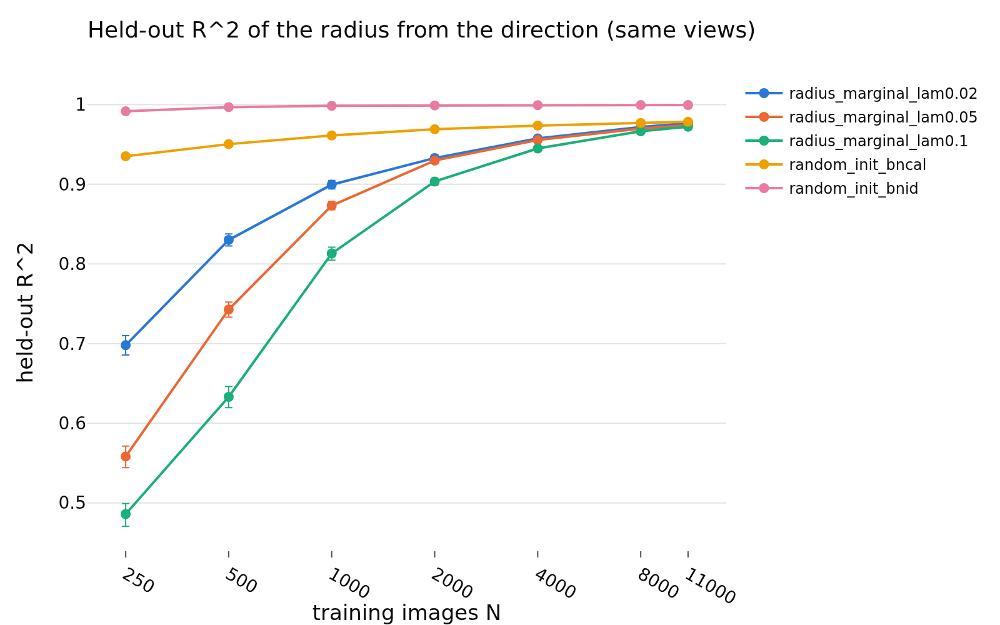
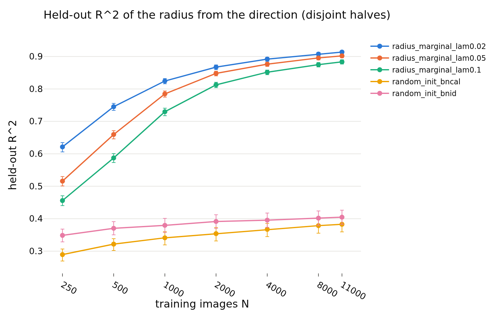

# E2 (part 1): is N = 4000 saturating? Learning curve of the redundancy R^2
- **Branch / version:** `radius-baselines-controls` @ `567c498` (code and pre-registered readings; this results commit follows it)
- **Run datetime (UTC):** 2026-10-26 (jobs started 2026-10-26T01:11Z by sacct; aggregation 2026-10-26T02:11Z)
- **Command(s):** `sbatch --export=ALL --array=0-5 slurm/embed_random_init.sbatch configs/base.yaml` (job 2247669, random-init embeddings, 1 GPU each, node r003: NVIDIA H200); `sbatch --export=ALL --array=0-14%8 slurm/baseline_controls.sbatch configs/base.yaml radius_marginal random_init` (job 2247779, CPU only, nodes m002/g002/h001); aggregation: `python apps/analyze.py --config configs/base.yaml --baseline-controls radius_marginal random_init --note radius_baselines/controls.md` (writes `controls_redundancy.md`, `controls_smooth.md`, `controls_curve.md`)
- **Datasets:** STL-10 `train` (5000 labeled images) and `test` (8000 images) clean images, pooled to 13000 ([canonical](https://cs.stanford.edu/~acoates/stl10/), [HF `tanganke/stl10`](https://huggingface.co/datasets/tanganke/stl10)); the canonical archive was used (via the existing `stl10_train` / `stl10_test` embedding dumps). The 100k `unlabeled` images have no embeddings (the dump layout covers five evaluation sets, not the pretraining images), so N is capped at 11000 training images; nothing is extrapolated beyond it.
- **Backbone:** ResNet-18 from scratch ([HF architecture reference](https://huggingface.co/timm/resnet18.a1_in1k), weights not used); `last.pt` of `radius_marginal_lam{0.02,0.05,0.1}_s{0,1,2}`, and the random-init networks of `controls_redundancy.md`.
- **Scope:** h is not analyzed; LeJEPA's product is z.

## Question

All redundancy numbers use N = 4000 images (nested 5-fold CV, so 3200 training images per fit). Is that saturating, i.e. does the held-out R^2 of the radius from the direction stop growing with the number of training images, or would more images give a (much) higher R^2?

## Setup (deviations from the base config)

No deviation from `configs/base.yaml`. Pool: the `stl10_train` and `stl10_test` dumps, K = 8 augmented views each (13000 images). One fixed random held-out set of `eval.curve_holdout = 2000` images (the same images for every run: seed 0, independent of the run); training sets of N in {250, 500, 1000, 2000, 4000, 8000, 11000} images are random nested subsets of the other 11000 images (5 draws for N <= 1000, 3 for 2000 and 4000, 2 for 8000, the whole remainder once). Fit: `redundancy.FittedKernelRidge` on `u -> rho_bar` (exp-dot kernel, bandwidth and penalty selected by exact LOO on the training rows, as inside one outer fold of the nested CV in the redundancy table). Deviation for compute (an 11000 x 11000 eigendecomposition per bandwidth is about 10 minutes): for N = 8000 and 11000 the bandwidth is the one selected at N = 4000 on the same nested training draw and only the penalty is re-selected by exact LOO at the larger N. If the best bandwidth shrinks with N this slightly understates R^2 at large N, i.e. it can bias the contrast toward "saturated". Two setups: `same views` (u_hat and rho_bar both from all 8 views, the headline setup) and `disjoint halves` (u_hat of views 0-3 to rho_bar of views 4-7, the setup with no shared view). R^2 is on the held-out set; for N with several draws the per-image squared errors are averaged over draws before the bootstrap (images of the held-out set resampled within each seed, same resample for every N, then averaged over seeds; 1000 replicates). Note the difference to the redundancy table: its N = 4000 CV trains on 3200 images per fold and tests on the remaining 800 of the same images; here N = 4000 trains on 4000 and tests on 2000 different images, so values at N = 4000 differ slightly (more training images; a different, larger test set).

**Margin (fixed before any curve was computed, `eval.curve_margin` in `configs/base.yaml` and `lejepa_norm.config`):** 0.01 in R^2 units. Saturation contrast: `R^2(N) - R^2(4000)`, paired over held-out images, equivalence verdict shared with E1 (`randomization.verdict`): `equivalent` if the 90% interval lies inside (-0.01, +0.01), `different` if not and the 95% interval excludes 0, else `inconclusive`.

## Pre-registered reading (written before any result was computed)

1. **N = 4000 is saturating:** the contrast `R^2(11000) - R^2(4000)` for `same views` is `equivalent` (within 0.01) for every group of trained runs. Then the reported R^2 at N = 4000 is a good estimate of what this regressor can reach on these directions, and the numbers of the redundancy table are not limited by N (to within 0.01).
2. **Not saturating:** the same contrast is `different` with a positive point estimate above 0.01. Then the redundancy R^2 reported at N = 4000 is a lower bound by about that amount (higher N, higher R^2); statements such as "about 5% of the radius variance is not explained" would be too pessimistic, and the unexplained share would have to be quoted at the largest N.
3. **Inconclusive:** the interval is wider than the margin (seed or held-out noise): reported as such; no saturation claim either way.
4. The `disjoint halves` setup is read the same way as a check; it has a lower ceiling (the reliability of the target) and may saturate earlier.
5. For the random-init groups the curve is shown for comparison only; the saturation decision uses the trained groups.
6. The contrasts `R^2(2000) - R^2(4000)` and `R^2(8000) - R^2(4000)` are reported to locate where the curve flattens; they carry no decision.

## Results

<!-- BEGIN GENERATED: baseline.curve -->
### Held-out R^2 against the number of training images

One fixed held-out set (the same images in every run), nested random training subsets of the rest, 95% percentile bootstrap over held-out images (seeds averaged). `same views`: u_hat and rho_bar of all 8 views; `disjoint halves`: u_hat of views 0-3, rho_bar of views 4-7.

| group | setup | N | seeds | r2 (mean over seeds) | 95% CI (held-out images) | seed range |
|---|---|---|---|---|---|---|
| radius_marginal_lam0.02 | same views | 250 | 3 | 0.698 | [0.6846, 0.7099] | [0.6779, 0.7110] |
| radius_marginal_lam0.02 | same views | 500 | 3 | 0.8301 | [0.8218, 0.8375] | [0.8215, 0.8350] |
| radius_marginal_lam0.02 | same views | 1000 | 3 | 0.8995 | [0.8943, 0.9045] | [0.8908, 0.9054] |
| radius_marginal_lam0.02 | same views | 2000 | 3 | 0.9329 | [0.9286, 0.9369] | [0.9253, 0.9369] |
| radius_marginal_lam0.02 | same views | 4000 | 3 | 0.9576 | [0.9547, 0.9604] | [0.9524, 0.9613] |
| radius_marginal_lam0.02 | same views | 8000 | 3 | 0.9719 | [0.9696, 0.9740] | [0.9682, 0.9751] |
| radius_marginal_lam0.02 | same views | 11000 | 3 | 0.9768 | [0.9749, 0.9786] | [0.9739, 0.9795] |
| radius_marginal_lam0.02 | disjoint halves | 250 | 3 | 0.6213 | [0.6051, 0.6355] | [0.6061, 0.6378] |
| radius_marginal_lam0.02 | disjoint halves | 500 | 3 | 0.7452 | [0.7338, 0.7552] | [0.7370, 0.7525] |
| radius_marginal_lam0.02 | disjoint halves | 1000 | 3 | 0.8245 | [0.8151, 0.8325] | [0.8122, 0.8320] |
| radius_marginal_lam0.02 | disjoint halves | 2000 | 3 | 0.8673 | [0.8593, 0.8743] | [0.8550, 0.8743] |
| radius_marginal_lam0.02 | disjoint halves | 4000 | 3 | 0.8919 | [0.8850, 0.8977] | [0.8799, 0.8986] |
| radius_marginal_lam0.02 | disjoint halves | 8000 | 3 | 0.9075 | [0.9015, 0.9128] | [0.8982, 0.9129] |
| radius_marginal_lam0.02 | disjoint halves | 11000 | 3 | 0.9136 | [0.9082, 0.9186] | [0.9057, 0.9189] |
| radius_marginal_lam0.05 | same views | 250 | 3 | 0.5582 | [0.5440, 0.5714] | [0.5541, 0.5604] |
| radius_marginal_lam0.05 | same views | 500 | 3 | 0.7428 | [0.7331, 0.7523] | [0.7350, 0.7530] |
| radius_marginal_lam0.05 | same views | 1000 | 3 | 0.8733 | [0.8682, 0.8782] | [0.8693, 0.8786] |
| radius_marginal_lam0.05 | same views | 2000 | 3 | 0.9298 | [0.9262, 0.9327] | [0.9283, 0.9314] |
| radius_marginal_lam0.05 | same views | 4000 | 3 | 0.9556 | [0.9531, 0.9575] | [0.9545, 0.9562] |
| radius_marginal_lam0.05 | same views | 8000 | 3 | 0.9699 | [0.9681, 0.9714] | [0.9687, 0.9708] |
| radius_marginal_lam0.05 | same views | 11000 | 3 | 0.9743 | [0.9728, 0.9756] | [0.9734, 0.9750] |
| radius_marginal_lam0.05 | disjoint halves | 250 | 3 | 0.5159 | [0.5016, 0.5296] | [0.5120, 0.5203] |
| radius_marginal_lam0.05 | disjoint halves | 500 | 3 | 0.6595 | [0.6463, 0.6720] | [0.6544, 0.6695] |
| radius_marginal_lam0.05 | disjoint halves | 1000 | 3 | 0.7847 | [0.7751, 0.7932] | [0.7768, 0.7938] |
| radius_marginal_lam0.05 | disjoint halves | 2000 | 3 | 0.8479 | [0.8401, 0.8558] | [0.8427, 0.8539] |
| radius_marginal_lam0.05 | disjoint halves | 4000 | 3 | 0.8763 | [0.8695, 0.8831] | [0.8732, 0.8790] |
| radius_marginal_lam0.05 | disjoint halves | 8000 | 3 | 0.8956 | [0.8895, 0.9014] | [0.8940, 0.8975] |
| radius_marginal_lam0.05 | disjoint halves | 11000 | 3 | 0.902 | [0.8961, 0.9077] | [0.9002, 0.9032] |
| radius_marginal_lam0.1 | same views | 250 | 3 | 0.486 | [0.4704, 0.4985] | [0.4810, 0.4948] |
| radius_marginal_lam0.1 | same views | 500 | 3 | 0.6331 | [0.6185, 0.6457] | [0.6253, 0.6397] |
| radius_marginal_lam0.1 | same views | 1000 | 3 | 0.8131 | [0.8041, 0.8209] | [0.8109, 0.8155] |
| radius_marginal_lam0.1 | same views | 2000 | 3 | 0.9035 | [0.8992, 0.9075] | [0.9028, 0.9047] |
| radius_marginal_lam0.1 | same views | 4000 | 3 | 0.945 | [0.9422, 0.9475] | [0.9442, 0.9455] |
| radius_marginal_lam0.1 | same views | 8000 | 3 | 0.9666 | [0.9647, 0.9683] | [0.9662, 0.9672] |
| radius_marginal_lam0.1 | same views | 11000 | 3 | 0.9722 | [0.9706, 0.9737] | [0.9716, 0.9729] |
| radius_marginal_lam0.1 | disjoint halves | 250 | 3 | 0.4559 | [0.4416, 0.4693] | [0.4488, 0.4655] |
| radius_marginal_lam0.1 | disjoint halves | 500 | 3 | 0.5873 | [0.5732, 0.5999] | [0.5761, 0.5962] |
| radius_marginal_lam0.1 | disjoint halves | 1000 | 3 | 0.7298 | [0.7182, 0.7407] | [0.7248, 0.7387] |
| radius_marginal_lam0.1 | disjoint halves | 2000 | 3 | 0.8126 | [0.8037, 0.8203] | [0.8101, 0.8173] |
| radius_marginal_lam0.1 | disjoint halves | 4000 | 3 | 0.8516 | [0.8440, 0.8584] | [0.8482, 0.8560] |
| radius_marginal_lam0.1 | disjoint halves | 8000 | 3 | 0.8749 | [0.8677, 0.8816] | [0.8705, 0.8806] |
| radius_marginal_lam0.1 | disjoint halves | 11000 | 3 | 0.8835 | [0.8767, 0.8901] | [0.8802, 0.8872] |
| random_init_bncal | same views | 250 | 3 | 0.9352 | [0.9326, 0.9374] | [0.9273, 0.9459] |
| random_init_bncal | same views | 500 | 3 | 0.9504 | [0.9484, 0.9523] | [0.9436, 0.9614] |
| random_init_bncal | same views | 1000 | 3 | 0.9613 | [0.9596, 0.9629] | [0.9567, 0.9703] |
| random_init_bncal | same views | 2000 | 3 | 0.969 | [0.9676, 0.9704] | [0.9657, 0.9752] |
| random_init_bncal | same views | 4000 | 3 | 0.9737 | [0.9724, 0.9750] | [0.9711, 0.9786] |
| random_init_bncal | same views | 8000 | 3 | 0.977 | [0.9758, 0.9782] | [0.9750, 0.9809] |
| random_init_bncal | same views | 11000 | 3 | 0.9785 | [0.9774, 0.9796] | [0.9764, 0.9819] |
| random_init_bncal | disjoint halves | 250 | 3 | 0.2895 | [0.2691, 0.3082] | [0.2715, 0.3078] |
| random_init_bncal | disjoint halves | 500 | 3 | 0.3217 | [0.3020, 0.3403] | [0.3058, 0.3386] |
| random_init_bncal | disjoint halves | 1000 | 3 | 0.3411 | [0.3198, 0.3605] | [0.3261, 0.3579] |
| random_init_bncal | disjoint halves | 2000 | 3 | 0.354 | [0.3322, 0.3743] | [0.3379, 0.3728] |
| random_init_bncal | disjoint halves | 4000 | 3 | 0.3672 | [0.3459, 0.3874] | [0.3497, 0.3843] |
| random_init_bncal | disjoint halves | 8000 | 3 | 0.3786 | [0.3566, 0.3999] | [0.3637, 0.3928] |
| random_init_bncal | disjoint halves | 11000 | 3 | 0.3828 | [0.3601, 0.4045] | [0.3672, 0.3963] |
| random_init_bnid | same views | 250 | 3 | 0.9916 | [0.9902, 0.9928] | [0.9896, 0.9930] |
| random_init_bnid | same views | 500 | 3 | 0.9968 | [0.9964, 0.9972] | [0.9956, 0.9976] |
| random_init_bnid | same views | 1000 | 3 | 0.9985 | [0.9983, 0.9986] | [0.9975, 0.9990] |
| random_init_bnid | same views | 2000 | 3 | 0.999 | [0.9989, 0.9991] | [0.9984, 0.9994] |
| random_init_bnid | same views | 4000 | 3 | 0.9993 | [0.9993, 0.9994] | [0.9989, 0.9996] |
| random_init_bnid | same views | 8000 | 3 | 0.9995 | [0.9994, 0.9995] | [0.9992, 0.9997] |
| random_init_bnid | same views | 11000 | 3 | 0.9995 | [0.9995, 0.9996] | [0.9992, 0.9997] |
| random_init_bnid | disjoint halves | 250 | 3 | 0.3487 | [0.3294, 0.3685] | [0.3018, 0.3761] |
| random_init_bnid | disjoint halves | 500 | 3 | 0.3705 | [0.3508, 0.3907] | [0.3336, 0.3928] |
| random_init_bnid | disjoint halves | 1000 | 3 | 0.3795 | [0.3578, 0.4018] | [0.3424, 0.4035] |
| random_init_bnid | disjoint halves | 2000 | 3 | 0.3915 | [0.3701, 0.4137] | [0.3536, 0.4142] |
| random_init_bnid | disjoint halves | 4000 | 3 | 0.3956 | [0.3733, 0.4182] | [0.3584, 0.4181] |
| random_init_bnid | disjoint halves | 8000 | 3 | 0.4018 | [0.3786, 0.4248] | [0.3655, 0.4225] |
| random_init_bnid | disjoint halves | 11000 | 3 | 0.4047 | [0.3817, 0.4279] | [0.3680, 0.4261] |
<!-- END GENERATED: baseline.curve -->

<!-- BEGIN GENERATED: baseline.saturation -->
### Is N = 4000 saturating?

Difference of the held-out R^2 at N and at N = 4000 (paired over held-out images). Margin 0.01 R^2 (`eval.curve_margin`, fixed before any curve was computed); `equivalent` means the 90% interval is inside the margin (saturated to within it), `different` means the 95% interval excludes 0.

| group | setup | contrast | difference in r2 | 90% CI | 95% CI | verdict |
|---|---|---|---|---|---|---|
| radius_marginal_lam0.02 | same views | R^2(250) - R^2(4000) | -0.2596 | [-0.2694, -0.2505] | [-0.2711, -0.2489] | different |
| radius_marginal_lam0.02 | same views | R^2(500) - R^2(4000) | -0.1275 | [-0.1330, -0.1223] | [-0.1337, -0.1214] | different |
| radius_marginal_lam0.02 | same views | R^2(1000) - R^2(4000) | -0.05805 | [-0.0610, -0.0550] | [-0.0617, -0.0545] | different |
| radius_marginal_lam0.02 | same views | R^2(2000) - R^2(4000) | -0.02468 | [-0.0264, -0.0229] | [-0.0269, -0.0225] | different |
| radius_marginal_lam0.02 | same views | R^2(8000) - R^2(4000) | 0.01426 | [+0.0132, +0.0155] | [+0.0130, +0.0156] | different |
| radius_marginal_lam0.02 | same views | R^2(11000) - R^2(4000) | 0.0192 | [+0.0179, +0.0206] | [+0.0176, +0.0208] | different |
| radius_marginal_lam0.02 | disjoint halves | R^2(250) - R^2(4000) | -0.2705 | [-0.2812, -0.2604] | [-0.2829, -0.2592] | different |
| radius_marginal_lam0.02 | disjoint halves | R^2(500) - R^2(4000) | -0.1467 | [-0.1531, -0.1405] | [-0.1542, -0.1393] | different |
| radius_marginal_lam0.02 | disjoint halves | R^2(1000) - R^2(4000) | -0.06742 | [-0.0711, -0.0639] | [-0.0721, -0.0635] | different |
| radius_marginal_lam0.02 | disjoint halves | R^2(2000) - R^2(4000) | -0.02458 | [-0.0266, -0.0227] | [-0.0269, -0.0223] | different |
| radius_marginal_lam0.02 | disjoint halves | R^2(8000) - R^2(4000) | 0.01563 | [+0.0141, +0.0172] | [+0.0138, +0.0175] | different |
| radius_marginal_lam0.02 | disjoint halves | R^2(11000) - R^2(4000) | 0.02173 | [+0.0201, +0.0236] | [+0.0197, +0.0239] | different |
| radius_marginal_lam0.05 | same views | R^2(250) - R^2(4000) | -0.3973 | [-0.4090, -0.3870] | [-0.4105, -0.3851] | different |
| radius_marginal_lam0.05 | same views | R^2(500) - R^2(4000) | -0.2128 | [-0.2205, -0.2056] | [-0.2216, -0.2042] | different |
| radius_marginal_lam0.05 | same views | R^2(1000) - R^2(4000) | -0.0823 | [-0.0857, -0.0791] | [-0.0864, -0.0784] | different |
| radius_marginal_lam0.05 | same views | R^2(2000) - R^2(4000) | -0.02577 | [-0.0272, -0.0244] | [-0.0275, -0.0242] | different |
| radius_marginal_lam0.05 | same views | R^2(8000) - R^2(4000) | 0.01434 | [+0.0134, +0.0153] | [+0.0132, +0.0155] | different |
| radius_marginal_lam0.05 | same views | R^2(11000) - R^2(4000) | 0.01875 | [+0.0177, +0.0199] | [+0.0175, +0.0200] | different |
| radius_marginal_lam0.05 | disjoint halves | R^2(250) - R^2(4000) | -0.3604 | [-0.3708, -0.3497] | [-0.3738, -0.3472] | different |
| radius_marginal_lam0.05 | disjoint halves | R^2(500) - R^2(4000) | -0.2168 | [-0.2247, -0.2089] | [-0.2260, -0.2069] | different |
| radius_marginal_lam0.05 | disjoint halves | R^2(1000) - R^2(4000) | -0.09164 | [-0.0959, -0.0874] | [-0.0971, -0.0867] | different |
| radius_marginal_lam0.05 | disjoint halves | R^2(2000) - R^2(4000) | -0.02836 | [-0.0306, -0.0264] | [-0.0310, -0.0259] | different |
| radius_marginal_lam0.05 | disjoint halves | R^2(8000) - R^2(4000) | 0.01926 | [+0.0177, +0.0211] | [+0.0172, +0.0214] | different |
| radius_marginal_lam0.05 | disjoint halves | R^2(11000) - R^2(4000) | 0.02569 | [+0.0239, +0.0278] | [+0.0235, +0.0282] | different |
| radius_marginal_lam0.1 | same views | R^2(250) - R^2(4000) | -0.459 | [-0.4703, -0.4488] | [-0.4724, -0.4464] | different |
| radius_marginal_lam0.1 | same views | R^2(500) - R^2(4000) | -0.3119 | [-0.3224, -0.3027] | [-0.3251, -0.3007] | different |
| radius_marginal_lam0.1 | same views | R^2(1000) - R^2(4000) | -0.1319 | [-0.1382, -0.1264] | [-0.1392, -0.1255] | different |
| radius_marginal_lam0.1 | same views | R^2(2000) - R^2(4000) | -0.04153 | [-0.0436, -0.0395] | [-0.0440, -0.0391] | different |
| radius_marginal_lam0.1 | same views | R^2(8000) - R^2(4000) | 0.02158 | [+0.0203, +0.0229] | [+0.0201, +0.0232] | different |
| radius_marginal_lam0.1 | same views | R^2(11000) - R^2(4000) | 0.02724 | [+0.0259, +0.0288] | [+0.0256, +0.0290] | different |
| radius_marginal_lam0.1 | disjoint halves | R^2(250) - R^2(4000) | -0.3956 | [-0.4068, -0.3857] | [-0.4085, -0.3841] | different |
| radius_marginal_lam0.1 | disjoint halves | R^2(500) - R^2(4000) | -0.2642 | [-0.2737, -0.2558] | [-0.2759, -0.2544] | different |
| radius_marginal_lam0.1 | disjoint halves | R^2(1000) - R^2(4000) | -0.1218 | [-0.1282, -0.1158] | [-0.1299, -0.1145] | different |
| radius_marginal_lam0.1 | disjoint halves | R^2(2000) - R^2(4000) | -0.03896 | [-0.0418, -0.0363] | [-0.0425, -0.0359] | different |
| radius_marginal_lam0.1 | disjoint halves | R^2(8000) - R^2(4000) | 0.02329 | [+0.0211, +0.0254] | [+0.0207, +0.0257] | different |
| radius_marginal_lam0.1 | disjoint halves | R^2(11000) - R^2(4000) | 0.03196 | [+0.0295, +0.0345] | [+0.0290, +0.0350] | different |
| random_init_bncal | same views | R^2(250) - R^2(4000) | -0.03855 | [-0.0401, -0.0371] | [-0.0404, -0.0369] | different |
| random_init_bncal | same views | R^2(500) - R^2(4000) | -0.02331 | [-0.0244, -0.0223] | [-0.0246, -0.0221] | different |
| random_init_bncal | same views | R^2(1000) - R^2(4000) | -0.01245 | [-0.0132, -0.0118] | [-0.0134, -0.0116] | different |
| random_init_bncal | same views | R^2(2000) - R^2(4000) | -0.004675 | [-0.0051, -0.0043] | [-0.0051, -0.0042] | equivalent |
| random_init_bncal | same views | R^2(8000) - R^2(4000) | 0.003315 | [+0.0030, +0.0036] | [+0.0029, +0.0037] | equivalent |
| random_init_bncal | same views | R^2(11000) - R^2(4000) | 0.004783 | [+0.0044, +0.0052] | [+0.0043, +0.0052] | equivalent |
| random_init_bncal | disjoint halves | R^2(250) - R^2(4000) | -0.07771 | [-0.0836, -0.0717] | [-0.0844, -0.0705] | different |
| random_init_bncal | disjoint halves | R^2(500) - R^2(4000) | -0.0455 | [-0.0502, -0.0405] | [-0.0511, -0.0394] | different |
| random_init_bncal | disjoint halves | R^2(1000) - R^2(4000) | -0.02603 | [-0.0295, -0.0225] | [-0.0300, -0.0221] | different |
| random_init_bncal | disjoint halves | R^2(2000) - R^2(4000) | -0.01318 | [-0.0158, -0.0108] | [-0.0162, -0.0102] | different |
| random_init_bncal | disjoint halves | R^2(8000) - R^2(4000) | 0.01146 | [+0.0086, +0.0145] | [+0.0083, +0.0151] | different |
| random_init_bncal | disjoint halves | R^2(11000) - R^2(4000) | 0.01565 | [+0.0123, +0.0190] | [+0.0118, +0.0198] | different |
| random_init_bnid | same views | R^2(250) - R^2(4000) | -0.007727 | [-0.0089, -0.0067] | [-0.0092, -0.0065] | equivalent |
| random_init_bnid | same views | R^2(500) - R^2(4000) | -0.002489 | [-0.0028, -0.0022] | [-0.0029, -0.0021] | equivalent |
| random_init_bnid | same views | R^2(1000) - R^2(4000) | -0.0008651 | [-0.0010, -0.0008] | [-0.0010, -0.0008] | equivalent |
| random_init_bnid | same views | R^2(2000) - R^2(4000) | -0.0003061 | [-0.0004, -0.0003] | [-0.0004, -0.0003] | equivalent |
| random_init_bnid | same views | R^2(8000) - R^2(4000) | 0.0001537 | [+0.0001, +0.0002] | [+0.0001, +0.0002] | equivalent |
| random_init_bnid | same views | R^2(11000) - R^2(4000) | 0.0002026 | [+0.0002, +0.0002] | [+0.0002, +0.0002] | equivalent |
| random_init_bnid | disjoint halves | R^2(250) - R^2(4000) | -0.04689 | [-0.0521, -0.0411] | [-0.0534, -0.0401] | different |
| random_init_bnid | disjoint halves | R^2(500) - R^2(4000) | -0.02512 | [-0.0296, -0.0207] | [-0.0303, -0.0199] | different |
| random_init_bnid | disjoint halves | R^2(1000) - R^2(4000) | -0.01606 | [-0.0188, -0.0129] | [-0.0193, -0.0124] | different |
| random_init_bnid | disjoint halves | R^2(2000) - R^2(4000) | -0.004085 | [-0.0063, -0.0017] | [-0.0068, -0.0013] | equivalent |
| random_init_bnid | disjoint halves | R^2(8000) - R^2(4000) | 0.006197 | [+0.0042, +0.0080] | [+0.0038, +0.0084] | equivalent |
| random_init_bnid | disjoint halves | R^2(11000) - R^2(4000) | 0.009112 | [+0.0069, +0.0110] | [+0.0065, +0.0115] | different |
<!-- END GENERATED: baseline.saturation -->

<!-- BEGIN GENERATED: baseline.figures -->
### Figures

<!-- END GENERATED: baseline.figures -->

## Interpretation

- **Reading 2 (not saturating) for the trained runs.** `R^2(11000) - R^2(4000)` for same views is +0.019 (lambda 0.02), +0.019 (0.05), +0.027 (0.1), all `different` with intervals above 0.01. The redundancy R^2 at N = 4000 is a lower bound by about 0.02-0.03: at N = 11000 it is 0.977 / 0.974 / 0.972, i.e. the unexplained share is about 2.3-2.8% instead of 4.4-5.5%. The curve is still rising at 11000 (+0.014 from 4000 to 8000, then +0.005 more), so even 0.97 is not a ceiling. At N = 250 the R^2 is 0.49-0.70, so the high value needs thousands of images (the sweep of E2 should quote N with every R^2). Disjoint halves rise similarly (+0.022 to +0.032).
- Random-init calibrated: same views saturate (equivalent from N = 2000), disjoint halves do not (+0.016 at 11000); for comparison only (reading 5).
- Caveat: the held-out set here is a fixed subset of the pooled 13000 images, not the 4000-image subsample of the redundancy table, so levels differ slightly (0.9556 vs 0.9467 at N = 4000 for lambda 0.05). Three seeds; the intervals are over held-out images.

## Next steps
