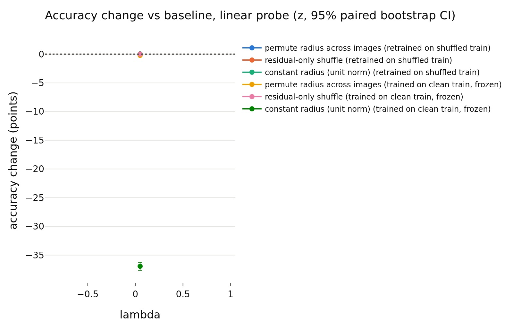
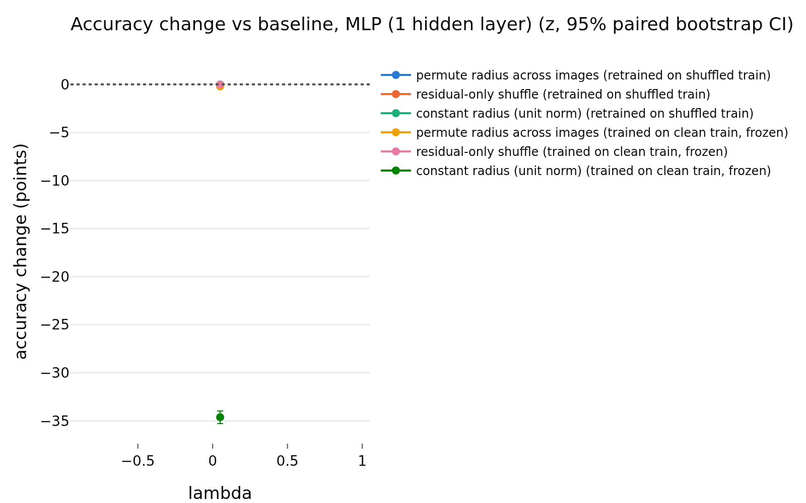

# h_lejepa_ref
- **Branch / version:** `radius-baselines-train` @ the commit containing this note (analysis code: `analyze --space h`, commit after `016362c`)
- **Run datetime (UTC):** 2026-10-26 (after the h addendum `016362c` in `train_summary.md`)
- **Command(s):**
  `python apps/analyze.py --config configs/base.yaml --randomize-radius radius_marginal_lam0.05 --space h --note radius_baselines/h_lejepa_ref.md` via `sbatch --wrap`, PYTHONPATH=<worktree>/src, 8 CPUs (job 2252609, CPU only)
  Redundancy controls: `python apps/analyze.py --config configs/base.yaml --run-name radius_marginal_lam0.05_s0 --note radius_baselines/h_lejepa_ref.md --redundancy-controls --no-figures` via `sbatch --wrap` (job 2252608)
- **Datasets:** STL-10 ([canonical](https://cs.stanford.edu/~acoates/stl10/), [HF `tanganke/stl10`](https://huggingface.co/datasets/tanganke/stl10); canonical prepared arrays used).
- **Backbone:** ResNet-18 from scratch ([HF architecture reference](https://huggingface.co/timm/resnet18.a1_in1k), no pretrained weights).

## Question

**Secondary reference only: LeJEPA's product is z, not h** (3 seeds averaged for the randomization tables, seed 0 for the redundancy controls). Tables labelled `z` in the redundancy block are the projector output and are shown for context; the randomization tables are h-space (the `lambda` column is the unused default).

## Setup (deviations from the base config)

## Results

<!-- BEGIN GENERATED: analyze.redundancy_controls -->
### Redundancy controls (run `radius_marginal_lam0.05_s0`)

Held-out R^2 of the radius from the direction (nested-CV kernel ridge, same images as the redundancy table) against a permutation null (500 shuffles of the radius through the identical pipeline; p = (1 + #{null >= observed}) / (1 + permutations)), with cross-view setups that share no view between input and target, and the classical OLS F-test (linear, in-sample). The reference row is the squared correlation of the two half-view means of rho_bar.

| space | setup | N | r2 (nested CV, kernel) | null mean | null sd | null max | permutations | permutation p | F | df | F p | r2 (in-sample, linear) |
|---|---|---|---|---|---|---|---|---|---|---|---|---|
| z | same views (all 8): rho_bar ~ u_hat | 4000 | 0.9459 | -0.001127 | 0.0008805 | 0.002633 | 500 | 0.001996 | 78.19 | 256, 3743 | 0 | 0.8425 |
| z | disjoint halves: rho_bar(views 4-7) ~ u_hat(views 0-3) | 4000 | 0.8572 | -0.001141 | 0.0008401 | 0.001586 | 500 | 0.001996 | 58.57 | 256, 3743 | 0 | 0.8002 |
| z | disjoint halves: rho_bar(views 0-3) ~ u_hat(views 4-7) | 4000 | 0.8597 | -0.001073 | 0.0008897 | 0.003703 | 500 | 0.001996 | 55.57 | 256, 3743 | 0 | 0.7917 |
| z | single view, same view: rho_0 ~ u_0 | 4000 | 0.9182 | -0.001131 | 0.0008578 | 0.004124 | 500 | 0.001996 | 55.94 | 256, 3743 | 0 | 0.7928 |
| z | single view, other view: rho_1 ~ u_0 | 4000 | 0.6913 | -0.001079 | 0.000822 | 0.001767 | 500 | 0.001996 | 30.29 | 256, 3743 | 0 | 0.6744 |
| z | reference: split-half reliability r^2 of rho_bar |  | 0.9276 |  |  |  |  |  |  |  |  |  |
| h | same views (all 8): rho_bar ~ u_hat | 4000 | 0.925 | -0.001108 | 0.0008214 | 0.001475 | 500 | 0.001996 | 72.78 | 512, 3487 | 0 | 0.9144 |
| h | disjoint halves: rho_bar(views 4-7) ~ u_hat(views 0-3) | 4000 | 0.7927 | -0.00103 | 0.0008216 | 0.002833 | 500 | 0.001996 | 30.9 | 512, 3487 | 0 | 0.8194 |
| h | disjoint halves: rho_bar(views 0-3) ~ u_hat(views 4-7) | 4000 | 0.7948 | -0.001087 | 0.0008284 | 0.004022 | 500 | 0.001996 | 31.24 | 512, 3487 | 0 | 0.821 |
| h | single view, same view: rho_0 ~ u_0 | 4000 | 0.8549 | -0.00106 | 0.000849 | 0.002193 | 500 | 0.001996 | 40.55 | 512, 3487 | 0 | 0.8562 |
| h | single view, other view: rho_1 ~ u_0 | 4000 | 0.5719 | -0.000922 | 0.000881 | 0.005429 | 500 | 0.001996 | 11.84 | 512, 3487 | 0 | 0.6348 |
| h | reference: split-half reliability r^2 of rho_bar |  | 0.8581 |  |  |  |  |  |  |  |  |  |
<!-- END GENERATED: analyze.redundancy_controls -->

<!-- BEGIN GENERATED: analyze.randomization_comparison -->
### Paired accuracy change vs the baseline, per lambda

h-space, center views; bank = STL-10 train, test set = STL-10 test; the same transformation is applied to bank and test set independently. Differences are in accuracy points (condition minus baseline on the same test images), averaged over training seeds; intervals are paired bootstrap percentile intervals (1000 replicates, test images resampled within each seed). Verdict, with the equivalence margin set to ±0.5 points before looking at results: `equivalent` if the 90% interval (TOST at 5%) lies inside the margin, `different` if not equivalent and the 95% interval excludes 0, otherwise `inconclusive`. Shuffle repeats (5 per randomized condition) only average out shuffle noise; they are not part of the interval.

| lambda | reader | protocol | condition | baseline acc | condition acc | difference (points) | 90% CI (points) | 95% CI (points) | verdict |
|---|---|---|---|---|---|---|---|---|---|
| 0.05 | k-NN (euclidean) | retrained on shuffled train | permute radius across images | 0.7936 | 0.7893 | -0.42 | [-0.66, -0.17] | [-0.71, -0.12] | different |
| 0.05 | k-NN (euclidean) | retrained on shuffled train | residual-only shuffle | 0.7936 | 0.7935 | -0.01 | [-0.20, +0.17] | [-0.23, +0.19] | equivalent |
| 0.05 | k-NN (euclidean) | retrained on shuffled train | constant radius (unit norm) | 0.7936 | 0.7947 | +0.11 | [-0.17, +0.40] | [-0.20, +0.45] | equivalent |
| 0.05 | k-NN (euclidean) | trained on clean train, frozen | permute radius across images | 0.7936 | 0.7934 | -0.01 | [-0.18, +0.15] | [-0.21, +0.18] | equivalent |
| 0.05 | k-NN (euclidean) | trained on clean train, frozen | residual-only shuffle | 0.7936 | 0.7937 | +0.02 | [-0.10, +0.13] | [-0.12, +0.15] | equivalent |
| 0.05 | k-NN (euclidean) | trained on clean train, frozen | constant radius (unit norm) | 0.7936 | 0.3713 | -42.23 | [-42.80, -41.65] | [-42.90, -41.55] | different |
| 0.05 | k-NN (cosine, reference) | retrained on shuffled train | permute radius across images | 0.7947 | 0.7947 | +0.00 | [+0.00, +0.00] | [+0.00, +0.00] | equivalent |
| 0.05 | k-NN (cosine, reference) | retrained on shuffled train | residual-only shuffle | 0.7947 | 0.7947 | +0.00 | [+0.00, +0.00] | [+0.00, +0.00] | equivalent |
| 0.05 | k-NN (cosine, reference) | retrained on shuffled train | constant radius (unit norm) | 0.7947 | 0.7947 | +0.00 | [+0.00, +0.00] | [+0.00, +0.00] | equivalent |
| 0.05 | k-NN (cosine, reference) | trained on clean train, frozen | permute radius across images | 0.7947 | 0.7947 | +0.00 | [+0.00, +0.00] | [+0.00, +0.00] | equivalent |
| 0.05 | k-NN (cosine, reference) | trained on clean train, frozen | residual-only shuffle | 0.7947 | 0.7947 | +0.00 | [+0.00, +0.00] | [+0.00, +0.00] | equivalent |
| 0.05 | k-NN (cosine, reference) | trained on clean train, frozen | constant radius (unit norm) | 0.7947 | 0.7947 | +0.00 | [+0.00, +0.00] | [+0.00, +0.00] | equivalent |
| 0.05 | linear probe | retrained on shuffled train | permute radius across images | 0.8085 | 0.8089 | +0.04 | [-0.07, +0.15] | [-0.09, +0.17] | equivalent |
| 0.05 | linear probe | retrained on shuffled train | residual-only shuffle | 0.8085 | 0.8089 | +0.04 | [-0.04, +0.13] | [-0.05, +0.15] | equivalent |
| 0.05 | linear probe | retrained on shuffled train | constant radius (unit norm) | 0.8085 | 0.8088 | +0.03 | [-0.10, +0.15] | [-0.12, +0.17] | equivalent |
| 0.05 | linear probe | trained on clean train, frozen | permute radius across images | 0.8085 | 0.8064 | -0.21 | [-0.33, -0.09] | [-0.35, -0.06] | equivalent |
| 0.05 | linear probe | trained on clean train, frozen | residual-only shuffle | 0.8085 | 0.8086 | +0.01 | [-0.06, +0.07] | [-0.07, +0.09] | equivalent |
| 0.05 | linear probe | trained on clean train, frozen | constant radius (unit norm) | 0.8085 | 0.4391 | -36.94 | [-37.54, -36.35] | [-37.64, -36.27] | different |
| 0.05 | MLP (1 hidden layer) | retrained on shuffled train | permute radius across images | 0.8423 | 0.8417 | -0.06 | [-0.18, +0.05] | [-0.20, +0.08] | equivalent |
| 0.05 | MLP (1 hidden layer) | retrained on shuffled train | residual-only shuffle | 0.8423 | 0.8421 | -0.02 | [-0.10, +0.06] | [-0.11, +0.07] | equivalent |
| 0.05 | MLP (1 hidden layer) | retrained on shuffled train | constant radius (unit norm) | 0.8423 | 0.8422 | -0.01 | [-0.13, +0.11] | [-0.15, +0.13] | equivalent |
| 0.05 | MLP (1 hidden layer) | trained on clean train, frozen | permute radius across images | 0.8423 | 0.8402 | -0.21 | [-0.31, -0.11] | [-0.32, -0.09] | equivalent |
| 0.05 | MLP (1 hidden layer) | trained on clean train, frozen | residual-only shuffle | 0.8423 | 0.8421 | -0.02 | [-0.07, +0.04] | [-0.08, +0.05] | equivalent |
| 0.05 | MLP (1 hidden layer) | trained on clean train, frozen | constant radius (unit norm) | 0.8423 | 0.4961 | -34.62 | [-35.18, -34.09] | [-35.28, -33.97] | different |
<!-- END GENERATED: analyze.randomization_comparison -->

<!-- BEGIN GENERATED: analyze.randomization_accuracy -->
### Accuracy: mean ± std over training seeds, per lambda

| lambda | reader | protocol | condition | seeds | accuracy (mean ± std over seeds) | shuffle sd (mean over seeds) |
|---|---|---|---|---|---|---|
| 0.05 | k-NN (euclidean) | retrained on shuffled train | baseline | 3 | 0.7936 ± 0.0003 |  |
| 0.05 | k-NN (euclidean) | retrained on shuffled train | permute radius across images | 3 | 0.7893 ± 0.0030 | 0.0022 |
| 0.05 | k-NN (euclidean) | retrained on shuffled train | residual-only shuffle | 3 | 0.7935 ± 0.0017 | 0.0022 |
| 0.05 | k-NN (euclidean) | retrained on shuffled train | constant radius (unit norm) | 3 | 0.7947 ± 0.0051 |  |
| 0.05 | k-NN (euclidean) | trained on clean train, frozen | baseline | 3 | 0.7936 ± 0.0003 |  |
| 0.05 | k-NN (euclidean) | trained on clean train, frozen | permute radius across images | 3 | 0.7934 ± 0.0028 | 0.0017 |
| 0.05 | k-NN (euclidean) | trained on clean train, frozen | residual-only shuffle | 3 | 0.7938 ± 0.0017 | 0.0010 |
| 0.05 | k-NN (euclidean) | trained on clean train, frozen | constant radius (unit norm) | 3 | 0.3713 ± 0.0727 |  |
| 0.05 | k-NN (cosine, reference) | retrained on shuffled train | baseline | 3 | 0.7947 ± 0.0051 |  |
| 0.05 | k-NN (cosine, reference) | retrained on shuffled train | permute radius across images | 3 | 0.7947 ± 0.0051 | 0.0000 |
| 0.05 | k-NN (cosine, reference) | retrained on shuffled train | residual-only shuffle | 3 | 0.7947 ± 0.0051 | 0.0000 |
| 0.05 | k-NN (cosine, reference) | retrained on shuffled train | constant radius (unit norm) | 3 | 0.7947 ± 0.0051 |  |
| 0.05 | k-NN (cosine, reference) | trained on clean train, frozen | baseline | 3 | 0.7947 ± 0.0051 |  |
| 0.05 | k-NN (cosine, reference) | trained on clean train, frozen | permute radius across images | 3 | 0.7947 ± 0.0051 | 0.0000 |
| 0.05 | k-NN (cosine, reference) | trained on clean train, frozen | residual-only shuffle | 3 | 0.7947 ± 0.0051 | 0.0000 |
| 0.05 | k-NN (cosine, reference) | trained on clean train, frozen | constant radius (unit norm) | 3 | 0.7947 ± 0.0051 |  |
| 0.05 | linear probe | retrained on shuffled train | baseline | 3 | 0.8085 ± 0.0019 |  |
| 0.05 | linear probe | retrained on shuffled train | permute radius across images | 3 | 0.8089 ± 0.0030 | 0.0013 |
| 0.05 | linear probe | retrained on shuffled train | residual-only shuffle | 3 | 0.8089 ± 0.0015 | 0.0010 |
| 0.05 | linear probe | retrained on shuffled train | constant radius (unit norm) | 3 | 0.8088 ± 0.0027 |  |
| 0.05 | linear probe | trained on clean train, frozen | baseline | 3 | 0.8085 ± 0.0019 |  |
| 0.05 | linear probe | trained on clean train, frozen | permute radius across images | 3 | 0.8064 ± 0.0043 | 0.0012 |
| 0.05 | linear probe | trained on clean train, frozen | residual-only shuffle | 3 | 0.8086 ± 0.0021 | 0.0006 |
| 0.05 | linear probe | trained on clean train, frozen | constant radius (unit norm) | 3 | 0.4391 ± 0.0437 |  |
| 0.05 | MLP (1 hidden layer) | retrained on shuffled train | baseline | 3 | 0.8423 ± 0.0044 |  |
| 0.05 | MLP (1 hidden layer) | retrained on shuffled train | permute radius across images | 3 | 0.8417 ± 0.0028 | 0.0013 |
| 0.05 | MLP (1 hidden layer) | retrained on shuffled train | residual-only shuffle | 3 | 0.8421 ± 0.0044 | 0.0010 |
| 0.05 | MLP (1 hidden layer) | retrained on shuffled train | constant radius (unit norm) | 3 | 0.8422 ± 0.0040 |  |
| 0.05 | MLP (1 hidden layer) | trained on clean train, frozen | baseline | 3 | 0.8423 ± 0.0044 |  |
| 0.05 | MLP (1 hidden layer) | trained on clean train, frozen | permute radius across images | 3 | 0.8402 ± 0.0041 | 0.0008 |
| 0.05 | MLP (1 hidden layer) | trained on clean train, frozen | residual-only shuffle | 3 | 0.8421 ± 0.0046 | 0.0004 |
| 0.05 | MLP (1 hidden layer) | trained on clean train, frozen | constant radius (unit norm) | 3 | 0.4961 ± 0.0937 |  |
<!-- END GENERATED: analyze.randomization_accuracy -->

<!-- BEGIN GENERATED: analyze.randomization_runs -->
### Per-run accuracies

| run | reader | protocol | condition | repeats | accuracy | shuffle sd |
|---|---|---|---|---|---|---|
| radius_marginal_lam0.05_s0 | k-NN (euclidean) | retrained on shuffled train | baseline | 1 | 0.7939 |  |
| radius_marginal_lam0.05_s0 | k-NN (euclidean) | trained on clean train, frozen | baseline | 1 | 0.7939 |  |
| radius_marginal_lam0.05_s0 | k-NN (euclidean) | trained on clean train, frozen | constant radius (unit norm) | 1 | 0.3034 |  |
| radius_marginal_lam0.05_s0 | k-NN (euclidean) | retrained on shuffled train | constant radius (unit norm) | 1 | 0.7986 |  |
| radius_marginal_lam0.05_s0 | k-NN (euclidean) | trained on clean train, frozen | permute radius across images | 5 | 0.7954 | 0.001275 |
| radius_marginal_lam0.05_s0 | k-NN (euclidean) | retrained on shuffled train | permute radius across images | 5 | 0.7924 | 0.001995 |
| radius_marginal_lam0.05_s0 | k-NN (euclidean) | trained on clean train, frozen | residual-only shuffle | 5 | 0.7953 | 0.001174 |
| radius_marginal_lam0.05_s0 | k-NN (euclidean) | retrained on shuffled train | residual-only shuffle | 5 | 0.7954 | 0.002942 |
| radius_marginal_lam0.05_s0 | k-NN (cosine, reference) | retrained on shuffled train | baseline | 1 | 0.7986 |  |
| radius_marginal_lam0.05_s0 | k-NN (cosine, reference) | trained on clean train, frozen | baseline | 1 | 0.7986 |  |
| radius_marginal_lam0.05_s0 | k-NN (cosine, reference) | trained on clean train, frozen | constant radius (unit norm) | 1 | 0.7986 |  |
| radius_marginal_lam0.05_s0 | k-NN (cosine, reference) | retrained on shuffled train | constant radius (unit norm) | 1 | 0.7986 |  |
| radius_marginal_lam0.05_s0 | k-NN (cosine, reference) | trained on clean train, frozen | permute radius across images | 5 | 0.7986 | 0 |
| radius_marginal_lam0.05_s0 | k-NN (cosine, reference) | retrained on shuffled train | permute radius across images | 5 | 0.7986 | 0 |
| radius_marginal_lam0.05_s0 | k-NN (cosine, reference) | trained on clean train, frozen | residual-only shuffle | 5 | 0.7986 | 0 |
| radius_marginal_lam0.05_s0 | k-NN (cosine, reference) | retrained on shuffled train | residual-only shuffle | 5 | 0.7986 | 0 |
| radius_marginal_lam0.05_s0 | linear probe | retrained on shuffled train | baseline | 1 | 0.8106 |  |
| radius_marginal_lam0.05_s0 | linear probe | trained on clean train, frozen | baseline | 1 | 0.8106 |  |
| radius_marginal_lam0.05_s0 | linear probe | trained on clean train, frozen | constant radius (unit norm) | 1 | 0.4845 |  |
| radius_marginal_lam0.05_s0 | linear probe | retrained on shuffled train | constant radius (unit norm) | 1 | 0.8119 |  |
| radius_marginal_lam0.05_s0 | linear probe | trained on clean train, frozen | permute radius across images | 5 | 0.8114 | 0.001305 |
| radius_marginal_lam0.05_s0 | linear probe | retrained on shuffled train | permute radius across images | 5 | 0.8122 | 0.001283 |
| radius_marginal_lam0.05_s0 | linear probe | trained on clean train, frozen | residual-only shuffle | 5 | 0.811 | 0.000405 |
| radius_marginal_lam0.05_s0 | linear probe | retrained on shuffled train | residual-only shuffle | 5 | 0.8107 | 0.001106 |
| radius_marginal_lam0.05_s0 | MLP (1 hidden layer) | retrained on shuffled train | baseline | 1 | 0.8423 |  |
| radius_marginal_lam0.05_s0 | MLP (1 hidden layer) | trained on clean train, frozen | baseline | 1 | 0.8423 |  |
| radius_marginal_lam0.05_s0 | MLP (1 hidden layer) | trained on clean train, frozen | constant radius (unit norm) | 1 | 0.3895 |  |
| radius_marginal_lam0.05_s0 | MLP (1 hidden layer) | retrained on shuffled train | constant radius (unit norm) | 1 | 0.8421 |  |
| radius_marginal_lam0.05_s0 | MLP (1 hidden layer) | trained on clean train, frozen | permute radius across images | 5 | 0.84 | 0.001036 |
| radius_marginal_lam0.05_s0 | MLP (1 hidden layer) | retrained on shuffled train | permute radius across images | 5 | 0.8419 | 0.001325 |
| radius_marginal_lam0.05_s0 | MLP (1 hidden layer) | trained on clean train, frozen | residual-only shuffle | 5 | 0.841 | 0.0003579 |
| radius_marginal_lam0.05_s0 | MLP (1 hidden layer) | retrained on shuffled train | residual-only shuffle | 5 | 0.8415 | 0.001157 |
| radius_marginal_lam0.05_s1 | k-NN (euclidean) | retrained on shuffled train | baseline | 1 | 0.7933 |  |
| radius_marginal_lam0.05_s1 | k-NN (euclidean) | trained on clean train, frozen | baseline | 1 | 0.7933 |  |
| radius_marginal_lam0.05_s1 | k-NN (euclidean) | trained on clean train, frozen | constant radius (unit norm) | 1 | 0.3626 |  |
| radius_marginal_lam0.05_s1 | k-NN (euclidean) | retrained on shuffled train | constant radius (unit norm) | 1 | 0.789 |  |
| radius_marginal_lam0.05_s1 | k-NN (euclidean) | trained on clean train, frozen | permute radius across images | 5 | 0.7903 | 0.002335 |
| radius_marginal_lam0.05_s1 | k-NN (euclidean) | retrained on shuffled train | permute radius across images | 5 | 0.7865 | 0.00235 |
| radius_marginal_lam0.05_s1 | k-NN (euclidean) | trained on clean train, frozen | residual-only shuffle | 5 | 0.792 | 0.000904 |
| radius_marginal_lam0.05_s1 | k-NN (euclidean) | retrained on shuffled train | residual-only shuffle | 5 | 0.7927 | 0.001342 |
| radius_marginal_lam0.05_s1 | k-NN (cosine, reference) | retrained on shuffled train | baseline | 1 | 0.789 |  |
| radius_marginal_lam0.05_s1 | k-NN (cosine, reference) | trained on clean train, frozen | baseline | 1 | 0.789 |  |
| radius_marginal_lam0.05_s1 | k-NN (cosine, reference) | trained on clean train, frozen | constant radius (unit norm) | 1 | 0.789 |  |
| radius_marginal_lam0.05_s1 | k-NN (cosine, reference) | retrained on shuffled train | constant radius (unit norm) | 1 | 0.789 |  |
| radius_marginal_lam0.05_s1 | k-NN (cosine, reference) | trained on clean train, frozen | permute radius across images | 5 | 0.789 | 0 |
| radius_marginal_lam0.05_s1 | k-NN (cosine, reference) | retrained on shuffled train | permute radius across images | 5 | 0.789 | 0 |
| radius_marginal_lam0.05_s1 | k-NN (cosine, reference) | trained on clean train, frozen | residual-only shuffle | 5 | 0.789 | 0 |
| radius_marginal_lam0.05_s1 | k-NN (cosine, reference) | retrained on shuffled train | residual-only shuffle | 5 | 0.789 | 0 |
| radius_marginal_lam0.05_s1 | linear probe | retrained on shuffled train | baseline | 1 | 0.8079 |  |
| radius_marginal_lam0.05_s1 | linear probe | trained on clean train, frozen | baseline | 1 | 0.8079 |  |
| radius_marginal_lam0.05_s1 | linear probe | trained on clean train, frozen | constant radius (unit norm) | 1 | 0.4354 |  |
| radius_marginal_lam0.05_s1 | linear probe | retrained on shuffled train | constant radius (unit norm) | 1 | 0.807 |  |
| radius_marginal_lam0.05_s1 | linear probe | trained on clean train, frozen | permute radius across images | 5 | 0.8036 | 0.000812 |
| radius_marginal_lam0.05_s1 | linear probe | retrained on shuffled train | permute radius across images | 5 | 0.8063 | 0.0006287 |
| radius_marginal_lam0.05_s1 | linear probe | trained on clean train, frozen | residual-only shuffle | 5 | 0.8071 | 0.0004202 |
| radius_marginal_lam0.05_s1 | linear probe | retrained on shuffled train | residual-only shuffle | 5 | 0.8079 | 0.0005154 |
| radius_marginal_lam0.05_s1 | MLP (1 hidden layer) | retrained on shuffled train | baseline | 1 | 0.8379 |  |
| radius_marginal_lam0.05_s1 | MLP (1 hidden layer) | trained on clean train, frozen | baseline | 1 | 0.8379 |  |
| radius_marginal_lam0.05_s1 | MLP (1 hidden layer) | trained on clean train, frozen | constant radius (unit norm) | 1 | 0.5653 |  |
| radius_marginal_lam0.05_s1 | MLP (1 hidden layer) | retrained on shuffled train | constant radius (unit norm) | 1 | 0.8383 |  |
| radius_marginal_lam0.05_s1 | MLP (1 hidden layer) | trained on clean train, frozen | permute radius across images | 5 | 0.8362 | 0.0004627 |
| radius_marginal_lam0.05_s1 | MLP (1 hidden layer) | retrained on shuffled train | permute radius across images | 5 | 0.8387 | 0.001183 |
| radius_marginal_lam0.05_s1 | MLP (1 hidden layer) | trained on clean train, frozen | residual-only shuffle | 5 | 0.8382 | 0.0004541 |
| radius_marginal_lam0.05_s1 | MLP (1 hidden layer) | retrained on shuffled train | residual-only shuffle | 5 | 0.8381 | 0.0006766 |
| radius_marginal_lam0.05_s2 | k-NN (euclidean) | retrained on shuffled train | baseline | 1 | 0.7936 |  |
| radius_marginal_lam0.05_s2 | k-NN (euclidean) | trained on clean train, frozen | baseline | 1 | 0.7936 |  |
| radius_marginal_lam0.05_s2 | k-NN (euclidean) | trained on clean train, frozen | constant radius (unit norm) | 1 | 0.448 |  |
| radius_marginal_lam0.05_s2 | k-NN (euclidean) | retrained on shuffled train | constant radius (unit norm) | 1 | 0.7965 |  |
| radius_marginal_lam0.05_s2 | k-NN (euclidean) | trained on clean train, frozen | permute radius across images | 5 | 0.7947 | 0.001382 |
| radius_marginal_lam0.05_s2 | k-NN (euclidean) | retrained on shuffled train | permute radius across images | 5 | 0.7891 | 0.002116 |
| radius_marginal_lam0.05_s2 | k-NN (euclidean) | trained on clean train, frozen | residual-only shuffle | 5 | 0.794 | 0.001005 |
| radius_marginal_lam0.05_s2 | k-NN (euclidean) | retrained on shuffled train | residual-only shuffle | 5 | 0.7923 | 0.002356 |
| radius_marginal_lam0.05_s2 | k-NN (cosine, reference) | retrained on shuffled train | baseline | 1 | 0.7965 |  |
| radius_marginal_lam0.05_s2 | k-NN (cosine, reference) | trained on clean train, frozen | baseline | 1 | 0.7965 |  |
| radius_marginal_lam0.05_s2 | k-NN (cosine, reference) | trained on clean train, frozen | constant radius (unit norm) | 1 | 0.7965 |  |
| radius_marginal_lam0.05_s2 | k-NN (cosine, reference) | retrained on shuffled train | constant radius (unit norm) | 1 | 0.7965 |  |
| radius_marginal_lam0.05_s2 | k-NN (cosine, reference) | trained on clean train, frozen | permute radius across images | 5 | 0.7965 | 0 |
| radius_marginal_lam0.05_s2 | k-NN (cosine, reference) | retrained on shuffled train | permute radius across images | 5 | 0.7965 | 0 |
| radius_marginal_lam0.05_s2 | k-NN (cosine, reference) | trained on clean train, frozen | residual-only shuffle | 5 | 0.7965 | 0 |
| radius_marginal_lam0.05_s2 | k-NN (cosine, reference) | retrained on shuffled train | residual-only shuffle | 5 | 0.7965 | 0 |
| radius_marginal_lam0.05_s2 | linear probe | retrained on shuffled train | baseline | 1 | 0.807 |  |
| radius_marginal_lam0.05_s2 | linear probe | trained on clean train, frozen | baseline | 1 | 0.807 |  |
| radius_marginal_lam0.05_s2 | linear probe | trained on clean train, frozen | constant radius (unit norm) | 1 | 0.3974 |  |
| radius_marginal_lam0.05_s2 | linear probe | retrained on shuffled train | constant radius (unit norm) | 1 | 0.8075 |  |
| radius_marginal_lam0.05_s2 | linear probe | trained on clean train, frozen | permute radius across images | 5 | 0.8042 | 0.001494 |
| radius_marginal_lam0.05_s2 | linear probe | retrained on shuffled train | permute radius across images | 5 | 0.8082 | 0.001938 |
| radius_marginal_lam0.05_s2 | linear probe | trained on clean train, frozen | residual-only shuffle | 5 | 0.8076 | 0.0008292 |
| radius_marginal_lam0.05_s2 | linear probe | retrained on shuffled train | residual-only shuffle | 5 | 0.8083 | 0.001274 |
| radius_marginal_lam0.05_s2 | MLP (1 hidden layer) | retrained on shuffled train | baseline | 1 | 0.8468 |  |
| radius_marginal_lam0.05_s2 | MLP (1 hidden layer) | trained on clean train, frozen | baseline | 1 | 0.8468 |  |
| radius_marginal_lam0.05_s2 | MLP (1 hidden layer) | trained on clean train, frozen | constant radius (unit norm) | 1 | 0.5336 |  |
| radius_marginal_lam0.05_s2 | MLP (1 hidden layer) | retrained on shuffled train | constant radius (unit norm) | 1 | 0.8462 |  |
| radius_marginal_lam0.05_s2 | MLP (1 hidden layer) | trained on clean train, frozen | permute radius across images | 5 | 0.8443 | 0.0009169 |
| radius_marginal_lam0.05_s2 | MLP (1 hidden layer) | retrained on shuffled train | permute radius across images | 5 | 0.8443 | 0.001502 |
| radius_marginal_lam0.05_s2 | MLP (1 hidden layer) | trained on clean train, frozen | residual-only shuffle | 5 | 0.8472 | 0.0003137 |
| radius_marginal_lam0.05_s2 | MLP (1 hidden layer) | retrained on shuffled train | residual-only shuffle | 5 | 0.8468 | 0.001191 |
<!-- END GENERATED: analyze.randomization_runs -->

<!-- BEGIN GENERATED: analyze.randomization_model -->
### Direction -> log-radius regression used by the residual shuffle

| run | MLP weight decay | quantity | bank (out-of-fold) | test (held out) |
|---|---|---|---|---|
| radius_marginal_lam0.05_s0 | 0.01 | R^2 of log-radius from direction | 0.8903 | 0.8886 |
| radius_marginal_lam0.05_s0 | 0.01 | sd of log-radius | 0.1306 | 0.1302 |
| radius_marginal_lam0.05_s0 | 0.01 | sd of the residual log-radius | 0.04326 | 0.0429 |
| radius_marginal_lam0.05_s1 | 0.0001 | R^2 of log-radius from direction | 0.901 | 0.9006 |
| radius_marginal_lam0.05_s1 | 0.0001 | sd of log-radius | 0.1421 | 0.1391 |
| radius_marginal_lam0.05_s1 | 0.0001 | sd of the residual log-radius | 0.04469 | 0.04328 |
| radius_marginal_lam0.05_s2 | 0.01 | R^2 of log-radius from direction | 0.88 | 0.8779 |
| radius_marginal_lam0.05_s2 | 0.01 | sd of log-radius | 0.1316 | 0.1292 |
| radius_marginal_lam0.05_s2 | 0.01 | sd of the residual log-radius | 0.0456 | 0.04476 |
<!-- END GENERATED: analyze.randomization_model -->

<!-- BEGIN GENERATED: analyze.randomization_skipped -->
### Runs without the required dumps

None: every run of the prefix has `stl10_train` and `stl10_test`.
<!-- END GENERATED: analyze.randomization_skipped -->

<!-- BEGIN GENERATED: analyze.randomization_figures -->
### Figures

<!-- END GENERATED: analyze.randomization_figures -->

## Interpretation

## Next steps
