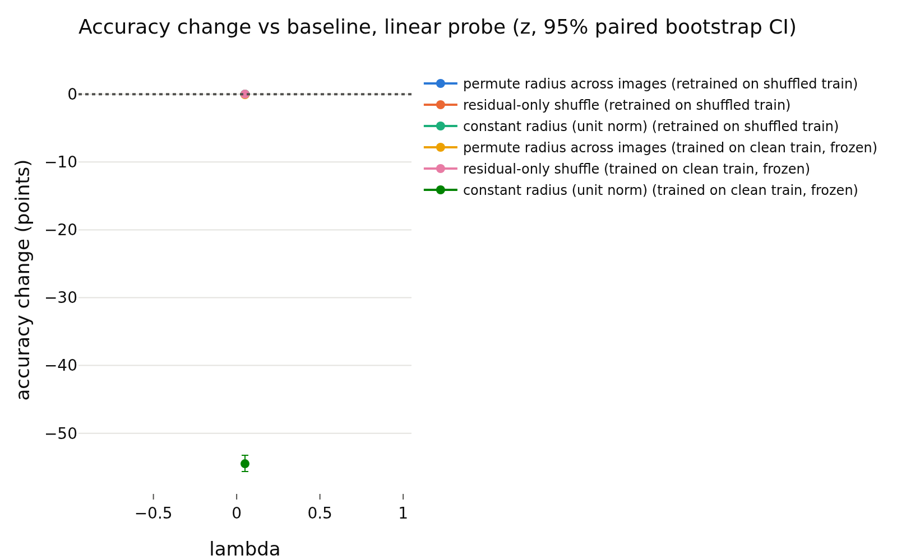
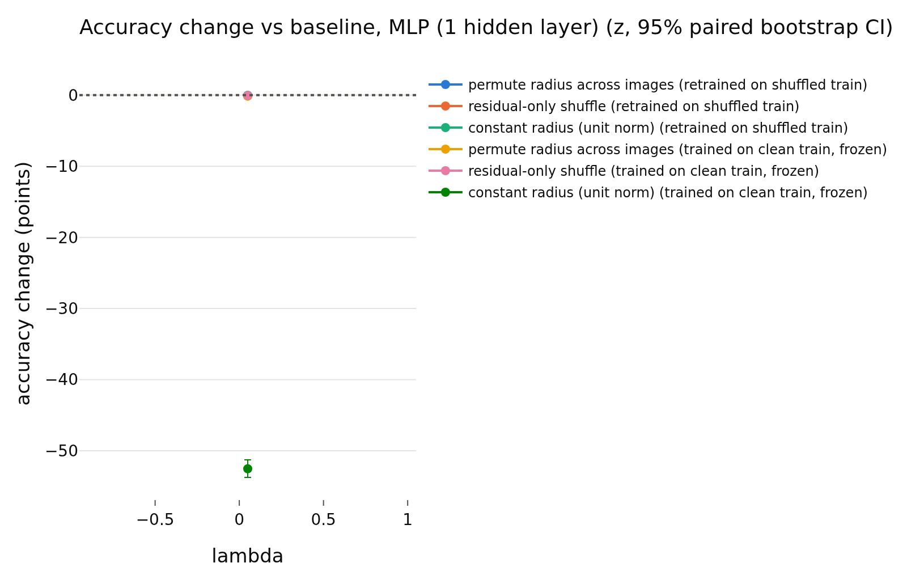

# h_simclr
- **Branch / version:** `radius-baselines-train` @ the commit containing this note (analysis code: `analyze --space h`, commit after `016362c`)
- **Run datetime (UTC):** 2026-10-26 (after the h addendum `016362c` in `train_summary.md`)
- **Command(s):**
  `python apps/analyze.py --config configs/base.yaml --randomize-radius baseline_simclr --space h --note radius_baselines/h_simclr.md` via `sbatch --wrap`, PYTHONPATH=<worktree>/src, 8 CPUs (job 2252605, CPU only)
- **Datasets:** STL-10 ([canonical](https://cs.stanford.edu/~acoates/stl10/), [HF `tanganke/stl10`](https://huggingface.co/datasets/tanganke/stl10); canonical prepared arrays used).
- **Backbone:** ResNet-18 from scratch ([HF architecture reference](https://huggingface.co/timm/resnet18.a1_in1k), no pretrained weights).

## Question

**Explicit exception to the z-only rule for the E2 baselines** (see the addendum in `train_summary.md`): the analyzed space is the backbone feature h, 1 seed. Tables labelled `z` in the redundancy block are the projector output and are shown for context; the randomization tables are h-space (the `lambda` column is the unused default).

## Setup (deviations from the base config)

## Results

<!-- BEGIN GENERATED: analyze.randomization_comparison -->
### Paired accuracy change vs the baseline, per lambda

h-space, center views; bank = STL-10 train, test set = STL-10 test; the same transformation is applied to bank and test set independently. Differences are in accuracy points (condition minus baseline on the same test images), averaged over training seeds; intervals are paired bootstrap percentile intervals (1000 replicates, test images resampled within each seed). Verdict, with the equivalence margin set to ±0.5 points before looking at results: `equivalent` if the 90% interval (TOST at 5%) lies inside the margin, `different` if not equivalent and the 95% interval excludes 0, otherwise `inconclusive`. Shuffle repeats (5 per randomized condition) only average out shuffle noise; they are not part of the interval.

| lambda | reader | protocol | condition | baseline acc | condition acc | difference (points) | 90% CI (points) | 95% CI (points) | verdict |
|---|---|---|---|---|---|---|---|---|---|
| 0.05 | k-NN (euclidean) | retrained on shuffled train | permute radius across images | 0.7855 | 0.7850 | -0.05 | [-0.44, +0.33] | [-0.51, +0.41] | equivalent |
| 0.05 | k-NN (euclidean) | retrained on shuffled train | residual-only shuffle | 0.7855 | 0.7844 | -0.11 | [-0.41, +0.18] | [-0.47, +0.24] | equivalent |
| 0.05 | k-NN (euclidean) | retrained on shuffled train | constant radius (unit norm) | 0.7855 | 0.7900 | +0.45 | [+0.01, +0.89] | [-0.07, +0.96] | inconclusive |
| 0.05 | k-NN (euclidean) | trained on clean train, frozen | permute radius across images | 0.7855 | 0.7874 | +0.19 | [-0.04, +0.44] | [-0.08, +0.48] | equivalent |
| 0.05 | k-NN (euclidean) | trained on clean train, frozen | residual-only shuffle | 0.7855 | 0.7849 | -0.06 | [-0.21, +0.11] | [-0.24, +0.13] | equivalent |
| 0.05 | k-NN (euclidean) | trained on clean train, frozen | constant radius (unit norm) | 0.7855 | 0.4264 | -35.91 | [-36.96, -34.80] | [-37.08, -34.60] | different |
| 0.05 | k-NN (cosine, reference) | retrained on shuffled train | permute radius across images | 0.7900 | 0.7900 | +0.00 | [+0.00, +0.00] | [+0.00, +0.00] | equivalent |
| 0.05 | k-NN (cosine, reference) | retrained on shuffled train | residual-only shuffle | 0.7900 | 0.7900 | +0.00 | [+0.00, +0.00] | [+0.00, +0.00] | equivalent |
| 0.05 | k-NN (cosine, reference) | retrained on shuffled train | constant radius (unit norm) | 0.7900 | 0.7900 | +0.00 | [+0.00, +0.00] | [+0.00, +0.00] | equivalent |
| 0.05 | k-NN (cosine, reference) | trained on clean train, frozen | permute radius across images | 0.7900 | 0.7900 | +0.00 | [+0.00, +0.00] | [+0.00, +0.00] | equivalent |
| 0.05 | k-NN (cosine, reference) | trained on clean train, frozen | residual-only shuffle | 0.7900 | 0.7900 | +0.00 | [+0.00, +0.00] | [+0.00, +0.00] | equivalent |
| 0.05 | k-NN (cosine, reference) | trained on clean train, frozen | constant radius (unit norm) | 0.7900 | 0.7900 | +0.00 | [+0.00, +0.00] | [+0.00, +0.00] | equivalent |
| 0.05 | linear probe | retrained on shuffled train | permute radius across images | 0.7894 | 0.7891 | -0.03 | [-0.21, +0.16] | [-0.25, +0.21] | equivalent |
| 0.05 | linear probe | retrained on shuffled train | residual-only shuffle | 0.7894 | 0.7892 | -0.02 | [-0.19, +0.15] | [-0.24, +0.19] | equivalent |
| 0.05 | linear probe | retrained on shuffled train | constant radius (unit norm) | 0.7894 | 0.7895 | +0.01 | [-0.22, +0.26] | [-0.27, +0.30] | equivalent |
| 0.05 | linear probe | trained on clean train, frozen | permute radius across images | 0.7894 | 0.7886 | -0.07 | [-0.25, +0.10] | [-0.29, +0.14] | equivalent |
| 0.05 | linear probe | trained on clean train, frozen | residual-only shuffle | 0.7894 | 0.7894 | +0.01 | [-0.12, +0.14] | [-0.14, +0.16] | equivalent |
| 0.05 | linear probe | trained on clean train, frozen | constant radius (unit norm) | 0.7894 | 0.2445 | -54.49 | [-55.46, -53.49] | [-55.64, -53.25] | different |
| 0.05 | MLP (1 hidden layer) | retrained on shuffled train | permute radius across images | 0.8240 | 0.8235 | -0.05 | [-0.25, +0.14] | [-0.28, +0.18] | equivalent |
| 0.05 | MLP (1 hidden layer) | retrained on shuffled train | residual-only shuffle | 0.8240 | 0.8228 | -0.12 | [-0.27, +0.04] | [-0.30, +0.08] | equivalent |
| 0.05 | MLP (1 hidden layer) | retrained on shuffled train | constant radius (unit norm) | 0.8240 | 0.8239 | -0.01 | [-0.24, +0.22] | [-0.29, +0.26] | equivalent |
| 0.05 | MLP (1 hidden layer) | trained on clean train, frozen | permute radius across images | 0.8240 | 0.8226 | -0.14 | [-0.32, +0.03] | [-0.36, +0.06] | equivalent |
| 0.05 | MLP (1 hidden layer) | trained on clean train, frozen | residual-only shuffle | 0.8240 | 0.8234 | -0.06 | [-0.17, +0.05] | [-0.19, +0.07] | equivalent |
| 0.05 | MLP (1 hidden layer) | trained on clean train, frozen | constant radius (unit norm) | 0.8240 | 0.2986 | -52.54 | [-53.55, -51.55] | [-53.75, -51.29] | different |
<!-- END GENERATED: analyze.randomization_comparison -->

<!-- BEGIN GENERATED: analyze.randomization_accuracy -->
### Accuracy: mean ± std over training seeds, per lambda

| lambda | reader | protocol | condition | seeds | accuracy (mean ± std over seeds) | shuffle sd (mean over seeds) |
|---|---|---|---|---|---|---|
| 0.05 | k-NN (euclidean) | retrained on shuffled train | baseline | 1 | 0.7855 ± nan |  |
| 0.05 | k-NN (euclidean) | retrained on shuffled train | permute radius across images | 1 | 0.7850 ± nan | 0.0014 |
| 0.05 | k-NN (euclidean) | retrained on shuffled train | residual-only shuffle | 1 | 0.7844 ± nan | 0.0020 |
| 0.05 | k-NN (euclidean) | retrained on shuffled train | constant radius (unit norm) | 1 | 0.7900 ± nan |  |
| 0.05 | k-NN (euclidean) | trained on clean train, frozen | baseline | 1 | 0.7855 ± nan |  |
| 0.05 | k-NN (euclidean) | trained on clean train, frozen | permute radius across images | 1 | 0.7874 ± nan | 0.0008 |
| 0.05 | k-NN (euclidean) | trained on clean train, frozen | residual-only shuffle | 1 | 0.7849 ± nan | 0.0006 |
| 0.05 | k-NN (euclidean) | trained on clean train, frozen | constant radius (unit norm) | 1 | 0.4264 ± nan |  |
| 0.05 | k-NN (cosine, reference) | retrained on shuffled train | baseline | 1 | 0.7900 ± nan |  |
| 0.05 | k-NN (cosine, reference) | retrained on shuffled train | permute radius across images | 1 | 0.7900 ± nan | 0.0000 |
| 0.05 | k-NN (cosine, reference) | retrained on shuffled train | residual-only shuffle | 1 | 0.7900 ± nan | 0.0000 |
| 0.05 | k-NN (cosine, reference) | retrained on shuffled train | constant radius (unit norm) | 1 | 0.7900 ± nan |  |
| 0.05 | k-NN (cosine, reference) | trained on clean train, frozen | baseline | 1 | 0.7900 ± nan |  |
| 0.05 | k-NN (cosine, reference) | trained on clean train, frozen | permute radius across images | 1 | 0.7900 ± nan | 0.0000 |
| 0.05 | k-NN (cosine, reference) | trained on clean train, frozen | residual-only shuffle | 1 | 0.7900 ± nan | 0.0000 |
| 0.05 | k-NN (cosine, reference) | trained on clean train, frozen | constant radius (unit norm) | 1 | 0.7900 ± nan |  |
| 0.05 | linear probe | retrained on shuffled train | baseline | 1 | 0.7894 ± nan |  |
| 0.05 | linear probe | retrained on shuffled train | permute radius across images | 1 | 0.7891 ± nan | 0.0005 |
| 0.05 | linear probe | retrained on shuffled train | residual-only shuffle | 1 | 0.7892 ± nan | 0.0009 |
| 0.05 | linear probe | retrained on shuffled train | constant radius (unit norm) | 1 | 0.7895 ± nan |  |
| 0.05 | linear probe | trained on clean train, frozen | baseline | 1 | 0.7894 ± nan |  |
| 0.05 | linear probe | trained on clean train, frozen | permute radius across images | 1 | 0.7886 ± nan | 0.0007 |
| 0.05 | linear probe | trained on clean train, frozen | residual-only shuffle | 1 | 0.7894 ± nan | 0.0003 |
| 0.05 | linear probe | trained on clean train, frozen | constant radius (unit norm) | 1 | 0.2445 ± nan |  |
| 0.05 | MLP (1 hidden layer) | retrained on shuffled train | baseline | 1 | 0.8240 ± nan |  |
| 0.05 | MLP (1 hidden layer) | retrained on shuffled train | permute radius across images | 1 | 0.8235 ± nan | 0.0009 |
| 0.05 | MLP (1 hidden layer) | retrained on shuffled train | residual-only shuffle | 1 | 0.8228 ± nan | 0.0009 |
| 0.05 | MLP (1 hidden layer) | retrained on shuffled train | constant radius (unit norm) | 1 | 0.8239 ± nan |  |
| 0.05 | MLP (1 hidden layer) | trained on clean train, frozen | baseline | 1 | 0.8240 ± nan |  |
| 0.05 | MLP (1 hidden layer) | trained on clean train, frozen | permute radius across images | 1 | 0.8226 ± nan | 0.0005 |
| 0.05 | MLP (1 hidden layer) | trained on clean train, frozen | residual-only shuffle | 1 | 0.8234 ± nan | 0.0005 |
| 0.05 | MLP (1 hidden layer) | trained on clean train, frozen | constant radius (unit norm) | 1 | 0.2986 ± nan |  |
<!-- END GENERATED: analyze.randomization_accuracy -->

<!-- BEGIN GENERATED: analyze.randomization_runs -->
### Per-run accuracies

| run | reader | protocol | condition | repeats | accuracy | shuffle sd |
|---|---|---|---|---|---|---|
| baseline_simclr_s0 | k-NN (euclidean) | retrained on shuffled train | baseline | 1 | 0.7855 |  |
| baseline_simclr_s0 | k-NN (euclidean) | trained on clean train, frozen | baseline | 1 | 0.7855 |  |
| baseline_simclr_s0 | k-NN (euclidean) | trained on clean train, frozen | constant radius (unit norm) | 1 | 0.4264 |  |
| baseline_simclr_s0 | k-NN (euclidean) | retrained on shuffled train | constant radius (unit norm) | 1 | 0.79 |  |
| baseline_simclr_s0 | k-NN (euclidean) | trained on clean train, frozen | permute radius across images | 5 | 0.7874 | 0.0008197 |
| baseline_simclr_s0 | k-NN (euclidean) | retrained on shuffled train | permute radius across images | 5 | 0.785 | 0.001379 |
| baseline_simclr_s0 | k-NN (euclidean) | trained on clean train, frozen | residual-only shuffle | 5 | 0.7849 | 0.0006471 |
| baseline_simclr_s0 | k-NN (euclidean) | retrained on shuffled train | residual-only shuffle | 5 | 0.7844 | 0.00201 |
| baseline_simclr_s0 | k-NN (cosine, reference) | retrained on shuffled train | baseline | 1 | 0.79 |  |
| baseline_simclr_s0 | k-NN (cosine, reference) | trained on clean train, frozen | baseline | 1 | 0.79 |  |
| baseline_simclr_s0 | k-NN (cosine, reference) | trained on clean train, frozen | constant radius (unit norm) | 1 | 0.79 |  |
| baseline_simclr_s0 | k-NN (cosine, reference) | retrained on shuffled train | constant radius (unit norm) | 1 | 0.79 |  |
| baseline_simclr_s0 | k-NN (cosine, reference) | trained on clean train, frozen | permute radius across images | 5 | 0.79 | 0 |
| baseline_simclr_s0 | k-NN (cosine, reference) | retrained on shuffled train | permute radius across images | 5 | 0.79 | 0 |
| baseline_simclr_s0 | k-NN (cosine, reference) | trained on clean train, frozen | residual-only shuffle | 5 | 0.79 | 0 |
| baseline_simclr_s0 | k-NN (cosine, reference) | retrained on shuffled train | residual-only shuffle | 5 | 0.79 | 0 |
| baseline_simclr_s0 | linear probe | retrained on shuffled train | baseline | 1 | 0.7894 |  |
| baseline_simclr_s0 | linear probe | trained on clean train, frozen | baseline | 1 | 0.7894 |  |
| baseline_simclr_s0 | linear probe | trained on clean train, frozen | constant radius (unit norm) | 1 | 0.2445 |  |
| baseline_simclr_s0 | linear probe | retrained on shuffled train | constant radius (unit norm) | 1 | 0.7895 |  |
| baseline_simclr_s0 | linear probe | trained on clean train, frozen | permute radius across images | 5 | 0.7886 | 0.0007038 |
| baseline_simclr_s0 | linear probe | retrained on shuffled train | permute radius across images | 5 | 0.7891 | 0.0005491 |
| baseline_simclr_s0 | linear probe | trained on clean train, frozen | residual-only shuffle | 5 | 0.7894 | 0.0003137 |
| baseline_simclr_s0 | linear probe | retrained on shuffled train | residual-only shuffle | 5 | 0.7892 | 0.0009074 |
| baseline_simclr_s0 | MLP (1 hidden layer) | retrained on shuffled train | baseline | 1 | 0.824 |  |
| baseline_simclr_s0 | MLP (1 hidden layer) | trained on clean train, frozen | baseline | 1 | 0.824 |  |
| baseline_simclr_s0 | MLP (1 hidden layer) | trained on clean train, frozen | constant radius (unit norm) | 1 | 0.2986 |  |
| baseline_simclr_s0 | MLP (1 hidden layer) | retrained on shuffled train | constant radius (unit norm) | 1 | 0.8239 |  |
| baseline_simclr_s0 | MLP (1 hidden layer) | trained on clean train, frozen | permute radius across images | 5 | 0.8226 | 0.0004809 |
| baseline_simclr_s0 | MLP (1 hidden layer) | retrained on shuffled train | permute radius across images | 5 | 0.8235 | 0.0009495 |
| baseline_simclr_s0 | MLP (1 hidden layer) | trained on clean train, frozen | residual-only shuffle | 5 | 0.8234 | 0.0005 |
| baseline_simclr_s0 | MLP (1 hidden layer) | retrained on shuffled train | residual-only shuffle | 5 | 0.8228 | 0.0009295 |
<!-- END GENERATED: analyze.randomization_runs -->

<!-- BEGIN GENERATED: analyze.randomization_model -->
### Direction -> log-radius regression used by the residual shuffle

| run | MLP weight decay | quantity | bank (out-of-fold) | test (held out) |
|---|---|---|---|---|
| baseline_simclr_s0 | 0.01 | R^2 of log-radius from direction | 0.8374 | 0.8384 |
| baseline_simclr_s0 | 0.01 | sd of log-radius | 0.08676 | 0.0864 |
| baseline_simclr_s0 | 0.01 | sd of the residual log-radius | 0.03499 | 0.03431 |
<!-- END GENERATED: analyze.randomization_model -->

<!-- BEGIN GENERATED: analyze.randomization_skipped -->
### Runs without the required dumps

None: every run of the prefix has `stl10_train` and `stl10_test`.
<!-- END GENERATED: analyze.randomization_skipped -->

<!-- BEGIN GENERATED: analyze.randomization_figures -->
### Figures

<!-- END GENERATED: analyze.randomization_figures -->

## Interpretation

## Next steps
