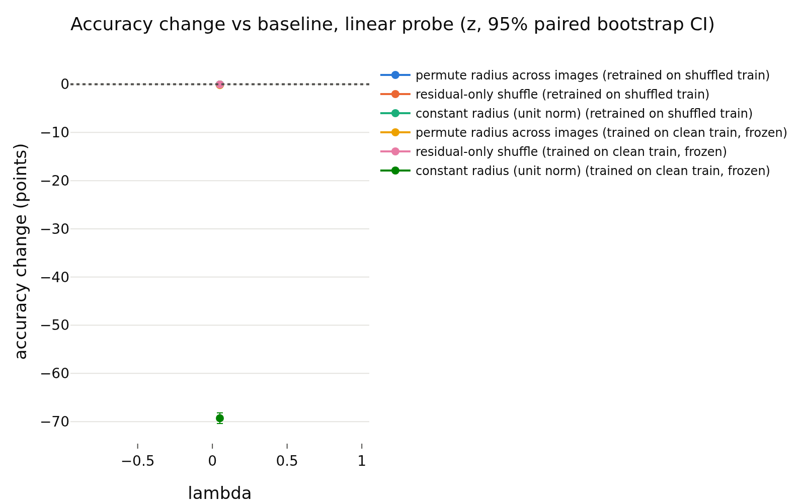
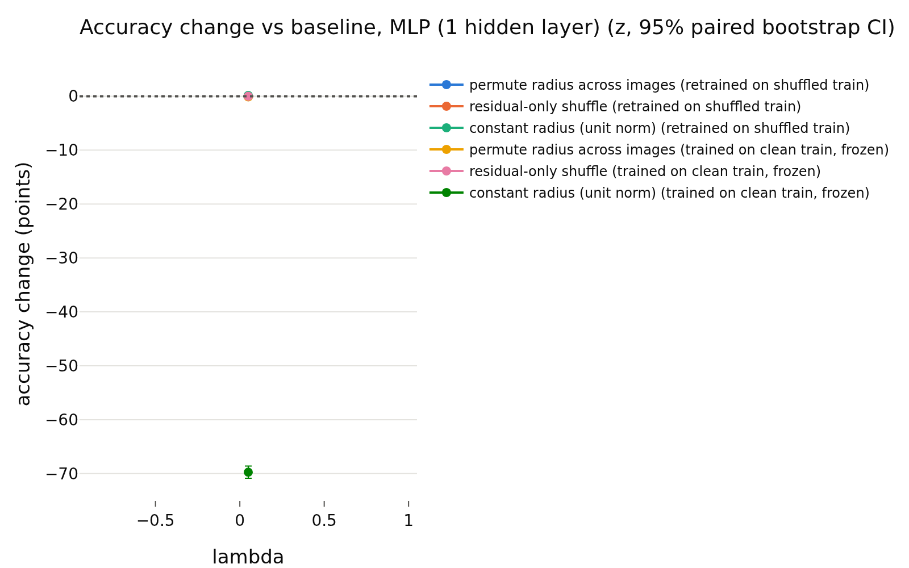

# h_supervised
- **Branch / version:** `radius-baselines-train` @ the commit containing this note (analysis code: `analyze --space h`, commit after `016362c`)
- **Run datetime (UTC):** 2026-10-26 (after the h addendum `016362c` in `train_summary.md`)
- **Command(s):**
  `python apps/analyze.py --config configs/base.yaml --randomize-radius baseline_supervised --space h --note radius_baselines/h_supervised.md` via `sbatch --wrap`, PYTHONPATH=<worktree>/src, 8 CPUs (job 2252607, CPU only)
- **Datasets:** STL-10 ([canonical](https://cs.stanford.edu/~acoates/stl10/), [HF `tanganke/stl10`](https://huggingface.co/datasets/tanganke/stl10); canonical prepared arrays used).
- **Backbone:** ResNet-18 from scratch ([HF architecture reference](https://huggingface.co/timm/resnet18.a1_in1k), no pretrained weights).

## Question

**Explicit exception to the z-only rule for the E2 baselines** (see the addendum in `train_summary.md`): the analyzed space is the backbone feature h, 1 seed. Tables labelled `z` in the redundancy block are the projector output and are shown for context; the randomization tables are h-space (the `lambda` column is the unused default).

## Setup (deviations from the base config)

## Results

<!-- BEGIN GENERATED: analyze.randomization_comparison -->
### Paired accuracy change vs the baseline, per lambda

h-space, center views; bank = STL-10 train, test set = STL-10 test; the same transformation is applied to bank and test set independently. Differences are in accuracy points (condition minus baseline on the same test images), averaged over training seeds; intervals are paired bootstrap percentile intervals (1000 replicates, test images resampled within each seed). Verdict, with the equivalence margin set to ±0.5 points before looking at results: `equivalent` if the 90% interval (TOST at 5%) lies inside the margin, `different` if not equivalent and the 95% interval excludes 0, otherwise `inconclusive`. Shuffle repeats (5 per randomized condition) only average out shuffle noise; they are not part of the interval.

| lambda | reader | protocol | condition | baseline acc | condition acc | difference (points) | 90% CI (points) | 95% CI (points) | verdict |
|---|---|---|---|---|---|---|---|---|---|
| 0.05 | k-NN (euclidean) | retrained on shuffled train | permute radius across images | 0.7836 | 0.7798 | -0.39 | [-0.81, +0.01] | [-0.90, +0.08] | inconclusive |
| 0.05 | k-NN (euclidean) | retrained on shuffled train | residual-only shuffle | 0.7836 | 0.7808 | -0.28 | [-0.55, -0.02] | [-0.59, +0.04] | inconclusive |
| 0.05 | k-NN (euclidean) | retrained on shuffled train | constant radius (unit norm) | 0.7836 | 0.7809 | -0.28 | [-0.74, +0.16] | [-0.84, +0.25] | inconclusive |
| 0.05 | k-NN (euclidean) | trained on clean train, frozen | permute radius across images | 0.7836 | 0.7794 | -0.42 | [-0.73, -0.13] | [-0.79, -0.07] | different |
| 0.05 | k-NN (euclidean) | trained on clean train, frozen | residual-only shuffle | 0.7836 | 0.7820 | -0.16 | [-0.34, +0.02] | [-0.36, +0.06] | equivalent |
| 0.05 | k-NN (euclidean) | trained on clean train, frozen | constant radius (unit norm) | 0.7836 | 0.1883 | -59.54 | [-60.52, -58.57] | [-60.69, -58.36] | different |
| 0.05 | k-NN (cosine, reference) | retrained on shuffled train | permute radius across images | 0.7809 | 0.7809 | +0.00 | [+0.00, +0.00] | [+0.00, +0.00] | equivalent |
| 0.05 | k-NN (cosine, reference) | retrained on shuffled train | residual-only shuffle | 0.7809 | 0.7809 | +0.00 | [+0.00, +0.00] | [+0.00, +0.00] | equivalent |
| 0.05 | k-NN (cosine, reference) | retrained on shuffled train | constant radius (unit norm) | 0.7809 | 0.7809 | +0.00 | [+0.00, +0.00] | [+0.00, +0.00] | equivalent |
| 0.05 | k-NN (cosine, reference) | trained on clean train, frozen | permute radius across images | 0.7809 | 0.7809 | +0.00 | [+0.00, +0.00] | [+0.00, +0.00] | equivalent |
| 0.05 | k-NN (cosine, reference) | trained on clean train, frozen | residual-only shuffle | 0.7809 | 0.7809 | +0.00 | [+0.00, +0.00] | [+0.00, +0.00] | equivalent |
| 0.05 | k-NN (cosine, reference) | trained on clean train, frozen | constant radius (unit norm) | 0.7809 | 0.7809 | +0.00 | [+0.00, +0.00] | [+0.00, +0.00] | equivalent |
| 0.05 | linear probe | retrained on shuffled train | permute radius across images | 0.7930 | 0.7917 | -0.13 | [-0.31, +0.07] | [-0.35, +0.11] | equivalent |
| 0.05 | linear probe | retrained on shuffled train | residual-only shuffle | 0.7930 | 0.7925 | -0.05 | [-0.19, +0.07] | [-0.22, +0.09] | equivalent |
| 0.05 | linear probe | retrained on shuffled train | constant radius (unit norm) | 0.7930 | 0.7925 | -0.05 | [-0.31, +0.21] | [-0.35, +0.25] | equivalent |
| 0.05 | linear probe | trained on clean train, frozen | permute radius across images | 0.7930 | 0.7913 | -0.18 | [-0.35, +0.01] | [-0.38, +0.05] | equivalent |
| 0.05 | linear probe | trained on clean train, frozen | residual-only shuffle | 0.7930 | 0.7925 | -0.05 | [-0.17, +0.07] | [-0.20, +0.09] | equivalent |
| 0.05 | linear probe | trained on clean train, frozen | constant radius (unit norm) | 0.7930 | 0.1000 | -69.30 | [-70.23, -68.35] | [-70.40, -68.17] | different |
| 0.05 | MLP (1 hidden layer) | retrained on shuffled train | permute radius across images | 0.7974 | 0.7965 | -0.08 | [-0.23, +0.08] | [-0.27, +0.11] | equivalent |
| 0.05 | MLP (1 hidden layer) | retrained on shuffled train | residual-only shuffle | 0.7974 | 0.7974 | -0.00 | [-0.11, +0.11] | [-0.14, +0.13] | equivalent |
| 0.05 | MLP (1 hidden layer) | retrained on shuffled train | constant radius (unit norm) | 0.7974 | 0.7989 | +0.15 | [-0.06, +0.35] | [-0.10, +0.39] | equivalent |
| 0.05 | MLP (1 hidden layer) | trained on clean train, frozen | permute radius across images | 0.7974 | 0.7963 | -0.11 | [-0.27, +0.05] | [-0.30, +0.09] | equivalent |
| 0.05 | MLP (1 hidden layer) | trained on clean train, frozen | residual-only shuffle | 0.7974 | 0.7974 | -0.00 | [-0.09, +0.08] | [-0.11, +0.10] | equivalent |
| 0.05 | MLP (1 hidden layer) | trained on clean train, frozen | constant radius (unit norm) | 0.7974 | 0.1000 | -69.74 | [-70.64, -68.80] | [-70.86, -68.60] | different |
<!-- END GENERATED: analyze.randomization_comparison -->

<!-- BEGIN GENERATED: analyze.randomization_accuracy -->
### Accuracy: mean ± std over training seeds, per lambda

| lambda | reader | protocol | condition | seeds | accuracy (mean ± std over seeds) | shuffle sd (mean over seeds) |
|---|---|---|---|---|---|---|
| 0.05 | k-NN (euclidean) | retrained on shuffled train | baseline | 1 | 0.7836 ± nan |  |
| 0.05 | k-NN (euclidean) | retrained on shuffled train | permute radius across images | 1 | 0.7798 ± nan | 0.0028 |
| 0.05 | k-NN (euclidean) | retrained on shuffled train | residual-only shuffle | 1 | 0.7808 ± nan | 0.0010 |
| 0.05 | k-NN (euclidean) | retrained on shuffled train | constant radius (unit norm) | 1 | 0.7809 ± nan |  |
| 0.05 | k-NN (euclidean) | trained on clean train, frozen | baseline | 1 | 0.7836 ± nan |  |
| 0.05 | k-NN (euclidean) | trained on clean train, frozen | permute radius across images | 1 | 0.7794 ± nan | 0.0011 |
| 0.05 | k-NN (euclidean) | trained on clean train, frozen | residual-only shuffle | 1 | 0.7820 ± nan | 0.0009 |
| 0.05 | k-NN (euclidean) | trained on clean train, frozen | constant radius (unit norm) | 1 | 0.1883 ± nan |  |
| 0.05 | k-NN (cosine, reference) | retrained on shuffled train | baseline | 1 | 0.7809 ± nan |  |
| 0.05 | k-NN (cosine, reference) | retrained on shuffled train | permute radius across images | 1 | 0.7809 ± nan | 0.0000 |
| 0.05 | k-NN (cosine, reference) | retrained on shuffled train | residual-only shuffle | 1 | 0.7809 ± nan | 0.0000 |
| 0.05 | k-NN (cosine, reference) | retrained on shuffled train | constant radius (unit norm) | 1 | 0.7809 ± nan |  |
| 0.05 | k-NN (cosine, reference) | trained on clean train, frozen | baseline | 1 | 0.7809 ± nan |  |
| 0.05 | k-NN (cosine, reference) | trained on clean train, frozen | permute radius across images | 1 | 0.7809 ± nan | 0.0000 |
| 0.05 | k-NN (cosine, reference) | trained on clean train, frozen | residual-only shuffle | 1 | 0.7809 ± nan | 0.0000 |
| 0.05 | k-NN (cosine, reference) | trained on clean train, frozen | constant radius (unit norm) | 1 | 0.7809 ± nan |  |
| 0.05 | linear probe | retrained on shuffled train | baseline | 1 | 0.7930 ± nan |  |
| 0.05 | linear probe | retrained on shuffled train | permute radius across images | 1 | 0.7917 ± nan | 0.0009 |
| 0.05 | linear probe | retrained on shuffled train | residual-only shuffle | 1 | 0.7924 ± nan | 0.0007 |
| 0.05 | linear probe | retrained on shuffled train | constant radius (unit norm) | 1 | 0.7925 ± nan |  |
| 0.05 | linear probe | trained on clean train, frozen | baseline | 1 | 0.7930 ± nan |  |
| 0.05 | linear probe | trained on clean train, frozen | permute radius across images | 1 | 0.7913 ± nan | 0.0006 |
| 0.05 | linear probe | trained on clean train, frozen | residual-only shuffle | 1 | 0.7925 ± nan | 0.0007 |
| 0.05 | linear probe | trained on clean train, frozen | constant radius (unit norm) | 1 | 0.1000 ± nan |  |
| 0.05 | MLP (1 hidden layer) | retrained on shuffled train | baseline | 1 | 0.7974 ± nan |  |
| 0.05 | MLP (1 hidden layer) | retrained on shuffled train | permute radius across images | 1 | 0.7966 ± nan | 0.0010 |
| 0.05 | MLP (1 hidden layer) | retrained on shuffled train | residual-only shuffle | 1 | 0.7974 ± nan | 0.0002 |
| 0.05 | MLP (1 hidden layer) | retrained on shuffled train | constant radius (unit norm) | 1 | 0.7989 ± nan |  |
| 0.05 | MLP (1 hidden layer) | trained on clean train, frozen | baseline | 1 | 0.7974 ± nan |  |
| 0.05 | MLP (1 hidden layer) | trained on clean train, frozen | permute radius across images | 1 | 0.7963 ± nan | 0.0007 |
| 0.05 | MLP (1 hidden layer) | trained on clean train, frozen | residual-only shuffle | 1 | 0.7974 ± nan | 0.0002 |
| 0.05 | MLP (1 hidden layer) | trained on clean train, frozen | constant radius (unit norm) | 1 | 0.1000 ± nan |  |
<!-- END GENERATED: analyze.randomization_accuracy -->

<!-- BEGIN GENERATED: analyze.randomization_runs -->
### Per-run accuracies

| run | reader | protocol | condition | repeats | accuracy | shuffle sd |
|---|---|---|---|---|---|---|
| baseline_supervised_s0 | k-NN (euclidean) | retrained on shuffled train | baseline | 1 | 0.7836 |  |
| baseline_supervised_s0 | k-NN (euclidean) | trained on clean train, frozen | baseline | 1 | 0.7836 |  |
| baseline_supervised_s0 | k-NN (euclidean) | trained on clean train, frozen | constant radius (unit norm) | 1 | 0.1883 |  |
| baseline_supervised_s0 | k-NN (euclidean) | retrained on shuffled train | constant radius (unit norm) | 1 | 0.7809 |  |
| baseline_supervised_s0 | k-NN (euclidean) | trained on clean train, frozen | permute radius across images | 5 | 0.7794 | 0.00107 |
| baseline_supervised_s0 | k-NN (euclidean) | retrained on shuffled train | permute radius across images | 5 | 0.7798 | 0.002841 |
| baseline_supervised_s0 | k-NN (euclidean) | trained on clean train, frozen | residual-only shuffle | 5 | 0.782 | 0.00089 |
| baseline_supervised_s0 | k-NN (euclidean) | retrained on shuffled train | residual-only shuffle | 5 | 0.7808 | 0.001029 |
| baseline_supervised_s0 | k-NN (cosine, reference) | retrained on shuffled train | baseline | 1 | 0.7809 |  |
| baseline_supervised_s0 | k-NN (cosine, reference) | trained on clean train, frozen | baseline | 1 | 0.7809 |  |
| baseline_supervised_s0 | k-NN (cosine, reference) | trained on clean train, frozen | constant radius (unit norm) | 1 | 0.7809 |  |
| baseline_supervised_s0 | k-NN (cosine, reference) | retrained on shuffled train | constant radius (unit norm) | 1 | 0.7809 |  |
| baseline_supervised_s0 | k-NN (cosine, reference) | trained on clean train, frozen | permute radius across images | 5 | 0.7809 | 0 |
| baseline_supervised_s0 | k-NN (cosine, reference) | retrained on shuffled train | permute radius across images | 5 | 0.7809 | 0 |
| baseline_supervised_s0 | k-NN (cosine, reference) | trained on clean train, frozen | residual-only shuffle | 5 | 0.7809 | 0 |
| baseline_supervised_s0 | k-NN (cosine, reference) | retrained on shuffled train | residual-only shuffle | 5 | 0.7809 | 0 |
| baseline_supervised_s0 | linear probe | retrained on shuffled train | baseline | 1 | 0.793 |  |
| baseline_supervised_s0 | linear probe | trained on clean train, frozen | baseline | 1 | 0.793 |  |
| baseline_supervised_s0 | linear probe | trained on clean train, frozen | constant radius (unit norm) | 1 | 0.1 |  |
| baseline_supervised_s0 | linear probe | retrained on shuffled train | constant radius (unit norm) | 1 | 0.7925 |  |
| baseline_supervised_s0 | linear probe | trained on clean train, frozen | permute radius across images | 5 | 0.7913 | 0.000625 |
| baseline_supervised_s0 | linear probe | retrained on shuffled train | permute radius across images | 5 | 0.7917 | 0.0009454 |
| baseline_supervised_s0 | linear probe | trained on clean train, frozen | residual-only shuffle | 5 | 0.7925 | 0.0007416 |
| baseline_supervised_s0 | linear probe | retrained on shuffled train | residual-only shuffle | 5 | 0.7924 | 0.000665 |
| baseline_supervised_s0 | MLP (1 hidden layer) | retrained on shuffled train | baseline | 1 | 0.7974 |  |
| baseline_supervised_s0 | MLP (1 hidden layer) | trained on clean train, frozen | baseline | 1 | 0.7974 |  |
| baseline_supervised_s0 | MLP (1 hidden layer) | trained on clean train, frozen | constant radius (unit norm) | 1 | 0.1 |  |
| baseline_supervised_s0 | MLP (1 hidden layer) | retrained on shuffled train | constant radius (unit norm) | 1 | 0.7989 |  |
| baseline_supervised_s0 | MLP (1 hidden layer) | trained on clean train, frozen | permute radius across images | 5 | 0.7963 | 0.0007289 |
| baseline_supervised_s0 | MLP (1 hidden layer) | retrained on shuffled train | permute radius across images | 5 | 0.7966 | 0.00101 |
| baseline_supervised_s0 | MLP (1 hidden layer) | trained on clean train, frozen | residual-only shuffle | 5 | 0.7974 | 0.000163 |
| baseline_supervised_s0 | MLP (1 hidden layer) | retrained on shuffled train | residual-only shuffle | 5 | 0.7974 | 0.0002404 |
<!-- END GENERATED: analyze.randomization_runs -->

<!-- BEGIN GENERATED: analyze.randomization_model -->
### Direction -> log-radius regression used by the residual shuffle

| run | MLP weight decay | quantity | bank (out-of-fold) | test (held out) |
|---|---|---|---|---|
| baseline_supervised_s0 | 0.01 | R^2 of log-radius from direction | 0.8885 | 0.8936 |
| baseline_supervised_s0 | 0.01 | sd of log-radius | 0.08261 | 0.08396 |
| baseline_supervised_s0 | 0.01 | sd of the residual log-radius | 0.02758 | 0.02734 |
<!-- END GENERATED: analyze.randomization_model -->

<!-- BEGIN GENERATED: analyze.randomization_skipped -->
### Runs without the required dumps

None: every run of the prefix has `stl10_train` and `stl10_test`.
<!-- END GENERATED: analyze.randomization_skipped -->

<!-- BEGIN GENERATED: analyze.randomization_figures -->
### Figures

<!-- END GENERATED: analyze.randomization_figures -->

## Interpretation

## Next steps
