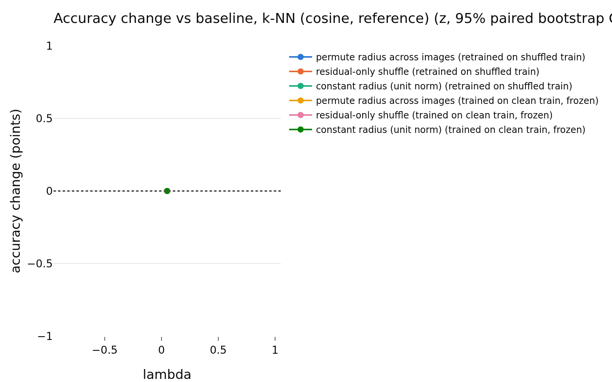
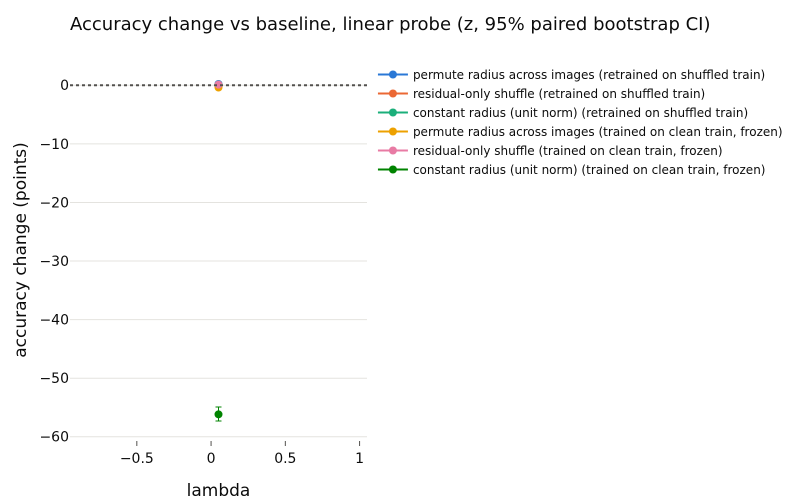
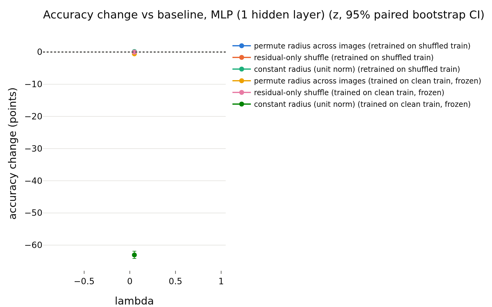

# h_vicreg
- **Branch / version:** `radius-baselines-train` @ the commit containing this note (analysis code: `analyze --space h`, commit after `016362c`)
- **Run datetime (UTC):** 2026-10-26 (after the h addendum `016362c` in `train_summary.md`)
- **Command(s):**
  `python apps/analyze.py --config configs/base.yaml --randomize-radius baseline_vicreg --space h --note radius_baselines/h_vicreg.md` via `sbatch --wrap`, PYTHONPATH=<worktree>/src, 8 CPUs (job 2252606, CPU only)
- **Datasets:** STL-10 ([canonical](https://cs.stanford.edu/~acoates/stl10/), [HF `tanganke/stl10`](https://huggingface.co/datasets/tanganke/stl10); canonical prepared arrays used).
- **Backbone:** ResNet-18 from scratch ([HF architecture reference](https://huggingface.co/timm/resnet18.a1_in1k), no pretrained weights).

## Question

**Explicit exception to the z-only rule for the E2 baselines** (see the addendum in `train_summary.md`): the analyzed space is the backbone feature h, 1 seed. Tables labelled `z` in the redundancy block are the projector output and are shown for context; the randomization tables are h-space (the `lambda` column is the unused default).

## Setup (deviations from the base config)

## Results

<!-- BEGIN GENERATED: analyze.randomization_comparison -->
### Paired accuracy change vs the baseline, per lambda

h-space, center views; bank = STL-10 train, test set = STL-10 test; the same transformation is applied to bank and test set independently. Differences are in accuracy points (condition minus baseline on the same test images), averaged over training seeds; intervals are paired bootstrap percentile intervals (1000 replicates, test images resampled within each seed). Verdict, with the equivalence margin set to ±0.5 points before looking at results: `equivalent` if the 90% interval (TOST at 5%) lies inside the margin, `different` if not equivalent and the 95% interval excludes 0, otherwise `inconclusive`. Shuffle repeats (5 per randomized condition) only average out shuffle noise; they are not part of the interval.

| lambda | reader | protocol | condition | baseline acc | condition acc | difference (points) | 90% CI (points) | 95% CI (points) | verdict |
|---|---|---|---|---|---|---|---|---|---|
| 0.05 | k-NN (euclidean) | retrained on shuffled train | permute radius across images | 0.7645 | 0.7662 | +0.17 | [-0.27, +0.59] | [-0.36, +0.66] | inconclusive |
| 0.05 | k-NN (euclidean) | retrained on shuffled train | residual-only shuffle | 0.7645 | 0.7680 | +0.35 | [+0.05, +0.65] | [-0.00, +0.69] | inconclusive |
| 0.05 | k-NN (euclidean) | retrained on shuffled train | constant radius (unit norm) | 0.7645 | 0.7772 | +1.28 | [+0.80, +1.75] | [+0.74, +1.88] | different |
| 0.05 | k-NN (euclidean) | trained on clean train, frozen | permute radius across images | 0.7645 | 0.7707 | +0.62 | [+0.32, +0.92] | [+0.27, +0.97] | different |
| 0.05 | k-NN (euclidean) | trained on clean train, frozen | residual-only shuffle | 0.7645 | 0.7678 | +0.33 | [+0.14, +0.51] | [+0.10, +0.54] | different |
| 0.05 | k-NN (euclidean) | trained on clean train, frozen | constant radius (unit norm) | 0.7645 | 0.2151 | -54.94 | [-56.04, -53.92] | [-56.29, -53.77] | different |
| 0.05 | k-NN (cosine, reference) | retrained on shuffled train | permute radius across images | 0.7772 | 0.7772 | +0.00 | [+0.00, +0.00] | [+0.00, +0.00] | equivalent |
| 0.05 | k-NN (cosine, reference) | retrained on shuffled train | residual-only shuffle | 0.7772 | 0.7772 | +0.00 | [+0.00, +0.00] | [+0.00, +0.00] | equivalent |
| 0.05 | k-NN (cosine, reference) | retrained on shuffled train | constant radius (unit norm) | 0.7772 | 0.7772 | +0.00 | [+0.00, +0.00] | [+0.00, +0.00] | equivalent |
| 0.05 | k-NN (cosine, reference) | trained on clean train, frozen | permute radius across images | 0.7772 | 0.7772 | +0.00 | [+0.00, +0.00] | [+0.00, +0.00] | equivalent |
| 0.05 | k-NN (cosine, reference) | trained on clean train, frozen | residual-only shuffle | 0.7772 | 0.7772 | +0.00 | [+0.00, +0.00] | [+0.00, +0.00] | equivalent |
| 0.05 | k-NN (cosine, reference) | trained on clean train, frozen | constant radius (unit norm) | 0.7772 | 0.7772 | +0.00 | [+0.00, +0.00] | [+0.00, +0.00] | equivalent |
| 0.05 | linear probe | retrained on shuffled train | permute radius across images | 0.7666 | 0.7688 | +0.21 | [+0.02, +0.43] | [-0.01, +0.48] | equivalent |
| 0.05 | linear probe | retrained on shuffled train | residual-only shuffle | 0.7666 | 0.7671 | +0.05 | [-0.11, +0.23] | [-0.14, +0.26] | equivalent |
| 0.05 | linear probe | retrained on shuffled train | constant radius (unit norm) | 0.7666 | 0.7678 | +0.11 | [-0.14, +0.39] | [-0.16, +0.44] | equivalent |
| 0.05 | linear probe | trained on clean train, frozen | permute radius across images | 0.7666 | 0.7627 | -0.39 | [-0.65, -0.12] | [-0.72, -0.06] | different |
| 0.05 | linear probe | trained on clean train, frozen | residual-only shuffle | 0.7666 | 0.7677 | +0.11 | [-0.03, +0.24] | [-0.05, +0.27] | equivalent |
| 0.05 | linear probe | trained on clean train, frozen | constant radius (unit norm) | 0.7666 | 0.2050 | -56.16 | [-57.17, -55.10] | [-57.30, -54.91] | different |
| 0.05 | MLP (1 hidden layer) | retrained on shuffled train | permute radius across images | 0.8121 | 0.8132 | +0.11 | [-0.14, +0.36] | [-0.19, +0.40] | equivalent |
| 0.05 | MLP (1 hidden layer) | retrained on shuffled train | residual-only shuffle | 0.8121 | 0.8126 | +0.05 | [-0.14, +0.23] | [-0.16, +0.26] | equivalent |
| 0.05 | MLP (1 hidden layer) | retrained on shuffled train | constant radius (unit norm) | 0.8121 | 0.8136 | +0.15 | [-0.10, +0.40] | [-0.15, +0.46] | equivalent |
| 0.05 | MLP (1 hidden layer) | trained on clean train, frozen | permute radius across images | 0.8121 | 0.8065 | -0.56 | [-0.78, -0.33] | [-0.85, -0.30] | different |
| 0.05 | MLP (1 hidden layer) | trained on clean train, frozen | residual-only shuffle | 0.8121 | 0.8119 | -0.02 | [-0.11, +0.07] | [-0.13, +0.10] | equivalent |
| 0.05 | MLP (1 hidden layer) | trained on clean train, frozen | constant radius (unit norm) | 0.8121 | 0.1816 | -63.05 | [-63.96, -62.06] | [-64.15, -61.87] | different |
<!-- END GENERATED: analyze.randomization_comparison -->

<!-- BEGIN GENERATED: analyze.randomization_accuracy -->
### Accuracy: mean ± std over training seeds, per lambda

| lambda | reader | protocol | condition | seeds | accuracy (mean ± std over seeds) | shuffle sd (mean over seeds) |
|---|---|---|---|---|---|---|
| 0.05 | k-NN (euclidean) | retrained on shuffled train | baseline | 1 | 0.7645 ± nan |  |
| 0.05 | k-NN (euclidean) | retrained on shuffled train | permute radius across images | 1 | 0.7662 ± nan | 0.0024 |
| 0.05 | k-NN (euclidean) | retrained on shuffled train | residual-only shuffle | 1 | 0.7680 ± nan | 0.0010 |
| 0.05 | k-NN (euclidean) | retrained on shuffled train | constant radius (unit norm) | 1 | 0.7772 ± nan |  |
| 0.05 | k-NN (euclidean) | trained on clean train, frozen | baseline | 1 | 0.7645 ± nan |  |
| 0.05 | k-NN (euclidean) | trained on clean train, frozen | permute radius across images | 1 | 0.7707 ± nan | 0.0013 |
| 0.05 | k-NN (euclidean) | trained on clean train, frozen | residual-only shuffle | 1 | 0.7678 ± nan | 0.0012 |
| 0.05 | k-NN (euclidean) | trained on clean train, frozen | constant radius (unit norm) | 1 | 0.2151 ± nan |  |
| 0.05 | k-NN (cosine, reference) | retrained on shuffled train | baseline | 1 | 0.7772 ± nan |  |
| 0.05 | k-NN (cosine, reference) | retrained on shuffled train | permute radius across images | 1 | 0.7772 ± nan | 0.0000 |
| 0.05 | k-NN (cosine, reference) | retrained on shuffled train | residual-only shuffle | 1 | 0.7772 ± nan | 0.0000 |
| 0.05 | k-NN (cosine, reference) | retrained on shuffled train | constant radius (unit norm) | 1 | 0.7772 ± nan |  |
| 0.05 | k-NN (cosine, reference) | trained on clean train, frozen | baseline | 1 | 0.7772 ± nan |  |
| 0.05 | k-NN (cosine, reference) | trained on clean train, frozen | permute radius across images | 1 | 0.7772 ± nan | 0.0000 |
| 0.05 | k-NN (cosine, reference) | trained on clean train, frozen | residual-only shuffle | 1 | 0.7772 ± nan | 0.0000 |
| 0.05 | k-NN (cosine, reference) | trained on clean train, frozen | constant radius (unit norm) | 1 | 0.7772 ± nan |  |
| 0.05 | linear probe | retrained on shuffled train | baseline | 1 | 0.7666 ± nan |  |
| 0.05 | linear probe | retrained on shuffled train | permute radius across images | 1 | 0.7688 ± nan | 0.0021 |
| 0.05 | linear probe | retrained on shuffled train | residual-only shuffle | 1 | 0.7671 ± nan | 0.0005 |
| 0.05 | linear probe | retrained on shuffled train | constant radius (unit norm) | 1 | 0.7678 ± nan |  |
| 0.05 | linear probe | trained on clean train, frozen | baseline | 1 | 0.7666 ± nan |  |
| 0.05 | linear probe | trained on clean train, frozen | permute radius across images | 1 | 0.7627 ± nan | 0.0010 |
| 0.05 | linear probe | trained on clean train, frozen | residual-only shuffle | 1 | 0.7677 ± nan | 0.0008 |
| 0.05 | linear probe | trained on clean train, frozen | constant radius (unit norm) | 1 | 0.2050 ± nan |  |
| 0.05 | MLP (1 hidden layer) | retrained on shuffled train | baseline | 1 | 0.8121 ± nan |  |
| 0.05 | MLP (1 hidden layer) | retrained on shuffled train | permute radius across images | 1 | 0.8132 ± nan | 0.0020 |
| 0.05 | MLP (1 hidden layer) | retrained on shuffled train | residual-only shuffle | 1 | 0.8126 ± nan | 0.0003 |
| 0.05 | MLP (1 hidden layer) | retrained on shuffled train | constant radius (unit norm) | 1 | 0.8136 ± nan |  |
| 0.05 | MLP (1 hidden layer) | trained on clean train, frozen | baseline | 1 | 0.8121 ± nan |  |
| 0.05 | MLP (1 hidden layer) | trained on clean train, frozen | permute radius across images | 1 | 0.8065 ± nan | 0.0008 |
| 0.05 | MLP (1 hidden layer) | trained on clean train, frozen | residual-only shuffle | 1 | 0.8119 ± nan | 0.0005 |
| 0.05 | MLP (1 hidden layer) | trained on clean train, frozen | constant radius (unit norm) | 1 | 0.1816 ± nan |  |
<!-- END GENERATED: analyze.randomization_accuracy -->

<!-- BEGIN GENERATED: analyze.randomization_runs -->
### Per-run accuracies

| run | reader | protocol | condition | repeats | accuracy | shuffle sd |
|---|---|---|---|---|---|---|
| baseline_vicreg_s0 | k-NN (euclidean) | retrained on shuffled train | baseline | 1 | 0.7645 |  |
| baseline_vicreg_s0 | k-NN (euclidean) | trained on clean train, frozen | baseline | 1 | 0.7645 |  |
| baseline_vicreg_s0 | k-NN (euclidean) | trained on clean train, frozen | constant radius (unit norm) | 1 | 0.2151 |  |
| baseline_vicreg_s0 | k-NN (euclidean) | retrained on shuffled train | constant radius (unit norm) | 1 | 0.7772 |  |
| baseline_vicreg_s0 | k-NN (euclidean) | trained on clean train, frozen | permute radius across images | 5 | 0.7707 | 0.001295 |
| baseline_vicreg_s0 | k-NN (euclidean) | retrained on shuffled train | permute radius across images | 5 | 0.7662 | 0.002374 |
| baseline_vicreg_s0 | k-NN (euclidean) | trained on clean train, frozen | residual-only shuffle | 5 | 0.7678 | 0.001152 |
| baseline_vicreg_s0 | k-NN (euclidean) | retrained on shuffled train | residual-only shuffle | 5 | 0.768 | 0.001042 |
| baseline_vicreg_s0 | k-NN (cosine, reference) | retrained on shuffled train | baseline | 1 | 0.7772 |  |
| baseline_vicreg_s0 | k-NN (cosine, reference) | trained on clean train, frozen | baseline | 1 | 0.7772 |  |
| baseline_vicreg_s0 | k-NN (cosine, reference) | trained on clean train, frozen | constant radius (unit norm) | 1 | 0.7772 |  |
| baseline_vicreg_s0 | k-NN (cosine, reference) | retrained on shuffled train | constant radius (unit norm) | 1 | 0.7772 |  |
| baseline_vicreg_s0 | k-NN (cosine, reference) | trained on clean train, frozen | permute radius across images | 5 | 0.7772 | 0 |
| baseline_vicreg_s0 | k-NN (cosine, reference) | retrained on shuffled train | permute radius across images | 5 | 0.7772 | 0 |
| baseline_vicreg_s0 | k-NN (cosine, reference) | trained on clean train, frozen | residual-only shuffle | 5 | 0.7772 | 0 |
| baseline_vicreg_s0 | k-NN (cosine, reference) | retrained on shuffled train | residual-only shuffle | 5 | 0.7772 | 0 |
| baseline_vicreg_s0 | linear probe | retrained on shuffled train | baseline | 1 | 0.7666 |  |
| baseline_vicreg_s0 | linear probe | trained on clean train, frozen | baseline | 1 | 0.7666 |  |
| baseline_vicreg_s0 | linear probe | trained on clean train, frozen | constant radius (unit norm) | 1 | 0.205 |  |
| baseline_vicreg_s0 | linear probe | retrained on shuffled train | constant radius (unit norm) | 1 | 0.7678 |  |
| baseline_vicreg_s0 | linear probe | trained on clean train, frozen | permute radius across images | 5 | 0.7627 | 0.001048 |
| baseline_vicreg_s0 | linear probe | retrained on shuffled train | permute radius across images | 5 | 0.7688 | 0.002074 |
| baseline_vicreg_s0 | linear probe | trained on clean train, frozen | residual-only shuffle | 5 | 0.7677 | 0.0008413 |
| baseline_vicreg_s0 | linear probe | retrained on shuffled train | residual-only shuffle | 5 | 0.7671 | 0.0005229 |
| baseline_vicreg_s0 | MLP (1 hidden layer) | retrained on shuffled train | baseline | 1 | 0.8121 |  |
| baseline_vicreg_s0 | MLP (1 hidden layer) | trained on clean train, frozen | baseline | 1 | 0.8121 |  |
| baseline_vicreg_s0 | MLP (1 hidden layer) | trained on clean train, frozen | constant radius (unit norm) | 1 | 0.1816 |  |
| baseline_vicreg_s0 | MLP (1 hidden layer) | retrained on shuffled train | constant radius (unit norm) | 1 | 0.8136 |  |
| baseline_vicreg_s0 | MLP (1 hidden layer) | trained on clean train, frozen | permute radius across images | 5 | 0.8065 | 0.0008404 |
| baseline_vicreg_s0 | MLP (1 hidden layer) | retrained on shuffled train | permute radius across images | 5 | 0.8132 | 0.002017 |
| baseline_vicreg_s0 | MLP (1 hidden layer) | trained on clean train, frozen | residual-only shuffle | 5 | 0.8119 | 0.0005491 |
| baseline_vicreg_s0 | MLP (1 hidden layer) | retrained on shuffled train | residual-only shuffle | 5 | 0.8126 | 0.0002878 |
<!-- END GENERATED: analyze.randomization_runs -->

<!-- BEGIN GENERATED: analyze.randomization_model -->
### Direction -> log-radius regression used by the residual shuffle

| run | MLP weight decay | quantity | bank (out-of-fold) | test (held out) |
|---|---|---|---|---|
| baseline_vicreg_s0 | 1 | R^2 of log-radius from direction | 0.9472 | 0.9468 |
| baseline_vicreg_s0 | 1 | sd of log-radius | 0.1665 | 0.1616 |
| baseline_vicreg_s0 | 1 | sd of the residual log-radius | 0.03825 | 0.03706 |
<!-- END GENERATED: analyze.randomization_model -->

<!-- BEGIN GENERATED: analyze.randomization_skipped -->
### Runs without the required dumps

None: every run of the prefix has `stl10_train` and `stl10_test`.
<!-- END GENERATED: analyze.randomization_skipped -->

<!-- BEGIN GENERATED: analyze.randomization_figures -->
### Figures

<!-- END GENERATED: analyze.randomization_figures -->

## Interpretation

## Next steps
