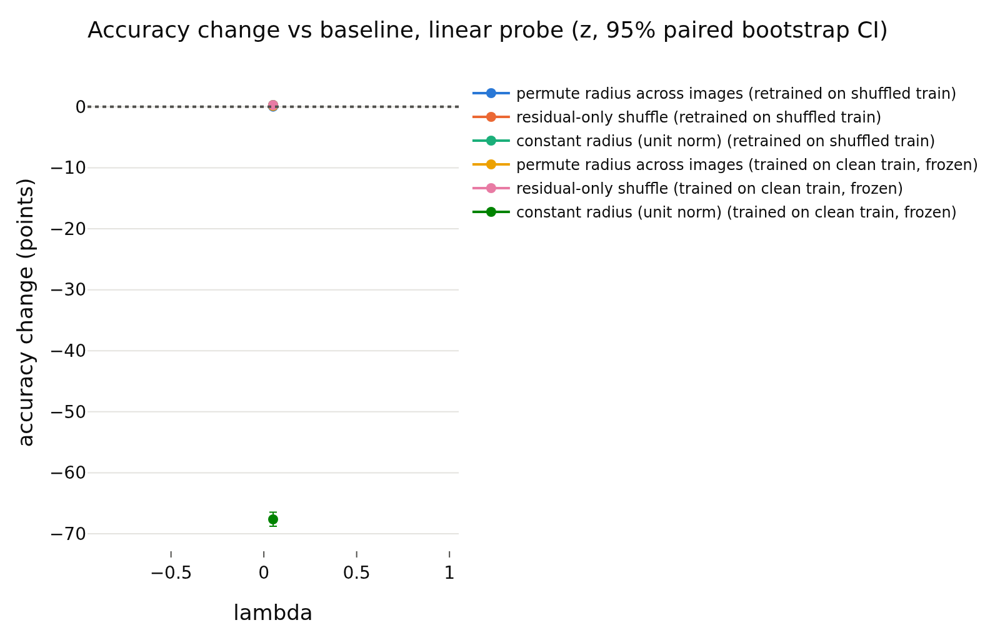
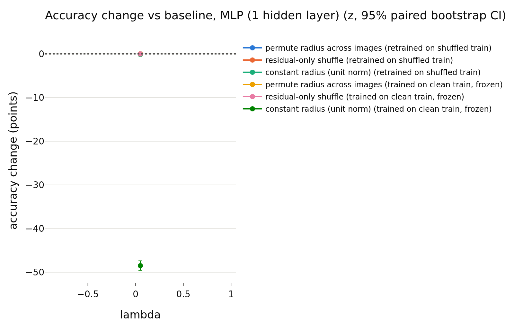

# train_simclr
- **Branch / version:** `radius-baselines-train` @ `681e353` (pre-registration commit; this note's results are generated and committed after it)
- **Run datetime (UTC):** 2026-10-26T00:52Z (training) to 2026-10-26T03:20Z (analysis); note written 2026-10-26
- **Command(s):**
  Training: `sbatch --export=ALL --cpus-per-task=4 --gres=gpu:h100:1 slurm/train.sbatch configs/base.yaml baseline_simclr_s0 --set loss.variant=simclr --set data.num_local_views=0 --set seed=0` (job 2247675 (H100, node m002; 2026-10-26T00:55Z to 03:04Z, 2 h 09 min))
  Embed: `sbatch --export=ALL --cpus-per-task=4 --dependency=afterok:<train job> slurm/embed.sbatch configs/base.yaml baseline_simclr_s0 last.pt --sets stl10_train,stl10_test` (job 2247709)
  Redundancy controls: `sbatch --export=ALL,OMP_NUM_THREADS=8,OPENBLAS_NUM_THREADS=8 --dependency=afterok:<embed job> slurm/analyze.sbatch configs/base.yaml baseline_simclr_s0 radius_baselines/train_simclr.md --redundancy-controls` (job 2247712)
  Randomization: `python apps/analyze.py --config configs/base.yaml --randomize-radius baseline_simclr --note radius_baselines/train_simclr.md` via `sbatch --wrap` with PYTHONPATH=<worktree>/src, 8 CPUs, 32 GB (job 2247715)
- **Datasets:** STL-10 ([canonical](https://cs.stanford.edu/~acoates/stl10/), [HF `tanganke/stl10`](https://huggingface.co/datasets/tanganke/stl10); the canonical data via prepared arrays was used). h is not analyzed; LeJEPA's product is z.
- **Backbone:** ResNet-18 from scratch ([HF architecture reference](https://huggingface.co/timm/resnet18.a1_in1k), no pretrained weights).

## Question

Is the radius redundancy of z (predictable from the direction) specific to LeJEPA? Run: SimCLR (NT-Xent, T = 0.2), seed 0. Pre-registered readings: `train_summary.md`.

## Setup (deviations from the base config)

See `train_summary.md`. Note: the `lambda` column of the generated tables (0.05) is the unused default and means nothing here. The generated redundancy table also contains an h block; h is not analyzed and is ignored in this note.

## Results

<!-- BEGIN GENERATED: analyze.randomization_comparison -->
### Paired accuracy change vs the baseline, per lambda

z-space, center views; bank = STL-10 train, test set = STL-10 test; the same transformation is applied to bank and test set independently. Differences are in accuracy points (condition minus baseline on the same test images), averaged over training seeds; intervals are paired bootstrap percentile intervals (1000 replicates, test images resampled within each seed). Verdict, with the equivalence margin set to ±0.5 points before looking at results: `equivalent` if the 90% interval (TOST at 5%) lies inside the margin, `different` if not equivalent and the 95% interval excludes 0, otherwise `inconclusive`. Shuffle repeats (5 per randomized condition) only average out shuffle noise; they are not part of the interval.

| lambda | reader | protocol | condition | baseline acc | condition acc | difference (points) | 90% CI (points) | 95% CI (points) | verdict |
|---|---|---|---|---|---|---|---|---|---|
| 0.05 | k-NN (euclidean) | retrained on shuffled train | permute radius across images | 0.7580 | 0.7748 | +1.68 | [+1.17, +2.22] | [+1.05, +2.31] | different |
| 0.05 | k-NN (euclidean) | retrained on shuffled train | residual-only shuffle | 0.7580 | 0.7684 | +1.04 | [+0.59, +1.50] | [+0.49, +1.55] | different |
| 0.05 | k-NN (euclidean) | retrained on shuffled train | constant radius (unit norm) | 0.7580 | 0.7814 | +2.34 | [+1.80, +2.95] | [+1.70, +3.08] | different |
| 0.05 | k-NN (euclidean) | trained on clean train, frozen | permute radius across images | 0.7580 | 0.7471 | -1.09 | [-1.51, -0.69] | [-1.58, -0.63] | different |
| 0.05 | k-NN (euclidean) | trained on clean train, frozen | residual-only shuffle | 0.7580 | 0.7610 | +0.30 | [-0.06, +0.65] | [-0.12, +0.72] | inconclusive |
| 0.05 | k-NN (euclidean) | trained on clean train, frozen | constant radius (unit norm) | 0.7580 | 0.1071 | -65.09 | [-66.11, -64.12] | [-66.29, -63.99] | different |
| 0.05 | k-NN (cosine, reference) | retrained on shuffled train | permute radius across images | 0.7814 | 0.7814 | +0.00 | [+0.00, +0.00] | [+0.00, +0.00] | equivalent |
| 0.05 | k-NN (cosine, reference) | retrained on shuffled train | residual-only shuffle | 0.7814 | 0.7814 | +0.00 | [+0.00, +0.00] | [+0.00, +0.00] | equivalent |
| 0.05 | k-NN (cosine, reference) | retrained on shuffled train | constant radius (unit norm) | 0.7814 | 0.7814 | +0.00 | [+0.00, +0.00] | [+0.00, +0.00] | equivalent |
| 0.05 | k-NN (cosine, reference) | trained on clean train, frozen | permute radius across images | 0.7814 | 0.7814 | +0.00 | [+0.00, +0.00] | [+0.00, +0.00] | equivalent |
| 0.05 | k-NN (cosine, reference) | trained on clean train, frozen | residual-only shuffle | 0.7814 | 0.7814 | +0.00 | [+0.00, +0.00] | [+0.00, +0.00] | equivalent |
| 0.05 | k-NN (cosine, reference) | trained on clean train, frozen | constant radius (unit norm) | 0.7814 | 0.7814 | +0.00 | [+0.00, +0.00] | [+0.00, +0.00] | equivalent |
| 0.05 | linear probe | retrained on shuffled train | permute radius across images | 0.7939 | 0.7940 | +0.01 | [-0.24, +0.25] | [-0.28, +0.30] | equivalent |
| 0.05 | linear probe | retrained on shuffled train | residual-only shuffle | 0.7939 | 0.7968 | +0.29 | [+0.09, +0.51] | [+0.04, +0.54] | different |
| 0.05 | linear probe | retrained on shuffled train | constant radius (unit norm) | 0.7939 | 0.7966 | +0.28 | [-0.00, +0.53] | [-0.05, +0.57] | inconclusive |
| 0.05 | linear probe | trained on clean train, frozen | permute radius across images | 0.7939 | 0.7952 | +0.13 | [-0.09, +0.33] | [-0.13, +0.38] | equivalent |
| 0.05 | linear probe | trained on clean train, frozen | residual-only shuffle | 0.7939 | 0.7965 | +0.26 | [+0.10, +0.42] | [+0.07, +0.45] | equivalent |
| 0.05 | linear probe | trained on clean train, frozen | constant radius (unit norm) | 0.7939 | 0.1175 | -67.64 | [-68.60, -66.61] | [-68.76, -66.46] | different |
| 0.05 | MLP (1 hidden layer) | retrained on shuffled train | permute radius across images | 0.8054 | 0.8052 | -0.02 | [-0.27, +0.25] | [-0.33, +0.28] | equivalent |
| 0.05 | MLP (1 hidden layer) | retrained on shuffled train | residual-only shuffle | 0.8054 | 0.8052 | -0.02 | [-0.24, +0.20] | [-0.28, +0.25] | equivalent |
| 0.05 | MLP (1 hidden layer) | retrained on shuffled train | constant radius (unit norm) | 0.8054 | 0.8039 | -0.15 | [-0.45, +0.14] | [-0.51, +0.19] | equivalent |
| 0.05 | MLP (1 hidden layer) | trained on clean train, frozen | permute radius across images | 0.8054 | 0.8052 | -0.02 | [-0.13, +0.10] | [-0.15, +0.12] | equivalent |
| 0.05 | MLP (1 hidden layer) | trained on clean train, frozen | residual-only shuffle | 0.8054 | 0.8052 | -0.02 | [-0.11, +0.07] | [-0.13, +0.09] | equivalent |
| 0.05 | MLP (1 hidden layer) | trained on clean train, frozen | constant radius (unit norm) | 0.8054 | 0.3205 | -48.49 | [-49.38, -47.56] | [-49.54, -47.36] | different |
<!-- END GENERATED: analyze.randomization_comparison -->

<!-- BEGIN GENERATED: analyze.randomization_accuracy -->
### Accuracy: mean ± std over training seeds, per lambda

| lambda | reader | protocol | condition | seeds | accuracy (mean ± std over seeds) | shuffle sd (mean over seeds) |
|---|---|---|---|---|---|---|
| 0.05 | k-NN (euclidean) | retrained on shuffled train | baseline | 1 | 0.7580 ± nan |  |
| 0.05 | k-NN (euclidean) | retrained on shuffled train | permute radius across images | 1 | 0.7748 ± nan | 0.0057 |
| 0.05 | k-NN (euclidean) | retrained on shuffled train | residual-only shuffle | 1 | 0.7684 ± nan | 0.0006 |
| 0.05 | k-NN (euclidean) | retrained on shuffled train | constant radius (unit norm) | 1 | 0.7814 ± nan |  |
| 0.05 | k-NN (euclidean) | trained on clean train, frozen | baseline | 1 | 0.7580 ± nan |  |
| 0.05 | k-NN (euclidean) | trained on clean train, frozen | permute radius across images | 1 | 0.7471 ± nan | 0.0022 |
| 0.05 | k-NN (euclidean) | trained on clean train, frozen | residual-only shuffle | 1 | 0.7610 ± nan | 0.0015 |
| 0.05 | k-NN (euclidean) | trained on clean train, frozen | constant radius (unit norm) | 1 | 0.1071 ± nan |  |
| 0.05 | k-NN (cosine, reference) | retrained on shuffled train | baseline | 1 | 0.7814 ± nan |  |
| 0.05 | k-NN (cosine, reference) | retrained on shuffled train | permute radius across images | 1 | 0.7814 ± nan | 0.0000 |
| 0.05 | k-NN (cosine, reference) | retrained on shuffled train | residual-only shuffle | 1 | 0.7814 ± nan | 0.0000 |
| 0.05 | k-NN (cosine, reference) | retrained on shuffled train | constant radius (unit norm) | 1 | 0.7814 ± nan |  |
| 0.05 | k-NN (cosine, reference) | trained on clean train, frozen | baseline | 1 | 0.7814 ± nan |  |
| 0.05 | k-NN (cosine, reference) | trained on clean train, frozen | permute radius across images | 1 | 0.7814 ± nan | 0.0000 |
| 0.05 | k-NN (cosine, reference) | trained on clean train, frozen | residual-only shuffle | 1 | 0.7814 ± nan | 0.0000 |
| 0.05 | k-NN (cosine, reference) | trained on clean train, frozen | constant radius (unit norm) | 1 | 0.7814 ± nan |  |
| 0.05 | linear probe | retrained on shuffled train | baseline | 1 | 0.7939 ± nan |  |
| 0.05 | linear probe | retrained on shuffled train | permute radius across images | 1 | 0.7940 ± nan | 0.0024 |
| 0.05 | linear probe | retrained on shuffled train | residual-only shuffle | 1 | 0.7968 ± nan | 0.0016 |
| 0.05 | linear probe | retrained on shuffled train | constant radius (unit norm) | 1 | 0.7966 ± nan |  |
| 0.05 | linear probe | trained on clean train, frozen | baseline | 1 | 0.7939 ± nan |  |
| 0.05 | linear probe | trained on clean train, frozen | permute radius across images | 1 | 0.7952 ± nan | 0.0010 |
| 0.05 | linear probe | trained on clean train, frozen | residual-only shuffle | 1 | 0.7965 ± nan | 0.0009 |
| 0.05 | linear probe | trained on clean train, frozen | constant radius (unit norm) | 1 | 0.1175 ± nan |  |
| 0.05 | MLP (1 hidden layer) | retrained on shuffled train | baseline | 1 | 0.8054 ± nan |  |
| 0.05 | MLP (1 hidden layer) | retrained on shuffled train | permute radius across images | 1 | 0.8052 ± nan | 0.0019 |
| 0.05 | MLP (1 hidden layer) | retrained on shuffled train | residual-only shuffle | 1 | 0.8052 ± nan | 0.0007 |
| 0.05 | MLP (1 hidden layer) | retrained on shuffled train | constant radius (unit norm) | 1 | 0.8039 ± nan |  |
| 0.05 | MLP (1 hidden layer) | trained on clean train, frozen | baseline | 1 | 0.8054 ± nan |  |
| 0.05 | MLP (1 hidden layer) | trained on clean train, frozen | permute radius across images | 1 | 0.8052 ± nan | 0.0004 |
| 0.05 | MLP (1 hidden layer) | trained on clean train, frozen | residual-only shuffle | 1 | 0.8052 ± nan | 0.0004 |
| 0.05 | MLP (1 hidden layer) | trained on clean train, frozen | constant radius (unit norm) | 1 | 0.3205 ± nan |  |
<!-- END GENERATED: analyze.randomization_accuracy -->

<!-- BEGIN GENERATED: analyze.randomization_runs -->
### Per-run accuracies

| run | reader | protocol | condition | repeats | accuracy | shuffle sd |
|---|---|---|---|---|---|---|
| baseline_simclr_s0 | k-NN (euclidean) | retrained on shuffled train | baseline | 1 | 0.758 |  |
| baseline_simclr_s0 | k-NN (euclidean) | trained on clean train, frozen | baseline | 1 | 0.758 |  |
| baseline_simclr_s0 | k-NN (euclidean) | trained on clean train, frozen | constant radius (unit norm) | 1 | 0.1071 |  |
| baseline_simclr_s0 | k-NN (euclidean) | retrained on shuffled train | constant radius (unit norm) | 1 | 0.7814 |  |
| baseline_simclr_s0 | k-NN (euclidean) | trained on clean train, frozen | permute radius across images | 5 | 0.7471 | 0.002201 |
| baseline_simclr_s0 | k-NN (euclidean) | retrained on shuffled train | permute radius across images | 5 | 0.7748 | 0.005697 |
| baseline_simclr_s0 | k-NN (euclidean) | trained on clean train, frozen | residual-only shuffle | 5 | 0.761 | 0.001491 |
| baseline_simclr_s0 | k-NN (euclidean) | retrained on shuffled train | residual-only shuffle | 5 | 0.7684 | 0.0005995 |
| baseline_simclr_s0 | k-NN (cosine, reference) | retrained on shuffled train | baseline | 1 | 0.7814 |  |
| baseline_simclr_s0 | k-NN (cosine, reference) | trained on clean train, frozen | baseline | 1 | 0.7814 |  |
| baseline_simclr_s0 | k-NN (cosine, reference) | trained on clean train, frozen | constant radius (unit norm) | 1 | 0.7814 |  |
| baseline_simclr_s0 | k-NN (cosine, reference) | retrained on shuffled train | constant radius (unit norm) | 1 | 0.7814 |  |
| baseline_simclr_s0 | k-NN (cosine, reference) | trained on clean train, frozen | permute radius across images | 5 | 0.7814 | 0 |
| baseline_simclr_s0 | k-NN (cosine, reference) | retrained on shuffled train | permute radius across images | 5 | 0.7814 | 0 |
| baseline_simclr_s0 | k-NN (cosine, reference) | trained on clean train, frozen | residual-only shuffle | 5 | 0.7814 | 0 |
| baseline_simclr_s0 | k-NN (cosine, reference) | retrained on shuffled train | residual-only shuffle | 5 | 0.7814 | 0 |
| baseline_simclr_s0 | linear probe | retrained on shuffled train | baseline | 1 | 0.7939 |  |
| baseline_simclr_s0 | linear probe | trained on clean train, frozen | baseline | 1 | 0.7939 |  |
| baseline_simclr_s0 | linear probe | trained on clean train, frozen | constant radius (unit norm) | 1 | 0.1175 |  |
| baseline_simclr_s0 | linear probe | retrained on shuffled train | constant radius (unit norm) | 1 | 0.7966 |  |
| baseline_simclr_s0 | linear probe | trained on clean train, frozen | permute radius across images | 5 | 0.7952 | 0.0009906 |
| baseline_simclr_s0 | linear probe | retrained on shuffled train | permute radius across images | 5 | 0.794 | 0.002442 |
| baseline_simclr_s0 | linear probe | trained on clean train, frozen | residual-only shuffle | 5 | 0.7965 | 0.0008615 |
| baseline_simclr_s0 | linear probe | retrained on shuffled train | residual-only shuffle | 5 | 0.7968 | 0.001555 |
| baseline_simclr_s0 | MLP (1 hidden layer) | retrained on shuffled train | baseline | 1 | 0.8054 |  |
| baseline_simclr_s0 | MLP (1 hidden layer) | trained on clean train, frozen | baseline | 1 | 0.8054 |  |
| baseline_simclr_s0 | MLP (1 hidden layer) | trained on clean train, frozen | constant radius (unit norm) | 1 | 0.3205 |  |
| baseline_simclr_s0 | MLP (1 hidden layer) | retrained on shuffled train | constant radius (unit norm) | 1 | 0.8039 |  |
| baseline_simclr_s0 | MLP (1 hidden layer) | trained on clean train, frozen | permute radius across images | 5 | 0.8052 | 0.0003893 |
| baseline_simclr_s0 | MLP (1 hidden layer) | retrained on shuffled train | permute radius across images | 5 | 0.8052 | 0.001901 |
| baseline_simclr_s0 | MLP (1 hidden layer) | trained on clean train, frozen | residual-only shuffle | 5 | 0.8052 | 0.0003812 |
| baseline_simclr_s0 | MLP (1 hidden layer) | retrained on shuffled train | residual-only shuffle | 5 | 0.8052 | 0.0006531 |
<!-- END GENERATED: analyze.randomization_runs -->

<!-- BEGIN GENERATED: analyze.randomization_model -->
### Direction -> log-radius regression used by the residual shuffle

| run | MLP weight decay | quantity | bank (out-of-fold) | test (held out) |
|---|---|---|---|---|
| baseline_simclr_s0 | 1 | R^2 of log-radius from direction | 0.6204 | 0.5736 |
| baseline_simclr_s0 | 1 | sd of log-radius | 0.2463 | 0.2826 |
| baseline_simclr_s0 | 1 | sd of the residual log-radius | 0.1517 | 0.1715 |
<!-- END GENERATED: analyze.randomization_model -->

<!-- BEGIN GENERATED: analyze.randomization_skipped -->
### Runs without the required dumps

None: every run of the prefix has `stl10_train` and `stl10_test`.
<!-- END GENERATED: analyze.randomization_skipped -->

<!-- BEGIN GENERATED: analyze.randomization_figures -->
### Figures

<!-- END GENERATED: analyze.randomization_figures -->

<!-- BEGIN GENERATED: analyze.redundancy_controls -->
### Redundancy controls (run `baseline_simclr_s0`)

Held-out R^2 of the radius from the direction (nested-CV kernel ridge, same images as the redundancy table) against a permutation null (500 shuffles of the radius through the identical pipeline; p = (1 + #{null >= observed}) / (1 + permutations)), with cross-view setups that share no view between input and target, and the classical OLS F-test (linear, in-sample). The reference row is the squared correlation of the two half-view means of rho_bar.

| space | setup | N | r2 (nested CV, kernel) | null mean | null sd | null max | permutations | permutation p | F | df | F p | r2 (in-sample, linear) |
|---|---|---|---|---|---|---|---|---|---|---|---|---|
| z | same views (all 8): rho_bar ~ u_hat | 4000 | 0.6842 | -0.001022 | 0.0007862 | 0.002418 | 500 | 0.001996 | 28.8 | 256, 3743 | 0 | 0.6633 |
| z | disjoint halves: rho_bar(views 4-7) ~ u_hat(views 0-3) | 4000 | 0.5992 | -0.001144 | 0.0008553 | 0.002767 | 500 | 0.001996 | 22.66 | 256, 3743 | 0 | 0.6078 |
| z | disjoint halves: rho_bar(views 0-3) ~ u_hat(views 4-7) | 4000 | 0.5998 | -0.001076 | 0.0007841 | 0.003356 | 500 | 0.001996 | 23.62 | 256, 3743 | 0 | 0.6176 |
| z | single view, same view: rho_0 ~ u_0 | 4000 | 0.528 | -0.000964 | 0.0007395 | 0.002228 | 500 | 0.001996 | 19.01 | 256, 3743 | 0 | 0.5653 |
| z | single view, other view: rho_1 ~ u_0 | 4000 | 0.4075 | -0.001016 | 0.0008413 | 0.004445 | 500 | 0.001996 | 13.06 | 256, 3743 | 0 | 0.4717 |
| z | reference: split-half reliability r^2 of rho_bar |  | 0.8188 |  |  |  |  |  |  |  |  |  |
| h | same views (all 8): rho_bar ~ u_hat | 4000 | 0.8689 | -0.001029 | 0.0007619 | 0.002276 | 500 | 0.001996 | 37.67 | 512, 3487 | 0 | 0.8469 |
| h | disjoint halves: rho_bar(views 4-7) ~ u_hat(views 0-3) | 4000 | 0.7524 | -0.001029 | 0.0008099 | 0.002252 | 500 | 0.001996 | 22.36 | 512, 3487 | 0 | 0.7665 |
| h | disjoint halves: rho_bar(views 0-3) ~ u_hat(views 4-7) | 4000 | 0.7453 | -0.001097 | 0.0007817 | 0.001671 | 500 | 0.001996 | 21.93 | 512, 3487 | 0 | 0.763 |
| h | single view, same view: rho_0 ~ u_0 | 4000 | 0.7923 | -0.0009956 | 0.0007836 | 0.002634 | 500 | 0.001996 | 25.65 | 512, 3487 | 0 | 0.7902 |
| h | single view, other view: rho_1 ~ u_0 | 4000 | 0.5154 | -0.0009574 | 0.0007494 | 0.002135 | 500 | 0.001996 | 10.01 | 512, 3487 | 0 | 0.5951 |
| h | reference: split-half reliability r^2 of rho_bar |  | 0.8558 |  |  |  |  |  |  |  |  |  |
<!-- END GENERATED: analyze.redundancy_controls -->

## Interpretation

**Validity gate:** passed (z k-NN accuracy 0.7815 at epoch 200, h 0.7905; threshold 0.55).

**Redundancy:** same-view held-out R^2 of z = **0.684** (permutation null -0.001 +- 0.001, p = 0.002), disjoint halves 0.599 / 0.600 against a split-half reliability of 0.819, single view to other view 0.41. This is in the pre-registered *mixed* band (0.50 < R^2 < 0.85): lower than LeJEPA's 0.94-0.95, far above the null, not <= 0.50, not >= 0.85. By the pre-registered rule it is assigned to neither story. It is *not* in the more-seeds band ([0.80, 0.90] or [0.45, 0.55]), so one seed is reported as one seed. The loss never sees ||z||, so the radius here is unconstrained by the objective, and it is still substantially predictable from the direction (a sizeable part of that is plausibly generic network structure; see the random-init calibration of E2 part 1).

**Usage:** equivalent (margin 0.5) for the MLP in all six cells and for the linear probe under permute (retrained and frozen) and residual shuffle (frozen). Not equivalent: linear probe residual shuffle retrained (+0.29, 95% CI [+0.04, +0.54], inside the margin but excluding 0: the radius-free version is slightly *better*), constant radius retrained inconclusive (+0.28). Euclidean k-NN *improves* when the radius is removed after retraining (permute +1.68, residual +1.04, constant +2.34), as for LeJEPA; frozen, permuting hurts it by 1.1. Frozen constant radius collapses every reader (linear -67.6, MLP -48.5, k-NN -65.1): z has mean norm about 48 and a unit-norm input is a scale mismatch, not evidence of radius use (the retrained constant-radius cells above are the informative ones). The radius is not used by the linear/MLP readers; same picture as LeJEPA.

## Next steps

One seed; no further SimCLR seeds required by the pre-registered rule. Temperature not tuned.
