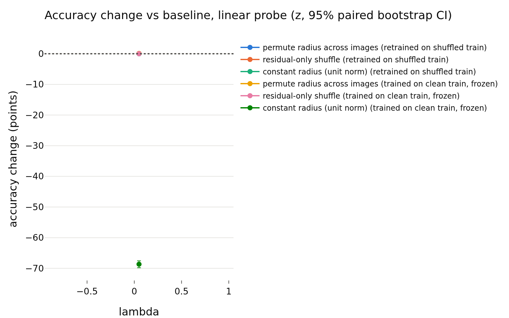
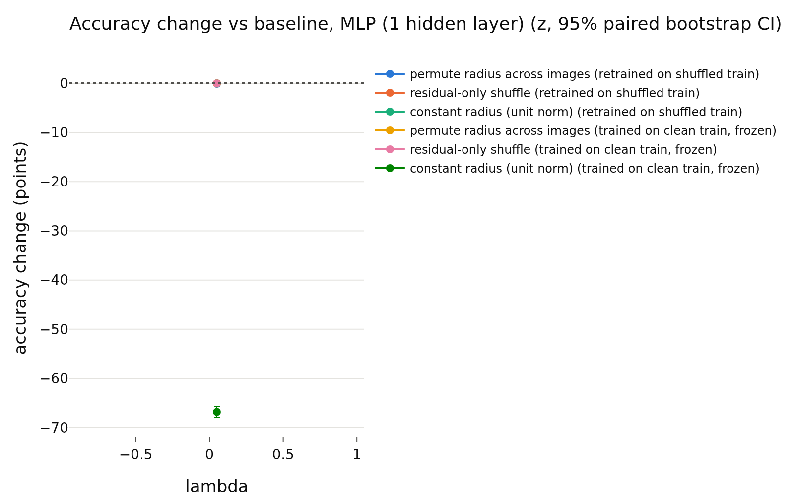

# train_supervised
- **Branch / version:** `radius-baselines-train` @ `681e353` (pre-registration commit; this note's results are generated and committed after it)
- **Run datetime (UTC):** 2026-10-26T00:52Z (training) to 2026-10-26T03:20Z (analysis); note written 2026-10-26
- **Command(s):**
  Training: `sbatch --export=ALL --cpus-per-task=4 --gres=gpu:a100:1 slurm/train.sbatch configs/base.yaml baseline_supervised_s0 --set loss.variant=supervised --set seed=0` (job 2247677 (A100, node j005-ds; 2026-10-26T01:00Z to 01:10Z, 9 min))
  Embed: `sbatch --export=ALL --cpus-per-task=4 --dependency=afterok:<train job> slurm/embed.sbatch configs/base.yaml baseline_supervised_s0 last.pt --sets stl10_train,stl10_test` (job 2247711)
  Redundancy controls: `sbatch --export=ALL,OMP_NUM_THREADS=8,OPENBLAS_NUM_THREADS=8 --dependency=afterok:<embed job> slurm/analyze.sbatch configs/base.yaml baseline_supervised_s0 radius_baselines/train_supervised.md --redundancy-controls` (job 2247714)
  Randomization: `python apps/analyze.py --config configs/base.yaml --randomize-radius baseline_supervised --note radius_baselines/train_supervised.md` via `sbatch --wrap` with PYTHONPATH=<worktree>/src, 8 CPUs, 32 GB (job 2247717)
- **Datasets:** STL-10 ([canonical](https://cs.stanford.edu/~acoates/stl10/), [HF `tanganke/stl10`](https://huggingface.co/datasets/tanganke/stl10); the canonical data via prepared arrays was used). h is not analyzed; LeJEPA's product is z.
- **Backbone:** ResNet-18 from scratch ([HF architecture reference](https://huggingface.co/timm/resnet18.a1_in1k), no pretrained weights).

## Question

Descriptive reference only: radius redundancy and usage in z of a supervised ResNet-18 (STL-10 train labels, 5000 images, 3800 steps). Pre-registered readings: `train_summary.md`.

## Setup (deviations from the base config)

See `train_summary.md`. Note: the `lambda` column of the generated tables (0.05) is the unused default and means nothing here. The generated redundancy table also contains an h block; h is not analyzed and is ignored in this note.

## Results

<!-- BEGIN GENERATED: analyze.randomization_comparison -->
### Paired accuracy change vs the baseline, per lambda

z-space, center views; bank = STL-10 train, test set = STL-10 test; the same transformation is applied to bank and test set independently. Differences are in accuracy points (condition minus baseline on the same test images), averaged over training seeds; intervals are paired bootstrap percentile intervals (1000 replicates, test images resampled within each seed). Verdict, with the equivalence margin set to ±0.5 points before looking at results: `equivalent` if the 90% interval (TOST at 5%) lies inside the margin, `different` if not equivalent and the 95% interval excludes 0, otherwise `inconclusive`. Shuffle repeats (5 per randomized condition) only average out shuffle noise; they are not part of the interval.

| lambda | reader | protocol | condition | baseline acc | condition acc | difference (points) | 90% CI (points) | 95% CI (points) | verdict |
|---|---|---|---|---|---|---|---|---|---|
| 0.05 | k-NN (euclidean) | retrained on shuffled train | permute radius across images | 0.7973 | 0.7944 | -0.28 | [-0.56, +0.00] | [-0.64, +0.07] | inconclusive |
| 0.05 | k-NN (euclidean) | retrained on shuffled train | residual-only shuffle | 0.7973 | 0.7967 | -0.05 | [-0.24, +0.14] | [-0.28, +0.17] | equivalent |
| 0.05 | k-NN (euclidean) | retrained on shuffled train | constant radius (unit norm) | 0.7973 | 0.7959 | -0.14 | [-0.43, +0.16] | [-0.48, +0.21] | equivalent |
| 0.05 | k-NN (euclidean) | trained on clean train, frozen | permute radius across images | 0.7973 | 0.7960 | -0.12 | [-0.32, +0.09] | [-0.36, +0.13] | equivalent |
| 0.05 | k-NN (euclidean) | trained on clean train, frozen | residual-only shuffle | 0.7973 | 0.7968 | -0.05 | [-0.19, +0.09] | [-0.22, +0.12] | equivalent |
| 0.05 | k-NN (euclidean) | trained on clean train, frozen | constant radius (unit norm) | 0.7973 | 0.1000 | -69.73 | [-70.64, -68.81] | [-70.80, -68.69] | different |
| 0.05 | k-NN (cosine, reference) | retrained on shuffled train | permute radius across images | 0.7959 | 0.7959 | +0.00 | [+0.00, +0.00] | [+0.00, +0.00] | equivalent |
| 0.05 | k-NN (cosine, reference) | retrained on shuffled train | residual-only shuffle | 0.7959 | 0.7959 | +0.00 | [+0.00, +0.00] | [+0.00, +0.00] | equivalent |
| 0.05 | k-NN (cosine, reference) | retrained on shuffled train | constant radius (unit norm) | 0.7959 | 0.7959 | +0.00 | [+0.00, +0.00] | [+0.00, +0.00] | equivalent |
| 0.05 | k-NN (cosine, reference) | trained on clean train, frozen | permute radius across images | 0.7959 | 0.7959 | +0.00 | [+0.00, +0.00] | [+0.00, +0.00] | equivalent |
| 0.05 | k-NN (cosine, reference) | trained on clean train, frozen | residual-only shuffle | 0.7959 | 0.7959 | +0.00 | [+0.00, +0.00] | [+0.00, +0.00] | equivalent |
| 0.05 | k-NN (cosine, reference) | trained on clean train, frozen | constant radius (unit norm) | 0.7959 | 0.7959 | +0.00 | [+0.00, +0.00] | [+0.00, +0.00] | equivalent |
| 0.05 | linear probe | retrained on shuffled train | permute radius across images | 0.7920 | 0.7917 | -0.03 | [-0.20, +0.13] | [-0.23, +0.17] | equivalent |
| 0.05 | linear probe | retrained on shuffled train | residual-only shuffle | 0.7920 | 0.7931 | +0.11 | [+0.01, +0.22] | [-0.01, +0.23] | equivalent |
| 0.05 | linear probe | retrained on shuffled train | constant radius (unit norm) | 0.7920 | 0.7921 | +0.01 | [-0.18, +0.18] | [-0.22, +0.22] | equivalent |
| 0.05 | linear probe | trained on clean train, frozen | permute radius across images | 0.7920 | 0.7924 | +0.04 | [-0.08, +0.17] | [-0.11, +0.19] | equivalent |
| 0.05 | linear probe | trained on clean train, frozen | residual-only shuffle | 0.7920 | 0.7920 | +0.00 | [-0.06, +0.07] | [-0.07, +0.08] | equivalent |
| 0.05 | linear probe | trained on clean train, frozen | constant radius (unit norm) | 0.7920 | 0.1054 | -68.66 | [-69.61, -67.75] | [-69.81, -67.56] | different |
| 0.05 | MLP (1 hidden layer) | retrained on shuffled train | permute radius across images | 0.7947 | 0.7937 | -0.10 | [-0.30, +0.09] | [-0.34, +0.14] | equivalent |
| 0.05 | MLP (1 hidden layer) | retrained on shuffled train | residual-only shuffle | 0.7947 | 0.7948 | +0.01 | [-0.11, +0.13] | [-0.14, +0.15] | equivalent |
| 0.05 | MLP (1 hidden layer) | retrained on shuffled train | constant radius (unit norm) | 0.7947 | 0.7945 | -0.02 | [-0.22, +0.18] | [-0.25, +0.22] | equivalent |
| 0.05 | MLP (1 hidden layer) | trained on clean train, frozen | permute radius across images | 0.7947 | 0.7944 | -0.03 | [-0.17, +0.09] | [-0.19, +0.11] | equivalent |
| 0.05 | MLP (1 hidden layer) | trained on clean train, frozen | residual-only shuffle | 0.7947 | 0.7945 | -0.02 | [-0.10, +0.06] | [-0.12, +0.08] | equivalent |
| 0.05 | MLP (1 hidden layer) | trained on clean train, frozen | constant radius (unit norm) | 0.7947 | 0.1266 | -66.81 | [-67.79, -65.85] | [-67.97, -65.67] | different |
<!-- END GENERATED: analyze.randomization_comparison -->

<!-- BEGIN GENERATED: analyze.randomization_accuracy -->
### Accuracy: mean ± std over training seeds, per lambda

| lambda | reader | protocol | condition | seeds | accuracy (mean ± std over seeds) | shuffle sd (mean over seeds) |
|---|---|---|---|---|---|---|
| 0.05 | k-NN (euclidean) | retrained on shuffled train | baseline | 1 | 0.7973 ± nan |  |
| 0.05 | k-NN (euclidean) | retrained on shuffled train | permute radius across images | 1 | 0.7944 ± nan | 0.0006 |
| 0.05 | k-NN (euclidean) | retrained on shuffled train | residual-only shuffle | 1 | 0.7968 ± nan | 0.0009 |
| 0.05 | k-NN (euclidean) | retrained on shuffled train | constant radius (unit norm) | 1 | 0.7959 ± nan |  |
| 0.05 | k-NN (euclidean) | trained on clean train, frozen | baseline | 1 | 0.7973 ± nan |  |
| 0.05 | k-NN (euclidean) | trained on clean train, frozen | permute radius across images | 1 | 0.7960 ± nan | 0.0013 |
| 0.05 | k-NN (euclidean) | trained on clean train, frozen | residual-only shuffle | 1 | 0.7968 ± nan | 0.0005 |
| 0.05 | k-NN (euclidean) | trained on clean train, frozen | constant radius (unit norm) | 1 | 0.1000 ± nan |  |
| 0.05 | k-NN (cosine, reference) | retrained on shuffled train | baseline | 1 | 0.7959 ± nan |  |
| 0.05 | k-NN (cosine, reference) | retrained on shuffled train | permute radius across images | 1 | 0.7959 ± nan | 0.0000 |
| 0.05 | k-NN (cosine, reference) | retrained on shuffled train | residual-only shuffle | 1 | 0.7959 ± nan | 0.0000 |
| 0.05 | k-NN (cosine, reference) | retrained on shuffled train | constant radius (unit norm) | 1 | 0.7959 ± nan |  |
| 0.05 | k-NN (cosine, reference) | trained on clean train, frozen | baseline | 1 | 0.7959 ± nan |  |
| 0.05 | k-NN (cosine, reference) | trained on clean train, frozen | permute radius across images | 1 | 0.7959 ± nan | 0.0000 |
| 0.05 | k-NN (cosine, reference) | trained on clean train, frozen | residual-only shuffle | 1 | 0.7959 ± nan | 0.0000 |
| 0.05 | k-NN (cosine, reference) | trained on clean train, frozen | constant radius (unit norm) | 1 | 0.7959 ± nan |  |
| 0.05 | linear probe | retrained on shuffled train | baseline | 1 | 0.7920 ± nan |  |
| 0.05 | linear probe | retrained on shuffled train | permute radius across images | 1 | 0.7917 ± nan | 0.0009 |
| 0.05 | linear probe | retrained on shuffled train | residual-only shuffle | 1 | 0.7931 ± nan | 0.0002 |
| 0.05 | linear probe | retrained on shuffled train | constant radius (unit norm) | 1 | 0.7921 ± nan |  |
| 0.05 | linear probe | trained on clean train, frozen | baseline | 1 | 0.7920 ± nan |  |
| 0.05 | linear probe | trained on clean train, frozen | permute radius across images | 1 | 0.7924 ± nan | 0.0007 |
| 0.05 | linear probe | trained on clean train, frozen | residual-only shuffle | 1 | 0.7920 ± nan | 0.0002 |
| 0.05 | linear probe | trained on clean train, frozen | constant radius (unit norm) | 1 | 0.1054 ± nan |  |
| 0.05 | MLP (1 hidden layer) | retrained on shuffled train | baseline | 1 | 0.7947 ± nan |  |
| 0.05 | MLP (1 hidden layer) | retrained on shuffled train | permute radius across images | 1 | 0.7937 ± nan | 0.0013 |
| 0.05 | MLP (1 hidden layer) | retrained on shuffled train | residual-only shuffle | 1 | 0.7948 ± nan | 0.0005 |
| 0.05 | MLP (1 hidden layer) | retrained on shuffled train | constant radius (unit norm) | 1 | 0.7945 ± nan |  |
| 0.05 | MLP (1 hidden layer) | trained on clean train, frozen | baseline | 1 | 0.7947 ± nan |  |
| 0.05 | MLP (1 hidden layer) | trained on clean train, frozen | permute radius across images | 1 | 0.7944 ± nan | 0.0009 |
| 0.05 | MLP (1 hidden layer) | trained on clean train, frozen | residual-only shuffle | 1 | 0.7945 ± nan | 0.0006 |
| 0.05 | MLP (1 hidden layer) | trained on clean train, frozen | constant radius (unit norm) | 1 | 0.1266 ± nan |  |
<!-- END GENERATED: analyze.randomization_accuracy -->

<!-- BEGIN GENERATED: analyze.randomization_runs -->
### Per-run accuracies

| run | reader | protocol | condition | repeats | accuracy | shuffle sd |
|---|---|---|---|---|---|---|
| baseline_supervised_s0 | k-NN (euclidean) | retrained on shuffled train | baseline | 1 | 0.7973 |  |
| baseline_supervised_s0 | k-NN (euclidean) | trained on clean train, frozen | baseline | 1 | 0.7973 |  |
| baseline_supervised_s0 | k-NN (euclidean) | trained on clean train, frozen | constant radius (unit norm) | 1 | 0.1 |  |
| baseline_supervised_s0 | k-NN (euclidean) | retrained on shuffled train | constant radius (unit norm) | 1 | 0.7959 |  |
| baseline_supervised_s0 | k-NN (euclidean) | trained on clean train, frozen | permute radius across images | 5 | 0.796 | 0.001302 |
| baseline_supervised_s0 | k-NN (euclidean) | retrained on shuffled train | permute radius across images | 5 | 0.7944 | 0.0005969 |
| baseline_supervised_s0 | k-NN (euclidean) | trained on clean train, frozen | residual-only shuffle | 5 | 0.7968 | 0.0005477 |
| baseline_supervised_s0 | k-NN (euclidean) | retrained on shuffled train | residual-only shuffle | 5 | 0.7968 | 0.0008795 |
| baseline_supervised_s0 | k-NN (cosine, reference) | retrained on shuffled train | baseline | 1 | 0.7959 |  |
| baseline_supervised_s0 | k-NN (cosine, reference) | trained on clean train, frozen | baseline | 1 | 0.7959 |  |
| baseline_supervised_s0 | k-NN (cosine, reference) | trained on clean train, frozen | constant radius (unit norm) | 1 | 0.7959 |  |
| baseline_supervised_s0 | k-NN (cosine, reference) | retrained on shuffled train | constant radius (unit norm) | 1 | 0.7959 |  |
| baseline_supervised_s0 | k-NN (cosine, reference) | trained on clean train, frozen | permute radius across images | 5 | 0.7959 | 0 |
| baseline_supervised_s0 | k-NN (cosine, reference) | retrained on shuffled train | permute radius across images | 5 | 0.7959 | 0 |
| baseline_supervised_s0 | k-NN (cosine, reference) | trained on clean train, frozen | residual-only shuffle | 5 | 0.7959 | 0 |
| baseline_supervised_s0 | k-NN (cosine, reference) | retrained on shuffled train | residual-only shuffle | 5 | 0.7959 | 0 |
| baseline_supervised_s0 | linear probe | retrained on shuffled train | baseline | 1 | 0.792 |  |
| baseline_supervised_s0 | linear probe | trained on clean train, frozen | baseline | 1 | 0.792 |  |
| baseline_supervised_s0 | linear probe | trained on clean train, frozen | constant radius (unit norm) | 1 | 0.1054 |  |
| baseline_supervised_s0 | linear probe | retrained on shuffled train | constant radius (unit norm) | 1 | 0.7921 |  |
| baseline_supervised_s0 | linear probe | trained on clean train, frozen | permute radius across images | 5 | 0.7924 | 0.0007126 |
| baseline_supervised_s0 | linear probe | retrained on shuffled train | permute radius across images | 5 | 0.7917 | 0.0008551 |
| baseline_supervised_s0 | linear probe | trained on clean train, frozen | residual-only shuffle | 5 | 0.792 | 0.000163 |
| baseline_supervised_s0 | linear probe | retrained on shuffled train | residual-only shuffle | 5 | 0.7931 | 0.0002236 |
| baseline_supervised_s0 | MLP (1 hidden layer) | retrained on shuffled train | baseline | 1 | 0.7947 |  |
| baseline_supervised_s0 | MLP (1 hidden layer) | trained on clean train, frozen | baseline | 1 | 0.7947 |  |
| baseline_supervised_s0 | MLP (1 hidden layer) | trained on clean train, frozen | constant radius (unit norm) | 1 | 0.1266 |  |
| baseline_supervised_s0 | MLP (1 hidden layer) | retrained on shuffled train | constant radius (unit norm) | 1 | 0.7945 |  |
| baseline_supervised_s0 | MLP (1 hidden layer) | trained on clean train, frozen | permute radius across images | 5 | 0.7944 | 0.0008506 |
| baseline_supervised_s0 | MLP (1 hidden layer) | retrained on shuffled train | permute radius across images | 5 | 0.7937 | 0.001294 |
| baseline_supervised_s0 | MLP (1 hidden layer) | trained on clean train, frozen | residual-only shuffle | 5 | 0.7945 | 0.0005903 |
| baseline_supervised_s0 | MLP (1 hidden layer) | retrained on shuffled train | residual-only shuffle | 5 | 0.7948 | 0.0004727 |
<!-- END GENERATED: analyze.randomization_runs -->

<!-- BEGIN GENERATED: analyze.randomization_model -->
### Direction -> log-radius regression used by the residual shuffle

| run | MLP weight decay | quantity | bank (out-of-fold) | test (held out) |
|---|---|---|---|---|
| baseline_supervised_s0 | 0.0001 | R^2 of log-radius from direction | 0.8387 | 0.8709 |
| baseline_supervised_s0 | 0.0001 | sd of log-radius | 0.2119 | 0.2699 |
| baseline_supervised_s0 | 0.0001 | sd of the residual log-radius | 0.08493 | 0.09334 |
<!-- END GENERATED: analyze.randomization_model -->

<!-- BEGIN GENERATED: analyze.randomization_skipped -->
### Runs without the required dumps

None: every run of the prefix has `stl10_train` and `stl10_test`.
<!-- END GENERATED: analyze.randomization_skipped -->

<!-- BEGIN GENERATED: analyze.randomization_figures -->
### Figures

<!-- END GENERATED: analyze.randomization_figures -->

<!-- BEGIN GENERATED: analyze.redundancy_controls -->
### Redundancy controls (run `baseline_supervised_s0`)

Held-out R^2 of the radius from the direction (nested-CV kernel ridge, same images as the redundancy table) against a permutation null (500 shuffles of the radius through the identical pipeline; p = (1 + #{null >= observed}) / (1 + permutations)), with cross-view setups that share no view between input and target, and the classical OLS F-test (linear, in-sample). The reference row is the squared correlation of the two half-view means of rho_bar.

| space | setup | N | r2 (nested CV, kernel) | null mean | null sd | null max | permutations | permutation p | F | df | F p | r2 (in-sample, linear) |
|---|---|---|---|---|---|---|---|---|---|---|---|---|
| z | same views (all 8): rho_bar ~ u_hat | 4000 | 0.9294 | -0.001361 | 0.001095 | 0.002343 | 500 | 0.001996 | 112.3 | 256, 3743 | 0 | 0.8848 |
| z | disjoint halves: rho_bar(views 4-7) ~ u_hat(views 0-3) | 4000 | 0.6537 | -0.001349 | 0.0009804 | 0.004295 | 500 | 0.001996 | 28.82 | 256, 3743 | 0 | 0.6634 |
| z | disjoint halves: rho_bar(views 0-3) ~ u_hat(views 4-7) | 4000 | 0.6455 | -0.001311 | 0.001071 | 0.004713 | 500 | 0.001996 | 28.92 | 256, 3743 | 0 | 0.6642 |
| z | single view, same view: rho_0 ~ u_0 | 4000 | 0.9004 | -0.001434 | 0.001002 | 0.001905 | 500 | 0.001996 | 70.93 | 256, 3743 | 0 | 0.8291 |
| z | single view, other view: rho_1 ~ u_0 | 4000 | 0.3061 | -0.00132 | 0.001049 | 0.00343 | 500 | 0.001996 | 8.481 | 256, 3743 | 8.253e-224 | 0.3671 |
| z | reference: split-half reliability r^2 of rho_bar |  | 0.6838 |  |  |  |  |  |  |  |  |  |
| h | same views (all 8): rho_bar ~ u_hat | 4000 | 0.9504 | -0.001137 | 0.0009105 | 0.003323 | 500 | 0.001996 | 135 | 512, 3487 | 0 | 0.952 |
| h | disjoint halves: rho_bar(views 4-7) ~ u_hat(views 0-3) | 4000 | 0.5782 | -0.001142 | 0.0008421 | 0.002781 | 500 | 0.001996 | 12.58 | 512, 3487 | 0 | 0.6488 |
| h | disjoint halves: rho_bar(views 0-3) ~ u_hat(views 4-7) | 4000 | 0.5693 | -0.001135 | 0.0008752 | 0.002329 | 500 | 0.001996 | 12.06 | 512, 3487 | 0 | 0.6391 |
| h | single view, same view: rho_0 ~ u_0 | 4000 | 0.9124 | -0.001048 | 0.0008398 | 0.002042 | 500 | 0.001996 | 77.63 | 512, 3487 | 0 | 0.9193 |
| h | single view, other view: rho_1 ~ u_0 | 4000 | 0.2419 | -0.0009219 | 0.0008638 | 0.005349 | 500 | 0.001996 | 3.97 | 512, 3487 | 3.589e-129 | 0.3682 |
| h | reference: split-half reliability r^2 of rho_bar |  | 0.5759 |  |  |  |  |  |  |  |  |  |
<!-- END GENERATED: analyze.redundancy_controls -->

## Interpretation

**Validity gate:** passed (z k-NN accuracy 0.7955, h 0.7805). The run uses 5000 labelled images and 3800 steps and is not on equal footing; it does not decide between the two stories.

**Redundancy (descriptive):** same-view held-out R^2 of z = 0.929 (null -0.001), disjoint halves 0.654 / 0.646 against a split-half reliability of only 0.684, single view to other view 0.306. The same-view value is high but cross-view reliability is low: the radius of a supervised z is noisier across views of the same image.

**Usage:** all linear and MLP cells equivalent; Euclidean k-NN equivalent except permute retrained (-0.28, inconclusive). The frozen constant radius collapses every reader (-67 to -70; norm mismatch). The radius is unused by the downstream readers, as for the self-supervised runs.

## Next steps

None planned; kept as a reference.
