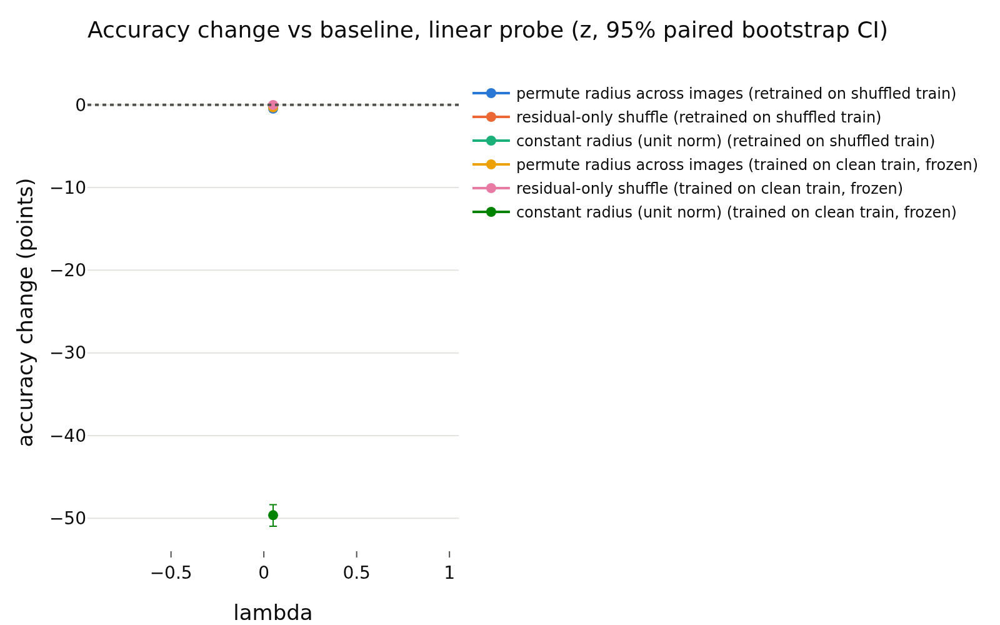
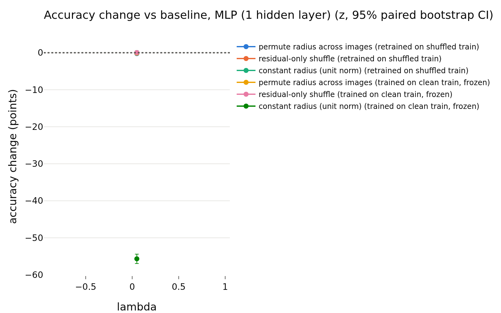

# train_vicreg
- **Branch / version:** `radius-baselines-train` @ `681e353` (pre-registration commit; this note's results are generated and committed after it)
- **Run datetime (UTC):** 2026-10-26T00:52Z (training) to 2026-10-26T03:20Z (analysis); note written 2026-10-26
- **Command(s):**
  Training: `sbatch --export=ALL --cpus-per-task=4 --gres=gpu:h200:1 slurm/train.sbatch configs/base.yaml baseline_vicreg_s0 --set loss.variant=vicreg --set data.num_local_views=0 --set seed=0` (job 2247676 (H200, node r003; 2026-10-26T00:52Z to 01:48Z, 56 min))
  Embed: `sbatch --export=ALL --cpus-per-task=4 --dependency=afterok:<train job> slurm/embed.sbatch configs/base.yaml baseline_vicreg_s0 last.pt --sets stl10_train,stl10_test` (job 2247710)
  Redundancy controls: `sbatch --export=ALL,OMP_NUM_THREADS=8,OPENBLAS_NUM_THREADS=8 --dependency=afterok:<embed job> slurm/analyze.sbatch configs/base.yaml baseline_vicreg_s0 radius_baselines/train_vicreg.md --redundancy-controls` (job 2247713)
  Randomization: `python apps/analyze.py --config configs/base.yaml --randomize-radius baseline_vicreg --note radius_baselines/train_vicreg.md` via `sbatch --wrap` with PYTHONPATH=<worktree>/src, 8 CPUs, 32 GB (job 2247716)
- **Datasets:** STL-10 ([canonical](https://cs.stanford.edu/~acoates/stl10/), [HF `tanganke/stl10`](https://huggingface.co/datasets/tanganke/stl10); the canonical data via prepared arrays was used). h is not analyzed; LeJEPA's product is z.
- **Backbone:** ResNet-18 from scratch ([HF architecture reference](https://huggingface.co/timm/resnet18.a1_in1k), no pretrained weights).

## Question

Is the radius redundancy of z specific to LeJEPA? Run: VICReg (25 / 25 / 1, no expander), seed 0. Pre-registered readings: `train_summary.md`.

## Setup (deviations from the base config)

See `train_summary.md`. Note: the `lambda` column of the generated tables (0.05) is the unused default and means nothing here. The generated redundancy table also contains an h block; h is not analyzed and is ignored in this note.

## Results

<!-- BEGIN GENERATED: analyze.randomization_comparison -->
### Paired accuracy change vs the baseline, per lambda

z-space, center views; bank = STL-10 train, test set = STL-10 test; the same transformation is applied to bank and test set independently. Differences are in accuracy points (condition minus baseline on the same test images), averaged over training seeds; intervals are paired bootstrap percentile intervals (1000 replicates, test images resampled within each seed). Verdict, with the equivalence margin set to ±0.5 points before looking at results: `equivalent` if the 90% interval (TOST at 5%) lies inside the margin, `different` if not equivalent and the 95% interval excludes 0, otherwise `inconclusive`. Shuffle repeats (5 per randomized condition) only average out shuffle noise; they are not part of the interval.

| lambda | reader | protocol | condition | baseline acc | condition acc | difference (points) | 90% CI (points) | 95% CI (points) | verdict |
|---|---|---|---|---|---|---|---|---|---|
| 0.05 | k-NN (euclidean) | retrained on shuffled train | permute radius across images | 0.7429 | 0.7434 | +0.05 | [-0.37, +0.51] | [-0.43, +0.57] | inconclusive |
| 0.05 | k-NN (euclidean) | retrained on shuffled train | residual-only shuffle | 0.7429 | 0.7398 | -0.30 | [-0.55, -0.08] | [-0.59, -0.02] | different |
| 0.05 | k-NN (euclidean) | retrained on shuffled train | constant radius (unit norm) | 0.7429 | 0.7499 | +0.70 | [+0.26, +1.18] | [+0.17, +1.25] | different |
| 0.05 | k-NN (euclidean) | trained on clean train, frozen | permute radius across images | 0.7429 | 0.6904 | -5.25 | [-5.72, -4.82] | [-5.81, -4.75] | different |
| 0.05 | k-NN (euclidean) | trained on clean train, frozen | residual-only shuffle | 0.7429 | 0.7414 | -0.15 | [-0.32, +0.02] | [-0.36, +0.05] | equivalent |
| 0.05 | k-NN (euclidean) | trained on clean train, frozen | constant radius (unit norm) | 0.7429 | 0.1174 | -62.55 | [-63.55, -61.56] | [-63.68, -61.40] | different |
| 0.05 | k-NN (cosine, reference) | retrained on shuffled train | permute radius across images | 0.7499 | 0.7499 | +0.00 | [+0.00, +0.00] | [+0.00, +0.00] | equivalent |
| 0.05 | k-NN (cosine, reference) | retrained on shuffled train | residual-only shuffle | 0.7499 | 0.7499 | +0.00 | [+0.00, +0.00] | [+0.00, +0.00] | equivalent |
| 0.05 | k-NN (cosine, reference) | retrained on shuffled train | constant radius (unit norm) | 0.7499 | 0.7499 | +0.00 | [+0.00, +0.00] | [+0.00, +0.00] | equivalent |
| 0.05 | k-NN (cosine, reference) | trained on clean train, frozen | permute radius across images | 0.7499 | 0.7499 | +0.00 | [+0.00, +0.00] | [+0.00, +0.00] | equivalent |
| 0.05 | k-NN (cosine, reference) | trained on clean train, frozen | residual-only shuffle | 0.7499 | 0.7499 | +0.00 | [+0.00, +0.00] | [+0.00, +0.00] | equivalent |
| 0.05 | k-NN (cosine, reference) | trained on clean train, frozen | constant radius (unit norm) | 0.7499 | 0.7499 | +0.00 | [+0.00, +0.00] | [+0.00, +0.00] | equivalent |
| 0.05 | linear probe | retrained on shuffled train | permute radius across images | 0.7721 | 0.7675 | -0.46 | [-0.77, -0.17] | [-0.82, -0.11] | different |
| 0.05 | linear probe | retrained on shuffled train | residual-only shuffle | 0.7721 | 0.7714 | -0.07 | [-0.19, +0.04] | [-0.21, +0.06] | equivalent |
| 0.05 | linear probe | retrained on shuffled train | constant radius (unit norm) | 0.7721 | 0.7705 | -0.16 | [-0.53, +0.16] | [-0.59, +0.26] | inconclusive |
| 0.05 | linear probe | trained on clean train, frozen | permute radius across images | 0.7721 | 0.7690 | -0.31 | [-0.58, -0.06] | [-0.62, -0.01] | different |
| 0.05 | linear probe | trained on clean train, frozen | residual-only shuffle | 0.7721 | 0.7719 | -0.02 | [-0.09, +0.05] | [-0.10, +0.07] | equivalent |
| 0.05 | linear probe | trained on clean train, frozen | constant radius (unit norm) | 0.7721 | 0.2759 | -49.62 | [-50.71, -48.55] | [-50.96, -48.36] | different |
| 0.05 | MLP (1 hidden layer) | retrained on shuffled train | permute radius across images | 0.7656 | 0.7633 | -0.24 | [-0.58, +0.11] | [-0.65, +0.21] | inconclusive |
| 0.05 | MLP (1 hidden layer) | retrained on shuffled train | residual-only shuffle | 0.7656 | 0.7659 | +0.03 | [-0.18, +0.24] | [-0.20, +0.29] | equivalent |
| 0.05 | MLP (1 hidden layer) | retrained on shuffled train | constant radius (unit norm) | 0.7656 | 0.7660 | +0.04 | [-0.38, +0.43] | [-0.45, +0.51] | equivalent |
| 0.05 | MLP (1 hidden layer) | trained on clean train, frozen | permute radius across images | 0.7656 | 0.7646 | -0.10 | [-0.34, +0.14] | [-0.38, +0.19] | equivalent |
| 0.05 | MLP (1 hidden layer) | trained on clean train, frozen | residual-only shuffle | 0.7656 | 0.7661 | +0.05 | [-0.03, +0.12] | [-0.03, +0.14] | equivalent |
| 0.05 | MLP (1 hidden layer) | trained on clean train, frozen | constant radius (unit norm) | 0.7656 | 0.2089 | -55.67 | [-56.80, -54.59] | [-56.95, -54.41] | different |
<!-- END GENERATED: analyze.randomization_comparison -->

<!-- BEGIN GENERATED: analyze.randomization_accuracy -->
### Accuracy: mean ± std over training seeds, per lambda

| lambda | reader | protocol | condition | seeds | accuracy (mean ± std over seeds) | shuffle sd (mean over seeds) |
|---|---|---|---|---|---|---|
| 0.05 | k-NN (euclidean) | retrained on shuffled train | baseline | 1 | 0.7429 ± nan |  |
| 0.05 | k-NN (euclidean) | retrained on shuffled train | permute radius across images | 1 | 0.7434 ± nan | 0.0017 |
| 0.05 | k-NN (euclidean) | retrained on shuffled train | residual-only shuffle | 1 | 0.7399 ± nan | 0.0007 |
| 0.05 | k-NN (euclidean) | retrained on shuffled train | constant radius (unit norm) | 1 | 0.7499 ± nan |  |
| 0.05 | k-NN (euclidean) | trained on clean train, frozen | baseline | 1 | 0.7429 ± nan |  |
| 0.05 | k-NN (euclidean) | trained on clean train, frozen | permute radius across images | 1 | 0.6904 ± nan | 0.0046 |
| 0.05 | k-NN (euclidean) | trained on clean train, frozen | residual-only shuffle | 1 | 0.7414 ± nan | 0.0010 |
| 0.05 | k-NN (euclidean) | trained on clean train, frozen | constant radius (unit norm) | 1 | 0.1174 ± nan |  |
| 0.05 | k-NN (cosine, reference) | retrained on shuffled train | baseline | 1 | 0.7499 ± nan |  |
| 0.05 | k-NN (cosine, reference) | retrained on shuffled train | permute radius across images | 1 | 0.7499 ± nan | 0.0000 |
| 0.05 | k-NN (cosine, reference) | retrained on shuffled train | residual-only shuffle | 1 | 0.7499 ± nan | 0.0000 |
| 0.05 | k-NN (cosine, reference) | retrained on shuffled train | constant radius (unit norm) | 1 | 0.7499 ± nan |  |
| 0.05 | k-NN (cosine, reference) | trained on clean train, frozen | baseline | 1 | 0.7499 ± nan |  |
| 0.05 | k-NN (cosine, reference) | trained on clean train, frozen | permute radius across images | 1 | 0.7499 ± nan | 0.0000 |
| 0.05 | k-NN (cosine, reference) | trained on clean train, frozen | residual-only shuffle | 1 | 0.7499 ± nan | 0.0000 |
| 0.05 | k-NN (cosine, reference) | trained on clean train, frozen | constant radius (unit norm) | 1 | 0.7499 ± nan |  |
| 0.05 | linear probe | retrained on shuffled train | baseline | 1 | 0.7721 ± nan |  |
| 0.05 | linear probe | retrained on shuffled train | permute radius across images | 1 | 0.7675 ± nan | 0.0022 |
| 0.05 | linear probe | retrained on shuffled train | residual-only shuffle | 1 | 0.7714 ± nan | 0.0007 |
| 0.05 | linear probe | retrained on shuffled train | constant radius (unit norm) | 1 | 0.7705 ± nan |  |
| 0.05 | linear probe | trained on clean train, frozen | baseline | 1 | 0.7721 ± nan |  |
| 0.05 | linear probe | trained on clean train, frozen | permute radius across images | 1 | 0.7690 ± nan | 0.0015 |
| 0.05 | linear probe | trained on clean train, frozen | residual-only shuffle | 1 | 0.7719 ± nan | 0.0003 |
| 0.05 | linear probe | trained on clean train, frozen | constant radius (unit norm) | 1 | 0.2759 ± nan |  |
| 0.05 | MLP (1 hidden layer) | retrained on shuffled train | baseline | 1 | 0.7656 ± nan |  |
| 0.05 | MLP (1 hidden layer) | retrained on shuffled train | permute radius across images | 1 | 0.7633 ± nan | 0.0019 |
| 0.05 | MLP (1 hidden layer) | retrained on shuffled train | residual-only shuffle | 1 | 0.7659 ± nan | 0.0011 |
| 0.05 | MLP (1 hidden layer) | retrained on shuffled train | constant radius (unit norm) | 1 | 0.7660 ± nan |  |
| 0.05 | MLP (1 hidden layer) | trained on clean train, frozen | baseline | 1 | 0.7656 ± nan |  |
| 0.05 | MLP (1 hidden layer) | trained on clean train, frozen | permute radius across images | 1 | 0.7646 ± nan | 0.0010 |
| 0.05 | MLP (1 hidden layer) | trained on clean train, frozen | residual-only shuffle | 1 | 0.7661 ± nan | 0.0005 |
| 0.05 | MLP (1 hidden layer) | trained on clean train, frozen | constant radius (unit norm) | 1 | 0.2089 ± nan |  |
<!-- END GENERATED: analyze.randomization_accuracy -->

<!-- BEGIN GENERATED: analyze.randomization_runs -->
### Per-run accuracies

| run | reader | protocol | condition | repeats | accuracy | shuffle sd |
|---|---|---|---|---|---|---|
| baseline_vicreg_s0 | k-NN (euclidean) | retrained on shuffled train | baseline | 1 | 0.7429 |  |
| baseline_vicreg_s0 | k-NN (euclidean) | trained on clean train, frozen | baseline | 1 | 0.7429 |  |
| baseline_vicreg_s0 | k-NN (euclidean) | trained on clean train, frozen | constant radius (unit norm) | 1 | 0.1174 |  |
| baseline_vicreg_s0 | k-NN (euclidean) | retrained on shuffled train | constant radius (unit norm) | 1 | 0.7499 |  |
| baseline_vicreg_s0 | k-NN (euclidean) | trained on clean train, frozen | permute radius across images | 5 | 0.6904 | 0.004565 |
| baseline_vicreg_s0 | k-NN (euclidean) | retrained on shuffled train | permute radius across images | 5 | 0.7434 | 0.001746 |
| baseline_vicreg_s0 | k-NN (euclidean) | trained on clean train, frozen | residual-only shuffle | 5 | 0.7414 | 0.0009642 |
| baseline_vicreg_s0 | k-NN (euclidean) | retrained on shuffled train | residual-only shuffle | 5 | 0.7399 | 0.0006926 |
| baseline_vicreg_s0 | k-NN (cosine, reference) | retrained on shuffled train | baseline | 1 | 0.7499 |  |
| baseline_vicreg_s0 | k-NN (cosine, reference) | trained on clean train, frozen | baseline | 1 | 0.7499 |  |
| baseline_vicreg_s0 | k-NN (cosine, reference) | trained on clean train, frozen | constant radius (unit norm) | 1 | 0.7499 |  |
| baseline_vicreg_s0 | k-NN (cosine, reference) | retrained on shuffled train | constant radius (unit norm) | 1 | 0.7499 |  |
| baseline_vicreg_s0 | k-NN (cosine, reference) | trained on clean train, frozen | permute radius across images | 5 | 0.7499 | 0 |
| baseline_vicreg_s0 | k-NN (cosine, reference) | retrained on shuffled train | permute radius across images | 5 | 0.7499 | 0 |
| baseline_vicreg_s0 | k-NN (cosine, reference) | trained on clean train, frozen | residual-only shuffle | 5 | 0.7499 | 0 |
| baseline_vicreg_s0 | k-NN (cosine, reference) | retrained on shuffled train | residual-only shuffle | 5 | 0.7499 | 0 |
| baseline_vicreg_s0 | linear probe | retrained on shuffled train | baseline | 1 | 0.7721 |  |
| baseline_vicreg_s0 | linear probe | trained on clean train, frozen | baseline | 1 | 0.7721 |  |
| baseline_vicreg_s0 | linear probe | trained on clean train, frozen | constant radius (unit norm) | 1 | 0.2759 |  |
| baseline_vicreg_s0 | linear probe | retrained on shuffled train | constant radius (unit norm) | 1 | 0.7705 |  |
| baseline_vicreg_s0 | linear probe | trained on clean train, frozen | permute radius across images | 5 | 0.769 | 0.001547 |
| baseline_vicreg_s0 | linear probe | retrained on shuffled train | permute radius across images | 5 | 0.7675 | 0.002182 |
| baseline_vicreg_s0 | linear probe | trained on clean train, frozen | residual-only shuffle | 5 | 0.7719 | 0.0002592 |
| baseline_vicreg_s0 | linear probe | retrained on shuffled train | residual-only shuffle | 5 | 0.7714 | 0.000696 |
| baseline_vicreg_s0 | MLP (1 hidden layer) | retrained on shuffled train | baseline | 1 | 0.7656 |  |
| baseline_vicreg_s0 | MLP (1 hidden layer) | trained on clean train, frozen | baseline | 1 | 0.7656 |  |
| baseline_vicreg_s0 | MLP (1 hidden layer) | trained on clean train, frozen | constant radius (unit norm) | 1 | 0.2089 |  |
| baseline_vicreg_s0 | MLP (1 hidden layer) | retrained on shuffled train | constant radius (unit norm) | 1 | 0.766 |  |
| baseline_vicreg_s0 | MLP (1 hidden layer) | trained on clean train, frozen | permute radius across images | 5 | 0.7646 | 0.0009601 |
| baseline_vicreg_s0 | MLP (1 hidden layer) | retrained on shuffled train | permute radius across images | 5 | 0.7633 | 0.001872 |
| baseline_vicreg_s0 | MLP (1 hidden layer) | trained on clean train, frozen | residual-only shuffle | 5 | 0.7661 | 0.0005259 |
| baseline_vicreg_s0 | MLP (1 hidden layer) | retrained on shuffled train | residual-only shuffle | 5 | 0.7659 | 0.001085 |
<!-- END GENERATED: analyze.randomization_runs -->

<!-- BEGIN GENERATED: analyze.randomization_model -->
### Direction -> log-radius regression used by the residual shuffle

| run | MLP weight decay | quantity | bank (out-of-fold) | test (held out) |
|---|---|---|---|---|
| baseline_vicreg_s0 | 0.0001 | R^2 of log-radius from direction | 0.9936 | 0.9929 |
| baseline_vicreg_s0 | 0.0001 | sd of log-radius | 0.438 | 0.4233 |
| baseline_vicreg_s0 | 0.0001 | sd of the residual log-radius | 0.03492 | 0.03472 |
<!-- END GENERATED: analyze.randomization_model -->

<!-- BEGIN GENERATED: analyze.randomization_skipped -->
### Runs without the required dumps

None: every run of the prefix has `stl10_train` and `stl10_test`.
<!-- END GENERATED: analyze.randomization_skipped -->

<!-- BEGIN GENERATED: analyze.randomization_figures -->
### Figures

<!-- END GENERATED: analyze.randomization_figures -->

<!-- BEGIN GENERATED: analyze.redundancy_controls -->
### Redundancy controls (run `baseline_vicreg_s0`)

Held-out R^2 of the radius from the direction (nested-CV kernel ridge, same images as the redundancy table) against a permutation null (500 shuffles of the radius through the identical pipeline; p = (1 + #{null >= observed}) / (1 + permutations)), with cross-view setups that share no view between input and target, and the classical OLS F-test (linear, in-sample). The reference row is the squared correlation of the two half-view means of rho_bar.

| space | setup | N | r2 (nested CV, kernel) | null mean | null sd | null max | permutations | permutation p | F | df | F p | r2 (in-sample, linear) |
|---|---|---|---|---|---|---|---|---|---|---|---|---|
| z | same views (all 8): rho_bar ~ u_hat | 4000 | 0.9897 | -0.001016 | 0.0007708 | 0.00299 | 500 | 0.001996 | 558.8 | 256, 3743 | 0 | 0.9745 |
| z | disjoint halves: rho_bar(views 4-7) ~ u_hat(views 0-3) | 4000 | 0.9538 | -0.001034 | 0.0008092 | 0.003112 | 500 | 0.001996 | 264.9 | 256, 3743 | 0 | 0.9477 |
| z | disjoint halves: rho_bar(views 0-3) ~ u_hat(views 4-7) | 4000 | 0.9509 | -0.001054 | 0.000835 | 0.003191 | 500 | 0.001996 | 259.1 | 256, 3743 | 0 | 0.9466 |
| z | single view, same view: rho_0 ~ u_0 | 4000 | 0.9897 | -0.00102 | 0.0009125 | 0.006405 | 500 | 0.001996 | 521.7 | 256, 3743 | 0 | 0.9727 |
| z | single view, other view: rho_1 ~ u_0 | 4000 | 0.8727 | -0.00101 | 0.0007708 | 0.002386 | 500 | 0.001996 | 106.7 | 256, 3743 | 0 | 0.8795 |
| z | reference: split-half reliability r^2 of rho_bar |  | 0.9712 |  |  |  |  |  |  |  |  |  |
| h | same views (all 8): rho_bar ~ u_hat | 4000 | 0.9562 | -0.001056 | 0.0008579 | 0.003918 | 500 | 0.001996 | 121.3 | 512, 3487 | 0 | 0.9468 |
| h | disjoint halves: rho_bar(views 4-7) ~ u_hat(views 0-3) | 4000 | 0.8962 | -0.001027 | 0.0008416 | 0.003567 | 500 | 0.001996 | 65.63 | 512, 3487 | 0 | 0.906 |
| h | disjoint halves: rho_bar(views 0-3) ~ u_hat(views 4-7) | 4000 | 0.8972 | -0.001115 | 0.000851 | 0.002825 | 500 | 0.001996 | 64.69 | 512, 3487 | 0 | 0.9048 |
| h | single view, same view: rho_0 ~ u_0 | 4000 | 0.9188 | -0.001025 | 0.0008574 | 0.004543 | 500 | 0.001996 | 71.37 | 512, 3487 | 0 | 0.9129 |
| h | single view, other view: rho_1 ~ u_0 | 4000 | 0.7626 | -0.0009822 | 0.0007976 | 0.002872 | 500 | 0.001996 | 26.14 | 512, 3487 | 0 | 0.7933 |
| h | reference: split-half reliability r^2 of rho_bar |  | 0.9372 |  |  |  |  |  |  |  |  |  |
<!-- END GENERATED: analyze.redundancy_controls -->

## Interpretation

**Validity gate:** passed (z k-NN accuracy 0.7494 at epoch 200, h 0.778; threshold 0.55; lower than LeJEPA's 0.78-0.79).

**Redundancy:** same-view held-out R^2 of z = **0.990** (null -0.001, p = 0.002), disjoint halves 0.954 / 0.951 against a split-half reliability of 0.971, single view to other view 0.873. Pre-registered rule: R^2 >= 0.85 with a null near 0, so for VICReg the redundancy is *at least as strong as for LeJEPA*, i.e. not specific to SIGReg. Outside the more-seeds band, one seed.

**Usage:** the residual-only shuffle is equivalent for the linear probe (retrained, frozen), the MLP (both) and frozen k-NN; retrained k-NN residual shuffle -0.30 `different`. Permuting the radius across images is more damaging here than for LeJEPA or SimCLR: frozen k-NN -5.25, linear probe -0.46 (retrained) and -0.31 (frozen) `different`, MLP inconclusive/equivalent. So VICReg's radius (mean norm about 15, high spread; kappa_z about 85) carries something the direction does not (permute destroys the direction-radius link, residual shuffle does not), but the effect on linear/MLP readers is below 0.5 points in size; only the Euclidean k-NN is materially affected, which is the metric that uses the radius by construction. Frozen constant radius collapses (scale mismatch, as for SimCLR). Mixed with respect to a "pure nuisance" reading: high redundancy, equivalence for the residual part, a small but detectable permute effect.

## Next steps

One seed (rule not triggered).
