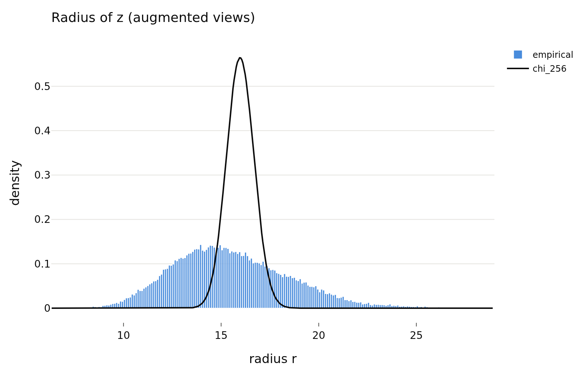
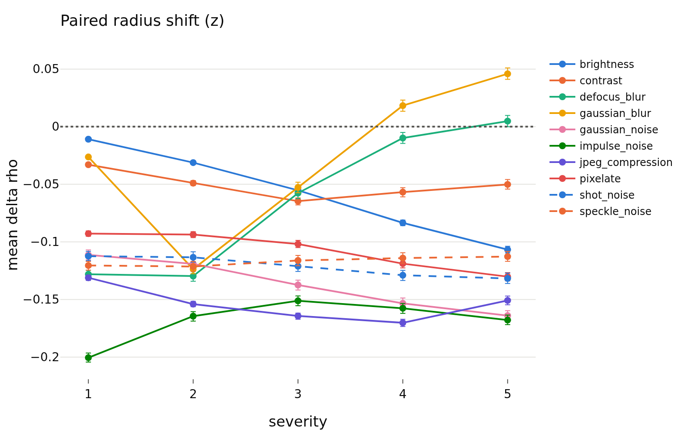
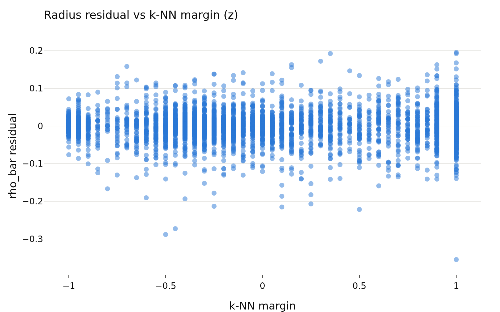
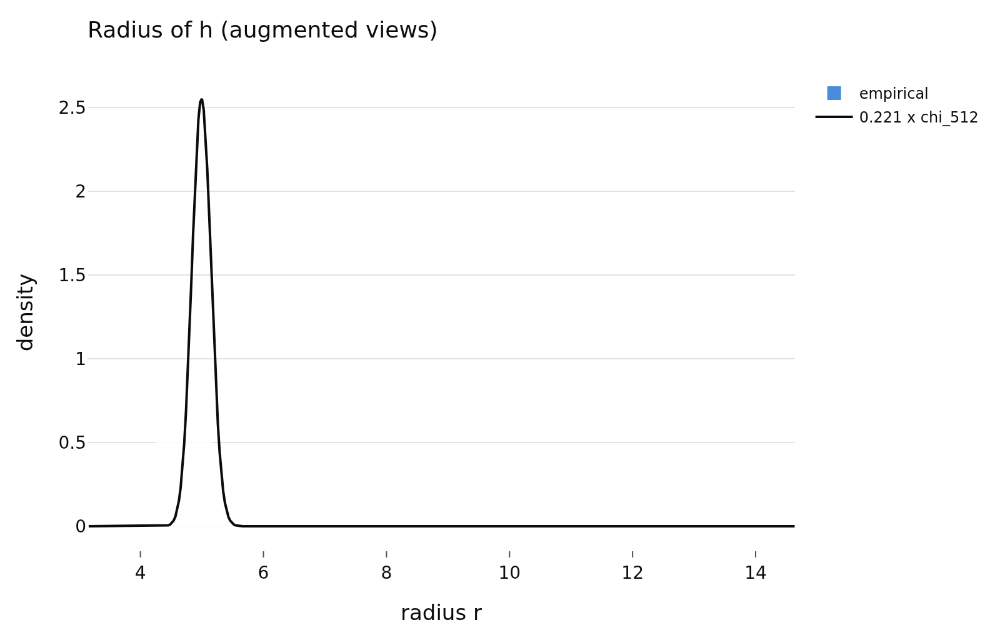
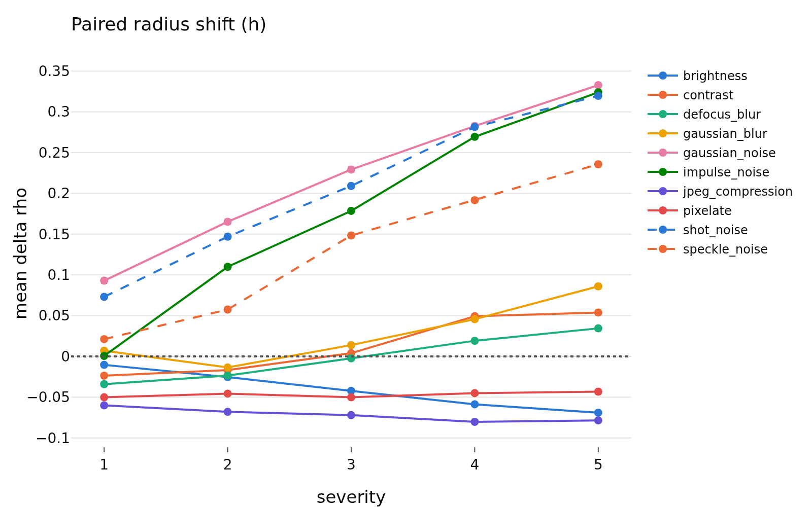
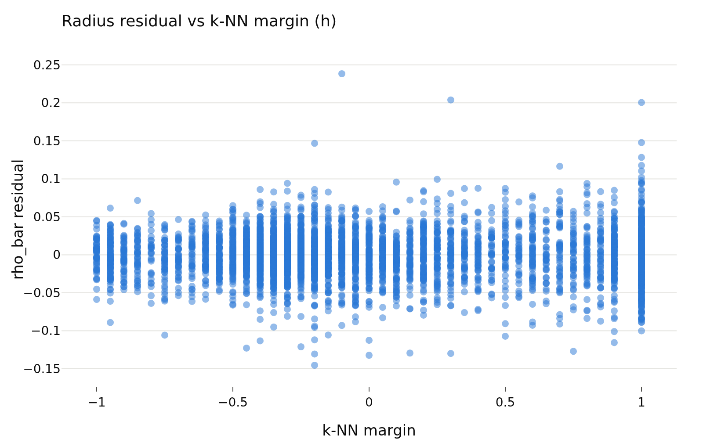
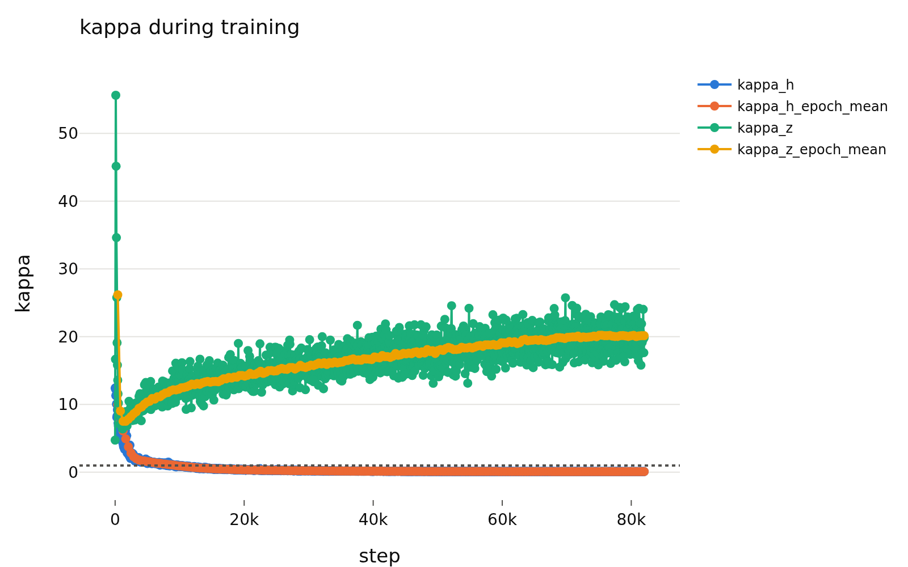

# variant_a_lam0.05
- **Branch / version:** `radius-conditional` @ `97ad785` (`master`, merge of PR #27)
- **Run datetime (UTC):** 2026-10-22T15:17Z (embedding, job 2231953, finished 15:04Z; analysis, job 2231992, started ~15:18Z, 9 min 41 s). The first analysis attempt (job 2231973) failed at figure export because `LEJEPA_NORM_KALEIDO_CHROME` pointed to a directory; the same command was rerun after fixing `.env`.
- **Command(s):** (submitted from the cluster checkout at the commit above; `--exclude=m002` because scratch was not writable on that node)
  `sbatch --cpus-per-task=4 --gres=gpu:1 --exclude=m002 slurm/embed.sbatch configs/base.yaml radius_marginal_lam0.05_s0 last.pt`
  `sbatch --mem=64G --exclude=m002 slurm/analyze.sbatch configs/base.yaml radius_marginal_lam0.05_s0 radius_conditional/variant_a_lam0.05.md`
- **Datasets:** STL-10 ([canonical](https://cs.stanford.edu/~acoates/stl10/), [HF](https://huggingface.co/datasets/tanganke/stl10)), canonical archive used; STL-10-C built locally from STL-10 `test` (10 corruptions x 5 severities, 400k images; no HF mirror); DTD ([canonical](https://www.robots.ox.ac.uk/~vgg/data/dtd/), [HF](https://huggingface.co/datasets/tanganke/dtd)) and SVHN ([canonical](http://ufldl.stanford.edu/housenumbers/), [HF](https://huggingface.co/datasets/ufldl-stanford/svhn)) `test` splits as OOD sets. Which source was actually used for DTD/SVHN: not re-verified for this note, see `apps/prepare_data.py`.
- **Backbone:** ResNet-18 from scratch ([HF architecture reference](https://huggingface.co/timm/resnet18.a1_in1k), weights not used); checkpoint `last.pt` of `radius_marginal_lam0.05_s0` (Variant A, lambda = 0.05, seed 0, epoch 200).

## Question

Is the embedding radius an image-level signal rather than noise around the chi_256 marginal? Specifically, for the main Variant A run (lambda = 0.05, seed 0): (1) is the log-radius consistent across augmented views of the same image (ICC); (2) is it redundant with the direction `u_hat = z/||z||` (held-out R^2 of the mean log-radius `rho_bar` from `u_hat`); (3) does it carry difficulty or shift information beyond what the direction carries; (4) does it help downstream tasks (probe, OOD, selective classification, retrieval)?

## Setup (deviations from the base config)

Base config unchanged (`configs/base.yaml`; the analysis uses its `eval.*` defaults). Evaluation on STL-10 `test` with K = 8 augmented views plus the center view; STL-10-C paired with the clean test images. `z` is the projector output and `h` the 512-d backbone feature.

## Results

<!-- BEGIN GENERATED: analyze.inputs -->
### Inputs (run `radius_marginal_lam0.05_s0`)

| set | images |
|---|---|
| stl10_train | 5000 |
| stl10_test | 8000 |
| stl10c | 400000 |
| dtd_test | 1880 |
| svhn_test | 26032 |
<!-- END GENERATED: analyze.inputs -->

<!-- BEGIN GENERATED: analyze.marginal -->
### Marginal radius (STL-10 test)

| space | views | d | kappa | mean_r | std_r | mean_r_sq_over_d |
|---|---|---|---|---|---|---|
| z | center | 256 | 17.41 | 15.92 | 2.811 | 1.021 |
| z | augmented | 256 | 19.54 | 15.56 | 3.026 | 0.9816 |
| h | center | 512 | 0.05574 | 4.927 | 0.6825 | 0.04832 |
| h | augmented | 512 | 0.07386 | 4.94 | 0.754 | 0.04878 |
<!-- END GENERATED: analyze.marginal -->

<!-- BEGIN GENERATED: analyze.icc -->
### ICC(1) of the log-radius over augmented views

| space | icc | msb | msw | K | N |
|---|---|---|---|---|---|
| z | 0.872 [0.868, 0.877] | 0.2653 | 0.004772 | 8 | 8000 |
| h | 0.765 [0.755, 0.774] | 0.1257 | 0.004659 | 8 | 8000 |
<!-- END GENERATED: analyze.icc -->

<!-- BEGIN GENERATED: analyze.redundancy -->
### Redundancy: held-out R^2 of rho_bar

| space | model | r2 | fold_r2_std | N | params (median over folds) |
|---|---|---|---|---|---|
| z | kernel ridge (u_hat) | 0.9451 | 0.005354 | 4000 | alpha=0.001, tau=4.14 |
| z | linear ridge (u_hat) | 0.8073 | 0.008118 | 4000 | alpha=0.001 |
| z | class one-hot | 0.2024 | 0.0467 | 4000 |  |
| h | kernel ridge (u_hat) | 0.9217 | 0.004234 | 4000 | alpha=0.01, tau=1.35 |
| h | linear ridge (u_hat) | 0.8859 | 0.009043 | 4000 | alpha=0.1 |
| h | class one-hot | 0.04015 | 0.01199 | 4000 |  |
<!-- END GENERATED: analyze.redundancy -->

<!-- BEGIN GENERATED: analyze.difficulty -->
### Difficulty correlations (Spearman, 95% bootstrap CI)

| space | score | spearman(rho_bar) | spearman(residual) | partial spearman(rho_bar \| class) | N |
|---|---|---|---|---|---|
| z | severity | 0.004 [-0.029, 0.037] | 0.021 [-0.012, 0.054] | 0.004 [-0.027, 0.034] | 4000 |
| z | knn_margin | 0.145 [0.110, 0.178] | -0.005 [-0.036, 0.028] | 0.145 [0.111, 0.182] | 4000 |
| z | view_consistency | 0.625 [0.603, 0.644] | 0.001 [-0.032, 0.033] | 0.629 [0.608, 0.650] | 4000 |
| z | probe_entropy | -0.244 [-0.277, -0.213] | 0.017 [-0.011, 0.049] | -0.256 [-0.285, -0.222] | 4000 |
| h | severity | 0.272 [0.242, 0.304] | 0.010 [-0.021, 0.041] | 0.275 [0.246, 0.303] | 4000 |
| h | knn_margin | -0.242 [-0.270, -0.212] | 0.003 [-0.027, 0.035] | -0.239 [-0.266, -0.211] | 4000 |
| h | view_consistency | 0.058 [0.026, 0.087] | -0.089 [-0.120, -0.060] | 0.059 [0.025, 0.092] | 4000 |
| h | probe_entropy | 0.311 [0.283, 0.338] | 0.006 [-0.024, 0.037] | 0.310 [0.283, 0.337] | 4000 |
<!-- END GENERATED: analyze.difficulty -->

<!-- BEGIN GENERATED: analyze.radius_shift -->
### Paired radius shift vs. corruption severity

| space | corruption | severity | mean delta_rho | N |
|---|---|---|---|---|
| z | brightness | 1 | -0.011 [-0.012, -0.010] | 8000 |
| z | brightness | 2 | -0.031 [-0.033, -0.030] | 8000 |
| z | brightness | 3 | -0.055 [-0.057, -0.053] | 8000 |
| z | brightness | 4 | -0.083 [-0.086, -0.081] | 8000 |
| z | brightness | 5 | -0.107 [-0.110, -0.104] | 8000 |
| z | contrast | 1 | -0.033 [-0.035, -0.031] | 8000 |
| z | contrast | 2 | -0.049 [-0.051, -0.047] | 8000 |
| z | contrast | 3 | -0.065 [-0.068, -0.062] | 8000 |
| z | contrast | 4 | -0.057 [-0.061, -0.053] | 8000 |
| z | contrast | 5 | -0.050 [-0.054, -0.046] | 8000 |
| z | defocus_blur | 1 | -0.128 [-0.132, -0.125] | 8000 |
| z | defocus_blur | 2 | -0.130 [-0.134, -0.125] | 8000 |
| z | defocus_blur | 3 | -0.058 [-0.062, -0.053] | 8000 |
| z | defocus_blur | 4 | -0.010 [-0.015, -0.005] | 8000 |
| z | defocus_blur | 5 | 0.005 [-0.000, 0.010] | 8000 |
| z | gaussian_blur | 1 | -0.026 [-0.028, -0.025] | 8000 |
| z | gaussian_blur | 2 | -0.124 [-0.128, -0.120] | 8000 |
| z | gaussian_blur | 3 | -0.053 [-0.057, -0.048] | 8000 |
| z | gaussian_blur | 4 | 0.018 [0.013, 0.023] | 8000 |
| z | gaussian_blur | 5 | 0.046 [0.041, 0.051] | 8000 |
| z | gaussian_noise | 1 | -0.111 [-0.116, -0.107] | 8000 |
| z | gaussian_noise | 2 | -0.119 [-0.123, -0.115] | 8000 |
| z | gaussian_noise | 3 | -0.137 [-0.142, -0.133] | 8000 |
| z | gaussian_noise | 4 | -0.153 [-0.158, -0.149] | 8000 |
| z | gaussian_noise | 5 | -0.164 [-0.168, -0.160] | 8000 |
| z | impulse_noise | 1 | -0.201 [-0.204, -0.197] | 8000 |
| z | impulse_noise | 2 | -0.164 [-0.169, -0.161] | 8000 |
| z | impulse_noise | 3 | -0.151 [-0.155, -0.147] | 8000 |
| z | impulse_noise | 4 | -0.158 [-0.162, -0.154] | 8000 |
| z | impulse_noise | 5 | -0.168 [-0.172, -0.164] | 8000 |
| z | jpeg_compression | 1 | -0.131 [-0.133, -0.129] | 8000 |
| z | jpeg_compression | 2 | -0.154 [-0.156, -0.152] | 8000 |
| z | jpeg_compression | 3 | -0.164 [-0.167, -0.162] | 8000 |
| z | jpeg_compression | 4 | -0.170 [-0.173, -0.167] | 8000 |
| z | jpeg_compression | 5 | -0.151 [-0.155, -0.147] | 8000 |
| z | pixelate | 1 | -0.093 [-0.095, -0.090] | 8000 |
| z | pixelate | 2 | -0.094 [-0.096, -0.091] | 8000 |
| z | pixelate | 3 | -0.102 [-0.105, -0.099] | 8000 |
| z | pixelate | 4 | -0.119 [-0.123, -0.115] | 8000 |
| z | pixelate | 5 | -0.130 [-0.134, -0.127] | 8000 |
| z | shot_noise | 1 | -0.112 [-0.116, -0.108] | 8000 |
| z | shot_noise | 2 | -0.113 [-0.118, -0.109] | 8000 |
| z | shot_noise | 3 | -0.121 [-0.126, -0.116] | 8000 |
| z | shot_noise | 4 | -0.129 [-0.133, -0.125] | 8000 |
| z | shot_noise | 5 | -0.132 [-0.136, -0.127] | 8000 |
| z | speckle_noise | 1 | -0.120 [-0.125, -0.117] | 8000 |
| z | speckle_noise | 2 | -0.121 [-0.126, -0.117] | 8000 |
| z | speckle_noise | 3 | -0.116 [-0.121, -0.112] | 8000 |
| z | speckle_noise | 4 | -0.114 [-0.118, -0.109] | 8000 |
| z | speckle_noise | 5 | -0.113 [-0.117, -0.108] | 8000 |
| h | brightness | 1 | -0.010 [-0.011, -0.010] | 8000 |
| h | brightness | 2 | -0.025 [-0.027, -0.024] | 8000 |
| h | brightness | 3 | -0.042 [-0.044, -0.041] | 8000 |
| h | brightness | 4 | -0.059 [-0.061, -0.057] | 8000 |
| h | brightness | 5 | -0.069 [-0.071, -0.067] | 8000 |
| h | contrast | 1 | -0.024 [-0.025, -0.022] | 8000 |
| h | contrast | 2 | -0.017 [-0.019, -0.015] | 8000 |
| h | contrast | 3 | 0.004 [0.001, 0.007] | 8000 |
| h | contrast | 4 | 0.049 [0.046, 0.053] | 8000 |
| h | contrast | 5 | 0.054 [0.051, 0.057] | 8000 |
| h | defocus_blur | 1 | -0.034 [-0.036, -0.032] | 8000 |
| h | defocus_blur | 2 | -0.023 [-0.026, -0.021] | 8000 |
| h | defocus_blur | 3 | -0.002 [-0.005, 0.001] | 8000 |
| h | defocus_blur | 4 | 0.019 [0.016, 0.022] | 8000 |
| h | defocus_blur | 5 | 0.034 [0.031, 0.037] | 8000 |
| h | gaussian_blur | 1 | 0.007 [0.006, 0.008] | 8000 |
| h | gaussian_blur | 2 | -0.014 [-0.016, -0.011] | 8000 |
| h | gaussian_blur | 3 | 0.014 [0.011, 0.017] | 8000 |
| h | gaussian_blur | 4 | 0.046 [0.043, 0.049] | 8000 |
| h | gaussian_blur | 5 | 0.086 [0.083, 0.089] | 8000 |
| h | gaussian_noise | 1 | 0.093 [0.089, 0.096] | 8000 |
| h | gaussian_noise | 2 | 0.165 [0.162, 0.169] | 8000 |
| h | gaussian_noise | 3 | 0.229 [0.226, 0.233] | 8000 |
| h | gaussian_noise | 4 | 0.283 [0.280, 0.286] | 8000 |
| h | gaussian_noise | 5 | 0.333 [0.330, 0.336] | 8000 |
| h | impulse_noise | 1 | 0.001 [-0.002, 0.003] | 8000 |
| h | impulse_noise | 2 | 0.110 [0.107, 0.113] | 8000 |
| h | impulse_noise | 3 | 0.179 [0.176, 0.182] | 8000 |
| h | impulse_noise | 4 | 0.269 [0.267, 0.272] | 8000 |
| h | impulse_noise | 5 | 0.324 [0.321, 0.327] | 8000 |
| h | jpeg_compression | 1 | -0.060 [-0.062, -0.058] | 8000 |
| h | jpeg_compression | 2 | -0.068 [-0.070, -0.066] | 8000 |
| h | jpeg_compression | 3 | -0.072 [-0.074, -0.070] | 8000 |
| h | jpeg_compression | 4 | -0.080 [-0.083, -0.078] | 8000 |
| h | jpeg_compression | 5 | -0.079 [-0.081, -0.076] | 8000 |
| h | pixelate | 1 | -0.050 [-0.052, -0.048] | 8000 |
| h | pixelate | 2 | -0.046 [-0.048, -0.044] | 8000 |
| h | pixelate | 3 | -0.050 [-0.053, -0.048] | 8000 |
| h | pixelate | 4 | -0.045 [-0.048, -0.042] | 8000 |
| h | pixelate | 5 | -0.043 [-0.046, -0.040] | 8000 |
| h | shot_noise | 1 | 0.073 [0.070, 0.076] | 8000 |
| h | shot_noise | 2 | 0.147 [0.144, 0.150] | 8000 |
| h | shot_noise | 3 | 0.209 [0.206, 0.212] | 8000 |
| h | shot_noise | 4 | 0.282 [0.278, 0.284] | 8000 |
| h | shot_noise | 5 | 0.320 [0.316, 0.323] | 8000 |
| h | speckle_noise | 1 | 0.021 [0.018, 0.024] | 8000 |
| h | speckle_noise | 2 | 0.057 [0.055, 0.061] | 8000 |
| h | speckle_noise | 3 | 0.148 [0.145, 0.151] | 8000 |
| h | speckle_noise | 4 | 0.192 [0.188, 0.195] | 8000 |
| h | speckle_noise | 5 | 0.236 [0.232, 0.239] | 8000 |
<!-- END GENERATED: analyze.radius_shift -->

<!-- BEGIN GENERATED: analyze.downstream -->
### Downstream accuracy

| space | views | features | linear probe acc | k-NN acc |
|---|---|---|---|---|
| z | center | embedding | 0.8165 | 0.7824 |
| z | center | u_hat | 0.8166 | 0.7824 |
| z | center | u_hat+rho | 0.8147 | 0.772 |
| z | augmented | embedding | 0.8287 | 0.794 |
| z | augmented | u_hat | 0.8284 | 0.7949 |
| z | augmented | u_hat+rho | 0.828 | 0.7825 |
| h | center | embedding | 0.8106 | 0.7986 |
| h | center | u_hat | 0.8119 | 0.7986 |
| h | center | u_hat+rho | 0.812 | 0.7629 |
| h | augmented | embedding | 0.8359 | 0.8097 |
| h | augmented | u_hat | 0.835 | 0.8115 |
| h | augmented | u_hat+rho | 0.835 | 0.7859 |
<!-- END GENERATED: analyze.downstream -->

<!-- BEGIN GENERATED: analyze.selective -->
### Selective classification (AURC, lower is better)

| space | views | probe error | AURC (radius) | AURC (max softmax) | AURC (-radius) |
|---|---|---|---|---|---|
| z | center | 0.1834 | 0.09952 | 0.04741 | 0.2781 |
| z | augmented | 0.1716 | 0.08849 | 0.0413 | 0.2723 |
| h | center | 0.1881 | 0.1594 | 0.04927 | 0.2264 |
| h | augmented | 0.165 | 0.1226 | 0.03875 | 0.2148 |
<!-- END GENERATED: analyze.selective -->

<!-- BEGIN GENERATED: analyze.ood -->
### OOD detection with the radius as score

| space | OOD set | views | AUROC (radius, in-dist positive) |
|---|---|---|---|
| z | dtd_test | center | 0.6868 |
| z | svhn_test | center | 0.8185 |
| z | dtd_test | augmented | 0.6696 |
| z | svhn_test | augmented | 0.6849 |
| h | dtd_test | center | 0.2758 |
| h | svhn_test | center | 0.5425 |
| h | dtd_test | augmented | 0.2661 |
| h | svhn_test | augmented | 0.4163 |
<!-- END GENERATED: analyze.ood -->

<!-- BEGIN GENERATED: analyze.retrieval -->
### DTD retrieval

| space | views | features | DTD mAP |
|---|---|---|---|
| z | center | u_hat | 0.0912 |
| z | center | u_hat+rho | 0.0683 |
| z | augmented | u_hat | 0.0949 |
| z | augmented | u_hat+rho | 0.07278 |
| h | center | u_hat | 0.1123 |
| h | center | u_hat+rho | 0.08733 |
| h | augmented | u_hat | 0.1152 |
| h | augmented | u_hat+rho | 0.09487 |
<!-- END GENERATED: analyze.retrieval -->

<!-- BEGIN GENERATED: analyze.figures -->
### Figures

<!-- END GENERATED: analyze.figures -->

## Interpretation

All statements are for one run (one seed, lambda = 0.05); nothing here has seed or lambda replication yet.

- **Marginal.** `kappa_z` is 17-20 on test embeddings (training-log value at epoch 200: 20.2), with `E||z||^2/d` ~ 1 but a radius spread (std 2.8-3.0) about four times the chi_256 value (0.71). The radius is far from chi_256 despite SIGReg, as in the sweep note.
- **ICC.** The log-radius of `z` is strongly image-level: ICC(1) = 0.872 [0.868, 0.877] over 8 augmented views (0.765 for `h`). Between-image variance is ~55x the within-image variance. Image-level radius signal exists, but this does not say it is *independent* of the direction.
- **Redundancy.** Held-out R^2 of `rho_bar` from `u_hat` is 0.945 with kernel ridge (0.807 linear) for `z`, and 0.922 / 0.886 for `h`. Most of the image-level radius is therefore predictable from direction. This fits the downstream tables: appending `rho` to `u_hat` never improves linear-probe accuracy (z, augmented: 0.8284 -> 0.828) and lowers k-NN accuracy and DTD retrieval mAP (z, center: 0.0912 -> 0.0683). Class labels alone explain only 0.20 (z) and 0.04 (h).
- **Difficulty.** The raw `rho_bar` correlates with view consistency (Spearman 0.625), weakly with k-NN margin (0.145) and probe entropy (-0.244) for `z`. After removing the direction-predicted part, **every `z` residual correlation is within about +-0.02 of zero** (CIs include 0, e.g. view consistency 0.001 [-0.032, 0.033]). So in `z` the difficulty information in the radius is carried by what direction already predicts. For `h` the residual is also ~0 except view consistency (-0.089 [-0.120, -0.060]), small. Caveat: `rho_bar` and view consistency are computed from the same views, so their 0.625 may be partly mechanical.
- **Corruption shift.** `z` radius falls under almost every corruption (-0.01 to -0.20 in log-radius) and not monotonically in severity (defocus/gaussian blur, contrast turn back up; severity vs `rho_bar` Spearman 0.004). `h` radius rises monotonically with noise severity (gaussian/shot/impulse noise up to +0.33), so `h` is the shift-sensitive space, `z` is not.
- **Selective classification and OOD.** The radius is a poor confidence score: AURC(radius) 0.088-0.100 vs 0.041-0.047 for max-softmax; the negated radius is worse still (0.27), so the sign is not simply reversed. OOD AUROC of the `z` radius is 0.67-0.82 (SVHN center 0.82, DTD 0.67-0.69); for `h` it is below 0.5 on DTD (0.27), meaning DTD images have *larger* `h` radius than STL-10. The direction of the effect differs between sets and spaces, so there is no single usable sign.
- **Go/no-go.** The thresholds of the Technical Design are not in this repository and I did not have them, so I do **not** declare a formal verdict. Against the criteria the question implies: ICC is high (pass), but redundancy with direction is very high (R^2 ~ 0.95), the residual carries no difficulty information, and adding the radius to direction does not help any downstream task. On this single run the evidence points to "radius is image-level but not additional information" for `z`. The `h` space is the only place with an independent-looking shift signal. To be checked against the written thresholds before M4.

## Next steps

1. Check the numbers above against the Technical Design go/no-go thresholds (needs the vault note) and decide.
2. Repeat on lambda = 0.1 seed 0 (`radius_marginal_lam0.1_s0`), the planned comparison, with the same two commands; compare redundancy R^2 and residual correlations.
3. Seeds 1 and 2 of lambda = 0.05 for a spread on ICC and R^2 (one run gives no uncertainty beyond the bootstrap over images).
4. Check whether `rho_bar`-vs-view-consistency (0.625) survives when the two are computed from disjoint views.
