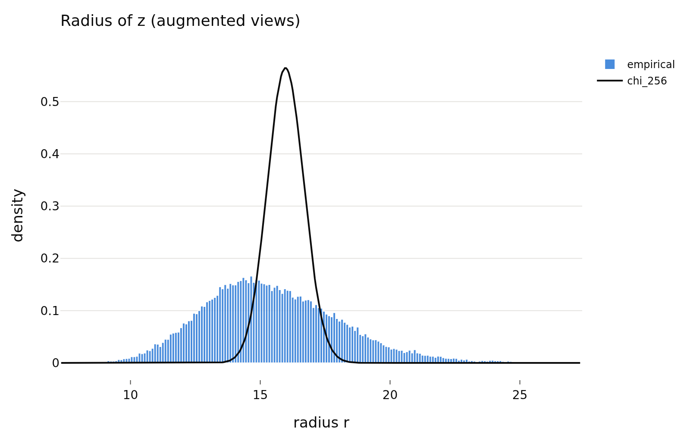
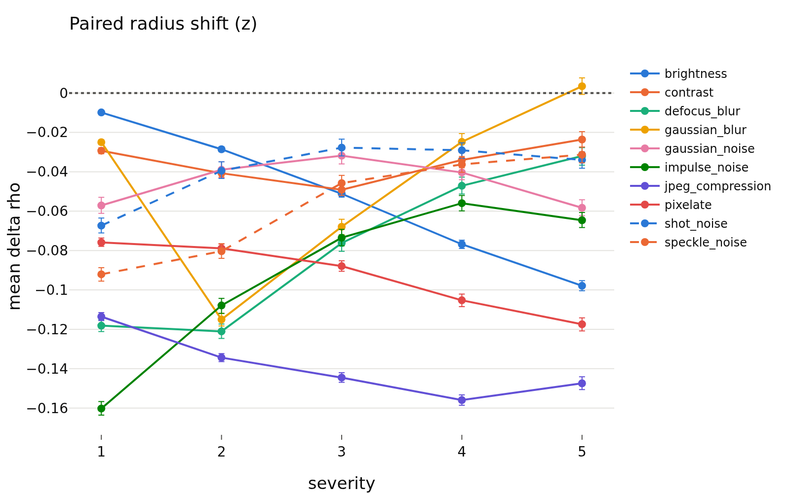
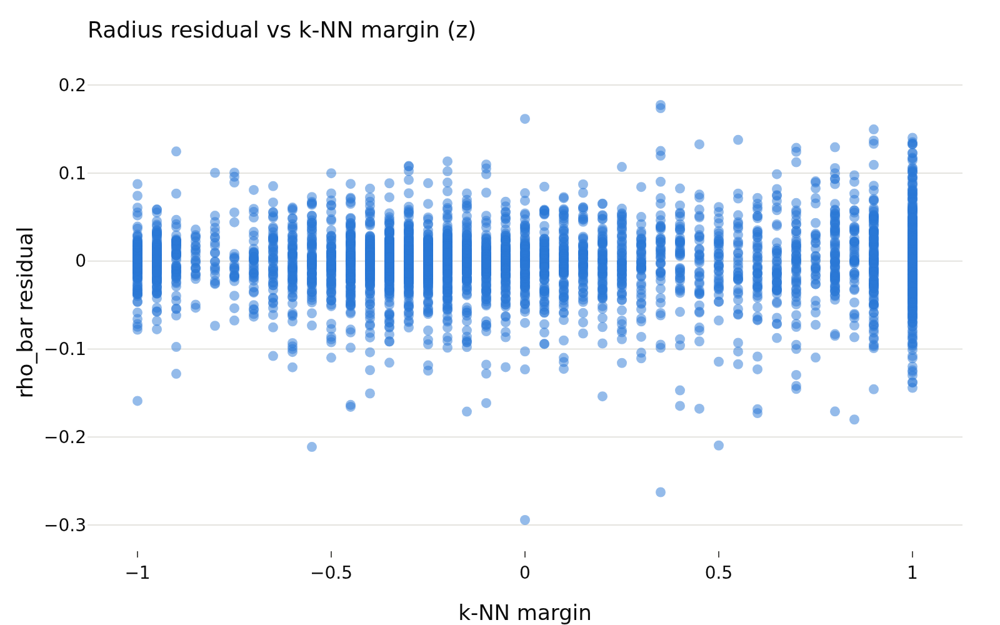
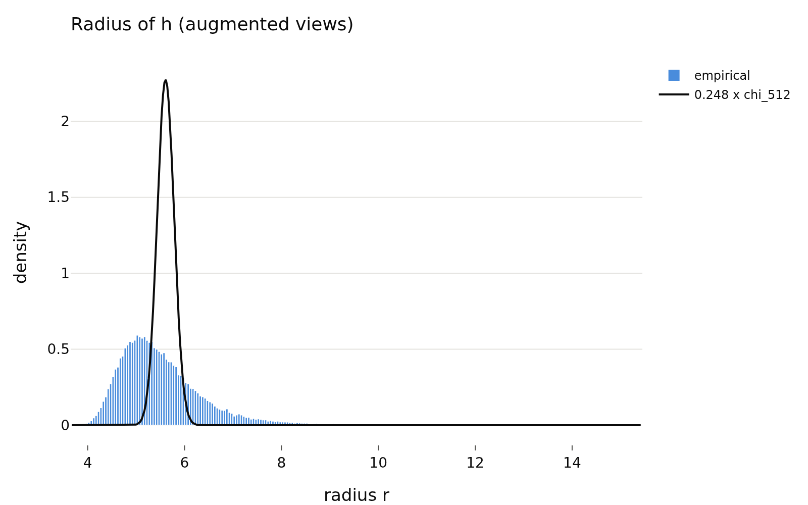
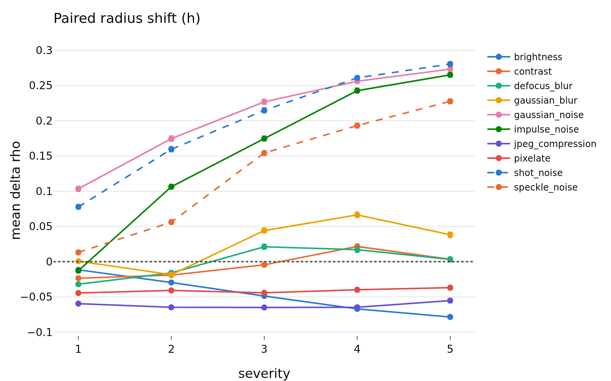
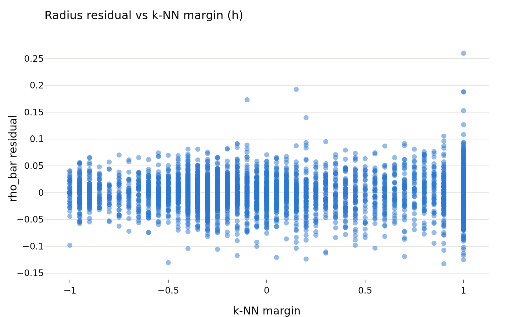
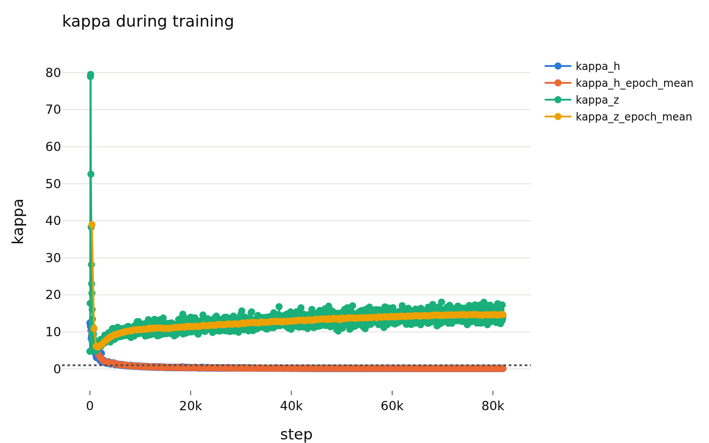

# variant_a_lam0.1
- **Branch / version:** `radius-conditional` @ `7a513be`
- **Run datetime (UTC):** 2026-10-22T15:31Z (embedding, job 2232064, 4 min 29 s); analysis, job 2232065, 15:36Z to 15:48Z (12 min 20 s). Same pipeline as `variant_a_lam0.05.md`.
- **Command(s):** (submitted from the cluster checkout; `--exclude=m002` because scratch was not writable on that node)
  `sbatch --cpus-per-task=4 --gres=gpu:1 --exclude=m002 slurm/embed.sbatch configs/base.yaml radius_marginal_lam0.1_s0 last.pt`
  `sbatch --dependency=afterok:2232064 --mem=64G --exclude=m002 slurm/analyze.sbatch configs/base.yaml radius_marginal_lam0.1_s0 radius_conditional/variant_a_lam0.1.md`
- **Datasets:** as in `variant_a_lam0.05.md` (STL-10 [canonical](https://cs.stanford.edu/~acoates/stl10/), [HF](https://huggingface.co/datasets/tanganke/stl10), canonical archive used; STL-10-C built locally; DTD [canonical](https://www.robots.ox.ac.uk/~vgg/data/dtd/), [HF](https://huggingface.co/datasets/tanganke/dtd); SVHN [canonical](http://ufldl.stanford.edu/housenumbers/), [HF](https://huggingface.co/datasets/ufldl-stanford/svhn); source actually used for DTD/SVHN not re-verified).
- **Backbone:** ResNet-18 from scratch ([HF architecture reference](https://huggingface.co/timm/resnet18.a1_in1k), weights not used); `last.pt` of `radius_marginal_lam0.1_s0` (Variant A, lambda = 0.1, seed 0, epoch 200).

## Question

Do the image-conditional findings for lambda = 0.05 (`variant_a_lam0.05.md`) hold at lambda = 0.1, the setting closest to the chi_256 target (`kappa_z` 14.6 at epoch 200 in the sweep)? Same four sub-questions: ICC, redundancy with direction, difficulty, downstream.

## Setup (deviations from the base config)

Base config unchanged; only the checkpoint differs from the lambda = 0.05 note. One run (seed 0).

## Results

<!-- BEGIN GENERATED: analyze.inputs -->
### Inputs (run `radius_marginal_lam0.1_s0`)

| set | images |
|---|---|
| stl10_train | 5000 |
| stl10_test | 8000 |
| stl10c | 400000 |
| dtd_test | 1880 |
| svhn_test | 26032 |
<!-- END GENERATED: analyze.inputs -->

<!-- BEGIN GENERATED: analyze.marginal -->
### Marginal radius (STL-10 test)

| space | views | d | kappa | mean_r | std_r | mean_r_sq_over_d |
|---|---|---|---|---|---|---|
| z | center | 256 | 12.64 | 15.83 | 2.438 | 1.001 |
| z | augmented | 256 | 14.56 | 15.48 | 2.65 | 0.9633 |
| h | center | 512 | 0.1084 | 5.546 | 0.8497 | 0.06148 |
| h | augmented | 512 | 0.1346 | 5.539 | 0.9152 | 0.06155 |
<!-- END GENERATED: analyze.marginal -->

<!-- BEGIN GENERATED: analyze.icc -->
### ICC(1) of the log-radius over augmented views

| space | icc | msb | msw | K | N |
|---|---|---|---|---|---|
| z | 0.855 [0.850, 0.860] | 0.2017 | 0.004175 | 8 | 8000 |
| h | 0.807 [0.800, 0.814] | 0.1527 | 0.004433 | 8 | 8000 |
<!-- END GENERATED: analyze.icc -->

<!-- BEGIN GENERATED: analyze.redundancy -->
### Redundancy: held-out R^2 of rho_bar

| space | model | r2 | fold_r2_std | N | params (median over folds) |
|---|---|---|---|---|---|
| z | kernel ridge (u_hat) | 0.9332 | 0.006324 | 4000 | alpha=0.001, tau=4.09 |
| z | linear ridge (u_hat) | 0.7355 | 0.01664 | 4000 | alpha=0.001 |
| z | class one-hot | 0.1961 | 0.04637 | 4000 |  |
| h | kernel ridge (u_hat) | 0.9366 | 0.004996 | 4000 | alpha=0.01, tau=1.33 |
| h | linear ridge (u_hat) | 0.9006 | 0.006939 | 4000 | alpha=0.1 |
| h | class one-hot | 0.0848 | 0.02543 | 4000 |  |
<!-- END GENERATED: analyze.redundancy -->

<!-- BEGIN GENERATED: analyze.difficulty -->
### Difficulty correlations (Spearman, 95% bootstrap CI)

| space | score | spearman(rho_bar) | spearman(residual) | partial spearman(rho_bar \| class) | N |
|---|---|---|---|---|---|
| z | severity | 0.070 [0.041, 0.104] | 0.014 [-0.019, 0.047] | 0.071 [0.040, 0.102] | 4000 |
| z | knn_margin | 0.147 [0.111, 0.179] | 0.024 [-0.006, 0.056] | 0.150 [0.116, 0.183] | 4000 |
| z | view_consistency | 0.463 [0.438, 0.488] | 0.045 [0.013, 0.077] | 0.467 [0.442, 0.491] | 4000 |
| z | probe_entropy | -0.031 [-0.065, 0.003] | 0.008 [-0.024, 0.039] | -0.036 [-0.069, -0.002] | 4000 |
| h | severity | 0.229 [0.198, 0.261] | 0.005 [-0.028, 0.038] | 0.230 [0.198, 0.260] | 4000 |
| h | knn_margin | -0.200 [-0.229, -0.171] | -0.024 [-0.057, 0.008] | -0.194 [-0.222, -0.166] | 4000 |
| h | view_consistency | 0.005 [-0.025, 0.037] | -0.090 [-0.119, -0.061] | 0.008 [-0.024, 0.040] | 4000 |
| h | probe_entropy | -0.011 [-0.042, 0.020] | -0.003 [-0.037, 0.028] | -0.023 [-0.051, 0.007] | 4000 |
<!-- END GENERATED: analyze.difficulty -->

<!-- BEGIN GENERATED: analyze.radius_shift -->
### Paired radius shift vs. corruption severity

| space | corruption | severity | mean delta_rho | N |
|---|---|---|---|---|
| z | brightness | 1 | -0.010 [-0.011, -0.009] | 8000 |
| z | brightness | 2 | -0.029 [-0.030, -0.027] | 8000 |
| z | brightness | 3 | -0.051 [-0.053, -0.050] | 8000 |
| z | brightness | 4 | -0.077 [-0.079, -0.075] | 8000 |
| z | brightness | 5 | -0.098 [-0.100, -0.095] | 8000 |
| z | contrast | 1 | -0.029 [-0.031, -0.028] | 8000 |
| z | contrast | 2 | -0.041 [-0.043, -0.039] | 8000 |
| z | contrast | 3 | -0.049 [-0.052, -0.047] | 8000 |
| z | contrast | 4 | -0.034 [-0.038, -0.030] | 8000 |
| z | contrast | 5 | -0.024 [-0.027, -0.020] | 8000 |
| z | defocus_blur | 1 | -0.118 [-0.121, -0.115] | 8000 |
| z | defocus_blur | 2 | -0.121 [-0.125, -0.117] | 8000 |
| z | defocus_blur | 3 | -0.076 [-0.080, -0.072] | 8000 |
| z | defocus_blur | 4 | -0.047 [-0.051, -0.043] | 8000 |
| z | defocus_blur | 5 | -0.032 [-0.037, -0.028] | 8000 |
| z | gaussian_blur | 1 | -0.025 [-0.026, -0.024] | 8000 |
| z | gaussian_blur | 2 | -0.115 [-0.118, -0.112] | 8000 |
| z | gaussian_blur | 3 | -0.068 [-0.072, -0.064] | 8000 |
| z | gaussian_blur | 4 | -0.025 [-0.029, -0.021] | 8000 |
| z | gaussian_blur | 5 | 0.003 [-0.001, 0.008] | 8000 |
| z | gaussian_noise | 1 | -0.057 [-0.061, -0.053] | 8000 |
| z | gaussian_noise | 2 | -0.039 [-0.043, -0.035] | 8000 |
| z | gaussian_noise | 3 | -0.032 [-0.036, -0.028] | 8000 |
| z | gaussian_noise | 4 | -0.040 [-0.044, -0.036] | 8000 |
| z | gaussian_noise | 5 | -0.058 [-0.062, -0.054] | 8000 |
| z | impulse_noise | 1 | -0.160 [-0.164, -0.157] | 8000 |
| z | impulse_noise | 2 | -0.108 [-0.112, -0.104] | 8000 |
| z | impulse_noise | 3 | -0.073 [-0.078, -0.069] | 8000 |
| z | impulse_noise | 4 | -0.056 [-0.060, -0.052] | 8000 |
| z | impulse_noise | 5 | -0.065 [-0.068, -0.061] | 8000 |
| z | jpeg_compression | 1 | -0.114 [-0.116, -0.112] | 8000 |
| z | jpeg_compression | 2 | -0.134 [-0.136, -0.132] | 8000 |
| z | jpeg_compression | 3 | -0.145 [-0.147, -0.142] | 8000 |
| z | jpeg_compression | 4 | -0.156 [-0.159, -0.153] | 8000 |
| z | jpeg_compression | 5 | -0.147 [-0.151, -0.144] | 8000 |
| z | pixelate | 1 | -0.076 [-0.078, -0.074] | 8000 |
| z | pixelate | 2 | -0.079 [-0.081, -0.077] | 8000 |
| z | pixelate | 3 | -0.088 [-0.091, -0.085] | 8000 |
| z | pixelate | 4 | -0.105 [-0.109, -0.102] | 8000 |
| z | pixelate | 5 | -0.117 [-0.121, -0.114] | 8000 |
| z | shot_noise | 1 | -0.067 [-0.071, -0.064] | 8000 |
| z | shot_noise | 2 | -0.039 [-0.043, -0.035] | 8000 |
| z | shot_noise | 3 | -0.028 [-0.032, -0.023] | 8000 |
| z | shot_noise | 4 | -0.029 [-0.033, -0.025] | 8000 |
| z | shot_noise | 5 | -0.034 [-0.038, -0.030] | 8000 |
| z | speckle_noise | 1 | -0.092 [-0.096, -0.089] | 8000 |
| z | speckle_noise | 2 | -0.080 [-0.084, -0.076] | 8000 |
| z | speckle_noise | 3 | -0.046 [-0.050, -0.042] | 8000 |
| z | speckle_noise | 4 | -0.036 [-0.040, -0.032] | 8000 |
| z | speckle_noise | 5 | -0.031 [-0.035, -0.027] | 8000 |
| h | brightness | 1 | -0.012 [-0.012, -0.011] | 8000 |
| h | brightness | 2 | -0.030 [-0.031, -0.028] | 8000 |
| h | brightness | 3 | -0.049 [-0.050, -0.047] | 8000 |
| h | brightness | 4 | -0.067 [-0.069, -0.065] | 8000 |
| h | brightness | 5 | -0.079 [-0.081, -0.076] | 8000 |
| h | contrast | 1 | -0.023 [-0.025, -0.022] | 8000 |
| h | contrast | 2 | -0.019 [-0.021, -0.017] | 8000 |
| h | contrast | 3 | -0.004 [-0.008, -0.001] | 8000 |
| h | contrast | 4 | 0.022 [0.018, 0.025] | 8000 |
| h | contrast | 5 | 0.003 [-0.000, 0.007] | 8000 |
| h | defocus_blur | 1 | -0.032 [-0.035, -0.029] | 8000 |
| h | defocus_blur | 2 | -0.016 [-0.019, -0.013] | 8000 |
| h | defocus_blur | 3 | 0.021 [0.018, 0.025] | 8000 |
| h | defocus_blur | 4 | 0.017 [0.013, 0.021] | 8000 |
| h | defocus_blur | 5 | 0.003 [-0.001, 0.007] | 8000 |
| h | gaussian_blur | 1 | 0.001 [-0.000, 0.002] | 8000 |
| h | gaussian_blur | 2 | -0.018 [-0.021, -0.016] | 8000 |
| h | gaussian_blur | 3 | 0.044 [0.041, 0.048] | 8000 |
| h | gaussian_blur | 4 | 0.066 [0.062, 0.071] | 8000 |
| h | gaussian_blur | 5 | 0.038 [0.034, 0.042] | 8000 |
| h | gaussian_noise | 1 | 0.103 [0.099, 0.107] | 8000 |
| h | gaussian_noise | 2 | 0.175 [0.171, 0.179] | 8000 |
| h | gaussian_noise | 3 | 0.227 [0.223, 0.231] | 8000 |
| h | gaussian_noise | 4 | 0.256 [0.253, 0.260] | 8000 |
| h | gaussian_noise | 5 | 0.273 [0.270, 0.277] | 8000 |
| h | impulse_noise | 1 | -0.013 [-0.016, -0.010] | 8000 |
| h | impulse_noise | 2 | 0.106 [0.103, 0.110] | 8000 |
| h | impulse_noise | 3 | 0.175 [0.171, 0.179] | 8000 |
| h | impulse_noise | 4 | 0.243 [0.240, 0.247] | 8000 |
| h | impulse_noise | 5 | 0.265 [0.262, 0.269] | 8000 |
| h | jpeg_compression | 1 | -0.060 [-0.062, -0.057] | 8000 |
| h | jpeg_compression | 2 | -0.065 [-0.067, -0.063] | 8000 |
| h | jpeg_compression | 3 | -0.065 [-0.068, -0.063] | 8000 |
| h | jpeg_compression | 4 | -0.065 [-0.068, -0.062] | 8000 |
| h | jpeg_compression | 5 | -0.055 [-0.059, -0.052] | 8000 |
| h | pixelate | 1 | -0.044 [-0.046, -0.043] | 8000 |
| h | pixelate | 2 | -0.041 [-0.043, -0.039] | 8000 |
| h | pixelate | 3 | -0.044 [-0.047, -0.042] | 8000 |
| h | pixelate | 4 | -0.040 [-0.043, -0.037] | 8000 |
| h | pixelate | 5 | -0.037 [-0.040, -0.034] | 8000 |
| h | shot_noise | 1 | 0.078 [0.074, 0.081] | 8000 |
| h | shot_noise | 2 | 0.160 [0.156, 0.164] | 8000 |
| h | shot_noise | 3 | 0.215 [0.211, 0.219] | 8000 |
| h | shot_noise | 4 | 0.261 [0.257, 0.264] | 8000 |
| h | shot_noise | 5 | 0.281 [0.277, 0.284] | 8000 |
| h | speckle_noise | 1 | 0.013 [0.010, 0.016] | 8000 |
| h | speckle_noise | 2 | 0.056 [0.053, 0.060] | 8000 |
| h | speckle_noise | 3 | 0.154 [0.151, 0.158] | 8000 |
| h | speckle_noise | 4 | 0.193 [0.190, 0.197] | 8000 |
| h | speckle_noise | 5 | 0.228 [0.224, 0.231] | 8000 |
<!-- END GENERATED: analyze.radius_shift -->

<!-- BEGIN GENERATED: analyze.downstream -->
### Downstream accuracy

| space | views | features | linear probe acc | k-NN acc |
|---|---|---|---|---|
| z | center | embedding | 0.8093 | 0.7854 |
| z | center | u_hat | 0.8076 | 0.7854 |
| z | center | u_hat+rho | 0.8081 | 0.7635 |
| z | augmented | embedding | 0.8244 | 0.7984 |
| z | augmented | u_hat | 0.8229 | 0.7984 |
| z | augmented | u_hat+rho | 0.8224 | 0.7766 |
| h | center | embedding | 0.8035 | 0.79 |
| h | center | u_hat | 0.8049 | 0.79 |
| h | center | u_hat+rho | 0.8049 | 0.7645 |
| h | augmented | embedding | 0.8321 | 0.8054 |
| h | augmented | u_hat | 0.8335 | 0.8063 |
| h | augmented | u_hat+rho | 0.8331 | 0.7881 |
<!-- END GENERATED: analyze.downstream -->

<!-- BEGIN GENERATED: analyze.selective -->
### Selective classification (AURC, lower is better)

| space | views | probe error | AURC (radius) | AURC (max softmax) | AURC (-radius) |
|---|---|---|---|---|---|
| z | center | 0.1924 | 0.1045 | 0.05221 | 0.2967 |
| z | augmented | 0.1771 | 0.09133 | 0.04526 | 0.2823 |
| h | center | 0.1951 | 0.139 | 0.05547 | 0.2657 |
| h | augmented | 0.1665 | 0.1055 | 0.0402 | 0.2421 |
<!-- END GENERATED: analyze.selective -->

<!-- BEGIN GENERATED: analyze.ood -->
### OOD detection with the radius as score

| space | OOD set | views | AUROC (radius, in-dist positive) |
|---|---|---|---|
| z | dtd_test | center | 0.6723 |
| z | svhn_test | center | 0.7963 |
| z | dtd_test | augmented | 0.662 |
| z | svhn_test | augmented | 0.726 |
| h | dtd_test | center | 0.3344 |
| h | svhn_test | center | 0.3457 |
| h | dtd_test | augmented | 0.3499 |
| h | svhn_test | augmented | 0.3654 |
<!-- END GENERATED: analyze.ood -->

<!-- BEGIN GENERATED: analyze.retrieval -->
### DTD retrieval

| space | views | features | DTD mAP |
|---|---|---|---|
| z | center | u_hat | 0.09492 |
| z | center | u_hat+rho | 0.06995 |
| z | augmented | u_hat | 0.09854 |
| z | augmented | u_hat+rho | 0.07466 |
| h | center | u_hat | 0.1091 |
| h | center | u_hat+rho | 0.08227 |
| h | augmented | u_hat | 0.1137 |
| h | augmented | u_hat+rho | 0.08894 |
<!-- END GENERATED: analyze.retrieval -->

<!-- BEGIN GENERATED: analyze.figures -->
### Figures

<!-- END GENERATED: analyze.figures -->

## Interpretation

One run, one seed; compare with `variant_a_lam0.05.md` (L05 below).

- **Marginal.** `kappa_z` is 12.6 (center) / 14.6 (augmented) against 17.4 / 19.5 for L05: closer to 1, but still an order of magnitude away. The radius std is 2.4-2.7 vs 0.71 for chi_256.
- **ICC** is similar: 0.855 [0.850, 0.860] for `z` (L05: 0.872), 0.807 for `h` (L05: 0.765). The radius is image-level at both lambdas.
- **Redundancy** is again high: kernel-ridge R^2 of `rho_bar` from `u_hat` is 0.933 (z) and 0.937 (h), versus 0.945 / 0.922. The linear-ridge R^2 for `z` drops from 0.807 to 0.736 while the kernel one barely moves, so the dependence of the radius on direction at lambda = 0.1 is more nonlinear, not weaker. Class labels explain 0.20 (z) and 0.08 (h).
- **Difficulty.** The raw correlations are not stable across lambda: `z` view consistency 0.463 (L05: 0.625), probe entropy -0.031 (L05: -0.244), severity 0.070 (L05: 0.004). The direction-adjusted residual correlations stay near zero for every `z` score (|rho| <= 0.045); the largest is view consistency 0.045 [0.013, 0.077], marginally above zero and small. The `h` residual for view consistency is -0.090 [-0.119, -0.061], the same as L05 (-0.089). So the residual result replicates; the raw one does not, which is a reason to put little weight on any single raw correlation.
- **Shift and scores.** `h` radius vs corruption severity is positive again (0.229). `z`-radius OOD AUROC is 0.66-0.80 (L05: 0.67-0.82). `h`-radius OOD AUROC is now below 0.5 on both sets (0.33-0.37), whereas L05 had SVHN near 0.5 and 0.42-0.54: the sign of the `h` radius as an OOD score is consistently "OOD has a larger radius", but its size is not.
- **Downstream.** Appending `rho` to `u_hat` again does not change the linear probe (z augmented: 0.8229 -> 0.8224) and lowers k-NN accuracy (0.798 -> 0.777) and DTD mAP (0.0985 -> 0.0747). Max-softmax beats the radius as a selective-classification score by about 2x in AURC at both lambdas. Accuracy is the same at both lambdas within about 0.5 points (`h` augmented linear 0.832 vs 0.836).
- **Reading.** Going from lambda 0.05 to 0.1 moves the marginal radius towards chi_256 but changes none of the conditional conclusions: the image-level radius is largely a function of direction (R^2 ~ 0.93), and adding it brings no downstream gain. Not yet checked: seeds, weight decay and other training settings (see below), and whether the near-deterministic radius(direction) dependence is something SIGReg's one-dimensional projections cannot see (hypothesis, untested).

## Next steps

1. Seeds 1 and 2 at both lambdas for the spread on ICC and R^2.
2. Rule out training-recipe explanations: weight decay 5e-4 (the LeJEPA README value for ResNets; the base config uses 0.05), same seed and lambda.
3. Check `rho_bar` against view consistency using disjoint views.
