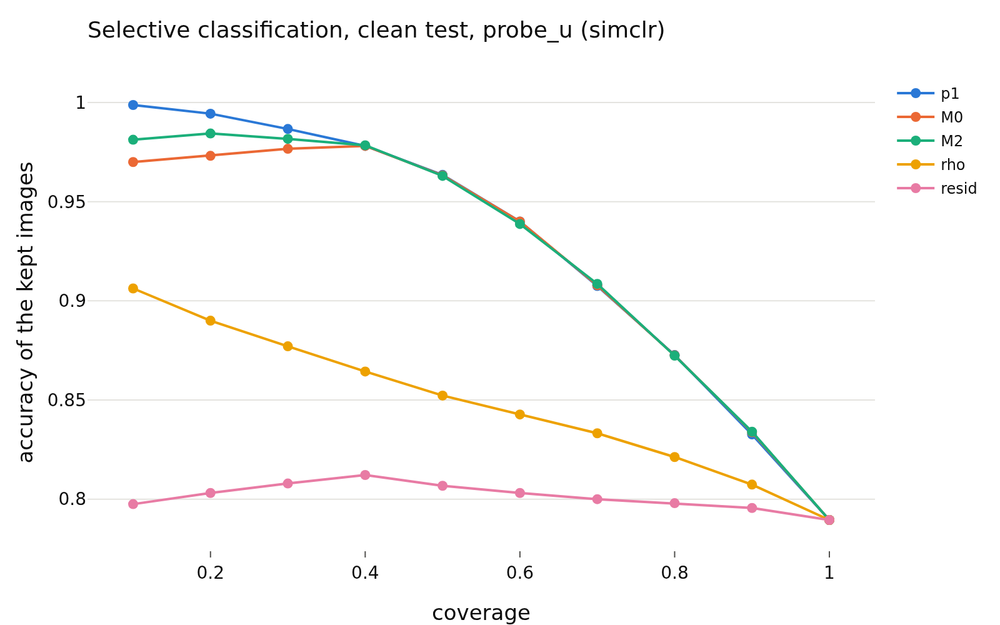

# confidence_h_simclr
- **Branch / version:** `radius-confidence` @ `8bf19c2`
- **Run datetime (UTC):** 2026-10-26T17:57Z (aggregation; units computed 2026-10-26T17:06Z-17:50Z, SLURM jobs 2253285 / 2253286, CPU only)
- **Command(s):**
  `python apps/analyze.py --config configs/base.yaml --confidence baseline --confidence-space h --note radius_confidence/confidence.md` (per-run units: see `confidence.md`, section Commands)
- **Datasets:** STL-10 ([canonical](https://cs.stanford.edu/~acoates/stl10/), [HF `tanganke/stl10`](https://huggingface.co/datasets/tanganke/stl10); canonical used), STL-10-C (vendored corruptions of the STL-10 test split), DTD ([canonical](https://www.robots.ox.ac.uk/~vgg/data/dtd/), [HF `tanganke/dtd`](https://huggingface.co/datasets/tanganke/dtd)); SVHN excluded, Places365 pending.
- **Backbone:** ResNet-18 from scratch ([HF architecture reference](https://huggingface.co/timm/resnet18.a1_in1k), pretrained weights not used). **Explicit exception: E2 baselines analyzed in h (their projector is discarded); one seed; clean STL-10 test only.**

## Question

Does the radius track the readers' confidence and errors beyond the direction? Definitions, predictions and the scorecard: [`confidence.md`](confidence.md).

## Setup (deviations from the base config)

None beyond the pre-registration (`confidence.md`); `eval.knn_k=20`, `eval.num_bootstrap=1000` (200 for the corrupted cells).

## Results

<!-- BEGIN GENERATED: analyze.confidence_inputs -->
### Inputs

Runs aggregated (h space, center views): `baseline_simclr_s0`.
<!-- END GENERATED: analyze.confidence_inputs -->

<!-- BEGIN GENERATED: analyze.confidence_clean -->
### Clean STL-10 test: error detection by the radius signals

Seed means; intervals are paired bootstrap percentile intervals over images (resampled within each seed). Definitions, margins and verdict rules: `research_notes/radius_confidence/confidence.md` (pre-registration).

| set | reader | signal | reader accuracy | AUROC (errors) | 95% CI | verdict |
|---|---|---|---|---|---|---|
| clean test | probe_z | -rho | 0.7894 | 0.6319 | [0.616, 0.647] | informative |
| clean test | probe_z | -resid | 0.7894 | 0.5344 | [0.519, 0.552] | informative |
| clean test | probe_z | -p1 | 0.7894 | 0.8436 | [0.835, 0.853] | informative |
| clean test | probe_z | -margin | 0.7894 | 0.842 | [0.833, 0.851] | informative |
| clean test | probe_z | -rho_cc | 0.7894 | 0.6039 | [0.588, 0.619] | informative |
| clean test | probe_z | -rho, within class (macro) | 0.7894 | 0.6234 |  | n/a |
| clean test | probe_u | -rho | 0.7895 | 0.6371 | [0.622, 0.652] | informative |
| clean test | probe_u | -resid | 0.7895 | 0.5332 | [0.518, 0.550] | informative |
| clean test | probe_u | -p1 | 0.7895 | 0.841 | [0.832, 0.850] | informative |
| clean test | probe_u | -margin | 0.7895 | 0.8392 | [0.830, 0.849] | informative |
| clean test | probe_u | -rho_cc | 0.7895 | 0.6094 | [0.593, 0.624] | informative |
| clean test | probe_u | -rho, within class (macro) | 0.7895 | 0.6304 |  | n/a |
| clean test | knn_u | -rho | 0.79 | 0.6407 | [0.625, 0.654] | informative |
| clean test | knn_u | -resid | 0.79 | 0.538 | [0.521, 0.554] | informative |
| clean test | knn_u | -p1 | 0.79 | 0.8624 | [0.855, 0.871] | informative |
| clean test | knn_u | -margin | 0.79 | 0.8571 | [0.849, 0.865] | informative |
| clean test | knn_u | -rho_cc | 0.79 | 0.6119 | [0.596, 0.626] | informative |
| clean test | knn_u | -rho, within class (macro) | 0.79 | 0.6304 |  | n/a |

| set | reader | Spearman(rho,p1) | rho,p1 95% CI | Spearman(resid,p1) | resid,p1 95% CI |
|---|---|---|---|---|---|
| clean test | probe_z | 0.366 | [+0.347, +0.384] | 0.081 | [+0.059, +0.103] |
| clean test | probe_u | 0.291 | [+0.272, +0.310] | 0.05 | [+0.030, +0.072] |
| clean test | knn_u | 0.329 | [+0.309, +0.348] | 0.056 | [+0.033, +0.079] |
<!-- END GENERATED: analyze.confidence_clean -->

<!-- BEGIN GENERATED: analyze.confidence_nested -->
### Beyond the reader's own confidence (clean test)

`M0 = [logit p1, margin]`, `M1 = M0 + rho`, `M2 = M0 + resid`, 5-fold cross-fitted; AUROC differences have margin 0.01, accuracy-at-coverage differences 0.5 points.

| set | reader | comparison | difference | unit | 95% CI | verdict |
|---|---|---|---|---|---|---|
| clean test | probe_z | auroc: M1 - M0 | 0.0032 | AUROC | [+0.0006, +0.0056] | equivalent |
| clean test | probe_z | acc@50: M1 - M0 | 0.025 | points | [-0.1500, +0.2750] | equivalent |
| clean test | probe_z | acc@80: M1 - M0 | -0.0625 | points | [-0.3281, +0.1406] | equivalent |
| clean test | probe_z | auroc: M2 - M0 | 0.0024 | AUROC | [+0.0007, +0.0043] | equivalent |
| clean test | probe_z | acc@50: M2 - M0 | 0.05 | points | [-0.1750, +0.1750] | equivalent |
| clean test | probe_z | acc@80: M2 - M0 | 0.0937 | points | [-0.0938, +0.2500] | equivalent |
| clean test | probe_z | auroc: M3 - M0 (post hoc) | 0.0025 | AUROC | [-0.0000, +0.0049] | equivalent |
| clean test | probe_z | auroc: M4 - M0 (post hoc) | 0.0031 | AUROC | [+0.0005, +0.0055] | equivalent |
| clean test | probe_u | auroc: M1 - M0 | 0.0067 | AUROC | [+0.0032, +0.0101] | equivalent |
| clean test | probe_u | acc@50: M1 - M0 | 0.3 | points | [+0.0250, +0.5500] | inconclusive |
| clean test | probe_u | acc@80: M1 - M0 | -0.0156 | points | [-0.3441, +0.2656] | equivalent |
| clean test | probe_u | auroc: M2 - M0 | 0.0031 | AUROC | [+0.0004, +0.0056] | equivalent |
| clean test | probe_u | acc@50: M2 - M0 | -0.025 | points | [-0.1500, +0.1750] | equivalent |
| clean test | probe_u | acc@80: M2 - M0 | -0.0156 | points | [-0.2500, +0.1563] | equivalent |
| clean test | probe_u | auroc: M3 - M0 (post hoc) | 0.0055 | AUROC | [+0.0023, +0.0084] | equivalent |
| clean test | probe_u | auroc: M4 - M0 (post hoc) | 0.0066 | AUROC | [+0.0031, +0.0101] | equivalent |
| clean test | knn_u | auroc: M1 - M0 | 0.0009 | AUROC | [-0.0004, +0.0021] | equivalent |
| clean test | knn_u | acc@50: M1 - M0 | -0.05 | points | [-0.2500, +0.2000] | equivalent |
| clean test | knn_u | acc@80: M1 - M0 | 0.1094 | points | [-0.1719, +0.2812] | equivalent |
| clean test | knn_u | auroc: M2 - M0 | 0.0009 | AUROC | [-0.0001, +0.0019] | equivalent |
| clean test | knn_u | acc@50: M2 - M0 | -0.075 | points | [-0.2000, +0.1250] | equivalent |
| clean test | knn_u | acc@80: M2 - M0 | 0.1875 | points | [-0.0625, +0.3125] | equivalent |
| clean test | knn_u | auroc: M3 - M0 (post hoc) | 0.0003 | AUROC | [-0.0006, +0.0012] | equivalent |
| clean test | knn_u | auroc: M4 - M0 (post hoc) | 0.0013 | AUROC | [-0.0001, +0.0026] | equivalent |
<!-- END GENERATED: analyze.confidence_nested -->

<!-- BEGIN GENERATED: analyze.confidence_figures -->
### Figures

<!-- END GENERATED: analyze.confidence_figures -->

## Interpretation

See `confidence.md` (this note holds the generated tables of one group).

## Next steps

See `confidence.md`.
