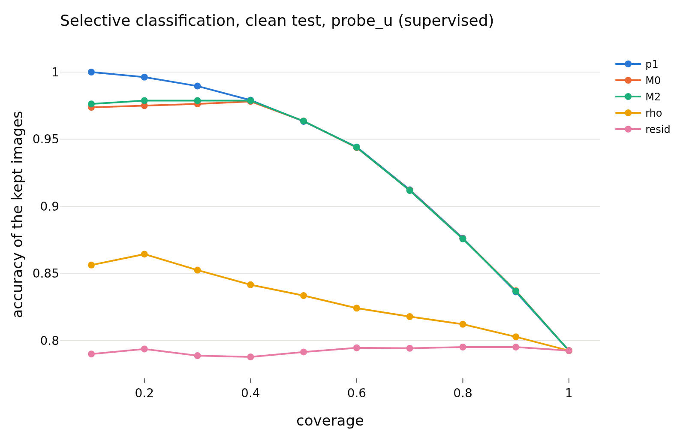

# confidence_h_supervised
- **Branch / version:** `radius-confidence` @ `8bf19c2`
- **Run datetime (UTC):** 2026-10-26T17:57Z (aggregation; units computed 2026-10-26T17:06Z-17:50Z, SLURM jobs 2253285 / 2253286, CPU only)
- **Command(s):**
  `python apps/analyze.py --config configs/base.yaml --confidence baseline --confidence-space h --note radius_confidence/confidence.md` (per-run units: see `confidence.md`, section Commands)
- **Datasets:** STL-10 ([canonical](https://cs.stanford.edu/~acoates/stl10/), [HF `tanganke/stl10`](https://huggingface.co/datasets/tanganke/stl10); canonical used), STL-10-C (vendored corruptions of the STL-10 test split), DTD ([canonical](https://www.robots.ox.ac.uk/~vgg/data/dtd/), [HF `tanganke/dtd`](https://huggingface.co/datasets/tanganke/dtd)); SVHN excluded, Places365 pending.
- **Backbone:** ResNet-18 from scratch ([HF architecture reference](https://huggingface.co/timm/resnet18.a1_in1k), pretrained weights not used). **Explicit exception: E2 baselines analyzed in h (their projector is discarded); one seed; clean STL-10 test only.**

## Question

Does the radius track the readers' confidence and errors beyond the direction? Definitions, predictions and the scorecard: [`confidence.md`](confidence.md).

## Setup (deviations from the base config)

None beyond the pre-registration (`confidence.md`); `eval.knn_k=20`, `eval.num_bootstrap=1000` (200 for the corrupted cells).

## Results

<!-- BEGIN GENERATED: analyze.confidence_inputs -->
### Inputs

Runs aggregated (h space, center views): `baseline_supervised_s0`.
<!-- END GENERATED: analyze.confidence_inputs -->

<!-- BEGIN GENERATED: analyze.confidence_clean -->
### Clean STL-10 test: error detection by the radius signals

Seed means; intervals are paired bootstrap percentile intervals over images (resampled within each seed). Definitions, margins and verdict rules: `research_notes/radius_confidence/confidence.md` (pre-registration).

| set | reader | signal | reader accuracy | AUROC (errors) | 95% CI | verdict |
|---|---|---|---|---|---|---|
| clean test | probe_z | -rho | 0.793 | 0.588 | [0.572, 0.603] | informative |
| clean test | probe_z | -resid | 0.793 | 0.4961 | [0.481, 0.511] | inconclusive |
| clean test | probe_z | -p1 | 0.793 | 0.8474 | [0.838, 0.857] | informative |
| clean test | probe_z | -margin | 0.793 | 0.846 | [0.837, 0.855] | informative |
| clean test | probe_z | -rho_cc | 0.793 | 0.5689 | [0.553, 0.584] | informative |
| clean test | probe_z | -rho, within class (macro) | 0.793 | 0.5818 |  | n/a |
| clean test | probe_u | -rho | 0.7925 | 0.5871 | [0.571, 0.602] | informative |
| clean test | probe_u | -resid | 0.7925 | 0.5018 | [0.486, 0.517] | inconclusive |
| clean test | probe_u | -p1 | 0.7925 | 0.8449 | [0.835, 0.855] | informative |
| clean test | probe_u | -margin | 0.7925 | 0.8435 | [0.834, 0.853] | informative |
| clean test | probe_u | -rho_cc | 0.7925 | 0.5662 | [0.550, 0.582] | informative |
| clean test | probe_u | -rho, within class (macro) | 0.7925 | 0.5795 |  | n/a |
| clean test | knn_u | -rho | 0.7809 | 0.5811 | [0.565, 0.596] | informative |
| clean test | knn_u | -resid | 0.7809 | 0.502 | [0.486, 0.518] | inconclusive |
| clean test | knn_u | -p1 | 0.7809 | 0.8525 | [0.844, 0.861] | informative |
| clean test | knn_u | -margin | 0.7809 | 0.8487 | [0.840, 0.857] | informative |
| clean test | knn_u | -rho_cc | 0.7809 | 0.5637 | [0.548, 0.579] | informative |
| clean test | knn_u | -rho, within class (macro) | 0.7809 | 0.5766 |  | n/a |

| set | reader | Spearman(rho,p1) | rho,p1 95% CI | Spearman(resid,p1) | resid,p1 95% CI |
|---|---|---|---|---|---|
| clean test | probe_z | 0.325 | [+0.304, +0.345] | 0.047 | [+0.026, +0.069] |
| clean test | probe_u | 0.248 | [+0.225, +0.269] | 0.019 | [-0.002, +0.040] |
| clean test | knn_u | 0.215 | [+0.193, +0.236] | 0.006 | [-0.015, +0.028] |
<!-- END GENERATED: analyze.confidence_clean -->

<!-- BEGIN GENERATED: analyze.confidence_nested -->
### Beyond the reader's own confidence (clean test)

`M0 = [logit p1, margin]`, `M1 = M0 + rho`, `M2 = M0 + resid`, 5-fold cross-fitted; AUROC differences have margin 0.01, accuracy-at-coverage differences 0.5 points.

| set | reader | comparison | difference | unit | 95% CI | verdict |
|---|---|---|---|---|---|---|
| clean test | probe_z | auroc: M1 - M0 | 0.0004 | AUROC | [-0.0007, +0.0015] | equivalent |
| clean test | probe_z | acc@50: M1 - M0 | 0.025 | points | [-0.0750, +0.1000] | equivalent |
| clean test | probe_z | acc@80: M1 - M0 | -0.0469 | points | [-0.1094, +0.1094] | equivalent |
| clean test | probe_z | auroc: M2 - M0 | 0.0016 | AUROC | [-0.0001, +0.0035] | equivalent |
| clean test | probe_z | acc@50: M2 - M0 | 0.075 | points | [-0.1000, +0.2250] | equivalent |
| clean test | probe_z | acc@80: M2 - M0 | 0.0625 | points | [-0.0937, +0.2656] | equivalent |
| clean test | probe_z | auroc: M3 - M0 (post hoc) | 0.0003 | AUROC | [-0.0006, +0.0012] | equivalent |
| clean test | probe_z | auroc: M4 - M0 (post hoc) | 0.0013 | AUROC | [-0.0005, +0.0031] | equivalent |
| clean test | probe_u | auroc: M1 - M0 | 0.002 | AUROC | [+0.0001, +0.0040] | equivalent |
| clean test | probe_u | acc@50: M1 - M0 | 0.075 | points | [-0.0750, +0.2250] | equivalent |
| clean test | probe_u | acc@80: M1 - M0 | -0.0313 | points | [-0.1563, +0.1406] | equivalent |
| clean test | probe_u | auroc: M2 - M0 | 0.0013 | AUROC | [+0.0007, +0.0021] | equivalent |
| clean test | probe_u | acc@50: M2 - M0 | 0 | points | [-0.0250, +0.0250] | equivalent |
| clean test | probe_u | acc@80: M2 - M0 | -0.0156 | points | [-0.0316, +0.0313] | equivalent |
| clean test | probe_u | auroc: M3 - M0 (post hoc) | 0.0022 | AUROC | [+0.0001, +0.0043] | equivalent |
| clean test | probe_u | auroc: M4 - M0 (post hoc) | 0.0022 | AUROC | [+0.0001, +0.0043] | equivalent |
| clean test | knn_u | auroc: M1 - M0 | 0.0005 | AUROC | [-0.0001, +0.0012] | equivalent |
| clean test | knn_u | acc@50: M1 - M0 | -0.05 | points | [-0.2000, +0.1000] | equivalent |
| clean test | knn_u | acc@80: M1 - M0 | -0.0469 | points | [-0.1723, +0.0938] | equivalent |
| clean test | knn_u | auroc: M2 - M0 | -0.0001 | AUROC | [-0.0004, +0.0003] | equivalent |
| clean test | knn_u | acc@50: M2 - M0 | -0.075 | points | [-0.1500, +0.1006] | equivalent |
| clean test | knn_u | acc@80: M2 - M0 | 0.0156 | points | [-0.0781, +0.1094] | equivalent |
| clean test | knn_u | auroc: M3 - M0 (post hoc) | 0.0005 | AUROC | [-0.0001, +0.0011] | equivalent |
| clean test | knn_u | auroc: M4 - M0 (post hoc) | 0.0003 | AUROC | [-0.0004, +0.0009] | equivalent |
<!-- END GENERATED: analyze.confidence_nested -->

<!-- BEGIN GENERATED: analyze.confidence_figures -->
### Figures

<!-- END GENERATED: analyze.confidence_figures -->

## Interpretation

See `confidence.md` (this note holds the generated tables of one group).

## Next steps

See `confidence.md`.
