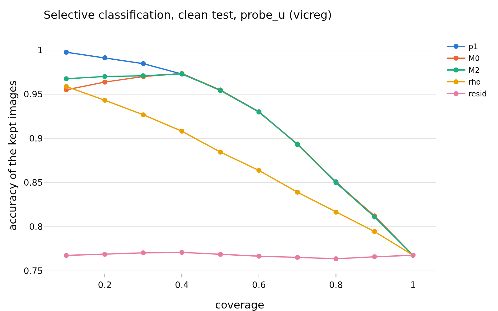

# confidence_h_vicreg
- **Branch / version:** `radius-confidence` @ `8bf19c2`
- **Run datetime (UTC):** 2026-10-26T17:57Z (aggregation; units computed 2026-10-26T17:06Z-17:50Z, SLURM jobs 2253285 / 2253286, CPU only)
- **Command(s):**
  `python apps/analyze.py --config configs/base.yaml --confidence baseline --confidence-space h --note radius_confidence/confidence.md` (per-run units: see `confidence.md`, section Commands)
- **Datasets:** STL-10 ([canonical](https://cs.stanford.edu/~acoates/stl10/), [HF `tanganke/stl10`](https://huggingface.co/datasets/tanganke/stl10); canonical used), STL-10-C (vendored corruptions of the STL-10 test split), DTD ([canonical](https://www.robots.ox.ac.uk/~vgg/data/dtd/), [HF `tanganke/dtd`](https://huggingface.co/datasets/tanganke/dtd)); SVHN excluded, Places365 pending.
- **Backbone:** ResNet-18 from scratch ([HF architecture reference](https://huggingface.co/timm/resnet18.a1_in1k), pretrained weights not used). **Explicit exception: E2 baselines analyzed in h (their projector is discarded); one seed; clean STL-10 test only.**

## Question

Does the radius track the readers' confidence and errors beyond the direction? Definitions, predictions and the scorecard: [`confidence.md`](confidence.md).

## Setup (deviations from the base config)

None beyond the pre-registration (`confidence.md`); `eval.knn_k=20`, `eval.num_bootstrap=1000` (200 for the corrupted cells).

## Results

<!-- BEGIN GENERATED: analyze.confidence_inputs -->
### Inputs

Runs aggregated (h space, center views): `baseline_vicreg_s0`.
<!-- END GENERATED: analyze.confidence_inputs -->

<!-- BEGIN GENERATED: analyze.confidence_clean -->
### Clean STL-10 test: error detection by the radius signals

Seed means; intervals are paired bootstrap percentile intervals over images (resampled within each seed). Definitions, margins and verdict rules: `research_notes/radius_confidence/confidence.md` (pre-registration).

| set | reader | signal | reader accuracy | AUROC (errors) | 95% CI | verdict |
|---|---|---|---|---|---|---|
| clean test | probe_z | -rho | 0.7666 | 0.7145 | [0.702, 0.727] | informative |
| clean test | probe_z | -resid | 0.7666 | 0.5027 | [0.488, 0.517] | inconclusive |
| clean test | probe_z | -p1 | 0.7666 | 0.8492 | [0.840, 0.857] | informative |
| clean test | probe_z | -margin | 0.7666 | 0.8475 | [0.839, 0.856] | informative |
| clean test | probe_z | -rho_cc | 0.7666 | 0.6128 | [0.597, 0.626] | informative |
| clean test | probe_z | -rho, within class (macro) | 0.7666 | 0.6764 |  | n/a |
| clean test | probe_u | -rho | 0.7678 | 0.7198 | [0.707, 0.732] | informative |
| clean test | probe_u | -resid | 0.7678 | 0.4987 | [0.484, 0.513] | inconclusive |
| clean test | probe_u | -p1 | 0.7678 | 0.8388 | [0.830, 0.848] | informative |
| clean test | probe_u | -margin | 0.7678 | 0.8372 | [0.828, 0.846] | informative |
| clean test | probe_u | -rho_cc | 0.7678 | 0.6186 | [0.604, 0.632] | informative |
| clean test | probe_u | -rho, within class (macro) | 0.7678 | 0.682 |  | n/a |
| clean test | knn_u | -rho | 0.7772 | 0.6983 | [0.685, 0.712] | informative |
| clean test | knn_u | -resid | 0.7772 | 0.4953 | [0.480, 0.510] | inconclusive |
| clean test | knn_u | -p1 | 0.7772 | 0.8624 | [0.855, 0.871] | informative |
| clean test | knn_u | -margin | 0.7772 | 0.8568 | [0.849, 0.865] | informative |
| clean test | knn_u | -rho_cc | 0.7772 | 0.6102 | [0.594, 0.625] | informative |
| clean test | knn_u | -rho, within class (macro) | 0.7772 | 0.6645 |  | n/a |

| set | reader | Spearman(rho,p1) | rho,p1 95% CI | Spearman(resid,p1) | resid,p1 95% CI |
|---|---|---|---|---|---|
| clean test | probe_z | 0.581 | [+0.566, +0.594] | 0.046 | [+0.024, +0.066] |
| clean test | probe_u | 0.483 | [+0.467, +0.499] | 0.012 | [-0.010, +0.033] |
| clean test | knn_u | 0.579 | [+0.562, +0.593] | -0.016 | [-0.037, +0.007] |
<!-- END GENERATED: analyze.confidence_clean -->

<!-- BEGIN GENERATED: analyze.confidence_nested -->
### Beyond the reader's own confidence (clean test)

`M0 = [logit p1, margin]`, `M1 = M0 + rho`, `M2 = M0 + resid`, 5-fold cross-fitted; AUROC differences have margin 0.01, accuracy-at-coverage differences 0.5 points.

| set | reader | comparison | difference | unit | 95% CI | verdict |
|---|---|---|---|---|---|---|
| clean test | probe_z | auroc: M1 - M0 | 0.0046 | AUROC | [+0.0019, +0.0072] | equivalent |
| clean test | probe_z | acc@50: M1 - M0 | 0.175 | points | [-0.0500, +0.4000] | equivalent |
| clean test | probe_z | acc@80: M1 - M0 | -0.0469 | points | [-0.2969, +0.2812] | equivalent |
| clean test | probe_z | auroc: M2 - M0 | 0.0016 | AUROC | [+0.0001, +0.0033] | equivalent |
| clean test | probe_z | acc@50: M2 - M0 | -0.025 | points | [-0.1000, +0.1500] | equivalent |
| clean test | probe_z | acc@80: M2 - M0 | -0.0312 | points | [-0.2031, +0.1094] | equivalent |
| clean test | probe_z | auroc: M3 - M0 (post hoc) | 0.0051 | AUROC | [+0.0023, +0.0079] | equivalent |
| clean test | probe_z | auroc: M4 - M0 (post hoc) | 0.0051 | AUROC | [+0.0023, +0.0080] | equivalent |
| clean test | probe_u | auroc: M1 - M0 | 0.0136 | AUROC | [+0.0091, +0.0178] | inconclusive |
| clean test | probe_u | acc@50: M1 - M0 | 0.425 | points | [+0.1000, +0.7756] | inconclusive |
| clean test | probe_u | acc@80: M1 - M0 | 0.3594 | points | [-0.0625, +0.7344] | inconclusive |
| clean test | probe_u | auroc: M2 - M0 | 0.0013 | AUROC | [+0.0001, +0.0027] | equivalent |
| clean test | probe_u | acc@50: M2 - M0 | -0.05 | points | [-0.1250, +0.0750] | equivalent |
| clean test | probe_u | acc@80: M2 - M0 | -0.0312 | points | [-0.1098, +0.0938] | equivalent |
| clean test | probe_u | auroc: M3 - M0 (post hoc) | 0.0143 | AUROC | [+0.0098, +0.0186] | inconclusive |
| clean test | probe_u | auroc: M4 - M0 (post hoc) | 0.0141 | AUROC | [+0.0096, +0.0184] | inconclusive |
| clean test | knn_u | auroc: M1 - M0 | 0 | AUROC | [-0.0002, +0.0003] | equivalent |
| clean test | knn_u | acc@50: M1 - M0 | 0.05 | points | [-0.1000, +0.1750] | equivalent |
| clean test | knn_u | acc@80: M1 - M0 | -0.0469 | points | [-0.1250, +0.0781] | equivalent |
| clean test | knn_u | auroc: M2 - M0 | -0 | AUROC | [-0.0002, +0.0001] | equivalent |
| clean test | knn_u | acc@50: M2 - M0 | 0 | points | [-0.1250, +0.0750] | equivalent |
| clean test | knn_u | acc@80: M2 - M0 | 0.0156 | points | [-0.0781, +0.0938] | equivalent |
| clean test | knn_u | auroc: M3 - M0 (post hoc) | -0 | AUROC | [-0.0003, +0.0002] | equivalent |
| clean test | knn_u | auroc: M4 - M0 (post hoc) | -0 | AUROC | [-0.0003, +0.0002] | equivalent |
<!-- END GENERATED: analyze.confidence_nested -->

<!-- BEGIN GENERATED: analyze.confidence_figures -->
### Figures

<!-- END GENERATED: analyze.confidence_figures -->

## Interpretation

See `confidence.md` (this note holds the generated tables of one group).

## Next steps

See `confidence.md`.
