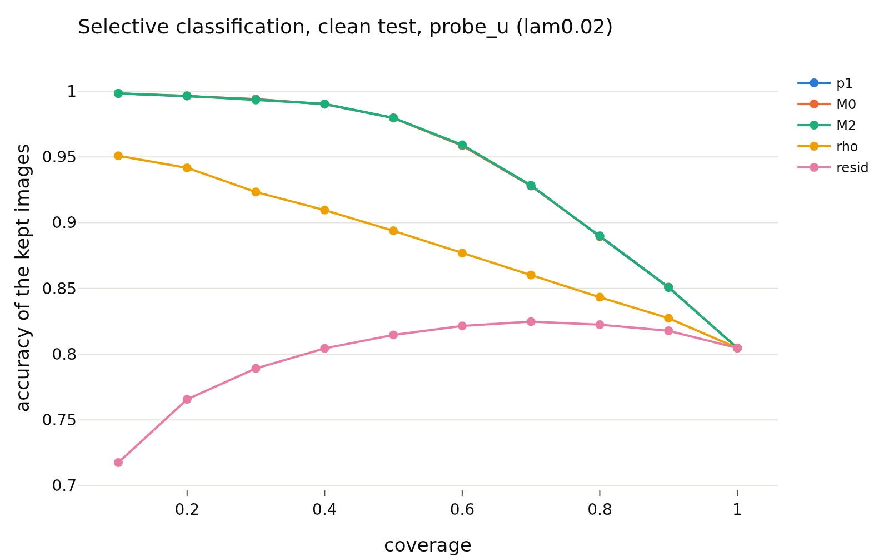
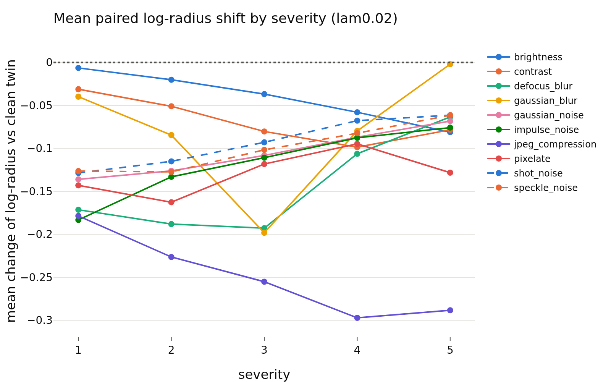
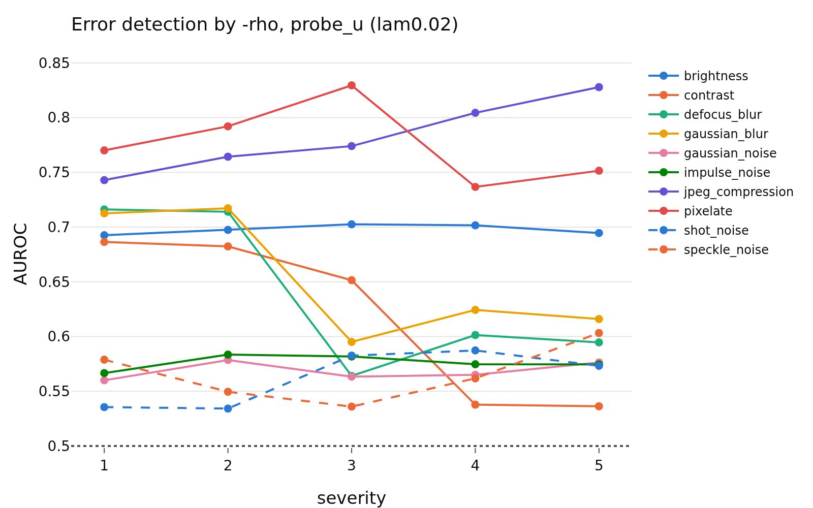

# confidence_z_lam0.02
- **Branch / version:** `radius-confidence` @ `8bf19c2`
- **Run datetime (UTC):** 2026-10-26T17:57Z (aggregation; units computed 2026-10-26T17:06Z-17:50Z, SLURM jobs 2253285 / 2253286, CPU only)
- **Command(s):**
  `python apps/analyze.py --config configs/base.yaml --confidence radius_marginal --confidence-space z --note radius_confidence/confidence.md` (per-run units: see `confidence.md`, section Commands)
- **Datasets:** STL-10 ([canonical](https://cs.stanford.edu/~acoates/stl10/), [HF `tanganke/stl10`](https://huggingface.co/datasets/tanganke/stl10); canonical used), STL-10-C (vendored corruptions of the STL-10 test split), DTD ([canonical](https://www.robots.ox.ac.uk/~vgg/data/dtd/), [HF `tanganke/dtd`](https://huggingface.co/datasets/tanganke/dtd)); SVHN excluded, Places365 pending.
- **Backbone:** ResNet-18 from scratch ([HF architecture reference](https://huggingface.co/timm/resnet18.a1_in1k), pretrained weights not used). **h is not analyzed; LeJEPA's product is z.**

## Question

Does the radius track the readers' confidence and errors beyond the direction? Definitions, predictions and the scorecard: [`confidence.md`](confidence.md).

## Setup (deviations from the base config)

None beyond the pre-registration (`confidence.md`); `eval.knn_k=20`, `eval.num_bootstrap=1000` (200 for the corrupted cells).

## Results

<!-- BEGIN GENERATED: analyze.confidence_inputs -->
### Inputs

Runs aggregated (z space, center views): `radius_marginal_lam0.02_s0`, `radius_marginal_lam0.02_s1`, `radius_marginal_lam0.02_s2`.
<!-- END GENERATED: analyze.confidence_inputs -->

<!-- BEGIN GENERATED: analyze.confidence_clean -->
### Clean STL-10 test: error detection by the radius signals

Seed means; intervals are paired bootstrap percentile intervals over images (resampled within each seed). Definitions, margins and verdict rules: `research_notes/radius_confidence/confidence.md` (pre-registration).

| set | reader | signal | reader accuracy | AUROC (errors) | 95% CI | verdict |
|---|---|---|---|---|---|---|
| clean test | probe_z | -rho | 0.8041 | 0.6948 | [0.687, 0.703] | informative |
| clean test | probe_z | -resid | 0.8041 | 0.5211 | [0.511, 0.531] | informative |
| clean test | probe_z | -p1 | 0.8041 | 0.8691 | [0.865, 0.874] | informative |
| clean test | probe_z | -margin | 0.8041 | 0.866 | [0.861, 0.871] | informative |
| clean test | probe_z | -rho_cc | 0.8041 | 0.6163 | [0.607, 0.626] | informative |
| clean test | probe_z | -rho, within class (macro) | 0.8041 | 0.6805 |  | n/a |
| clean test | probe_u | -rho | 0.8047 | 0.6916 | [0.683, 0.700] | informative |
| clean test | probe_u | -resid | 0.8047 | 0.5211 | [0.512, 0.531] | informative |
| clean test | probe_u | -p1 | 0.8047 | 0.8633 | [0.859, 0.868] | informative |
| clean test | probe_u | -margin | 0.8047 | 0.8604 | [0.856, 0.865] | informative |
| clean test | probe_u | -rho_cc | 0.8047 | 0.6121 | [0.603, 0.621] | informative |
| clean test | probe_u | -rho, within class (macro) | 0.8047 | 0.6768 |  | n/a |
| clean test | knn_u | -rho | 0.7735 | 0.7084 | [0.701, 0.715] | informative |
| clean test | knn_u | -resid | 0.7735 | 0.5318 | [0.522, 0.541] | informative |
| clean test | knn_u | -p1 | 0.7735 | 0.8546 | [0.850, 0.860] | informative |
| clean test | knn_u | -margin | 0.7735 | 0.8527 | [0.848, 0.858] | informative |
| clean test | knn_u | -rho_cc | 0.7735 | 0.6274 | [0.619, 0.636] | informative |
| clean test | knn_u | -rho, within class (macro) | 0.7735 | 0.693 |  | n/a |

| set | reader | Spearman(rho,p1) | rho,p1 95% CI | Spearman(resid,p1) | resid,p1 95% CI |
|---|---|---|---|---|---|
| clean test | probe_z | 0.566 | [+0.557, +0.575] | 0.061 | [+0.050, +0.074] |
| clean test | probe_u | 0.44 | [+0.430, +0.450] | 0.021 | [+0.010, +0.033] |
| clean test | knn_u | 0.481 | [+0.471, +0.491] | 0.022 | [+0.010, +0.035] |
<!-- END GENERATED: analyze.confidence_clean -->

<!-- BEGIN GENERATED: analyze.confidence_nested -->
### Beyond the reader's own confidence (clean test)

`M0 = [logit p1, margin]`, `M1 = M0 + rho`, `M2 = M0 + resid`, 5-fold cross-fitted; AUROC differences have margin 0.01, accuracy-at-coverage differences 0.5 points.

| set | reader | comparison | difference | unit | 95% CI | verdict |
|---|---|---|---|---|---|---|
| clean test | probe_z | auroc: M1 - M0 | -0.0001 | AUROC | [-0.0003, +0.0001] | equivalent |
| clean test | probe_z | acc@50: M1 - M0 | -0.0083 | points | [-0.0583, +0.0417] | equivalent |
| clean test | probe_z | acc@80: M1 - M0 | -0.0313 | points | [-0.0625, +0.0833] | equivalent |
| clean test | probe_z | auroc: M2 - M0 | -0.0002 | AUROC | [-0.0003, -0.0001] | equivalent |
| clean test | probe_z | acc@50: M2 - M0 | 0 | points | [-0.0333, +0.0417] | equivalent |
| clean test | probe_z | acc@80: M2 - M0 | 0 | points | [-0.0573, +0.0625] | equivalent |
| clean test | probe_z | auroc: M3 - M0 (post hoc) | -0.0002 | AUROC | [-0.0004, +0.0000] | equivalent |
| clean test | probe_z | auroc: M4 - M0 (post hoc) | -0.0004 | AUROC | [-0.0006, -0.0002] | equivalent |
| clean test | probe_u | auroc: M1 - M0 | 0.0034 | AUROC | [+0.0023, +0.0046] | equivalent |
| clean test | probe_u | acc@50: M1 - M0 | 0.2083 | points | [+0.0915, +0.3500] | equivalent |
| clean test | probe_u | acc@80: M1 - M0 | 0.1302 | points | [-0.0313, +0.2917] | equivalent |
| clean test | probe_u | auroc: M2 - M0 | 0.0002 | AUROC | [-0.0003, +0.0006] | equivalent |
| clean test | probe_u | acc@50: M2 - M0 | 0.0167 | points | [-0.0750, +0.0833] | equivalent |
| clean test | probe_u | acc@80: M2 - M0 | 0.0365 | points | [-0.1146, +0.0938] | equivalent |
| clean test | probe_u | auroc: M3 - M0 (post hoc) | 0.0029 | AUROC | [+0.0018, +0.0041] | equivalent |
| clean test | probe_u | auroc: M4 - M0 (post hoc) | 0.0033 | AUROC | [+0.0021, +0.0045] | equivalent |
| clean test | knn_u | auroc: M1 - M0 | 0.0064 | AUROC | [+0.0049, +0.0078] | equivalent |
| clean test | knn_u | acc@50: M1 - M0 | 0.2917 | points | [+0.1581, +0.5002] | equivalent |
| clean test | knn_u | acc@80: M1 - M0 | 0.0781 | points | [-0.1250, +0.2344] | equivalent |
| clean test | knn_u | auroc: M2 - M0 | 0.0015 | AUROC | [+0.0007, +0.0023] | equivalent |
| clean test | knn_u | acc@50: M2 - M0 | 0.0333 | points | [-0.0583, +0.1669] | equivalent |
| clean test | knn_u | acc@80: M2 - M0 | 0.0052 | points | [-0.1458, +0.1042] | equivalent |
| clean test | knn_u | auroc: M3 - M0 (post hoc) | 0.0053 | AUROC | [+0.0039, +0.0067] | equivalent |
| clean test | knn_u | auroc: M4 - M0 (post hoc) | 0.0065 | AUROC | [+0.0049, +0.0079] | equivalent |
<!-- END GENERATED: analyze.confidence_nested -->

<!-- BEGIN GENERATED: analyze.confidence_corrupted -->
### STL-10-C: error detection and additions, all cells pooled

Seed means; intervals are paired bootstrap percentile intervals over images (resampled within each seed). Definitions, margins and verdict rules: `research_notes/radius_confidence/confidence.md` (pre-registration). (200 replicates for the corrupted cells.)

| set | reader | signal | reader accuracy | AUROC (errors) | 95% CI | verdict |
|---|---|---|---|---|---|---|
| all 50 corrupted cells (mean over cells) | probe_z | -rho | 0.3728 | 0.6454 | [0.642, 0.648] | informative |
| all 50 corrupted cells (mean over cells) | probe_z | -resid | 0.3728 | 0.5462 | [0.544, 0.549] | informative |
| all 50 corrupted cells (mean over cells) | probe_z | -p1 | 0.3728 | 0.7059 | [0.704, 0.708] | informative |
| all 50 corrupted cells (mean over cells) | probe_z | -margin | 0.3728 | 0.6979 | [0.696, 0.700] | informative |
| all 50 corrupted cells (mean over cells) | probe_z | -rho_cc | 0.3728 | 0.6602 | [0.657, 0.663] | informative |
| all 50 corrupted cells (mean over cells) | probe_z | -rho, within class (macro) | 0.3728 | 0.5711 |  | n/a |
| all 50 corrupted cells (mean over cells) | probe_u | -rho | 0.3763 | 0.644 | [0.641, 0.646] | informative |
| all 50 corrupted cells (mean over cells) | probe_u | -resid | 0.3763 | 0.547 | [0.544, 0.550] | informative |
| all 50 corrupted cells (mean over cells) | probe_u | -p1 | 0.3763 | 0.7019 | [0.699, 0.704] | informative |
| all 50 corrupted cells (mean over cells) | probe_u | -margin | 0.3763 | 0.6942 | [0.692, 0.697] | informative |
| all 50 corrupted cells (mean over cells) | probe_u | -rho_cc | 0.3763 | 0.6524 | [0.650, 0.655] | informative |
| all 50 corrupted cells (mean over cells) | probe_u | -rho, within class (macro) | 0.3763 | 0.5634 |  | n/a |
| all 50 corrupted cells (mean over cells) | knn_u | -rho | 0.371 | 0.6522 | [0.648, 0.655] | informative |
| all 50 corrupted cells (mean over cells) | knn_u | -resid | 0.371 | 0.5557 | [0.553, 0.559] | informative |
| all 50 corrupted cells (mean over cells) | knn_u | -p1 | 0.371 | 0.6862 | [0.684, 0.689] | informative |
| all 50 corrupted cells (mean over cells) | knn_u | -margin | 0.371 | 0.6721 | [0.670, 0.674] | informative |
| all 50 corrupted cells (mean over cells) | knn_u | -rho_cc | 0.371 | 0.6412 | [0.638, 0.644] | informative |
| all 50 corrupted cells (mean over cells) | knn_u | -rho, within class (macro) | 0.371 | 0.5776 |  | n/a |

| set | reader | Spearman(rho,p1) | rho,p1 95% CI | Spearman(resid,p1) | resid,p1 95% CI | Spearman(d_rho,d_p1) | d_rho,d_p1 95% CI |
|---|---|---|---|---|---|---|---|
| all 50 corrupted cells (mean over cells) | probe_z | 0.42 | [+0.417, +0.424] | 0.171 | [+0.167, +0.174] | 0.402 | [+0.397, +0.406] |
| all 50 corrupted cells (mean over cells) | probe_u | 0.278 | [+0.274, +0.282] | 0.128 | [+0.124, +0.132] | 0.267 | [+0.262, +0.273] |
| all 50 corrupted cells (mean over cells) | knn_u | 0.261 | [+0.257, +0.264] | 0.035 | [+0.032, +0.038] | 0.312 | [+0.306, +0.316] |

| set | reader | comparison | difference | unit | 95% CI | verdict |
|---|---|---|---|---|---|---|
| all 50 corrupted cells (mean over cells) | probe_z | auroc: M1 - M0 | 0.014 | AUROC | [+0.0129, +0.0152] | adds |
| all 50 corrupted cells (mean over cells) | probe_z | acc@50: M1 - M0 | 0.7798 | points | [+0.7060, +0.8265] | adds |
| all 50 corrupted cells (mean over cells) | probe_z | acc@80: M1 - M0 | 0.2227 | points | [+0.1920, +0.2507] | equivalent |
| all 50 corrupted cells (mean over cells) | probe_z | auroc: M2 - M0 | 0.0071 | AUROC | [+0.0063, +0.0078] | equivalent |
| all 50 corrupted cells (mean over cells) | probe_z | acc@50: M2 - M0 | 0.3395 | points | [+0.2901, +0.3832] | equivalent |
| all 50 corrupted cells (mean over cells) | probe_z | acc@80: M2 - M0 | 0.159 | points | [+0.1371, +0.1780] | equivalent |
| all 50 corrupted cells (mean over cells) | probe_z | auroc: M3 - M0 (post hoc) | 0.0151 | AUROC | [+0.0138, +0.0162] | adds |
| all 50 corrupted cells (mean over cells) | probe_z | auroc: M4 - M0 (post hoc) | 0.0219 | AUROC | [+0.0207, +0.0231] | adds |
| all 50 corrupted cells (mean over cells) | probe_u | auroc: M1 - M0 | 0.0245 | AUROC | [+0.0230, +0.0260] | adds |
| all 50 corrupted cells (mean over cells) | probe_u | acc@50: M1 - M0 | 1.36 | points | [+1.2732, +1.4368] | adds |
| all 50 corrupted cells (mean over cells) | probe_u | acc@80: M1 - M0 | 0.3786 | points | [+0.3404, +0.4219] | equivalent |
| all 50 corrupted cells (mean over cells) | probe_u | auroc: M2 - M0 | 0.0081 | AUROC | [+0.0073, +0.0088] | equivalent |
| all 50 corrupted cells (mean over cells) | probe_u | acc@50: M2 - M0 | 0.3692 | points | [+0.3255, +0.4205] | equivalent |
| all 50 corrupted cells (mean over cells) | probe_u | acc@80: M2 - M0 | 0.1873 | points | [+0.1669, +0.2096] | equivalent |
| all 50 corrupted cells (mean over cells) | probe_u | auroc: M3 - M0 (post hoc) | 0.0225 | AUROC | [+0.0210, +0.0239] | adds |
| all 50 corrupted cells (mean over cells) | probe_u | auroc: M4 - M0 (post hoc) | 0.0315 | AUROC | [+0.0297, +0.0330] | adds |
| all 50 corrupted cells (mean over cells) | knn_u | auroc: M1 - M0 | 0.0351 | AUROC | [+0.0335, +0.0366] | adds |
| all 50 corrupted cells (mean over cells) | knn_u | acc@50: M1 - M0 | 1.363 | points | [+1.2823, +1.4436] | adds |
| all 50 corrupted cells (mean over cells) | knn_u | acc@80: M1 - M0 | 0.5004 | points | [+0.4465, +0.5339] | inconclusive |
| all 50 corrupted cells (mean over cells) | knn_u | auroc: M2 - M0 | 0.0189 | AUROC | [+0.0177, +0.0199] | adds |
| all 50 corrupted cells (mean over cells) | knn_u | acc@50: M2 - M0 | 0.647 | points | [+0.6025, +0.6924] | adds |
| all 50 corrupted cells (mean over cells) | knn_u | acc@80: M2 - M0 | 0.2268 | points | [+0.1959, +0.2499] | equivalent |
| all 50 corrupted cells (mean over cells) | knn_u | auroc: M3 - M0 (post hoc) | 0.0259 | AUROC | [+0.0242, +0.0272] | adds |
| all 50 corrupted cells (mean over cells) | knn_u | auroc: M4 - M0 (post hoc) | 0.0403 | AUROC | [+0.0386, +0.0419] | adds |
<!-- END GENERATED: analyze.confidence_corrupted -->

<!-- BEGIN GENERATED: analyze.confidence_per_corruption -->
### Per corruption (severities averaged)

| corruption | reader | mean shift of log-radius | accuracy | AUROC(-rho) | verdict -rho | AUROC(-resid) | M1 - M0 | verdict M1 | M2 - M0 | verdict M2 | Spearman(d_rho, d_p1) |
|---|---|---|---|---|---|---|---|---|---|---|---|
| brightness | probe_z | -0.0405 | 0.7435 | 0.6992 | informative | 0.527 | 0.0007 | equivalent | -0.0001 | equivalent | 0.235 |
| brightness | probe_u | -0.0405 | 0.7444 | 0.6977 | informative | 0.5267 | 0.0059 | equivalent | 0.0001 | equivalent | 0.097 |
| brightness | knn_u | -0.0405 | 0.7304 | 0.694 | informative | 0.5369 | 0.0034 | equivalent | 0.001 | equivalent | 0.1 |
| contrast | probe_z | -0.0679 | 0.5692 | 0.618 | informative | 0.5149 | 0.0027 | equivalent | 0.0021 | equivalent | 0.256 |
| contrast | probe_u | -0.0679 | 0.5707 | 0.6189 | informative | 0.5149 | 0.0015 | equivalent | 0.0009 | equivalent | 0.118 |
| contrast | knn_u | -0.0679 | 0.5599 | 0.6328 | informative | 0.5141 | -0.0005 | equivalent | 0.0001 | equivalent | 0.076 |
| defocus_blur | probe_z | -0.1444 | 0.2901 | 0.6449 | informative | 0.6076 | 0.0096 | inconclusive | 0.0295 | adds | 0.58 |
| defocus_blur | probe_u | -0.1444 | 0.2958 | 0.638 | informative | 0.6015 | 0.0154 | adds | 0.0305 | adds | 0.464 |
| defocus_blur | knn_u | -0.1444 | 0.2869 | 0.6629 | informative | 0.6064 | 0.0809 | adds | 0.0754 | adds | 0.465 |
| gaussian_blur | probe_z | -0.0809 | 0.3907 | 0.6562 | informative | 0.589 | 0.0082 | equivalent | 0.0056 | equivalent | 0.478 |
| gaussian_blur | probe_u | -0.0809 | 0.393 | 0.6531 | informative | 0.5867 | 0.0161 | adds | 0.0107 | inconclusive | 0.343 |
| gaussian_blur | knn_u | -0.0809 | 0.3856 | 0.6685 | informative | 0.5928 | 0.071 | adds | 0.0603 | adds | 0.357 |
| gaussian_noise | probe_z | -0.1051 | 0.1795 | 0.5747 | informative | 0.4925 | 0.0184 | adds | 0.0041 | equivalent | 0.48 |
| gaussian_noise | probe_u | -0.1051 | 0.1856 | 0.5687 | informative | 0.4944 | 0.0259 | adds | 0.0031 | equivalent | 0.362 |
| gaussian_noise | knn_u | -0.1051 | 0.1763 | 0.5899 | informative | 0.5176 | 0.0275 | adds | 0.0062 | equivalent | 0.435 |
| impulse_noise | probe_z | -0.1182 | 0.1812 | 0.5801 | informative | 0.5062 | 0.0202 | adds | 0.0045 | equivalent | 0.431 |
| impulse_noise | probe_u | -0.1182 | 0.1852 | 0.5762 | informative | 0.511 | 0.0334 | adds | 0.0047 | equivalent | 0.304 |
| impulse_noise | knn_u | -0.1182 | 0.1775 | 0.5885 | informative | 0.5319 | 0.0321 | adds | 0.0114 | inconclusive | 0.389 |
| jpeg_compression | probe_z | -0.2491 | 0.5368 | 0.7797 | informative | 0.6227 | 0.017 | adds | 0.0016 | equivalent | 0.359 |
| jpeg_compression | probe_u | -0.2491 | 0.5403 | 0.7827 | informative | 0.6251 | 0.0383 | adds | 0.0043 | equivalent | 0.169 |
| jpeg_compression | knn_u | -0.2491 | 0.5569 | 0.7673 | informative | 0.6227 | 0.0261 | adds | 0.0027 | equivalent | 0.236 |
| pixelate | probe_z | -0.1294 | 0.3644 | 0.7753 | informative | 0.6474 | 0.0394 | adds | 0.0155 | adds | 0.351 |
| pixelate | probe_u | -0.1294 | 0.368 | 0.776 | informative | 0.6494 | 0.0633 | adds | 0.0199 | adds | 0.197 |
| pixelate | knn_u | -0.1294 | 0.3885 | 0.7549 | informative | 0.6275 | 0.0406 | adds | 0.0089 | equivalent | 0.275 |
| shot_noise | probe_z | -0.0932 | 0.1931 | 0.5632 | informative | 0.4823 | 0.0101 | inconclusive | 0.0032 | equivalent | 0.458 |
| shot_noise | probe_u | -0.0932 | 0.1967 | 0.5626 | informative | 0.4836 | 0.0196 | adds | 0.0026 | equivalent | 0.347 |
| shot_noise | knn_u | -0.0932 | 0.1838 | 0.5726 | informative | 0.5021 | 0.0333 | adds | 0.0098 | inconclusive | 0.411 |
| speckle_noise | probe_z | -0.0998 | 0.2799 | 0.563 | informative | 0.4726 | 0.0136 | adds | 0.0046 | equivalent | 0.388 |
| speckle_noise | probe_u | -0.0998 | 0.2835 | 0.5659 | informative | 0.4766 | 0.0257 | adds | 0.0037 | equivalent | 0.272 |
| speckle_noise | knn_u | -0.0998 | 0.2644 | 0.5904 | informative | 0.5052 | 0.0369 | adds | 0.0132 | adds | 0.371 |
<!-- END GENERATED: analyze.confidence_per_corruption -->

<!-- BEGIN GENERATED: analyze.confidence_shift -->
### Sign and monotonicity of the radius shift

Mean paired change of the center-view log-radius against the clean twin of each image.

| corruption | severity 1 | severity 2 | severity 3 | severity 4 | severity 5 | non-increasing |
|---|---|---|---|---|---|---|
| brightness | -0.0064 | -0.0202 | -0.0368 | -0.058 | -0.0811 | True |
| contrast | -0.0312 | -0.051 | -0.0803 | -0.0986 | -0.0784 | False |
| defocus_blur | -0.1714 | -0.1881 | -0.1928 | -0.1063 | -0.0634 | False |
| gaussian_blur | -0.0398 | -0.0845 | -0.1982 | -0.0797 | -0.002 | False |
| gaussian_noise | -0.136 | -0.1261 | -0.1082 | -0.087 | -0.0682 | False |
| impulse_noise | -0.1833 | -0.1331 | -0.1108 | -0.0877 | -0.0759 | False |
| jpeg_compression | -0.1786 | -0.2263 | -0.2551 | -0.2971 | -0.2883 | False |
| pixelate | -0.143 | -0.1627 | -0.1182 | -0.0948 | -0.1282 | False |
| shot_noise | -0.1286 | -0.1151 | -0.0929 | -0.0678 | -0.0614 | False |
| speckle_noise | -0.1264 | -0.1273 | -0.1017 | -0.0823 | -0.0614 | False |

| corruptions with negative mean shift | Spearman(shift, accuracy loss of probe_z) across corruption types |
|---|---|
| 10 of 10 | -0.345 |
<!-- END GENERATED: analyze.confidence_shift -->

<!-- BEGIN GENERATED: analyze.confidence_cells -->
### AUROC of `-rho` for the errors of `probe_u`, per cell

| corruption | severity 1 | severity 2 | severity 3 | severity 4 | severity 5 |
|---|---|---|---|---|---|
| brightness | 0.693 | 0.697 | 0.703 | 0.702 | 0.695 |
| contrast | 0.686 | 0.682 | 0.651 | 0.538 | 0.536 |
| defocus_blur | 0.716 | 0.714 | 0.564 | 0.601 | 0.595 |
| gaussian_blur | 0.713 | 0.717 | 0.595 | 0.624 | 0.616 |
| gaussian_noise | 0.56 | 0.579 | 0.563 | 0.565 | 0.576 |
| impulse_noise | 0.567 | 0.583 | 0.582 | 0.575 | 0.575 |
| jpeg_compression | 0.743 | 0.764 | 0.774 | 0.804 | 0.828 |
| pixelate | 0.77 | 0.792 | 0.83 | 0.737 | 0.751 |
| shot_noise | 0.536 | 0.534 | 0.583 | 0.587 | 0.573 |
| speckle_noise | 0.579 | 0.55 | 0.536 | 0.562 | 0.603 |

### AUROC of `-rho` for the errors of `knn_u`, per cell

| corruption | severity 1 | severity 2 | severity 3 | severity 4 | severity 5 |
|---|---|---|---|---|---|
| brightness | 0.706 | 0.702 | 0.697 | 0.688 | 0.677 |
| contrast | 0.696 | 0.685 | 0.647 | 0.564 | 0.572 |
| defocus_blur | 0.733 | 0.727 | 0.607 | 0.627 | 0.621 |
| gaussian_blur | 0.723 | 0.726 | 0.638 | 0.633 | 0.623 |
| gaussian_noise | 0.586 | 0.593 | 0.595 | 0.587 | 0.588 |
| impulse_noise | 0.568 | 0.579 | 0.595 | 0.6 | 0.6 |
| jpeg_compression | 0.737 | 0.754 | 0.763 | 0.783 | 0.8 |
| pixelate | 0.756 | 0.772 | 0.799 | 0.714 | 0.734 |
| shot_noise | 0.55 | 0.56 | 0.591 | 0.588 | 0.574 |
| speckle_noise | 0.585 | 0.56 | 0.58 | 0.606 | 0.621 |
<!-- END GENERATED: analyze.confidence_cells -->

<!-- BEGIN GENERATED: analyze.confidence_ood -->
### ID (STL-10 test) vs OOD: the radius against the readers' confidence

OOD is the positive class; `-rho`, `-p1` are oriented so that high = more OOD. SVHN is deliberately excluded: it is upsampled from 32 x 32 to 96 x 96, which confounds the low-level statistics (`research_notes/radius_usage/svhn_control.md`, branch `radius-usage-svhn-control`). DTD is native high resolution (downsampled); Places365 `val` is downsampled to 96 x 96.

| OOD set | reader | comparison | value | 95% CI | verdict |
|---|---|---|---|---|---|
| ood:dtd | probe_z | AUROC of -rho | 0.6659 | [0.659, 0.673] |  |
| ood:dtd | probe_z | AUROC of -resid | 0.6354 | [0.626, 0.645] |  |
| ood:dtd | probe_z | AUROC of -p1 | 0.7507 | [0.745, 0.757] |  |
| ood:dtd | probe_z | AUROC of -margin | 0.7436 | [0.738, 0.750] |  |
| ood:dtd | probe_z | AUROC: M1 - M0 | 0.0011 | [+0.0001, +0.0019] | equivalent |
| ood:dtd | probe_z | AUROC: M2 - M0 | 0.0295 | [+0.0251, +0.0338] | adds |
| ood:dtd | probe_z | AUROC: M3 - M0 (post hoc) | 0.0048 | [+0.0029, +0.0066] | equivalent |
| ood:dtd | probe_z | AUROC: M4 - M0 (post hoc) | 0.0288 | [+0.0243, +0.0333] | adds |
| ood:dtd | probe_u | AUROC of -rho | 0.6659 | [0.659, 0.673] |  |
| ood:dtd | probe_u | AUROC of -resid | 0.6354 | [0.626, 0.645] |  |
| ood:dtd | probe_u | AUROC of -p1 | 0.76 | [0.754, 0.766] |  |
| ood:dtd | probe_u | AUROC of -margin | 0.751 | [0.745, 0.757] |  |
| ood:dtd | probe_u | AUROC: M1 - M0 | 0.0033 | [+0.0011, +0.0054] | equivalent |
| ood:dtd | probe_u | AUROC: M2 - M0 | 0.0287 | [+0.0242, +0.0332] | adds |
| ood:dtd | probe_u | AUROC: M3 - M0 (post hoc) | 0.0002 | [-0.0003, +0.0006] | equivalent |
| ood:dtd | probe_u | AUROC: M4 - M0 (post hoc) | 0.0292 | [+0.0246, +0.0337] | adds |
| ood:dtd | knn_u | AUROC of -rho | 0.6659 | [0.659, 0.673] |  |
| ood:dtd | knn_u | AUROC of -resid | 0.6354 | [0.626, 0.645] |  |
| ood:dtd | knn_u | AUROC of -p1 | 0.8037 | [0.798, 0.809] |  |
| ood:dtd | knn_u | AUROC of -margin | 0.7838 | [0.778, 0.789] |  |
| ood:dtd | knn_u | AUROC: M1 - M0 | 0.0014 | [+0.0004, +0.0023] | equivalent |
| ood:dtd | knn_u | AUROC: M2 - M0 | 0.0209 | [+0.0172, +0.0245] | adds |
| ood:dtd | knn_u | AUROC: M3 - M0 (post hoc) | 0.0033 | [+0.0024, +0.0042] | equivalent |
| ood:dtd | knn_u | AUROC: M4 - M0 (post hoc) | 0.021 | [+0.0172, +0.0246] | adds |
<!-- END GENERATED: analyze.confidence_ood -->

<!-- BEGIN GENERATED: analyze.confidence_figures -->
### Figures

<!-- END GENERATED: analyze.confidence_figures -->

## Interpretation

See `confidence.md` (this note holds the generated tables of one group).

## Next steps

See `confidence.md`.
