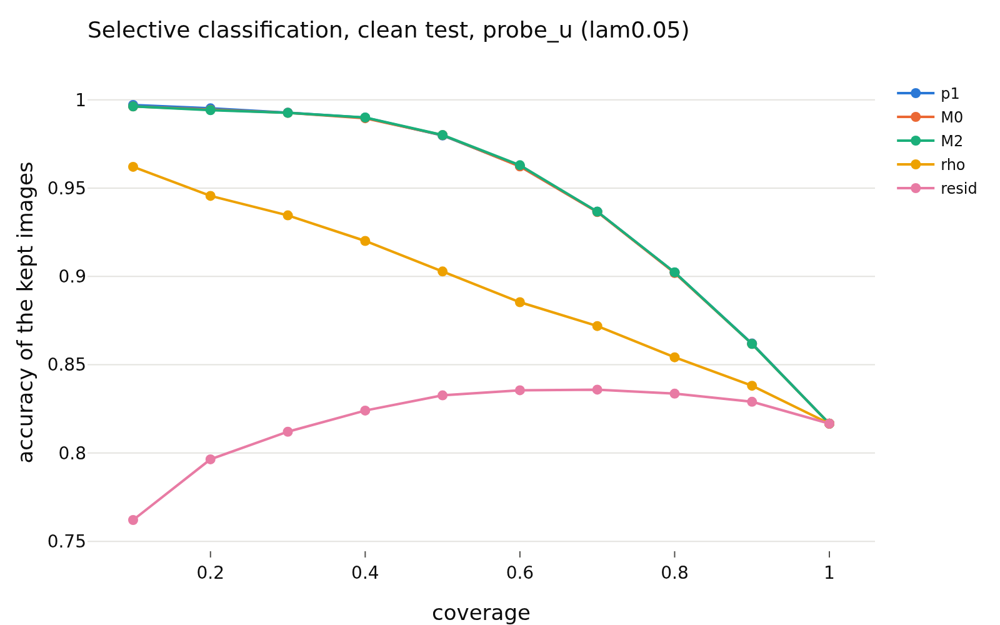
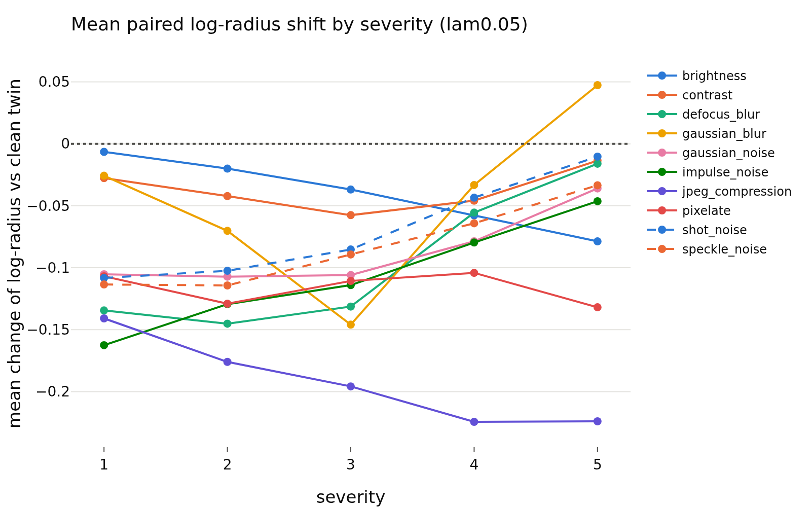
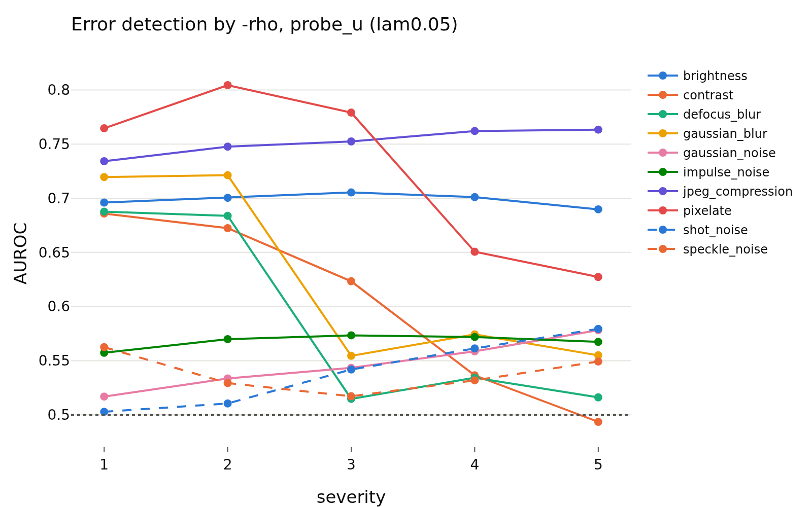

# confidence_z_lam0.05
- **Branch / version:** `radius-confidence` @ `8bf19c2`
- **Run datetime (UTC):** 2026-10-26T17:57Z (aggregation; units computed 2026-10-26T17:06Z-17:50Z, SLURM jobs 2253285 / 2253286, CPU only)
- **Command(s):**
  `python apps/analyze.py --config configs/base.yaml --confidence radius_marginal --confidence-space z --note radius_confidence/confidence.md` (per-run units: see `confidence.md`, section Commands)
- **Datasets:** STL-10 ([canonical](https://cs.stanford.edu/~acoates/stl10/), [HF `tanganke/stl10`](https://huggingface.co/datasets/tanganke/stl10); canonical used), STL-10-C (vendored corruptions of the STL-10 test split), DTD ([canonical](https://www.robots.ox.ac.uk/~vgg/data/dtd/), [HF `tanganke/dtd`](https://huggingface.co/datasets/tanganke/dtd)); SVHN excluded, Places365 pending.
- **Backbone:** ResNet-18 from scratch ([HF architecture reference](https://huggingface.co/timm/resnet18.a1_in1k), pretrained weights not used). **h is not analyzed; LeJEPA's product is z.**

## Question

Does the radius track the readers' confidence and errors beyond the direction? Definitions, predictions and the scorecard: [`confidence.md`](confidence.md).

## Setup (deviations from the base config)

None beyond the pre-registration (`confidence.md`); `eval.knn_k=20`, `eval.num_bootstrap=1000` (200 for the corrupted cells).

## Results

<!-- BEGIN GENERATED: analyze.confidence_inputs -->
### Inputs

Runs aggregated (z space, center views): `radius_marginal_lam0.05_s0`, `radius_marginal_lam0.05_s1`, `radius_marginal_lam0.05_s2`.
<!-- END GENERATED: analyze.confidence_inputs -->

<!-- BEGIN GENERATED: analyze.confidence_clean -->
### Clean STL-10 test: error detection by the radius signals

Seed means; intervals are paired bootstrap percentile intervals over images (resampled within each seed). Definitions, margins and verdict rules: `research_notes/radius_confidence/confidence.md` (pre-registration).

| set | reader | signal | reader accuracy | AUROC (errors) | 95% CI | verdict |
|---|---|---|---|---|---|---|
| clean test | probe_z | -rho | 0.817 | 0.6953 | [0.687, 0.703] | informative |
| clean test | probe_z | -resid | 0.817 | 0.5314 | [0.521, 0.542] | informative |
| clean test | probe_z | -p1 | 0.817 | 0.8703 | [0.865, 0.876] | informative |
| clean test | probe_z | -margin | 0.817 | 0.8673 | [0.863, 0.873] | informative |
| clean test | probe_z | -rho_cc | 0.817 | 0.631 | [0.622, 0.640] | informative |
| clean test | probe_z | -rho, within class (macro) | 0.817 | 0.6833 |  | n/a |
| clean test | probe_u | -rho | 0.8167 | 0.6954 | [0.687, 0.703] | informative |
| clean test | probe_u | -resid | 0.8167 | 0.5331 | [0.522, 0.543] | informative |
| clean test | probe_u | -p1 | 0.8167 | 0.8632 | [0.858, 0.868] | informative |
| clean test | probe_u | -margin | 0.8167 | 0.8604 | [0.855, 0.866] | informative |
| clean test | probe_u | -rho_cc | 0.8167 | 0.6302 | [0.621, 0.639] | informative |
| clean test | probe_u | -rho, within class (macro) | 0.8167 | 0.6827 |  | n/a |
| clean test | knn_u | -rho | 0.7836 | 0.6971 | [0.690, 0.705] | informative |
| clean test | knn_u | -resid | 0.7836 | 0.534 | [0.523, 0.544] | informative |
| clean test | knn_u | -p1 | 0.7836 | 0.8577 | [0.853, 0.862] | informative |
| clean test | knn_u | -margin | 0.7836 | 0.8557 | [0.851, 0.860] | informative |
| clean test | knn_u | -rho_cc | 0.7836 | 0.6275 | [0.619, 0.636] | informative |
| clean test | knn_u | -rho, within class (macro) | 0.7836 | 0.6828 |  | n/a |

| set | reader | Spearman(rho,p1) | rho,p1 95% CI | Spearman(resid,p1) | resid,p1 95% CI |
|---|---|---|---|---|---|
| clean test | probe_z | 0.49 | [+0.480, +0.500] | 0.089 | [+0.077, +0.101] |
| clean test | probe_u | 0.381 | [+0.370, +0.392] | 0.048 | [+0.036, +0.061] |
| clean test | knn_u | 0.453 | [+0.442, +0.463] | 0.052 | [+0.040, +0.065] |
<!-- END GENERATED: analyze.confidence_clean -->

<!-- BEGIN GENERATED: analyze.confidence_nested -->
### Beyond the reader's own confidence (clean test)

`M0 = [logit p1, margin]`, `M1 = M0 + rho`, `M2 = M0 + resid`, 5-fold cross-fitted; AUROC differences have margin 0.01, accuracy-at-coverage differences 0.5 points.

| set | reader | comparison | difference | unit | 95% CI | verdict |
|---|---|---|---|---|---|---|
| clean test | probe_z | auroc: M1 - M0 | 0.0007 | AUROC | [+0.0001, +0.0013] | equivalent |
| clean test | probe_z | acc@50: M1 - M0 | 0.075 | points | [-0.0250, +0.1417] | equivalent |
| clean test | probe_z | acc@80: M1 - M0 | -0.0312 | points | [-0.1199, +0.1198] | equivalent |
| clean test | probe_z | auroc: M2 - M0 | -0.0002 | AUROC | [-0.0003, -0.0000] | equivalent |
| clean test | probe_z | acc@50: M2 - M0 | -0.0083 | points | [-0.0333, +0.0417] | equivalent |
| clean test | probe_z | acc@80: M2 - M0 | -0.026 | points | [-0.0937, +0.0208] | equivalent |
| clean test | probe_z | auroc: M3 - M0 (post hoc) | 0.0008 | AUROC | [+0.0002, +0.0014] | equivalent |
| clean test | probe_z | auroc: M4 - M0 (post hoc) | 0.0006 | AUROC | [-0.0001, +0.0013] | equivalent |
| clean test | probe_u | auroc: M1 - M0 | 0.0057 | AUROC | [+0.0043, +0.0072] | equivalent |
| clean test | probe_u | acc@50: M1 - M0 | 0.3333 | points | [+0.2083, +0.5502] | inconclusive |
| clean test | probe_u | acc@80: M1 - M0 | 0.1198 | points | [-0.0626, +0.3022] | equivalent |
| clean test | probe_u | auroc: M2 - M0 | 0.0003 | AUROC | [-0.0001, +0.0008] | equivalent |
| clean test | probe_u | acc@50: M2 - M0 | 0.0083 | points | [-0.0583, +0.1083] | equivalent |
| clean test | probe_u | acc@80: M2 - M0 | 0.0365 | points | [-0.0626, +0.1199] | equivalent |
| clean test | probe_u | auroc: M3 - M0 (post hoc) | 0.0054 | AUROC | [+0.0040, +0.0069] | equivalent |
| clean test | probe_u | auroc: M4 - M0 (post hoc) | 0.0057 | AUROC | [+0.0042, +0.0073] | equivalent |
| clean test | knn_u | auroc: M1 - M0 | 0.0052 | AUROC | [+0.0038, +0.0065] | equivalent |
| clean test | knn_u | acc@50: M1 - M0 | 0.2917 | points | [+0.1000, +0.4169] | equivalent |
| clean test | knn_u | acc@80: M1 - M0 | -0.026 | points | [-0.2085, +0.1771] | equivalent |
| clean test | knn_u | auroc: M2 - M0 | 0.0008 | AUROC | [+0.0002, +0.0014] | equivalent |
| clean test | knn_u | acc@50: M2 - M0 | 0.125 | points | [-0.0250, +0.1585] | equivalent |
| clean test | knn_u | acc@80: M2 - M0 | -0.0469 | points | [-0.1719, +0.0573] | equivalent |
| clean test | knn_u | auroc: M3 - M0 (post hoc) | 0.0047 | AUROC | [+0.0034, +0.0060] | equivalent |
| clean test | knn_u | auroc: M4 - M0 (post hoc) | 0.0052 | AUROC | [+0.0038, +0.0064] | equivalent |
<!-- END GENERATED: analyze.confidence_nested -->

<!-- BEGIN GENERATED: analyze.confidence_corrupted -->
### STL-10-C: error detection and additions, all cells pooled

Seed means; intervals are paired bootstrap percentile intervals over images (resampled within each seed). Definitions, margins and verdict rules: `research_notes/radius_confidence/confidence.md` (pre-registration). (200 replicates for the corrupted cells.)

| set | reader | signal | reader accuracy | AUROC (errors) | 95% CI | verdict |
|---|---|---|---|---|---|---|
| all 50 corrupted cells (mean over cells) | probe_z | -rho | 0.3724 | 0.6193 | [0.616, 0.622] | informative |
| all 50 corrupted cells (mean over cells) | probe_z | -resid | 0.3724 | 0.5845 | [0.582, 0.587] | informative |
| all 50 corrupted cells (mean over cells) | probe_z | -p1 | 0.3724 | 0.6942 | [0.692, 0.697] | informative |
| all 50 corrupted cells (mean over cells) | probe_z | -margin | 0.3724 | 0.6863 | [0.684, 0.689] | informative |
| all 50 corrupted cells (mean over cells) | probe_z | -rho_cc | 0.3724 | 0.6182 | [0.615, 0.621] | informative |
| all 50 corrupted cells (mean over cells) | probe_z | -rho, within class (macro) | 0.3724 | 0.5851 |  | n/a |
| all 50 corrupted cells (mean over cells) | probe_u | -rho | 0.3757 | 0.6181 | [0.615, 0.621] | informative |
| all 50 corrupted cells (mean over cells) | probe_u | -resid | 0.3757 | 0.5833 | [0.581, 0.586] | informative |
| all 50 corrupted cells (mean over cells) | probe_u | -p1 | 0.3757 | 0.6871 | [0.685, 0.689] | informative |
| all 50 corrupted cells (mean over cells) | probe_u | -margin | 0.3757 | 0.6802 | [0.678, 0.682] | informative |
| all 50 corrupted cells (mean over cells) | probe_u | -rho_cc | 0.3757 | 0.6158 | [0.613, 0.618] | informative |
| all 50 corrupted cells (mean over cells) | probe_u | -rho, within class (macro) | 0.3757 | 0.579 |  | n/a |
| all 50 corrupted cells (mean over cells) | knn_u | -rho | 0.3742 | 0.6142 | [0.611, 0.617] | informative |
| all 50 corrupted cells (mean over cells) | knn_u | -resid | 0.3742 | 0.5849 | [0.582, 0.588] | informative |
| all 50 corrupted cells (mean over cells) | knn_u | -p1 | 0.3742 | 0.6957 | [0.693, 0.698] | informative |
| all 50 corrupted cells (mean over cells) | knn_u | -margin | 0.3742 | 0.6821 | [0.680, 0.684] | informative |
| all 50 corrupted cells (mean over cells) | knn_u | -rho_cc | 0.3742 | 0.5933 | [0.590, 0.596] | informative |
| all 50 corrupted cells (mean over cells) | knn_u | -rho, within class (macro) | 0.3742 | 0.5632 |  | n/a |

| set | reader | Spearman(rho,p1) | rho,p1 95% CI | Spearman(resid,p1) | resid,p1 95% CI | Spearman(d_rho,d_p1) | d_rho,d_p1 95% CI |
|---|---|---|---|---|---|---|---|
| all 50 corrupted cells (mean over cells) | probe_z | 0.292 | [+0.289, +0.296] | 0.144 | [+0.141, +0.148] | 0.298 | [+0.292, +0.303] |
| all 50 corrupted cells (mean over cells) | probe_u | 0.175 | [+0.172, +0.179] | 0.105 | [+0.102, +0.108] | 0.188 | [+0.182, +0.194] |
| all 50 corrupted cells (mean over cells) | knn_u | 0.223 | [+0.220, +0.227] | 0.14 | [+0.137, +0.143] | 0.279 | [+0.274, +0.285] |

| set | reader | comparison | difference | unit | 95% CI | verdict |
|---|---|---|---|---|---|---|
| all 50 corrupted cells (mean over cells) | probe_z | auroc: M1 - M0 | 0.0137 | AUROC | [+0.0125, +0.0145] | adds |
| all 50 corrupted cells (mean over cells) | probe_z | acc@50: M1 - M0 | 0.6843 | points | [+0.6291, +0.7411] | adds |
| all 50 corrupted cells (mean over cells) | probe_z | acc@80: M1 - M0 | 0.2764 | points | [+0.2420, +0.3071] | equivalent |
| all 50 corrupted cells (mean over cells) | probe_z | auroc: M2 - M0 | 0.0145 | AUROC | [+0.0136, +0.0156] | adds |
| all 50 corrupted cells (mean over cells) | probe_z | acc@50: M2 - M0 | 0.6698 | points | [+0.6066, +0.7300] | adds |
| all 50 corrupted cells (mean over cells) | probe_z | acc@80: M2 - M0 | 0.3076 | points | [+0.2817, +0.3314] | equivalent |
| all 50 corrupted cells (mean over cells) | probe_z | auroc: M3 - M0 (post hoc) | 0.0095 | AUROC | [+0.0085, +0.0104] | inconclusive |
| all 50 corrupted cells (mean over cells) | probe_z | auroc: M4 - M0 (post hoc) | 0.0234 | AUROC | [+0.0222, +0.0249] | adds |
| all 50 corrupted cells (mean over cells) | probe_u | auroc: M1 - M0 | 0.0224 | AUROC | [+0.0210, +0.0237] | adds |
| all 50 corrupted cells (mean over cells) | probe_u | acc@50: M1 - M0 | 1.229 | points | [+1.1594, +1.3126] | adds |
| all 50 corrupted cells (mean over cells) | probe_u | acc@80: M1 - M0 | 0.3645 | points | [+0.3160, +0.4044] | equivalent |
| all 50 corrupted cells (mean over cells) | probe_u | auroc: M2 - M0 | 0.0171 | AUROC | [+0.0161, +0.0182] | adds |
| all 50 corrupted cells (mean over cells) | probe_u | acc@50: M2 - M0 | 0.8105 | points | [+0.7536, +0.8744] | adds |
| all 50 corrupted cells (mean over cells) | probe_u | acc@80: M2 - M0 | 0.3236 | points | [+0.2933, +0.3635] | equivalent |
| all 50 corrupted cells (mean over cells) | probe_u | auroc: M3 - M0 (post hoc) | 0.0154 | AUROC | [+0.0142, +0.0165] | adds |
| all 50 corrupted cells (mean over cells) | probe_u | auroc: M4 - M0 (post hoc) | 0.0318 | AUROC | [+0.0305, +0.0336] | adds |
| all 50 corrupted cells (mean over cells) | knn_u | auroc: M1 - M0 | 0.0198 | AUROC | [+0.0183, +0.0210] | adds |
| all 50 corrupted cells (mean over cells) | knn_u | acc@50: M1 - M0 | 0.8128 | points | [+0.7375, +0.8656] | adds |
| all 50 corrupted cells (mean over cells) | knn_u | acc@80: M1 - M0 | 0.2535 | points | [+0.2168, +0.2882] | equivalent |
| all 50 corrupted cells (mean over cells) | knn_u | auroc: M2 - M0 | 0.0169 | AUROC | [+0.0155, +0.0185] | adds |
| all 50 corrupted cells (mean over cells) | knn_u | acc@50: M2 - M0 | 0.559 | points | [+0.4978, +0.6200] | inconclusive |
| all 50 corrupted cells (mean over cells) | knn_u | acc@80: M2 - M0 | 0.2094 | points | [+0.1768, +0.2422] | equivalent |
| all 50 corrupted cells (mean over cells) | knn_u | auroc: M3 - M0 (post hoc) | 0.0132 | AUROC | [+0.0116, +0.0145] | adds |
| all 50 corrupted cells (mean over cells) | knn_u | auroc: M4 - M0 (post hoc) | 0.0262 | AUROC | [+0.0245, +0.0278] | adds |
<!-- END GENERATED: analyze.confidence_corrupted -->

<!-- BEGIN GENERATED: analyze.confidence_per_corruption -->
### Per corruption (severities averaged)

| corruption | reader | mean shift of log-radius | accuracy | AUROC(-rho) | verdict -rho | AUROC(-resid) | M1 - M0 | verdict M1 | M2 - M0 | verdict M2 | Spearman(d_rho, d_p1) |
|---|---|---|---|---|---|---|---|---|---|---|---|
| brightness | probe_z | -0.04 | 0.7453 | 0.7004 | informative | 0.5475 | 0.003 | equivalent | 0.0004 | equivalent | 0.159 |
| brightness | probe_u | -0.04 | 0.7471 | 0.6985 | informative | 0.547 | 0.0092 | inconclusive | 0.0008 | equivalent | 0.054 |
| brightness | knn_u | -0.04 | 0.7335 | 0.6851 | informative | 0.5506 | 0.003 | equivalent | 0.001 | equivalent | 0.08 |
| contrast | probe_z | -0.0374 | 0.5487 | 0.6063 | informative | 0.598 | -0.0002 | equivalent | 0.0005 | equivalent | 0.111 |
| contrast | probe_u | -0.0374 | 0.5521 | 0.6023 | informative | 0.5945 | -0.0001 | equivalent | 0.0001 | equivalent | -0.006 |
| contrast | knn_u | -0.0374 | 0.5529 | 0.5885 | informative | 0.6136 | 0.0011 | equivalent | 0.0008 | equivalent | 0 |
| defocus_blur | probe_z | -0.0965 | 0.3024 | 0.6024 | informative | 0.6082 | 0.0053 | equivalent | 0.0199 | adds | 0.46 |
| defocus_blur | probe_u | -0.0965 | 0.3114 | 0.5873 | informative | 0.6055 | 0.0114 | inconclusive | 0.0238 | adds | 0.357 |
| defocus_blur | knn_u | -0.0965 | 0.2922 | 0.6085 | informative | 0.611 | 0.029 | adds | 0.0344 | adds | 0.443 |
| gaussian_blur | probe_z | -0.0456 | 0.3947 | 0.6339 | informative | 0.5918 | 0.0037 | equivalent | 0.0099 | inconclusive | 0.39 |
| gaussian_blur | probe_u | -0.0456 | 0.3995 | 0.6249 | informative | 0.589 | 0.013 | adds | 0.0175 | adds | 0.279 |
| gaussian_blur | knn_u | -0.0456 | 0.3875 | 0.6381 | informative | 0.593 | 0.0388 | adds | 0.0407 | adds | 0.341 |
| gaussian_noise | probe_z | -0.0866 | 0.1844 | 0.5441 | informative | 0.5601 | 0.0254 | adds | 0.0325 | adds | 0.354 |
| gaussian_noise | probe_u | -0.0866 | 0.1854 | 0.5461 | informative | 0.5593 | 0.026 | adds | 0.028 | adds | 0.253 |
| gaussian_noise | knn_u | -0.0866 | 0.1733 | 0.5404 | informative | 0.5575 | 0.0186 | adds | 0.0259 | adds | 0.395 |
| impulse_noise | probe_z | -0.1064 | 0.1753 | 0.5648 | informative | 0.5819 | 0.0285 | adds | 0.0339 | adds | 0.309 |
| impulse_noise | probe_u | -0.1064 | 0.1773 | 0.568 | informative | 0.58 | 0.031 | adds | 0.0306 | adds | 0.202 |
| impulse_noise | knn_u | -0.1064 | 0.168 | 0.548 | informative | 0.5772 | 0.0205 | adds | 0.0291 | adds | 0.38 |
| jpeg_compression | probe_z | -0.1921 | 0.5297 | 0.7479 | informative | 0.6264 | 0.0172 | adds | 0.002 | equivalent | 0.279 |
| jpeg_compression | probe_u | -0.1921 | 0.5329 | 0.752 | informative | 0.63 | 0.036 | adds | 0.0057 | equivalent | 0.155 |
| jpeg_compression | knn_u | -0.1921 | 0.569 | 0.7264 | informative | 0.6257 | 0.0124 | adds | 0.0037 | equivalent | 0.196 |
| pixelate | probe_z | -0.1165 | 0.3708 | 0.7223 | informative | 0.6795 | 0.0353 | adds | 0.0352 | adds | 0.264 |
| pixelate | probe_u | -0.1165 | 0.3714 | 0.7252 | informative | 0.6803 | 0.0578 | adds | 0.0438 | adds | 0.152 |
| pixelate | knn_u | -0.1165 | 0.4161 | 0.703 | informative | 0.6344 | 0.0258 | adds | 0.0057 | equivalent | 0.228 |
| shot_noise | probe_z | -0.0699 | 0.1985 | 0.5363 | informative | 0.5291 | 0.0127 | inconclusive | 0.0085 | inconclusive | 0.352 |
| shot_noise | probe_u | -0.0699 | 0.2008 | 0.5392 | informative | 0.5275 | 0.0228 | adds | 0.0133 | adds | 0.247 |
| shot_noise | knn_u | -0.0699 | 0.1835 | 0.5386 | informative | 0.5397 | 0.0259 | adds | 0.0144 | adds | 0.383 |
| speckle_noise | probe_z | -0.0829 | 0.2742 | 0.5348 | informative | 0.5221 | 0.0056 | equivalent | 0.0025 | equivalent | 0.3 |
| speckle_noise | probe_u | -0.0829 | 0.2792 | 0.538 | informative | 0.52 | 0.0164 | adds | 0.0075 | equivalent | 0.185 |
| speckle_noise | knn_u | -0.0829 | 0.2656 | 0.5657 | informative | 0.5467 | 0.0231 | adds | 0.0133 | adds | 0.346 |
<!-- END GENERATED: analyze.confidence_per_corruption -->

<!-- BEGIN GENERATED: analyze.confidence_shift -->
### Sign and monotonicity of the radius shift

Mean paired change of the center-view log-radius against the clean twin of each image.

| corruption | severity 1 | severity 2 | severity 3 | severity 4 | severity 5 | non-increasing |
|---|---|---|---|---|---|---|
| brightness | -0.0065 | -0.02 | -0.0369 | -0.0577 | -0.0787 | True |
| contrast | -0.0277 | -0.0422 | -0.0576 | -0.0458 | -0.0136 | False |
| defocus_blur | -0.1345 | -0.1451 | -0.1313 | -0.0555 | -0.0161 | False |
| gaussian_blur | -0.0258 | -0.0702 | -0.1459 | -0.0332 | 0.0473 | False |
| gaussian_noise | -0.1053 | -0.1072 | -0.1058 | -0.0787 | -0.036 | False |
| impulse_noise | -0.1625 | -0.1294 | -0.114 | -0.0797 | -0.0463 | False |
| jpeg_compression | -0.1409 | -0.1759 | -0.1957 | -0.2243 | -0.2239 | False |
| pixelate | -0.1069 | -0.129 | -0.1106 | -0.1041 | -0.1319 | False |
| shot_noise | -0.1082 | -0.1025 | -0.0853 | -0.0434 | -0.0103 | False |
| speckle_noise | -0.1135 | -0.1143 | -0.0893 | -0.0641 | -0.0334 | False |

| corruptions with negative mean shift | Spearman(shift, accuracy loss of probe_z) across corruption types |
|---|---|
| 10 of 10 | -0.382 |
<!-- END GENERATED: analyze.confidence_shift -->

<!-- BEGIN GENERATED: analyze.confidence_cells -->
### AUROC of `-rho` for the errors of `probe_u`, per cell

| corruption | severity 1 | severity 2 | severity 3 | severity 4 | severity 5 |
|---|---|---|---|---|---|
| brightness | 0.696 | 0.7 | 0.705 | 0.701 | 0.69 |
| contrast | 0.686 | 0.672 | 0.623 | 0.536 | 0.494 |
| defocus_blur | 0.688 | 0.684 | 0.515 | 0.534 | 0.516 |
| gaussian_blur | 0.72 | 0.721 | 0.554 | 0.574 | 0.555 |
| gaussian_noise | 0.517 | 0.534 | 0.543 | 0.559 | 0.578 |
| impulse_noise | 0.557 | 0.57 | 0.573 | 0.572 | 0.567 |
| jpeg_compression | 0.734 | 0.748 | 0.752 | 0.762 | 0.763 |
| pixelate | 0.765 | 0.804 | 0.779 | 0.651 | 0.627 |
| shot_noise | 0.503 | 0.51 | 0.542 | 0.561 | 0.579 |
| speckle_noise | 0.562 | 0.529 | 0.517 | 0.532 | 0.549 |

### AUROC of `-rho` for the errors of `knn_u`, per cell

| corruption | severity 1 | severity 2 | severity 3 | severity 4 | severity 5 |
|---|---|---|---|---|---|
| brightness | 0.692 | 0.692 | 0.689 | 0.68 | 0.671 |
| contrast | 0.683 | 0.665 | 0.607 | 0.507 | 0.482 |
| defocus_blur | 0.704 | 0.688 | 0.555 | 0.55 | 0.546 |
| gaussian_blur | 0.718 | 0.718 | 0.593 | 0.58 | 0.581 |
| gaussian_noise | 0.535 | 0.529 | 0.531 | 0.544 | 0.562 |
| impulse_noise | 0.543 | 0.533 | 0.539 | 0.554 | 0.572 |
| jpeg_compression | 0.717 | 0.726 | 0.731 | 0.733 | 0.725 |
| pixelate | 0.737 | 0.765 | 0.741 | 0.639 | 0.634 |
| shot_noise | 0.516 | 0.528 | 0.551 | 0.544 | 0.553 |
| speckle_noise | 0.565 | 0.536 | 0.565 | 0.582 | 0.58 |
<!-- END GENERATED: analyze.confidence_cells -->

<!-- BEGIN GENERATED: analyze.confidence_ood -->
### ID (STL-10 test) vs OOD: the radius against the readers' confidence

OOD is the positive class; `-rho`, `-p1` are oriented so that high = more OOD. SVHN is deliberately excluded: it is upsampled from 32 x 32 to 96 x 96, which confounds the low-level statistics (`research_notes/radius_usage/svhn_control.md`, branch `radius-usage-svhn-control`). DTD is native high resolution (downsampled); Places365 `val` is downsampled to 96 x 96.

| OOD set | reader | comparison | value | 95% CI | verdict |
|---|---|---|---|---|---|
| ood:dtd | probe_z | AUROC of -rho | 0.6599 | [0.653, 0.667] |  |
| ood:dtd | probe_z | AUROC of -resid | 0.7438 | [0.735, 0.752] |  |
| ood:dtd | probe_z | AUROC of -p1 | 0.7841 | [0.779, 0.789] |  |
| ood:dtd | probe_z | AUROC of -margin | 0.7726 | [0.768, 0.778] |  |
| ood:dtd | probe_z | AUROC: M1 - M0 | -0 | [-0.0008, +0.0006] | equivalent |
| ood:dtd | probe_z | AUROC: M2 - M0 | 0.0564 | [+0.0516, +0.0611] | adds |
| ood:dtd | probe_z | AUROC: M3 - M0 (post hoc) | 0.015 | [+0.0122, +0.0180] | adds |
| ood:dtd | probe_z | AUROC: M4 - M0 (post hoc) | 0.0576 | [+0.0527, +0.0625] | adds |
| ood:dtd | probe_u | AUROC of -rho | 0.6599 | [0.653, 0.667] |  |
| ood:dtd | probe_u | AUROC of -resid | 0.7438 | [0.735, 0.752] |  |
| ood:dtd | probe_u | AUROC of -p1 | 0.7851 | [0.780, 0.790] |  |
| ood:dtd | probe_u | AUROC of -margin | 0.7738 | [0.769, 0.779] |  |
| ood:dtd | probe_u | AUROC: M1 - M0 | 0.0009 | [-0.0010, +0.0026] | equivalent |
| ood:dtd | probe_u | AUROC: M2 - M0 | 0.0591 | [+0.0540, +0.0645] | adds |
| ood:dtd | probe_u | AUROC: M3 - M0 (post hoc) | 0.0067 | [+0.0049, +0.0086] | equivalent |
| ood:dtd | probe_u | AUROC: M4 - M0 (post hoc) | 0.0589 | [+0.0537, +0.0643] | adds |
| ood:dtd | knn_u | AUROC of -rho | 0.6599 | [0.653, 0.667] |  |
| ood:dtd | knn_u | AUROC of -resid | 0.7438 | [0.735, 0.752] |  |
| ood:dtd | knn_u | AUROC of -p1 | 0.8123 | [0.807, 0.817] |  |
| ood:dtd | knn_u | AUROC of -margin | 0.7891 | [0.784, 0.795] |  |
| ood:dtd | knn_u | AUROC: M1 - M0 | 0.0019 | [+0.0008, +0.0028] | equivalent |
| ood:dtd | knn_u | AUROC: M2 - M0 | 0.0508 | [+0.0465, +0.0556] | adds |
| ood:dtd | knn_u | AUROC: M3 - M0 (post hoc) | 0.0128 | [+0.0107, +0.0149] | adds |
| ood:dtd | knn_u | AUROC: M4 - M0 (post hoc) | 0.052 | [+0.0476, +0.0567] | adds |
<!-- END GENERATED: analyze.confidence_ood -->

<!-- BEGIN GENERATED: analyze.confidence_figures -->
### Figures

<!-- END GENERATED: analyze.confidence_figures -->

## Interpretation

See `confidence.md` (this note holds the generated tables of one group).

## Next steps

See `confidence.md`.
