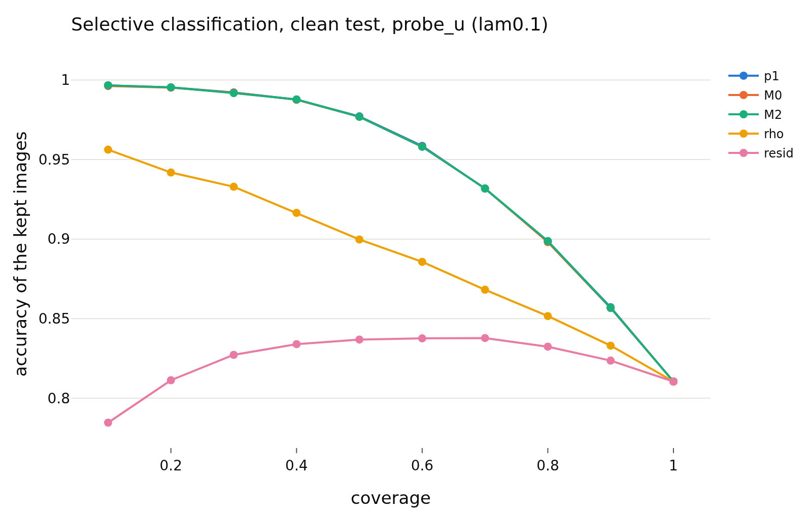
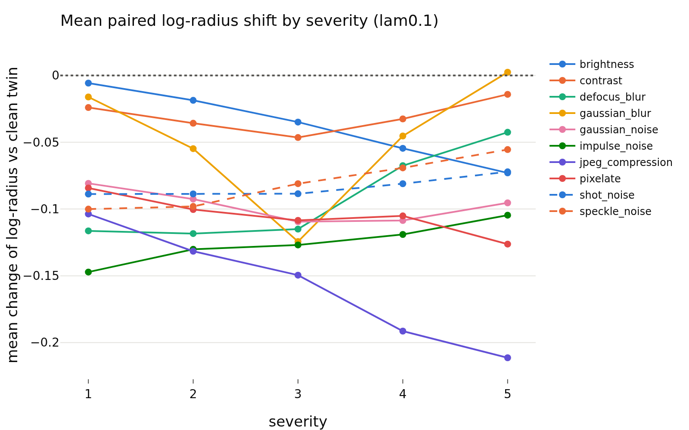
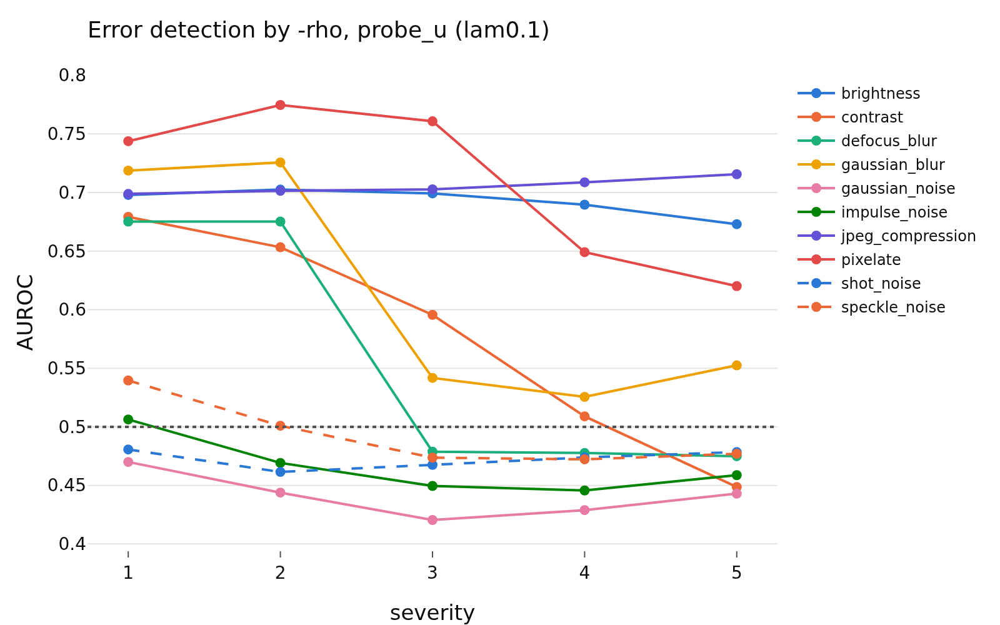

# confidence_z_lam0.1
- **Branch / version:** `radius-confidence` @ `8bf19c2`
- **Run datetime (UTC):** 2026-10-26T17:57Z (aggregation; units computed 2026-10-26T17:06Z-17:50Z, SLURM jobs 2253285 / 2253286, CPU only)
- **Command(s):**
  `python apps/analyze.py --config configs/base.yaml --confidence radius_marginal --confidence-space z --note radius_confidence/confidence.md` (per-run units: see `confidence.md`, section Commands)
- **Datasets:** STL-10 ([canonical](https://cs.stanford.edu/~acoates/stl10/), [HF `tanganke/stl10`](https://huggingface.co/datasets/tanganke/stl10); canonical used), STL-10-C (vendored corruptions of the STL-10 test split), DTD ([canonical](https://www.robots.ox.ac.uk/~vgg/data/dtd/), [HF `tanganke/dtd`](https://huggingface.co/datasets/tanganke/dtd)); SVHN excluded, Places365 pending.
- **Backbone:** ResNet-18 from scratch ([HF architecture reference](https://huggingface.co/timm/resnet18.a1_in1k), pretrained weights not used). **h is not analyzed; LeJEPA's product is z.**

## Question

Does the radius track the readers' confidence and errors beyond the direction? Definitions, predictions and the scorecard: [`confidence.md`](confidence.md).

## Setup (deviations from the base config)

None beyond the pre-registration (`confidence.md`); `eval.knn_k=20`, `eval.num_bootstrap=1000` (200 for the corrupted cells).

## Results

<!-- BEGIN GENERATED: analyze.confidence_inputs -->
### Inputs

Runs aggregated (z space, center views): `radius_marginal_lam0.1_s0`, `radius_marginal_lam0.1_s1`, `radius_marginal_lam0.1_s2`.
<!-- END GENERATED: analyze.confidence_inputs -->

<!-- BEGIN GENERATED: analyze.confidence_clean -->
### Clean STL-10 test: error detection by the radius signals

Seed means; intervals are paired bootstrap percentile intervals over images (resampled within each seed). Definitions, margins and verdict rules: `research_notes/radius_confidence/confidence.md` (pre-registration).

| set | reader | signal | reader accuracy | AUROC (errors) | 95% CI | verdict |
|---|---|---|---|---|---|---|
| clean test | probe_z | -rho | 0.8121 | 0.6986 | [0.691, 0.707] | informative |
| clean test | probe_z | -resid | 0.8121 | 0.5588 | [0.549, 0.569] | informative |
| clean test | probe_z | -p1 | 0.8121 | 0.8683 | [0.863, 0.873] | informative |
| clean test | probe_z | -margin | 0.8121 | 0.8658 | [0.861, 0.871] | informative |
| clean test | probe_z | -rho_cc | 0.8121 | 0.6388 | [0.630, 0.648] | informative |
| clean test | probe_z | -rho, within class (macro) | 0.8121 | 0.6896 |  | n/a |
| clean test | probe_u | -rho | 0.8105 | 0.7004 | [0.693, 0.709] | informative |
| clean test | probe_u | -resid | 0.8105 | 0.5596 | [0.549, 0.570] | informative |
| clean test | probe_u | -p1 | 0.8105 | 0.861 | [0.856, 0.866] | informative |
| clean test | probe_u | -margin | 0.8105 | 0.8591 | [0.854, 0.864] | informative |
| clean test | probe_u | -rho_cc | 0.8105 | 0.6401 | [0.631, 0.649] | informative |
| clean test | probe_u | -rho, within class (macro) | 0.8105 | 0.6902 |  | n/a |
| clean test | knn_u | -rho | 0.7845 | 0.6904 | [0.682, 0.698] | informative |
| clean test | knn_u | -resid | 0.7845 | 0.555 | [0.545, 0.564] | informative |
| clean test | knn_u | -p1 | 0.7845 | 0.8628 | [0.858, 0.868] | informative |
| clean test | knn_u | -margin | 0.7845 | 0.8613 | [0.856, 0.866] | informative |
| clean test | knn_u | -rho_cc | 0.7845 | 0.6245 | [0.615, 0.633] | informative |
| clean test | knn_u | -rho, within class (macro) | 0.7845 | 0.6773 |  | n/a |

| set | reader | Spearman(rho,p1) | rho,p1 95% CI | Spearman(resid,p1) | resid,p1 95% CI |
|---|---|---|---|---|---|
| clean test | probe_z | 0.449 | [+0.439, +0.458] | 0.113 | [+0.100, +0.125] |
| clean test | probe_u | 0.35 | [+0.340, +0.360] | 0.067 | [+0.054, +0.079] |
| clean test | knn_u | 0.446 | [+0.436, +0.457] | 0.076 | [+0.064, +0.090] |
<!-- END GENERATED: analyze.confidence_clean -->

<!-- BEGIN GENERATED: analyze.confidence_nested -->
### Beyond the reader's own confidence (clean test)

`M0 = [logit p1, margin]`, `M1 = M0 + rho`, `M2 = M0 + resid`, 5-fold cross-fitted; AUROC differences have margin 0.01, accuracy-at-coverage differences 0.5 points.

| set | reader | comparison | difference | unit | 95% CI | verdict |
|---|---|---|---|---|---|---|
| clean test | probe_z | auroc: M1 - M0 | 0.0025 | AUROC | [+0.0015, +0.0035] | equivalent |
| clean test | probe_z | acc@50: M1 - M0 | 0.1083 | points | [-0.0167, +0.2083] | equivalent |
| clean test | probe_z | acc@80: M1 - M0 | -0.0365 | points | [-0.1771, +0.1199] | equivalent |
| clean test | probe_z | auroc: M2 - M0 | 0.0004 | AUROC | [-0.0001, +0.0009] | equivalent |
| clean test | probe_z | acc@50: M2 - M0 | 0.0083 | points | [-0.0667, +0.0917] | equivalent |
| clean test | probe_z | acc@80: M2 - M0 | -0.1146 | points | [-0.1927, +0.0313] | equivalent |
| clean test | probe_z | auroc: M3 - M0 (post hoc) | 0.0021 | AUROC | [+0.0011, +0.0031] | equivalent |
| clean test | probe_z | auroc: M4 - M0 (post hoc) | 0.0024 | AUROC | [+0.0014, +0.0035] | equivalent |
| clean test | probe_u | auroc: M1 - M0 | 0.0088 | AUROC | [+0.0070, +0.0106] | inconclusive |
| clean test | probe_u | acc@50: M1 - M0 | 0.4083 | points | [+0.2667, +0.5919] | inconclusive |
| clean test | probe_u | acc@80: M1 - M0 | 0.0781 | points | [-0.1147, +0.2656] | equivalent |
| clean test | probe_u | auroc: M2 - M0 | 0.0017 | AUROC | [+0.0008, +0.0026] | equivalent |
| clean test | probe_u | acc@50: M2 - M0 | -0 | points | [-0.0750, +0.1169] | equivalent |
| clean test | probe_u | acc@80: M2 - M0 | 0.0625 | points | [-0.0939, +0.1824] | equivalent |
| clean test | probe_u | auroc: M3 - M0 (post hoc) | 0.0075 | AUROC | [+0.0059, +0.0093] | equivalent |
| clean test | probe_u | auroc: M4 - M0 (post hoc) | 0.0089 | AUROC | [+0.0071, +0.0106] | inconclusive |
| clean test | knn_u | auroc: M1 - M0 | 0.0041 | AUROC | [+0.0027, +0.0053] | equivalent |
| clean test | knn_u | acc@50: M1 - M0 | 0.1667 | points | [+0.0083, +0.2833] | equivalent |
| clean test | knn_u | acc@80: M1 - M0 | 0.0833 | points | [-0.0418, +0.2708] | equivalent |
| clean test | knn_u | auroc: M2 - M0 | 0.0014 | AUROC | [+0.0007, +0.0022] | equivalent |
| clean test | knn_u | acc@50: M2 - M0 | -0.0167 | points | [-0.1417, +0.0500] | equivalent |
| clean test | knn_u | acc@80: M2 - M0 | 0.0156 | points | [-0.0833, +0.1564] | equivalent |
| clean test | knn_u | auroc: M3 - M0 (post hoc) | 0.0033 | AUROC | [+0.0021, +0.0045] | equivalent |
| clean test | knn_u | auroc: M4 - M0 (post hoc) | 0.0041 | AUROC | [+0.0027, +0.0053] | equivalent |
<!-- END GENERATED: analyze.confidence_nested -->

<!-- BEGIN GENERATED: analyze.confidence_corrupted -->
### STL-10-C: error detection and additions, all cells pooled

Seed means; intervals are paired bootstrap percentile intervals over images (resampled within each seed). Definitions, margins and verdict rules: `research_notes/radius_confidence/confidence.md` (pre-registration). (200 replicates for the corrupted cells.)

| set | reader | signal | reader accuracy | AUROC (errors) | 95% CI | verdict |
|---|---|---|---|---|---|---|
| all 50 corrupted cells (mean over cells) | probe_z | -rho | 0.3742 | 0.5761 | [0.573, 0.579] | informative |
| all 50 corrupted cells (mean over cells) | probe_z | -resid | 0.3742 | 0.5672 | [0.565, 0.570] | informative |
| all 50 corrupted cells (mean over cells) | probe_z | -p1 | 0.3742 | 0.6921 | [0.690, 0.695] | informative |
| all 50 corrupted cells (mean over cells) | probe_z | -margin | 0.3742 | 0.686 | [0.684, 0.688] | informative |
| all 50 corrupted cells (mean over cells) | probe_z | -rho_cc | 0.3742 | 0.5762 | [0.573, 0.579] | informative |
| all 50 corrupted cells (mean over cells) | probe_z | -rho, within class (macro) | 0.3742 | 0.5741 |  | n/a |
| all 50 corrupted cells (mean over cells) | probe_u | -rho | 0.3775 | 0.5726 | [0.570, 0.575] | informative |
| all 50 corrupted cells (mean over cells) | probe_u | -resid | 0.3775 | 0.5653 | [0.563, 0.568] | informative |
| all 50 corrupted cells (mean over cells) | probe_u | -p1 | 0.3775 | 0.6882 | [0.686, 0.691] | informative |
| all 50 corrupted cells (mean over cells) | probe_u | -margin | 0.3775 | 0.6827 | [0.680, 0.685] | informative |
| all 50 corrupted cells (mean over cells) | probe_u | -rho_cc | 0.3775 | 0.5702 | [0.567, 0.573] | informative |
| all 50 corrupted cells (mean over cells) | probe_u | -rho, within class (macro) | 0.3775 | 0.5652 |  | n/a |
| all 50 corrupted cells (mean over cells) | knn_u | -rho | 0.3716 | 0.5808 | [0.578, 0.583] | informative |
| all 50 corrupted cells (mean over cells) | knn_u | -resid | 0.3716 | 0.5578 | [0.555, 0.561] | informative |
| all 50 corrupted cells (mean over cells) | knn_u | -p1 | 0.3716 | 0.6984 | [0.696, 0.701] | informative |
| all 50 corrupted cells (mean over cells) | knn_u | -margin | 0.3716 | 0.6814 | [0.679, 0.683] | informative |
| all 50 corrupted cells (mean over cells) | knn_u | -rho_cc | 0.3716 | 0.5673 | [0.565, 0.570] | informative |
| all 50 corrupted cells (mean over cells) | knn_u | -rho, within class (macro) | 0.3716 | 0.5659 |  | n/a |

| set | reader | Spearman(rho,p1) | rho,p1 95% CI | Spearman(resid,p1) | resid,p1 95% CI | Spearman(d_rho,d_p1) | d_rho,d_p1 95% CI |
|---|---|---|---|---|---|---|---|
| all 50 corrupted cells (mean over cells) | probe_z | 0.219 | [+0.216, +0.222] | 0.154 | [+0.150, +0.157] | 0.236 | [+0.230, +0.241] |
| all 50 corrupted cells (mean over cells) | probe_u | 0.117 | [+0.114, +0.121] | 0.094 | [+0.090, +0.097] | 0.139 | [+0.134, +0.145] |
| all 50 corrupted cells (mean over cells) | knn_u | 0.161 | [+0.157, +0.164] | 0.097 | [+0.093, +0.101] | 0.264 | [+0.258, +0.270] |

| set | reader | comparison | difference | unit | 95% CI | verdict |
|---|---|---|---|---|---|---|
| all 50 corrupted cells (mean over cells) | probe_z | auroc: M1 - M0 | 0.0111 | AUROC | [+0.0099, +0.0122] | inconclusive |
| all 50 corrupted cells (mean over cells) | probe_z | acc@50: M1 - M0 | 0.5963 | points | [+0.5253, +0.6495] | adds |
| all 50 corrupted cells (mean over cells) | probe_z | acc@80: M1 - M0 | 0.1113 | points | [+0.0781, +0.1465] | equivalent |
| all 50 corrupted cells (mean over cells) | probe_z | auroc: M2 - M0 | 0.0085 | AUROC | [+0.0075, +0.0096] | equivalent |
| all 50 corrupted cells (mean over cells) | probe_z | acc@50: M2 - M0 | 0.421 | points | [+0.3625, +0.4731] | equivalent |
| all 50 corrupted cells (mean over cells) | probe_z | acc@80: M2 - M0 | 0.1576 | points | [+0.1309, +0.1922] | equivalent |
| all 50 corrupted cells (mean over cells) | probe_z | auroc: M3 - M0 (post hoc) | 0.0176 | AUROC | [+0.0160, +0.0190] | adds |
| all 50 corrupted cells (mean over cells) | probe_z | auroc: M4 - M0 (post hoc) | 0.0225 | AUROC | [+0.0209, +0.0239] | adds |
| all 50 corrupted cells (mean over cells) | probe_u | auroc: M1 - M0 | 0.0149 | AUROC | [+0.0139, +0.0160] | adds |
| all 50 corrupted cells (mean over cells) | probe_u | acc@50: M1 - M0 | 0.84 | points | [+0.7903, +0.9169] | adds |
| all 50 corrupted cells (mean over cells) | probe_u | acc@80: M1 - M0 | 0.1461 | points | [+0.1087, +0.1855] | equivalent |
| all 50 corrupted cells (mean over cells) | probe_u | auroc: M2 - M0 | 0.0106 | AUROC | [+0.0096, +0.0119] | inconclusive |
| all 50 corrupted cells (mean over cells) | probe_u | acc@50: M2 - M0 | 0.5312 | points | [+0.4782, +0.5992] | inconclusive |
| all 50 corrupted cells (mean over cells) | probe_u | acc@80: M2 - M0 | 0.1453 | points | [+0.1081, +0.1765] | equivalent |
| all 50 corrupted cells (mean over cells) | probe_u | auroc: M3 - M0 (post hoc) | 0.0198 | AUROC | [+0.0185, +0.0212] | adds |
| all 50 corrupted cells (mean over cells) | probe_u | auroc: M4 - M0 (post hoc) | 0.0263 | AUROC | [+0.0250, +0.0279] | adds |
| all 50 corrupted cells (mean over cells) | knn_u | auroc: M1 - M0 | 0.0094 | AUROC | [+0.0084, +0.0104] | inconclusive |
| all 50 corrupted cells (mean over cells) | knn_u | acc@50: M1 - M0 | 0.4403 | points | [+0.3896, +0.5037] | equivalent |
| all 50 corrupted cells (mean over cells) | knn_u | acc@80: M1 - M0 | 0.1063 | points | [+0.0731, +0.1352] | equivalent |
| all 50 corrupted cells (mean over cells) | knn_u | auroc: M2 - M0 | 0.0092 | AUROC | [+0.0083, +0.0101] | equivalent |
| all 50 corrupted cells (mean over cells) | knn_u | acc@50: M2 - M0 | 0.404 | points | [+0.3642, +0.4612] | equivalent |
| all 50 corrupted cells (mean over cells) | knn_u | acc@80: M2 - M0 | 0.1355 | points | [+0.1074, +0.1616] | equivalent |
| all 50 corrupted cells (mean over cells) | knn_u | auroc: M3 - M0 (post hoc) | 0.0084 | AUROC | [+0.0075, +0.0093] | equivalent |
| all 50 corrupted cells (mean over cells) | knn_u | auroc: M4 - M0 (post hoc) | 0.0153 | AUROC | [+0.0142, +0.0163] | adds |
<!-- END GENERATED: analyze.confidence_corrupted -->

<!-- BEGIN GENERATED: analyze.confidence_per_corruption -->
### Per corruption (severities averaged)

| corruption | reader | mean shift of log-radius | accuracy | AUROC(-rho) | verdict -rho | AUROC(-resid) | M1 - M0 | verdict M1 | M2 - M0 | verdict M2 | Spearman(d_rho, d_p1) |
|---|---|---|---|---|---|---|---|---|---|---|---|
| brightness | probe_z | -0.0373 | 0.741 | 0.6925 | informative | 0.5654 | 0.004 | equivalent | 0 | equivalent | 0.136 |
| brightness | probe_u | -0.0373 | 0.7411 | 0.6925 | informative | 0.5644 | 0.0106 | inconclusive | 0.0007 | equivalent | 0.05 |
| brightness | knn_u | -0.0373 | 0.7315 | 0.6783 | informative | 0.5647 | 0.0025 | equivalent | 0.001 | equivalent | 0.091 |
| contrast | probe_z | -0.0306 | 0.531 | 0.5788 | informative | 0.5677 | 0.0036 | equivalent | 0.0004 | equivalent | 0.106 |
| contrast | probe_u | -0.0306 | 0.5328 | 0.5772 | informative | 0.5659 | 0.0028 | equivalent | 0.0009 | equivalent | 0.008 |
| contrast | knn_u | -0.0306 | 0.5354 | 0.5774 | informative | 0.5705 | 0.0004 | equivalent | 0.0002 | equivalent | 0.016 |
| defocus_blur | probe_z | -0.092 | 0.3117 | 0.5687 | informative | 0.5556 | 0.0185 | adds | 0.0025 | equivalent | 0.399 |
| defocus_blur | probe_u | -0.092 | 0.3199 | 0.5564 | informative | 0.5521 | 0.0188 | adds | 0.003 | equivalent | 0.308 |
| defocus_blur | knn_u | -0.092 | 0.2919 | 0.5886 | informative | 0.557 | 0.0184 | adds | 0.0143 | adds | 0.448 |
| gaussian_blur | probe_z | -0.0476 | 0.4035 | 0.6192 | informative | 0.5609 | 0.0025 | equivalent | 0.0067 | equivalent | 0.34 |
| gaussian_blur | probe_u | -0.0476 | 0.4072 | 0.6129 | informative | 0.559 | 0.0081 | equivalent | 0.0093 | inconclusive | 0.245 |
| gaussian_blur | knn_u | -0.0476 | 0.3933 | 0.6212 | informative | 0.5631 | 0.0281 | adds | 0.0245 | adds | 0.331 |
| gaussian_noise | probe_z | -0.0973 | 0.1774 | 0.4459 | inconclusive | 0.5219 | 0.0205 | adds | 0.0112 | inconclusive | 0.237 |
| gaussian_noise | probe_u | -0.0973 | 0.1826 | 0.4412 | inconclusive | 0.5176 | 0.0184 | adds | 0.0123 | inconclusive | 0.137 |
| gaussian_noise | knn_u | -0.0973 | 0.1629 | 0.4582 | inconclusive | 0.5053 | 0.0047 | equivalent | 0.0088 | inconclusive | 0.322 |
| impulse_noise | probe_z | -0.1256 | 0.1711 | 0.4709 | inconclusive | 0.5465 | 0.0145 | adds | 0.019 | adds | 0.257 |
| impulse_noise | probe_u | -0.1256 | 0.1744 | 0.4659 | inconclusive | 0.5437 | 0.0134 | adds | 0.0187 | adds | 0.166 |
| impulse_noise | knn_u | -0.1256 | 0.1628 | 0.4813 | inconclusive | 0.5198 | 0.0036 | equivalent | 0.0115 | inconclusive | 0.343 |
| jpeg_compression | probe_z | -0.1575 | 0.5525 | 0.7027 | informative | 0.6188 | 0.0111 | inconclusive | 0.0054 | equivalent | 0.18 |
| jpeg_compression | probe_u | -0.1575 | 0.5523 | 0.7055 | informative | 0.6198 | 0.0246 | adds | 0.0102 | inconclusive | 0.078 |
| jpeg_compression | knn_u | -0.1575 | 0.5804 | 0.6922 | informative | 0.613 | 0.0071 | equivalent | 0.0042 | equivalent | 0.141 |
| pixelate | probe_z | -0.1049 | 0.3927 | 0.7065 | informative | 0.6519 | 0.0265 | adds | 0.019 | adds | 0.247 |
| pixelate | probe_u | -0.1049 | 0.3912 | 0.7097 | informative | 0.6548 | 0.0432 | adds | 0.0265 | adds | 0.157 |
| pixelate | knn_u | -0.1049 | 0.4342 | 0.695 | informative | 0.6296 | 0.0183 | adds | 0.0087 | equivalent | 0.273 |
| shot_noise | probe_z | -0.0838 | 0.1964 | 0.478 | inconclusive | 0.5262 | 0.0063 | equivalent | 0.0097 | inconclusive | 0.232 |
| shot_noise | probe_u | -0.0838 | 0.2023 | 0.4724 | inconclusive | 0.5224 | 0.0046 | equivalent | 0.0104 | inconclusive | 0.129 |
| shot_noise | knn_u | -0.0838 | 0.1735 | 0.4847 | inconclusive | 0.5061 | 0.003 | equivalent | 0.0049 | equivalent | 0.341 |
| speckle_noise | probe_z | -0.0808 | 0.2646 | 0.4977 | uninformative | 0.5571 | 0.003 | equivalent | 0.0111 | inconclusive | 0.222 |
| speckle_noise | probe_u | -0.0808 | 0.2716 | 0.4927 | inconclusive | 0.5535 | 0.0043 | equivalent | 0.0139 | adds | 0.115 |
| speckle_noise | knn_u | -0.0808 | 0.2502 | 0.5306 | informative | 0.5492 | 0.0081 | equivalent | 0.0134 | adds | 0.332 |
<!-- END GENERATED: analyze.confidence_per_corruption -->

<!-- BEGIN GENERATED: analyze.confidence_shift -->
### Sign and monotonicity of the radius shift

Mean paired change of the center-view log-radius against the clean twin of each image.

| corruption | severity 1 | severity 2 | severity 3 | severity 4 | severity 5 | non-increasing |
|---|---|---|---|---|---|---|
| brightness | -0.0057 | -0.0186 | -0.0349 | -0.0545 | -0.0729 | True |
| contrast | -0.024 | -0.0357 | -0.0465 | -0.0325 | -0.0141 | False |
| defocus_blur | -0.1164 | -0.1184 | -0.115 | -0.0675 | -0.0425 | False |
| gaussian_blur | -0.0161 | -0.0548 | -0.1244 | -0.0453 | 0.0024 | False |
| gaussian_noise | -0.0808 | -0.0925 | -0.1095 | -0.1086 | -0.0954 | False |
| impulse_noise | -0.1472 | -0.1302 | -0.1269 | -0.119 | -0.1046 | False |
| jpeg_compression | -0.1037 | -0.1316 | -0.1495 | -0.1914 | -0.2114 | True |
| pixelate | -0.0843 | -0.1004 | -0.1085 | -0.1051 | -0.1263 | False |
| shot_noise | -0.0888 | -0.0887 | -0.0885 | -0.081 | -0.0721 | False |
| speckle_noise | -0.1001 | -0.0981 | -0.081 | -0.0692 | -0.0555 | False |

| corruptions with negative mean shift | Spearman(shift, accuracy loss of probe_z) across corruption types |
|---|---|
| 10 of 10 | -0.382 |
<!-- END GENERATED: analyze.confidence_shift -->

<!-- BEGIN GENERATED: analyze.confidence_cells -->
### AUROC of `-rho` for the errors of `probe_u`, per cell

| corruption | severity 1 | severity 2 | severity 3 | severity 4 | severity 5 |
|---|---|---|---|---|---|
| brightness | 0.698 | 0.703 | 0.699 | 0.69 | 0.673 |
| contrast | 0.679 | 0.653 | 0.596 | 0.509 | 0.449 |
| defocus_blur | 0.675 | 0.675 | 0.479 | 0.478 | 0.475 |
| gaussian_blur | 0.719 | 0.726 | 0.542 | 0.526 | 0.552 |
| gaussian_noise | 0.47 | 0.444 | 0.42 | 0.429 | 0.443 |
| impulse_noise | 0.506 | 0.469 | 0.45 | 0.446 | 0.459 |
| jpeg_compression | 0.699 | 0.701 | 0.703 | 0.709 | 0.716 |
| pixelate | 0.744 | 0.775 | 0.761 | 0.649 | 0.62 |
| shot_noise | 0.481 | 0.461 | 0.468 | 0.474 | 0.478 |
| speckle_noise | 0.54 | 0.501 | 0.474 | 0.472 | 0.477 |

### AUROC of `-rho` for the errors of `knn_u`, per cell

| corruption | severity 1 | severity 2 | severity 3 | severity 4 | severity 5 |
|---|---|---|---|---|---|
| brightness | 0.689 | 0.688 | 0.685 | 0.674 | 0.656 |
| contrast | 0.675 | 0.652 | 0.602 | 0.521 | 0.437 |
| defocus_blur | 0.693 | 0.681 | 0.516 | 0.524 | 0.53 |
| gaussian_blur | 0.715 | 0.714 | 0.575 | 0.531 | 0.571 |
| gaussian_noise | 0.483 | 0.451 | 0.439 | 0.461 | 0.457 |
| impulse_noise | 0.501 | 0.487 | 0.468 | 0.48 | 0.47 |
| jpeg_compression | 0.689 | 0.692 | 0.69 | 0.697 | 0.694 |
| pixelate | 0.722 | 0.74 | 0.738 | 0.647 | 0.628 |
| shot_noise | 0.484 | 0.486 | 0.489 | 0.491 | 0.474 |
| speckle_noise | 0.534 | 0.524 | 0.522 | 0.538 | 0.534 |
<!-- END GENERATED: analyze.confidence_cells -->

<!-- BEGIN GENERATED: analyze.confidence_ood -->
### ID (STL-10 test) vs OOD: the radius against the readers' confidence

OOD is the positive class; `-rho`, `-p1` are oriented so that high = more OOD. SVHN is deliberately excluded: it is upsampled from 32 x 32 to 96 x 96, which confounds the low-level statistics (`research_notes/radius_usage/svhn_control.md`, branch `radius-usage-svhn-control`). DTD is native high resolution (downsampled); Places365 `val` is downsampled to 96 x 96.

| OOD set | reader | comparison | value | 95% CI | verdict |
|---|---|---|---|---|---|
| ood:dtd | probe_z | AUROC of -rho | 0.6476 | [0.640, 0.655] |  |
| ood:dtd | probe_z | AUROC of -resid | 0.6885 | [0.679, 0.698] |  |
| ood:dtd | probe_z | AUROC of -p1 | 0.7727 | [0.767, 0.778] |  |
| ood:dtd | probe_z | AUROC of -margin | 0.7655 | [0.760, 0.771] |  |
| ood:dtd | probe_z | AUROC: M1 - M0 | 0.0005 | [-0.0010, +0.0019] | equivalent |
| ood:dtd | probe_z | AUROC: M2 - M0 | 0.0364 | [+0.0319, +0.0406] | adds |
| ood:dtd | probe_z | AUROC: M3 - M0 (post hoc) | 0.0095 | [+0.0074, +0.0118] | inconclusive |
| ood:dtd | probe_z | AUROC: M4 - M0 (post hoc) | 0.0391 | [+0.0344, +0.0435] | adds |
| ood:dtd | probe_u | AUROC of -rho | 0.6476 | [0.640, 0.655] |  |
| ood:dtd | probe_u | AUROC of -resid | 0.6885 | [0.679, 0.698] |  |
| ood:dtd | probe_u | AUROC of -p1 | 0.7674 | [0.761, 0.773] |  |
| ood:dtd | probe_u | AUROC of -margin | 0.7601 | [0.754, 0.766] |  |
| ood:dtd | probe_u | AUROC: M1 - M0 | 0.0018 | [-0.0006, +0.0039] | equivalent |
| ood:dtd | probe_u | AUROC: M2 - M0 | 0.0406 | [+0.0354, +0.0455] | adds |
| ood:dtd | probe_u | AUROC: M3 - M0 (post hoc) | 0.0038 | [+0.0023, +0.0053] | equivalent |
| ood:dtd | probe_u | AUROC: M4 - M0 (post hoc) | 0.0416 | [+0.0364, +0.0465] | adds |
| ood:dtd | knn_u | AUROC of -rho | 0.6476 | [0.640, 0.655] |  |
| ood:dtd | knn_u | AUROC of -resid | 0.6885 | [0.679, 0.698] |  |
| ood:dtd | knn_u | AUROC of -p1 | 0.8169 | [0.812, 0.822] |  |
| ood:dtd | knn_u | AUROC of -margin | 0.7887 | [0.783, 0.794] |  |
| ood:dtd | knn_u | AUROC: M1 - M0 | 0.0005 | [-0.0001, +0.0012] | equivalent |
| ood:dtd | knn_u | AUROC: M2 - M0 | 0.0267 | [+0.0227, +0.0308] | adds |
| ood:dtd | knn_u | AUROC: M3 - M0 (post hoc) | 0.0111 | [+0.0093, +0.0130] | inconclusive |
| ood:dtd | knn_u | AUROC: M4 - M0 (post hoc) | 0.0303 | [+0.0263, +0.0345] | adds |
<!-- END GENERATED: analyze.confidence_ood -->

<!-- BEGIN GENERATED: analyze.confidence_figures -->
### Figures

<!-- END GENERATED: analyze.confidence_figures -->

## Interpretation

See `confidence.md` (this note holds the generated tables of one group).

## Next steps

See `confidence.md`.
