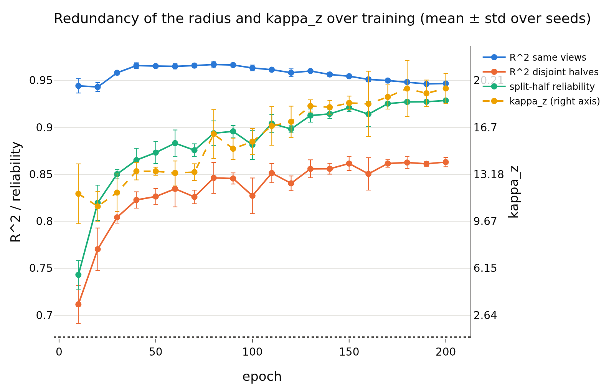

# epoch_sweep
- **Branch / version:** `radius-dynamics` @ `9c62dd9` (code); the 60 unit jobs ran on `aa192fa` plus the uncommitted working tree of that commit
- **Run datetime (UTC):** 2026-10-23T21:24Z-21:46Z (array job 2237170, 60 tasks, all COMPLETED; aggregation 2026-10-23T21:50Z)
- **Command(s):**
  Units (one SLURM array task each; `PYTHONPATH=$PWD/src`, submitted from the worktree):
  `RUNS="radius_marginal_lam0.05_s0 radius_marginal_lam0.05_s1 radius_marginal_lam0.05_s2" EPOCHS="$(seq -s' ' 10 10 200)" sbatch --export=ALL --array=0-59%20 slurm/analyze_epochs.sbatch configs/base.yaml --set eval.num_permutations=100`
  (each task runs `python apps/analyze.py --config configs/base.yaml --epoch-unit RUN EPOCH --set eval.num_permutations=100`).
  Aggregation (this note):
  `python apps/analyze.py --config configs/base.yaml --set eval.num_permutations=100 --epoch-sweep radius_marginal_lam0.05_s0 radius_marginal_lam0.05_s1 radius_marginal_lam0.05_s2 --note radius_dynamics/epoch_sweep.md`
  Per-epoch embeddings (earlier jobs 2236182, 2236184, 2236185): `sbatch slurm/embed_epochs.sbatch configs/base.yaml radius_marginal_lam0.05_s{0,1,2}`.
- **Datasets:** STL-10 `test` split, clean images ([canonical](https://cs.stanford.edu/~acoates/stl10/), [HF](https://huggingface.co/datasets/tanganke/stl10)); canonical archive used
- **Backbone:** ResNet-18 from scratch ([HF architecture reference](https://huggingface.co/timm/resnet18.a1_in1k), weights not used); the `epoch_XXXX.pt` checkpoints (every 10 epochs) of the Variant A lambda = 0.05 runs, seeds {0, 1, 2}. `h` is not analyzed: LeJEPA's product is `z`.

## Question

When during training does the redundancy of the radius with the direction (held-out R^2 of `rho_bar` from `u_hat`, in `z`) appear, and how does it relate to the `kappa_z` curve (minimum at epochs 3-4, then a rise)?

## Setup (deviations from the base config)

Base config except `eval.num_permutations=100` (the controls note used 500). Per epoch checkpoint: 4000 `stl10_test` images (the same images at every epoch), K = 8 augmented views, nested-CV kernel ridge, permutation null, `z` only. Only epochs that are multiples of 10 exist (checkpoints are saved every 10 epochs). The earlier timed-out job (2236235) is superseded: its cost was dominated by the permutation null at 500 shuffles x 3 regressions x 60 units with a per-permutation cost of ~0.8 s (see the branch history for the diagnosis and the batched permutation fit that replaced it).

## Results

<!-- BEGIN GENERATED: dynamics.run.radius_marginal_lam0.05_s0 -->
### Epoch sweep, run `radius_marginal_lam0.05_s0`

| epoch | kappa_z | kappa_z_center | icc | reliability | r2_same | r2_cross | null_max |
|---|---|---|---|---|---|---|---|
| 10 | 9.776 | 9.328 | 0.599 | 0.7333 | 0.9358 | 0.6915 | 0.004761 |
| 20 | 11.55 | 10.56 | 0.694 | 0.8078 | 0.9446 | 0.7644 | 0.002617 |
| 30 | 12.91 | 12.01 | 0.7593 | 0.8556 | 0.9599 | 0.8086 | 0.001199 |
| 40 | 12.94 | 11.18 | 0.7808 | 0.8668 | 0.9624 | 0.8194 | 0.001685 |
| 50 | 13.55 | 12.5 | 0.7799 | 0.8722 | 0.9671 | 0.8275 | 0.001797 |
| 60 | 13.75 | 12.85 | 0.8218 | 0.8957 | 0.9659 | 0.848 | 0.000903 |
| 70 | 12.67 | 11.7 | 0.7875 | 0.8746 | 0.9658 | 0.8228 | 0.003305 |
| 80 | 16.65 | 15.46 | 0.83 | 0.9027 | 0.9681 | 0.8583 | 0.001735 |
| 90 | 14.24 | 13.35 | 0.8165 | 0.8918 | 0.9671 | 0.841 | 0.001508 |
| 100 | 16.57 | 14.9 | 0.8268 | 0.8984 | 0.9665 | 0.8459 | 0.001366 |
| 110 | 16.98 | 15.5 | 0.8306 | 0.902 | 0.9607 | 0.8486 | 0.001208 |
| 120 | 16.66 | 15.34 | 0.8287 | 0.9008 | 0.9616 | 0.8437 | 0.001994 |
| 130 | 18.81 | 16.97 | 0.8479 | 0.9119 | 0.9604 | 0.8515 | 0.001438 |
| 140 | 17.81 | 15.9 | 0.8535 | 0.916 | 0.9547 | 0.8549 | 0.001831 |
| 150 | 18.23 | 16.5 | 0.8544 | 0.917 | 0.9542 | 0.8552 | 0.001462 |
| 160 | 17.29 | 15.73 | 0.8543 | 0.9164 | 0.9493 | 0.8497 | 0.001113 |
| 170 | 18.08 | 16.18 | 0.8635 | 0.9237 | 0.9493 | 0.8574 | 0.001354 |
| 180 | 19.15 | 17.23 | 0.8717 | 0.9271 | 0.9482 | 0.8601 | 0.001741 |
| 190 | 20.07 | 17.95 | 0.8748 | 0.9292 | 0.946 | 0.8621 | 0.001818 |
| 200 | 19.54 | 17.41 | 0.8722 | 0.9276 | 0.9459 | 0.8602 | 0.001565 |
<!-- END GENERATED: dynamics.run.radius_marginal_lam0.05_s0 -->

<!-- BEGIN GENERATED: dynamics.run.radius_marginal_lam0.05_s1 -->
### Epoch sweep, run `radius_marginal_lam0.05_s1`

| epoch | kappa_z | kappa_z_center | icc | reliability | r2_same | r2_cross | null_max |
|---|---|---|---|---|---|---|---|
| 10 | 14.17 | 13.52 | 0.6285 | 0.7606 | 0.9507 | 0.7319 | 0.002203 |
| 20 | 9.505 | 8.552 | 0.6965 | 0.81 | 0.9377 | 0.7513 | 0.002724 |
| 30 | 12.3 | 10.34 | 0.7504 | 0.8495 | 0.9576 | 0.8068 | 0.001107 |
| 40 | 14.16 | 12.33 | 0.8014 | 0.8768 | 0.968 | 0.8326 | 0.001909 |
| 50 | 13.62 | 11.31 | 0.8004 | 0.8853 | 0.9642 | 0.8342 | 0.001976 |
| 60 | 13.84 | 11.68 | 0.8096 | 0.886 | 0.9673 | 0.8431 | 0.0008259 |
| 70 | 13.89 | 12.39 | 0.7793 | 0.8695 | 0.9648 | 0.8209 | 0.001378 |
| 80 | 17.76 | 16.13 | 0.8336 | 0.9 | 0.9696 | 0.8528 | 0.002312 |
| 90 | 15.81 | 14.78 | 0.8344 | 0.9028 | 0.9646 | 0.8523 | 0.001167 |
| 100 | 15.68 | 14.1 | 0.799 | 0.8777 | 0.9627 | 0.8277 | 0.001802 |
| 110 | 18.16 | 16.74 | 0.8526 | 0.9146 | 0.9613 | 0.8626 | 0.001011 |
| 120 | 18.44 | 16.18 | 0.8259 | 0.9005 | 0.9594 | 0.8461 | 0.001599 |
| 130 | 18.12 | 16.29 | 0.8608 | 0.9199 | 0.9591 | 0.8668 | 0.001193 |
| 140 | 18.78 | 16.42 | 0.8566 | 0.9183 | 0.9555 | 0.8621 | 0.002299 |
| 150 | 19.11 | 17.34 | 0.865 | 0.925 | 0.9538 | 0.8696 | 0.001575 |
| 160 | 21.26 | 18.67 | 0.8699 | 0.926 | 0.9533 | 0.8682 | 0.001806 |
| 170 | 19.89 | 17.31 | 0.8701 | 0.9257 | 0.9491 | 0.8653 | 0.001685 |
| 180 | 21.88 | 18.77 | 0.8762 | 0.9294 | 0.95 | 0.8698 | 0.001961 |
| 190 | 19.52 | 16.92 | 0.8702 | 0.9264 | 0.9468 | 0.8634 | 0.001849 |
| 200 | 20.78 | 17.99 | 0.8771 | 0.9304 | 0.9484 | 0.8687 | 0.001995 |
<!-- END GENERATED: dynamics.run.radius_marginal_lam0.05_s1 -->

<!-- BEGIN GENERATED: dynamics.run.radius_marginal_lam0.05_s2 -->
### Epoch sweep, run `radius_marginal_lam0.05_s2`

| epoch | kappa_z | kappa_z_center | icc | reliability | r2_same | r2_cross | null_max |
|---|---|---|---|---|---|---|---|
| 10 | 11.23 | 10.03 | 0.6055 | 0.7352 | 0.9462 | 0.7115 | 0.003224 |
| 20 | 11.31 | 10.43 | 0.7363 | 0.8413 | 0.9467 | 0.7953 | 0.0008588 |
| 30 | 10.25 | 9.229 | 0.7447 | 0.8456 | 0.9568 | 0.7973 | 0.002197 |
| 40 | 13.15 | 11 | 0.7562 | 0.852 | 0.9669 | 0.8163 | 0.002366 |
| 50 | 13.07 | 12.28 | 0.7671 | 0.8619 | 0.9645 | 0.8174 | 0.002969 |
| 60 | 12.24 | 10.97 | 0.776 | 0.868 | 0.9619 | 0.8126 | 0.00156 |
| 70 | 13.49 | 12.66 | 0.8007 | 0.883 | 0.9668 | 0.8342 | 0.001365 |
| 80 | 14.18 | 13.21 | 0.7976 | 0.8786 | 0.9631 | 0.8274 | 0.001458 |
| 90 | 15.24 | 13.36 | 0.8178 | 0.8926 | 0.9674 | 0.8435 | 0.002138 |
| 100 | 14.64 | 14.01 | 0.7766 | 0.8682 | 0.9606 | 0.808 | 0.002511 |
| 110 | 15.28 | 14.33 | 0.8226 | 0.8955 | 0.9622 | 0.8428 | 0.001281 |
| 120 | 16.25 | 14.42 | 0.8178 | 0.8936 | 0.9536 | 0.8315 | 0.002158 |
| 130 | 17.95 | 16.07 | 0.8339 | 0.9059 | 0.9605 | 0.8493 | 0.001377 |
| 140 | 18.01 | 16.32 | 0.8439 | 0.9088 | 0.9588 | 0.8508 | 0.001715 |
| 150 | 18.23 | 16.26 | 0.8576 | 0.9208 | 0.9554 | 0.8597 | 0.002209 |
| 160 | 16.82 | 15.59 | 0.8249 | 0.8999 | 0.9506 | 0.8336 | 0.002248 |
| 170 | 18.95 | 16.88 | 0.8674 | 0.9265 | 0.951 | 0.862 | 0.001974 |
| 180 | 17.78 | 16.03 | 0.8642 | 0.9248 | 0.9467 | 0.8579 | 0.00186 |
| 190 | 18.15 | 16.44 | 0.8664 | 0.9262 | 0.9459 | 0.8582 | 0.001535 |
| 200 | 18.52 | 16.75 | 0.8688 | 0.9277 | 0.9459 | 0.8602 | 0.001513 |
<!-- END GENERATED: dynamics.run.radius_marginal_lam0.05_s2 -->

<!-- BEGIN GENERATED: dynamics.table -->
### Redundancy and kappa_z by epoch: mean ± std over seeds

Runs: `radius_marginal_lam0.05_s0`, `radius_marginal_lam0.05_s1`, `radius_marginal_lam0.05_s2`. `z` only, `stl10_test`, 4000 images for the regressions (the same images at every epoch), K = 8 augmented views; `r2_same`: rho_bar ~ u_hat from all views; `r2_cross`: disjoint view halves (mean of both directions); `reliability`: split-half r^2 of rho_bar; `icc`: ICC(1) of the log-radius over views; `kappa_z` on the augmented views of all test images (`kappa_z_center`: center view). Permutation null: 100 shuffles per regression.

| epoch | seeds | kappa_z | kappa_z_center | icc | reliability | r2_same | r2_cross | null max (max over seeds) |
|---|---|---|---|---|---|---|---|---|
| 10 | 3 | 11.73 ± 2.2 | 10.96 ± 2.2 | 0.611 ± 0.016 | 0.743 ± 0.015 | 0.9442 ± 0.0076 | 0.7116 ± 0.02 | 0.004761 |
| 20 | 3 | 10.79 ± 1.1 | 9.846 ± 1.1 | 0.7089 ± 0.024 | 0.8197 ± 0.019 | 0.943 ± 0.0047 | 0.7703 ± 0.023 | 0.002724 |
| 30 | 3 | 11.82 ± 1.4 | 10.53 ± 1.4 | 0.7515 ± 0.0074 | 0.8502 ± 0.005 | 0.9581 ± 0.0016 | 0.8042 ± 0.0061 | 0.002197 |
| 40 | 3 | 13.41 ± 0.65 | 11.5 ± 0.72 | 0.7795 ± 0.023 | 0.8652 ± 0.012 | 0.9658 ± 0.003 | 0.8228 ± 0.0087 | 0.002366 |
| 50 | 3 | 13.41 ± 0.3 | 12.03 ± 0.64 | 0.7824 ± 0.017 | 0.8732 ± 0.012 | 0.9652 ± 0.0016 | 0.8264 ± 0.0084 | 0.002969 |
| 60 | 3 | 13.28 ± 0.9 | 11.83 ± 0.95 | 0.8025 ± 0.024 | 0.8832 ± 0.014 | 0.965 ± 0.0028 | 0.8346 ± 0.019 | 0.00156 |
| 70 | 3 | 13.35 ± 0.62 | 12.25 ± 0.5 | 0.7892 ± 0.011 | 0.8757 ± 0.0068 | 0.9658 ± 0.001 | 0.8259 ± 0.0072 | 0.003305 |
| 80 | 3 | 16.19 ± 1.8 | 14.93 ± 1.5 | 0.8204 ± 0.02 | 0.8938 ± 0.013 | 0.9669 ± 0.0034 | 0.8462 ± 0.016 | 0.002312 |
| 90 | 3 | 15.1 ± 0.79 | 13.83 ± 0.82 | 0.8229 ± 0.01 | 0.8958 ± 0.0062 | 0.9664 ± 0.0015 | 0.8456 ± 0.006 | 0.002138 |
| 100 | 3 | 15.63 ± 0.97 | 14.34 ± 0.49 | 0.8008 ± 0.025 | 0.8814 ± 0.015 | 0.9633 ± 0.003 | 0.8272 ± 0.019 | 0.002511 |
| 110 | 3 | 16.8 ± 1.4 | 15.52 ± 1.2 | 0.8353 ± 0.016 | 0.904 ± 0.0097 | 0.9614 ± 0.00075 | 0.8513 ± 0.01 | 0.001281 |
| 120 | 3 | 17.11 ± 1.2 | 15.31 ± 0.88 | 0.8241 ± 0.0057 | 0.8983 ± 0.0041 | 0.9582 ± 0.0041 | 0.8404 ± 0.0078 | 0.002158 |
| 130 | 3 | 18.3 ± 0.46 | 16.44 ± 0.47 | 0.8475 ± 0.013 | 0.9126 ± 0.007 | 0.96 ± 0.00077 | 0.8559 ± 0.0096 | 0.001438 |
| 140 | 3 | 18.2 ± 0.51 | 16.21 ± 0.28 | 0.8513 ± 0.0066 | 0.9144 ± 0.0049 | 0.9563 ± 0.0022 | 0.8559 ± 0.0057 | 0.002299 |
| 150 | 3 | 18.53 ± 0.51 | 16.7 ± 0.57 | 0.859 ± 0.0054 | 0.9209 ± 0.004 | 0.9545 ± 0.00079 | 0.8615 ± 0.0074 | 0.002209 |
| 160 | 3 | 18.46 ± 2.4 | 16.66 ± 1.7 | 0.8497 ± 0.023 | 0.9141 ± 0.013 | 0.9511 ± 0.002 | 0.8505 ± 0.017 | 0.002248 |
| 170 | 3 | 18.97 ± 0.9 | 16.79 ± 0.57 | 0.867 ± 0.0033 | 0.9253 ± 0.0014 | 0.9498 ± 0.0011 | 0.8616 ± 0.004 | 0.001974 |
| 180 | 3 | 19.6 ± 2.1 | 17.34 ± 1.4 | 0.8707 ± 0.0061 | 0.9271 ± 0.0023 | 0.9483 ± 0.0016 | 0.8626 ± 0.0063 | 0.001961 |
| 190 | 3 | 19.25 ± 0.99 | 17.1 ± 0.77 | 0.8705 ± 0.0042 | 0.9273 ± 0.0017 | 0.9462 ± 0.0005 | 0.8612 ± 0.0027 | 0.001849 |
| 200 | 3 | 19.61 ± 1.1 | 17.39 ± 0.62 | 0.8727 ± 0.0042 | 0.9286 ± 0.0016 | 0.9467 ± 0.0014 | 0.8631 ± 0.0049 | 0.001995 |
<!-- END GENERATED: dynamics.table -->

<!-- BEGIN GENERATED: dynamics.figure -->
### Figure

<!-- END GENERATED: dynamics.figure -->

## Interpretation

- The redundancy is already at its plateau at the first checkpoint: `r2_same` is 0.944 at epoch 10, peaks at 0.967 around epochs 40-90 and drifts slowly down to 0.947 at epoch 200. There is no onset between 10 and 200; if there is one, it happens before epoch 10.
- The permutation null stays below 0.005 at every epoch, so these values are far from chance.
- The disjoint-halves `r2_cross` and the split-half reliability of `rho_bar` rise together (0.71 -> 0.86 and 0.74 -> 0.93). Their ratio is 0.96 at epoch 10 and 0.93 at epoch 200, so the rise of `r2_cross` is mostly the radius becoming a more reproducible image-level quantity (ICC 0.61 -> 0.87), not a stronger dependence on the direction.
- `kappa_z` is 11.7 at epoch 10, shows a shallow dip at epoch 20 (10.8, within one std of epoch 10), and rises to 19.6 at epoch 200 (monotone from epoch 30, with a plateau at epochs 40-70 near 13.4). The rise of `kappa_z` therefore coincides with the rise of ICC and reliability (the radius becoming image-specific and heavy-tailed across images), while the redundancy with the direction does not change.
- **Not resolved:** the `kappa_z` minimum at epochs 3-4 reported in the training log lies before the first checkpoint. With checkpoints every 10 epochs it cannot be related to the onset of the redundancy; whether the redundancy is already high at epochs 3-4 is unknown. Resolving it needs checkpoints at epochs 1-9 (a new training run or a rerun with a smaller checkpoint interval), which was deliberately not done here.

## Next steps

- Retrain or resume one seed with per-epoch checkpoints for epochs 1-10 and run the same units (`slurm/analyze_epochs.sbatch` with `EPOCHS="1 2 ... 10"`), to locate the onset relative to the `kappa_z` minimum.
- lambda = 0.1 / 0.02 were not part of this sweep (no epoch dumps exist for them); embed them with `slurm/embed_epochs.sbatch` if the lambda dependence of the dynamics is wanted.
