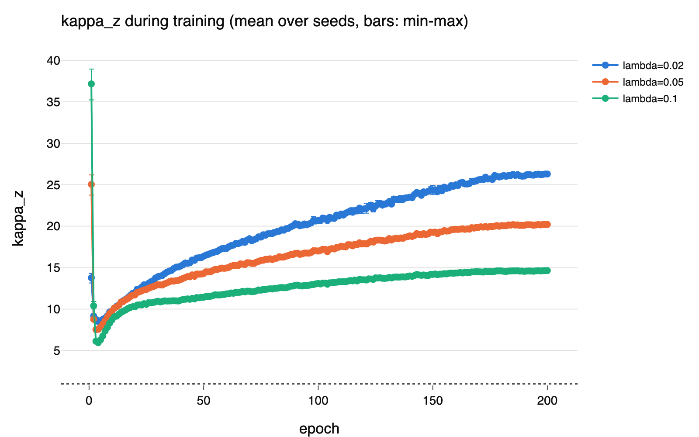
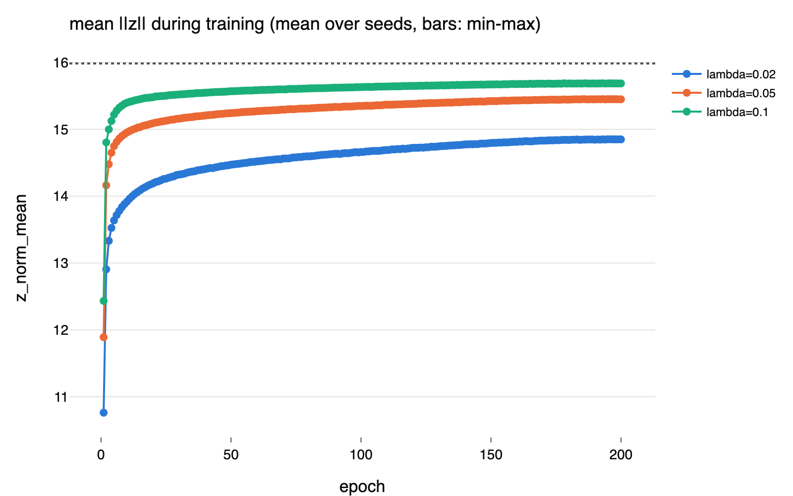
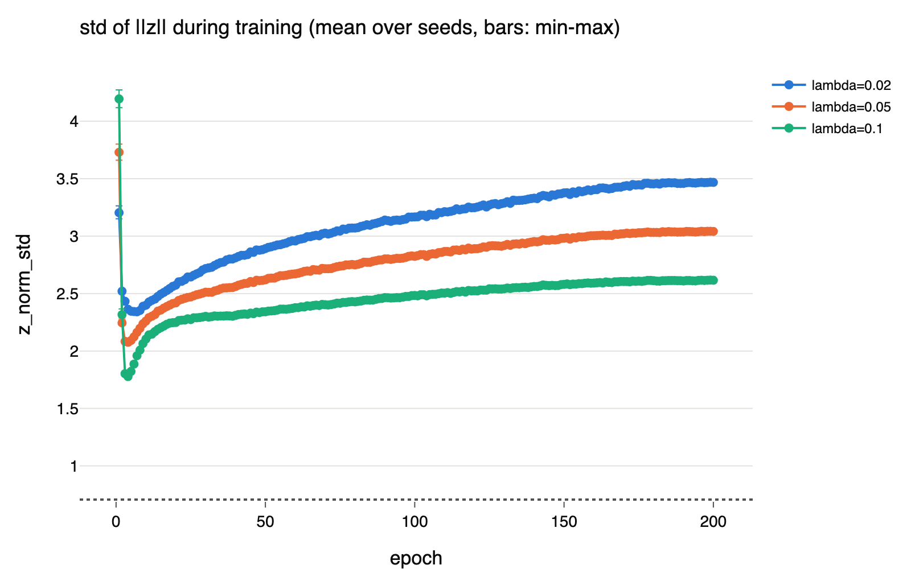
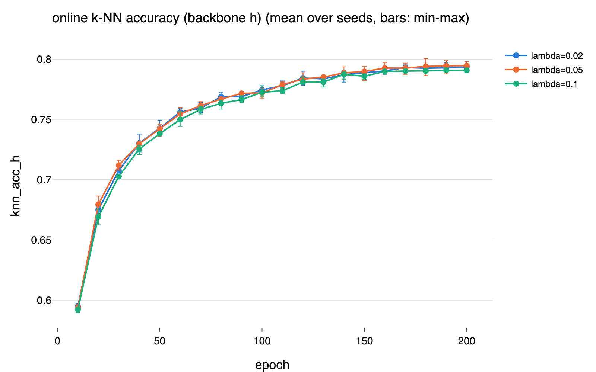

# Variant A lambda sweep: does the embedding radius follow chi_256 under SIGReg?
- **Branch / version:** `radius-marginal` (note); runs executed at `e25af9c1c86a19a8e4c479cd06ffd43e21401978` (merge of PR #23 on `master`, which includes the per-view SIGReg fix #21, the GPU augmentation #22 and `slurm/sweep.sbatch` #23)
- **Run datetime (UTC):** 2026-10-18T23:53:52Z (start of array task 3, `radius_marginal_lam0.05_s0`; the other tasks of the array started independently, see each run's `slurm-train-<jobid>.log` for its own start time and any restarts)
- **Command(s):** (job array `2186161`, submitted from the cluster checkout at the commit above)
  `LAMBDAS="0.02 0.05 0.1" SEEDS="0 1 2" sbatch --array=0-8 --cpus-per-task=4 slurm/sweep.sbatch configs/base.yaml radius_marginal`
- **Analysis (run locally on 2026-10-19T03:00Z, branch `radius-marginal` after merging `master` at `6d616fc`, which contains `analyze --sweep`):** the nine run directories were copied from the cluster without checkpoints, then
  `rsync -avz --prune-empty-dirs --include='radius_marginal_lam*_s*/' --include='metrics.jsonl' --include='config.resolved.yaml' --include='slurm-train-*.log' --exclude='*' fe.ds:<runs_dir>/ <local_runs_dir>/`
  `LEJEPA_NORM_RUNS_DIR=<local_runs_dir> LEJEPA_NORM_NOTES_DIR=<repo>/research_notes uv run python apps/analyze.py --sweep radius_marginal --note radius_marginal/lambda_sweep.md`
- **Datasets:** STL-10 ([canonical](https://cs.stanford.edu/~acoates/stl10/), [HF](https://huggingface.co/datasets/tanganke/stl10)); pretraining on the `unlabeled` + `train` splits (labels unused), k-NN monitoring on `train` (bank) and `test`. The **canonical Stanford archive was used for all splits**; the Hugging Face mirror has no `unlabeled` split and is linked for reference only.
- **Backbone:** ResNet-18 from scratch ([HF architecture reference](https://huggingface.co/timm/resnet18.a1_in1k), weights not used)

## Question
[LeJEPA](https://arxiv.org/abs/2511.08544) regularizes the population distribution of the projector output `z` towards N(0, I_d), d = 256. Under that target the radius `r = ||z||` follows a chi_d distribution, concentrated near sqrt(d - 1/2) ~ 15.98 with standard deviation ~ 0.71. This sweep asks the marginal-radius question only (the image-conditional questions are M3b):

1. Does the radius of the trained model actually match chi_256? We measure `kappa = Var(||z||^2) / (2d)` (target 1 for an exact Gaussian) and the mean and standard deviation of `||z||`, over training and at the end.
2. How do these depend on the SIGReg weight `lambda` in {0.02, 0.05, 0.1}, and how large is the seed-to-seed spread (3 seeds per setting)?

**Hypotheses, recorded before the runs finished.** 5-epoch pilots with the per-view SIGReg loss (infrastructure checks, not results) ended with `kappa_z ~ 8`, `||z||` mean ~ 14.9 and standard deviation ~ 2.1, and `kappa_z` was no longer falling. So I expect that (a) `kappa_z` will **not** reach ~1 within 200 epochs at lambda = 0.05, and (b) larger lambda will give smaller `kappa_z`. Neither is established; the pilots used a 5-epoch schedule whose learning rate decays to zero within the run.

## Setup (deviations from the base config)
- Base config `configs/base.yaml` (ResNet-18 backbone, projector 2048-2048-256, 2 global 96 px + 4 local 48 px views, batch 256, AdamW lr 5e-4 scaled by batch/256, weight decay 0.05, 10 warmup epochs then cosine, 200 epochs, bf16 autocast with the loss in fp32).
- Only `loss.lambda` and `seed` vary: the 3 x 3 grid {0.02, 0.05, 0.1} x {0, 1, 2}, one independent job-array task per run, run names `radius_marginal_lam<lambda>_s<seed>`.
- Hardware: one A100 per run (`--gres=gpu:a100:1`), 4 CPUs, `--cpus-per-task=4`. Augmentation runs on the GPU, so `data.num_workers` does not affect the results.
- Implementation points that differ from the original Technical Design and from earlier pilots:
  - SIGReg is computed **per view** (N = per-view batch size, shared random directions, averaged over views), as in the paper and the official code, not on all views pooled (see `research_notes/sigreg_reference/reference_comparison.md`). Earlier pilots used the pooled loss and are not comparable.
  - Per-channel normalization uses statistics computed from the prepared data (`prepare_data --stage stats`): mean (0.4409, 0.4279, 0.3868), std (0.2683, 0.2610, 0.2687).
  - Augmentation is the batched GPU pipeline (`research_notes/gpu_augmentation/pipeline_comparison.md` documents its agreement with the PIL pipeline; views are ~1.3/255 brighter on average).
- Runs are preemptable (`--resume auto`); a requeued task resumes from its run directory. The run's `slurm-train-<jobid>.log` records every restart.

## Results
Training-log results of all nine runs (200/200 epochs each), generated by `apps/analyze.py --sweep`. Every `kappa_z` and `||z||` figure here is measured on **all six views of a batch pooled** (2 global 96 px + 4 local 48 px), while SIGReg acts per view. The histogram of `r` against chi_256 needs embedding dumps and is not part of this note yet.

<!-- BEGIN GENERATED: sweep.summary -->
### Sweep `radius_marginal`: per lambda (mean ± std over seeds)

Each metric is taken at the last epoch that every seed of that lambda has logged it; the `epoch` column is that epoch for `kappa_z`, and sparsely logged metrics (k-NN) may come from an earlier one.

| lambda | seeds | epoch | kappa_z | z_norm_mean | z_norm_std | kappa_h | knn_acc_h | knn_acc_z | loss_dist | loss_inv |
|---|---|---|---|---|---|---|---|---|---|---|
| target (N(0, I)) |  |  | 1 | 15.98 | 0.7071 |  |  |  |  |  |
| 0.02 | 3 | 200 | 26.29 ± 0.097 | 14.85 ± 0.0023 | 3.467 ± 0.0046 | 0.4277 ± 0.044 | 0.7934 ± 0.0046 | 0.7734 ± 0.0019 | 4.24 ± 0.0052 | 0.1611 ± 0.00061 |
| 0.05 | 3 | 200 | 20.21 ± 0.069 | 15.45 ± 0.00098 | 3.041 ± 0.0048 | 0.09602 ± 0.0063 | 0.7946 ± 0.0044 | 0.7839 ± 0.0008 | 2.036 ± 0.0023 | 0.221 ± 0.00078 |
| 0.1 | 3 | 200 | 14.64 ± 0.067 | 15.69 ± 0.0027 | 2.615 ± 0.0038 | 0.1188 ± 0.0048 | 0.7908 ± 0.001 | 0.7844 ± 0.0026 | 1.285 ± 0.0018 | 0.2722 ± 0.00063 |
<!-- END GENERATED: sweep.summary -->

<!-- BEGIN GENERATED: sweep.runs -->
### Sweep runs

| run | lambda | seed | epochs | status | kappa_z | kappa_h | z_norm_mean | z_norm_std | knn_acc_h | knn_acc_z | loss_dist | loss_inv |
|---|---|---|---|---|---|---|---|---|---|---|---|---|
| radius_marginal_lam0.02_s0 | 0.02 | 0 | 200/200 | complete | 26.22 | 0.4616 | 14.85 | 3.463 | 0.7984 | 0.7756 | 4.239 | 0.1616 |
| radius_marginal_lam0.02_s1 | 0.02 | 1 | 200/200 | complete | 26.4 | 0.4432 | 14.85 | 3.472 | 0.7893 | 0.772 | 4.246 | 0.1604 |
| radius_marginal_lam0.02_s2 | 0.02 | 2 | 200/200 | complete | 26.25 | 0.3783 | 14.85 | 3.467 | 0.7925 | 0.7726 | 4.236 | 0.1613 |
| radius_marginal_lam0.05_s0 | 0.05 | 0 | 200/200 | complete | 20.14 | 0.09285 | 15.45 | 3.036 | 0.7981 | 0.783 | 2.033 | 0.2219 |
| radius_marginal_lam0.05_s1 | 0.05 | 1 | 200/200 | complete | 20.21 | 0.1032 | 15.45 | 3.042 | 0.7896 | 0.7843 | 2.037 | 0.2204 |
| radius_marginal_lam0.05_s2 | 0.05 | 2 | 200/200 | complete | 20.28 | 0.09198 | 15.45 | 3.045 | 0.796 | 0.7845 | 2.037 | 0.2208 |
| radius_marginal_lam0.1_s0 | 0.1 | 0 | 200/200 | complete | 14.65 | 0.1236 | 15.69 | 2.615 | 0.7903 | 0.7845 | 1.286 | 0.2727 |
| radius_marginal_lam0.1_s1 | 0.1 | 1 | 200/200 | complete | 14.57 | 0.1139 | 15.68 | 2.612 | 0.792 | 0.7869 | 1.287 | 0.2715 |
| radius_marginal_lam0.1_s2 | 0.1 | 2 | 200/200 | complete | 14.7 | 0.1189 | 15.69 | 2.619 | 0.7901 | 0.7817 | 1.283 | 0.2725 |
<!-- END GENERATED: sweep.runs -->

<!-- BEGIN GENERATED: sweep.figures -->
### Sweep figures

<!-- END GENERATED: sweep.figures -->

## Interpretation
**Both pre-registered hypotheses are supported.**
- (a) `kappa_z` does not reach 1. At the end of training it is 26.3, 20.2 and 14.6 for lambda = 0.02, 0.05, 0.1 (table above); even the best setting is about 15x the Gaussian value, and the radius standard deviation (3.47, 3.04, 2.62) is 3.7-4.9x the chi_256 value 0.71. The mean `||z||` (14.85, 15.45, 15.69) approaches but does not reach 15.98.
- (b) Larger lambda gives smaller `kappa_z`, monotonically and with no overlap between settings: the seed-to-seed spread is at most 0.1 in `kappa_z`, against gaps of 5.6 to 6.1 between settings. The three seeds of each setting are nearly identical on every logged quantity.

**How it evolves** (figure `kappa_z during training`). For every lambda `kappa_z` drops to a minimum of about 6-9 around epochs 3-4, then **rises steadily** through training and flattens only near the end, as the cosine learning rate decays. Larger lambda slows the rise but does not stop it. The per-view SIGReg term (`loss_dist`) keeps falling throughout, so the radius spread grows while the regularizer is being reduced.

**What the numbers do and do not say**
- **The sliced test looks nearly satisfied while pooled `kappa_z` is far from 1.** At lambda = 0.1 the per-view SIGReg value is 1.285, against a noise floor of about 1.05 for exact N(0, I) samples, yet `kappa_z` is 14.6. Two explanations are consistent with the logs and are **not separated by this sweep**: (i) the Epps-Pulley statistic (t in [0, 3], 1024 random slices, N = 256 per view) has little power against a radial spread of this size; (ii) `kappa_z` is measured on the pooled global and local views, which may sit at different radii, whereas SIGReg tests each view separately. The decisive check is the per-view-type radius statistics (global vs. local), which the training logs do not contain.
- **Cost of more regularization.** The invariance loss rises with lambda (0.161, 0.221, 0.272), as expected from the trade-off. Online k-NN accuracy on the backbone feature shows no cost in this range: 0.793 +- 0.005, 0.795 +- 0.004, 0.791 +- 0.001 (mean +- std over seeds); on the projector output it is 0.773, 0.784, 0.784. The three settings are indistinguishable on `knn_acc_h` at this seed count.
- **Backbone feature.** `kappa_h` is small (0.43 at lambda = 0.02, about 0.1 at 0.05 and 0.1): the backbone feature norms are nearly constant, while the projector output carries the radial spread. Not analyzed further here.
- **Extrapolation.** The curve of final `kappa_z` against lambda (26.3, 20.2, 14.6) flattens in lambda; with three points I do not extrapolate to the lambda that would give `kappa_z` = 1, if one exists.

**Run logistics** (from the job logs): all nine runs completed 200 epochs with no requeue, about 2.45 h each (median epoch 44 s, about 2,360-2,420 images/s on A100 nodes, 4 CPUs, GPU augmentation). One run (`lam0.05_s0`) ran on node `h001` instead of a `j00x` node and was about 8% slower (47.7 s per epoch); its metrics lie within the seed spread of its setting.

**Caveats.** One backbone, dataset, augmentation recipe and schedule; metrics are training-time epoch means on augmented training views, not test-time embeddings; no test of the image-conditional structure of the radius yet (M3b).

## Next steps
1. **Per-view-type diagnostic.** Embed the final checkpoints (`last.pt`) of the nine runs on STL-10 `test` and read the marginal-radius table (center view and global-style augmented views), and compare with the pooled training value; add `kappa_z` and `||z||` statistics for global and local views separately to the training diagnostics.
2. **Radius histogram against chi_256** at convergence for each lambda (needs the embedding dumps).
3. **Larger lambda.** If the per-view diagnostic confirms the radial spread, a follow-up sweep at larger lambda (e.g. 0.25 and 0.5) would test whether `kappa_z` can approach 1 and at what cost to invariance and k-NN accuracy.
4. M3b (`radius-conditional`): embed the final checkpoints and run the image-conditional analyses (ICC, redundancy R^2, difficulty correlations, downstream evaluations) on Variant A, then the go/no-go.
