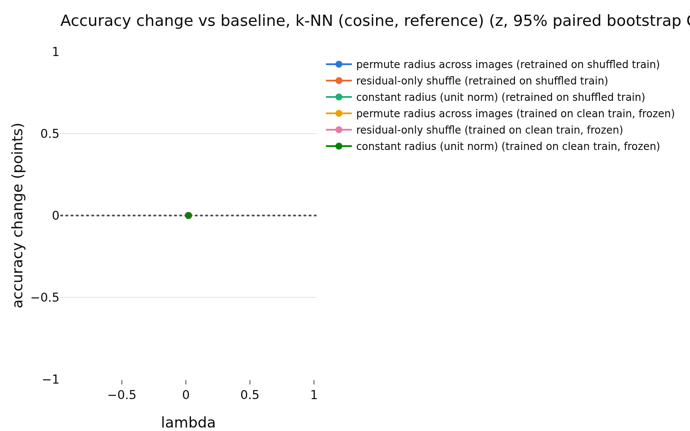
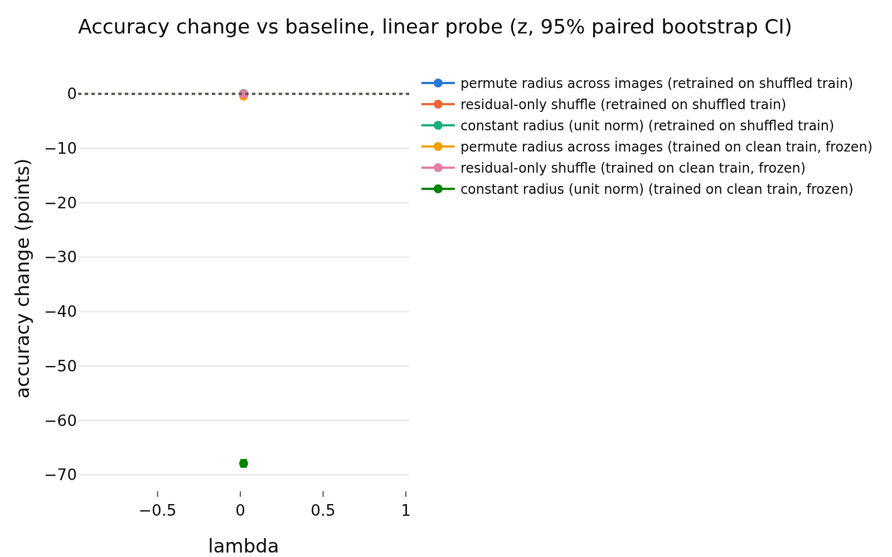
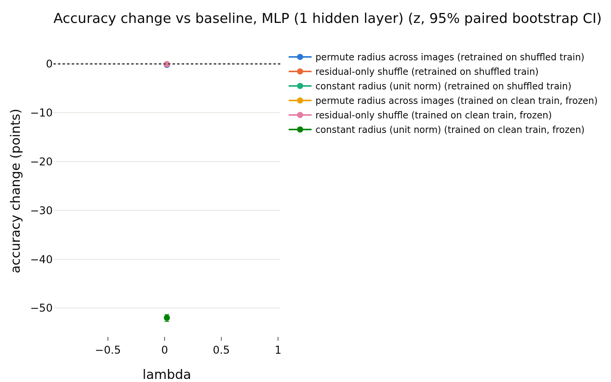

# E1 usage of the radius, lambda = 0.02
- **Branch / version:** `radius-randomization` @ `0f0cd4459d52e558887a1b2a3b21ededaa76905d` (merged as PR #32); notes committed on `radius-randomization-notes`
- **Run datetime (UTC):** 2026-10-23T15:27:43Z (end of SLURM job 2236229; the cluster reports local time, CDT = UTC-5, converted)
- **Command(s):** (submitted with `sbatch --wrap`, 8 CPUs, 32 GB, from the checkout of the branch above; `<repo>` is that checkout and `<python>` its `.venv` interpreter)
  `cd <repo> && export OMP_NUM_THREADS=8 OPENBLAS_NUM_THREADS=8 PYTHONPATH=<repo>/src && <python> apps/analyze.py --config configs/base.yaml --randomize-radius radius_marginal_lam0.02 --note radius_randomization/lam0.02.md`
- **Datasets:** STL-10 `train` (k-NN bank / probe training set) and `test` (evaluation), clean images, center views only ([canonical](https://cs.stanford.edu/~acoates/stl10/), [HF `tanganke/stl10`](https://huggingface.co/datasets/tanganke/stl10)). The **canonical Stanford archive was used** (via the prepared arrays and the existing `stl10_train` / `stl10_test` embedding dumps); the HF page is linked for reference only.
- **Backbone:** ResNet-18 from scratch ([HF architecture reference](https://huggingface.co/timm/resnet18.a1_in1k), weights not used); `last.pt` (epoch 200) of `radius_marginal_lam0.02_s{0,1,2}` (Variant A, lambda = 0.02)
- **Scope:** h is not analyzed; LeJEPA's product is z. All results are in z-space.
- **Equivalence margin:** 0.5 accuracy points, fixed before looking at any result (spec `radius_nuisance/spec.md`, E1; `eval.equivalence_margin`).

## Question

Is the radius ||z|| *used* by downstream readers of the LeJEPA embedding? If it is a nuisance parameter, randomizing it (keeping the direction) should not change the accuracy of classifiers on STL-10 by more than the margin of 0.5 points. This note covers lambda = 0.02, three training seeds. The cross-lambda reading is in `summary.md`.

## Setup (deviations from the base config)

No deviation from `configs/base.yaml` (k = 20 for k-NN, 1000 bootstrap replicates, 5 shuffle repeats per randomized condition, margin 0.5). Embeddings: the existing center-view z of the final checkpoints. Conditions (each applied to bank and test set independently): baseline, full radius permutation across images, residual-only shuffle (the direction-predicted part of log-radius is kept, held out / out-of-fold; only the residual is permuted), constant radius (unit norm). Readers: Euclidean k-NN, cosine k-NN (reference), linear (logistic) probe, one-hidden-layer MLP with weight decay chosen on a validation split of the clean bank. Protocols: *retrained* on the shuffled bank, and *frozen* (fit on clean bank, applied to shuffled test features). Statistics: paired bootstrap over test images within each seed, averaged over the three seeds; verdict `equivalent` if the 90% CI is inside +-0.5, `different` if not equivalent and the 95% CI excludes 0, else `inconclusive`. The tables below are generated and unedited.

## Results

<!-- BEGIN GENERATED: analyze.randomization_comparison -->
### Paired accuracy change vs the baseline, per lambda

z-space, center views; bank = STL-10 train, test set = STL-10 test; the same transformation is applied to bank and test set independently. Differences are in accuracy points (condition minus baseline on the same test images), averaged over training seeds; intervals are paired bootstrap percentile intervals (1000 replicates, test images resampled within each seed). Verdict, with the equivalence margin set to ±0.5 points before looking at results: `equivalent` if the 90% interval (TOST at 5%) lies inside the margin, `different` if not equivalent and the 95% interval excludes 0, otherwise `inconclusive`. Shuffle repeats (5 per randomized condition) only average out shuffle noise; they are not part of the interval.

| lambda | reader | protocol | condition | baseline acc | condition acc | difference (points) | 90% CI (points) | 95% CI (points) | verdict |
|---|---|---|---|---|---|---|---|---|---|
| 0.02 | k-NN (euclidean) | retrained on shuffled train | permute radius across images | 0.7774 | 0.7700 | -0.74 | [-0.96, -0.53] | [-0.98, -0.48] | different |
| 0.02 | k-NN (euclidean) | retrained on shuffled train | residual-only shuffle | 0.7774 | 0.7763 | -0.10 | [-0.25, +0.04] | [-0.29, +0.08] | equivalent |
| 0.02 | k-NN (euclidean) | retrained on shuffled train | constant radius (unit norm) | 0.7774 | 0.7735 | -0.38 | [-0.60, -0.15] | [-0.65, -0.11] | different |
| 0.02 | k-NN (euclidean) | trained on clean train, frozen | permute radius across images | 0.7774 | 0.7757 | -0.17 | [-0.33, -0.00] | [-0.36, +0.03] | equivalent |
| 0.02 | k-NN (euclidean) | trained on clean train, frozen | residual-only shuffle | 0.7774 | 0.7776 | +0.02 | [-0.08, +0.13] | [-0.10, +0.15] | equivalent |
| 0.02 | k-NN (euclidean) | trained on clean train, frozen | constant radius (unit norm) | 0.7774 | 0.1299 | -64.75 | [-65.34, -64.12] | [-65.51, -64.01] | different |
| 0.02 | k-NN (cosine, reference) | retrained on shuffled train | permute radius across images | 0.7735 | 0.7735 | +0.00 | [+0.00, +0.00] | [+0.00, +0.00] | equivalent |
| 0.02 | k-NN (cosine, reference) | retrained on shuffled train | residual-only shuffle | 0.7735 | 0.7735 | +0.00 | [+0.00, +0.00] | [+0.00, +0.00] | equivalent |
| 0.02 | k-NN (cosine, reference) | retrained on shuffled train | constant radius (unit norm) | 0.7735 | 0.7735 | +0.00 | [+0.00, +0.00] | [+0.00, +0.00] | equivalent |
| 0.02 | k-NN (cosine, reference) | trained on clean train, frozen | permute radius across images | 0.7735 | 0.7735 | +0.00 | [+0.00, +0.00] | [+0.00, +0.00] | equivalent |
| 0.02 | k-NN (cosine, reference) | trained on clean train, frozen | residual-only shuffle | 0.7735 | 0.7735 | +0.00 | [+0.00, +0.00] | [+0.00, +0.00] | equivalent |
| 0.02 | k-NN (cosine, reference) | trained on clean train, frozen | constant radius (unit norm) | 0.7735 | 0.7735 | +0.00 | [+0.00, +0.00] | [+0.00, +0.00] | equivalent |
| 0.02 | linear probe | retrained on shuffled train | permute radius across images | 0.8041 | 0.8038 | -0.03 | [-0.16, +0.09] | [-0.18, +0.11] | equivalent |
| 0.02 | linear probe | retrained on shuffled train | residual-only shuffle | 0.8041 | 0.8041 | -0.01 | [-0.08, +0.07] | [-0.10, +0.08] | equivalent |
| 0.02 | linear probe | retrained on shuffled train | constant radius (unit norm) | 0.8041 | 0.8047 | +0.05 | [-0.08, +0.19] | [-0.11, +0.22] | equivalent |
| 0.02 | linear probe | trained on clean train, frozen | permute radius across images | 0.8041 | 0.7997 | -0.44 | [-0.59, -0.30] | [-0.61, -0.28] | different |
| 0.02 | linear probe | trained on clean train, frozen | residual-only shuffle | 0.8041 | 0.8039 | -0.02 | [-0.09, +0.05] | [-0.11, +0.06] | equivalent |
| 0.02 | linear probe | trained on clean train, frozen | constant radius (unit norm) | 0.8041 | 0.1252 | -67.90 | [-68.50, -67.31] | [-68.59, -67.18] | different |
| 0.02 | MLP (1 hidden layer) | retrained on shuffled train | permute radius across images | 0.8037 | 0.8015 | -0.23 | [-0.36, -0.08] | [-0.39, -0.05] | equivalent |
| 0.02 | MLP (1 hidden layer) | retrained on shuffled train | residual-only shuffle | 0.8037 | 0.8031 | -0.06 | [-0.18, +0.05] | [-0.20, +0.07] | equivalent |
| 0.02 | MLP (1 hidden layer) | retrained on shuffled train | constant radius (unit norm) | 0.8037 | 0.8030 | -0.08 | [-0.25, +0.12] | [-0.29, +0.15] | equivalent |
| 0.02 | MLP (1 hidden layer) | trained on clean train, frozen | permute radius across images | 0.8037 | 0.8031 | -0.07 | [-0.15, +0.01] | [-0.17, +0.03] | equivalent |
| 0.02 | MLP (1 hidden layer) | trained on clean train, frozen | residual-only shuffle | 0.8037 | 0.8031 | -0.07 | [-0.11, -0.03] | [-0.12, -0.02] | equivalent |
| 0.02 | MLP (1 hidden layer) | trained on clean train, frozen | constant radius (unit norm) | 0.8037 | 0.2839 | -51.99 | [-52.60, -51.42] | [-52.74, -51.32] | different |
<!-- END GENERATED: analyze.randomization_comparison -->

<!-- BEGIN GENERATED: analyze.randomization_accuracy -->
### Accuracy: mean ± std over training seeds, per lambda

| lambda | reader | protocol | condition | seeds | accuracy (mean ± std over seeds) | shuffle sd (mean over seeds) |
|---|---|---|---|---|---|---|
| 0.02 | k-NN (euclidean) | retrained on shuffled train | baseline | 3 | 0.7774 ± 0.0012 |  |
| 0.02 | k-NN (euclidean) | retrained on shuffled train | permute radius across images | 3 | 0.7700 ± 0.0011 | 0.0020 |
| 0.02 | k-NN (euclidean) | retrained on shuffled train | residual-only shuffle | 3 | 0.7763 ± 0.0015 | 0.0013 |
| 0.02 | k-NN (euclidean) | retrained on shuffled train | constant radius (unit norm) | 3 | 0.7735 ± 0.0026 |  |
| 0.02 | k-NN (euclidean) | trained on clean train, frozen | baseline | 3 | 0.7774 ± 0.0012 |  |
| 0.02 | k-NN (euclidean) | trained on clean train, frozen | permute radius across images | 3 | 0.7757 ± 0.0007 | 0.0013 |
| 0.02 | k-NN (euclidean) | trained on clean train, frozen | residual-only shuffle | 3 | 0.7776 ± 0.0014 | 0.0008 |
| 0.02 | k-NN (euclidean) | trained on clean train, frozen | constant radius (unit norm) | 3 | 0.1299 ± 0.0113 |  |
| 0.02 | k-NN (cosine, reference) | retrained on shuffled train | baseline | 3 | 0.7735 ± 0.0026 |  |
| 0.02 | k-NN (cosine, reference) | retrained on shuffled train | permute radius across images | 3 | 0.7735 ± 0.0026 | 0.0000 |
| 0.02 | k-NN (cosine, reference) | retrained on shuffled train | residual-only shuffle | 3 | 0.7735 ± 0.0026 | 0.0000 |
| 0.02 | k-NN (cosine, reference) | retrained on shuffled train | constant radius (unit norm) | 3 | 0.7735 ± 0.0026 |  |
| 0.02 | k-NN (cosine, reference) | trained on clean train, frozen | baseline | 3 | 0.7735 ± 0.0026 |  |
| 0.02 | k-NN (cosine, reference) | trained on clean train, frozen | permute radius across images | 3 | 0.7735 ± 0.0026 | 0.0000 |
| 0.02 | k-NN (cosine, reference) | trained on clean train, frozen | residual-only shuffle | 3 | 0.7735 ± 0.0026 | 0.0000 |
| 0.02 | k-NN (cosine, reference) | trained on clean train, frozen | constant radius (unit norm) | 3 | 0.7735 ± 0.0026 |  |
| 0.02 | linear probe | retrained on shuffled train | baseline | 3 | 0.8041 ± 0.0022 |  |
| 0.02 | linear probe | retrained on shuffled train | permute radius across images | 3 | 0.8038 ± 0.0015 | 0.0008 |
| 0.02 | linear probe | retrained on shuffled train | residual-only shuffle | 3 | 0.8041 ± 0.0017 | 0.0007 |
| 0.02 | linear probe | retrained on shuffled train | constant radius (unit norm) | 3 | 0.8047 ± 0.0023 |  |
| 0.02 | linear probe | trained on clean train, frozen | baseline | 3 | 0.8041 ± 0.0022 |  |
| 0.02 | linear probe | trained on clean train, frozen | permute radius across images | 3 | 0.7997 ± 0.0017 | 0.0012 |
| 0.02 | linear probe | trained on clean train, frozen | residual-only shuffle | 3 | 0.8039 ± 0.0019 | 0.0006 |
| 0.02 | linear probe | trained on clean train, frozen | constant radius (unit norm) | 3 | 0.1252 ± 0.0346 |  |
| 0.02 | MLP (1 hidden layer) | retrained on shuffled train | baseline | 3 | 0.8037 ± 0.0035 |  |
| 0.02 | MLP (1 hidden layer) | retrained on shuffled train | permute radius across images | 3 | 0.8015 ± 0.0026 | 0.0015 |
| 0.02 | MLP (1 hidden layer) | retrained on shuffled train | residual-only shuffle | 3 | 0.8031 ± 0.0022 | 0.0009 |
| 0.02 | MLP (1 hidden layer) | retrained on shuffled train | constant radius (unit norm) | 3 | 0.8030 ± 0.0024 |  |
| 0.02 | MLP (1 hidden layer) | trained on clean train, frozen | baseline | 3 | 0.8037 ± 0.0035 |  |
| 0.02 | MLP (1 hidden layer) | trained on clean train, frozen | permute radius across images | 3 | 0.8031 ± 0.0037 | 0.0006 |
| 0.02 | MLP (1 hidden layer) | trained on clean train, frozen | residual-only shuffle | 3 | 0.8031 ± 0.0037 | 0.0004 |
| 0.02 | MLP (1 hidden layer) | trained on clean train, frozen | constant radius (unit norm) | 3 | 0.2839 ± 0.0615 |  |
<!-- END GENERATED: analyze.randomization_accuracy -->

<!-- BEGIN GENERATED: analyze.randomization_runs -->
### Per-run accuracies

| run | reader | protocol | condition | repeats | accuracy | shuffle sd |
|---|---|---|---|---|---|---|
| radius_marginal_lam0.02_s0 | k-NN (euclidean) | retrained on shuffled train | baseline | 1 | 0.776 |  |
| radius_marginal_lam0.02_s0 | k-NN (euclidean) | trained on clean train, frozen | baseline | 1 | 0.776 |  |
| radius_marginal_lam0.02_s0 | k-NN (euclidean) | trained on clean train, frozen | constant radius (unit norm) | 1 | 0.1368 |  |
| radius_marginal_lam0.02_s0 | k-NN (euclidean) | retrained on shuffled train | constant radius (unit norm) | 1 | 0.7765 |  |
| radius_marginal_lam0.02_s0 | k-NN (euclidean) | trained on clean train, frozen | permute radius across images | 5 | 0.7764 | 0.0007634 |
| radius_marginal_lam0.02_s0 | k-NN (euclidean) | retrained on shuffled train | permute radius across images | 5 | 0.7712 | 0.0022 |
| radius_marginal_lam0.02_s0 | k-NN (euclidean) | trained on clean train, frozen | residual-only shuffle | 5 | 0.7776 | 0.0008723 |
| radius_marginal_lam0.02_s0 | k-NN (euclidean) | retrained on shuffled train | residual-only shuffle | 5 | 0.7758 | 0.001622 |
| radius_marginal_lam0.02_s0 | k-NN (cosine, reference) | retrained on shuffled train | baseline | 1 | 0.7765 |  |
| radius_marginal_lam0.02_s0 | k-NN (cosine, reference) | trained on clean train, frozen | baseline | 1 | 0.7765 |  |
| radius_marginal_lam0.02_s0 | k-NN (cosine, reference) | trained on clean train, frozen | constant radius (unit norm) | 1 | 0.7765 |  |
| radius_marginal_lam0.02_s0 | k-NN (cosine, reference) | retrained on shuffled train | constant radius (unit norm) | 1 | 0.7765 |  |
| radius_marginal_lam0.02_s0 | k-NN (cosine, reference) | trained on clean train, frozen | permute radius across images | 5 | 0.7765 | 0 |
| radius_marginal_lam0.02_s0 | k-NN (cosine, reference) | retrained on shuffled train | permute radius across images | 5 | 0.7765 | 0 |
| radius_marginal_lam0.02_s0 | k-NN (cosine, reference) | trained on clean train, frozen | residual-only shuffle | 5 | 0.7765 | 0 |
| radius_marginal_lam0.02_s0 | k-NN (cosine, reference) | retrained on shuffled train | residual-only shuffle | 5 | 0.7765 | 0 |
| radius_marginal_lam0.02_s0 | linear probe | retrained on shuffled train | baseline | 1 | 0.8031 |  |
| radius_marginal_lam0.02_s0 | linear probe | trained on clean train, frozen | baseline | 1 | 0.8031 |  |
| radius_marginal_lam0.02_s0 | linear probe | trained on clean train, frozen | constant radius (unit norm) | 1 | 0.1649 |  |
| radius_marginal_lam0.02_s0 | linear probe | retrained on shuffled train | constant radius (unit norm) | 1 | 0.8039 |  |
| radius_marginal_lam0.02_s0 | linear probe | trained on clean train, frozen | permute radius across images | 5 | 0.8002 | 0.0008642 |
| radius_marginal_lam0.02_s0 | linear probe | retrained on shuffled train | permute radius across images | 5 | 0.8044 | 0.0006162 |
| radius_marginal_lam0.02_s0 | linear probe | trained on clean train, frozen | residual-only shuffle | 5 | 0.8029 | 0.0005995 |
| radius_marginal_lam0.02_s0 | linear probe | retrained on shuffled train | residual-only shuffle | 5 | 0.8034 | 0.000845 |
| radius_marginal_lam0.02_s0 | MLP (1 hidden layer) | retrained on shuffled train | baseline | 1 | 0.8064 |  |
| radius_marginal_lam0.02_s0 | MLP (1 hidden layer) | trained on clean train, frozen | baseline | 1 | 0.8064 |  |
| radius_marginal_lam0.02_s0 | MLP (1 hidden layer) | trained on clean train, frozen | constant radius (unit norm) | 1 | 0.3521 |  |
| radius_marginal_lam0.02_s0 | MLP (1 hidden layer) | retrained on shuffled train | constant radius (unit norm) | 1 | 0.8053 |  |
| radius_marginal_lam0.02_s0 | MLP (1 hidden layer) | trained on clean train, frozen | permute radius across images | 5 | 0.8055 | 0.0008432 |
| radius_marginal_lam0.02_s0 | MLP (1 hidden layer) | retrained on shuffled train | permute radius across images | 5 | 0.8036 | 0.001629 |
| radius_marginal_lam0.02_s0 | MLP (1 hidden layer) | trained on clean train, frozen | residual-only shuffle | 5 | 0.8056 | 0.000476 |
| radius_marginal_lam0.02_s0 | MLP (1 hidden layer) | retrained on shuffled train | residual-only shuffle | 5 | 0.805 | 0.0003853 |
| radius_marginal_lam0.02_s1 | k-NN (euclidean) | retrained on shuffled train | baseline | 1 | 0.7781 |  |
| radius_marginal_lam0.02_s1 | k-NN (euclidean) | trained on clean train, frozen | baseline | 1 | 0.7781 |  |
| radius_marginal_lam0.02_s1 | k-NN (euclidean) | trained on clean train, frozen | constant radius (unit norm) | 1 | 0.136 |  |
| radius_marginal_lam0.02_s1 | k-NN (euclidean) | retrained on shuffled train | constant radius (unit norm) | 1 | 0.7725 |  |
| radius_marginal_lam0.02_s1 | k-NN (euclidean) | trained on clean train, frozen | permute radius across images | 5 | 0.7751 | 0.001454 |
| radius_marginal_lam0.02_s1 | k-NN (euclidean) | retrained on shuffled train | permute radius across images | 5 | 0.7691 | 0.002251 |
| radius_marginal_lam0.02_s1 | k-NN (euclidean) | trained on clean train, frozen | residual-only shuffle | 5 | 0.7762 | 0.001176 |
| radius_marginal_lam0.02_s1 | k-NN (euclidean) | retrained on shuffled train | residual-only shuffle | 5 | 0.7781 | 0.001277 |
| radius_marginal_lam0.02_s1 | k-NN (cosine, reference) | retrained on shuffled train | baseline | 1 | 0.7725 |  |
| radius_marginal_lam0.02_s1 | k-NN (cosine, reference) | trained on clean train, frozen | baseline | 1 | 0.7725 |  |
| radius_marginal_lam0.02_s1 | k-NN (cosine, reference) | trained on clean train, frozen | constant radius (unit norm) | 1 | 0.7725 |  |
| radius_marginal_lam0.02_s1 | k-NN (cosine, reference) | retrained on shuffled train | constant radius (unit norm) | 1 | 0.7725 |  |
| radius_marginal_lam0.02_s1 | k-NN (cosine, reference) | trained on clean train, frozen | permute radius across images | 5 | 0.7725 | 0 |
| radius_marginal_lam0.02_s1 | k-NN (cosine, reference) | retrained on shuffled train | permute radius across images | 5 | 0.7725 | 0 |
| radius_marginal_lam0.02_s1 | k-NN (cosine, reference) | trained on clean train, frozen | residual-only shuffle | 5 | 0.7725 | 0 |
| radius_marginal_lam0.02_s1 | k-NN (cosine, reference) | retrained on shuffled train | residual-only shuffle | 5 | 0.7725 | 0 |
| radius_marginal_lam0.02_s1 | linear probe | retrained on shuffled train | baseline | 1 | 0.8066 |  |
| radius_marginal_lam0.02_s1 | linear probe | trained on clean train, frozen | baseline | 1 | 0.8066 |  |
| radius_marginal_lam0.02_s1 | linear probe | trained on clean train, frozen | constant radius (unit norm) | 1 | 0.1092 |  |
| radius_marginal_lam0.02_s1 | linear probe | retrained on shuffled train | constant radius (unit norm) | 1 | 0.8073 |  |
| radius_marginal_lam0.02_s1 | linear probe | trained on clean train, frozen | permute radius across images | 5 | 0.8011 | 0.001296 |
| radius_marginal_lam0.02_s1 | linear probe | retrained on shuffled train | permute radius across images | 5 | 0.8049 | 0.0007975 |
| radius_marginal_lam0.02_s1 | linear probe | trained on clean train, frozen | residual-only shuffle | 5 | 0.8061 | 0.0008263 |
| radius_marginal_lam0.02_s1 | linear probe | retrained on shuffled train | residual-only shuffle | 5 | 0.806 | 0.0006697 |
| radius_marginal_lam0.02_s1 | MLP (1 hidden layer) | retrained on shuffled train | baseline | 1 | 0.8051 |  |
| radius_marginal_lam0.02_s1 | MLP (1 hidden layer) | trained on clean train, frozen | baseline | 1 | 0.8051 |  |
| radius_marginal_lam0.02_s1 | MLP (1 hidden layer) | trained on clean train, frozen | constant radius (unit norm) | 1 | 0.2666 |  |
| radius_marginal_lam0.02_s1 | MLP (1 hidden layer) | retrained on shuffled train | constant radius (unit norm) | 1 | 0.8033 |  |
| radius_marginal_lam0.02_s1 | MLP (1 hidden layer) | trained on clean train, frozen | permute radius across images | 5 | 0.8049 | 0.0007975 |
| radius_marginal_lam0.02_s1 | MLP (1 hidden layer) | retrained on shuffled train | permute radius across images | 5 | 0.8024 | 0.001793 |
| radius_marginal_lam0.02_s1 | MLP (1 hidden layer) | trained on clean train, frozen | residual-only shuffle | 5 | 0.8047 | 0.0004202 |
| radius_marginal_lam0.02_s1 | MLP (1 hidden layer) | retrained on shuffled train | residual-only shuffle | 5 | 0.8036 | 0.001197 |
| radius_marginal_lam0.02_s2 | k-NN (euclidean) | retrained on shuffled train | baseline | 1 | 0.778 |  |
| radius_marginal_lam0.02_s2 | k-NN (euclidean) | trained on clean train, frozen | baseline | 1 | 0.778 |  |
| radius_marginal_lam0.02_s2 | k-NN (euclidean) | trained on clean train, frozen | constant radius (unit norm) | 1 | 0.1169 |  |
| radius_marginal_lam0.02_s2 | k-NN (euclidean) | retrained on shuffled train | constant radius (unit norm) | 1 | 0.7716 |  |
| radius_marginal_lam0.02_s2 | k-NN (euclidean) | trained on clean train, frozen | permute radius across images | 5 | 0.7756 | 0.001645 |
| radius_marginal_lam0.02_s2 | k-NN (euclidean) | retrained on shuffled train | permute radius across images | 5 | 0.7696 | 0.001422 |
| radius_marginal_lam0.02_s2 | k-NN (euclidean) | trained on clean train, frozen | residual-only shuffle | 5 | 0.779 | 0.0003687 |
| radius_marginal_lam0.02_s2 | k-NN (euclidean) | retrained on shuffled train | residual-only shuffle | 5 | 0.7752 | 0.001044 |
| radius_marginal_lam0.02_s2 | k-NN (cosine, reference) | retrained on shuffled train | baseline | 1 | 0.7716 |  |
| radius_marginal_lam0.02_s2 | k-NN (cosine, reference) | trained on clean train, frozen | baseline | 1 | 0.7716 |  |
| radius_marginal_lam0.02_s2 | k-NN (cosine, reference) | trained on clean train, frozen | constant radius (unit norm) | 1 | 0.7716 |  |
| radius_marginal_lam0.02_s2 | k-NN (cosine, reference) | retrained on shuffled train | constant radius (unit norm) | 1 | 0.7716 |  |
| radius_marginal_lam0.02_s2 | k-NN (cosine, reference) | trained on clean train, frozen | permute radius across images | 5 | 0.7716 | 0 |
| radius_marginal_lam0.02_s2 | k-NN (cosine, reference) | retrained on shuffled train | permute radius across images | 5 | 0.7716 | 0 |
| radius_marginal_lam0.02_s2 | k-NN (cosine, reference) | trained on clean train, frozen | residual-only shuffle | 5 | 0.7716 | 0 |
| radius_marginal_lam0.02_s2 | k-NN (cosine, reference) | retrained on shuffled train | residual-only shuffle | 5 | 0.7716 | 0 |
| radius_marginal_lam0.02_s2 | linear probe | retrained on shuffled train | baseline | 1 | 0.8026 |  |
| radius_marginal_lam0.02_s2 | linear probe | trained on clean train, frozen | baseline | 1 | 0.8026 |  |
| radius_marginal_lam0.02_s2 | linear probe | trained on clean train, frozen | constant radius (unit norm) | 1 | 0.1014 |  |
| radius_marginal_lam0.02_s2 | linear probe | retrained on shuffled train | constant radius (unit norm) | 1 | 0.8029 |  |
| radius_marginal_lam0.02_s2 | linear probe | trained on clean train, frozen | permute radius across images | 5 | 0.7978 | 0.001291 |
| radius_marginal_lam0.02_s2 | linear probe | retrained on shuffled train | permute radius across images | 5 | 0.8021 | 0.0009329 |
| radius_marginal_lam0.02_s2 | linear probe | trained on clean train, frozen | residual-only shuffle | 5 | 0.8027 | 0.0003112 |
| radius_marginal_lam0.02_s2 | linear probe | retrained on shuffled train | residual-only shuffle | 5 | 0.8028 | 0.0004969 |
| radius_marginal_lam0.02_s2 | MLP (1 hidden layer) | retrained on shuffled train | baseline | 1 | 0.7997 |  |
| radius_marginal_lam0.02_s2 | MLP (1 hidden layer) | trained on clean train, frozen | baseline | 1 | 0.7997 |  |
| radius_marginal_lam0.02_s2 | MLP (1 hidden layer) | trained on clean train, frozen | constant radius (unit norm) | 1 | 0.2329 |  |
| radius_marginal_lam0.02_s2 | MLP (1 hidden layer) | retrained on shuffled train | constant radius (unit norm) | 1 | 0.8005 |  |
| radius_marginal_lam0.02_s2 | MLP (1 hidden layer) | trained on clean train, frozen | permute radius across images | 5 | 0.7988 | 0.0002878 |
| radius_marginal_lam0.02_s2 | MLP (1 hidden layer) | retrained on shuffled train | permute radius across images | 5 | 0.7985 | 0.0009371 |
| radius_marginal_lam0.02_s2 | MLP (1 hidden layer) | trained on clean train, frozen | residual-only shuffle | 5 | 0.7989 | 0.0001854 |
| radius_marginal_lam0.02_s2 | MLP (1 hidden layer) | retrained on shuffled train | residual-only shuffle | 5 | 0.8007 | 0.001055 |
<!-- END GENERATED: analyze.randomization_runs -->

<!-- BEGIN GENERATED: analyze.randomization_model -->
### Direction -> log-radius regression used by the residual shuffle

| run | MLP weight decay | quantity | bank (out-of-fold) | test (held out) |
|---|---|---|---|---|
| radius_marginal_lam0.02_s0 | 1 | R^2 of log-radius from direction | 0.9481 | 0.946 |
| radius_marginal_lam0.02_s0 | 1 | sd of log-radius | 0.2066 | 0.2089 |
| radius_marginal_lam0.02_s0 | 1 | sd of the residual log-radius | 0.04705 | 0.04805 |
| radius_marginal_lam0.02_s1 | 1 | R^2 of log-radius from direction | 0.9515 | 0.9522 |
| radius_marginal_lam0.02_s1 | 1 | sd of log-radius | 0.2138 | 0.2147 |
| radius_marginal_lam0.02_s1 | 1 | sd of the residual log-radius | 0.04703 | 0.0465 |
| radius_marginal_lam0.02_s2 | 1 | R^2 of log-radius from direction | 0.9505 | 0.9493 |
| radius_marginal_lam0.02_s2 | 1 | sd of log-radius | 0.2102 | 0.2117 |
| radius_marginal_lam0.02_s2 | 1 | sd of the residual log-radius | 0.04675 | 0.04726 |
<!-- END GENERATED: analyze.randomization_model -->

<!-- BEGIN GENERATED: analyze.randomization_skipped -->
### Runs without the required dumps

None: every run of the prefix has `stl10_train` and `stl10_test`.
<!-- END GENERATED: analyze.randomization_skipped -->

<!-- BEGIN GENERATED: analyze.randomization_figures -->
### Figures

<!-- END GENERATED: analyze.randomization_figures -->

## Interpretation

- Linear probe and MLP: the radius is not needed. Under retraining and under the residual-only shuffle all verdicts are `equivalent` with small point estimates (|difference| <= 0.23). Under frozen full permutation, 0.02: the linear probe applied frozen to permuted-radius test features loses 0.44 points (90% CI [-0.59, -0.30], verdict `different` because the CI leaves the margin), the largest dependence of any non-k-NN reader. Everything else for the linear probe and MLP is `equivalent`.
- Euclidean k-NN retrained on shuffled features loses accuracy under full permutation and under constant radius (verdict `different`, point estimates of a few tenths of a point). This is partly mechanical: the Euclidean metric depends on the radius by construction. The residual-only shuffle, which keeps the direction-predicted radius, is `equivalent` for every reader, so the damage comes from removing the radius information that the direction already predicts (R^2 about 0.93-0.95 on held-out data, see the generated model table), not from an independent signal.
- Constant radius equals cosine k-NN exactly for Euclidean k-NN (unit vectors rank like cosine); the -0.3 to -0.4 point difference is therefore the Euclidean-vs-cosine metric gap at baseline, not a loss of label information.
- Cosine k-NN differences are exactly zero in all conditions: it is radius-invariant by construction and serves as a pipeline sanity check only, not as evidence.
- Frozen readers under constant radius collapse (about 13-16% for k-NN and for the linear probe, close to the 10% chance level; 28-48% for the MLP). Unit-norm features are a ~16x rescaling (E||z||^2/d is about 1, so ||z|| is about 16), which puts the frozen reader far off its training distribution. This is a distribution-shift artifact; the retrained readers on the same features lose nothing, so it is not evidence of label information in the radius.
- Weaknesses: only three training seeds, and the bootstrap resamples test images only (seed-to-seed variability is averaged, not propagated into the CI); the verdicts treat the three seeds as the population of trainings. The 90% CI endpoints of some `equivalent` verdicts sit near the margin (see above). Only one dataset and one k, and a single margin chosen a priori.

## Next steps

- See `summary.md` for the cross-lambda reading and the go-forward items (more seeds, a joint model over seeds, E3 training without the radius).
- Figure note: the generated k-NN figures of this run overwrite each other (Euclidean and cosine share one file name, so the PNG shows only the cosine panel) and a single lambda gives one point per series; the tables are the authoritative result.
