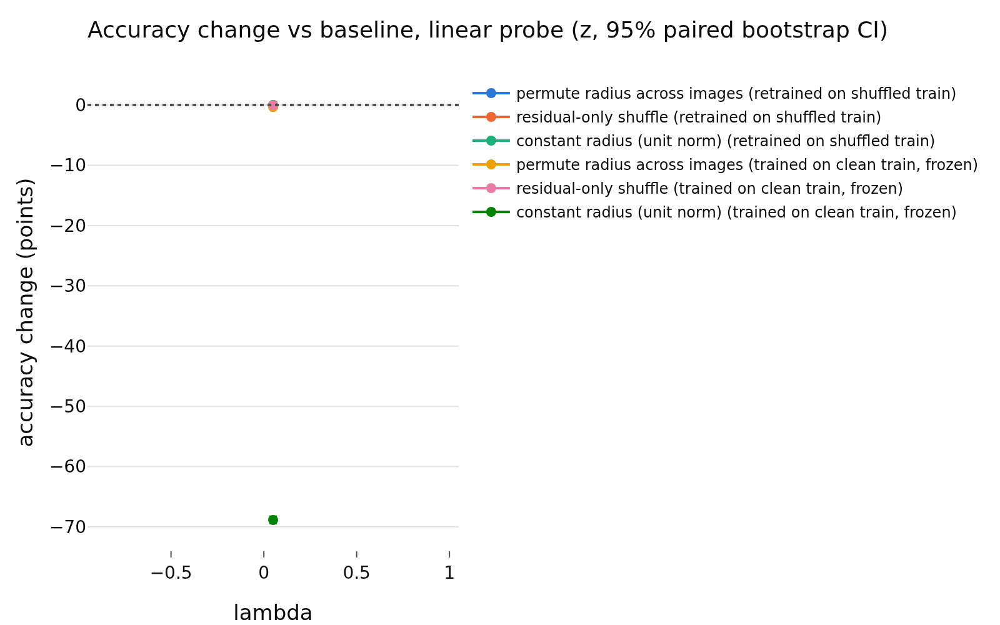
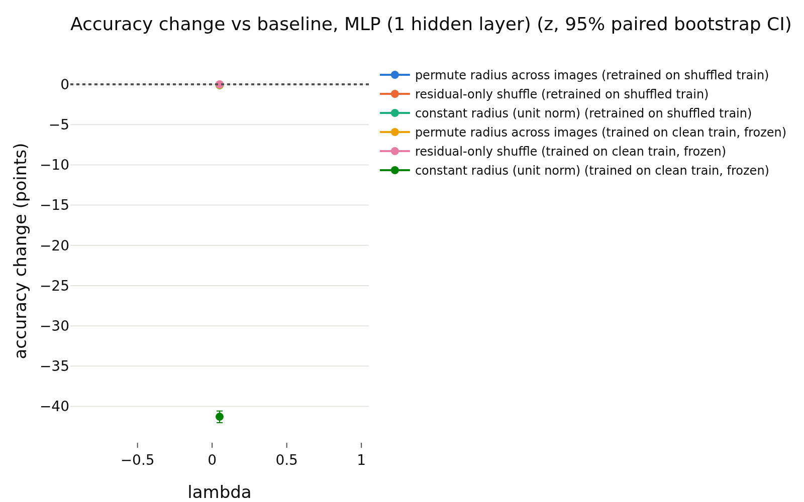

# E1 usage of the radius, lambda = 0.05
- **Branch / version:** `radius-randomization` @ `0f0cd4459d52e558887a1b2a3b21ededaa76905d` (merged as PR #32); notes committed on `radius-randomization-notes`
- **Run datetime (UTC):** 2026-10-23T16:19:16Z (end of SLURM job 2236227; the cluster reports local time, CDT = UTC-5, converted)
- **Command(s):** (submitted with `sbatch --wrap`, 8 CPUs, 32 GB, from the checkout of the branch above; `<repo>` is that checkout and `<python>` its `.venv` interpreter)
  `cd <repo> && export OMP_NUM_THREADS=8 OPENBLAS_NUM_THREADS=8 PYTHONPATH=<repo>/src && <python> apps/analyze.py --config configs/base.yaml --randomize-radius radius_marginal_lam0.05 --note radius_randomization/lam0.05.md`
- **Datasets:** STL-10 `train` (k-NN bank / probe training set) and `test` (evaluation), clean images, center views only ([canonical](https://cs.stanford.edu/~acoates/stl10/), [HF `tanganke/stl10`](https://huggingface.co/datasets/tanganke/stl10)). The **canonical Stanford archive was used** (via the prepared arrays and the existing `stl10_train` / `stl10_test` embedding dumps); the HF page is linked for reference only.
- **Backbone:** ResNet-18 from scratch ([HF architecture reference](https://huggingface.co/timm/resnet18.a1_in1k), weights not used); `last.pt` (epoch 200) of `radius_marginal_lam0.05_s{0,1,2}` (Variant A, lambda = 0.05)
- **Scope:** h is not analyzed; LeJEPA's product is z. All results are in z-space.
- **Equivalence margin:** 0.5 accuracy points, fixed before looking at any result (spec `radius_nuisance/spec.md`, E1; `eval.equivalence_margin`).

## Question

Is the radius ||z|| *used* by downstream readers of the LeJEPA embedding? If it is a nuisance parameter, randomizing it (keeping the direction) should not change the accuracy of classifiers on STL-10 by more than the margin of 0.5 points. This note covers lambda = 0.05, three training seeds. The cross-lambda reading is in `summary.md`.

## Setup (deviations from the base config)

No deviation from `configs/base.yaml` (k = 20 for k-NN, 1000 bootstrap replicates, 5 shuffle repeats per randomized condition, margin 0.5). Embeddings: the existing center-view z of the final checkpoints. Conditions (each applied to bank and test set independently): baseline, full radius permutation across images, residual-only shuffle (the direction-predicted part of log-radius is kept, held out / out-of-fold; only the residual is permuted), constant radius (unit norm). Readers: Euclidean k-NN, cosine k-NN (reference), linear (logistic) probe, one-hidden-layer MLP with weight decay chosen on a validation split of the clean bank. Protocols: *retrained* on the shuffled bank, and *frozen* (fit on clean bank, applied to shuffled test features). Statistics: paired bootstrap over test images within each seed, averaged over the three seeds; verdict `equivalent` if the 90% CI is inside +-0.5, `different` if not equivalent and the 95% CI excludes 0, else `inconclusive`. The tables below are generated and unedited.

## Results

<!-- BEGIN GENERATED: analyze.randomization_comparison -->
### Paired accuracy change vs the baseline, per lambda

z-space, center views; bank = STL-10 train, test set = STL-10 test; the same transformation is applied to bank and test set independently. Differences are in accuracy points (condition minus baseline on the same test images), averaged over training seeds; intervals are paired bootstrap percentile intervals (1000 replicates, test images resampled within each seed). Verdict, with the equivalence margin set to ±0.5 points before looking at results: `equivalent` if the 90% interval (TOST at 5%) lies inside the margin, `different` if not equivalent and the 95% interval excludes 0, otherwise `inconclusive`. Shuffle repeats (5 per randomized condition) only average out shuffle noise; they are not part of the interval.

| lambda | reader | protocol | condition | baseline acc | condition acc | difference (points) | 90% CI (points) | 95% CI (points) | verdict |
|---|---|---|---|---|---|---|---|---|---|
| 0.05 | k-NN (euclidean) | retrained on shuffled train | permute radius across images | 0.7870 | 0.7804 | -0.66 | [-0.88, -0.43] | [-0.93, -0.40] | different |
| 0.05 | k-NN (euclidean) | retrained on shuffled train | residual-only shuffle | 0.7870 | 0.7861 | -0.09 | [-0.24, +0.05] | [-0.28, +0.08] | equivalent |
| 0.05 | k-NN (euclidean) | retrained on shuffled train | constant radius (unit norm) | 0.7870 | 0.7836 | -0.35 | [-0.59, -0.10] | [-0.64, -0.05] | different |
| 0.05 | k-NN (euclidean) | trained on clean train, frozen | permute radius across images | 0.7870 | 0.7863 | -0.07 | [-0.23, +0.07] | [-0.25, +0.09] | equivalent |
| 0.05 | k-NN (euclidean) | trained on clean train, frozen | residual-only shuffle | 0.7870 | 0.7881 | +0.10 | [+0.01, +0.20] | [-0.01, +0.21] | equivalent |
| 0.05 | k-NN (euclidean) | trained on clean train, frozen | constant radius (unit norm) | 0.7870 | 0.1425 | -64.45 | [-65.03, -63.86] | [-65.19, -63.78] | different |
| 0.05 | k-NN (cosine, reference) | retrained on shuffled train | permute radius across images | 0.7836 | 0.7836 | +0.00 | [+0.00, +0.00] | [+0.00, +0.00] | equivalent |
| 0.05 | k-NN (cosine, reference) | retrained on shuffled train | residual-only shuffle | 0.7836 | 0.7836 | +0.00 | [+0.00, +0.00] | [+0.00, +0.00] | equivalent |
| 0.05 | k-NN (cosine, reference) | retrained on shuffled train | constant radius (unit norm) | 0.7836 | 0.7836 | +0.00 | [+0.00, +0.00] | [+0.00, +0.00] | equivalent |
| 0.05 | k-NN (cosine, reference) | trained on clean train, frozen | permute radius across images | 0.7836 | 0.7836 | +0.00 | [+0.00, +0.00] | [+0.00, +0.00] | equivalent |
| 0.05 | k-NN (cosine, reference) | trained on clean train, frozen | residual-only shuffle | 0.7836 | 0.7836 | +0.00 | [+0.00, +0.00] | [+0.00, +0.00] | equivalent |
| 0.05 | k-NN (cosine, reference) | trained on clean train, frozen | constant radius (unit norm) | 0.7836 | 0.7836 | +0.00 | [+0.00, +0.00] | [+0.00, +0.00] | equivalent |
| 0.05 | linear probe | retrained on shuffled train | permute radius across images | 0.8170 | 0.8154 | -0.16 | [-0.29, -0.03] | [-0.32, -0.00] | equivalent |
| 0.05 | linear probe | retrained on shuffled train | residual-only shuffle | 0.8170 | 0.8170 | +0.00 | [-0.07, +0.08] | [-0.09, +0.10] | equivalent |
| 0.05 | linear probe | retrained on shuffled train | constant radius (unit norm) | 0.8170 | 0.8170 | +0.00 | [-0.13, +0.14] | [-0.17, +0.16] | equivalent |
| 0.05 | linear probe | trained on clean train, frozen | permute radius across images | 0.8170 | 0.8136 | -0.34 | [-0.46, -0.21] | [-0.48, -0.20] | equivalent |
| 0.05 | linear probe | trained on clean train, frozen | residual-only shuffle | 0.8170 | 0.8165 | -0.05 | [-0.11, +0.03] | [-0.12, +0.04] | equivalent |
| 0.05 | linear probe | trained on clean train, frozen | constant radius (unit norm) | 0.8170 | 0.1283 | -68.86 | [-69.40, -68.30] | [-69.47, -68.21] | different |
| 0.05 | MLP (1 hidden layer) | retrained on shuffled train | permute radius across images | 0.8155 | 0.8145 | -0.10 | [-0.25, +0.04] | [-0.27, +0.07] | equivalent |
| 0.05 | MLP (1 hidden layer) | retrained on shuffled train | residual-only shuffle | 0.8155 | 0.8155 | -0.01 | [-0.12, +0.10] | [-0.14, +0.12] | equivalent |
| 0.05 | MLP (1 hidden layer) | retrained on shuffled train | constant radius (unit norm) | 0.8155 | 0.8145 | -0.11 | [-0.28, +0.05] | [-0.30, +0.10] | equivalent |
| 0.05 | MLP (1 hidden layer) | trained on clean train, frozen | permute radius across images | 0.8155 | 0.8147 | -0.08 | [-0.16, +0.00] | [-0.17, +0.01] | equivalent |
| 0.05 | MLP (1 hidden layer) | trained on clean train, frozen | residual-only shuffle | 0.8155 | 0.8156 | +0.00 | [-0.04, +0.05] | [-0.04, +0.05] | equivalent |
| 0.05 | MLP (1 hidden layer) | trained on clean train, frozen | constant radius (unit norm) | 0.8155 | 0.4027 | -41.28 | [-41.91, -40.67] | [-42.03, -40.57] | different |
<!-- END GENERATED: analyze.randomization_comparison -->

<!-- BEGIN GENERATED: analyze.randomization_accuracy -->
### Accuracy: mean ± std over training seeds, per lambda

| lambda | reader | protocol | condition | seeds | accuracy (mean ± std over seeds) | shuffle sd (mean over seeds) |
|---|---|---|---|---|---|---|
| 0.05 | k-NN (euclidean) | retrained on shuffled train | baseline | 3 | 0.7870 ± 0.0022 |  |
| 0.05 | k-NN (euclidean) | retrained on shuffled train | permute radius across images | 3 | 0.7804 ± 0.0010 | 0.0018 |
| 0.05 | k-NN (euclidean) | retrained on shuffled train | residual-only shuffle | 3 | 0.7861 ± 0.0029 | 0.0020 |
| 0.05 | k-NN (euclidean) | retrained on shuffled train | constant radius (unit norm) | 3 | 0.7836 ± 0.0011 |  |
| 0.05 | k-NN (euclidean) | trained on clean train, frozen | baseline | 3 | 0.7870 ± 0.0022 |  |
| 0.05 | k-NN (euclidean) | trained on clean train, frozen | permute radius across images | 3 | 0.7863 ± 0.0012 | 0.0012 |
| 0.05 | k-NN (euclidean) | trained on clean train, frozen | residual-only shuffle | 3 | 0.7881 ± 0.0027 | 0.0007 |
| 0.05 | k-NN (euclidean) | trained on clean train, frozen | constant radius (unit norm) | 3 | 0.1425 ± 0.0486 |  |
| 0.05 | k-NN (cosine, reference) | retrained on shuffled train | baseline | 3 | 0.7836 ± 0.0011 |  |
| 0.05 | k-NN (cosine, reference) | retrained on shuffled train | permute radius across images | 3 | 0.7836 ± 0.0011 | 0.0000 |
| 0.05 | k-NN (cosine, reference) | retrained on shuffled train | residual-only shuffle | 3 | 0.7836 ± 0.0011 | 0.0000 |
| 0.05 | k-NN (cosine, reference) | retrained on shuffled train | constant radius (unit norm) | 3 | 0.7836 ± 0.0011 |  |
| 0.05 | k-NN (cosine, reference) | trained on clean train, frozen | baseline | 3 | 0.7836 ± 0.0011 |  |
| 0.05 | k-NN (cosine, reference) | trained on clean train, frozen | permute radius across images | 3 | 0.7836 ± 0.0011 | 0.0000 |
| 0.05 | k-NN (cosine, reference) | trained on clean train, frozen | residual-only shuffle | 3 | 0.7836 ± 0.0011 | 0.0000 |
| 0.05 | k-NN (cosine, reference) | trained on clean train, frozen | constant radius (unit norm) | 3 | 0.7836 ± 0.0011 |  |
| 0.05 | linear probe | retrained on shuffled train | baseline | 3 | 0.8170 ± 0.0004 |  |
| 0.05 | linear probe | retrained on shuffled train | permute radius across images | 3 | 0.8154 ± 0.0010 | 0.0012 |
| 0.05 | linear probe | retrained on shuffled train | residual-only shuffle | 3 | 0.8170 ± 0.0001 | 0.0008 |
| 0.05 | linear probe | retrained on shuffled train | constant radius (unit norm) | 3 | 0.8170 ± 0.0008 |  |
| 0.05 | linear probe | trained on clean train, frozen | baseline | 3 | 0.8170 ± 0.0004 |  |
| 0.05 | linear probe | trained on clean train, frozen | permute radius across images | 3 | 0.8135 ± 0.0012 | 0.0018 |
| 0.05 | linear probe | trained on clean train, frozen | residual-only shuffle | 3 | 0.8165 ± 0.0005 | 0.0007 |
| 0.05 | linear probe | trained on clean train, frozen | constant radius (unit norm) | 3 | 0.1283 ± 0.0456 |  |
| 0.05 | MLP (1 hidden layer) | retrained on shuffled train | baseline | 3 | 0.8155 ± 0.0020 |  |
| 0.05 | MLP (1 hidden layer) | retrained on shuffled train | permute radius across images | 3 | 0.8145 ± 0.0029 | 0.0017 |
| 0.05 | MLP (1 hidden layer) | retrained on shuffled train | residual-only shuffle | 3 | 0.8155 ± 0.0015 | 0.0010 |
| 0.05 | MLP (1 hidden layer) | retrained on shuffled train | constant radius (unit norm) | 3 | 0.8145 ± 0.0013 |  |
| 0.05 | MLP (1 hidden layer) | trained on clean train, frozen | baseline | 3 | 0.8155 ± 0.0020 |  |
| 0.05 | MLP (1 hidden layer) | trained on clean train, frozen | permute radius across images | 3 | 0.8147 ± 0.0030 | 0.0010 |
| 0.05 | MLP (1 hidden layer) | trained on clean train, frozen | residual-only shuffle | 3 | 0.8156 ± 0.0025 | 0.0003 |
| 0.05 | MLP (1 hidden layer) | trained on clean train, frozen | constant radius (unit norm) | 3 | 0.4027 ± 0.0613 |  |
<!-- END GENERATED: analyze.randomization_accuracy -->

<!-- BEGIN GENERATED: analyze.randomization_runs -->
### Per-run accuracies

| run | reader | protocol | condition | repeats | accuracy | shuffle sd |
|---|---|---|---|---|---|---|
| radius_marginal_lam0.05_s0 | k-NN (euclidean) | retrained on shuffled train | baseline | 1 | 0.787 |  |
| radius_marginal_lam0.05_s0 | k-NN (euclidean) | trained on clean train, frozen | baseline | 1 | 0.787 |  |
| radius_marginal_lam0.05_s0 | k-NN (euclidean) | trained on clean train, frozen | constant radius (unit norm) | 1 | 0.1265 |  |
| radius_marginal_lam0.05_s0 | k-NN (euclidean) | retrained on shuffled train | constant radius (unit norm) | 1 | 0.7824 |  |
| radius_marginal_lam0.05_s0 | k-NN (euclidean) | trained on clean train, frozen | permute radius across images | 5 | 0.7867 | 0.001688 |
| radius_marginal_lam0.05_s0 | k-NN (euclidean) | retrained on shuffled train | permute radius across images | 5 | 0.7803 | 0.002228 |
| radius_marginal_lam0.05_s0 | k-NN (euclidean) | trained on clean train, frozen | residual-only shuffle | 5 | 0.7896 | 0.0006187 |
| radius_marginal_lam0.05_s0 | k-NN (euclidean) | retrained on shuffled train | residual-only shuffle | 5 | 0.7884 | 0.002138 |
| radius_marginal_lam0.05_s0 | k-NN (cosine, reference) | retrained on shuffled train | baseline | 1 | 0.7824 |  |
| radius_marginal_lam0.05_s0 | k-NN (cosine, reference) | trained on clean train, frozen | baseline | 1 | 0.7824 |  |
| radius_marginal_lam0.05_s0 | k-NN (cosine, reference) | trained on clean train, frozen | constant radius (unit norm) | 1 | 0.7824 |  |
| radius_marginal_lam0.05_s0 | k-NN (cosine, reference) | retrained on shuffled train | constant radius (unit norm) | 1 | 0.7824 |  |
| radius_marginal_lam0.05_s0 | k-NN (cosine, reference) | trained on clean train, frozen | permute radius across images | 5 | 0.7824 | 0 |
| radius_marginal_lam0.05_s0 | k-NN (cosine, reference) | retrained on shuffled train | permute radius across images | 5 | 0.7824 | 0 |
| radius_marginal_lam0.05_s0 | k-NN (cosine, reference) | trained on clean train, frozen | residual-only shuffle | 5 | 0.7824 | 0 |
| radius_marginal_lam0.05_s0 | k-NN (cosine, reference) | retrained on shuffled train | residual-only shuffle | 5 | 0.7824 | 0 |
| radius_marginal_lam0.05_s0 | linear probe | retrained on shuffled train | baseline | 1 | 0.8165 |  |
| radius_marginal_lam0.05_s0 | linear probe | trained on clean train, frozen | baseline | 1 | 0.8165 |  |
| radius_marginal_lam0.05_s0 | linear probe | trained on clean train, frozen | constant radius (unit norm) | 1 | 0.1006 |  |
| radius_marginal_lam0.05_s0 | linear probe | retrained on shuffled train | constant radius (unit norm) | 1 | 0.8161 |  |
| radius_marginal_lam0.05_s0 | linear probe | trained on clean train, frozen | permute radius across images | 5 | 0.8131 | 0.001197 |
| radius_marginal_lam0.05_s0 | linear probe | retrained on shuffled train | permute radius across images | 5 | 0.8159 | 0.00131 |
| radius_marginal_lam0.05_s0 | linear probe | trained on clean train, frozen | residual-only shuffle | 5 | 0.816 | 0.0009203 |
| radius_marginal_lam0.05_s0 | linear probe | retrained on shuffled train | residual-only shuffle | 5 | 0.8169 | 0.000665 |
| radius_marginal_lam0.05_s0 | MLP (1 hidden layer) | retrained on shuffled train | baseline | 1 | 0.8164 |  |
| radius_marginal_lam0.05_s0 | MLP (1 hidden layer) | trained on clean train, frozen | baseline | 1 | 0.8164 |  |
| radius_marginal_lam0.05_s0 | MLP (1 hidden layer) | trained on clean train, frozen | constant radius (unit norm) | 1 | 0.3729 |  |
| radius_marginal_lam0.05_s0 | MLP (1 hidden layer) | retrained on shuffled train | constant radius (unit norm) | 1 | 0.8147 |  |
| radius_marginal_lam0.05_s0 | MLP (1 hidden layer) | trained on clean train, frozen | permute radius across images | 5 | 0.8155 | 0.001165 |
| radius_marginal_lam0.05_s0 | MLP (1 hidden layer) | retrained on shuffled train | permute radius across images | 5 | 0.8167 | 0.001565 |
| radius_marginal_lam0.05_s0 | MLP (1 hidden layer) | trained on clean train, frozen | residual-only shuffle | 5 | 0.8165 | 0.0004089 |
| radius_marginal_lam0.05_s0 | MLP (1 hidden layer) | retrained on shuffled train | residual-only shuffle | 5 | 0.8169 | 0.0007479 |
| radius_marginal_lam0.05_s1 | k-NN (euclidean) | retrained on shuffled train | baseline | 1 | 0.7849 |  |
| radius_marginal_lam0.05_s1 | k-NN (euclidean) | trained on clean train, frozen | baseline | 1 | 0.7849 |  |
| radius_marginal_lam0.05_s1 | k-NN (euclidean) | trained on clean train, frozen | constant radius (unit norm) | 1 | 0.1039 |  |
| radius_marginal_lam0.05_s1 | k-NN (euclidean) | retrained on shuffled train | constant radius (unit norm) | 1 | 0.7837 |  |
| radius_marginal_lam0.05_s1 | k-NN (euclidean) | trained on clean train, frozen | permute radius across images | 5 | 0.785 | 0.00144 |
| radius_marginal_lam0.05_s1 | k-NN (euclidean) | retrained on shuffled train | permute radius across images | 5 | 0.7795 | 0.000916 |
| radius_marginal_lam0.05_s1 | k-NN (euclidean) | trained on clean train, frozen | residual-only shuffle | 5 | 0.785 | 0.0004889 |
| radius_marginal_lam0.05_s1 | k-NN (euclidean) | retrained on shuffled train | residual-only shuffle | 5 | 0.7829 | 0.00184 |
| radius_marginal_lam0.05_s1 | k-NN (cosine, reference) | retrained on shuffled train | baseline | 1 | 0.7837 |  |
| radius_marginal_lam0.05_s1 | k-NN (cosine, reference) | trained on clean train, frozen | baseline | 1 | 0.7837 |  |
| radius_marginal_lam0.05_s1 | k-NN (cosine, reference) | trained on clean train, frozen | constant radius (unit norm) | 1 | 0.7837 |  |
| radius_marginal_lam0.05_s1 | k-NN (cosine, reference) | retrained on shuffled train | constant radius (unit norm) | 1 | 0.7837 |  |
| radius_marginal_lam0.05_s1 | k-NN (cosine, reference) | trained on clean train, frozen | permute radius across images | 5 | 0.7837 | 0 |
| radius_marginal_lam0.05_s1 | k-NN (cosine, reference) | retrained on shuffled train | permute radius across images | 5 | 0.7837 | 0 |
| radius_marginal_lam0.05_s1 | k-NN (cosine, reference) | trained on clean train, frozen | residual-only shuffle | 5 | 0.7837 | 0 |
| radius_marginal_lam0.05_s1 | k-NN (cosine, reference) | retrained on shuffled train | residual-only shuffle | 5 | 0.7837 | 0 |
| radius_marginal_lam0.05_s1 | linear probe | retrained on shuffled train | baseline | 1 | 0.817 |  |
| radius_marginal_lam0.05_s1 | linear probe | trained on clean train, frozen | baseline | 1 | 0.817 |  |
| radius_marginal_lam0.05_s1 | linear probe | trained on clean train, frozen | constant radius (unit norm) | 1 | 0.1034 |  |
| radius_marginal_lam0.05_s1 | linear probe | retrained on shuffled train | constant radius (unit norm) | 1 | 0.8173 |  |
| radius_marginal_lam0.05_s1 | linear probe | trained on clean train, frozen | permute radius across images | 5 | 0.8149 | 0.002482 |
| radius_marginal_lam0.05_s1 | linear probe | retrained on shuffled train | permute radius across images | 5 | 0.8161 | 0.001041 |
| radius_marginal_lam0.05_s1 | linear probe | trained on clean train, frozen | residual-only shuffle | 5 | 0.8166 | 0.0005449 |
| radius_marginal_lam0.05_s1 | linear probe | retrained on shuffled train | residual-only shuffle | 5 | 0.817 | 0.0008542 |
| radius_marginal_lam0.05_s1 | MLP (1 hidden layer) | retrained on shuffled train | baseline | 1 | 0.817 |  |
| radius_marginal_lam0.05_s1 | MLP (1 hidden layer) | trained on clean train, frozen | baseline | 1 | 0.817 |  |
| radius_marginal_lam0.05_s1 | MLP (1 hidden layer) | trained on clean train, frozen | constant radius (unit norm) | 1 | 0.4733 |  |
| radius_marginal_lam0.05_s1 | MLP (1 hidden layer) | retrained on shuffled train | constant radius (unit norm) | 1 | 0.8156 |  |
| radius_marginal_lam0.05_s1 | MLP (1 hidden layer) | trained on clean train, frozen | permute radius across images | 5 | 0.8172 | 0.0004593 |
| radius_marginal_lam0.05_s1 | MLP (1 hidden layer) | retrained on shuffled train | permute radius across images | 5 | 0.8156 | 0.001907 |
| radius_marginal_lam0.05_s1 | MLP (1 hidden layer) | trained on clean train, frozen | residual-only shuffle | 5 | 0.8175 | 0.000271 |
| radius_marginal_lam0.05_s1 | MLP (1 hidden layer) | retrained on shuffled train | residual-only shuffle | 5 | 0.8155 | 0.0009577 |
| radius_marginal_lam0.05_s2 | k-NN (euclidean) | retrained on shuffled train | baseline | 1 | 0.7893 |  |
| radius_marginal_lam0.05_s2 | k-NN (euclidean) | trained on clean train, frozen | baseline | 1 | 0.7893 |  |
| radius_marginal_lam0.05_s2 | k-NN (euclidean) | trained on clean train, frozen | constant radius (unit norm) | 1 | 0.1971 |  |
| radius_marginal_lam0.05_s2 | k-NN (euclidean) | retrained on shuffled train | constant radius (unit norm) | 1 | 0.7846 |  |
| radius_marginal_lam0.05_s2 | k-NN (euclidean) | trained on clean train, frozen | permute radius across images | 5 | 0.7874 | 0.0003687 |
| radius_marginal_lam0.05_s2 | k-NN (euclidean) | retrained on shuffled train | permute radius across images | 5 | 0.7814 | 0.002265 |
| radius_marginal_lam0.05_s2 | k-NN (euclidean) | trained on clean train, frozen | residual-only shuffle | 5 | 0.7896 | 0.001058 |
| radius_marginal_lam0.05_s2 | k-NN (euclidean) | retrained on shuffled train | residual-only shuffle | 5 | 0.7871 | 0.00208 |
| radius_marginal_lam0.05_s2 | k-NN (cosine, reference) | retrained on shuffled train | baseline | 1 | 0.7846 |  |
| radius_marginal_lam0.05_s2 | k-NN (cosine, reference) | trained on clean train, frozen | baseline | 1 | 0.7846 |  |
| radius_marginal_lam0.05_s2 | k-NN (cosine, reference) | trained on clean train, frozen | constant radius (unit norm) | 1 | 0.7846 |  |
| radius_marginal_lam0.05_s2 | k-NN (cosine, reference) | retrained on shuffled train | constant radius (unit norm) | 1 | 0.7846 |  |
| radius_marginal_lam0.05_s2 | k-NN (cosine, reference) | trained on clean train, frozen | permute radius across images | 5 | 0.7846 | 0 |
| radius_marginal_lam0.05_s2 | k-NN (cosine, reference) | retrained on shuffled train | permute radius across images | 5 | 0.7846 | 0 |
| radius_marginal_lam0.05_s2 | k-NN (cosine, reference) | trained on clean train, frozen | residual-only shuffle | 5 | 0.7846 | 0 |
| radius_marginal_lam0.05_s2 | k-NN (cosine, reference) | retrained on shuffled train | residual-only shuffle | 5 | 0.7846 | 0 |
| radius_marginal_lam0.05_s2 | linear probe | retrained on shuffled train | baseline | 1 | 0.8174 |  |
| radius_marginal_lam0.05_s2 | linear probe | trained on clean train, frozen | baseline | 1 | 0.8174 |  |
| radius_marginal_lam0.05_s2 | linear probe | trained on clean train, frozen | constant radius (unit norm) | 1 | 0.181 |  |
| radius_marginal_lam0.05_s2 | linear probe | retrained on shuffled train | constant radius (unit norm) | 1 | 0.8176 |  |
| radius_marginal_lam0.05_s2 | linear probe | trained on clean train, frozen | permute radius across images | 5 | 0.8126 | 0.001685 |
| radius_marginal_lam0.05_s2 | linear probe | retrained on shuffled train | permute radius across images | 5 | 0.8142 | 0.001303 |
| radius_marginal_lam0.05_s2 | linear probe | trained on clean train, frozen | residual-only shuffle | 5 | 0.8169 | 0.0007726 |
| radius_marginal_lam0.05_s2 | linear probe | retrained on shuffled train | residual-only shuffle | 5 | 0.8171 | 0.0009245 |
| radius_marginal_lam0.05_s2 | MLP (1 hidden layer) | retrained on shuffled train | baseline | 1 | 0.8133 |  |
| radius_marginal_lam0.05_s2 | MLP (1 hidden layer) | trained on clean train, frozen | baseline | 1 | 0.8133 |  |
| radius_marginal_lam0.05_s2 | MLP (1 hidden layer) | trained on clean train, frozen | constant radius (unit norm) | 1 | 0.3621 |  |
| radius_marginal_lam0.05_s2 | MLP (1 hidden layer) | retrained on shuffled train | constant radius (unit norm) | 1 | 0.813 |  |
| radius_marginal_lam0.05_s2 | MLP (1 hidden layer) | trained on clean train, frozen | permute radius across images | 5 | 0.8114 | 0.001239 |
| radius_marginal_lam0.05_s2 | MLP (1 hidden layer) | retrained on shuffled train | permute radius across images | 5 | 0.8113 | 0.001508 |
| radius_marginal_lam0.05_s2 | MLP (1 hidden layer) | trained on clean train, frozen | residual-only shuffle | 5 | 0.8127 | 0.0003377 |
| radius_marginal_lam0.05_s2 | MLP (1 hidden layer) | retrained on shuffled train | residual-only shuffle | 5 | 0.8139 | 0.00131 |
<!-- END GENERATED: analyze.randomization_runs -->

<!-- BEGIN GENERATED: analyze.randomization_model -->
### Direction -> log-radius regression used by the residual shuffle

| run | MLP weight decay | quantity | bank (out-of-fold) | test (held out) |
|---|---|---|---|---|
| radius_marginal_lam0.05_s0 | 1 | R^2 of log-radius from direction | 0.9439 | 0.9488 |
| radius_marginal_lam0.05_s0 | 1 | sd of log-radius | 0.173 | 0.1753 |
| radius_marginal_lam0.05_s0 | 1 | sd of the residual log-radius | 0.04092 | 0.0388 |
| radius_marginal_lam0.05_s1 | 1 | R^2 of log-radius from direction | 0.9457 | 0.9497 |
| radius_marginal_lam0.05_s1 | 1 | sd of log-radius | 0.1787 | 0.1797 |
| radius_marginal_lam0.05_s1 | 1 | sd of the residual log-radius | 0.04159 | 0.03947 |
| radius_marginal_lam0.05_s2 | 1 | R^2 of log-radius from direction | 0.9462 | 0.9462 |
| radius_marginal_lam0.05_s2 | 1 | sd of log-radius | 0.1731 | 0.176 |
| radius_marginal_lam0.05_s2 | 1 | sd of the residual log-radius | 0.04011 | 0.03996 |
<!-- END GENERATED: analyze.randomization_model -->

<!-- BEGIN GENERATED: analyze.randomization_skipped -->
### Runs without the required dumps

None: every run of the prefix has `stl10_train` and `stl10_test`.
<!-- END GENERATED: analyze.randomization_skipped -->

<!-- BEGIN GENERATED: analyze.randomization_figures -->
### Figures

<!-- END GENERATED: analyze.randomization_figures -->

## Interpretation

- Linear probe and MLP: the radius is not needed. Under retraining and under the residual-only shuffle all verdicts are `equivalent` with small point estimates (|difference| <= 0.23). Under frozen full permutation, 0.05: the frozen linear probe under permutation loses 0.34 points (90% CI [-0.46, -0.21]); verdict `equivalent` because the 90% CI lies inside +-0.5, but the interval end is only 0.04 points from the margin.
- Euclidean k-NN retrained on shuffled features loses accuracy under full permutation and under constant radius (verdict `different`, point estimates of a few tenths of a point). This is partly mechanical: the Euclidean metric depends on the radius by construction. The residual-only shuffle, which keeps the direction-predicted radius, is `equivalent` for every reader, so the damage comes from removing the radius information that the direction already predicts (R^2 about 0.93-0.95 on held-out data, see the generated model table), not from an independent signal.
- Constant radius equals cosine k-NN exactly for Euclidean k-NN (unit vectors rank like cosine); the -0.3 to -0.4 point difference is therefore the Euclidean-vs-cosine metric gap at baseline, not a loss of label information.
- Cosine k-NN differences are exactly zero in all conditions: it is radius-invariant by construction and serves as a pipeline sanity check only, not as evidence.
- Frozen readers under constant radius collapse (about 13-16% for k-NN and for the linear probe, close to the 10% chance level; 28-48% for the MLP). Unit-norm features are a ~16x rescaling (E||z||^2/d is about 1, so ||z|| is about 16), which puts the frozen reader far off its training distribution. This is a distribution-shift artifact; the retrained readers on the same features lose nothing, so it is not evidence of label information in the radius.
- Weaknesses: only three training seeds, and the bootstrap resamples test images only (seed-to-seed variability is averaged, not propagated into the CI); the verdicts treat the three seeds as the population of trainings. The 90% CI endpoints of some `equivalent` verdicts sit near the margin (see above). Only one dataset and one k, and a single margin chosen a priori.

## Next steps

- See `summary.md` for the cross-lambda reading and the go-forward items (more seeds, a joint model over seeds, E3 training without the radius).
- Figure note: the generated k-NN figures of this run overwrite each other (Euclidean and cosine share one file name, so the PNG shows only the cosine panel) and a single lambda gives one point per series; the tables are the authoritative result.
