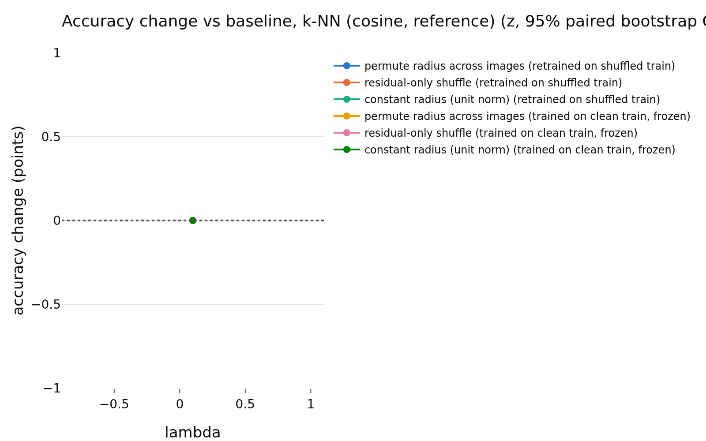
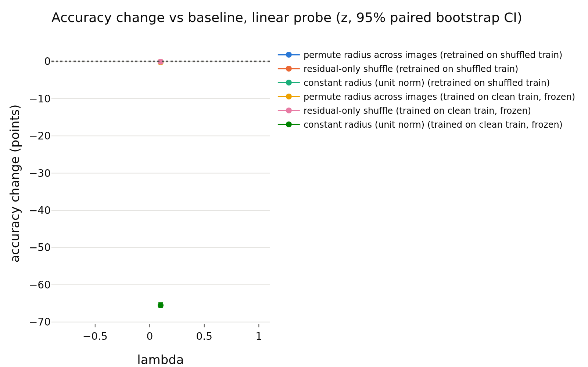
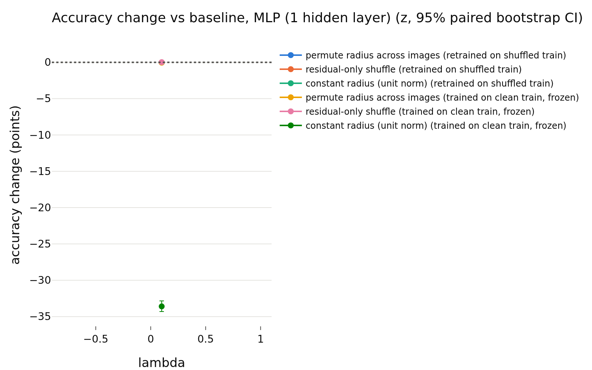

# E1 usage of the radius, lambda = 0.1
- **Branch / version:** `radius-randomization` @ `0f0cd4459d52e558887a1b2a3b21ededaa76905d` (merged as PR #32); notes committed on `radius-randomization-notes`
- **Run datetime (UTC):** 2026-10-23T15:21:33Z (end of SLURM job 2236228; the cluster reports local time, CDT = UTC-5, converted)
- **Command(s):** (submitted with `sbatch --wrap`, 8 CPUs, 32 GB, from the checkout of the branch above; `<repo>` is that checkout and `<python>` its `.venv` interpreter)
  `cd <repo> && export OMP_NUM_THREADS=8 OPENBLAS_NUM_THREADS=8 PYTHONPATH=<repo>/src && <python> apps/analyze.py --config configs/base.yaml --randomize-radius radius_marginal_lam0.1 --note radius_randomization/lam0.1.md`
- **Datasets:** STL-10 `train` (k-NN bank / probe training set) and `test` (evaluation), clean images, center views only ([canonical](https://cs.stanford.edu/~acoates/stl10/), [HF `tanganke/stl10`](https://huggingface.co/datasets/tanganke/stl10)). The **canonical Stanford archive was used** (via the prepared arrays and the existing `stl10_train` / `stl10_test` embedding dumps); the HF page is linked for reference only.
- **Backbone:** ResNet-18 from scratch ([HF architecture reference](https://huggingface.co/timm/resnet18.a1_in1k), weights not used); `last.pt` (epoch 200) of `radius_marginal_lam0.1_s{0,1,2}` (Variant A, lambda = 0.1)
- **Scope:** h is not analyzed; LeJEPA's product is z. All results are in z-space.
- **Equivalence margin:** 0.5 accuracy points, fixed before looking at any result (spec `radius_nuisance/spec.md`, E1; `eval.equivalence_margin`).

## Question

Is the radius ||z|| *used* by downstream readers of the LeJEPA embedding? If it is a nuisance parameter, randomizing it (keeping the direction) should not change the accuracy of classifiers on STL-10 by more than the margin of 0.5 points. This note covers lambda = 0.1, three training seeds. The cross-lambda reading is in `summary.md`.

## Setup (deviations from the base config)

No deviation from `configs/base.yaml` (k = 20 for k-NN, 1000 bootstrap replicates, 5 shuffle repeats per randomized condition, margin 0.5). Embeddings: the existing center-view z of the final checkpoints. Conditions (each applied to bank and test set independently): baseline, full radius permutation across images, residual-only shuffle (the direction-predicted part of log-radius is kept, held out / out-of-fold; only the residual is permuted), constant radius (unit norm). Readers: Euclidean k-NN, cosine k-NN (reference), linear (logistic) probe, one-hidden-layer MLP with weight decay chosen on a validation split of the clean bank. Protocols: *retrained* on the shuffled bank, and *frozen* (fit on clean bank, applied to shuffled test features). Statistics: paired bootstrap over test images within each seed, averaged over the three seeds; verdict `equivalent` if the 90% CI is inside +-0.5, `different` if not equivalent and the 95% CI excludes 0, else `inconclusive`. The tables below are generated and unedited.

## Results

<!-- BEGIN GENERATED: analyze.randomization_comparison -->
### Paired accuracy change vs the baseline, per lambda

z-space, center views; bank = STL-10 train, test set = STL-10 test; the same transformation is applied to bank and test set independently. Differences are in accuracy points (condition minus baseline on the same test images), averaged over training seeds; intervals are paired bootstrap percentile intervals (1000 replicates, test images resampled within each seed). Verdict, with the equivalence margin set to ±0.5 points before looking at results: `equivalent` if the 90% interval (TOST at 5%) lies inside the margin, `different` if not equivalent and the 95% interval excludes 0, otherwise `inconclusive`. Shuffle repeats (5 per randomized condition) only average out shuffle noise; they are not part of the interval.

| lambda | reader | protocol | condition | baseline acc | condition acc | difference (points) | 90% CI (points) | 95% CI (points) | verdict |
|---|---|---|---|---|---|---|---|---|---|
| 0.1 | k-NN (euclidean) | retrained on shuffled train | permute radius across images | 0.7886 | 0.7832 | -0.54 | [-0.76, -0.32] | [-0.78, -0.28] | different |
| 0.1 | k-NN (euclidean) | retrained on shuffled train | residual-only shuffle | 0.7886 | 0.7879 | -0.07 | [-0.23, +0.07] | [-0.26, +0.10] | equivalent |
| 0.1 | k-NN (euclidean) | retrained on shuffled train | constant radius (unit norm) | 0.7886 | 0.7845 | -0.42 | [-0.67, -0.16] | [-0.70, -0.13] | different |
| 0.1 | k-NN (euclidean) | trained on clean train, frozen | permute radius across images | 0.7886 | 0.7896 | +0.10 | [-0.03, +0.23] | [-0.05, +0.25] | equivalent |
| 0.1 | k-NN (euclidean) | trained on clean train, frozen | residual-only shuffle | 0.7886 | 0.7887 | +0.01 | [-0.07, +0.10] | [-0.09, +0.12] | equivalent |
| 0.1 | k-NN (euclidean) | trained on clean train, frozen | constant radius (unit norm) | 0.7886 | 0.1349 | -65.37 | [-65.92, -64.78] | [-66.06, -64.62] | different |
| 0.1 | k-NN (cosine, reference) | retrained on shuffled train | permute radius across images | 0.7845 | 0.7845 | +0.00 | [+0.00, +0.00] | [+0.00, +0.00] | equivalent |
| 0.1 | k-NN (cosine, reference) | retrained on shuffled train | residual-only shuffle | 0.7845 | 0.7845 | +0.00 | [+0.00, +0.00] | [+0.00, +0.00] | equivalent |
| 0.1 | k-NN (cosine, reference) | retrained on shuffled train | constant radius (unit norm) | 0.7845 | 0.7845 | +0.00 | [+0.00, +0.00] | [+0.00, +0.00] | equivalent |
| 0.1 | k-NN (cosine, reference) | trained on clean train, frozen | permute radius across images | 0.7845 | 0.7845 | +0.00 | [+0.00, +0.00] | [+0.00, +0.00] | equivalent |
| 0.1 | k-NN (cosine, reference) | trained on clean train, frozen | residual-only shuffle | 0.7845 | 0.7845 | +0.00 | [+0.00, +0.00] | [+0.00, +0.00] | equivalent |
| 0.1 | k-NN (cosine, reference) | trained on clean train, frozen | constant radius (unit norm) | 0.7845 | 0.7845 | +0.00 | [+0.00, +0.00] | [+0.00, +0.00] | equivalent |
| 0.1 | linear probe | retrained on shuffled train | permute radius across images | 0.8121 | 0.8102 | -0.19 | [-0.30, -0.08] | [-0.32, -0.06] | equivalent |
| 0.1 | linear probe | retrained on shuffled train | residual-only shuffle | 0.8121 | 0.8114 | -0.07 | [-0.14, +0.01] | [-0.15, +0.02] | equivalent |
| 0.1 | linear probe | retrained on shuffled train | constant radius (unit norm) | 0.8121 | 0.8105 | -0.17 | [-0.28, -0.06] | [-0.30, -0.03] | equivalent |
| 0.1 | linear probe | trained on clean train, frozen | permute radius across images | 0.8121 | 0.8096 | -0.25 | [-0.36, -0.15] | [-0.38, -0.12] | equivalent |
| 0.1 | linear probe | trained on clean train, frozen | residual-only shuffle | 0.8121 | 0.8113 | -0.08 | [-0.13, -0.02] | [-0.14, -0.02] | equivalent |
| 0.1 | linear probe | trained on clean train, frozen | constant radius (unit norm) | 0.8121 | 0.1570 | -65.51 | [-66.07, -64.92] | [-66.19, -64.77] | different |
| 0.1 | MLP (1 hidden layer) | retrained on shuffled train | permute radius across images | 0.8175 | 0.8173 | -0.02 | [-0.15, +0.09] | [-0.17, +0.12] | equivalent |
| 0.1 | MLP (1 hidden layer) | retrained on shuffled train | residual-only shuffle | 0.8175 | 0.8175 | -0.00 | [-0.09, +0.09] | [-0.11, +0.11] | equivalent |
| 0.1 | MLP (1 hidden layer) | retrained on shuffled train | constant radius (unit norm) | 0.8175 | 0.8172 | -0.03 | [-0.19, +0.10] | [-0.21, +0.13] | equivalent |
| 0.1 | MLP (1 hidden layer) | trained on clean train, frozen | permute radius across images | 0.8175 | 0.8170 | -0.05 | [-0.11, +0.01] | [-0.12, +0.02] | equivalent |
| 0.1 | MLP (1 hidden layer) | trained on clean train, frozen | residual-only shuffle | 0.8175 | 0.8177 | +0.02 | [-0.01, +0.05] | [-0.02, +0.06] | equivalent |
| 0.1 | MLP (1 hidden layer) | trained on clean train, frozen | constant radius (unit norm) | 0.8175 | 0.4816 | -33.60 | [-34.20, -32.97] | [-34.30, -32.85] | different |
<!-- END GENERATED: analyze.randomization_comparison -->

<!-- BEGIN GENERATED: analyze.randomization_accuracy -->
### Accuracy: mean ± std over training seeds, per lambda

| lambda | reader | protocol | condition | seeds | accuracy (mean ± std over seeds) | shuffle sd (mean over seeds) |
|---|---|---|---|---|---|---|
| 0.1 | k-NN (euclidean) | retrained on shuffled train | baseline | 3 | 0.7886 ± 0.0012 |  |
| 0.1 | k-NN (euclidean) | retrained on shuffled train | permute radius across images | 3 | 0.7832 ± 0.0013 | 0.0013 |
| 0.1 | k-NN (euclidean) | retrained on shuffled train | residual-only shuffle | 3 | 0.7879 ± 0.0012 | 0.0015 |
| 0.1 | k-NN (euclidean) | retrained on shuffled train | constant radius (unit norm) | 3 | 0.7845 ± 0.0025 |  |
| 0.1 | k-NN (euclidean) | trained on clean train, frozen | baseline | 3 | 0.7886 ± 0.0012 |  |
| 0.1 | k-NN (euclidean) | trained on clean train, frozen | permute radius across images | 3 | 0.7896 ± 0.0007 | 0.0014 |
| 0.1 | k-NN (euclidean) | trained on clean train, frozen | residual-only shuffle | 3 | 0.7887 ± 0.0005 | 0.0006 |
| 0.1 | k-NN (euclidean) | trained on clean train, frozen | constant radius (unit norm) | 3 | 0.1349 ± 0.0063 |  |
| 0.1 | k-NN (cosine, reference) | retrained on shuffled train | baseline | 3 | 0.7845 ± 0.0025 |  |
| 0.1 | k-NN (cosine, reference) | retrained on shuffled train | permute radius across images | 3 | 0.7845 ± 0.0025 | 0.0000 |
| 0.1 | k-NN (cosine, reference) | retrained on shuffled train | residual-only shuffle | 3 | 0.7845 ± 0.0025 | 0.0000 |
| 0.1 | k-NN (cosine, reference) | retrained on shuffled train | constant radius (unit norm) | 3 | 0.7845 ± 0.0025 |  |
| 0.1 | k-NN (cosine, reference) | trained on clean train, frozen | baseline | 3 | 0.7845 ± 0.0025 |  |
| 0.1 | k-NN (cosine, reference) | trained on clean train, frozen | permute radius across images | 3 | 0.7845 ± 0.0025 | 0.0000 |
| 0.1 | k-NN (cosine, reference) | trained on clean train, frozen | residual-only shuffle | 3 | 0.7845 ± 0.0025 | 0.0000 |
| 0.1 | k-NN (cosine, reference) | trained on clean train, frozen | constant radius (unit norm) | 3 | 0.7845 ± 0.0025 |  |
| 0.1 | linear probe | retrained on shuffled train | baseline | 3 | 0.8121 ± 0.0036 |  |
| 0.1 | linear probe | retrained on shuffled train | permute radius across images | 3 | 0.8102 ± 0.0029 | 0.0019 |
| 0.1 | linear probe | retrained on shuffled train | residual-only shuffle | 3 | 0.8114 ± 0.0036 | 0.0005 |
| 0.1 | linear probe | retrained on shuffled train | constant radius (unit norm) | 3 | 0.8105 ± 0.0041 |  |
| 0.1 | linear probe | trained on clean train, frozen | baseline | 3 | 0.8121 ± 0.0036 |  |
| 0.1 | linear probe | trained on clean train, frozen | permute radius across images | 3 | 0.8096 ± 0.0033 | 0.0007 |
| 0.1 | linear probe | trained on clean train, frozen | residual-only shuffle | 3 | 0.8113 ± 0.0032 | 0.0006 |
| 0.1 | linear probe | trained on clean train, frozen | constant radius (unit norm) | 3 | 0.1570 ± 0.0602 |  |
| 0.1 | MLP (1 hidden layer) | retrained on shuffled train | baseline | 3 | 0.8175 ± 0.0039 |  |
| 0.1 | MLP (1 hidden layer) | retrained on shuffled train | permute radius across images | 3 | 0.8173 ± 0.0036 | 0.0009 |
| 0.1 | MLP (1 hidden layer) | retrained on shuffled train | residual-only shuffle | 3 | 0.8175 ± 0.0040 | 0.0010 |
| 0.1 | MLP (1 hidden layer) | retrained on shuffled train | constant radius (unit norm) | 3 | 0.8172 ± 0.0019 |  |
| 0.1 | MLP (1 hidden layer) | trained on clean train, frozen | baseline | 3 | 0.8175 ± 0.0039 |  |
| 0.1 | MLP (1 hidden layer) | trained on clean train, frozen | permute radius across images | 3 | 0.8170 ± 0.0034 | 0.0004 |
| 0.1 | MLP (1 hidden layer) | trained on clean train, frozen | residual-only shuffle | 3 | 0.8177 ± 0.0040 | 0.0003 |
| 0.1 | MLP (1 hidden layer) | trained on clean train, frozen | constant radius (unit norm) | 3 | 0.4816 ± 0.1279 |  |
<!-- END GENERATED: analyze.randomization_accuracy -->

<!-- BEGIN GENERATED: analyze.randomization_runs -->
### Per-run accuracies

| run | reader | protocol | condition | repeats | accuracy | shuffle sd |
|---|---|---|---|---|---|---|
| radius_marginal_lam0.1_s0 | k-NN (euclidean) | retrained on shuffled train | baseline | 1 | 0.7876 |  |
| radius_marginal_lam0.1_s0 | k-NN (euclidean) | trained on clean train, frozen | baseline | 1 | 0.7876 |  |
| radius_marginal_lam0.1_s0 | k-NN (euclidean) | trained on clean train, frozen | constant radius (unit norm) | 1 | 0.1348 |  |
| radius_marginal_lam0.1_s0 | k-NN (euclidean) | retrained on shuffled train | constant radius (unit norm) | 1 | 0.7854 |  |
| radius_marginal_lam0.1_s0 | k-NN (euclidean) | trained on clean train, frozen | permute radius across images | 5 | 0.789 | 0.001257 |
| radius_marginal_lam0.1_s0 | k-NN (euclidean) | retrained on shuffled train | permute radius across images | 5 | 0.7829 | 0.00154 |
| radius_marginal_lam0.1_s0 | k-NN (euclidean) | trained on clean train, frozen | residual-only shuffle | 5 | 0.7883 | 0.0006591 |
| radius_marginal_lam0.1_s0 | k-NN (euclidean) | retrained on shuffled train | residual-only shuffle | 5 | 0.7876 | 0.002189 |
| radius_marginal_lam0.1_s0 | k-NN (cosine, reference) | retrained on shuffled train | baseline | 1 | 0.7854 |  |
| radius_marginal_lam0.1_s0 | k-NN (cosine, reference) | trained on clean train, frozen | baseline | 1 | 0.7854 |  |
| radius_marginal_lam0.1_s0 | k-NN (cosine, reference) | trained on clean train, frozen | constant radius (unit norm) | 1 | 0.7854 |  |
| radius_marginal_lam0.1_s0 | k-NN (cosine, reference) | retrained on shuffled train | constant radius (unit norm) | 1 | 0.7854 |  |
| radius_marginal_lam0.1_s0 | k-NN (cosine, reference) | trained on clean train, frozen | permute radius across images | 5 | 0.7854 | 0 |
| radius_marginal_lam0.1_s0 | k-NN (cosine, reference) | retrained on shuffled train | permute radius across images | 5 | 0.7854 | 0 |
| radius_marginal_lam0.1_s0 | k-NN (cosine, reference) | trained on clean train, frozen | residual-only shuffle | 5 | 0.7854 | 0 |
| radius_marginal_lam0.1_s0 | k-NN (cosine, reference) | retrained on shuffled train | residual-only shuffle | 5 | 0.7854 | 0 |
| radius_marginal_lam0.1_s0 | linear probe | retrained on shuffled train | baseline | 1 | 0.8093 |  |
| radius_marginal_lam0.1_s0 | linear probe | trained on clean train, frozen | baseline | 1 | 0.8093 |  |
| radius_marginal_lam0.1_s0 | linear probe | trained on clean train, frozen | constant radius (unit norm) | 1 | 0.1021 |  |
| radius_marginal_lam0.1_s0 | linear probe | retrained on shuffled train | constant radius (unit norm) | 1 | 0.8076 |  |
| radius_marginal_lam0.1_s0 | linear probe | trained on clean train, frozen | permute radius across images | 5 | 0.8079 | 0.0008404 |
| radius_marginal_lam0.1_s0 | linear probe | retrained on shuffled train | permute radius across images | 5 | 0.8083 | 0.002754 |
| radius_marginal_lam0.1_s0 | linear probe | trained on clean train, frozen | residual-only shuffle | 5 | 0.8089 | 0.0004294 |
| radius_marginal_lam0.1_s0 | linear probe | retrained on shuffled train | residual-only shuffle | 5 | 0.8084 | 0.0004627 |
| radius_marginal_lam0.1_s0 | MLP (1 hidden layer) | retrained on shuffled train | baseline | 1 | 0.8131 |  |
| radius_marginal_lam0.1_s0 | MLP (1 hidden layer) | trained on clean train, frozen | baseline | 1 | 0.8131 |  |
| radius_marginal_lam0.1_s0 | MLP (1 hidden layer) | trained on clean train, frozen | constant radius (unit norm) | 1 | 0.6285 |  |
| radius_marginal_lam0.1_s0 | MLP (1 hidden layer) | retrained on shuffled train | constant radius (unit norm) | 1 | 0.815 |  |
| radius_marginal_lam0.1_s0 | MLP (1 hidden layer) | trained on clean train, frozen | permute radius across images | 5 | 0.8132 | 0.0003601 |
| radius_marginal_lam0.1_s0 | MLP (1 hidden layer) | retrained on shuffled train | permute radius across images | 5 | 0.8136 | 0.001248 |
| radius_marginal_lam0.1_s0 | MLP (1 hidden layer) | trained on clean train, frozen | residual-only shuffle | 5 | 0.8133 | 0.0002795 |
| radius_marginal_lam0.1_s0 | MLP (1 hidden layer) | retrained on shuffled train | residual-only shuffle | 5 | 0.8131 | 0.0008997 |
| radius_marginal_lam0.1_s1 | k-NN (euclidean) | retrained on shuffled train | baseline | 1 | 0.79 |  |
| radius_marginal_lam0.1_s1 | k-NN (euclidean) | trained on clean train, frozen | baseline | 1 | 0.79 |  |
| radius_marginal_lam0.1_s1 | k-NN (euclidean) | trained on clean train, frozen | constant radius (unit norm) | 1 | 0.1412 |  |
| radius_marginal_lam0.1_s1 | k-NN (euclidean) | retrained on shuffled train | constant radius (unit norm) | 1 | 0.7864 |  |
| radius_marginal_lam0.1_s1 | k-NN (euclidean) | trained on clean train, frozen | permute radius across images | 5 | 0.7903 | 0.001844 |
| radius_marginal_lam0.1_s1 | k-NN (euclidean) | retrained on shuffled train | permute radius across images | 5 | 0.7847 | 0.0008732 |
| radius_marginal_lam0.1_s1 | k-NN (euclidean) | trained on clean train, frozen | residual-only shuffle | 5 | 0.7893 | 0.0004276 |
| radius_marginal_lam0.1_s1 | k-NN (euclidean) | retrained on shuffled train | residual-only shuffle | 5 | 0.7892 | 0.001664 |
| radius_marginal_lam0.1_s1 | k-NN (cosine, reference) | retrained on shuffled train | baseline | 1 | 0.7864 |  |
| radius_marginal_lam0.1_s1 | k-NN (cosine, reference) | trained on clean train, frozen | baseline | 1 | 0.7864 |  |
| radius_marginal_lam0.1_s1 | k-NN (cosine, reference) | trained on clean train, frozen | constant radius (unit norm) | 1 | 0.7864 |  |
| radius_marginal_lam0.1_s1 | k-NN (cosine, reference) | retrained on shuffled train | constant radius (unit norm) | 1 | 0.7864 |  |
| radius_marginal_lam0.1_s1 | k-NN (cosine, reference) | trained on clean train, frozen | permute radius across images | 5 | 0.7864 | 0 |
| radius_marginal_lam0.1_s1 | k-NN (cosine, reference) | retrained on shuffled train | permute radius across images | 5 | 0.7864 | 0 |
| radius_marginal_lam0.1_s1 | k-NN (cosine, reference) | trained on clean train, frozen | residual-only shuffle | 5 | 0.7864 | 0 |
| radius_marginal_lam0.1_s1 | k-NN (cosine, reference) | retrained on shuffled train | residual-only shuffle | 5 | 0.7864 | 0 |
| radius_marginal_lam0.1_s1 | linear probe | retrained on shuffled train | baseline | 1 | 0.8161 |  |
| radius_marginal_lam0.1_s1 | linear probe | trained on clean train, frozen | baseline | 1 | 0.8161 |  |
| radius_marginal_lam0.1_s1 | linear probe | trained on clean train, frozen | constant radius (unit norm) | 1 | 0.2214 |  |
| radius_marginal_lam0.1_s1 | linear probe | retrained on shuffled train | constant radius (unit norm) | 1 | 0.8151 |  |
| radius_marginal_lam0.1_s1 | linear probe | trained on clean train, frozen | permute radius across images | 5 | 0.8134 | 0.0005548 |
| radius_marginal_lam0.1_s1 | linear probe | retrained on shuffled train | permute radius across images | 5 | 0.8135 | 0.001815 |
| radius_marginal_lam0.1_s1 | linear probe | trained on clean train, frozen | residual-only shuffle | 5 | 0.815 | 0.0007624 |
| radius_marginal_lam0.1_s1 | linear probe | retrained on shuffled train | residual-only shuffle | 5 | 0.8154 | 0.0007104 |
| radius_marginal_lam0.1_s1 | MLP (1 hidden layer) | retrained on shuffled train | baseline | 1 | 0.8203 |  |
| radius_marginal_lam0.1_s1 | MLP (1 hidden layer) | trained on clean train, frozen | baseline | 1 | 0.8203 |  |
| radius_marginal_lam0.1_s1 | MLP (1 hidden layer) | trained on clean train, frozen | constant radius (unit norm) | 1 | 0.4215 |  |
| radius_marginal_lam0.1_s1 | MLP (1 hidden layer) | retrained on shuffled train | constant radius (unit norm) | 1 | 0.8184 |  |
| radius_marginal_lam0.1_s1 | MLP (1 hidden layer) | trained on clean train, frozen | permute radius across images | 5 | 0.8197 | 0.0004921 |
| radius_marginal_lam0.1_s1 | MLP (1 hidden layer) | retrained on shuffled train | permute radius across images | 5 | 0.8207 | 0.0008768 |
| radius_marginal_lam0.1_s1 | MLP (1 hidden layer) | trained on clean train, frozen | residual-only shuffle | 5 | 0.8207 | 0.000125 |
| radius_marginal_lam0.1_s1 | MLP (1 hidden layer) | retrained on shuffled train | residual-only shuffle | 5 | 0.821 | 0.001197 |
| radius_marginal_lam0.1_s2 | k-NN (euclidean) | retrained on shuffled train | baseline | 1 | 0.7883 |  |
| radius_marginal_lam0.1_s2 | k-NN (euclidean) | trained on clean train, frozen | baseline | 1 | 0.7883 |  |
| radius_marginal_lam0.1_s2 | k-NN (euclidean) | trained on clean train, frozen | constant radius (unit norm) | 1 | 0.1288 |  |
| radius_marginal_lam0.1_s2 | k-NN (euclidean) | retrained on shuffled train | constant radius (unit norm) | 1 | 0.7816 |  |
| radius_marginal_lam0.1_s2 | k-NN (euclidean) | trained on clean train, frozen | permute radius across images | 5 | 0.7896 | 0.001059 |
| radius_marginal_lam0.1_s2 | k-NN (euclidean) | retrained on shuffled train | permute radius across images | 5 | 0.7821 | 0.001486 |
| radius_marginal_lam0.1_s2 | k-NN (euclidean) | trained on clean train, frozen | residual-only shuffle | 5 | 0.7885 | 0.0007363 |
| radius_marginal_lam0.1_s2 | k-NN (euclidean) | retrained on shuffled train | residual-only shuffle | 5 | 0.7869 | 0.0007289 |
| radius_marginal_lam0.1_s2 | k-NN (cosine, reference) | retrained on shuffled train | baseline | 1 | 0.7816 |  |
| radius_marginal_lam0.1_s2 | k-NN (cosine, reference) | trained on clean train, frozen | baseline | 1 | 0.7816 |  |
| radius_marginal_lam0.1_s2 | k-NN (cosine, reference) | trained on clean train, frozen | constant radius (unit norm) | 1 | 0.7816 |  |
| radius_marginal_lam0.1_s2 | k-NN (cosine, reference) | retrained on shuffled train | constant radius (unit norm) | 1 | 0.7816 |  |
| radius_marginal_lam0.1_s2 | k-NN (cosine, reference) | trained on clean train, frozen | permute radius across images | 5 | 0.7816 | 0 |
| radius_marginal_lam0.1_s2 | k-NN (cosine, reference) | retrained on shuffled train | permute radius across images | 5 | 0.7816 | 0 |
| radius_marginal_lam0.1_s2 | k-NN (cosine, reference) | trained on clean train, frozen | residual-only shuffle | 5 | 0.7816 | 0 |
| radius_marginal_lam0.1_s2 | k-NN (cosine, reference) | retrained on shuffled train | residual-only shuffle | 5 | 0.7816 | 0 |
| radius_marginal_lam0.1_s2 | linear probe | retrained on shuffled train | baseline | 1 | 0.811 |  |
| radius_marginal_lam0.1_s2 | linear probe | trained on clean train, frozen | baseline | 1 | 0.811 |  |
| radius_marginal_lam0.1_s2 | linear probe | trained on clean train, frozen | constant radius (unit norm) | 1 | 0.1476 |  |
| radius_marginal_lam0.1_s2 | linear probe | retrained on shuffled train | constant radius (unit norm) | 1 | 0.8086 |  |
| radius_marginal_lam0.1_s2 | linear probe | trained on clean train, frozen | permute radius across images | 5 | 0.8075 | 0.0006287 |
| radius_marginal_lam0.1_s2 | linear probe | retrained on shuffled train | permute radius across images | 5 | 0.8088 | 0.001112 |
| radius_marginal_lam0.1_s2 | linear probe | trained on clean train, frozen | residual-only shuffle | 5 | 0.81 | 0.0005687 |
| radius_marginal_lam0.1_s2 | linear probe | retrained on shuffled train | residual-only shuffle | 5 | 0.8105 | 0.0004012 |
| radius_marginal_lam0.1_s2 | MLP (1 hidden layer) | retrained on shuffled train | baseline | 1 | 0.8193 |  |
| radius_marginal_lam0.1_s2 | MLP (1 hidden layer) | trained on clean train, frozen | baseline | 1 | 0.8193 |  |
| radius_marginal_lam0.1_s2 | MLP (1 hidden layer) | trained on clean train, frozen | constant radius (unit norm) | 1 | 0.3947 |  |
| radius_marginal_lam0.1_s2 | MLP (1 hidden layer) | retrained on shuffled train | constant radius (unit norm) | 1 | 0.8183 |  |
| radius_marginal_lam0.1_s2 | MLP (1 hidden layer) | trained on clean train, frozen | permute radius across images | 5 | 0.8181 | 0.0003893 |
| radius_marginal_lam0.1_s2 | MLP (1 hidden layer) | retrained on shuffled train | permute radius across images | 5 | 0.8177 | 0.000641 |
| radius_marginal_lam0.1_s2 | MLP (1 hidden layer) | trained on clean train, frozen | residual-only shuffle | 5 | 0.8192 | 0.0004202 |
| radius_marginal_lam0.1_s2 | MLP (1 hidden layer) | retrained on shuffled train | residual-only shuffle | 5 | 0.8185 | 0.0007856 |
<!-- END GENERATED: analyze.randomization_runs -->

<!-- BEGIN GENERATED: analyze.randomization_model -->
### Direction -> log-radius regression used by the residual shuffle

| run | MLP weight decay | quantity | bank (out-of-fold) | test (held out) |
|---|---|---|---|---|
| radius_marginal_lam0.1_s0 | 0.0001 | R^2 of log-radius from direction | 0.9281 | 0.9279 |
| radius_marginal_lam0.1_s0 | 0.0001 | sd of log-radius | 0.1501 | 0.1532 |
| radius_marginal_lam0.1_s0 | 0.0001 | sd of the residual log-radius | 0.04016 | 0.03947 |
| radius_marginal_lam0.1_s1 | 1 | R^2 of log-radius from direction | 0.9259 | 0.9262 |
| radius_marginal_lam0.1_s1 | 1 | sd of log-radius | 0.1504 | 0.1535 |
| radius_marginal_lam0.1_s1 | 1 | sd of the residual log-radius | 0.04088 | 0.03977 |
| radius_marginal_lam0.1_s2 | 1 | R^2 of log-radius from direction | 0.9229 | 0.9222 |
| radius_marginal_lam0.1_s2 | 1 | sd of log-radius | 0.1472 | 0.1507 |
| radius_marginal_lam0.1_s2 | 1 | sd of the residual log-radius | 0.04079 | 0.04006 |
<!-- END GENERATED: analyze.randomization_model -->

<!-- BEGIN GENERATED: analyze.randomization_skipped -->
### Runs without the required dumps

None: every run of the prefix has `stl10_train` and `stl10_test`.
<!-- END GENERATED: analyze.randomization_skipped -->

<!-- BEGIN GENERATED: analyze.randomization_figures -->
### Figures

<!-- END GENERATED: analyze.randomization_figures -->

## Interpretation

- Linear probe and MLP: the radius is not needed. Under retraining and under the residual-only shuffle all verdicts are `equivalent` with small point estimates (|difference| <= 0.23). Under frozen full permutation, 0.1: all linear-probe and MLP verdicts for permute and residual are `equivalent`; the largest is the frozen linear probe under permutation, -0.25 points (90% CI [-0.36, -0.15]).
- Euclidean k-NN retrained on shuffled features loses accuracy under full permutation and under constant radius (verdict `different`, point estimates of a few tenths of a point). This is partly mechanical: the Euclidean metric depends on the radius by construction. The residual-only shuffle, which keeps the direction-predicted radius, is `equivalent` for every reader, so the damage comes from removing the radius information that the direction already predicts (R^2 about 0.93-0.95 on held-out data, see the generated model table), not from an independent signal.
- Constant radius equals cosine k-NN exactly for Euclidean k-NN (unit vectors rank like cosine); the -0.3 to -0.4 point difference is therefore the Euclidean-vs-cosine metric gap at baseline, not a loss of label information.
- Cosine k-NN differences are exactly zero in all conditions: it is radius-invariant by construction and serves as a pipeline sanity check only, not as evidence.
- Frozen readers under constant radius collapse (about 13-16% for k-NN and for the linear probe, close to the 10% chance level; 28-48% for the MLP). Unit-norm features are a ~16x rescaling (E||z||^2/d is about 1, so ||z|| is about 16), which puts the frozen reader far off its training distribution. This is a distribution-shift artifact; the retrained readers on the same features lose nothing, so it is not evidence of label information in the radius.
- Weaknesses: only three training seeds, and the bootstrap resamples test images only (seed-to-seed variability is averaged, not propagated into the CI); the verdicts treat the three seeds as the population of trainings. The 90% CI endpoints of some `equivalent` verdicts sit near the margin (see above). Only one dataset and one k, and a single margin chosen a priori.

## Next steps

- See `summary.md` for the cross-lambda reading and the go-forward items (more seeds, a joint model over seeds, E3 training without the radius).
- Figure note: the generated k-NN figures of this run overwrite each other (Euclidean and cosine share one file name, so the PNG shows only the cosine panel) and a single lambda gives one point per series; the tables are the authoritative result.
