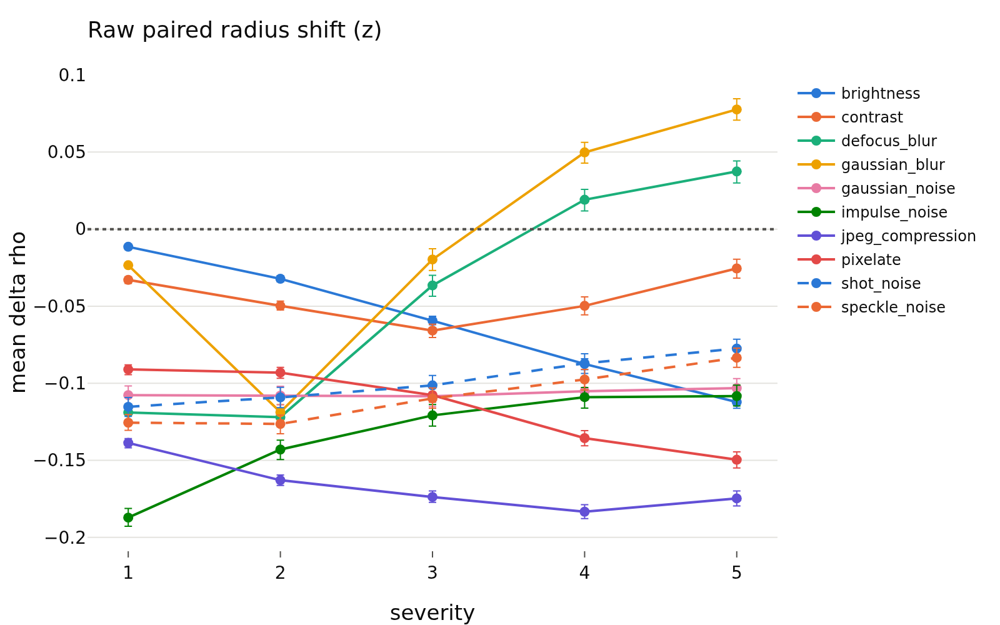
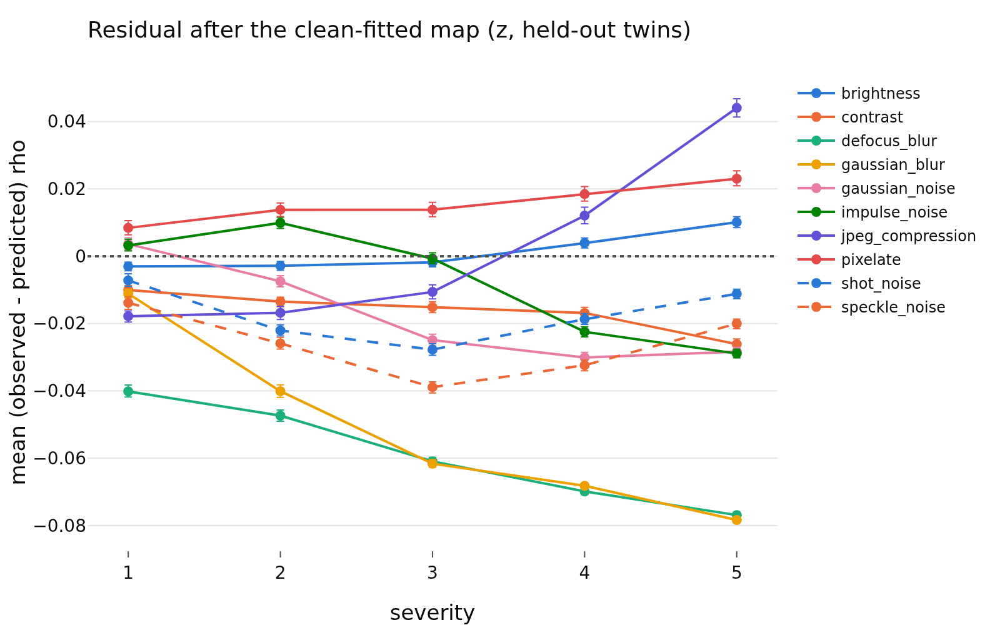

# radius_transfer, per run: `radius_marginal_lam0.05_s1`
- **Branch / version:** `radius-transfer` @ `4e25b35` (code; notes committed on top)
- **Run datetime (UTC):** 2026-10-23T14:50Z to 14:57Z
- **Command(s):**
  `sbatch --mem=64G --cpus-per-task=8 slurm/analyze.sbatch configs/base.yaml radius_marginal_lam0.05_s1 radius_transfer/lam0.05_s1.md --transfer`
- **Datasets:** STL-10 ([canonical](https://cs.stanford.edu/~acoates/stl10/), [HF](https://huggingface.co/datasets/tanganke/stl10)), canonical archive used; STL-10-C built locally from STL-10 `test` (no HF mirror).
- **Backbone:** ResNet-18 from scratch ([HF architecture reference](https://huggingface.co/timm/resnet18.a1_in1k), weights not used); `last.pt` of `radius_marginal_lam0.05_s1`.

h is not analyzed; LeJEPA's product is z. Question, setup, interpretation and next steps are in [summary.md](summary.md); this file holds the generated per-run tables and figures.

## Results

<!-- BEGIN GENERATED: analyze.radius_transfer -->
### Radius transfer (run `radius_marginal_lam0.05_s1`)

h is not analyzed; LeJEPA's product is z. Kernel ridge `u_hat -> rho_bar` fitted on 4000 clean `stl10_test` images (hyperparameters by leave-one-out CV on them: tau=4.14, alpha=0.001), applied to the corrupted versions of the other 4000 images (`held-out twins`) and, for comparison, of the fit images (`fit twins`). Shifts and residuals are in log-radius units (mean over images, 95% bootstrap CI over images with the map held fixed); `predicted shift` is the mean of `f(u_corrupted) - f(u_clean twin)`; `R^2` is the transferred `R^2` within the cell; `nn_cos` is the mean cosine to the nearest fit direction (support check). The last row is the same map on the clean held-out images.

| corruption | severity | N held-out | raw shift | predicted shift | residual (held-out twins) | R^2 (held-out twins) | nn_cos | residual (fit twins) | R^2 (fit twins) |
|---|---|---|---|---|---|---|---|---|---|
| brightness | 1 | 4000 | -0.011 [-0.013, -0.010] | -0.011 | -0.003 [-0.004, -0.002] | 0.9528 | 0.8654 | -0.001 [-0.001, 0.000] | 0.9808 |
| brightness | 2 | 4000 | -0.032 [-0.034, -0.030] | -0.032 | -0.003 [-0.004, -0.002] | 0.9469 | 0.8558 | -0.000 [-0.001, 0.000] | 0.9697 |
| brightness | 3 | 4000 | -0.059 [-0.062, -0.057] | -0.060 | -0.002 [-0.003, -0.000] | 0.9375 | 0.8418 | 0.001 [0.000, 0.003] | 0.9543 |
| brightness | 4 | 4000 | -0.087 [-0.091, -0.084] | -0.094 | 0.004 [0.002, 0.005] | 0.9127 | 0.8215 | 0.006 [0.004, 0.007] | 0.9254 |
| brightness | 5 | 4000 | -0.112 [-0.116, -0.108] | -0.125 | 0.010 [0.009, 0.012] | 0.8673 | 0.8011 | 0.013 [0.011, 0.015] | 0.873 |
| contrast | 1 | 4000 | -0.033 [-0.035, -0.031] | -0.026 | -0.010 [-0.011, -0.009] | 0.9322 | 0.8363 | -0.008 [-0.009, -0.007] | 0.9554 |
| contrast | 2 | 4000 | -0.050 [-0.053, -0.047] | -0.039 | -0.013 [-0.015, -0.012] | 0.9001 | 0.814 | -0.012 [-0.013, -0.010] | 0.9203 |
| contrast | 3 | 4000 | -0.066 [-0.070, -0.062] | -0.053 | -0.015 [-0.017, -0.013] | 0.8075 | 0.787 | -0.016 [-0.017, -0.014] | 0.8253 |
| contrast | 4 | 4000 | -0.050 [-0.056, -0.044] | -0.036 | -0.017 [-0.019, -0.015] | 0.5258 | 0.7543 | -0.017 [-0.019, -0.015] | 0.5521 |
| contrast | 5 | 4000 | -0.026 [-0.032, -0.019] | -0.002 | -0.026 [-0.028, -0.025] | 0.1592 | 0.7361 | -0.027 [-0.028, -0.025] | 0.1801 |
| defocus_blur | 1 | 4000 | -0.119 [-0.124, -0.114] | -0.082 | -0.040 [-0.042, -0.038] | 0.7051 | 0.7956 | -0.038 [-0.040, -0.037] | 0.7467 |
| defocus_blur | 2 | 4000 | -0.122 [-0.128, -0.116] | -0.077 | -0.047 [-0.049, -0.046] | 0.4938 | 0.7845 | -0.044 [-0.046, -0.043] | 0.5394 |
| defocus_blur | 3 | 4000 | -0.036 [-0.044, -0.030] | 0.022 | -0.061 [-0.062, -0.060] | 0.4076 | 0.8424 | -0.059 [-0.060, -0.058] | 0.4372 |
| defocus_blur | 4 | 4000 | 0.019 [0.012, 0.026] | 0.086 | -0.070 [-0.071, -0.069] | 0.3 | 0.877 | -0.069 [-0.070, -0.068] | 0.3461 |
| defocus_blur | 5 | 4000 | 0.037 [0.030, 0.044] | 0.112 | -0.077 [-0.078, -0.076] | 0.2019 | 0.8843 | -0.077 [-0.078, -0.076] | 0.2357 |
| gaussian_blur | 1 | 4000 | -0.023 [-0.025, -0.022] | -0.015 | -0.011 [-0.012, -0.010] | 0.9419 | 0.8638 | -0.009 [-0.009, -0.008] | 0.9726 |
| gaussian_blur | 2 | 4000 | -0.119 [-0.124, -0.114] | -0.081 | -0.040 [-0.042, -0.038] | 0.5872 | 0.7851 | -0.037 [-0.039, -0.035] | 0.6432 |
| gaussian_blur | 3 | 4000 | -0.020 [-0.027, -0.013] | 0.039 | -0.062 [-0.063, -0.060] | 0.305 | 0.8655 | -0.061 [-0.062, -0.060] | 0.3285 |
| gaussian_blur | 4 | 4000 | 0.050 [0.043, 0.056] | 0.115 | -0.068 [-0.069, -0.067] | 0.1492 | 0.9021 | -0.068 [-0.069, -0.067] | 0.1758 |
| gaussian_blur | 5 | 4000 | 0.078 [0.071, 0.085] | 0.153 | -0.078 [-0.079, -0.077] | 0.02696 | 0.9048 | -0.079 [-0.080, -0.078] | 0.07857 |
| gaussian_noise | 1 | 4000 | -0.108 [-0.114, -0.102] | -0.114 | 0.004 [0.002, 0.005] | 0.637 | 0.7238 | 0.006 [0.004, 0.008] | 0.6376 |
| gaussian_noise | 2 | 4000 | -0.108 [-0.114, -0.102] | -0.103 | -0.007 [-0.009, -0.006] | 0.5731 | 0.6956 | -0.006 [-0.008, -0.005] | 0.5554 |
| gaussian_noise | 3 | 4000 | -0.108 [-0.115, -0.102] | -0.086 | -0.025 [-0.027, -0.023] | 0.3422 | 0.6803 | -0.022 [-0.024, -0.021] | 0.3764 |
| gaussian_noise | 4 | 4000 | -0.105 [-0.111, -0.099] | -0.078 | -0.030 [-0.032, -0.029] | 0.146 | 0.6851 | -0.028 [-0.030, -0.027] | 0.179 |
| gaussian_noise | 5 | 4000 | -0.103 [-0.109, -0.097] | -0.078 | -0.028 [-0.030, -0.027] | 0.131 | 0.6927 | -0.027 [-0.028, -0.026] | 0.1629 |
| impulse_noise | 1 | 4000 | -0.187 [-0.193, -0.181] | -0.193 | 0.003 [0.002, 0.005] | 0.6444 | 0.7193 | 0.005 [0.003, 0.006] | 0.6484 |
| impulse_noise | 2 | 4000 | -0.143 [-0.149, -0.137] | -0.156 | 0.010 [0.008, 0.012] | 0.5193 | 0.6971 | 0.012 [0.010, 0.013] | 0.5292 |
| impulse_noise | 3 | 4000 | -0.121 [-0.128, -0.114] | -0.123 | -0.001 [-0.002, 0.001] | 0.433 | 0.6955 | 0.000 [-0.001, 0.002] | 0.4442 |
| impulse_noise | 4 | 4000 | -0.109 [-0.116, -0.103] | -0.089 | -0.022 [-0.024, -0.021] | 0.1704 | 0.699 | -0.022 [-0.024, -0.021] | 0.1821 |
| impulse_noise | 5 | 4000 | -0.108 [-0.115, -0.101] | -0.082 | -0.029 [-0.030, -0.028] | 0.02066 | 0.6967 | -0.029 [-0.030, -0.027] | 0.07808 |
| jpeg_compression | 1 | 4000 | -0.139 [-0.142, -0.136] | -0.124 | -0.018 [-0.020, -0.016] | 0.8992 | 0.814 | -0.017 [-0.018, -0.015] | 0.9203 |
| jpeg_compression | 2 | 4000 | -0.163 [-0.166, -0.159] | -0.149 | -0.017 [-0.019, -0.015] | 0.8605 | 0.7901 | -0.015 [-0.017, -0.014] | 0.8823 |
| jpeg_compression | 3 | 4000 | -0.174 [-0.177, -0.170] | -0.166 | -0.011 [-0.013, -0.008] | 0.83 | 0.7731 | -0.010 [-0.012, -0.008] | 0.8429 |
| jpeg_compression | 4 | 4000 | -0.183 [-0.188, -0.179] | -0.198 | 0.012 [0.010, 0.015] | 0.7016 | 0.7487 | 0.012 [0.010, 0.015] | 0.7198 |
| jpeg_compression | 5 | 4000 | -0.175 [-0.180, -0.170] | -0.222 | 0.044 [0.041, 0.047] | 0.4997 | 0.7373 | 0.046 [0.044, 0.049] | 0.506 |
| pixelate | 1 | 4000 | -0.091 [-0.094, -0.088] | -0.102 | 0.008 [0.006, 0.011] | 0.8438 | 0.7925 | 0.009 [0.007, 0.011] | 0.8702 |
| pixelate | 2 | 4000 | -0.093 [-0.097, -0.090] | -0.110 | 0.014 [0.012, 0.016] | 0.7918 | 0.781 | 0.013 [0.011, 0.015] | 0.8143 |
| pixelate | 3 | 4000 | -0.108 [-0.112, -0.103] | -0.124 | 0.014 [0.012, 0.016] | 0.6722 | 0.7804 | 0.015 [0.013, 0.017] | 0.6854 |
| pixelate | 4 | 4000 | -0.136 [-0.141, -0.131] | -0.157 | 0.018 [0.016, 0.021] | 0.4343 | 0.7832 | 0.019 [0.017, 0.021] | 0.5103 |
| pixelate | 5 | 4000 | -0.150 [-0.155, -0.144] | -0.175 | 0.023 [0.021, 0.025] | 0.2984 | 0.7782 | 0.023 [0.021, 0.025] | 0.3567 |
| shot_noise | 1 | 4000 | -0.115 [-0.121, -0.109] | -0.111 | -0.007 [-0.009, -0.005] | 0.6515 | 0.7219 | -0.007 [-0.009, -0.005] | 0.6361 |
| shot_noise | 2 | 4000 | -0.109 [-0.116, -0.103] | -0.090 | -0.022 [-0.024, -0.020] | 0.532 | 0.6857 | -0.022 [-0.023, -0.020] | 0.5284 |
| shot_noise | 3 | 4000 | -0.101 [-0.108, -0.095] | -0.076 | -0.028 [-0.029, -0.026] | 0.3658 | 0.6753 | -0.027 [-0.029, -0.025] | 0.3548 |
| shot_noise | 4 | 4000 | -0.087 [-0.094, -0.081] | -0.071 | -0.019 [-0.020, -0.017] | 0.339 | 0.6891 | -0.017 [-0.019, -0.016] | 0.3676 |
| shot_noise | 5 | 4000 | -0.077 [-0.083, -0.071] | -0.069 | -0.011 [-0.013, -0.010] | 0.4077 | 0.7011 | -0.011 [-0.012, -0.009] | 0.4016 |
| speckle_noise | 1 | 4000 | -0.126 [-0.131, -0.120] | -0.114 | -0.014 [-0.016, -0.012] | 0.7173 | 0.7464 | -0.010 [-0.012, -0.009] | 0.7165 |
| speckle_noise | 2 | 4000 | -0.126 [-0.133, -0.121] | -0.103 | -0.026 [-0.028, -0.024] | 0.6 | 0.7162 | -0.025 [-0.026, -0.023] | 0.6179 |
| speckle_noise | 3 | 4000 | -0.110 [-0.116, -0.103] | -0.074 | -0.039 [-0.041, -0.037] | 0.3193 | 0.6822 | -0.039 [-0.041, -0.038] | 0.319 |
| speckle_noise | 4 | 4000 | -0.098 [-0.104, -0.091] | -0.068 | -0.032 [-0.034, -0.031] | 0.2749 | 0.6822 | -0.032 [-0.033, -0.030] | 0.2887 |
| speckle_noise | 5 | 4000 | -0.083 [-0.090, -0.077] | -0.066 | -0.020 [-0.022, -0.019] | 0.3191 | 0.691 | -0.019 [-0.021, -0.018] | 0.3333 |
| clean (reference) | 0 | 4000 | 0 | 0 | -0.003 [-0.004, -0.002] | 0.9531 | 0.8709 |  |  |
<!-- END GENERATED: analyze.radius_transfer -->

<!-- BEGIN GENERATED: analyze.radius_transfer_figures -->
### Figures

<!-- END GENERATED: analyze.radius_transfer_figures -->
