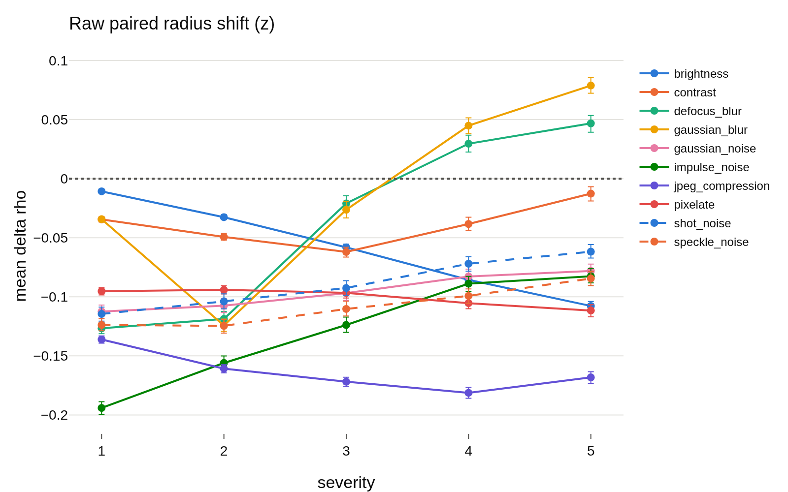
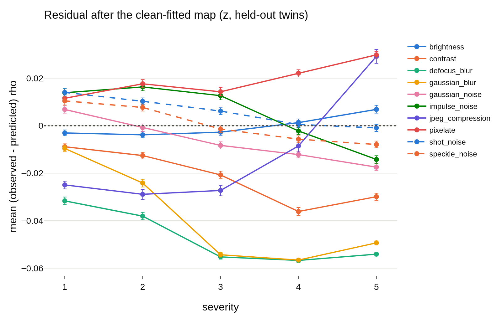

# radius_transfer, per run: `radius_marginal_lam0.05_s2`
- **Branch / version:** `radius-transfer` @ `4e25b35` (code; notes committed on top)
- **Run datetime (UTC):** 2026-10-23T14:50Z to 14:57Z
- **Command(s):**
  `sbatch --mem=64G --cpus-per-task=8 slurm/analyze.sbatch configs/base.yaml radius_marginal_lam0.05_s2 radius_transfer/lam0.05_s2.md --transfer`
- **Datasets:** STL-10 ([canonical](https://cs.stanford.edu/~acoates/stl10/), [HF](https://huggingface.co/datasets/tanganke/stl10)), canonical archive used; STL-10-C built locally from STL-10 `test` (no HF mirror).
- **Backbone:** ResNet-18 from scratch ([HF architecture reference](https://huggingface.co/timm/resnet18.a1_in1k), weights not used); `last.pt` of `radius_marginal_lam0.05_s2`.

h is not analyzed; LeJEPA's product is z. Question, setup, interpretation and next steps are in [summary.md](summary.md); this file holds the generated per-run tables and figures.

## Results

<!-- BEGIN GENERATED: analyze.radius_transfer -->
### Radius transfer (run `radius_marginal_lam0.05_s2`)

h is not analyzed; LeJEPA's product is z. Kernel ridge `u_hat -> rho_bar` fitted on 4000 clean `stl10_test` images (hyperparameters by leave-one-out CV on them: tau=4.14, alpha=0.001), applied to the corrupted versions of the other 4000 images (`held-out twins`) and, for comparison, of the fit images (`fit twins`). Shifts and residuals are in log-radius units (mean over images, 95% bootstrap CI over images with the map held fixed); `predicted shift` is the mean of `f(u_corrupted) - f(u_clean twin)`; `R^2` is the transferred `R^2` within the cell; `nn_cos` is the mean cosine to the nearest fit direction (support check). The last row is the same map on the clean held-out images.

| corruption | severity | N held-out | raw shift | predicted shift | residual (held-out twins) | R^2 (held-out twins) | nn_cos | residual (fit twins) | R^2 (fit twins) |
|---|---|---|---|---|---|---|---|---|---|
| brightness | 1 | 4000 | -0.011 [-0.012, -0.009] | -0.010 | -0.003 [-0.004, -0.002] | 0.9526 | 0.8653 | -0.001 [-0.002, -0.000] | 0.9811 |
| brightness | 2 | 4000 | -0.033 [-0.035, -0.030] | -0.031 | -0.004 [-0.005, -0.003] | 0.9461 | 0.8543 | -0.001 [-0.002, -0.000] | 0.9706 |
| brightness | 3 | 4000 | -0.058 [-0.061, -0.055] | -0.058 | -0.003 [-0.004, -0.001] | 0.9335 | 0.8391 | -0.001 [-0.002, 0.000] | 0.9542 |
| brightness | 4 | 4000 | -0.086 [-0.089, -0.082] | -0.089 | 0.001 [-0.000, 0.003] | 0.9104 | 0.818 | 0.003 [0.001, 0.004] | 0.9237 |
| brightness | 5 | 4000 | -0.108 [-0.112, -0.104] | -0.117 | 0.007 [0.005, 0.009] | 0.8639 | 0.7959 | 0.009 [0.007, 0.010] | 0.8755 |
| contrast | 1 | 4000 | -0.034 [-0.037, -0.032] | -0.028 | -0.009 [-0.010, -0.008] | 0.9332 | 0.836 | -0.007 [-0.008, -0.006] | 0.9568 |
| contrast | 2 | 4000 | -0.049 [-0.052, -0.046] | -0.039 | -0.013 [-0.014, -0.011] | 0.899 | 0.8136 | -0.011 [-0.012, -0.010] | 0.92 |
| contrast | 3 | 4000 | -0.062 [-0.066, -0.058] | -0.044 | -0.021 [-0.022, -0.019] | 0.7783 | 0.7902 | -0.020 [-0.022, -0.019] | 0.807 |
| contrast | 4 | 4000 | -0.038 [-0.044, -0.033] | -0.005 | -0.036 [-0.038, -0.034] | 0.3567 | 0.766 | -0.036 [-0.037, -0.034] | 0.3983 |
| contrast | 5 | 4000 | -0.013 [-0.019, -0.007] | 0.015 | -0.030 [-0.031, -0.028] | 0.1357 | 0.7463 | -0.030 [-0.032, -0.029] | 0.1613 |
| defocus_blur | 1 | 4000 | -0.127 [-0.131, -0.122] | -0.097 | -0.032 [-0.033, -0.030] | 0.7452 | 0.7947 | -0.031 [-0.032, -0.029] | 0.7838 |
| defocus_blur | 2 | 4000 | -0.119 [-0.125, -0.112] | -0.083 | -0.038 [-0.040, -0.036] | 0.5957 | 0.7969 | -0.036 [-0.038, -0.035] | 0.615 |
| defocus_blur | 3 | 4000 | -0.021 [-0.028, -0.015] | 0.032 | -0.055 [-0.056, -0.054] | 0.5556 | 0.8656 | -0.054 [-0.055, -0.053] | 0.5731 |
| defocus_blur | 4 | 4000 | 0.030 [0.023, 0.037] | 0.084 | -0.057 [-0.058, -0.056] | 0.5739 | 0.8866 | -0.056 [-0.057, -0.055] | 0.5966 |
| defocus_blur | 5 | 4000 | 0.047 [0.039, 0.053] | 0.098 | -0.054 [-0.055, -0.053] | 0.605 | 0.8855 | -0.053 [-0.054, -0.052] | 0.6273 |
| gaussian_blur | 1 | 4000 | -0.034 [-0.036, -0.033] | -0.027 | -0.010 [-0.011, -0.008] | 0.9454 | 0.8625 | -0.006 [-0.007, -0.005] | 0.9756 |
| gaussian_blur | 2 | 4000 | -0.124 [-0.129, -0.119] | -0.103 | -0.024 [-0.026, -0.023] | 0.7214 | 0.7892 | -0.023 [-0.024, -0.021] | 0.7511 |
| gaussian_blur | 3 | 4000 | -0.026 [-0.033, -0.019] | 0.026 | -0.054 [-0.055, -0.053] | 0.4916 | 0.8684 | -0.053 [-0.054, -0.052] | 0.5105 |
| gaussian_blur | 4 | 4000 | 0.045 [0.038, 0.051] | 0.099 | -0.057 [-0.057, -0.056] | 0.4783 | 0.898 | -0.056 [-0.057, -0.055] | 0.4958 |
| gaussian_blur | 5 | 4000 | 0.079 [0.072, 0.085] | 0.126 | -0.049 [-0.050, -0.049] | 0.576 | 0.8928 | -0.049 [-0.050, -0.048] | 0.5982 |
| gaussian_noise | 1 | 4000 | -0.112 [-0.118, -0.107] | -0.122 | 0.007 [0.005, 0.009] | 0.7124 | 0.7263 | 0.009 [0.007, 0.011] | 0.7178 |
| gaussian_noise | 2 | 4000 | -0.108 [-0.113, -0.101] | -0.109 | -0.001 [-0.002, 0.001] | 0.6659 | 0.6987 | 0.000 [-0.001, 0.002] | 0.6671 |
| gaussian_noise | 3 | 4000 | -0.097 [-0.103, -0.091] | -0.091 | -0.008 [-0.010, -0.007] | 0.5732 | 0.6736 | -0.007 [-0.009, -0.006] | 0.5695 |
| gaussian_noise | 4 | 4000 | -0.083 [-0.089, -0.077] | -0.073 | -0.012 [-0.014, -0.011] | 0.3975 | 0.6724 | -0.011 [-0.013, -0.010] | 0.4158 |
| gaussian_noise | 5 | 4000 | -0.078 [-0.084, -0.072] | -0.063 | -0.017 [-0.019, -0.016] | 0.1323 | 0.6783 | -0.017 [-0.018, -0.015] | 0.1536 |
| impulse_noise | 1 | 4000 | -0.194 [-0.199, -0.189] | -0.210 | 0.014 [0.012, 0.016] | 0.6043 | 0.7169 | 0.016 [0.014, 0.018] | 0.5916 |
| impulse_noise | 2 | 4000 | -0.156 [-0.162, -0.150] | -0.175 | 0.016 [0.015, 0.018] | 0.4579 | 0.6885 | 0.017 [0.016, 0.019] | 0.4531 |
| impulse_noise | 3 | 4000 | -0.124 [-0.130, -0.117] | -0.139 | 0.013 [0.011, 0.014] | 0.4203 | 0.6755 | 0.013 [0.011, 0.014] | 0.4443 |
| impulse_noise | 4 | 4000 | -0.089 [-0.095, -0.083] | -0.089 | -0.002 [-0.004, -0.001] | 0.3366 | 0.6769 | -0.002 [-0.004, -0.001] | 0.3621 |
| impulse_noise | 5 | 4000 | -0.083 [-0.088, -0.076] | -0.071 | -0.014 [-0.016, -0.013] | 0.03232 | 0.6823 | -0.013 [-0.015, -0.012] | 0.08429 |
| jpeg_compression | 1 | 4000 | -0.136 [-0.139, -0.133] | -0.114 | -0.025 [-0.027, -0.023] | 0.8864 | 0.8078 | -0.025 [-0.026, -0.023] | 0.9049 |
| jpeg_compression | 2 | 4000 | -0.161 [-0.164, -0.157] | -0.134 | -0.029 [-0.031, -0.027] | 0.8361 | 0.785 | -0.028 [-0.030, -0.027] | 0.8556 |
| jpeg_compression | 3 | 4000 | -0.172 [-0.176, -0.168] | -0.147 | -0.027 [-0.030, -0.025] | 0.7956 | 0.7679 | -0.027 [-0.029, -0.025] | 0.8216 |
| jpeg_compression | 4 | 4000 | -0.181 [-0.186, -0.177] | -0.175 | -0.009 [-0.011, -0.006] | 0.6753 | 0.743 | -0.009 [-0.012, -0.006] | 0.7121 |
| jpeg_compression | 5 | 4000 | -0.168 [-0.173, -0.163] | -0.200 | 0.029 [0.026, 0.032] | 0.5135 | 0.7286 | 0.029 [0.026, 0.032] | 0.5378 |
| pixelate | 1 | 4000 | -0.095 [-0.098, -0.092] | -0.109 | 0.012 [0.010, 0.013] | 0.8822 | 0.7954 | 0.014 [0.012, 0.016] | 0.9007 |
| pixelate | 2 | 4000 | -0.094 [-0.098, -0.091] | -0.114 | 0.018 [0.016, 0.019] | 0.8424 | 0.7823 | 0.018 [0.017, 0.020] | 0.8563 |
| pixelate | 3 | 4000 | -0.097 [-0.101, -0.092] | -0.113 | 0.014 [0.013, 0.016] | 0.7615 | 0.7826 | 0.015 [0.014, 0.017] | 0.7653 |
| pixelate | 4 | 4000 | -0.105 [-0.110, -0.100] | -0.130 | 0.022 [0.021, 0.024] | 0.6473 | 0.7837 | 0.023 [0.021, 0.024] | 0.6685 |
| pixelate | 5 | 4000 | -0.112 [-0.117, -0.107] | -0.144 | 0.030 [0.028, 0.031] | 0.5915 | 0.7779 | 0.029 [0.028, 0.031] | 0.6104 |
| shot_noise | 1 | 4000 | -0.114 [-0.121, -0.109] | -0.131 | 0.014 [0.013, 0.016] | 0.7184 | 0.7241 | 0.014 [0.013, 0.016] | 0.7036 |
| shot_noise | 2 | 4000 | -0.104 [-0.110, -0.097] | -0.117 | 0.010 [0.009, 0.012] | 0.676 | 0.6889 | 0.010 [0.009, 0.012] | 0.6812 |
| shot_noise | 3 | 4000 | -0.093 [-0.099, -0.086] | -0.101 | 0.006 [0.005, 0.008] | 0.6153 | 0.6701 | 0.005 [0.004, 0.006] | 0.6327 |
| shot_noise | 4 | 4000 | -0.072 [-0.078, -0.066] | -0.075 | 0.001 [-0.001, 0.002] | 0.4839 | 0.6746 | 0.001 [-0.001, 0.002] | 0.4783 |
| shot_noise | 5 | 4000 | -0.062 [-0.067, -0.056] | -0.063 | -0.001 [-0.002, 0.001] | 0.4041 | 0.6783 | -0.002 [-0.003, -0.000] | 0.4152 |
| speckle_noise | 1 | 4000 | -0.124 [-0.129, -0.118] | -0.137 | 0.010 [0.009, 0.012] | 0.7568 | 0.7457 | 0.013 [0.011, 0.015] | 0.7556 |
| speckle_noise | 2 | 4000 | -0.125 [-0.131, -0.119] | -0.135 | 0.008 [0.006, 0.009] | 0.7165 | 0.7168 | 0.009 [0.007, 0.010] | 0.7193 |
| speckle_noise | 3 | 4000 | -0.110 [-0.116, -0.104] | -0.111 | -0.001 [-0.003, -0.000] | 0.6269 | 0.6792 | -0.002 [-0.003, -0.000] | 0.6425 |
| speckle_noise | 4 | 4000 | -0.099 [-0.106, -0.093] | -0.096 | -0.006 [-0.007, -0.004] | 0.5239 | 0.6743 | -0.006 [-0.007, -0.005] | 0.5288 |
| speckle_noise | 5 | 4000 | -0.084 [-0.091, -0.079] | -0.079 | -0.008 [-0.009, -0.006] | 0.3742 | 0.6763 | -0.008 [-0.009, -0.007] | 0.3921 |
| clean (reference) | 0 | 4000 | 0 | 0 | -0.002 [-0.004, -0.001] | 0.9538 | 0.8705 |  |  |
<!-- END GENERATED: analyze.radius_transfer -->

<!-- BEGIN GENERATED: analyze.radius_transfer_figures -->
### Figures

<!-- END GENERATED: analyze.radius_transfer_figures -->
