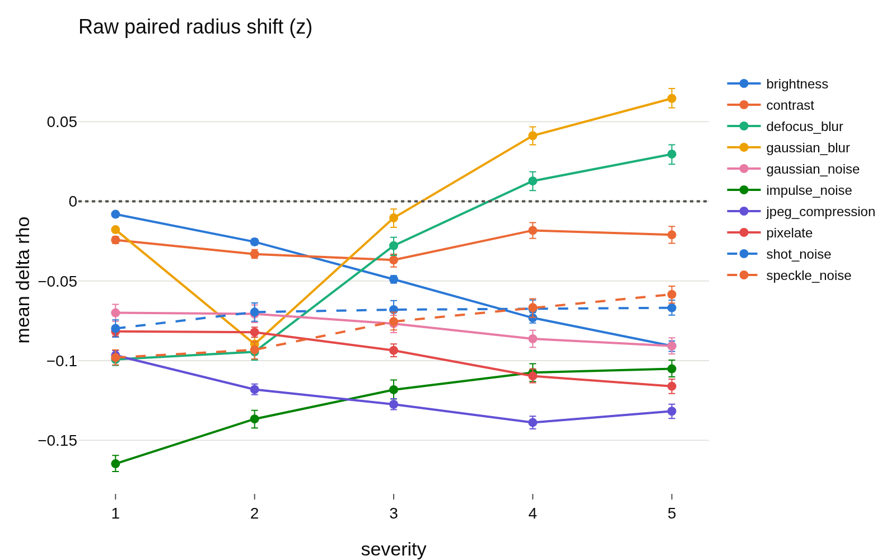
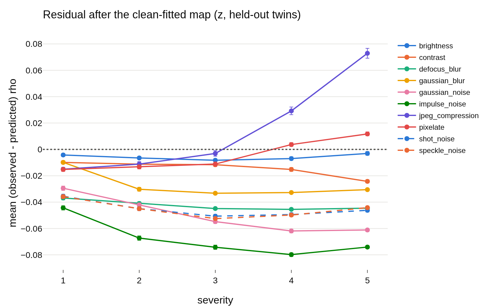

# radius_transfer, per run: `radius_marginal_lam0.1_s1`
- **Branch / version:** `radius-transfer` @ `574e7c0` (code; notes committed on top)
- **Run datetime (UTC):** 2026-10-23T14:50Z to 14:57Z
- **Command(s):**
  `sbatch --mem=64G --cpus-per-task=8 slurm/analyze.sbatch configs/base.yaml radius_marginal_lam0.1_s1 radius_transfer/lam0.1_s1.md --transfer`
- **Datasets:** STL-10 ([canonical](https://cs.stanford.edu/~acoates/stl10/), [HF](https://huggingface.co/datasets/tanganke/stl10)), canonical archive used; STL-10-C built locally from STL-10 `test` (no HF mirror).
- **Backbone:** ResNet-18 from scratch ([HF architecture reference](https://huggingface.co/timm/resnet18.a1_in1k), weights not used); `last.pt` of `radius_marginal_lam0.1_s1`.

h is not analyzed; LeJEPA's product is z. Question, setup, interpretation and next steps are in [summary.md](summary.md); this file holds the generated per-run tables and figures.

## Results

<!-- BEGIN GENERATED: analyze.radius_transfer -->
### Radius transfer (run `radius_marginal_lam0.1_s1`)

h is not analyzed; LeJEPA's product is z. Kernel ridge `u_hat -> rho_bar` fitted on 4000 clean `stl10_test` images (hyperparameters by leave-one-out CV on them: tau=4.1, alpha=0.001), applied to the corrupted versions of the other 4000 images (`held-out twins`) and, for comparison, of the fit images (`fit twins`). Shifts and residuals are in log-radius units (mean over images, 95% bootstrap CI over images with the map held fixed); `predicted shift` is the mean of `f(u_corrupted) - f(u_clean twin)`; `R^2` is the transferred `R^2` within the cell; `nn_cos` is the mean cosine to the nearest fit direction (support check). The last row is the same map on the clean held-out images.

| corruption | severity | N held-out | raw shift | predicted shift | residual (held-out twins) | R^2 (held-out twins) | nn_cos | residual (fit twins) | R^2 (fit twins) | residual (in-domain map) | R^2 (in-domain map) |
|---|---|---|---|---|---|---|---|---|---|---|---|
| brightness | 1 | 4000 | -0.008 [-0.009, -0.007] | -0.007 | -0.004 [-0.005, -0.003] | 0.943 | 0.8217 | -0.003 [-0.003, -0.002] | 0.9803 | -0.002 [-0.003, -0.001] | 0.9451 |
| brightness | 2 | 4000 | -0.025 [-0.027, -0.024] | -0.022 | -0.007 [-0.008, -0.005] | 0.9369 | 0.8089 | -0.005 [-0.006, -0.004] | 0.9673 | -0.002 [-0.003, -0.001] | 0.9507 |
| brightness | 3 | 4000 | -0.049 [-0.051, -0.047] | -0.044 | -0.008 [-0.009, -0.007] | 0.9232 | 0.7928 | -0.007 [-0.008, -0.006] | 0.9471 | -0.002 [-0.003, -0.001] | 0.9484 |
| brightness | 4 | 4000 | -0.073 [-0.076, -0.070] | -0.069 | -0.007 [-0.008, -0.006] | 0.8964 | 0.7684 | -0.006 [-0.007, -0.005] | 0.9148 | -0.002 [-0.003, -0.001] | 0.9462 |
| brightness | 5 | 4000 | -0.091 [-0.094, -0.087] | -0.091 | -0.003 [-0.005, -0.002] | 0.8489 | 0.745 | -0.002 [-0.004, -0.001] | 0.8694 | -0.001 [-0.002, -0.000] | 0.9458 |
| contrast | 1 | 4000 | -0.024 [-0.026, -0.022] | -0.018 | -0.010 [-0.011, -0.009] | 0.9117 | 0.7859 | -0.009 [-0.010, -0.008] | 0.941 | -0.002 [-0.003, -0.001] | 0.9416 |
| contrast | 2 | 4000 | -0.033 [-0.036, -0.030] | -0.025 | -0.011 [-0.012, -0.010] | 0.8732 | 0.7643 | -0.012 [-0.013, -0.011] | 0.897 | -0.002 [-0.003, -0.001] | 0.9382 |
| contrast | 3 | 4000 | -0.037 [-0.041, -0.033] | -0.028 | -0.012 [-0.013, -0.010] | 0.7648 | 0.7462 | -0.013 [-0.014, -0.011] | 0.7829 | -0.001 [-0.002, -0.000] | 0.9318 |
| contrast | 4 | 4000 | -0.018 [-0.024, -0.013] | -0.006 | -0.015 [-0.017, -0.014] | 0.4491 | 0.729 | -0.015 [-0.016, -0.013] | 0.4731 | -0.000 [-0.001, 0.000] | 0.9424 |
| contrast | 5 | 4000 | -0.021 [-0.026, -0.016] | 0.000 | -0.024 [-0.025, -0.023] | 0.2574 | 0.7008 | -0.026 [-0.027, -0.024] | 0.2563 | -0.000 [-0.000, 0.000] | 0.968 |
| defocus_blur | 1 | 4000 | -0.099 [-0.103, -0.095] | -0.065 | -0.037 [-0.038, -0.035] | 0.6937 | 0.7381 | -0.037 [-0.038, -0.036] | 0.7357 | -0.001 [-0.002, 0.000] | 0.9286 |
| defocus_blur | 2 | 4000 | -0.094 [-0.100, -0.090] | -0.057 | -0.041 [-0.042, -0.040] | 0.5056 | 0.7225 | -0.041 [-0.042, -0.039] | 0.535 | -0.001 [-0.001, -0.000] | 0.9216 |
| defocus_blur | 3 | 4000 | -0.028 [-0.034, -0.022] | 0.014 | -0.045 [-0.046, -0.044] | 0.4923 | 0.7742 | -0.045 [-0.046, -0.044] | 0.4907 | 0.000 [-0.000, 0.001] | 0.9681 |
| defocus_blur | 4 | 4000 | 0.013 [0.006, 0.018] | 0.055 | -0.045 [-0.046, -0.045] | 0.5185 | 0.8108 | -0.046 [-0.047, -0.045] | 0.5366 | 0.000 [-0.000, 0.000] | 0.9823 |
| defocus_blur | 5 | 4000 | 0.030 [0.024, 0.035] | 0.071 | -0.045 [-0.045, -0.044] | 0.5313 | 0.819 | -0.045 [-0.046, -0.044] | 0.5477 | -0.000 [-0.000, 0.000] | 0.9856 |
| gaussian_blur | 1 | 4000 | -0.018 [-0.019, -0.016] | -0.011 | -0.010 [-0.011, -0.009] | 0.933 | 0.8196 | -0.008 [-0.009, -0.007] | 0.9722 | -0.002 [-0.003, -0.001] | 0.9417 |
| gaussian_blur | 2 | 4000 | -0.090 [-0.094, -0.085] | -0.062 | -0.030 [-0.032, -0.029] | 0.6482 | 0.726 | -0.030 [-0.031, -0.028] | 0.6934 | -0.000 [-0.001, 0.000] | 0.9107 |
| gaussian_blur | 3 | 4000 | -0.010 [-0.016, -0.005] | 0.020 | -0.033 [-0.034, -0.032] | 0.5632 | 0.7918 | -0.034 [-0.035, -0.033] | 0.5779 | 0.000 [-0.000, 0.001] | 0.9668 |
| gaussian_blur | 4 | 4000 | 0.041 [0.035, 0.047] | 0.071 | -0.033 [-0.034, -0.032] | 0.6354 | 0.8333 | -0.033 [-0.034, -0.032] | 0.6532 | -0.000 [-0.001, -0.000] | 0.9845 |
| gaussian_blur | 5 | 4000 | 0.065 [0.058, 0.070] | 0.092 | -0.031 [-0.031, -0.030] | 0.6783 | 0.838 | -0.032 [-0.033, -0.031] | 0.6768 | 0.000 [-0.000, 0.000] | 0.989 |
| gaussian_noise | 1 | 4000 | -0.070 [-0.075, -0.065] | -0.044 | -0.029 [-0.031, -0.028] | 0.6277 | 0.672 | -0.028 [-0.030, -0.027] | 0.6354 | -0.000 [-0.001, 0.000] | 0.9553 |
| gaussian_noise | 2 | 4000 | -0.071 [-0.077, -0.065] | -0.032 | -0.042 [-0.044, -0.040] | 0.4546 | 0.6511 | -0.041 [-0.043, -0.040] | 0.448 | -0.000 [-0.001, 0.000] | 0.969 |
| gaussian_noise | 3 | 4000 | -0.077 [-0.082, -0.072] | -0.025 | -0.055 [-0.056, -0.053] | 0.05885 | 0.6182 | -0.053 [-0.055, -0.052] | 0.05755 | 0.000 [-0.000, 0.000] | 0.9767 |
| gaussian_noise | 4 | 4000 | -0.086 [-0.092, -0.081] | -0.028 | -0.062 [-0.063, -0.061] | -0.6249 | 0.5791 | -0.060 [-0.062, -0.059] | -0.5847 | -0.000 [-0.000, 0.000] | 0.9803 |
| gaussian_noise | 5 | 4000 | -0.091 [-0.096, -0.086] | -0.033 | -0.061 [-0.062, -0.060] | -1.574 | 0.5543 | -0.061 [-0.062, -0.060] | -1.578 | 0.000 [-0.000, 0.000] | 0.9798 |
| impulse_noise | 1 | 4000 | -0.165 [-0.169, -0.160] | -0.123 | -0.044 [-0.046, -0.043] | 0.2359 | 0.6471 | -0.043 [-0.045, -0.042] | 0.2678 | -0.000 [-0.001, 0.000] | 0.9241 |
| impulse_noise | 2 | 4000 | -0.137 [-0.142, -0.131] | -0.072 | -0.067 [-0.069, -0.066] | -0.2092 | 0.6165 | -0.067 [-0.068, -0.065] | -0.2196 | 0.000 [-0.000, 0.001] | 0.9605 |
| impulse_noise | 3 | 4000 | -0.118 [-0.124, -0.113] | -0.047 | -0.074 [-0.076, -0.073] | -0.6454 | 0.6019 | -0.074 [-0.076, -0.073] | -0.6094 | 0.000 [-0.000, 0.001] | 0.9691 |
| impulse_noise | 4 | 4000 | -0.107 [-0.113, -0.102] | -0.031 | -0.080 [-0.081, -0.078] | -1.89 | 0.5724 | -0.078 [-0.080, -0.077] | -1.893 | -0.000 [-0.000, -0.000] | 0.9768 |
| impulse_noise | 5 | 4000 | -0.105 [-0.110, -0.100] | -0.034 | -0.074 [-0.075, -0.073] | -2.965 | 0.5481 | -0.074 [-0.075, -0.072] | -3.018 | 0.000 [-0.000, 0.000] | 0.9758 |
| jpeg_compression | 1 | 4000 | -0.097 [-0.099, -0.094] | -0.085 | -0.015 [-0.017, -0.014] | 0.8698 | 0.7505 | -0.016 [-0.017, -0.014] | 0.8892 | -0.001 [-0.002, 0.000] | 0.943 |
| jpeg_compression | 2 | 4000 | -0.118 [-0.121, -0.115] | -0.110 | -0.011 [-0.013, -0.009] | 0.8058 | 0.7282 | -0.011 [-0.012, -0.009] | 0.8316 | -0.002 [-0.003, -0.001] | 0.9368 |
| jpeg_compression | 3 | 4000 | -0.127 [-0.131, -0.124] | -0.127 | -0.003 [-0.005, -0.001] | 0.7258 | 0.7131 | -0.003 [-0.005, -0.001] | 0.7542 | -0.001 [-0.002, -0.000] | 0.9347 |
| jpeg_compression | 4 | 4000 | -0.139 [-0.143, -0.135] | -0.171 | 0.029 [0.026, 0.032] | 0.3443 | 0.6844 | 0.029 [0.026, 0.032] | 0.3925 | -0.001 [-0.002, -0.000] | 0.9303 |
| jpeg_compression | 5 | 4000 | -0.132 [-0.137, -0.127] | -0.208 | 0.073 [0.069, 0.077] | -0.2645 | 0.6647 | 0.074 [0.071, 0.078] | -0.2221 | -0.001 [-0.002, -0.000] | 0.928 |
| pixelate | 1 | 4000 | -0.082 [-0.085, -0.079] | -0.070 | -0.015 [-0.017, -0.014] | 0.8671 | 0.7482 | -0.015 [-0.016, -0.014] | 0.8936 | -0.001 [-0.002, 0.000] | 0.9441 |
| pixelate | 2 | 4000 | -0.082 [-0.085, -0.079] | -0.072 | -0.013 [-0.015, -0.012] | 0.8392 | 0.7365 | -0.014 [-0.015, -0.012] | 0.8577 | -0.001 [-0.002, -0.000] | 0.9395 |
| pixelate | 3 | 4000 | -0.094 [-0.097, -0.090] | -0.086 | -0.011 [-0.013, -0.010] | 0.7664 | 0.7316 | -0.012 [-0.014, -0.011] | 0.7718 | -0.000 [-0.001, 0.000] | 0.9313 |
| pixelate | 4 | 4000 | -0.110 [-0.114, -0.105] | -0.116 | 0.004 [0.002, 0.005] | 0.6804 | 0.7318 | 0.001 [0.000, 0.003] | 0.7112 | -0.000 [-0.001, 0.000] | 0.9194 |
| pixelate | 5 | 4000 | -0.116 [-0.121, -0.112] | -0.131 | 0.012 [0.010, 0.013] | 0.5714 | 0.7273 | 0.009 [0.008, 0.011] | 0.6092 | 0.000 [-0.000, 0.001] | 0.9201 |
| shot_noise | 1 | 4000 | -0.080 [-0.085, -0.074] | -0.047 | -0.036 [-0.037, -0.034] | 0.5847 | 0.6672 | -0.037 [-0.039, -0.035] | 0.5712 | 0.000 [-0.000, 0.001] | 0.953 |
| shot_noise | 2 | 4000 | -0.070 [-0.076, -0.064] | -0.028 | -0.045 [-0.047, -0.043] | 0.4099 | 0.6369 | -0.045 [-0.047, -0.044] | 0.3977 | 0.000 [-0.000, 0.001] | 0.9694 |
| shot_noise | 3 | 4000 | -0.068 [-0.074, -0.062] | -0.020 | -0.051 [-0.052, -0.049] | 0.1542 | 0.6051 | -0.051 [-0.052, -0.050] | 0.1183 | 0.000 [0.000, 0.001] | 0.9747 |
| shot_noise | 4 | 4000 | -0.067 [-0.073, -0.062] | -0.021 | -0.049 [-0.051, -0.048] | -0.2219 | 0.5807 | -0.049 [-0.050, -0.048] | -0.2205 | 0.000 [-0.000, 0.000] | 0.9805 |
| shot_noise | 5 | 4000 | -0.067 [-0.072, -0.061] | -0.024 | -0.046 [-0.047, -0.045] | -0.4729 | 0.5789 | -0.045 [-0.046, -0.044] | -0.4077 | 0.000 [-0.000, 0.000] | 0.9792 |
| speckle_noise | 1 | 4000 | -0.098 [-0.103, -0.093] | -0.065 | -0.036 [-0.037, -0.034] | 0.6212 | 0.6856 | -0.034 [-0.036, -0.033] | 0.6276 | -0.001 [-0.001, 0.000] | 0.9402 |
| speckle_noise | 2 | 4000 | -0.093 [-0.099, -0.088] | -0.051 | -0.045 [-0.046, -0.044] | 0.4439 | 0.6599 | -0.045 [-0.046, -0.043] | 0.4628 | 0.001 [-0.000, 0.001] | 0.948 |
| speckle_noise | 3 | 4000 | -0.075 [-0.081, -0.070] | -0.026 | -0.052 [-0.054, -0.051] | 0.1302 | 0.6128 | -0.052 [-0.054, -0.051] | 0.1399 | 0.000 [-0.000, 0.001] | 0.9653 |
| speckle_noise | 4 | 4000 | -0.067 [-0.072, -0.061] | -0.020 | -0.050 [-0.051, -0.048] | 0.03881 | 0.596 | -0.050 [-0.052, -0.049] | 0.009089 | 0.000 [0.000, 0.001] | 0.972 |
| speckle_noise | 5 | 4000 | -0.058 [-0.064, -0.053] | -0.017 | -0.044 [-0.045, -0.043] | -0.07818 | 0.5902 | -0.044 [-0.045, -0.043] | -0.05618 | 0.000 [-0.000, 0.000] | 0.9736 |
| clean (reference) | 0 | 4000 | 0 | 0 | -0.003 [-0.004, -0.002] | 0.945 | 0.8272 |  |  |  |  |
<!-- END GENERATED: analyze.radius_transfer -->

<!-- BEGIN GENERATED: analyze.radius_transfer_figures -->
### Figures

<!-- END GENERATED: analyze.radius_transfer_figures -->
