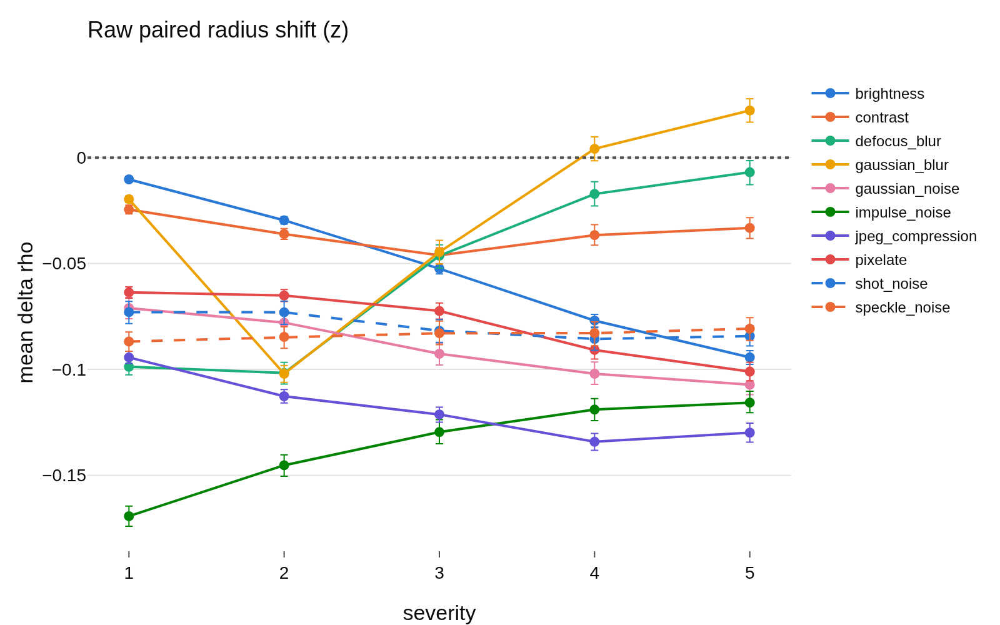
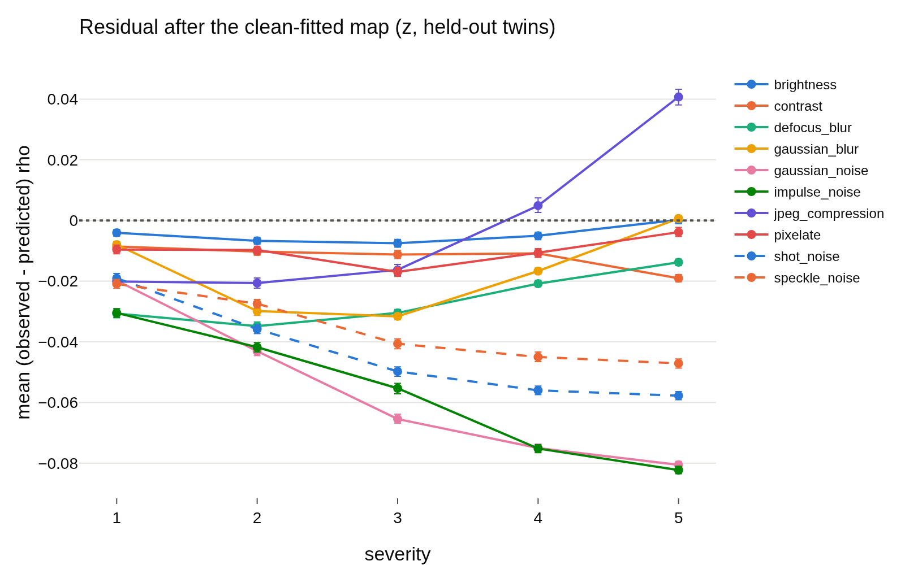

# radius_transfer, per run: `radius_marginal_lam0.1_s2`
- **Branch / version:** `radius-transfer` @ `4e25b35` (code; notes committed on top)
- **Run datetime (UTC):** 2026-10-23T14:50Z to 14:57Z
- **Command(s):**
  `sbatch --mem=64G --cpus-per-task=8 slurm/analyze.sbatch configs/base.yaml radius_marginal_lam0.1_s2 radius_transfer/lam0.1_s2.md --transfer`
- **Datasets:** STL-10 ([canonical](https://cs.stanford.edu/~acoates/stl10/), [HF](https://huggingface.co/datasets/tanganke/stl10)), canonical archive used; STL-10-C built locally from STL-10 `test` (no HF mirror).
- **Backbone:** ResNet-18 from scratch ([HF architecture reference](https://huggingface.co/timm/resnet18.a1_in1k), weights not used); `last.pt` of `radius_marginal_lam0.1_s2`.

h is not analyzed; LeJEPA's product is z. Question, setup, interpretation and next steps are in [summary.md](summary.md); this file holds the generated per-run tables and figures.

## Results

<!-- BEGIN GENERATED: analyze.radius_transfer -->
### Radius transfer (run `radius_marginal_lam0.1_s2`)

h is not analyzed; LeJEPA's product is z. Kernel ridge `u_hat -> rho_bar` fitted on 4000 clean `stl10_test` images (hyperparameters by leave-one-out CV on them: tau=4.1, alpha=0.001), applied to the corrupted versions of the other 4000 images (`held-out twins`) and, for comparison, of the fit images (`fit twins`). Shifts and residuals are in log-radius units (mean over images, 95% bootstrap CI over images with the map held fixed); `predicted shift` is the mean of `f(u_corrupted) - f(u_clean twin)`; `R^2` is the transferred `R^2` within the cell; `nn_cos` is the mean cosine to the nearest fit direction (support check). The last row is the same map on the clean held-out images.

| corruption | severity | N held-out | raw shift | predicted shift | residual (held-out twins) | R^2 (held-out twins) | nn_cos | residual (fit twins) | R^2 (fit twins) |
|---|---|---|---|---|---|---|---|---|---|
| brightness | 1 | 4000 | -0.010 [-0.012, -0.009] | -0.008 | -0.004 [-0.005, -0.003] | 0.9421 | 0.8213 | -0.003 [-0.003, -0.002] | 0.9803 |
| brightness | 2 | 4000 | -0.030 [-0.031, -0.028] | -0.025 | -0.007 [-0.008, -0.006] | 0.9348 | 0.808 | -0.005 [-0.006, -0.005] | 0.9673 |
| brightness | 3 | 4000 | -0.052 [-0.055, -0.050] | -0.047 | -0.008 [-0.009, -0.006] | 0.9218 | 0.7894 | -0.007 [-0.008, -0.006] | 0.9505 |
| brightness | 4 | 4000 | -0.077 [-0.080, -0.074] | -0.074 | -0.005 [-0.006, -0.004] | 0.9069 | 0.7648 | -0.005 [-0.006, -0.004] | 0.9225 |
| brightness | 5 | 4000 | -0.094 [-0.098, -0.091] | -0.096 | 0.000 [-0.001, 0.001] | 0.8679 | 0.7395 | 0.000 [-0.001, 0.001] | 0.8843 |
| contrast | 1 | 4000 | -0.025 [-0.027, -0.022] | -0.018 | -0.009 [-0.010, -0.007] | 0.9211 | 0.7836 | -0.008 [-0.009, -0.007] | 0.9474 |
| contrast | 2 | 4000 | -0.036 [-0.039, -0.033] | -0.028 | -0.010 [-0.011, -0.009] | 0.8889 | 0.759 | -0.011 [-0.012, -0.010] | 0.9129 |
| contrast | 3 | 4000 | -0.046 [-0.050, -0.043] | -0.037 | -0.011 [-0.013, -0.010] | 0.7997 | 0.7384 | -0.013 [-0.014, -0.012] | 0.8175 |
| contrast | 4 | 4000 | -0.037 [-0.041, -0.032] | -0.028 | -0.011 [-0.012, -0.009] | 0.5652 | 0.7129 | -0.012 [-0.013, -0.010] | 0.5611 |
| contrast | 5 | 4000 | -0.033 [-0.038, -0.028] | -0.016 | -0.019 [-0.020, -0.018] | 0.3875 | 0.6803 | -0.019 [-0.021, -0.018] | 0.3875 |
| defocus_blur | 1 | 4000 | -0.099 [-0.103, -0.095] | -0.070 | -0.031 [-0.032, -0.029] | 0.6795 | 0.7359 | -0.031 [-0.032, -0.029] | 0.7087 |
| defocus_blur | 2 | 4000 | -0.102 [-0.107, -0.097] | -0.069 | -0.035 [-0.036, -0.033] | 0.3614 | 0.7222 | -0.034 [-0.036, -0.033] | 0.4219 |
| defocus_blur | 3 | 4000 | -0.046 [-0.052, -0.041] | -0.018 | -0.030 [-0.032, -0.029] | 0.5122 | 0.7782 | -0.030 [-0.031, -0.029] | 0.5286 |
| defocus_blur | 4 | 4000 | -0.017 [-0.023, -0.011] | 0.002 | -0.021 [-0.022, -0.020] | 0.6303 | 0.8122 | -0.021 [-0.022, -0.020] | 0.6453 |
| defocus_blur | 5 | 4000 | -0.007 [-0.013, -0.001] | 0.005 | -0.014 [-0.015, -0.013] | 0.6433 | 0.8204 | -0.013 [-0.015, -0.012] | 0.6528 |
| gaussian_blur | 1 | 4000 | -0.020 [-0.021, -0.018] | -0.014 | -0.008 [-0.009, -0.007] | 0.9339 | 0.8201 | -0.007 [-0.008, -0.006] | 0.972 |
| gaussian_blur | 2 | 4000 | -0.102 [-0.106, -0.098] | -0.074 | -0.030 [-0.031, -0.028] | 0.564 | 0.7264 | -0.030 [-0.031, -0.028] | 0.6087 |
| gaussian_blur | 3 | 4000 | -0.045 [-0.050, -0.039] | -0.015 | -0.032 [-0.033, -0.031] | 0.343 | 0.793 | -0.031 [-0.033, -0.030] | 0.3638 |
| gaussian_blur | 4 | 4000 | 0.004 [-0.001, 0.010] | 0.019 | -0.017 [-0.018, -0.016] | 0.6278 | 0.8411 | -0.017 [-0.018, -0.016] | 0.6409 |
| gaussian_blur | 5 | 4000 | 0.022 [0.017, 0.028] | 0.020 | 0.001 [-0.000, 0.002] | 0.6087 | 0.8428 | 0.001 [-0.000, 0.002] | 0.6266 |
| gaussian_noise | 1 | 4000 | -0.071 [-0.076, -0.066] | -0.053 | -0.020 [-0.021, -0.018] | 0.6567 | 0.6799 | -0.018 [-0.019, -0.016] | 0.6744 |
| gaussian_noise | 2 | 4000 | -0.078 [-0.083, -0.073] | -0.037 | -0.043 [-0.045, -0.042] | 0.3085 | 0.6563 | -0.041 [-0.043, -0.040] | 0.3202 |
| gaussian_noise | 3 | 4000 | -0.093 [-0.098, -0.088] | -0.029 | -0.065 [-0.067, -0.064] | -0.4333 | 0.6351 | -0.062 [-0.064, -0.061] | -0.3513 |
| gaussian_noise | 4 | 4000 | -0.102 [-0.107, -0.097] | -0.029 | -0.075 [-0.076, -0.074] | -1.375 | 0.626 | -0.073 [-0.074, -0.072] | -1.256 |
| gaussian_noise | 5 | 4000 | -0.107 [-0.112, -0.102] | -0.028 | -0.081 [-0.082, -0.079] | -2.56 | 0.6241 | -0.080 [-0.081, -0.079] | -2.652 |
| impulse_noise | 1 | 4000 | -0.169 [-0.174, -0.165] | -0.141 | -0.030 [-0.032, -0.029] | 0.4826 | 0.654 | -0.030 [-0.031, -0.028] | 0.4695 |
| impulse_noise | 2 | 4000 | -0.145 [-0.150, -0.140] | -0.105 | -0.042 [-0.043, -0.040] | 0.02293 | 0.6363 | -0.041 [-0.043, -0.039] | 0.02695 |
| impulse_noise | 3 | 4000 | -0.130 [-0.135, -0.124] | -0.076 | -0.055 [-0.057, -0.054] | -0.5296 | 0.6316 | -0.054 [-0.056, -0.053] | -0.4834 |
| impulse_noise | 4 | 4000 | -0.119 [-0.124, -0.114] | -0.046 | -0.075 [-0.077, -0.074] | -2.013 | 0.6332 | -0.074 [-0.075, -0.072] | -1.954 |
| impulse_noise | 5 | 4000 | -0.116 [-0.120, -0.110] | -0.035 | -0.082 [-0.084, -0.081] | -3.095 | 0.6335 | -0.081 [-0.083, -0.080] | -2.976 |
| jpeg_compression | 1 | 4000 | -0.094 [-0.097, -0.091] | -0.076 | -0.020 [-0.022, -0.019] | 0.8625 | 0.7489 | -0.020 [-0.021, -0.019] | 0.881 |
| jpeg_compression | 2 | 4000 | -0.113 [-0.116, -0.110] | -0.094 | -0.021 [-0.022, -0.019] | 0.8055 | 0.7263 | -0.021 [-0.022, -0.019] | 0.8319 |
| jpeg_compression | 3 | 4000 | -0.121 [-0.125, -0.118] | -0.107 | -0.016 [-0.018, -0.014] | 0.7663 | 0.7106 | -0.016 [-0.017, -0.014] | 0.7924 |
| jpeg_compression | 4 | 4000 | -0.134 [-0.138, -0.130] | -0.141 | 0.005 [0.003, 0.007] | 0.5748 | 0.6817 | 0.005 [0.003, 0.007] | 0.6166 |
| jpeg_compression | 5 | 4000 | -0.130 [-0.134, -0.125] | -0.172 | 0.041 [0.038, 0.043] | 0.2858 | 0.6659 | 0.042 [0.039, 0.045] | 0.3142 |
| pixelate | 1 | 4000 | -0.064 [-0.066, -0.061] | -0.056 | -0.010 [-0.011, -0.008] | 0.8787 | 0.7548 | -0.009 [-0.011, -0.008] | 0.9034 |
| pixelate | 2 | 4000 | -0.065 [-0.068, -0.062] | -0.057 | -0.010 [-0.011, -0.008] | 0.8532 | 0.7422 | -0.011 [-0.012, -0.009] | 0.8703 |
| pixelate | 3 | 4000 | -0.072 [-0.076, -0.069] | -0.057 | -0.017 [-0.018, -0.015] | 0.7313 | 0.7405 | -0.017 [-0.019, -0.016] | 0.7428 |
| pixelate | 4 | 4000 | -0.091 [-0.095, -0.087] | -0.082 | -0.011 [-0.012, -0.009] | 0.6 | 0.7361 | -0.012 [-0.014, -0.011] | 0.6112 |
| pixelate | 5 | 4000 | -0.101 [-0.105, -0.097] | -0.099 | -0.004 [-0.005, -0.002] | 0.4975 | 0.7268 | -0.004 [-0.006, -0.002] | 0.4996 |
| shot_noise | 1 | 4000 | -0.073 [-0.078, -0.068] | -0.056 | -0.019 [-0.020, -0.017] | 0.6577 | 0.6761 | -0.019 [-0.021, -0.018] | 0.6566 |
| shot_noise | 2 | 4000 | -0.073 [-0.079, -0.068] | -0.039 | -0.036 [-0.037, -0.034] | 0.417 | 0.6441 | -0.035 [-0.037, -0.034] | 0.4226 |
| shot_noise | 3 | 4000 | -0.082 [-0.087, -0.076] | -0.034 | -0.050 [-0.051, -0.048] | 0.06301 | 0.6259 | -0.049 [-0.050, -0.047] | 0.06579 |
| shot_noise | 4 | 4000 | -0.086 [-0.091, -0.080] | -0.031 | -0.056 [-0.057, -0.055] | -0.3785 | 0.6172 | -0.055 [-0.056, -0.053] | -0.3881 |
| shot_noise | 5 | 4000 | -0.084 [-0.089, -0.079] | -0.028 | -0.058 [-0.059, -0.056] | -0.6913 | 0.6177 | -0.058 [-0.059, -0.056] | -0.6822 |
| speckle_noise | 1 | 4000 | -0.087 [-0.091, -0.082] | -0.068 | -0.021 [-0.022, -0.019] | 0.6981 | 0.6967 | -0.019 [-0.020, -0.017] | 0.6945 |
| speckle_noise | 2 | 4000 | -0.085 [-0.090, -0.080] | -0.059 | -0.027 [-0.029, -0.026] | 0.5752 | 0.6696 | -0.026 [-0.028, -0.025] | 0.5882 |
| speckle_noise | 3 | 4000 | -0.083 [-0.088, -0.077] | -0.044 | -0.041 [-0.042, -0.039] | 0.2495 | 0.6303 | -0.041 [-0.042, -0.039] | 0.2364 |
| speckle_noise | 4 | 4000 | -0.083 [-0.089, -0.078] | -0.040 | -0.045 [-0.047, -0.043] | 0.05192 | 0.6192 | -0.045 [-0.046, -0.043] | 0.0388 |
| speckle_noise | 5 | 4000 | -0.081 [-0.086, -0.076] | -0.035 | -0.047 [-0.049, -0.046] | -0.15 | 0.6146 | -0.047 [-0.049, -0.046] | -0.165 |
| clean (reference) | 0 | 4000 | 0 | 0 | -0.002 [-0.003, -0.001] | 0.945 | 0.8277 |  |  |
<!-- END GENERATED: analyze.radius_transfer -->

<!-- BEGIN GENERATED: analyze.radius_transfer_figures -->
### Figures

<!-- END GENERATED: analyze.radius_transfer_figures -->
