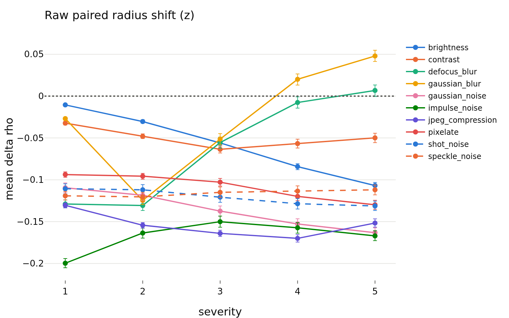
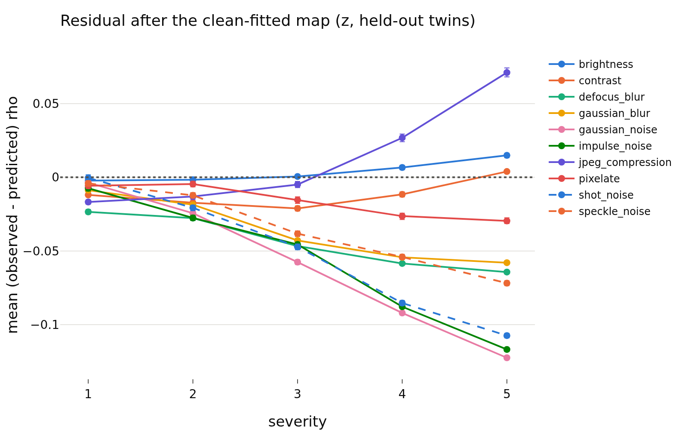
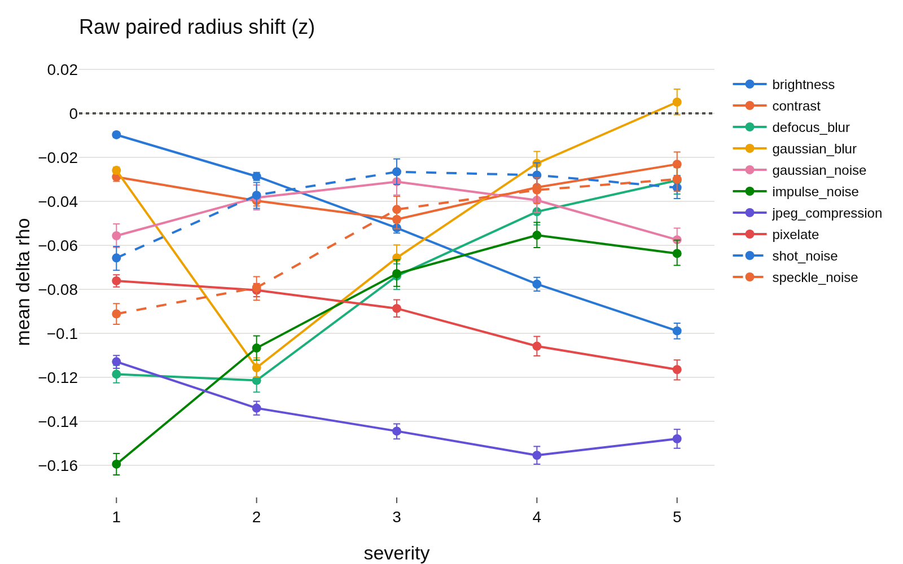
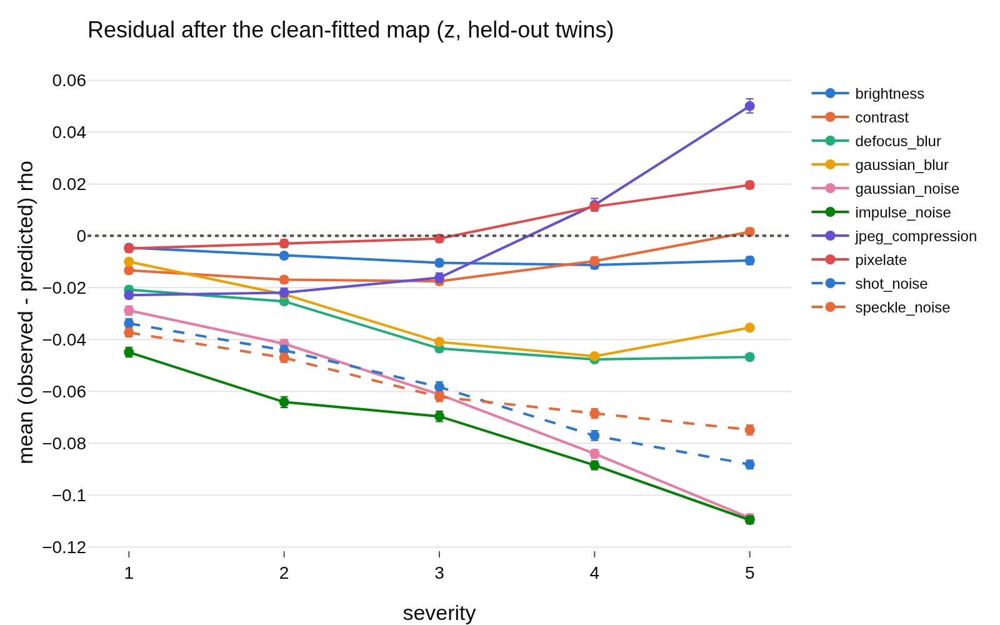

# radius_transfer: does the corruption radius shift carry information beyond the direction? (E6)
- **Branch / version:** `radius-transfer` @ `574e7c0` (code incl. the in-domain control, on top of `4e25b35`; notes committed after; branched from `master` at `8848388`)
- **Run datetime (UTC):** 2026-10-23T14:50Z to 14:57Z (six analysis jobs, 2.4 to 3 min each, 64 GB, no embedding jobs: all six STL-10-C dumps already existed); seed aggregation 2026-10-23T14:58Z.
- **Command(s):** (submitted from the repo checkout at the commit above, `PYTHONPATH=src`, `.env` with `LEJEPA_NORM_NOTES_DIR` pointing at this checkout's `research_notes/`)
  `sbatch --mem=64G --cpus-per-task=8 slurm/analyze.sbatch configs/base.yaml radius_marginal_lam{0.05,0.1}_s{0,1,2} radius_transfer/lam{0.05,0.1}_s{0,1,2}.md --transfer` (six jobs, one per run: lambda in {0.05, 0.1}, seed in {0, 1, 2}; each writes its own `lam<lambda>_s<seed>.md` next to this file, e.g. `sbatch --mem=64G --cpus-per-task=8 slurm/analyze.sbatch configs/base.yaml radius_marginal_lam0.05_s0 radius_transfer/lam0.05_s0.md --transfer`)
  `sbatch --mem=64G --cpus-per-task=8 --time=06:00:00 slurm/analyze.sbatch configs/base.yaml radius_marginal_lam<lambda>_s<seed> radius_transfer/lam<lambda>_s<seed>.md --transfer --no-figures` (rerun of the same six jobs with the in-domain control, jobs 2236260 to 2236265, 14 to 21 min each; `--no-figures` keeps the PNGs of the first run, whose residual means are unchanged, bootstrap CIs differ only by resampling noise)
  `python apps/analyze.py --aggregate-transfer radius_transfer/lam0.05_s0.md radius_transfer/lam0.05_s1.md radius_transfer/lam0.05_s2.md radius_transfer/lam0.1_s0.md radius_transfer/lam0.1_s1.md radius_transfer/lam0.1_s2.md --note radius_transfer/summary.md`
- **Datasets:** STL-10 ([canonical](https://cs.stanford.edu/~acoates/stl10/), [HF](https://huggingface.co/datasets/tanganke/stl10)), canonical archive used (`test` split, 8000 images); STL-10-C built locally from STL-10 `test` (10 corruptions x 5 severities, 400k images; no HF mirror). DTD and SVHN not used (optional, default no).
- **Backbone:** ResNet-18 from scratch ([HF architecture reference](https://huggingface.co/timm/resnet18.a1_in1k), weights not used); checkpoint `last.pt` (epoch 200) of Variant A runs `radius_marginal_lam{0.05,0.1}_s{0,1,2}`.

h is not analyzed; LeJEPA's product is z.

## Question

The radius shifts systematically under STL-10-C corruptions (paired shift of the mean log-radius `rho_bar`, z only). Is that shift just the direction moving, or does the radius carry shift information beyond the direction? If the radius is a function of the direction, a map `u_hat -> rho_bar` fitted on clean images must predict the radius of corrupted images from their own directions (residual shift about 0). If it does not, the radius carries information not in the direction (to be reported as a counterexample to "the radius is redundant").

## Setup (deviations from the base config)

Base config unchanged (`configs/base.yaml`, `eval.*` defaults: 4000-image kernel protocol, 1000 bootstrap resamples). Code: `lejepa_norm.eval.transfer`, `redundancy.FittedKernelRidge`, `apps/analyze.py --transfer`.

- Image-level quantities as in the redundancy study: `rho_bar` = mean log-radius and `u_hat` = normalized mean direction over the K = 8 augmented views; corrupted images use the same definitions on their own views.
- **Fit:** kernel ridge with `k(u, v) = exp((u . v - 1) / tau)` on a random half of the clean `stl10_test` images (4000 of 8000, the same size as the 4000-image redundancy protocol); `tau` (multiples of the median cosine distance) and the penalty `alpha` are chosen by exact leave-one-out CV on those 4000 clean images only (no corrupted data touches the fit).
- **Evaluation, leakage-free:** the corrupted versions of the *other* 4000 images ("held-out twins": neither the image nor its clean twin was seen) are the primary result. For comparison, the corrupted versions of the 4000 fit images ("fit twins") are also given, and the same map applied to the held-out clean images is the "no corruption" reference row.
- **Per cell (corruption x severity):** `raw shift` = mean `rho_bar(corrupted) - rho_bar(clean twin)`; `predicted shift` = mean `f(u_corrupted) - f(u_clean twin)`; `residual` = mean `rho_bar(corrupted) - f(u_corrupted)` (95% percentile bootstrap over images, the fitted map held fixed, so the CI does not contain fit uncertainty); `R^2` = `1 - SS_res / SS_tot` of the cell (SS_tot around the cell's own mean; it includes the bias, so it can be negative); `nn_cos` = mean cosine of a corrupted direction to its nearest fit direction (support check).
- **In-domain control** (added after the first run; approved follow-up): per cell, the same kernel ridge is fitted on the corrupted twins of the fit half (hyperparameters by LOO-CV on those corrupted fit images only) and predicts the corrupted twins of the held-out half. Same images as the clean-map `held-out twins` columns, so `residual (in-domain map)`, `R^2 (in-domain map)` and `unexplained fraction (in-domain)` are directly comparable with the clean-map columns. The residual mean is close to 0 almost by construction (the fit has an intercept), so the informative number is the in-domain `R^2`.
- Seeds: the summary averages the three seeds per lambda (mean ± std over seeds of the seed-level cell means); per-seed tables are in the six `lam*_s*.md` files. `unexplained fraction` = seed-mean residual / seed-mean raw shift (1 = the clean map explains none of the shift, 0 = all of it, negative = overshoot).

## Results

Clean reference (held-out clean images, same map): R^2 = 0.954 (lambda 0.05) and 0.945 (lambda 0.1), residual -0.002 and -0.003 (negligible: the map is unbiased on clean held-out images), `nn_cos` 0.87 and 0.83. Seed-0 figures follow; the full tables (all 50 cells per lambda) are generated below.

<!-- BEGIN GENERATED: analyze.radius_transfer_aggregate -->
### Radius transfer: mean ± std over seeds, per lambda

Runs: `radius_marginal_lam0.05_s0`, `radius_marginal_lam0.05_s1`, `radius_marginal_lam0.05_s2`, `radius_marginal_lam0.1_s0`, `radius_marginal_lam0.1_s1`, `radius_marginal_lam0.1_s2`. h is not analyzed; LeJEPA's product is z. Aggregates the per-run tables (held-out twins); `unexplained fraction` is the seed-mean residual over the seed-mean raw shift.

| lambda | corruption | severity | seeds | raw shift | residual (held-out twins) | R^2 (held-out twins) | unexplained fraction | residual (in-domain map) | R^2 (in-domain map) | unexplained fraction (in-domain) |
|---|---|---|---|---|---|---|---|---|---|---|
| 0.05 | brightness | 1 | 3 | -0.011 ± 0.001 | -0.003 ± 0.001 | 0.953 ± 0.000 | 0.25 | -0.002 ± 0.000 | 0.955 ± 0.000 | 0.1875 |
| 0.05 | brightness | 2 | 3 | -0.032 ± 0.002 | -0.003 ± 0.001 | 0.946 ± 0.001 | 0.09474 | -0.002 ± 0.000 | 0.957 ± 0.001 | 0.06316 |
| 0.05 | brightness | 3 | 3 | -0.058 ± 0.002 | -0.001 ± 0.002 | 0.935 ± 0.002 | 0.02312 | -0.002 ± 0.001 | 0.958 ± 0.001 | 0.0289 |
| 0.05 | brightness | 4 | 3 | -0.086 ± 0.002 | 0.004 ± 0.003 | 0.911 ± 0.002 | -0.04669 | -0.001 ± 0.001 | 0.959 ± 0.001 | 0.01556 |
| 0.05 | brightness | 5 | 3 | -0.109 ± 0.003 | 0.011 ± 0.004 | 0.862 ± 0.006 | -0.09786 | -0.002 ± 0.001 | 0.956 ± 0.000 | 0.01529 |
| 0.05 | contrast | 1 | 3 | -0.033 ± 0.001 | -0.010 ± 0.002 | 0.929 ± 0.006 | 0.3131 | -0.001 ± 0.001 | 0.957 ± 0.001 | 0.0404 |
| 0.05 | contrast | 2 | 3 | -0.049 ± 0.001 | -0.014 ± 0.002 | 0.892 ± 0.013 | 0.2925 | -0.001 ± 0.001 | 0.955 ± 0.001 | 0.02721 |
| 0.05 | contrast | 3 | 3 | -0.064 ± 0.002 | -0.019 ± 0.003 | 0.780 ± 0.026 | 0.2969 | -0.000 ± 0.001 | 0.954 ± 0.000 | 0.005208 |
| 0.05 | contrast | 4 | 3 | -0.048 ± 0.010 | -0.022 ± 0.013 | 0.463 ± 0.093 | 0.4483 | 0.000 ± 0.000 | 0.959 ± 0.003 | -0 |
| 0.05 | contrast | 5 | 3 | -0.030 ± 0.019 | -0.017 ± 0.019 | 0.282 ± 0.234 | 0.5843 | 0.000 ± 0.000 | 0.969 ± 0.001 | -0 |
| 0.05 | defocus_blur | 1 | 3 | -0.125 ± 0.005 | -0.032 ± 0.009 | 0.749 ± 0.045 | 0.2533 | -0.001 ± 0.001 | 0.940 ± 0.001 | 0.01067 |
| 0.05 | defocus_blur | 2 | 3 | -0.124 ± 0.006 | -0.038 ± 0.010 | 0.566 ± 0.063 | 0.3038 | -0.001 ± 0.001 | 0.933 ± 0.011 | 0.01075 |
| 0.05 | defocus_blur | 3 | 3 | -0.037 ± 0.017 | -0.054 ± 0.007 | 0.476 ± 0.075 | 1.455 | 0.000 ± 0.000 | 0.974 ± 0.006 | -0 |
| 0.05 | defocus_blur | 4 | 3 | 0.014 ± 0.020 | -0.062 ± 0.007 | 0.427 ± 0.138 | -4.512 | 0.000 ± 0.000 | 0.984 ± 0.003 | 0 |
| 0.05 | defocus_blur | 5 | 3 | 0.030 ± 0.021 | -0.065 ± 0.012 | 0.391 ± 0.203 | -2.143 | 0.000 ± 0.000 | 0.987 ± 0.002 | 0 |
| 0.05 | gaussian_blur | 1 | 3 | -0.028 ± 0.006 | -0.010 ± 0.001 | 0.944 ± 0.002 | 0.3571 | -0.002 ± 0.001 | 0.952 ± 0.002 | 0.08333 |
| 0.05 | gaussian_blur | 2 | 3 | -0.123 ± 0.003 | -0.028 ± 0.011 | 0.678 ± 0.079 | 0.2255 | -0.001 ± 0.001 | 0.923 ± 0.007 | 0.01087 |
| 0.05 | gaussian_blur | 3 | 3 | -0.032 ± 0.016 | -0.053 ± 0.010 | 0.420 ± 0.100 | 1.639 | 0.000 ± 0.000 | 0.968 ± 0.008 | -0 |
| 0.05 | gaussian_blur | 4 | 3 | 0.038 ± 0.016 | -0.060 ± 0.007 | 0.339 ± 0.170 | -1.557 | 0.000 ± 0.000 | 0.984 ± 0.003 | 0 |
| 0.05 | gaussian_blur | 5 | 3 | 0.068 ± 0.018 | -0.062 ± 0.015 | 0.335 ± 0.280 | -0.9024 | 0.000 ± 0.000 | 0.990 ± 0.002 | 0 |
| 0.05 | gaussian_noise | 1 | 3 | -0.110 ± 0.002 | 0.002 ± 0.006 | 0.639 ± 0.072 | -0.02121 | 0.000 ± 0.000 | 0.942 ± 0.004 | -0 |
| 0.05 | gaussian_noise | 2 | 3 | -0.111 ± 0.006 | -0.011 ± 0.012 | 0.544 ± 0.139 | 0.09581 | 0.000 ± 0.000 | 0.952 ± 0.003 | -0 |
| 0.05 | gaussian_noise | 3 | 3 | -0.114 ± 0.021 | -0.030 ± 0.025 | 0.228 ± 0.415 | 0.2661 | 0.000 ± 0.000 | 0.963 ± 0.002 | -0 |
| 0.05 | gaussian_noise | 4 | 3 | -0.114 ± 0.036 | -0.045 ± 0.042 | -0.547 ± 1.423 | 0.393 | 0.000 ± 0.000 | 0.968 ± 0.003 | -0 |
| 0.05 | gaussian_noise | 5 | 3 | -0.115 ± 0.044 | -0.056 ± 0.058 | -2.369 ± 4.331 | 0.4855 | 0.000 ± 0.000 | 0.972 ± 0.008 | -0 |
| 0.05 | impulse_noise | 1 | 3 | -0.194 ± 0.007 | 0.003 ± 0.011 | 0.593 ± 0.057 | -0.01721 | -0.000 ± 0.001 | 0.930 ± 0.000 | 0.001721 |
| 0.05 | impulse_noise | 2 | 3 | -0.154 ± 0.011 | -0.001 ± 0.024 | 0.411 ± 0.139 | 0.00432 | 0.000 ± 0.000 | 0.946 ± 0.004 | -0 |
| 0.05 | impulse_noise | 3 | 3 | -0.132 ± 0.016 | -0.011 ± 0.031 | 0.266 ± 0.279 | 0.08608 | 0.000 ± 0.000 | 0.958 ± 0.004 | -0 |
| 0.05 | impulse_noise | 4 | 3 | -0.118 ± 0.035 | -0.037 ± 0.045 | -0.574 ± 1.436 | 0.3155 | 0.000 ± 0.000 | 0.966 ± 0.004 | -0 |
| 0.05 | impulse_noise | 5 | 3 | -0.119 ± 0.043 | -0.053 ± 0.056 | -2.325 ± 4.073 | 0.4469 | 0.000 ± 0.000 | 0.968 ± 0.008 | -0 |
| 0.05 | jpeg_compression | 1 | 3 | -0.135 ± 0.005 | -0.020 ± 0.004 | 0.896 ± 0.008 | 0.1481 | -0.002 ± 0.001 | 0.952 ± 0.000 | 0.01235 |
| 0.05 | jpeg_compression | 2 | 3 | -0.159 ± 0.005 | -0.020 ± 0.008 | 0.854 ± 0.015 | 0.1234 | -0.002 ± 0.001 | 0.948 ± 0.002 | 0.01464 |
| 0.05 | jpeg_compression | 3 | 3 | -0.170 ± 0.005 | -0.014 ± 0.011 | 0.817 ± 0.019 | 0.08431 | -0.002 ± 0.001 | 0.945 ± 0.001 | 0.009804 |
| 0.05 | jpeg_compression | 4 | 3 | -0.178 ± 0.007 | 0.010 ± 0.018 | 0.668 ± 0.037 | -0.05618 | -0.002 ± 0.001 | 0.934 ± 0.002 | 0.009363 |
| 0.05 | jpeg_compression | 5 | 3 | -0.165 ± 0.012 | 0.048 ± 0.021 | 0.420 ± 0.150 | -0.2909 | 0.000 ± 0.000 | 0.934 ± 0.001 | -0 |
| 0.05 | pixelate | 1 | 3 | -0.093 ± 0.002 | 0.005 ± 0.009 | 0.859 ± 0.020 | -0.05 | -0.001 ± 0.002 | 0.952 ± 0.003 | 0.01429 |
| 0.05 | pixelate | 2 | 3 | -0.094 ± 0.002 | 0.009 ± 0.012 | 0.813 ± 0.026 | -0.09541 | -0.001 ± 0.001 | 0.948 ± 0.003 | 0.01413 |
| 0.05 | pixelate | 3 | 3 | -0.103 ± 0.006 | 0.004 ± 0.017 | 0.688 ± 0.067 | -0.04221 | -0.002 ± 0.001 | 0.942 ± 0.003 | 0.01623 |
| 0.05 | pixelate | 4 | 3 | -0.120 ± 0.016 | 0.005 ± 0.027 | 0.472 ± 0.160 | -0.03878 | -0.001 ± 0.001 | 0.932 ± 0.005 | 0.00554 |
| 0.05 | pixelate | 5 | 3 | -0.131 ± 0.019 | 0.008 ± 0.033 | 0.380 ± 0.184 | -0.05867 | -0.001 ± 0.001 | 0.930 ± 0.005 | 0.005102 |
| 0.05 | shot_noise | 1 | 3 | -0.113 ± 0.002 | 0.002 ± 0.011 | 0.654 ± 0.063 | -0.02059 | 0.000 ± 0.001 | 0.945 ± 0.002 | -0.002941 |
| 0.05 | shot_noise | 2 | 3 | -0.108 ± 0.004 | -0.011 ± 0.018 | 0.542 ± 0.129 | 0.1015 | 0.000 ± 0.001 | 0.956 ± 0.001 | -0.003077 |
| 0.05 | shot_noise | 3 | 3 | -0.105 ± 0.014 | -0.023 ± 0.027 | 0.346 ± 0.280 | 0.219 | 0.000 ± 0.000 | 0.965 ± 0.001 | -0 |
| 0.05 | shot_noise | 4 | 3 | -0.096 ± 0.030 | -0.034 ± 0.045 | -0.205 ± 1.070 | 0.3576 | 0.000 ± 0.000 | 0.973 ± 0.004 | -0 |
| 0.05 | shot_noise | 5 | 3 | -0.090 ± 0.036 | -0.040 ± 0.059 | -0.914 ± 2.287 | 0.4407 | 0.000 ± 0.000 | 0.977 ± 0.005 | -0 |
| 0.05 | speckle_noise | 1 | 3 | -0.123 ± 0.004 | -0.003 ± 0.012 | 0.719 ± 0.037 | 0.02168 | -0.001 ± 0.000 | 0.943 ± 0.003 | 0.00813 |
| 0.05 | speckle_noise | 2 | 3 | -0.124 ± 0.003 | -0.010 ± 0.017 | 0.626 ± 0.081 | 0.08086 | -0.000 ± 0.001 | 0.944 ± 0.003 | 0.002695 |
| 0.05 | speckle_noise | 3 | 3 | -0.112 ± 0.003 | -0.026 ± 0.022 | 0.385 ± 0.217 | 0.2328 | 0.000 ± 0.000 | 0.957 ± 0.002 | -0 |
| 0.05 | speckle_noise | 4 | 3 | -0.103 ± 0.008 | -0.031 ± 0.024 | 0.204 ± 0.360 | 0.2968 | 0.000 ± 0.000 | 0.961 ± 0.002 | -0 |
| 0.05 | speckle_noise | 5 | 3 | -0.093 ± 0.016 | -0.033 ± 0.034 | -0.093 ± 0.762 | 0.3584 | 0.000 ± 0.000 | 0.965 ± 0.003 | -0 |
| 0.05 | clean (reference) | 0 | 3 | 0.000 ± 0.000 | -0.002 ± 0.001 | 0.954 ± 0.000 | nan |  |  | nan |
| 0.1 | brightness | 1 | 3 | -0.009 ± 0.001 | -0.004 ± 0.001 | 0.943 ± 0.001 | 0.4643 | -0.002 ± 0.001 | 0.946 ± 0.001 | 0.1786 |
| 0.1 | brightness | 2 | 3 | -0.028 ± 0.003 | -0.007 ± 0.001 | 0.936 ± 0.001 | 0.2619 | -0.002 ± 0.000 | 0.950 ± 0.001 | 0.07143 |
| 0.1 | brightness | 3 | 3 | -0.051 ± 0.002 | -0.009 ± 0.001 | 0.921 ± 0.003 | 0.1699 | -0.002 ± 0.000 | 0.950 ± 0.001 | 0.03922 |
| 0.1 | brightness | 4 | 3 | -0.076 ± 0.003 | -0.008 ± 0.003 | 0.899 ± 0.008 | 0.1009 | -0.002 ± 0.001 | 0.948 ± 0.002 | 0.02193 |
| 0.1 | brightness | 5 | 3 | -0.095 ± 0.004 | -0.004 ± 0.005 | 0.854 ± 0.012 | 0.04577 | -0.001 ± 0.000 | 0.947 ± 0.001 | 0.01056 |
| 0.1 | contrast | 1 | 3 | -0.026 ± 0.003 | -0.011 ± 0.002 | 0.915 ± 0.005 | 0.4103 | -0.002 ± 0.000 | 0.942 ± 0.001 | 0.07692 |
| 0.1 | contrast | 2 | 3 | -0.036 ± 0.004 | -0.013 ± 0.004 | 0.879 ± 0.009 | 0.3486 | -0.001 ± 0.001 | 0.941 ± 0.002 | 0.0367 |
| 0.1 | contrast | 3 | 3 | -0.044 ± 0.006 | -0.013 ± 0.003 | 0.776 ± 0.020 | 0.3053 | -0.001 ± 0.000 | 0.940 ± 0.007 | 0.0229 |
| 0.1 | contrast | 4 | 3 | -0.030 ± 0.010 | -0.012 ± 0.003 | 0.526 ± 0.067 | 0.4045 | 0.000 ± 0.000 | 0.954 ± 0.011 | -0 |
| 0.1 | contrast | 5 | 3 | -0.026 ± 0.006 | -0.014 ± 0.014 | 0.424 ± 0.188 | 0.5325 | 0.000 ± 0.000 | 0.974 ± 0.008 | -0 |
| 0.1 | defocus_blur | 1 | 3 | -0.106 ± 0.012 | -0.030 ± 0.008 | 0.715 ± 0.050 | 0.2808 | -0.001 ± 0.001 | 0.925 ± 0.006 | 0.01262 |
| 0.1 | defocus_blur | 2 | 3 | -0.106 ± 0.014 | -0.034 ± 0.008 | 0.479 ± 0.107 | 0.3186 | -0.001 ± 0.000 | 0.918 ± 0.004 | 0.009464 |
| 0.1 | defocus_blur | 3 | 3 | -0.049 ± 0.023 | -0.039 ± 0.008 | 0.483 ± 0.034 | 0.7973 | 0.000 ± 0.000 | 0.969 ± 0.003 | -0 |
| 0.1 | defocus_blur | 4 | 3 | -0.016 ± 0.029 | -0.038 ± 0.015 | 0.546 ± 0.074 | 2.327 | 0.000 ± 0.000 | 0.981 ± 0.004 | -0 |
| 0.1 | defocus_blur | 5 | 3 | -0.002 ± 0.030 | -0.035 ± 0.019 | 0.560 ± 0.073 | 15.14 | 0.000 ± 0.000 | 0.984 ± 0.004 | -0 |
| 0.1 | gaussian_blur | 1 | 3 | -0.021 ± 0.004 | -0.009 ± 0.001 | 0.935 ± 0.003 | 0.4375 | -0.002 ± 0.001 | 0.943 ± 0.003 | 0.07813 |
| 0.1 | gaussian_blur | 2 | 3 | -0.103 ± 0.013 | -0.028 ± 0.004 | 0.635 ± 0.065 | 0.2695 | -0.001 ± 0.001 | 0.913 ± 0.007 | 0.006494 |
| 0.1 | gaussian_blur | 3 | 3 | -0.040 ± 0.028 | -0.035 ± 0.005 | 0.440 ± 0.113 | 0.876 | 0.000 ± 0.000 | 0.965 ± 0.008 | -0 |
| 0.1 | gaussian_blur | 4 | 3 | 0.007 ± 0.032 | -0.032 ± 0.015 | 0.550 ± 0.142 | -4.364 | 0.000 ± 0.000 | 0.983 ± 0.003 | 0 |
| 0.1 | gaussian_blur | 5 | 3 | 0.031 ± 0.031 | -0.022 ± 0.020 | 0.593 ± 0.094 | -0.7065 | 0.000 ± 0.000 | 0.987 ± 0.003 | 0 |
| 0.1 | gaussian_noise | 1 | 3 | -0.066 ± 0.008 | -0.026 ± 0.005 | 0.619 ± 0.042 | 0.3959 | 0.000 ± 0.000 | 0.955 ± 0.001 | -0 |
| 0.1 | gaussian_noise | 2 | 3 | -0.062 ± 0.021 | -0.042 ± 0.001 | 0.378 ± 0.073 | 0.6791 | 0.000 ± 0.001 | 0.967 ± 0.002 | -0.005348 |
| 0.1 | gaussian_noise | 3 | 3 | -0.067 ± 0.032 | -0.060 ± 0.005 | -0.174 ± 0.247 | 0.9005 | 0.000 ± 0.000 | 0.977 ± 0.001 | -0 |
| 0.1 | gaussian_noise | 4 | 3 | -0.076 ± 0.033 | -0.074 ± 0.011 | -1.088 ± 0.405 | 0.9736 | 0.000 ± 0.000 | 0.981 ± 0.001 | -0 |
| 0.1 | gaussian_noise | 5 | 3 | -0.085 ± 0.026 | -0.084 ± 0.024 | -2.620 ± 1.077 | 0.9843 | 0.000 ± 0.000 | 0.983 ± 0.003 | -0 |
| 0.1 | impulse_noise | 1 | 3 | -0.164 ± 0.005 | -0.040 ± 0.008 | 0.282 ± 0.182 | 0.2414 | -0.001 ± 0.001 | 0.921 ± 0.003 | 0.004057 |
| 0.1 | impulse_noise | 2 | 3 | -0.130 ± 0.020 | -0.058 ± 0.014 | -0.173 ± 0.181 | 0.4447 | 0.000 ± 0.001 | 0.959 ± 0.005 | -0.002571 |
| 0.1 | impulse_noise | 3 | 3 | -0.107 ± 0.030 | -0.066 ± 0.010 | -0.594 ± 0.059 | 0.6199 | 0.000 ± 0.000 | 0.969 ± 0.004 | -0 |
| 0.1 | impulse_noise | 4 | 3 | -0.094 ± 0.034 | -0.081 ± 0.007 | -1.885 ± 0.130 | 0.8648 | 0.000 ± 0.000 | 0.978 ± 0.003 | -0 |
| 0.1 | impulse_noise | 5 | 3 | -0.095 ± 0.027 | -0.089 ± 0.019 | -3.444 ± 0.721 | 0.9333 | 0.000 ± 0.000 | 0.980 ± 0.003 | -0 |
| 0.1 | jpeg_compression | 1 | 3 | -0.101 ± 0.010 | -0.019 ± 0.004 | 0.870 ± 0.007 | 0.1908 | -0.001 ± 0.000 | 0.944 ± 0.002 | 0.009868 |
| 0.1 | jpeg_compression | 2 | 3 | -0.122 ± 0.011 | -0.018 ± 0.006 | 0.814 ± 0.015 | 0.1479 | -0.002 ± 0.001 | 0.939 ± 0.002 | 0.0137 |
| 0.1 | jpeg_compression | 3 | 3 | -0.131 ± 0.012 | -0.012 ± 0.008 | 0.763 ± 0.036 | 0.08929 | -0.002 ± 0.001 | 0.936 ± 0.002 | 0.01276 |
| 0.1 | jpeg_compression | 4 | 3 | -0.143 ± 0.011 | 0.015 ± 0.012 | 0.510 ± 0.145 | -0.1075 | -0.001 ± 0.001 | 0.929 ± 0.003 | 0.009346 |
| 0.1 | jpeg_compression | 5 | 3 | -0.137 ± 0.010 | 0.055 ± 0.017 | 0.094 ± 0.311 | -0.4 | -0.001 ± 0.000 | 0.928 ± 0.001 | 0.007317 |
| 0.1 | pixelate | 1 | 3 | -0.074 ± 0.009 | -0.010 ± 0.005 | 0.881 ± 0.015 | 0.1351 | -0.001 ± 0.001 | 0.941 ± 0.004 | 0.01802 |
| 0.1 | pixelate | 2 | 3 | -0.076 ± 0.009 | -0.009 ± 0.005 | 0.857 ± 0.020 | 0.1145 | -0.001 ± 0.000 | 0.939 ± 0.004 | 0.01322 |
| 0.1 | pixelate | 3 | 3 | -0.085 ± 0.012 | -0.010 ± 0.008 | 0.772 ± 0.044 | 0.1137 | -0.001 ± 0.001 | 0.931 ± 0.002 | 0.007843 |
| 0.1 | pixelate | 4 | 3 | -0.102 ± 0.010 | 0.001 ± 0.011 | 0.659 ± 0.051 | -0.01303 | -0.000 ± 0.001 | 0.920 ± 0.001 | 0.003257 |
| 0.1 | pixelate | 5 | 3 | -0.111 ± 0.009 | 0.009 ± 0.012 | 0.533 ± 0.037 | -0.08408 | 0.000 ± 0.000 | 0.917 ± 0.004 | -0 |
| 0.1 | shot_noise | 1 | 3 | -0.073 ± 0.007 | -0.030 ± 0.009 | 0.582 ± 0.077 | 0.4064 | 0.000 ± 0.000 | 0.951 ± 0.002 | -0 |
| 0.1 | shot_noise | 2 | 3 | -0.060 ± 0.020 | -0.042 ± 0.005 | 0.370 ± 0.076 | 0.6944 | 0.000 ± 0.000 | 0.967 ± 0.003 | -0 |
| 0.1 | shot_noise | 3 | 3 | -0.059 ± 0.029 | -0.053 ± 0.004 | 0.017 ± 0.166 | 0.8983 | 0.000 ± 0.000 | 0.976 ± 0.001 | -0 |
| 0.1 | shot_noise | 4 | 3 | -0.060 ± 0.030 | -0.061 ± 0.015 | -0.535 ± 0.414 | 1.006 | 0.000 ± 0.000 | 0.983 ± 0.002 | -0 |
| 0.1 | shot_noise | 5 | 3 | -0.062 ± 0.025 | -0.064 ± 0.022 | -0.978 ± 0.695 | 1.038 | 0.000 ± 0.000 | 0.984 ± 0.004 | -0 |
| 0.1 | speckle_noise | 1 | 3 | -0.092 ± 0.006 | -0.031 ± 0.009 | 0.614 ± 0.087 | 0.3406 | -0.001 ± 0.000 | 0.937 ± 0.004 | 0.01087 |
| 0.1 | speckle_noise | 2 | 3 | -0.086 ± 0.007 | -0.040 ± 0.011 | 0.433 ± 0.149 | 0.463 | 0.000 ± 0.001 | 0.945 ± 0.004 | -0.003891 |
| 0.1 | speckle_noise | 3 | 3 | -0.067 ± 0.021 | -0.052 ± 0.011 | 0.020 ± 0.300 | 0.7673 | 0.000 ± 0.000 | 0.966 ± 0.002 | -0 |
| 0.1 | speckle_noise | 4 | 3 | -0.062 ± 0.024 | -0.055 ± 0.013 | -0.206 ± 0.435 | 0.8865 | 0.000 ± 0.001 | 0.973 ± 0.002 | -0.005405 |
| 0.1 | speckle_noise | 5 | 3 | -0.056 ± 0.026 | -0.055 ± 0.017 | -0.468 ± 0.615 | 0.9822 | 0.000 ± 0.000 | 0.976 ± 0.002 | -0 |
| 0.1 | clean (reference) | 0 | 3 | 0.000 ± 0.000 | -0.003 ± 0.001 | 0.945 ± 0.000 | nan |  |  | nan |
<!-- END GENERATED: analyze.radius_transfer_aggregate -->

## Interpretation

The answer is **mixed, and it depends on the corruption family**; the clean-fitted map does not transfer uniformly, so the shift is not "just the direction moving" in general. Numbers below are seed means at severity 5 (residual vs raw shift, log-radius units; per-seed values in the per-run notes).

- **Transfer works** for `brightness` (raw -0.109 / -0.095 at lambda 0.05 / 0.1, residual +0.011 / -0.004, transferred R^2 0.86 / 0.85 against 0.95 clean) and `pixelate` (raw -0.131 / -0.111, residual +0.008 / +0.009): the radius shift is accounted for by where the direction went. `contrast` and the low severities of most families are also small in absolute terms (|residual| mostly below 0.03), but there the raw shift is small too, so the unexplained fraction is not small everywhere (e.g. `defocus_blur` severity 1: raw -0.125, residual -0.032).
- **Transfer fails for the noise family** (`gaussian`, `impulse`, `shot`, `speckle`): at lambda = 0.1 the residual is about the whole raw shift at severity 5 (gaussian noise raw -0.085 ± 0.026, residual -0.084 ± 0.024; unexplained fraction 0.93 to 1.04 over the four noises) and the transferred R^2 is negative (-2.6 ± 1.1 for gaussian noise), i.e. worse than predicting the cell mean. At lambda = 0.05 about half of the shift stays in the residual on average (unexplained fraction 0.36 to 0.49 at severity 5) with a **large seed spread** (gaussian noise severity 5, residual -0.122 / -0.028 / -0.017 for seeds 0 / 1 / 2 against raw -0.163 / -0.103 / -0.078); the seed spread is far larger than the bootstrap CIs, which only cover image sampling. For lambda = 0.1 seed 0 the map even predicts the wrong sign (predicted shift +0.048, observed -0.057).
- **Blurs** (`defocus`, `gaussian_blur`): the clean map predicts a radius *increase* at high severity (predicted shift up to +0.10) that does not occur (raw shift about 0 to +0.07), residual -0.02 to -0.07 at severity 5, so the direction-to-radius relation is not the clean one there either; `nn_cos` stays high (0.79 to 0.88), so this is not simply a support problem.
- **`jpeg_compression`** overshoots in the other direction: the clean map predicts a larger drop (about -0.22) than observed (about -0.15), residual +0.03 to +0.07, significant in every seed.

What this does and does not show. A failed transfer means the *clean-fitted function* `f` does not describe the corrupted images; it does not by itself prove that the corrupted radius is not a function of the corrupted direction (it could be a *different* function of it). Two further reasons not to over-read a failure: (i) under noise the corrupted directions leave the clean support (`nn_cos` 0.58 to 0.69 vs 0.83 to 0.87 clean), so part of the failure is extrapolation of a kernel map, and the held-out clean reference cannot separate it; (ii) the bootstrap CIs hold the map fixed and are image-level only. Conversely, the success cases (brightness, pixelate) are clean evidence that the shift can be fully carried by the direction. **In-domain control.** Fitting the map on the corrupted data itself gives held-out R^2 between 0.92 and 0.99 in all 50 cells of both lambdas (seed means; clean reference 0.95), with the mean residual within 0.002 of zero, **including every cell where the clean map failed** (gaussian noise severity 5: clean-map R^2 -2.4 / -2.6, in-domain 0.97 / 0.98; defocus and gaussian blur severity 5: 0.99; jpeg: 0.93). The unexplained fraction is about 0 for the in-domain map wherever the raw shift is not itself tiny (it only grows, up to 0.19 in absolute value, in cells with raw shift near 0, where the ratio is unstable). So within every corruption and severity the radius remains an (almost) deterministic function of the direction; what changes is the function. This resolves the ambiguity above in favor of **"different function of the direction under corruption", not "extra information in the radius"**: no cell shows a radius component that the direction of the same images fails to predict. Caveats: the in-domain map is fitted per cell on 4000 corrupted images, so it has the clean map's data size but sees the corrupted support (this also removes the extrapolation issue); a cell-specific function is a weaker claim than one shared function (the clean map's failure says the radius-direction relation is not corruption-invariant); and the same image-level CI and seed caveats apply.

Net: the radius is a function of the direction on the clean data (R^2 0.95), and that function carries over to mild and some severe corruptions, but for noise (and, differently, blur and JPEG) the radius responds to the corruption in a way the clean direction-radius map does not predict; the in-domain control shows this is not information beyond the direction: the radius stays redundant with the direction under every corruption, but through a corruption-dependent map. Report it as: redundancy holds in-domain (R^2 0.92 to 0.99 everywhere), the clean-fitted map is **not invariant** under corruption (it fails for noise, blur and JPEG).

## Next steps

- A map shared across corruptions (fit on clean plus a few corrupted conditions, evaluated on held-out conditions) to see whether any single function covers them; a support-matched clean reference (clean held-out images binned by `nn_cos`) or a map fitted on a mixture of clean and a few corrupted conditions, to quantify the extrapolation share for noise.
- Bootstrap the fit as well (resample the fit images) to put seed-level and fit uncertainty into the CIs.
- Optional (default no): the same for DTD and SVHN as OOD sets.
