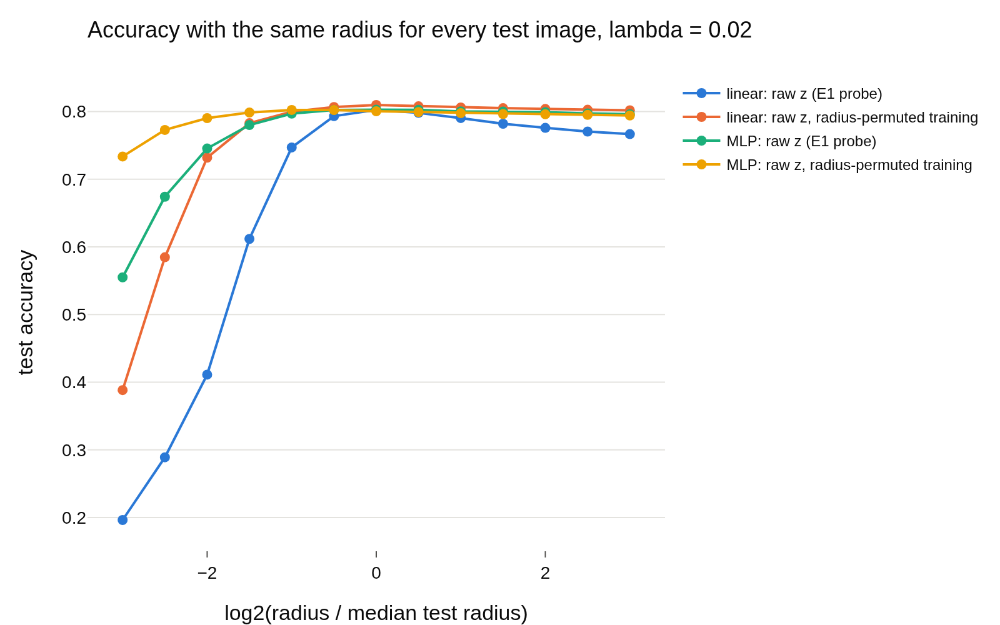
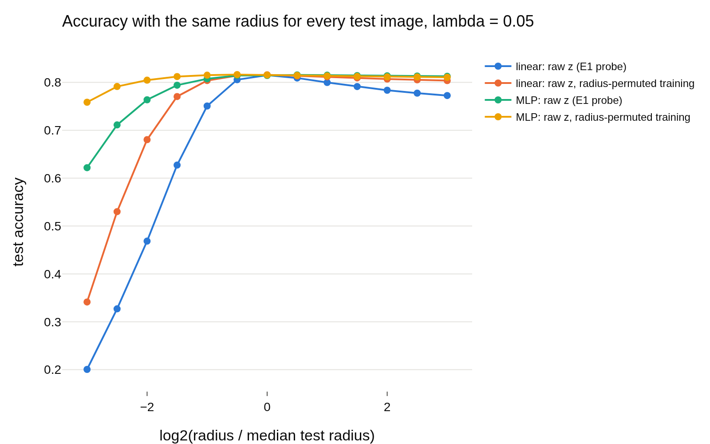
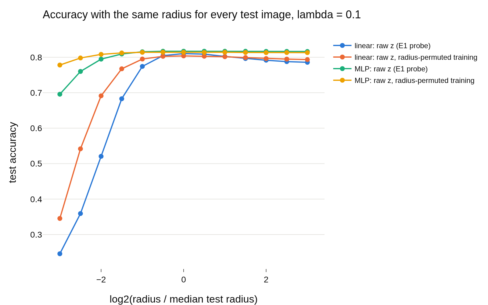

# Why does a frozen probe depend slightly on the radius? (E1 follow-up, lambda 0.02 / 0.05 / 0.1)
- **Branch / version:** `radius-usage-frozen-linear`, code @ `152d0db245dcf06341d7a5fa654166414634cf22` (this note is committed on top of it)
- **Run datetime (UTC):** 2026-10-25T20:24:16Z (end of the aggregation job 2246220; per-run jobs 2246189_0..8 finished before; the cluster reports CDT, converted)
- **Command(s):** per run (9 CPU jobs, 8 CPUs, 16 GB, 4-11 min each; `<repo>` is the checkout of the branch above, the template sets `PYTHONPATH=<repo>/src`):
  `cd <repo> && sbatch --export=ALL --array=0-8 slurm/frozen_linear.sbatch configs/base.yaml radius_marginal`
  (each task runs `apps/analyze.py --frozen-linear radius_marginal --config configs/base.yaml --frozen-run radius_marginal_lam<L>_s<S>`; the runs are listed by `--frozen-list-runs`). Aggregation (job 2246220, `sbatch --wrap`, 8 CPUs, 16 GB):
  `cd <repo> && export OMP_NUM_THREADS=8 OPENBLAS_NUM_THREADS=8 PYTHONPATH=<repo>/src && <python> apps/analyze.py --config configs/base.yaml --frozen-linear radius_marginal --note radius_usage/frozen_linear_summary.md`
- **Datasets:** STL-10 `train` (probe training set) and `test`, clean, center views ([canonical](https://cs.stanford.edu/~acoates/stl10/), [HF `tanganke/stl10`](https://huggingface.co/datasets/tanganke/stl10)); the canonical archive was used (via the existing `stl10_train` / `stl10_test` embedding dumps); HF is linked for reference only.
- **Backbone:** ResNet-18 from scratch ([HF architecture reference](https://huggingface.co/timm/resnet18.a1_in1k), weights not used); `last.pt` of `radius_marginal_lam{0.02,0.05,0.1}_s{0,1,2}`.
- **Scope:** h is not analyzed; LeJEPA's product is z.
- **Equivalence margin:** 0.5 accuracy points (as in E1, `eval.equivalence_margin`, fixed before any result). It applies to accuracy differences only; flip rates, correlations and the decomposition scalars carry 95% CIs (or seed sd) and no verdict.

## Question

E1 found that a linear probe fitted on clean STL-10 train z and *frozen* loses 0.44 / 0.34 / 0.25 points (lambda 0.02 / 0.05 / 0.1; here re-measured as 0.44 / 0.41 / 0.25) when the radius of the test embeddings is permuted across images, while retrained probes are equivalent. Is that a bias/scale artifact of how a logistic classifier handles a scale (then it is no evidence that the radius carries label information), or something more?

## Setup (deviations from the base config)

No deviation from `configs/base.yaml`. Same center-view z, same shuffle streams (5 permutations per condition, `eval.num_randomizations`), same held-out direction -> log-radius regression and same probes as E1 (`downstream.LinearProbe`, C = 1, standardized features; MLP with weight decay chosen once on the clean bank), 1000 paired bootstrap replicates. New here (code in `lejepa_norm.eval.frozen_linear`, module docstring has the full definitions):

- Exact decomposition of the linear logits: `s = r (u W^T) + b_eff`, `b_eff = intercept - W mu / sigma` (`mu`, `sigma`: training mean and std of the raw features). Radius only multiplies the direction logits; the effective bias does not move.
- Probe variants, all evaluated frozen under baseline / permute / residual / constant: the E1 probe; centered features without intercept; uncentered, scale-only features without intercept (homogeneous: exactly radius invariant); the E1 weights with `b_eff` set to 0 (not refitted); trained and tested on the direction u only (radius-free; train and test on u); trained on 5 copies of the bank with independent radius permutations (radius-invariant training, raw z at test). The same u-only and permuted-training variants for the MLP.
- Per-image diagnostics under the permutation (shuffle repeats pooled per image): flips, baseline margin, log radius ratio `log(r'/r)`, the mismatch `log r' - pred` (permuted radius against the held-out direction-predicted log-radius), the original residual `log r - pred`, and for the linear probe the distance in log-radius to the top-two crossing radius `t* = -db/da`. Spearman correlations with flip rate and accuracy loss, a margin x ratio grid, and accuracy at a constant radius `2^e` x median radius.
- The aggregation uses the E1 paired bootstrap/TOST machinery (`randomization.bootstrap_seed_mean`, `intervals`, `verdict`, shared with `compare`).

Reproducibility caveat: the E1 probe is refitted here and not bitwise identical to E1 (L-BFGS / threads): baselines differ by at most 0.06 points (lambda 0.05: 0.8176 here, 0.8170 in E1), and the frozen permute change at lambda 0.05 is -0.41 here against -0.34 in E1, which moves its verdict from `equivalent` (E1) to `different` (here; 90% CI [-0.53, -0.28] against the margin -0.5). Treat the lambda-0.05 verdict as borderline in both directions. lambda 0.02 (`different`, -0.44) and 0.1 (`equivalent`, -0.25) agree with E1.

## Results

<!-- BEGIN GENERATED: analyze.frozen_change -->
### Frozen accuracy change under each radius condition

Differences are in accuracy points on the same test images, averaged over training seeds; intervals are paired bootstrap percentile intervals (1000 replicates, test images resampled within each seed). Verdict with the margin fixed at ±0.5 points before looking at results: `equivalent` if the 90% interval lies inside the margin, `different` if not equivalent and the 95% interval excludes 0, else `inconclusive`. Each probe is fitted on the clean bank and evaluated frozen; the change is against its own baseline. Radius-free probes must be exactly 0.

| probe | condition | lambda | reference acc | acc | difference (points) | 90% CI (points) | 95% CI (points) | verdict |
|---|---|---|---|---|---|---|---|---|
| linear: raw z (E1 probe) | permute radius across images | 0.02 | 0.8040 | 0.7996 | -0.44 | [-0.58, -0.30] | [-0.60, -0.27] | different |
| linear: raw z (E1 probe) | residual-only shuffle | 0.02 | 0.8040 | 0.8037 | -0.03 | [-0.10, +0.04] | [-0.11, +0.05] | equivalent |
| linear: raw z (E1 probe) | constant radius (unit norm) | 0.02 | 0.8040 | 0.1250 | -67.90 | [-68.49, -67.32] | [-68.58, -67.17] | different |
| linear: raw z, centered, no intercept | permute radius across images | 0.02 | 0.8045 | 0.8039 | -0.06 | [-0.14, +0.02] | [-0.16, +0.03] | equivalent |
| linear: raw z, centered, no intercept | residual-only shuffle | 0.02 | 0.8045 | 0.8042 | -0.03 | [-0.07, +0.00] | [-0.07, +0.01] | equivalent |
| linear: raw z, centered, no intercept | constant radius (unit norm) | 0.02 | 0.8045 | 0.3658 | -43.87 | [-44.47, -43.28] | [-44.55, -43.14] | different |
| linear: raw z, uncentered, no intercept | permute radius across images | 0.02 | 0.8048 | 0.8048 | +0.00 | [+0.00, +0.00] | [+0.00, +0.00] | equivalent |
| linear: raw z, uncentered, no intercept | residual-only shuffle | 0.02 | 0.8048 | 0.8048 | +0.00 | [+0.00, +0.00] | [+0.00, +0.00] | equivalent |
| linear: raw z, uncentered, no intercept | constant radius (unit norm) | 0.02 | 0.8048 | 0.8048 | +0.00 | [+0.00, +0.00] | [+0.00, +0.00] | equivalent |
| linear: raw-z weights, effective bias removed | permute radius across images | 0.02 | 0.7575 | 0.7575 | +0.00 | [+0.00, +0.00] | [+0.00, +0.00] | equivalent |
| linear: raw-z weights, effective bias removed | residual-only shuffle | 0.02 | 0.7575 | 0.7575 | +0.00 | [+0.00, +0.00] | [+0.00, +0.00] | equivalent |
| linear: raw-z weights, effective bias removed | constant radius (unit norm) | 0.02 | 0.7575 | 0.7575 | +0.00 | [+0.00, +0.00] | [+0.00, +0.00] | equivalent |
| linear: direction u only | permute radius across images | 0.02 | 0.8048 | 0.8048 | +0.00 | [+0.00, +0.00] | [+0.00, +0.00] | equivalent |
| linear: direction u only | residual-only shuffle | 0.02 | 0.8048 | 0.8048 | +0.00 | [+0.00, +0.00] | [+0.00, +0.00] | equivalent |
| linear: direction u only | constant radius (unit norm) | 0.02 | 0.8048 | 0.8048 | +0.00 | [+0.00, +0.00] | [+0.00, +0.00] | equivalent |
| linear: raw z, radius-permuted training | permute radius across images | 0.02 | 0.8083 | 0.8085 | +0.03 | [-0.06, +0.11] | [-0.07, +0.13] | equivalent |
| linear: raw z, radius-permuted training | residual-only shuffle | 0.02 | 0.8083 | 0.8082 | -0.00 | [-0.04, +0.04] | [-0.05, +0.05] | equivalent |
| linear: raw z, radius-permuted training | constant radius (unit norm) | 0.02 | 0.8083 | 0.2261 | -58.21 | [-58.78, -57.61] | [-58.88, -57.47] | different |
| MLP: raw z (E1 probe) | permute radius across images | 0.02 | 0.8037 | 0.8031 | -0.07 | [-0.15, +0.01] | [-0.17, +0.03] | equivalent |
| MLP: raw z (E1 probe) | residual-only shuffle | 0.02 | 0.8037 | 0.8031 | -0.07 | [-0.11, -0.03] | [-0.12, -0.02] | equivalent |
| MLP: raw z (E1 probe) | constant radius (unit norm) | 0.02 | 0.8037 | 0.2839 | -51.99 | [-52.60, -51.42] | [-52.74, -51.32] | different |
| MLP: direction u only | permute radius across images | 0.02 | 0.8030 | 0.8030 | +0.00 | [+0.00, +0.00] | [+0.00, +0.00] | equivalent |
| MLP: direction u only | residual-only shuffle | 0.02 | 0.8030 | 0.8030 | +0.00 | [+0.00, +0.00] | [+0.00, +0.00] | equivalent |
| MLP: direction u only | constant radius (unit norm) | 0.02 | 0.8030 | 0.8030 | +0.00 | [+0.00, +0.00] | [+0.00, +0.00] | equivalent |
| MLP: raw z, radius-permuted training | permute radius across images | 0.02 | 0.8005 | 0.8004 | -0.01 | [-0.08, +0.07] | [-0.10, +0.08] | equivalent |
| MLP: raw z, radius-permuted training | residual-only shuffle | 0.02 | 0.8005 | 0.8005 | +0.01 | [-0.03, +0.05] | [-0.04, +0.05] | equivalent |
| MLP: raw z, radius-permuted training | constant radius (unit norm) | 0.02 | 0.8005 | 0.4509 | -34.96 | [-35.55, -34.39] | [-35.66, -34.32] | different |
| linear: raw z (E1 probe) | permute radius across images | 0.05 | 0.8176 | 0.8135 | -0.41 | [-0.53, -0.28] | [-0.56, -0.25] | different |
| linear: raw z (E1 probe) | residual-only shuffle | 0.05 | 0.8176 | 0.8166 | -0.10 | [-0.17, -0.03] | [-0.18, -0.02] | equivalent |
| linear: raw z (E1 probe) | constant radius (unit norm) | 0.05 | 0.8176 | 0.1286 | -68.90 | [-69.45, -68.30] | [-69.58, -68.22] | different |
| linear: raw z, centered, no intercept | permute radius across images | 0.05 | 0.8169 | 0.8159 | -0.10 | [-0.18, -0.02] | [-0.20, -0.00] | equivalent |
| linear: raw z, centered, no intercept | residual-only shuffle | 0.05 | 0.8169 | 0.8166 | -0.03 | [-0.07, +0.02] | [-0.07, +0.03] | equivalent |
| linear: raw z, centered, no intercept | constant radius (unit norm) | 0.05 | 0.8169 | 0.2755 | -54.14 | [-54.73, -53.55] | [-54.84, -53.38] | different |
| linear: raw z, uncentered, no intercept | permute radius across images | 0.05 | 0.8163 | 0.8163 | +0.00 | [+0.00, +0.00] | [+0.00, +0.00] | equivalent |
| linear: raw z, uncentered, no intercept | residual-only shuffle | 0.05 | 0.8163 | 0.8163 | +0.00 | [+0.00, +0.00] | [+0.00, +0.00] | equivalent |
| linear: raw z, uncentered, no intercept | constant radius (unit norm) | 0.05 | 0.8163 | 0.8163 | +0.00 | [+0.00, +0.00] | [+0.00, +0.00] | equivalent |
| linear: raw-z weights, effective bias removed | permute radius across images | 0.05 | 0.7599 | 0.7599 | +0.00 | [+0.00, +0.00] | [+0.00, +0.00] | equivalent |
| linear: raw-z weights, effective bias removed | residual-only shuffle | 0.05 | 0.7599 | 0.7599 | +0.00 | [+0.00, +0.00] | [+0.00, +0.00] | equivalent |
| linear: raw-z weights, effective bias removed | constant radius (unit norm) | 0.05 | 0.7599 | 0.7599 | +0.00 | [+0.00, +0.00] | [+0.00, +0.00] | equivalent |
| linear: direction u only | permute radius across images | 0.05 | 0.8167 | 0.8167 | +0.00 | [+0.00, +0.00] | [+0.00, +0.00] | equivalent |
| linear: direction u only | residual-only shuffle | 0.05 | 0.8167 | 0.8167 | +0.00 | [+0.00, +0.00] | [+0.00, +0.00] | equivalent |
| linear: direction u only | constant radius (unit norm) | 0.05 | 0.8167 | 0.8167 | +0.00 | [+0.00, +0.00] | [+0.00, +0.00] | equivalent |
| linear: raw z, radius-permuted training | permute radius across images | 0.05 | 0.8167 | 0.8150 | -0.18 | [-0.26, -0.09] | [-0.28, -0.08] | equivalent |
| linear: raw z, radius-permuted training | residual-only shuffle | 0.05 | 0.8167 | 0.8166 | -0.01 | [-0.06, +0.03] | [-0.06, +0.03] | equivalent |
| linear: raw z, radius-permuted training | constant radius (unit norm) | 0.05 | 0.8167 | 0.1370 | -67.97 | [-68.54, -67.38] | [-68.65, -67.29] | different |
| MLP: raw z (E1 probe) | permute radius across images | 0.05 | 0.8155 | 0.8147 | -0.08 | [-0.16, +0.00] | [-0.17, +0.01] | equivalent |
| MLP: raw z (E1 probe) | residual-only shuffle | 0.05 | 0.8155 | 0.8156 | +0.00 | [-0.04, +0.05] | [-0.05, +0.05] | equivalent |
| MLP: raw z (E1 probe) | constant radius (unit norm) | 0.05 | 0.8155 | 0.4027 | -41.28 | [-41.85, -40.67] | [-41.95, -40.52] | different |
| MLP: direction u only | permute radius across images | 0.05 | 0.8145 | 0.8145 | +0.00 | [+0.00, +0.00] | [+0.00, +0.00] | equivalent |
| MLP: direction u only | residual-only shuffle | 0.05 | 0.8145 | 0.8145 | +0.00 | [+0.00, +0.00] | [+0.00, +0.00] | equivalent |
| MLP: direction u only | constant radius (unit norm) | 0.05 | 0.8145 | 0.8145 | +0.00 | [+0.00, +0.00] | [+0.00, +0.00] | equivalent |
| MLP: raw z, radius-permuted training | permute radius across images | 0.05 | 0.8164 | 0.8152 | -0.11 | [-0.18, -0.05] | [-0.19, -0.03] | equivalent |
| MLP: raw z, radius-permuted training | residual-only shuffle | 0.05 | 0.8164 | 0.8165 | +0.01 | [-0.03, +0.05] | [-0.03, +0.06] | equivalent |
| MLP: raw z, radius-permuted training | constant radius (unit norm) | 0.05 | 0.8164 | 0.5683 | -24.81 | [-25.33, -24.28] | [-25.49, -24.17] | different |
| linear: raw z (E1 probe) | permute radius across images | 0.1 | 0.8121 | 0.8096 | -0.25 | [-0.37, -0.14] | [-0.38, -0.12] | equivalent |
| linear: raw z (E1 probe) | residual-only shuffle | 0.1 | 0.8121 | 0.8113 | -0.08 | [-0.13, -0.03] | [-0.14, -0.02] | equivalent |
| linear: raw z (E1 probe) | constant radius (unit norm) | 0.1 | 0.8121 | 0.1570 | -65.51 | [-66.06, -64.95] | [-66.17, -64.80] | different |
| linear: raw z, centered, no intercept | permute radius across images | 0.1 | 0.8117 | 0.8110 | -0.08 | [-0.16, +0.00] | [-0.17, +0.02] | equivalent |
| linear: raw z, centered, no intercept | residual-only shuffle | 0.1 | 0.8117 | 0.8115 | -0.02 | [-0.06, +0.02] | [-0.07, +0.02] | equivalent |
| linear: raw z, centered, no intercept | constant radius (unit norm) | 0.1 | 0.8117 | 0.2416 | -57.01 | [-57.61, -56.42] | [-57.71, -56.30] | different |
| linear: raw z, uncentered, no intercept | permute radius across images | 0.1 | 0.8125 | 0.8125 | +0.00 | [+0.00, +0.00] | [+0.00, +0.00] | equivalent |
| linear: raw z, uncentered, no intercept | residual-only shuffle | 0.1 | 0.8125 | 0.8125 | +0.00 | [+0.00, +0.00] | [+0.00, +0.00] | equivalent |
| linear: raw z, uncentered, no intercept | constant radius (unit norm) | 0.1 | 0.8125 | 0.8125 | +0.00 | [+0.00, +0.00] | [+0.00, +0.00] | equivalent |
| linear: raw-z weights, effective bias removed | permute radius across images | 0.1 | 0.7787 | 0.7787 | +0.00 | [+0.00, +0.00] | [+0.00, +0.00] | equivalent |
| linear: raw-z weights, effective bias removed | residual-only shuffle | 0.1 | 0.7787 | 0.7787 | +0.00 | [+0.00, +0.00] | [+0.00, +0.00] | equivalent |
| linear: raw-z weights, effective bias removed | constant radius (unit norm) | 0.1 | 0.7787 | 0.7787 | +0.00 | [+0.00, +0.00] | [+0.00, +0.00] | equivalent |
| linear: direction u only | permute radius across images | 0.1 | 0.8104 | 0.8104 | +0.00 | [+0.00, +0.00] | [+0.00, +0.00] | equivalent |
| linear: direction u only | residual-only shuffle | 0.1 | 0.8104 | 0.8104 | +0.00 | [+0.00, +0.00] | [+0.00, +0.00] | equivalent |
| linear: direction u only | constant radius (unit norm) | 0.1 | 0.8104 | 0.8104 | +0.00 | [+0.00, +0.00] | [+0.00, +0.00] | equivalent |
| linear: raw z, radius-permuted training | permute radius across images | 0.1 | 0.8042 | 0.8038 | -0.03 | [-0.11, +0.03] | [-0.12, +0.05] | equivalent |
| linear: raw z, radius-permuted training | residual-only shuffle | 0.1 | 0.8042 | 0.8040 | -0.02 | [-0.06, +0.02] | [-0.07, +0.03] | equivalent |
| linear: raw z, radius-permuted training | constant radius (unit norm) | 0.1 | 0.8042 | 0.1929 | -61.13 | [-61.74, -60.54] | [-61.82, -60.41] | different |
| MLP: raw z (E1 probe) | permute radius across images | 0.1 | 0.8175 | 0.8170 | -0.05 | [-0.11, +0.01] | [-0.11, +0.02] | equivalent |
| MLP: raw z (E1 probe) | residual-only shuffle | 0.1 | 0.8175 | 0.8177 | +0.02 | [-0.01, +0.05] | [-0.02, +0.06] | equivalent |
| MLP: raw z (E1 probe) | constant radius (unit norm) | 0.1 | 0.8175 | 0.4816 | -33.60 | [-34.17, -33.04] | [-34.28, -32.93] | different |
| MLP: direction u only | permute radius across images | 0.1 | 0.8172 | 0.8172 | +0.00 | [+0.00, +0.00] | [+0.00, +0.00] | equivalent |
| MLP: direction u only | residual-only shuffle | 0.1 | 0.8172 | 0.8172 | +0.00 | [+0.00, +0.00] | [+0.00, +0.00] | equivalent |
| MLP: direction u only | constant radius (unit norm) | 0.1 | 0.8172 | 0.8172 | +0.00 | [+0.00, +0.00] | [+0.00, +0.00] | equivalent |
| MLP: raw z, radius-permuted training | permute radius across images | 0.1 | 0.8144 | 0.8142 | -0.02 | [-0.08, +0.03] | [-0.09, +0.04] | equivalent |
| MLP: raw z, radius-permuted training | residual-only shuffle | 0.1 | 0.8144 | 0.8144 | +0.00 | [-0.03, +0.03] | [-0.03, +0.04] | equivalent |
| MLP: raw z, radius-permuted training | constant radius (unit norm) | 0.1 | 0.8144 | 0.6481 | -16.63 | [-17.15, -16.14] | [-17.21, -16.07] | different |
<!-- END GENERATED: analyze.frozen_change -->

<!-- BEGIN GENERATED: analyze.frozen_cost -->
### Clean accuracy of the variants against the E1 probe

Differences are in accuracy points on the same test images, averaged over training seeds; intervals are paired bootstrap percentile intervals (1000 replicates, test images resampled within each seed). Verdict with the margin fixed at ±0.5 points before looking at results: `equivalent` if the 90% interval lies inside the margin, `different` if not equivalent and the 95% interval excludes 0, else `inconclusive`. 

| probe | versus | lambda | reference acc | acc | difference (points) | 90% CI (points) | 95% CI (points) | verdict |
|---|---|---|---|---|---|---|---|---|
| linear: raw z, centered, no intercept | linear: raw z (E1 probe) | 0.02 | 0.8040 | 0.8045 | +0.05 | [-0.06, +0.16] | [-0.08, +0.19] | equivalent |
| linear: raw z, uncentered, no intercept | linear: raw z (E1 probe) | 0.02 | 0.8040 | 0.8048 | +0.08 | [-0.04, +0.20] | [-0.06, +0.21] | equivalent |
| linear: raw-z weights, effective bias removed | linear: raw z (E1 probe) | 0.02 | 0.8040 | 0.7575 | -4.65 | [-5.01, -4.28] | [-5.10, -4.21] | different |
| linear: direction u only | linear: raw z (E1 probe) | 0.02 | 0.8040 | 0.8048 | +0.08 | [-0.05, +0.22] | [-0.08, +0.24] | equivalent |
| linear: raw z, radius-permuted training | linear: raw z (E1 probe) | 0.02 | 0.8040 | 0.8083 | +0.43 | [+0.25, +0.60] | [+0.22, +0.63] | different |
| MLP: direction u only | MLP: raw z (E1 probe) | 0.02 | 0.8037 | 0.8030 | -0.07 | [-0.25, +0.10] | [-0.27, +0.13] | equivalent |
| MLP: raw z, radius-permuted training | MLP: raw z (E1 probe) | 0.02 | 0.8037 | 0.8005 | -0.33 | [-0.58, -0.06] | [-0.64, -0.02] | different |
| linear: raw z, centered, no intercept | linear: raw z (E1 probe) | 0.05 | 0.8176 | 0.8169 | -0.07 | [-0.18, +0.04] | [-0.20, +0.07] | equivalent |
| linear: raw z, uncentered, no intercept | linear: raw z (E1 probe) | 0.05 | 0.8176 | 0.8163 | -0.13 | [-0.25, -0.01] | [-0.27, +0.02] | equivalent |
| linear: raw-z weights, effective bias removed | linear: raw z (E1 probe) | 0.05 | 0.8176 | 0.7599 | -5.77 | [-6.13, -5.38] | [-6.19, -5.33] | different |
| linear: direction u only | linear: raw z (E1 probe) | 0.05 | 0.8176 | 0.8167 | -0.08 | [-0.22, +0.06] | [-0.25, +0.09] | equivalent |
| linear: raw z, radius-permuted training | linear: raw z (E1 probe) | 0.05 | 0.8176 | 0.8167 | -0.08 | [-0.29, +0.12] | [-0.32, +0.16] | equivalent |
| MLP: direction u only | MLP: raw z (E1 probe) | 0.05 | 0.8155 | 0.8145 | -0.11 | [-0.27, +0.05] | [-0.31, +0.10] | equivalent |
| MLP: raw z, radius-permuted training | MLP: raw z (E1 probe) | 0.05 | 0.8155 | 0.8164 | +0.08 | [-0.16, +0.35] | [-0.23, +0.38] | equivalent |
| linear: raw z, centered, no intercept | linear: raw z (E1 probe) | 0.1 | 0.8121 | 0.8117 | -0.04 | [-0.13, +0.05] | [-0.15, +0.07] | equivalent |
| linear: raw z, uncentered, no intercept | linear: raw z (E1 probe) | 0.1 | 0.8121 | 0.8125 | +0.03 | [-0.07, +0.14] | [-0.09, +0.16] | equivalent |
| linear: raw-z weights, effective bias removed | linear: raw z (E1 probe) | 0.1 | 0.8121 | 0.7787 | -3.35 | [-3.66, -3.00] | [-3.72, -2.96] | different |
| linear: direction u only | linear: raw z (E1 probe) | 0.1 | 0.8121 | 0.8104 | -0.17 | [-0.29, -0.06] | [-0.32, -0.04] | equivalent |
| linear: raw z, radius-permuted training | linear: raw z (E1 probe) | 0.1 | 0.8121 | 0.8042 | -0.80 | [-0.99, -0.61] | [-1.04, -0.57] | different |
| MLP: direction u only | MLP: raw z (E1 probe) | 0.1 | 0.8175 | 0.8172 | -0.03 | [-0.17, +0.10] | [-0.19, +0.14] | equivalent |
| MLP: raw z, radius-permuted training | MLP: raw z (E1 probe) | 0.1 | 0.8175 | 0.8144 | -0.32 | [-0.53, -0.08] | [-0.59, -0.05] | different |
<!-- END GENERATED: analyze.frozen_cost -->

<!-- BEGIN GENERATED: analyze.frozen_flips -->
### Flips of the frozen E1 probes under the radius permutation

Per test image and shuffle repeat; points = percent of (image, repeat) pairs; value [95% CI]. `correct -> wrong` and `wrong -> correct` add up to the net accuracy change.

| lambda | reader | flip rate (points) | correct -> wrong (points) | wrong -> correct (points) | net accuracy change (points) | share of flips that go to the baseline runner-up |
|---|---|---|---|---|---|---|
| 0.02 | linear | +3.94 [+3.75, +4.12] | +1.70 [+1.57, +1.82] | +1.25 [+1.14, +1.37] | -0.44 [-0.61, -0.27] | +0.89 [+0.87, +0.90] |
| 0.02 | MLP | +1.44 [+1.31, +1.54] | +0.57 [+0.49, +0.64] | +0.50 [+0.43, +0.56] | -0.07 [-0.17, +0.03] | +0.95 [+0.93, +0.96] |
| 0.05 | linear | +3.26 [+3.10, +3.43] | +1.44 [+1.33, +1.56] | +1.03 [+0.94, +1.14] | -0.41 [-0.56, -0.25] | +0.88 [+0.87, +0.90] |
| 0.05 | MLP | +1.12 [+1.02, +1.22] | +0.48 [+0.41, +0.55] | +0.40 [+0.34, +0.46] | -0.08 [-0.17, +0.01] | +0.96 [+0.94, +0.98] |
| 0.1 | linear | +2.23 [+2.10, +2.39] | +0.96 [+0.87, +1.06] | +0.71 [+0.63, +0.79] | -0.25 [-0.38, -0.12] | +0.92 [+0.91, +0.94] |
| 0.1 | MLP | +0.60 [+0.52, +0.68] | +0.24 [+0.20, +0.29] | +0.19 [+0.15, +0.23] | -0.05 [-0.11, +0.01] | +0.98 [+0.96, +0.99] |
<!-- END GENERATED: analyze.frozen_flips -->

<!-- BEGIN GENERATED: analyze.frozen_correlations -->
### What predicts the flips (Spearman, per image, mean over seeds)

Per-image flip rate (over the shuffle repeats) and accuracy loss against candidate predictors; value [95% bootstrap CI over test images].

| lambda | reader | predictor | Spearman with flip rate | Spearman with accuracy loss |
|---|---|---|---|---|
| 0.02 | linear | \|log radius ratio\| (permuted / original) | +0.091 [+0.078, +0.104] | +0.031 [+0.018, +0.046] |
| 0.02 | linear | \|mismatch\| (permuted log r - predicted) | +0.086 [+0.073, +0.099] | +0.030 [+0.017, +0.045] |
| 0.02 | linear | \|residual\| (original log r - predicted) | +0.080 [+0.067, +0.092] | +0.006 [-0.007, +0.018] |
| 0.02 | linear | - baseline margin | +0.425 [+0.415, +0.433] | +0.047 [+0.029, +0.067] |
| 0.02 | linear | - log distance to the crossing radius | +0.438 [+0.427, +0.447] | +0.057 [+0.038, +0.078] |
| 0.02 | MLP | \|log radius ratio\| (permuted / original) | +0.037 [+0.025, +0.049] | -0.004 [-0.017, +0.009] |
| 0.02 | MLP | \|mismatch\| (permuted log r - predicted) | +0.036 [+0.023, +0.047] | -0.002 [-0.015, +0.010] |
| 0.02 | MLP | \|residual\| (original log r - predicted) | +0.048 [+0.034, +0.061] | +0.008 [-0.006, +0.020] |
| 0.02 | MLP | - baseline margin | +0.291 [+0.280, +0.301] | +0.020 [+0.001, +0.039] |
| 0.05 | linear | \|log radius ratio\| (permuted / original) | +0.066 [+0.054, +0.077] | +0.028 [+0.015, +0.041] |
| 0.05 | linear | \|mismatch\| (permuted log r - predicted) | +0.059 [+0.047, +0.072] | +0.029 [+0.017, +0.042] |
| 0.05 | linear | \|residual\| (original log r - predicted) | +0.075 [+0.063, +0.087] | +0.011 [-0.002, +0.023] |
| 0.05 | linear | - baseline margin | +0.406 [+0.396, +0.415] | +0.061 [+0.040, +0.079] |
| 0.05 | linear | - log distance to the crossing radius | +0.412 [+0.401, +0.422] | +0.069 [+0.048, +0.088] |
| 0.05 | MLP | \|log radius ratio\| (permuted / original) | +0.029 [+0.017, +0.041] | +0.005 [-0.007, +0.019] |
| 0.05 | MLP | \|mismatch\| (permuted log r - predicted) | +0.023 [+0.012, +0.035] | +0.005 [-0.008, +0.018] |
| 0.05 | MLP | \|residual\| (original log r - predicted) | +0.042 [+0.031, +0.054] | +0.007 [-0.005, +0.019] |
| 0.05 | MLP | - baseline margin | +0.260 [+0.250, +0.271] | +0.006 [-0.016, +0.027] |
| 0.1 | linear | \|log radius ratio\| (permuted / original) | +0.067 [+0.054, +0.079] | +0.023 [+0.011, +0.036] |
| 0.1 | linear | \|mismatch\| (permuted log r - predicted) | +0.060 [+0.048, +0.072] | +0.018 [+0.006, +0.031] |
| 0.1 | linear | \|residual\| (original log r - predicted) | +0.046 [+0.033, +0.057] | +0.005 [-0.008, +0.018] |
| 0.1 | linear | - baseline margin | +0.339 [+0.330, +0.348] | +0.044 [+0.026, +0.066] |
| 0.1 | linear | - log distance to the crossing radius | +0.346 [+0.336, +0.356] | +0.050 [+0.031, +0.072] |
| 0.1 | MLP | \|log radius ratio\| (permuted / original) | +0.030 [+0.017, +0.042] | +0.000 [-0.012, +0.014] |
| 0.1 | MLP | \|mismatch\| (permuted log r - predicted) | +0.028 [+0.016, +0.040] | -0.005 [-0.017, +0.009] |
| 0.1 | MLP | \|residual\| (original log r - predicted) | +0.025 [+0.012, +0.038] | +0.001 [-0.013, +0.016] |
| 0.1 | MLP | - baseline margin | +0.192 [+0.181, +0.202] | +0.008 [-0.013, +0.030] |
<!-- END GENERATED: analyze.frozen_correlations -->

<!-- BEGIN GENERATED: analyze.frozen_grid -->
### Flip rate (percent) by baseline margin and |log radius ratio|

| lambda | reader | baseline-margin quintile | \|log ratio\| tercile 1 | \|log ratio\| tercile 2 | \|log ratio\| tercile 3 |
|---|---|---|---|---|---|
| 0.02 | linear | Q1 (smallest) | 4.71 | 16.37 | 32.44 |
| 0.02 | linear | Q2 | 0.00 | 0.01 | 3.93 |
| 0.02 | linear | Q3 | 0.00 | 0.00 | 0.59 |
| 0.02 | linear | Q4 | 0.00 | 0.00 | 0.28 |
| 0.02 | linear | Q5 | 0.00 | 0.00 | 0.06 |
| 0.02 | MLP | Q1 (smallest) | 1.72 | 6.47 | 12.88 |
| 0.02 | MLP | Q2 | 0.00 | 0.00 | 0.06 |
| 0.02 | MLP | Q3 | 0.00 | 0.00 | 0.00 |
| 0.02 | MLP | Q4 | 0.00 | 0.00 | 0.00 |
| 0.02 | MLP | Q5 | 0.00 | 0.00 | 0.00 |
| 0.05 | linear | Q1 (smallest) | 4.78 | 13.98 | 27.72 |
| 0.05 | linear | Q2 | 0.00 | 0.00 | 1.57 |
| 0.05 | linear | Q3 | 0.00 | 0.00 | 0.27 |
| 0.05 | linear | Q4 | 0.00 | 0.00 | 0.10 |
| 0.05 | linear | Q5 | 0.00 | 0.00 | 0.01 |
| 0.05 | MLP | Q1 (smallest) | 1.60 | 5.06 | 9.82 |
| 0.05 | MLP | Q2 | 0.00 | 0.00 | 0.01 |
| 0.05 | MLP | Q3 | 0.00 | 0.00 | 0.00 |
| 0.05 | MLP | Q4 | 0.00 | 0.00 | 0.00 |
| 0.05 | MLP | Q5 | 0.00 | 0.00 | 0.00 |
| 0.1 | linear | Q1 (smallest) | 2.98 | 9.67 | 19.73 |
| 0.1 | linear | Q2 | 0.00 | 0.00 | 0.75 |
| 0.1 | linear | Q3 | 0.00 | 0.00 | 0.05 |
| 0.1 | linear | Q4 | 0.00 | 0.00 | 0.00 |
| 0.1 | linear | Q5 | 0.00 | 0.00 | 0.00 |
| 0.1 | MLP | Q1 (smallest) | 0.89 | 2.78 | 5.18 |
| 0.1 | MLP | Q2 | 0.00 | 0.00 | 0.00 |
| 0.1 | MLP | Q3 | 0.00 | 0.00 | 0.00 |
| 0.1 | MLP | Q4 | 0.00 | 0.00 | 0.00 |
| 0.1 | MLP | Q5 | 0.00 | 0.00 | 0.00 |
<!-- END GENERATED: analyze.frozen_grid -->

<!-- BEGIN GENERATED: analyze.frozen_decomposition -->
### Exact logit decomposition of the E1 linear probe (z, test set)

| lambda | quantity | mean ± sd over seeds |
|---|---|---|
| 0.02 | bias spread (sd over classes) | 1.495 ± 0.067 |
| 0.02 | mean-direction offset spread (r_med W u_bar) | 0.3746 ± 0.069 |
| 0.02 | image-specific logit spread (median over images) | 5.321 ± 0.17 |
| 0.02 | mean resultant length of the bank directions | 0.1121 ± 0.0046 |
| 0.02 | median top-two margin | 2.635 ± 0.044 |
| 0.02 | median \|d margin / d log r\| = r \|da\| | 3.149 ± 0.14 |
| 0.02 | median \|db\| (bias gap, top two) | 1.514 ± 0.16 |
| 0.02 | share of images with a crossing | 0.745 ± 0.01 |
| 0.02 | weight_decay | 1 ± 0 |
| 0.02 | median_radius | 15.27 ± 0.093 |
| 0.02 | radius_r2_test | 0.9491 ± 0.0031 |
| 0.05 | bias spread (sd over classes) | 1.704 ± 0.085 |
| 0.05 | mean-direction offset spread (r_med W u_bar) | 0.4458 ± 0.11 |
| 0.05 | image-specific logit spread (median over images) | 5.95 ± 0.16 |
| 0.05 | mean resultant length of the bank directions | 0.09781 ± 0.0011 |
| 0.05 | median top-two margin | 3.248 ± 0.045 |
| 0.05 | median \|d margin / d log r\| = r \|da\| | 3.821 ± 0.12 |
| 0.05 | median \|db\| (bias gap, top two) | 1.533 ± 0.51 |
| 0.05 | share of images with a crossing | 0.7369 ± 0.02 |
| 0.05 | weight_decay | 1 ± 0 |
| 0.05 | median_radius | 15.58 ± 0.079 |
| 0.05 | radius_r2_test | 0.9482 ± 0.0018 |
| 0.1 | bias spread (sd over classes) | 1.559 ± 0.082 |
| 0.1 | mean-direction offset spread (r_med W u_bar) | 0.4018 ± 0.022 |
| 0.1 | image-specific logit spread (median over images) | 5.869 ± 0.048 |
| 0.1 | mean resultant length of the bank directions | 0.08817 ± 0.002 |
| 0.1 | median top-two margin | 3.755 ± 0.035 |
| 0.1 | median \|d margin / d log r\| = r \|da\| | 4.317 ± 0.13 |
| 0.1 | median \|db\| (bias gap, top two) | 1.39 ± 0.1 |
| 0.1 | share of images with a crossing | 0.7038 ± 0.021 |
| 0.1 | weight_decay | 0.6667 ± 0.58 |
| 0.1 | median_radius | 15.69 ± 0.11 |
| 0.1 | radius_r2_test | 0.9255 ± 0.0029 |
<!-- END GENERATED: analyze.frozen_decomposition -->

<!-- BEGIN GENERATED: analyze.frozen_curves -->
### Accuracy when every test image has the same radius

| lambda | log2(radius / median radius) | linear: raw z (E1 probe) | linear: raw z, radius-permuted training | MLP: raw z (E1 probe) | MLP: raw z, radius-permuted training |
|---|---|---|---|---|---|
| 0.02 | -3 | 0.1963 | 0.3883 | 0.5550 | 0.7336 |
| 0.02 | -2.5 | 0.2890 | 0.5847 | 0.6742 | 0.7729 |
| 0.02 | -2 | 0.4112 | 0.7319 | 0.7455 | 0.7903 |
| 0.02 | -1.5 | 0.6118 | 0.7829 | 0.7801 | 0.7987 |
| 0.02 | -1 | 0.7470 | 0.8000 | 0.7970 | 0.8025 |
| 0.02 | -0.5 | 0.7933 | 0.8068 | 0.8025 | 0.8022 |
| 0.02 | 0 | 0.8026 | 0.8097 | 0.8027 | 0.8005 |
| 0.02 | 0.5 | 0.7981 | 0.8078 | 0.8025 | 0.7993 |
| 0.02 | 1 | 0.7904 | 0.8062 | 0.8004 | 0.7976 |
| 0.02 | 1.5 | 0.7820 | 0.8051 | 0.8000 | 0.7964 |
| 0.02 | 2 | 0.7760 | 0.8039 | 0.7991 | 0.7960 |
| 0.02 | 2.5 | 0.7705 | 0.8028 | 0.7973 | 0.7952 |
| 0.02 | 3 | 0.7667 | 0.8020 | 0.7961 | 0.7943 |
| 0.05 | -3 | 0.2005 | 0.3414 | 0.6219 | 0.7586 |
| 0.05 | -2.5 | 0.3270 | 0.5300 | 0.7112 | 0.7914 |
| 0.05 | -2 | 0.4685 | 0.6805 | 0.7637 | 0.8047 |
| 0.05 | -1.5 | 0.6273 | 0.7705 | 0.7942 | 0.8122 |
| 0.05 | -1 | 0.7507 | 0.8039 | 0.8075 | 0.8151 |
| 0.05 | -0.5 | 0.8056 | 0.8143 | 0.8145 | 0.8163 |
| 0.05 | 0 | 0.8151 | 0.8159 | 0.8145 | 0.8155 |
| 0.05 | 0.5 | 0.8093 | 0.8135 | 0.8157 | 0.8147 |
| 0.05 | 1 | 0.7999 | 0.8117 | 0.8151 | 0.8136 |
| 0.05 | 1.5 | 0.7913 | 0.8095 | 0.8143 | 0.8125 |
| 0.05 | 2 | 0.7836 | 0.8071 | 0.8138 | 0.8117 |
| 0.05 | 2.5 | 0.7776 | 0.8054 | 0.8133 | 0.8115 |
| 0.05 | 3 | 0.7726 | 0.8038 | 0.8128 | 0.8107 |
| 0.1 | -3 | 0.2458 | 0.3454 | 0.6958 | 0.7781 |
| 0.1 | -2.5 | 0.3593 | 0.5418 | 0.7601 | 0.7980 |
| 0.1 | -2 | 0.5206 | 0.6913 | 0.7947 | 0.8082 |
| 0.1 | -1.5 | 0.6831 | 0.7675 | 0.8093 | 0.8122 |
| 0.1 | -1 | 0.7743 | 0.7950 | 0.8155 | 0.8140 |
| 0.1 | -0.5 | 0.8047 | 0.8027 | 0.8170 | 0.8143 |
| 0.1 | 0 | 0.8105 | 0.8038 | 0.8170 | 0.8140 |
| 0.1 | 0.5 | 0.8088 | 0.8030 | 0.8170 | 0.8137 |
| 0.1 | 1 | 0.8023 | 0.8016 | 0.8170 | 0.8142 |
| 0.1 | 1.5 | 0.7965 | 0.7992 | 0.8170 | 0.8136 |
| 0.1 | 2 | 0.7917 | 0.7964 | 0.8166 | 0.8131 |
| 0.1 | 2.5 | 0.7877 | 0.7949 | 0.8166 | 0.8133 |
| 0.1 | 3 | 0.7858 | 0.7935 | 0.8163 | 0.8132 |
<!-- END GENERATED: analyze.frozen_curves -->

<!-- BEGIN GENERATED: analyze.frozen_figures -->
### Figures

<!-- END GENERATED: analyze.frozen_figures -->

## Interpretation

Everything below reads the generated tables above (values per lambda 0.02 / 0.05 / 0.1; seeds averaged).

**1. The dependence lives in the effective bias.** The uncentered, intercept-free probe has logits exactly homogeneous in z and is exactly invariant (0.00 in every condition, as are the direction-only probes and the E1 weights with `b_eff` removed: the machinery checks out). Centered features without a fitted intercept (so `b_eff = -W mu / sigma` only) cut the frozen permute change from -0.44 / -0.41 / -0.25 to -0.06 / -0.10 / -0.08 (all `equivalent`). The bias is not a negligible term: removing it from the E1 weights costs 4.7 / 5.8 / 3.4 accuracy points. The class-level bias is large against the part of the logit that carries the mean direction: sd over classes of `b_eff` is 1.5 / 1.7 / 1.6 logits, of the offset `r_med W u_bar` of the mean direction 0.37 / 0.45 / 0.40, of the image-specific part 5.3 / 6.0 / 5.9. So the first hypothesis (a component along the mean embedding direction) is minor: the mean resultant length of the directions is only 0.09-0.11; the radius-scaled constant that matters is the bias.

**2. Flips are a margin phenomenon, and nearly symmetric.** 3.9 / 3.3 / 2.2% of (image, shuffle) pairs flip for the linear probe (MLP 1.4 / 1.1 / 0.6%); 88-92% of the flips go to the baseline runner-up (MLP 95-98%). Flips are confined to the smallest baseline-margin quintile (flip rate 32 / 28 / 20% there when the log ratio is in its top tercile; about 0 in quintiles 2-5 except 4 / 1.6 / 0.8% in quintile 2, top tercile). Spearman correlation of the per-image flip rate with the negative baseline margin is 0.43 / 0.41 / 0.34 (distance to the crossing radius 0.44 / 0.41 / 0.35; MLP margin 0.29 / 0.26 / 0.19), with |log radius ratio| only 0.09 / 0.07 / 0.07, with |mismatch| 0.09 / 0.06 / 0.06 and with the original |residual| 0.08 / 0.08 / 0.05. Correlations with the per-image accuracy loss are all at most 0.07. Correct -> wrong flips (1.70 / 1.44 / 0.96 points) are only about 1.35-1.4 times as frequent as wrong -> correct flips (1.25 / 1.03 / 0.71): the net loss is a small asymmetry of an almost symmetric reshuffling of low-margin images. Why it is asymmetric (a plausible reading: baseline top-1 of a small-margin image is right with probability above one half, so any perturbation among such images loses on net) was not tested separately. The monotone decrease in lambda matches the flip rate (3.9 -> 2.2%); that the radius spread shrinks with lambda (kappa_z 26 -> 15) as the cause was not measured here.

**3. Radius-invariant training removes it, and radius-free probes lose nothing.** The linear probe trained on radius-permuted copies of the bank changes by +0.03 / -0.18 / -0.03 points when frozen under the permutation (all `equivalent`; at lambda 0.05 the 95% CI excludes 0 by a small margin, a leftover of 0.1-0.2 points that is inside the margin), the MLP by -0.01 / -0.11 / -0.02. The direction-only probes reach the clean accuracy of the E1 probes within the margin (linear -0.08 / -0.08 / -0.17, MLP -0.07 / -0.11 / -0.03 points; all `equivalent`): a reader that cannot see the radius is as good as one that can. Clean accuracy of the permuted-training probe is mixed (linear +0.43 `different`, -0.08, -0.80 `different`; MLP -0.33 `different`, +0.08, -0.32 `different`), with no consistent direction; with 5x more rows the fixed C = 1 also regularizes less, so this comparison is confounded and I do not interpret it.

**4. The frozen MLP.** Its permute change is -0.07 / -0.08 / -0.05 (`equivalent`), 0.5 to 1.5% of images flip, almost all in the smallest margin quintile. Same picture, smaller: no interpretable, label-relevant use of the radius.

**5. Scale dependence is real but only visible for large shifts.** With a common radius for all images the frozen E1 linear probe goes from 0.80 at the median radius to about 0.20 at 1/8 of it (0.77 at 8x); the permuted-training probe is flatter for small radii but also degrades (0.39 at 1/8). The permutation moves each image by a modest log ratio, and only the near-tie images respond. Constant radius = 1 (unit norm, the E1 condition) is far outside this range, hence the 12-16% accuracy there.

**Verdict.** The frozen-probe dependence found in E1 is a bias/scale artifact of the classifier: it vanishes exactly when the logits are homogeneous, is carried by the effective bias, is confined to images whose top-two margin is smaller than what the rescaling moves, is nearly symmetric, and disappears when the probe is trained without access to a radius-label association. It is not evidence that the radius carries label information beyond the direction. What this study does not show: (a) why the small asymmetry is negative (point 2, untested); (b) the residual shuffle still shows -0.03 / -0.10 / -0.08 for the frozen linear probe (CIs exclude 0 at 0.05 and 0.1, inside the margin), and the permuted-training probe -0.18 at lambda 0.05; these tiny effects are compatible with the clean probe being calibrated to the strong coupling of radius to direction (held-out R^2 of log r from direction 0.95 / 0.95 / 0.93) but I cannot separate that from noise at this resolution; (c) results are for these 9 runs, one dataset, one probe family with fixed C; (d) numerical non-reproducibility of the probe fit at the 0.05-0.1 point level (setup).

## Next steps

- Test the asymmetry explanation (accuracy of baseline top-1 among small-margin images vs 0.5) and the role of kappa_z (spread of the log ratio) in the lambda trend directly.
- Repeat with a regularization strength tuned per probe (C selected on a validation split) to remove the confound of point 3.
- Use the cheap radius-invariant training (permuted-copy augmentation) as a standard reader when a frozen probe on z is reported.
