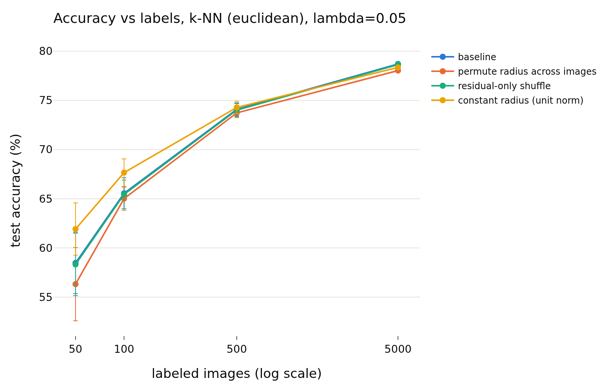
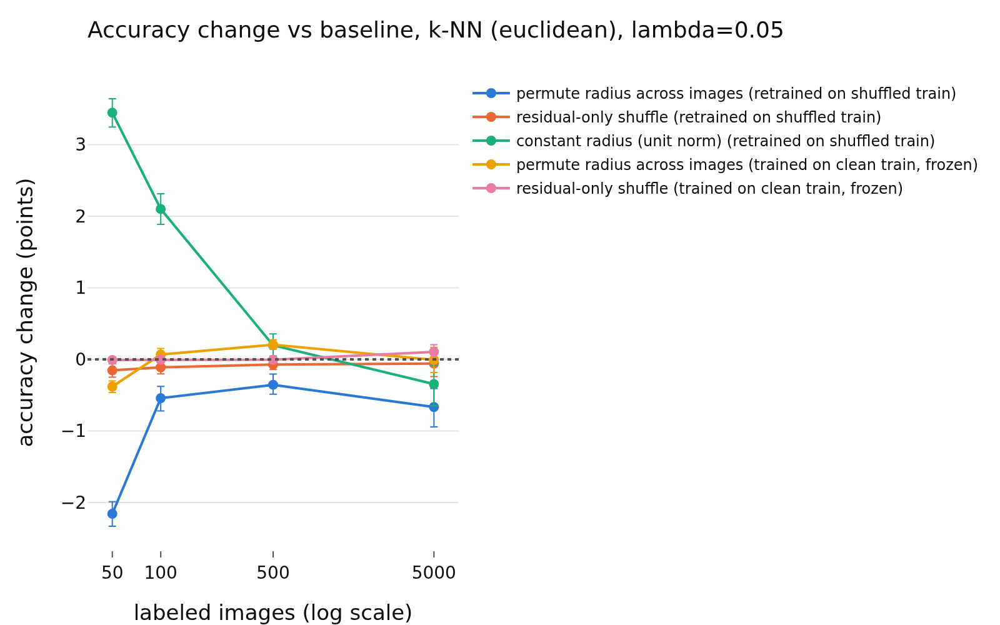
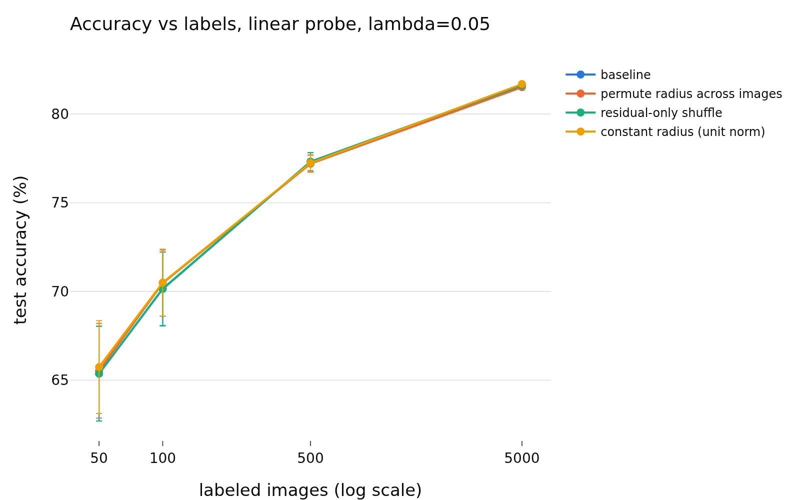
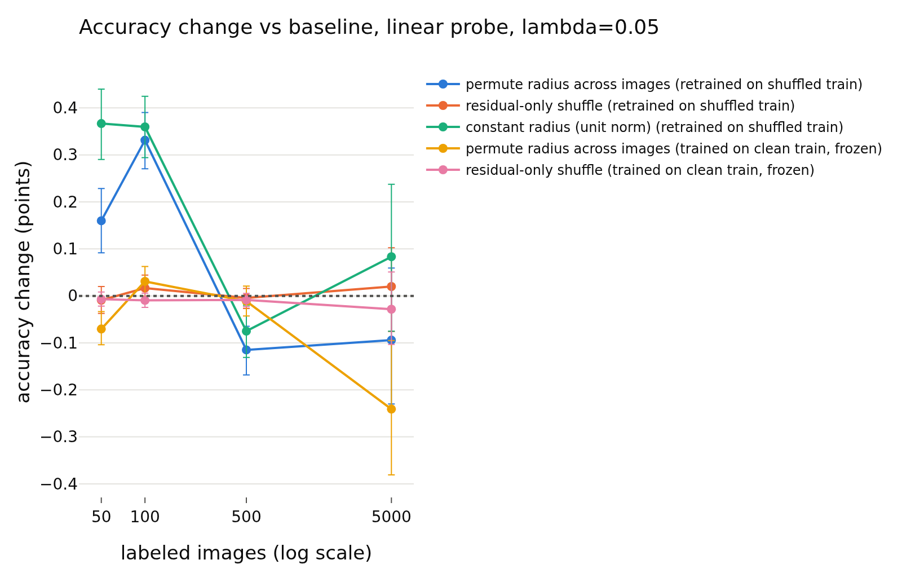
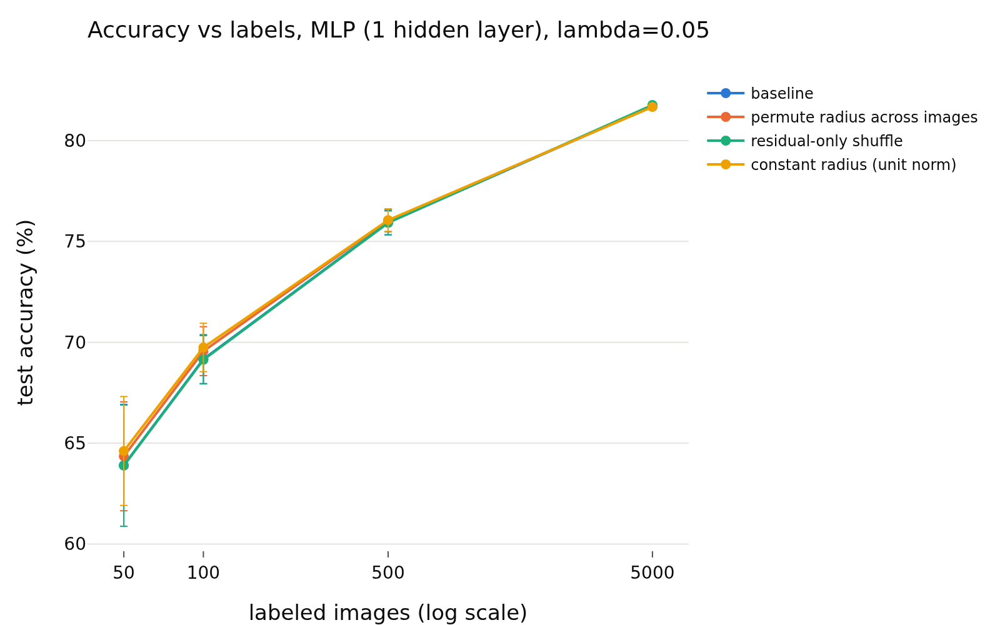
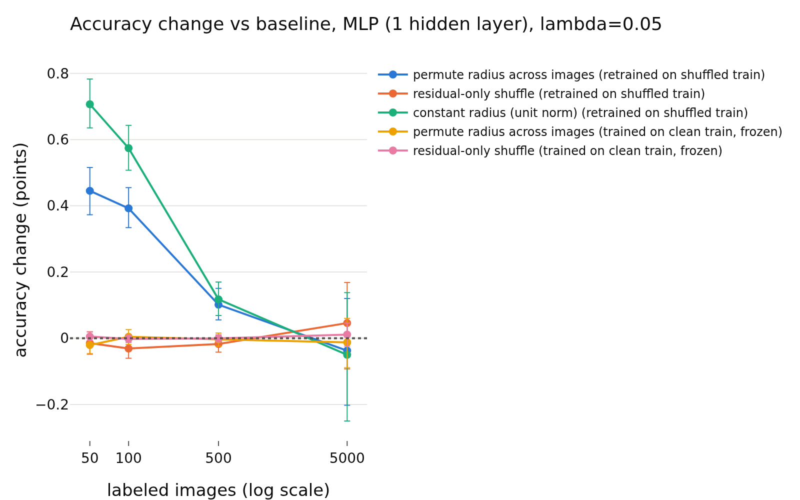

# E1-low-label: usage of the radius with scarce labels, lambda = 0.05
- **Branch / version:** `radius-usage-lowlabel` @ `9a46ed3c32e937d98696a5fdb80fee13d79eb963` (analysis code; per-run jobs at `5079b0a`, same evaluation code)
- **Run datetime (UTC):** 2026-10-25T21:02Z (aggregation; the per-run jobs ended 2026-10-25T20:41Z to 20:54Z, SLURM reports CDT = UTC-5, converted)
- **Command(s):**
  per run (SLURM, `sbatch --export=ALL`, 4 CPUs, 16 GB, CPU only; `<repo>` is the checkout of this branch; 9 jobs, one per run, 13-17 minutes each, jobs `radius_marginal_lam0.02_s{0,1,2}`: 2246242, 2246243, 2246244; `lam0.05_s{0,1,2}`: 2246245, 2246246, 2246247; `lam0.1_s{0,1,2}`: 2246249, 2246250, 2246294), `cd <repo> && sbatch --export=ALL slurm/lowlabel.sbatch configs/base.yaml radius_marginal <RUN>` which runs `apps/analyze.py --config configs/base.yaml --lowlabel radius_marginal --lowlabel-run <RUN>` with `OMP_NUM_THREADS=OPENBLAS_NUM_THREADS=2` (jobs ran at commit `5079b0a`; the evaluation code is unchanged since)
  Aggregation (this note): `cd <repo> && export OMP_NUM_THREADS=2 OPENBLAS_NUM_THREADS=2 PYTHONPATH=<repo>/src && <python> apps/analyze.py --config configs/base.yaml --lowlabel radius_marginal --lowlabel-lambda 0.05 --note radius_usage/lowlabel_lam0.05.md`
- **Datasets:** STL-10 `train` (the 5000 labeled images; the labeled bank is a class-balanced random subset of it) and `test` (8000 images, evaluation), clean, center views ([canonical](https://cs.stanford.edu/~acoates/stl10/), [HF `tanganke/stl10`](https://huggingface.co/datasets/tanganke/stl10)). The **canonical Stanford archive was used** (via the prepared arrays and the existing `stl10_train` / `stl10_test` embedding dumps); the HF page is linked for reference only.
- **Backbone:** ResNet-18 from scratch ([HF architecture reference](https://huggingface.co/timm/resnet18.a1_in1k), weights not used); `last.pt` (epoch 200) of `radius_marginal_lam0.05_s{0,1,2}` (Variant A).
- **Scope:** h is not analyzed; LeJEPA's product is z. All results are in z-space.
- **Equivalence margin:** 0.5 accuracy points, fixed before looking at any result (`eval.equivalence_margin`).

## Question

If the radius carried a confidence-like signal, it should matter most when labels are scarce, because a reader with little labeled data has little else to go on. Pre-stated hypothesis: randomizing the radius of z hurts the E1 readers more at 50-500 labels than with all 5000 labels. This note is the low-label repeat of E1 (`research_notes/radius_randomization/`) for lambda = 0.05, three training seeds; the cross-lambda reading is in `lowlabel_summary.md`.

## Setup (deviations from the base config)

Deviations from `configs/base.yaml`: none (k-NN `k` is capped by the per-class count, see below; 1000 bootstrap replicates, 5 shuffle repeats per randomized condition, margin 0.5 points = `eval.equivalence_margin`, 10 subsets = `eval.lowlabel_subsets`). Design, fixed in the code (`lejepa_norm.eval.lowlabel`) before any condition effect was looked at:

- **Budgets** (per class / total labels / share of the 5000-image labeled split): 5 / 50 / 1%, 10 / 100 / 2%, 50 / 500 / 10%, 500 / 5000 / 100% (the whole split; its single "subset" is the E1 setting).
- **Subsets:** 10 independent class-balanced random draws per budget (1 at 5000 labels). The draws depend only on the budget and the draw index, so every one of the 9 runs and every condition sees the same labeled images (paired). Subset-to-subset spread is reported (`subset SE`, `sd over subsets`).
- **Conditions, protocols, statistics:** exactly E1 (`lejepa_norm.eval.randomization`, same code path: `condition_cells`, `compare`): baseline, permute radius across images, residual-only shuffle, constant radius (unit norm); *retrained* and *frozen* protocols; paired bootstrap over test images within each seed, averaged over 3 seeds; TOST-style verdict with margin 0.5 points.
- **Readers:** Euclidean k-NN, linear probe, one-hidden-layer MLP (cosine k-NN dropped: radius-invariant by construction).
- **Hyperparameters** (decided before looking at condition effects): selected per subset on the *clean* labeled subset by stratified cross-validation inside the subset (`min(5, per-class count)` folds), then reused for all conditions and protocols. Linear probe `C` in {0.01, 0.1, 1}; MLP weight decay in {1e-4, 1e-2, 1} (the E1 grid); k-NN `k = min(20, per-class count)` (5 with 5 labels per class, 10 with 10, 20 beyond). At 5000 labels the cross-validation runs on the whole split (E1 used a single 20% validation split for the MLP; the linear probe used `C = 1`), so that budget is not bit-identical to E1.
- **Residual shuffle:** the direction -> log-radius regression uses no labels, so it is fitted once per run on the whole unlabeled `train` split (out-of-fold for the bank, E1 code) and the subset's images take their predictions from it. Fitting it on 50 images would be meaningless and would confound the condition with the budget.
- **Subset noise in the verdict:** the bootstrap interval conditions on the drawn subsets. `subset SE` is the standard error over subsets of the mean paired difference (combined over seeds); `verdict (with subsets)` adds it in quadrature to the bootstrap standard error (normal approximation). Because each subset's difference is measured on all test images, the subset SE also contains some test-image noise, i.e. it over-states the subset noise slightly: the second verdict is the stricter one. Training-seed variability beyond averaging 3 seeds is not covered (as in E1).

## Results

<!-- BEGIN GENERATED: analyze.lowlabel_comparison -->
### Paired accuracy change vs the baseline, per lambda and label budget

z-space, center views; labeled bank = a class-balanced random subset of STL-10 train, test set = STL-10 test; the same transformation is applied to bank and test set independently. Differences are in accuracy points (condition minus baseline on the same test images and the same subsets), averaged over training seeds and subsets. `90% CI, test images`: paired bootstrap (1000 replicates, test images resampled within each seed), conditional on the drawn subsets. `subset SE`: standard error of the mean paired difference over subsets. Verdicts, with the equivalence margin set to ±0.5 points before looking at results: `equivalent` if the 90% interval (TOST at 5%) lies inside the margin, `different` if not equivalent and the 95% interval excludes 0, otherwise `inconclusive`; `(with subsets)` adds the subset SE in quadrature to the bootstrap SE (normal approximation).

| lambda | labels | subsets | reader | protocol | condition | baseline acc | condition acc | difference (points) | 90% CI, test images (points) | subset SE (points) | verdict (test images) | verdict (with subsets) |
|---|---|---|---|---|---|---|---|---|---|---|---|---|
| 0.05 | 50 | 10 | k-NN (euclidean) | retrained on shuffled train | permute radius across images | 0.5848 | 0.5632 | -2.16 | [-2.30, -2.02] | 0.31 | different | different |
| 0.05 | 50 | 10 | k-NN (euclidean) | retrained on shuffled train | residual-only shuffle | 0.5848 | 0.5832 | -0.15 | [-0.23, -0.08] | 0.20 | equivalent | equivalent |
| 0.05 | 50 | 10 | k-NN (euclidean) | retrained on shuffled train | constant radius (unit norm) | 0.5848 | 0.6192 | +3.45 | [+3.27, +3.61] | 0.33 | different | different |
| 0.05 | 50 | 10 | k-NN (euclidean) | trained on clean train, frozen | permute radius across images | 0.5848 | 0.5810 | -0.38 | [-0.45, -0.31] | 0.10 | equivalent | different |
| 0.05 | 50 | 10 | k-NN (euclidean) | trained on clean train, frozen | residual-only shuffle | 0.5848 | 0.5847 | -0.01 | [-0.04, +0.02] | 0.02 | equivalent | equivalent |
| 0.05 | 50 | 10 | k-NN (euclidean) | trained on clean train, frozen | constant radius (unit norm) | 0.5848 | 0.1173 | -46.75 | [-47.13, -46.37] | 0.59 | different | different |
| 0.05 | 50 | 10 | linear probe | retrained on shuffled train | permute radius across images | 0.6538 | 0.6554 | +0.16 | [+0.10, +0.22] | 0.05 | equivalent | equivalent |
| 0.05 | 50 | 10 | linear probe | retrained on shuffled train | residual-only shuffle | 0.6538 | 0.6537 | -0.01 | [-0.03, +0.02] | 0.02 | equivalent | equivalent |
| 0.05 | 50 | 10 | linear probe | retrained on shuffled train | constant radius (unit norm) | 0.6538 | 0.6575 | +0.37 | [+0.30, +0.42] | 0.09 | equivalent | different |
| 0.05 | 50 | 10 | linear probe | trained on clean train, frozen | permute radius across images | 0.6538 | 0.6531 | -0.07 | [-0.10, -0.04] | 0.03 | equivalent | equivalent |
| 0.05 | 50 | 10 | linear probe | trained on clean train, frozen | residual-only shuffle | 0.6538 | 0.6537 | -0.01 | [-0.02, +0.01] | 0.01 | equivalent | equivalent |
| 0.05 | 50 | 10 | linear probe | trained on clean train, frozen | constant radius (unit norm) | 0.6538 | 0.1789 | -47.49 | [-47.88, -47.09] | 1.28 | different | different |
| 0.05 | 50 | 10 | MLP (1 hidden layer) | retrained on shuffled train | permute radius across images | 0.6390 | 0.6435 | +0.45 | [+0.39, +0.50] | 0.12 | different | different |
| 0.05 | 50 | 10 | MLP (1 hidden layer) | retrained on shuffled train | residual-only shuffle | 0.6390 | 0.6389 | -0.01 | [-0.04, +0.02] | 0.02 | equivalent | equivalent |
| 0.05 | 50 | 10 | MLP (1 hidden layer) | retrained on shuffled train | constant radius (unit norm) | 0.6390 | 0.6461 | +0.71 | [+0.65, +0.77] | 0.14 | different | different |
| 0.05 | 50 | 10 | MLP (1 hidden layer) | trained on clean train, frozen | permute radius across images | 0.6390 | 0.6388 | -0.02 | [-0.04, +0.00] | 0.02 | equivalent | equivalent |
| 0.05 | 50 | 10 | MLP (1 hidden layer) | trained on clean train, frozen | residual-only shuffle | 0.6390 | 0.6391 | +0.01 | [-0.01, +0.02] | 0.01 | equivalent | equivalent |
| 0.05 | 50 | 10 | MLP (1 hidden layer) | trained on clean train, frozen | constant radius (unit norm) | 0.6390 | 0.2580 | -38.10 | [-38.42, -37.78] | 1.26 | different | different |
| 0.05 | 100 | 10 | k-NN (euclidean) | retrained on shuffled train | permute radius across images | 0.6556 | 0.6502 | -0.54 | [-0.69, -0.40] | 0.18 | different | different |
| 0.05 | 100 | 10 | k-NN (euclidean) | retrained on shuffled train | residual-only shuffle | 0.6556 | 0.6545 | -0.11 | [-0.19, -0.03] | 0.12 | equivalent | equivalent |
| 0.05 | 100 | 10 | k-NN (euclidean) | retrained on shuffled train | constant radius (unit norm) | 0.6556 | 0.6766 | +2.10 | [+1.92, +2.28] | 0.22 | different | different |
| 0.05 | 100 | 10 | k-NN (euclidean) | trained on clean train, frozen | permute radius across images | 0.6556 | 0.6563 | +0.07 | [+0.00, +0.13] | 0.03 | equivalent | equivalent |
| 0.05 | 100 | 10 | k-NN (euclidean) | trained on clean train, frozen | residual-only shuffle | 0.6556 | 0.6555 | -0.01 | [-0.04, +0.03] | 0.02 | equivalent | equivalent |
| 0.05 | 100 | 10 | k-NN (euclidean) | trained on clean train, frozen | constant radius (unit norm) | 0.6556 | 0.1162 | -53.94 | [-54.35, -53.52] | 0.52 | different | different |
| 0.05 | 100 | 10 | linear probe | retrained on shuffled train | permute radius across images | 0.7015 | 0.7048 | +0.33 | [+0.28, +0.38] | 0.05 | equivalent | equivalent |
| 0.05 | 100 | 10 | linear probe | retrained on shuffled train | residual-only shuffle | 0.7015 | 0.7016 | +0.02 | [-0.00, +0.04] | 0.02 | equivalent | equivalent |
| 0.05 | 100 | 10 | linear probe | retrained on shuffled train | constant radius (unit norm) | 0.7015 | 0.7051 | +0.36 | [+0.30, +0.42] | 0.06 | equivalent | equivalent |
| 0.05 | 100 | 10 | linear probe | trained on clean train, frozen | permute radius across images | 0.7015 | 0.7018 | +0.03 | [+0.00, +0.06] | 0.02 | equivalent | equivalent |
| 0.05 | 100 | 10 | linear probe | trained on clean train, frozen | residual-only shuffle | 0.7015 | 0.7014 | -0.01 | [-0.02, +0.00] | 0.01 | equivalent | equivalent |
| 0.05 | 100 | 10 | linear probe | trained on clean train, frozen | constant radius (unit norm) | 0.7015 | 0.1675 | -53.40 | [-53.82, -52.96] | 1.29 | different | different |
| 0.05 | 100 | 10 | MLP (1 hidden layer) | retrained on shuffled train | permute radius across images | 0.6917 | 0.6956 | +0.39 | [+0.34, +0.45] | 0.05 | equivalent | equivalent |
| 0.05 | 100 | 10 | MLP (1 hidden layer) | retrained on shuffled train | residual-only shuffle | 0.6917 | 0.6914 | -0.03 | [-0.05, -0.01] | 0.02 | equivalent | equivalent |
| 0.05 | 100 | 10 | MLP (1 hidden layer) | retrained on shuffled train | constant radius (unit norm) | 0.6917 | 0.6974 | +0.57 | [+0.52, +0.63] | 0.05 | different | different |
| 0.05 | 100 | 10 | MLP (1 hidden layer) | trained on clean train, frozen | permute radius across images | 0.6917 | 0.6917 | +0.00 | [-0.01, +0.02] | 0.02 | equivalent | equivalent |
| 0.05 | 100 | 10 | MLP (1 hidden layer) | trained on clean train, frozen | residual-only shuffle | 0.6917 | 0.6916 | -0.00 | [-0.01, +0.01] | 0.01 | equivalent | equivalent |
| 0.05 | 100 | 10 | MLP (1 hidden layer) | trained on clean train, frozen | constant radius (unit norm) | 0.6917 | 0.2683 | -42.34 | [-42.72, -41.93] | 1.95 | different | different |
| 0.05 | 500 | 10 | k-NN (euclidean) | retrained on shuffled train | permute radius across images | 0.7409 | 0.7374 | -0.36 | [-0.47, -0.23] | 0.07 | equivalent | different |
| 0.05 | 500 | 10 | k-NN (euclidean) | retrained on shuffled train | residual-only shuffle | 0.7409 | 0.7402 | -0.07 | [-0.13, -0.01] | 0.04 | equivalent | equivalent |
| 0.05 | 500 | 10 | k-NN (euclidean) | retrained on shuffled train | constant radius (unit norm) | 0.7409 | 0.7429 | +0.20 | [+0.07, +0.33] | 0.08 | equivalent | equivalent |
| 0.05 | 500 | 10 | k-NN (euclidean) | trained on clean train, frozen | permute radius across images | 0.7409 | 0.7429 | +0.20 | [+0.15, +0.26] | 0.03 | equivalent | equivalent |
| 0.05 | 500 | 10 | k-NN (euclidean) | trained on clean train, frozen | residual-only shuffle | 0.7409 | 0.7409 | -0.01 | [-0.04, +0.03] | 0.03 | equivalent | equivalent |
| 0.05 | 500 | 10 | k-NN (euclidean) | trained on clean train, frozen | constant radius (unit norm) | 0.7409 | 0.1184 | -62.25 | [-62.72, -61.80] | 0.54 | different | different |
| 0.05 | 500 | 10 | linear probe | retrained on shuffled train | permute radius across images | 0.7732 | 0.7720 | -0.11 | [-0.16, -0.07] | 0.03 | equivalent | equivalent |
| 0.05 | 500 | 10 | linear probe | retrained on shuffled train | residual-only shuffle | 0.7732 | 0.7731 | -0.00 | [-0.02, +0.01] | 0.01 | equivalent | equivalent |
| 0.05 | 500 | 10 | linear probe | retrained on shuffled train | constant radius (unit norm) | 0.7732 | 0.7724 | -0.07 | [-0.12, -0.03] | 0.03 | equivalent | equivalent |
| 0.05 | 500 | 10 | linear probe | trained on clean train, frozen | permute radius across images | 0.7732 | 0.7731 | -0.01 | [-0.04, +0.02] | 0.02 | equivalent | equivalent |
| 0.05 | 500 | 10 | linear probe | trained on clean train, frozen | residual-only shuffle | 0.7732 | 0.7731 | -0.01 | [-0.02, +0.00] | 0.01 | equivalent | equivalent |
| 0.05 | 500 | 10 | linear probe | trained on clean train, frozen | constant radius (unit norm) | 0.7732 | 0.2091 | -56.40 | [-56.83, -55.93] | 1.19 | different | different |
| 0.05 | 500 | 10 | MLP (1 hidden layer) | retrained on shuffled train | permute radius across images | 0.7594 | 0.7604 | +0.10 | [+0.06, +0.14] | 0.03 | equivalent | equivalent |
| 0.05 | 500 | 10 | MLP (1 hidden layer) | retrained on shuffled train | residual-only shuffle | 0.7594 | 0.7592 | -0.02 | [-0.04, +0.00] | 0.01 | equivalent | equivalent |
| 0.05 | 500 | 10 | MLP (1 hidden layer) | retrained on shuffled train | constant radius (unit norm) | 0.7594 | 0.7606 | +0.12 | [+0.07, +0.16] | 0.03 | equivalent | equivalent |
| 0.05 | 500 | 10 | MLP (1 hidden layer) | trained on clean train, frozen | permute radius across images | 0.7594 | 0.7594 | -0.00 | [-0.02, +0.01] | 0.01 | equivalent | equivalent |
| 0.05 | 500 | 10 | MLP (1 hidden layer) | trained on clean train, frozen | residual-only shuffle | 0.7594 | 0.7594 | -0.00 | [-0.01, +0.01] | 0.01 | equivalent | equivalent |
| 0.05 | 500 | 10 | MLP (1 hidden layer) | trained on clean train, frozen | constant radius (unit norm) | 0.7594 | 0.4203 | -33.91 | [-34.28, -33.52] | 1.88 | different | different |
| 0.05 | 5000 | 1 | k-NN (euclidean) | retrained on shuffled train | permute radius across images | 0.7870 | 0.7804 | -0.67 | [-0.89, -0.45] | 0.00 | different | different |
| 0.05 | 5000 | 1 | k-NN (euclidean) | retrained on shuffled train | residual-only shuffle | 0.7870 | 0.7864 | -0.06 | [-0.22, +0.09] | 0.00 | equivalent | equivalent |
| 0.05 | 5000 | 1 | k-NN (euclidean) | retrained on shuffled train | constant radius (unit norm) | 0.7870 | 0.7836 | -0.35 | [-0.60, -0.12] | 0.00 | different | different |
| 0.05 | 5000 | 1 | k-NN (euclidean) | trained on clean train, frozen | permute radius across images | 0.7870 | 0.7870 | -0.01 | [-0.16, +0.14] | 0.00 | equivalent | equivalent |
| 0.05 | 5000 | 1 | k-NN (euclidean) | trained on clean train, frozen | residual-only shuffle | 0.7870 | 0.7881 | +0.11 | [+0.02, +0.19] | 0.00 | equivalent | equivalent |
| 0.05 | 5000 | 1 | k-NN (euclidean) | trained on clean train, frozen | constant radius (unit norm) | 0.7870 | 0.1425 | -64.45 | [-65.06, -63.89] | 0.00 | different | different |
| 0.05 | 5000 | 1 | linear probe | retrained on shuffled train | permute radius across images | 0.8161 | 0.8151 | -0.09 | [-0.21, +0.03] | 0.00 | equivalent | equivalent |
| 0.05 | 5000 | 1 | linear probe | retrained on shuffled train | residual-only shuffle | 0.8161 | 0.8163 | +0.02 | [-0.06, +0.09] | 0.00 | equivalent | equivalent |
| 0.05 | 5000 | 1 | linear probe | retrained on shuffled train | constant radius (unit norm) | 0.8161 | 0.8169 | +0.08 | [-0.05, +0.21] | 0.00 | equivalent | equivalent |
| 0.05 | 5000 | 1 | linear probe | trained on clean train, frozen | permute radius across images | 0.8161 | 0.8137 | -0.24 | [-0.36, -0.12] | 0.00 | equivalent | equivalent |
| 0.05 | 5000 | 1 | linear probe | trained on clean train, frozen | residual-only shuffle | 0.8161 | 0.8158 | -0.03 | [-0.09, +0.03] | 0.00 | equivalent | equivalent |
| 0.05 | 5000 | 1 | linear probe | trained on clean train, frozen | constant radius (unit norm) | 0.8161 | 0.1471 | -66.90 | [-67.48, -66.32] | 0.00 | different | different |
| 0.05 | 5000 | 1 | MLP (1 hidden layer) | retrained on shuffled train | permute radius across images | 0.8172 | 0.8168 | -0.04 | [-0.18, +0.10] | 0.00 | equivalent | equivalent |
| 0.05 | 5000 | 1 | MLP (1 hidden layer) | retrained on shuffled train | residual-only shuffle | 0.8172 | 0.8177 | +0.05 | [-0.07, +0.15] | 0.00 | equivalent | equivalent |
| 0.05 | 5000 | 1 | MLP (1 hidden layer) | retrained on shuffled train | constant radius (unit norm) | 0.8172 | 0.8167 | -0.05 | [-0.22, +0.12] | 0.00 | equivalent | equivalent |
| 0.05 | 5000 | 1 | MLP (1 hidden layer) | trained on clean train, frozen | permute radius across images | 0.8172 | 0.8171 | -0.01 | [-0.08, +0.05] | 0.00 | equivalent | equivalent |
| 0.05 | 5000 | 1 | MLP (1 hidden layer) | trained on clean train, frozen | residual-only shuffle | 0.8172 | 0.8173 | +0.01 | [-0.02, +0.04] | 0.00 | equivalent | equivalent |
| 0.05 | 5000 | 1 | MLP (1 hidden layer) | trained on clean train, frozen | constant radius (unit norm) | 0.8172 | 0.4395 | -37.77 | [-38.40, -37.24] | 0.00 | different | different |
<!-- END GENERATED: analyze.lowlabel_comparison -->

<!-- BEGIN GENERATED: analyze.lowlabel_summary -->
### Compact view

Accuracy change in points, `difference [90% CI including subset noise] verdict(test images)/verdict(with subsets)` with E = equivalent (margin ±0.5 points), D = different, I = inconclusive. The frozen constant-radius cell (chance level, a distribution-shift artifact) is omitted.

| protocol | reader | condition | lambda 0.05, 50 labels | lambda 0.05, 100 labels | lambda 0.05, 500 labels | lambda 0.05, 5000 labels |
|---|---|---|---|---|---|---|
| retrained on shuffled train | k-NN (euclidean) | permute radius across images | -2.16 [-2.68, -1.64] D/D | -0.54 [-0.88, -0.21] D/D | -0.36 [-0.52, -0.20] E/D | -0.67 [-0.89, -0.44] D/D |
| retrained on shuffled train | k-NN (euclidean) | residual-only shuffle | -0.15 [-0.49, +0.18] E/E | -0.11 [-0.32, +0.10] E/E | -0.07 [-0.17, +0.02] E/E | -0.06 [-0.21, +0.09] E/E |
| retrained on shuffled train | k-NN (euclidean) | constant radius (unit norm) | +3.45 [+2.88, +4.02] D/D | +2.10 [+1.70, +2.50] D/D | +0.20 [+0.02, +0.38] E/E | -0.35 [-0.58, -0.11] D/D |
| retrained on shuffled train | linear probe | permute radius across images | +0.16 [+0.05, +0.27] E/E | +0.33 [+0.23, +0.43] E/E | -0.11 [-0.18, -0.05] E/E | -0.09 [-0.22, +0.03] E/E |
| retrained on shuffled train | linear probe | residual-only shuffle | -0.01 [-0.05, +0.03] E/E | +0.02 [-0.02, +0.06] E/E | -0.00 [-0.03, +0.02] E/E | +0.02 [-0.06, +0.10] E/E |
| retrained on shuffled train | linear probe | constant radius (unit norm) | +0.37 [+0.21, +0.52] E/D | +0.36 [+0.25, +0.47] E/E | -0.07 [-0.14, -0.01] E/E | +0.08 [-0.05, +0.21] E/E |
| retrained on shuffled train | MLP (1 hidden layer) | permute radius across images | +0.45 [+0.24, +0.65] D/D | +0.39 [+0.30, +0.48] E/E | +0.10 [+0.04, +0.16] E/E | -0.04 [-0.18, +0.10] E/E |
| retrained on shuffled train | MLP (1 hidden layer) | residual-only shuffle | -0.01 [-0.06, +0.03] E/E | -0.03 [-0.08, +0.02] E/E | -0.02 [-0.05, +0.01] E/E | +0.05 [-0.06, +0.16] E/E |
| retrained on shuffled train | MLP (1 hidden layer) | constant radius (unit norm) | +0.71 [+0.47, +0.94] D/D | +0.57 [+0.48, +0.67] D/D | +0.12 [+0.06, +0.18] E/E | -0.05 [-0.22, +0.12] E/E |
| trained on clean train, frozen | k-NN (euclidean) | permute radius across images | -0.38 [-0.55, -0.21] E/D | +0.07 [-0.02, +0.15] E/E | +0.20 [+0.13, +0.28] E/E | -0.01 [-0.15, +0.14] E/E |
| trained on clean train, frozen | k-NN (euclidean) | residual-only shuffle | -0.01 [-0.05, +0.03] E/E | -0.01 [-0.06, +0.04] E/E | -0.01 [-0.06, +0.05] E/E | +0.11 [+0.02, +0.19] E/E |
| trained on clean train, frozen | linear probe | permute radius across images | -0.07 [-0.13, -0.01] E/E | +0.03 [-0.01, +0.07] E/E | -0.01 [-0.05, +0.03] E/E | -0.24 [-0.36, -0.12] E/E |
| trained on clean train, frozen | linear probe | residual-only shuffle | -0.01 [-0.02, +0.01] E/E | -0.01 [-0.03, +0.01] E/E | -0.01 [-0.02, +0.01] E/E | -0.03 [-0.09, +0.03] E/E |
| trained on clean train, frozen | MLP (1 hidden layer) | permute radius across images | -0.02 [-0.06, +0.02] E/E | +0.00 [-0.03, +0.04] E/E | -0.00 [-0.03, +0.02] E/E | -0.01 [-0.07, +0.05] E/E |
| trained on clean train, frozen | MLP (1 hidden layer) | residual-only shuffle | +0.01 [-0.01, +0.02] E/E | -0.00 [-0.02, +0.01] E/E | -0.00 [-0.01, +0.01] E/E | +0.01 [-0.02, +0.04] E/E |
<!-- END GENERATED: analyze.lowlabel_summary -->

<!-- BEGIN GENERATED: analyze.lowlabel_accuracy -->
### Accuracy per label budget

| lambda | labels | reader | protocol | condition | accuracy, mean ± sd over seeds | sd over subsets (mean over seeds) |
|---|---|---|---|---|---|---|
| 0.05 | 50 | k-NN (euclidean) | retrained on shuffled train | baseline | 0.5848 ± 0.0026 | 0.0312 |
| 0.05 | 50 | k-NN (euclidean) | retrained on shuffled train | permute radius across images | 0.5632 ± 0.0048 | 0.0372 |
| 0.05 | 50 | k-NN (euclidean) | retrained on shuffled train | residual-only shuffle | 0.5832 ± 0.0038 | 0.0317 |
| 0.05 | 50 | k-NN (euclidean) | retrained on shuffled train | constant radius (unit norm) | 0.6192 ± 0.0017 | 0.0266 |
| 0.05 | 50 | k-NN (euclidean) | trained on clean train, frozen | baseline | 0.5848 ± 0.0026 | 0.0312 |
| 0.05 | 50 | k-NN (euclidean) | trained on clean train, frozen | permute radius across images | 0.5810 ± 0.0037 | 0.0326 |
| 0.05 | 50 | k-NN (euclidean) | trained on clean train, frozen | residual-only shuffle | 0.5847 ± 0.0027 | 0.0313 |
| 0.05 | 50 | k-NN (euclidean) | trained on clean train, frozen | constant radius (unit norm) | 0.1173 ± 0.0111 | 0.0221 |
| 0.05 | 50 | linear probe | retrained on shuffled train | baseline | 0.6538 ± 0.0010 | 0.0267 |
| 0.05 | 50 | linear probe | retrained on shuffled train | permute radius across images | 0.6554 ± 0.0007 | 0.0267 |
| 0.05 | 50 | linear probe | retrained on shuffled train | residual-only shuffle | 0.6537 ± 0.0009 | 0.0266 |
| 0.05 | 50 | linear probe | retrained on shuffled train | constant radius (unit norm) | 0.6575 ± 0.0007 | 0.0261 |
| 0.05 | 50 | linear probe | trained on clean train, frozen | baseline | 0.6538 ± 0.0010 | 0.0267 |
| 0.05 | 50 | linear probe | trained on clean train, frozen | permute radius across images | 0.6531 ± 0.0012 | 0.0275 |
| 0.05 | 50 | linear probe | trained on clean train, frozen | residual-only shuffle | 0.6537 ± 0.0010 | 0.0267 |
| 0.05 | 50 | linear probe | trained on clean train, frozen | constant radius (unit norm) | 0.1789 ± 0.0122 | 0.0632 |
| 0.05 | 50 | MLP (1 hidden layer) | retrained on shuffled train | baseline | 0.6390 ± 0.0031 | 0.0302 |
| 0.05 | 50 | MLP (1 hidden layer) | retrained on shuffled train | permute radius across images | 0.6435 ± 0.0038 | 0.0270 |
| 0.05 | 50 | MLP (1 hidden layer) | retrained on shuffled train | residual-only shuffle | 0.6389 ± 0.0033 | 0.0301 |
| 0.05 | 50 | MLP (1 hidden layer) | retrained on shuffled train | constant radius (unit norm) | 0.6461 ± 0.0041 | 0.0270 |
| 0.05 | 50 | MLP (1 hidden layer) | trained on clean train, frozen | baseline | 0.6390 ± 0.0031 | 0.0302 |
| 0.05 | 50 | MLP (1 hidden layer) | trained on clean train, frozen | permute radius across images | 0.6388 ± 0.0032 | 0.0304 |
| 0.05 | 50 | MLP (1 hidden layer) | trained on clean train, frozen | residual-only shuffle | 0.6391 ± 0.0030 | 0.0303 |
| 0.05 | 50 | MLP (1 hidden layer) | trained on clean train, frozen | constant radius (unit norm) | 0.2580 ± 0.0186 | 0.0688 |
| 0.05 | 100 | k-NN (euclidean) | retrained on shuffled train | baseline | 0.6556 ± 0.0020 | 0.0158 |
| 0.05 | 100 | k-NN (euclidean) | retrained on shuffled train | permute radius across images | 0.6502 ± 0.0026 | 0.0118 |
| 0.05 | 100 | k-NN (euclidean) | retrained on shuffled train | residual-only shuffle | 0.6545 ± 0.0017 | 0.0146 |
| 0.05 | 100 | k-NN (euclidean) | retrained on shuffled train | constant radius (unit norm) | 0.6766 ± 0.0010 | 0.0140 |
| 0.05 | 100 | k-NN (euclidean) | trained on clean train, frozen | baseline | 0.6556 ± 0.0020 | 0.0158 |
| 0.05 | 100 | k-NN (euclidean) | trained on clean train, frozen | permute radius across images | 0.6563 ± 0.0023 | 0.0159 |
| 0.05 | 100 | k-NN (euclidean) | trained on clean train, frozen | residual-only shuffle | 0.6555 ± 0.0021 | 0.0156 |
| 0.05 | 100 | k-NN (euclidean) | trained on clean train, frozen | constant radius (unit norm) | 0.1162 ± 0.0062 | 0.0264 |
| 0.05 | 100 | linear probe | retrained on shuffled train | baseline | 0.7015 ± 0.0037 | 0.0208 |
| 0.05 | 100 | linear probe | retrained on shuffled train | permute radius across images | 0.7048 ± 0.0026 | 0.0187 |
| 0.05 | 100 | linear probe | retrained on shuffled train | residual-only shuffle | 0.7016 ± 0.0034 | 0.0207 |
| 0.05 | 100 | linear probe | retrained on shuffled train | constant radius (unit norm) | 0.7051 ± 0.0029 | 0.0188 |
| 0.05 | 100 | linear probe | trained on clean train, frozen | baseline | 0.7015 ± 0.0037 | 0.0208 |
| 0.05 | 100 | linear probe | trained on clean train, frozen | permute radius across images | 0.7018 ± 0.0036 | 0.0209 |
| 0.05 | 100 | linear probe | trained on clean train, frozen | residual-only shuffle | 0.7014 ± 0.0036 | 0.0209 |
| 0.05 | 100 | linear probe | trained on clean train, frozen | constant radius (unit norm) | 0.1675 ± 0.0080 | 0.0712 |
| 0.05 | 100 | MLP (1 hidden layer) | retrained on shuffled train | baseline | 0.6917 ± 0.0016 | 0.0121 |
| 0.05 | 100 | MLP (1 hidden layer) | retrained on shuffled train | permute radius across images | 0.6956 ± 0.0019 | 0.0121 |
| 0.05 | 100 | MLP (1 hidden layer) | retrained on shuffled train | residual-only shuffle | 0.6914 ± 0.0017 | 0.0120 |
| 0.05 | 100 | MLP (1 hidden layer) | retrained on shuffled train | constant radius (unit norm) | 0.6974 ± 0.0026 | 0.0120 |
| 0.05 | 100 | MLP (1 hidden layer) | trained on clean train, frozen | baseline | 0.6917 ± 0.0016 | 0.0121 |
| 0.05 | 100 | MLP (1 hidden layer) | trained on clean train, frozen | permute radius across images | 0.6917 ± 0.0018 | 0.0122 |
| 0.05 | 100 | MLP (1 hidden layer) | trained on clean train, frozen | residual-only shuffle | 0.6916 ± 0.0017 | 0.0122 |
| 0.05 | 100 | MLP (1 hidden layer) | trained on clean train, frozen | constant radius (unit norm) | 0.2683 ± 0.0290 | 0.1108 |
| 0.05 | 500 | k-NN (euclidean) | retrained on shuffled train | baseline | 0.7409 ± 0.0008 | 0.0066 |
| 0.05 | 500 | k-NN (euclidean) | retrained on shuffled train | permute radius across images | 0.7374 ± 0.0017 | 0.0048 |
| 0.05 | 500 | k-NN (euclidean) | retrained on shuffled train | residual-only shuffle | 0.7402 ± 0.0012 | 0.0066 |
| 0.05 | 500 | k-NN (euclidean) | retrained on shuffled train | constant radius (unit norm) | 0.7429 ± 0.0014 | 0.0063 |
| 0.05 | 500 | k-NN (euclidean) | trained on clean train, frozen | baseline | 0.7409 ± 0.0008 | 0.0066 |
| 0.05 | 500 | k-NN (euclidean) | trained on clean train, frozen | permute radius across images | 0.7429 ± 0.0008 | 0.0067 |
| 0.05 | 500 | k-NN (euclidean) | trained on clean train, frozen | residual-only shuffle | 0.7409 ± 0.0007 | 0.0069 |
| 0.05 | 500 | k-NN (euclidean) | trained on clean train, frozen | constant radius (unit norm) | 0.1184 ± 0.0057 | 0.0274 |
| 0.05 | 500 | linear probe | retrained on shuffled train | baseline | 0.7732 ± 0.0009 | 0.0051 |
| 0.05 | 500 | linear probe | retrained on shuffled train | permute radius across images | 0.7720 ± 0.0007 | 0.0048 |
| 0.05 | 500 | linear probe | retrained on shuffled train | residual-only shuffle | 0.7731 ± 0.0008 | 0.0051 |
| 0.05 | 500 | linear probe | retrained on shuffled train | constant radius (unit norm) | 0.7724 ± 0.0007 | 0.0046 |
| 0.05 | 500 | linear probe | trained on clean train, frozen | baseline | 0.7732 ± 0.0009 | 0.0051 |
| 0.05 | 500 | linear probe | trained on clean train, frozen | permute radius across images | 0.7731 ± 0.0008 | 0.0052 |
| 0.05 | 500 | linear probe | trained on clean train, frozen | residual-only shuffle | 0.7731 ± 0.0010 | 0.0051 |
| 0.05 | 500 | linear probe | trained on clean train, frozen | constant radius (unit norm) | 0.2092 ± 0.0060 | 0.0638 |
| 0.05 | 500 | MLP (1 hidden layer) | retrained on shuffled train | baseline | 0.7594 ± 0.0018 | 0.0061 |
| 0.05 | 500 | MLP (1 hidden layer) | retrained on shuffled train | permute radius across images | 0.7604 ± 0.0017 | 0.0056 |
| 0.05 | 500 | MLP (1 hidden layer) | retrained on shuffled train | residual-only shuffle | 0.7592 ± 0.0019 | 0.0059 |
| 0.05 | 500 | MLP (1 hidden layer) | retrained on shuffled train | constant radius (unit norm) | 0.7606 ± 0.0019 | 0.0056 |
| 0.05 | 500 | MLP (1 hidden layer) | trained on clean train, frozen | baseline | 0.7594 ± 0.0018 | 0.0061 |
| 0.05 | 500 | MLP (1 hidden layer) | trained on clean train, frozen | permute radius across images | 0.7594 ± 0.0019 | 0.0060 |
| 0.05 | 500 | MLP (1 hidden layer) | trained on clean train, frozen | residual-only shuffle | 0.7594 ± 0.0018 | 0.0061 |
| 0.05 | 500 | MLP (1 hidden layer) | trained on clean train, frozen | constant radius (unit norm) | 0.4203 ± 0.0407 | 0.0969 |
| 0.05 | 5000 | k-NN (euclidean) | retrained on shuffled train | baseline | 0.7870 ± 0.0022 | 0.0000 |
| 0.05 | 5000 | k-NN (euclidean) | retrained on shuffled train | permute radius across images | 0.7804 ± 0.0010 | 0.0000 |
| 0.05 | 5000 | k-NN (euclidean) | retrained on shuffled train | residual-only shuffle | 0.7864 ± 0.0029 | 0.0000 |
| 0.05 | 5000 | k-NN (euclidean) | retrained on shuffled train | constant radius (unit norm) | 0.7836 ± 0.0011 | 0.0000 |
| 0.05 | 5000 | k-NN (euclidean) | trained on clean train, frozen | baseline | 0.7870 ± 0.0022 | 0.0000 |
| 0.05 | 5000 | k-NN (euclidean) | trained on clean train, frozen | permute radius across images | 0.7870 ± 0.0006 | 0.0000 |
| 0.05 | 5000 | k-NN (euclidean) | trained on clean train, frozen | residual-only shuffle | 0.7881 ± 0.0028 | 0.0000 |
| 0.05 | 5000 | k-NN (euclidean) | trained on clean train, frozen | constant radius (unit norm) | 0.1425 ± 0.0486 | 0.0000 |
| 0.05 | 5000 | linear probe | retrained on shuffled train | baseline | 0.8161 ± 0.0018 | 0.0000 |
| 0.05 | 5000 | linear probe | retrained on shuffled train | permute radius across images | 0.8151 ± 0.0004 | 0.0000 |
| 0.05 | 5000 | linear probe | retrained on shuffled train | residual-only shuffle | 0.8163 ± 0.0015 | 0.0000 |
| 0.05 | 5000 | linear probe | retrained on shuffled train | constant radius (unit norm) | 0.8169 ± 0.0007 | 0.0000 |
| 0.05 | 5000 | linear probe | trained on clean train, frozen | baseline | 0.8161 ± 0.0018 | 0.0000 |
| 0.05 | 5000 | linear probe | trained on clean train, frozen | permute radius across images | 0.8137 ± 0.0010 | 0.0000 |
| 0.05 | 5000 | linear probe | trained on clean train, frozen | residual-only shuffle | 0.8158 ± 0.0013 | 0.0000 |
| 0.05 | 5000 | linear probe | trained on clean train, frozen | constant radius (unit norm) | 0.1471 ± 0.0417 | 0.0000 |
| 0.05 | 5000 | MLP (1 hidden layer) | retrained on shuffled train | baseline | 0.8172 ± 0.0009 | 0.0000 |
| 0.05 | 5000 | MLP (1 hidden layer) | retrained on shuffled train | permute radius across images | 0.8168 ± 0.0008 | 0.0000 |
| 0.05 | 5000 | MLP (1 hidden layer) | retrained on shuffled train | residual-only shuffle | 0.8177 ± 0.0013 | 0.0000 |
| 0.05 | 5000 | MLP (1 hidden layer) | retrained on shuffled train | constant radius (unit norm) | 0.8167 ± 0.0008 | 0.0000 |
| 0.05 | 5000 | MLP (1 hidden layer) | trained on clean train, frozen | baseline | 0.8172 ± 0.0009 | 0.0000 |
| 0.05 | 5000 | MLP (1 hidden layer) | trained on clean train, frozen | permute radius across images | 0.8171 ± 0.0009 | 0.0000 |
| 0.05 | 5000 | MLP (1 hidden layer) | trained on clean train, frozen | residual-only shuffle | 0.8173 ± 0.0014 | 0.0000 |
| 0.05 | 5000 | MLP (1 hidden layer) | trained on clean train, frozen | constant radius (unit norm) | 0.4395 ± 0.0628 | 0.0000 |
<!-- END GENERATED: analyze.lowlabel_accuracy -->

<!-- BEGIN GENERATED: analyze.lowlabel_hyper -->
### Hyperparameters selected by cross-validation inside each subset

Linear probe: inverse regularization C; MLP: weight decay.

| lambda | labels | reader | selected (value: count over seeds x subsets) |
|---|---|---|---|
| 0.05 | 50 | linear probe | 0.01: 25, 0.1: 4, 1: 1 |
| 0.05 | 50 | MLP (1 hidden layer) | 0.0001: 17, 1: 13 |
| 0.05 | 100 | linear probe | 0.01: 24, 0.1: 3, 1: 3 |
| 0.05 | 100 | MLP (1 hidden layer) | 0.0001: 13, 1: 17 |
| 0.05 | 500 | linear probe | 0.01: 30 |
| 0.05 | 500 | MLP (1 hidden layer) | 0.0001: 8, 1: 22 |
| 0.05 | 5000 | linear probe | 0.1: 1, 1: 2 |
| 0.05 | 5000 | MLP (1 hidden layer) | 1: 3 |
<!-- END GENERATED: analyze.lowlabel_hyper -->

<!-- BEGIN GENERATED: analyze.lowlabel_figures -->
### Figures

Per reader and lambda: accuracy vs number of labeled images (retrained protocol; mean over seeds and subsets, bars = standard deviation over subsets), then the paired accuracy change vs the baseline (bars = 95% paired bootstrap interval over test images; the frozen constant-radius cell is omitted, it is at chance).

<!-- END GENERATED: analyze.lowlabel_figures -->

## Interpretation

Highlights for lambda 0.05: the learned readers are insensitive to the radius (residual shuffle `E/E` everywhere; the largest positive cell is MLP/constant +0.71 at 50 labels). Euclidean k-NN gains +3.45 (50 labels) and +2.10 (100 labels) from unit-norm embeddings, about 0 at 500 (+0.20), and loses 0.35 at 5000; permuting costs 2.16 points at 50 labels and 0.67 at 5000; the residual shuffle is neutral at every budget.

## Next steps

- Cosine k-NN is the natural reader at low labels (it is the `constant` condition); whether its advantage over Euclidean k-NN at 50 labels also holds for other embedding methods is not tested here.
- The confidence-like reading of the radius is tested more directly by selective classification (radius as a confidence score), not by randomization; see the other radius-usage notes.
- Training-seed variability: only 3 seeds per lambda; more seeds would be needed to bound the lambda trend of the k-NN effects.
