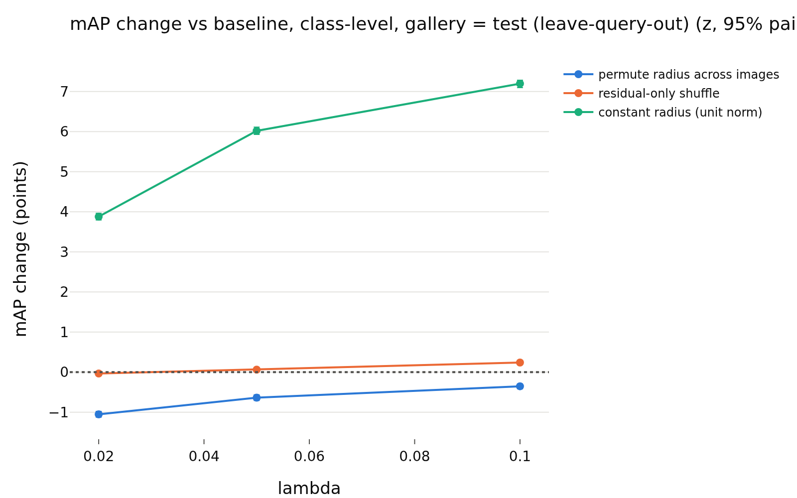
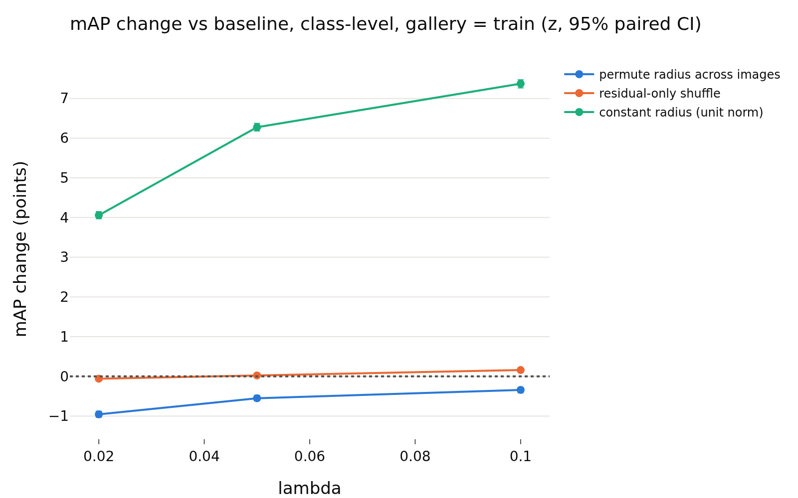
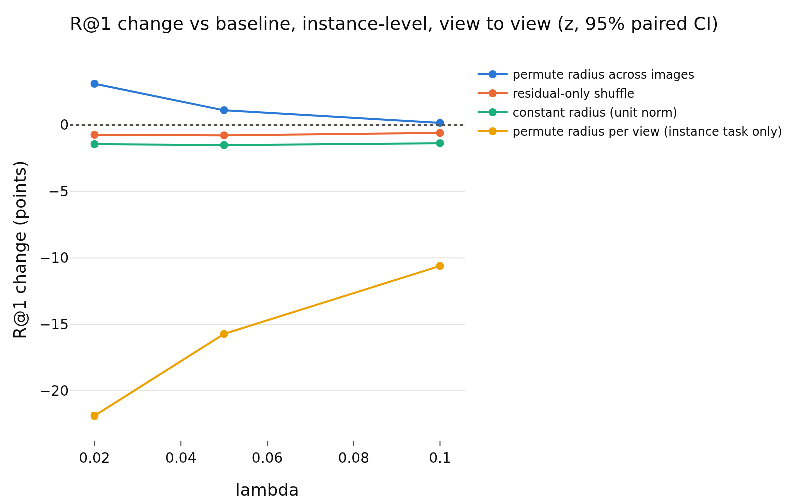

# E-retrieval: is the radius used by Euclidean retrieval of z?
- **Branch / version:** `radius-usage-retrieval` @ `8818910` (code; the per-run shards were computed with `eca2bf9`, the aggregation with `77b601c` + merge `8818910`, which only add lambda/seed bookkeeping and the merge of master)
- **Run datetime (UTC):** shards 2026-10-25T20:33Z to 21:12Z (SLURM jobs 2246265-2246273), aggregation 2026-10-25T21:13Z (job 2246441); the cluster reports CDT, converted to UTC
- **Command(s):** (`<repo>` = the checkout of the branch above, `<python>` = its `.venv` interpreter; one CPU job per run, 8 CPUs, 32 GB, `sbatch --wrap` with `--export=ALL,PYTHONPATH=<repo>/src,OMP_NUM_THREADS=8,OPENBLAS_NUM_THREADS=8`; each run on the CPU took 12-39 min)
  per run (9 jobs, `<run>` in `radius_marginal_lam{0.02,0.05,0.1}_s{0,1,2}`):
  `cd <repo> && <python> apps/analyze.py --config configs/base.yaml --retrieval radius_marginal --retrieval-run <run>`
  aggregation (job 2246441):
  `cd <repo> && <python> apps/analyze.py --config configs/base.yaml --retrieval radius_marginal --note radius_usage/retrieval_summary.md`
- **Datasets:** STL-10 `train` (class-retrieval gallery, regression fit) and `test` (queries / gallery / view-to-view), clean images ([canonical](https://cs.stanford.edu/~acoates/stl10/), [HF `tanganke/stl10`](https://huggingface.co/datasets/tanganke/stl10)). The **canonical Stanford archive was used** (via the prepared arrays and the existing `stl10_train` / `stl10_test` embedding dumps); the HF page is linked for reference only.
- **Backbone:** ResNet-18 from scratch ([HF architecture reference](https://huggingface.co/timm/resnet18.a1_in1k), weights not used); `last.pt` (epoch 200) of `radius_marginal_lam{0.02,0.05,0.1}_s{0,1,2}` (Variant A)
- **Scope:** h is not analyzed; LeJEPA's product is z. All results are in z-space, Euclidean distance only.
- **Equivalence margin:** 0.5 points of mAP / precision@k / recall@k, fixed in `eval.retrieval_margin` (committed in `eca2bf9`) before any retrieval result was computed.

## Question

E1 (`research_notes/radius_randomization/`) found the radius almost unused by classification readers. Retrieval with a Euclidean distance is the place where a radius that is a *stable per-image property* (ICC 0.87) could matter, because ||z_q - z_g||^2 = (r_q - r_g)^2 + 2 r_q r_g (1 - cos). Prediction to test (written before the runs): radius differences between images hurt Euclidean retrieval, so constant radius (the normalized embedding, i.e. cosine ranking) should help or be neutral and permuting the radius should hurt. The direction found is reported below, whatever it is.

## Setup (deviations from the base config)

No deviation from `configs/base.yaml` (1000 bootstrap replicates, 5 shuffle repeats per randomized condition, regression folds 5). **Views in the dumps:** view 0 is the un-augmented center view and views 1..8 are 8 random *global* augmentations (`eval/embedding.py` samples only the global view spec; the dumps contain no local views). Class-level retrieval uses the 8000 test / 5000 train center views; instance-level retrieval uses the 8 global augmented views of the 8000 test images, with the four disjoint view pairs (1,2), (3,4), (5,6), (7,8) (query = the first view of the pair of every image, gallery = the second view of every image, so the query view index always differs from the gallery's); each image's score is the fraction of the four pairs in which its other view was the nearest (R@1) or among the 5 nearest (R@5) of the 8000 gallery views (rank = number of strictly closer gallery items).

Tasks: (1) class-level, queries = test center views, gallery = the other test center views (leave-query-out, 7999 items), relevance = same class; (2) the same queries against the train center views (5000); metrics mAP (average precision over the full ranking) and precision@{1,5,10} (precision@1 is the recall@1 hit rate; recall@k proper is not used because the number of relevant items, 799 / 500, is far above k); (3) instance-level as above, recall@{1,5}. Distances are computed in float64 in chunks of 512 queries (memory O(512 x gallery)).

Conditions are those of E1 (`randomization`): `baseline`; `permute` (radius of a random image; in the instance task this is a permutation of whole images, so a view pair keeps a shared radius that is now unrelated to its direction); `residual` (direction-predicted held-out log-radius kept, the residual permuted across images; kernel ridge fitted on the train center views and applied to the test center / augmented views; held-out R^2 about 0.92-0.95, table below); `constant` (unit norm; Euclidean retrieval on it equals cosine retrieval). One extra condition for the instance task only, `permute radius per view`, gives every embedding the radius of a random embedding of the pool and so also destroys the radius stability across views. The conditions are applied to queries and gallery alike; for the test gallery of the class task the query and the gallery item are the same transformed embedding, the train gallery is transformed independently.

Statistics: per-query values, paired against the baseline on the same queries, paired bootstrap over queries within each training seed, averaged over the 3 seeds, TOST-style verdict as in E1 (margin 0.5 points: the E1 margin carried over to a different metric family, because a 0.5-point change is the smallest effect that would matter in practice for a representation whose baseline precision@1 is about 75%, and the 8000-query paired intervals are an order of magnitude narrower than that, so equivalence is certifiable). Intervals cover query sampling only, not the training-seed variability beyond averaging (per-seed paired differences have the same sign and nearly the same size in all 9 runs for the headline cells, checked separately; unit tests: `tests/test_retrieval.py`).

## Results

<!-- BEGIN GENERATED: analyze.retrieval_comparison -->
### Paired change vs the baseline, per lambda

z-space, Euclidean distance; differences in points (condition minus baseline on the same queries, mAP / precision@k / recall@k in %), averaged over training seeds; intervals are paired bootstrap percentile intervals (1000 replicates, queries resampled within each seed). Verdict with the margin fixed before the results at ±0.5 points: `equivalent` if the 90% interval lies inside the margin, `different` if not and the 95% interval excludes 0, else `inconclusive`. Shuffle repeats (5 per randomized condition) are averaged per query and are not part of the interval.

| lambda | task | metric | condition | baseline (%) | condition (%) | difference (points) | 90% CI (points) | 95% CI (points) | verdict |
|---|---|---|---|---|---|---|---|---|---|
| 0.02 | class-level, gallery = test (leave-query-out) | mAP | permute radius across images | 45.52 | 44.46 | -1.05 | [-1.11, -0.99] | [-1.12, -0.98] | different |
| 0.02 | class-level, gallery = test (leave-query-out) | mAP | residual-only shuffle | 45.52 | 45.48 | -0.03 | [-0.04, -0.02] | [-0.04, -0.02] | equivalent |
| 0.02 | class-level, gallery = test (leave-query-out) | mAP | constant radius (unit norm) | 45.52 | 49.40 | +3.88 | [+3.81, +3.95] | [+3.79, +3.96] | different |
| 0.02 | class-level, gallery = test (leave-query-out) | P@1 | permute radius across images | 74.40 | 74.44 | +0.05 | [-0.23, +0.33] | [-0.28, +0.38] | equivalent |
| 0.02 | class-level, gallery = test (leave-query-out) | P@1 | residual-only shuffle | 74.40 | 74.38 | -0.01 | [-0.18, +0.16] | [-0.22, +0.19] | equivalent |
| 0.02 | class-level, gallery = test (leave-query-out) | P@1 | constant radius (unit norm) | 74.40 | 75.30 | +0.91 | [+0.64, +1.16] | [+0.58, +1.22] | different |
| 0.02 | class-level, gallery = test (leave-query-out) | P@5 | permute radius across images | 71.54 | 72.02 | +0.47 | [+0.35, +0.59] | [+0.32, +0.61] | different |
| 0.02 | class-level, gallery = test (leave-query-out) | P@5 | residual-only shuffle | 71.54 | 71.61 | +0.07 | [-0.01, +0.14] | [-0.02, +0.15] | equivalent |
| 0.02 | class-level, gallery = test (leave-query-out) | P@5 | constant radius (unit norm) | 71.54 | 72.75 | +1.21 | [+1.08, +1.33] | [+1.06, +1.36] | different |
| 0.02 | class-level, gallery = test (leave-query-out) | P@10 | permute radius across images | 70.15 | 70.81 | +0.66 | [+0.57, +0.75] | [+0.55, +0.77] | different |
| 0.02 | class-level, gallery = test (leave-query-out) | P@10 | residual-only shuffle | 70.15 | 70.22 | +0.07 | [+0.02, +0.12] | [+0.01, +0.13] | equivalent |
| 0.02 | class-level, gallery = test (leave-query-out) | P@10 | constant radius (unit norm) | 70.15 | 71.49 | +1.34 | [+1.25, +1.43] | [+1.23, +1.46] | different |
| 0.02 | class-level, gallery = train | mAP | permute radius across images | 45.52 | 44.57 | -0.96 | [-1.02, -0.89] | [-1.03, -0.88] | different |
| 0.02 | class-level, gallery = train | mAP | residual-only shuffle | 45.52 | 45.47 | -0.06 | [-0.07, -0.05] | [-0.07, -0.05] | equivalent |
| 0.02 | class-level, gallery = train | mAP | constant radius (unit norm) | 45.52 | 49.58 | +4.06 | [+3.98, +4.13] | [+3.97, +4.15] | different |
| 0.02 | class-level, gallery = train | P@1 | permute radius across images | 72.99 | 73.19 | +0.19 | [-0.07, +0.47] | [-0.14, +0.54] | equivalent |
| 0.02 | class-level, gallery = train | P@1 | residual-only shuffle | 72.99 | 72.97 | -0.02 | [-0.20, +0.16] | [-0.23, +0.20] | equivalent |
| 0.02 | class-level, gallery = train | P@1 | constant radius (unit norm) | 72.99 | 74.13 | +1.14 | [+0.87, +1.41] | [+0.80, +1.46] | different |
| 0.02 | class-level, gallery = train | P@5 | permute radius across images | 70.43 | 70.99 | +0.56 | [+0.43, +0.68] | [+0.40, +0.70] | different |
| 0.02 | class-level, gallery = train | P@5 | residual-only shuffle | 70.43 | 70.54 | +0.10 | [+0.03, +0.17] | [+0.01, +0.19] | equivalent |
| 0.02 | class-level, gallery = train | P@5 | constant radius (unit norm) | 70.43 | 71.80 | +1.36 | [+1.23, +1.49] | [+1.21, +1.52] | different |
| 0.02 | class-level, gallery = train | P@10 | permute radius across images | 69.02 | 69.75 | +0.74 | [+0.65, +0.83] | [+0.64, +0.85] | different |
| 0.02 | class-level, gallery = train | P@10 | residual-only shuffle | 69.02 | 69.09 | +0.08 | [+0.02, +0.12] | [+0.02, +0.13] | equivalent |
| 0.02 | class-level, gallery = train | P@10 | constant radius (unit norm) | 69.02 | 70.55 | +1.54 | [+1.45, +1.63] | [+1.43, +1.64] | different |
| 0.02 | instance-level, view to view | R@1 | permute radius across images | 63.86 | 66.96 | +3.10 | [+2.94, +3.27] | [+2.92, +3.29] | different |
| 0.02 | instance-level, view to view | R@1 | residual-only shuffle | 63.86 | 63.12 | -0.74 | [-0.84, -0.63] | [-0.87, -0.60] | different |
| 0.02 | instance-level, view to view | R@1 | constant radius (unit norm) | 63.86 | 62.41 | -1.44 | [-1.58, -1.30] | [-1.61, -1.27] | different |
| 0.02 | instance-level, view to view | R@1 | permute radius per view (instance task only) | 63.86 | 41.97 | -21.89 | [-22.09, -21.68] | [-22.13, -21.65] | different |
| 0.02 | instance-level, view to view | R@5 | permute radius across images | 83.36 | 84.33 | +0.97 | [+0.84, +1.09] | [+0.81, +1.12] | different |
| 0.02 | instance-level, view to view | R@5 | residual-only shuffle | 83.36 | 82.57 | -0.79 | [-0.87, -0.70] | [-0.88, -0.69] | different |
| 0.02 | instance-level, view to view | R@5 | constant radius (unit norm) | 83.36 | 81.49 | -1.87 | [-1.99, -1.75] | [-2.01, -1.73] | different |
| 0.02 | instance-level, view to view | R@5 | permute radius per view (instance task only) | 83.36 | 61.74 | -21.62 | [-21.80, -21.44] | [-21.83, -21.40] | different |
| 0.05 | class-level, gallery = test (leave-query-out) | mAP | permute radius across images | 40.23 | 39.60 | -0.64 | [-0.69, -0.57] | [-0.71, -0.56] | different |
| 0.05 | class-level, gallery = test (leave-query-out) | mAP | residual-only shuffle | 40.23 | 40.30 | +0.06 | [+0.06, +0.07] | [+0.05, +0.07] | equivalent |
| 0.05 | class-level, gallery = test (leave-query-out) | mAP | constant radius (unit norm) | 40.23 | 46.25 | +6.02 | [+5.94, +6.10] | [+5.93, +6.11] | different |
| 0.05 | class-level, gallery = test (leave-query-out) | P@1 | permute radius across images | 75.42 | 75.95 | +0.53 | [+0.29, +0.78] | [+0.23, +0.81] | different |
| 0.05 | class-level, gallery = test (leave-query-out) | P@1 | residual-only shuffle | 75.42 | 75.56 | +0.13 | [-0.03, +0.29] | [-0.05, +0.32] | equivalent |
| 0.05 | class-level, gallery = test (leave-query-out) | P@1 | constant radius (unit norm) | 75.42 | 76.49 | +1.06 | [+0.82, +1.31] | [+0.74, +1.37] | different |
| 0.05 | class-level, gallery = test (leave-query-out) | P@5 | permute radius across images | 72.43 | 73.10 | +0.67 | [+0.55, +0.80] | [+0.53, +0.83] | different |
| 0.05 | class-level, gallery = test (leave-query-out) | P@5 | residual-only shuffle | 72.43 | 72.45 | +0.02 | [-0.05, +0.09] | [-0.07, +0.10] | equivalent |
| 0.05 | class-level, gallery = test (leave-query-out) | P@5 | constant radius (unit norm) | 72.43 | 73.65 | +1.21 | [+1.09, +1.34] | [+1.07, +1.36] | different |
| 0.05 | class-level, gallery = test (leave-query-out) | P@10 | permute radius across images | 70.96 | 71.71 | +0.75 | [+0.67, +0.84] | [+0.65, +0.86] | different |
| 0.05 | class-level, gallery = test (leave-query-out) | P@10 | residual-only shuffle | 70.96 | 71.03 | +0.07 | [+0.03, +0.12] | [+0.02, +0.13] | equivalent |
| 0.05 | class-level, gallery = test (leave-query-out) | P@10 | constant radius (unit norm) | 70.96 | 72.33 | +1.38 | [+1.28, +1.47] | [+1.26, +1.49] | different |
| 0.05 | class-level, gallery = train | mAP | permute radius across images | 40.13 | 39.58 | -0.55 | [-0.61, -0.49] | [-0.62, -0.48] | different |
| 0.05 | class-level, gallery = train | mAP | residual-only shuffle | 40.13 | 40.15 | +0.02 | [+0.02, +0.03] | [+0.01, +0.03] | equivalent |
| 0.05 | class-level, gallery = train | mAP | constant radius (unit norm) | 40.13 | 46.40 | +6.28 | [+6.20, +6.36] | [+6.18, +6.37] | different |
| 0.05 | class-level, gallery = train | P@1 | permute radius across images | 74.43 | 74.78 | +0.35 | [+0.10, +0.63] | [+0.03, +0.67] | different |
| 0.05 | class-level, gallery = train | P@1 | residual-only shuffle | 74.43 | 74.38 | -0.05 | [-0.24, +0.12] | [-0.26, +0.16] | equivalent |
| 0.05 | class-level, gallery = train | P@1 | constant radius (unit norm) | 74.43 | 75.83 | +1.39 | [+1.10, +1.67] | [+1.05, +1.74] | different |
| 0.05 | class-level, gallery = train | P@5 | permute radius across images | 71.07 | 71.87 | +0.80 | [+0.69, +0.92] | [+0.67, +0.95] | different |
| 0.05 | class-level, gallery = train | P@5 | residual-only shuffle | 71.07 | 71.13 | +0.06 | [-0.01, +0.13] | [-0.02, +0.15] | equivalent |
| 0.05 | class-level, gallery = train | P@5 | constant radius (unit norm) | 71.07 | 72.56 | +1.49 | [+1.36, +1.62] | [+1.34, +1.64] | different |
| 0.05 | class-level, gallery = train | P@10 | permute radius across images | 69.43 | 70.43 | +1.00 | [+0.91, +1.10] | [+0.89, +1.11] | different |
| 0.05 | class-level, gallery = train | P@10 | residual-only shuffle | 69.43 | 69.55 | +0.12 | [+0.07, +0.17] | [+0.06, +0.18] | equivalent |
| 0.05 | class-level, gallery = train | P@10 | constant radius (unit norm) | 69.43 | 71.19 | +1.76 | [+1.66, +1.86] | [+1.63, +1.88] | different |
| 0.05 | instance-level, view to view | R@1 | permute radius across images | 73.00 | 74.10 | +1.10 | [+0.96, +1.24] | [+0.94, +1.27] | different |
| 0.05 | instance-level, view to view | R@1 | residual-only shuffle | 73.00 | 72.21 | -0.78 | [-0.88, -0.69] | [-0.89, -0.67] | different |
| 0.05 | instance-level, view to view | R@1 | constant radius (unit norm) | 73.00 | 71.48 | -1.52 | [-1.64, -1.39] | [-1.67, -1.38] | different |
| 0.05 | instance-level, view to view | R@1 | permute radius per view (instance task only) | 73.00 | 57.27 | -15.73 | [-15.90, -15.56] | [-15.93, -15.53] | different |
| 0.05 | instance-level, view to view | R@5 | permute radius across images | 88.68 | 88.04 | -0.64 | [-0.73, -0.54] | [-0.75, -0.52] | different |
| 0.05 | instance-level, view to view | R@5 | residual-only shuffle | 88.68 | 87.93 | -0.75 | [-0.82, -0.69] | [-0.83, -0.68] | different |
| 0.05 | instance-level, view to view | R@5 | constant radius (unit norm) | 88.68 | 86.99 | -1.69 | [-1.79, -1.58] | [-1.82, -1.57] | different |
| 0.05 | instance-level, view to view | R@5 | permute radius per view (instance task only) | 88.68 | 75.98 | -12.70 | [-12.85, -12.57] | [-12.88, -12.55] | different |
| 0.1 | class-level, gallery = test (leave-query-out) | mAP | permute radius across images | 35.28 | 34.93 | -0.35 | [-0.41, -0.30] | [-0.42, -0.29] | equivalent |
| 0.1 | class-level, gallery = test (leave-query-out) | mAP | residual-only shuffle | 35.28 | 35.52 | +0.24 | [+0.23, +0.25] | [+0.23, +0.25] | equivalent |
| 0.1 | class-level, gallery = test (leave-query-out) | mAP | constant radius (unit norm) | 35.28 | 42.47 | +7.19 | [+7.12, +7.27] | [+7.10, +7.28] | different |
| 0.1 | class-level, gallery = test (leave-query-out) | P@1 | permute radius across images | 75.78 | 76.16 | +0.38 | [+0.13, +0.62] | [+0.09, +0.66] | different |
| 0.1 | class-level, gallery = test (leave-query-out) | P@1 | residual-only shuffle | 75.78 | 75.86 | +0.08 | [-0.09, +0.23] | [-0.11, +0.26] | equivalent |
| 0.1 | class-level, gallery = test (leave-query-out) | P@1 | constant radius (unit norm) | 75.78 | 76.62 | +0.84 | [+0.59, +1.10] | [+0.53, +1.14] | different |
| 0.1 | class-level, gallery = test (leave-query-out) | P@5 | permute radius across images | 72.21 | 72.99 | +0.78 | [+0.66, +0.90] | [+0.64, +0.92] | different |
| 0.1 | class-level, gallery = test (leave-query-out) | P@5 | residual-only shuffle | 72.21 | 72.34 | +0.13 | [+0.06, +0.20] | [+0.05, +0.22] | equivalent |
| 0.1 | class-level, gallery = test (leave-query-out) | P@5 | constant radius (unit norm) | 72.21 | 73.47 | +1.26 | [+1.15, +1.38] | [+1.12, +1.41] | different |
| 0.1 | class-level, gallery = test (leave-query-out) | P@10 | permute radius across images | 70.56 | 71.50 | +0.94 | [+0.86, +1.04] | [+0.84, +1.05] | different |
| 0.1 | class-level, gallery = test (leave-query-out) | P@10 | residual-only shuffle | 70.56 | 70.69 | +0.13 | [+0.09, +0.18] | [+0.08, +0.19] | equivalent |
| 0.1 | class-level, gallery = test (leave-query-out) | P@10 | constant radius (unit norm) | 70.56 | 72.06 | +1.50 | [+1.41, +1.59] | [+1.39, +1.61] | different |
| 0.1 | class-level, gallery = train | mAP | permute radius across images | 35.20 | 34.86 | -0.34 | [-0.40, -0.29] | [-0.42, -0.28] | equivalent |
| 0.1 | class-level, gallery = train | mAP | residual-only shuffle | 35.20 | 35.36 | +0.16 | [+0.15, +0.17] | [+0.15, +0.17] | equivalent |
| 0.1 | class-level, gallery = train | mAP | constant radius (unit norm) | 35.20 | 42.57 | +7.37 | [+7.28, +7.46] | [+7.27, +7.47] | different |
| 0.1 | class-level, gallery = train | P@1 | permute radius across images | 74.31 | 74.75 | +0.43 | [+0.17, +0.69] | [+0.13, +0.74] | different |
| 0.1 | class-level, gallery = train | P@1 | residual-only shuffle | 74.31 | 74.38 | +0.06 | [-0.12, +0.24] | [-0.16, +0.28] | equivalent |
| 0.1 | class-level, gallery = train | P@1 | constant radius (unit norm) | 74.31 | 75.64 | +1.32 | [+1.07, +1.60] | [+1.02, +1.65] | different |
| 0.1 | class-level, gallery = train | P@5 | permute radius across images | 70.73 | 71.67 | +0.93 | [+0.81, +1.04] | [+0.79, +1.06] | different |
| 0.1 | class-level, gallery = train | P@5 | residual-only shuffle | 70.73 | 70.93 | +0.20 | [+0.12, +0.26] | [+0.11, +0.27] | equivalent |
| 0.1 | class-level, gallery = train | P@5 | constant radius (unit norm) | 70.73 | 72.37 | +1.64 | [+1.50, +1.75] | [+1.48, +1.77] | different |
| 0.1 | class-level, gallery = train | P@10 | permute radius across images | 69.01 | 70.16 | +1.14 | [+1.06, +1.23] | [+1.04, +1.25] | different |
| 0.1 | class-level, gallery = train | P@10 | residual-only shuffle | 69.01 | 69.22 | +0.20 | [+0.16, +0.25] | [+0.15, +0.26] | equivalent |
| 0.1 | class-level, gallery = train | P@10 | constant radius (unit norm) | 69.01 | 70.89 | +1.87 | [+1.78, +1.97] | [+1.76, +1.99] | different |
| 0.1 | instance-level, view to view | R@1 | permute radius across images | 76.43 | 76.59 | +0.16 | [+0.04, +0.28] | [+0.02, +0.31] | equivalent |
| 0.1 | instance-level, view to view | R@1 | residual-only shuffle | 76.43 | 75.83 | -0.60 | [-0.68, -0.51] | [-0.70, -0.49] | different |
| 0.1 | instance-level, view to view | R@1 | constant radius (unit norm) | 76.43 | 75.06 | -1.37 | [-1.48, -1.25] | [-1.50, -1.22] | different |
| 0.1 | instance-level, view to view | R@1 | permute radius per view (instance task only) | 76.43 | 65.82 | -10.61 | [-10.76, -10.47] | [-10.78, -10.44] | different |
| 0.1 | instance-level, view to view | R@5 | permute radius across images | 90.37 | 89.31 | -1.06 | [-1.16, -0.97] | [-1.18, -0.96] | different |
| 0.1 | instance-level, view to view | R@5 | residual-only shuffle | 90.37 | 89.77 | -0.60 | [-0.67, -0.54] | [-0.68, -0.52] | different |
| 0.1 | instance-level, view to view | R@5 | constant radius (unit norm) | 90.37 | 89.00 | -1.36 | [-1.46, -1.28] | [-1.48, -1.26] | different |
| 0.1 | instance-level, view to view | R@5 | permute radius per view (instance task only) | 90.37 | 82.81 | -7.56 | [-7.68, -7.45] | [-7.70, -7.43] | different |
<!-- END GENERATED: analyze.retrieval_comparison -->

<!-- BEGIN GENERATED: analyze.retrieval_values -->
### Metric values (%), mean ± std over training seeds

#### class-level, gallery = test (leave-query-out)

| lambda | condition | seeds | mAP | P@1 | P@5 | P@10 |
|---|---|---|---|---|---|---|
| 0.02 | baseline | 3 | 45.52 ± 0.28 | 74.40 ± 0.28 | 71.54 ± 0.19 | 70.15 ± 0.25 |
| 0.02 | permute radius across images | 3 | 44.46 ± 0.29 | 74.44 ± 0.32 | 72.02 ± 0.29 | 70.81 ± 0.23 |
| 0.02 | residual-only shuffle | 3 | 45.48 ± 0.28 | 74.38 ± 0.32 | 71.61 ± 0.25 | 70.22 ± 0.21 |
| 0.02 | constant radius (unit norm) | 3 | 49.40 ± 0.28 | 75.30 ± 0.38 | 72.75 ± 0.27 | 71.49 ± 0.23 |
| 0.05 | baseline | 3 | 40.23 ± 0.13 | 75.42 ± 0.31 | 72.43 ± 0.39 | 70.96 ± 0.19 |
| 0.05 | permute radius across images | 3 | 39.60 ± 0.15 | 75.95 ± 0.32 | 73.10 ± 0.21 | 71.71 ± 0.21 |
| 0.05 | residual-only shuffle | 3 | 40.30 ± 0.15 | 75.56 ± 0.38 | 72.45 ± 0.27 | 71.03 ± 0.19 |
| 0.05 | constant radius (unit norm) | 3 | 46.25 ± 0.09 | 76.49 ± 0.39 | 73.64 ± 0.19 | 72.33 ± 0.15 |
| 0.1 | baseline | 3 | 35.28 ± 0.15 | 75.78 ± 0.43 | 72.21 ± 0.10 | 70.56 ± 0.04 |
| 0.1 | permute radius across images | 3 | 34.93 ± 0.17 | 76.16 ± 0.31 | 72.99 ± 0.11 | 71.50 ± 0.04 |
| 0.1 | residual-only shuffle | 3 | 35.52 ± 0.12 | 75.86 ± 0.35 | 72.34 ± 0.12 | 70.69 ± 0.07 |
| 0.1 | constant radius (unit norm) | 3 | 42.47 ± 0.15 | 76.62 ± 0.45 | 73.47 ± 0.11 | 72.06 ± 0.06 |

#### class-level, gallery = train

| lambda | condition | seeds | mAP | P@1 | P@5 | P@10 |
|---|---|---|---|---|---|---|
| 0.02 | baseline | 3 | 45.52 ± 0.26 | 72.99 ± 0.17 | 70.43 ± 0.03 | 69.02 ± 0.10 |
| 0.02 | permute radius across images | 3 | 44.57 ± 0.28 | 73.19 ± 0.24 | 70.99 ± 0.14 | 69.75 ± 0.14 |
| 0.02 | residual-only shuffle | 3 | 45.47 ± 0.24 | 72.97 ± 0.11 | 70.54 ± 0.11 | 69.09 ± 0.11 |
| 0.02 | constant radius (unit norm) | 3 | 49.58 ± 0.26 | 74.13 ± 0.30 | 71.80 ± 0.08 | 70.55 ± 0.16 |
| 0.05 | baseline | 3 | 40.13 ± 0.19 | 74.43 ± 0.21 | 71.07 ± 0.19 | 69.43 ± 0.24 |
| 0.05 | permute radius across images | 3 | 39.58 ± 0.19 | 74.78 ± 0.09 | 71.87 ± 0.18 | 70.43 ± 0.23 |
| 0.05 | residual-only shuffle | 3 | 40.15 ± 0.17 | 74.38 ± 0.23 | 71.13 ± 0.23 | 69.55 ± 0.23 |
| 0.05 | constant radius (unit norm) | 3 | 46.40 ± 0.12 | 75.83 ± 0.19 | 72.56 ± 0.13 | 71.19 ± 0.24 |
| 0.1 | baseline | 3 | 35.20 ± 0.19 | 74.31 ± 0.35 | 70.73 ± 0.17 | 69.01 ± 0.08 |
| 0.1 | permute radius across images | 3 | 34.86 ± 0.21 | 74.75 ± 0.05 | 71.67 ± 0.08 | 70.16 ± 0.03 |
| 0.1 | residual-only shuffle | 3 | 35.36 ± 0.16 | 74.38 ± 0.24 | 70.93 ± 0.11 | 69.22 ± 0.02 |
| 0.1 | constant radius (unit norm) | 3 | 42.57 ± 0.19 | 75.64 ± 0.10 | 72.37 ± 0.15 | 70.89 ± 0.09 |

#### instance-level, view to view

| lambda | condition | seeds | R@1 | R@5 |
|---|---|---|---|---|
| 0.02 | baseline | 3 | 63.86 ± 1.06 | 83.36 ± 0.95 |
| 0.02 | permute radius across images | 3 | 66.96 ± 1.21 | 84.33 ± 0.95 |
| 0.02 | residual-only shuffle | 3 | 63.12 ± 1.15 | 82.57 ± 1.00 |
| 0.02 | constant radius (unit norm) | 3 | 62.41 ± 1.11 | 81.49 ± 0.90 |
| 0.02 | permute radius per view (instance task only) | 3 | 41.97 ± 0.50 | 61.74 ± 0.60 |
| 0.05 | baseline | 3 | 73.00 ± 0.30 | 88.68 ± 0.15 |
| 0.05 | permute radius across images | 3 | 74.10 ± 0.22 | 88.04 ± 0.22 |
| 0.05 | residual-only shuffle | 3 | 72.21 ± 0.38 | 87.93 ± 0.21 |
| 0.05 | constant radius (unit norm) | 3 | 71.48 ± 0.38 | 86.99 ± 0.25 |
| 0.05 | permute radius per view (instance task only) | 3 | 57.27 ± 0.59 | 75.98 ± 0.62 |
| 0.1 | baseline | 3 | 76.43 ± 0.37 | 90.37 ± 0.19 |
| 0.1 | permute radius across images | 3 | 76.59 ± 0.30 | 89.31 ± 0.24 |
| 0.1 | residual-only shuffle | 3 | 75.83 ± 0.36 | 89.77 ± 0.30 |
| 0.1 | constant radius (unit norm) | 3 | 75.06 ± 0.27 | 89.00 ± 0.28 |
| 0.1 | permute radius per view (instance task only) | 3 | 65.82 ± 0.55 | 82.81 ± 0.52 |
<!-- END GENERATED: analyze.retrieval_values -->

<!-- BEGIN GENERATED: analyze.retrieval_r2 -->
### Held-out R^2 of log-radius from direction (test center views)

| run | lambda | seed | R^2 |
|---|---|---|---|
| radius_marginal_lam0.02_s0 | 0.02 | 0 | 0.946 |
| radius_marginal_lam0.02_s1 | 0.02 | 1 | 0.9522 |
| radius_marginal_lam0.02_s2 | 0.02 | 2 | 0.9493 |
| radius_marginal_lam0.05_s0 | 0.05 | 0 | 0.9488 |
| radius_marginal_lam0.05_s1 | 0.05 | 1 | 0.9497 |
| radius_marginal_lam0.05_s2 | 0.05 | 2 | 0.9462 |
| radius_marginal_lam0.1_s0 | 0.1 | 0 | 0.9279 |
| radius_marginal_lam0.1_s1 | 0.1 | 1 | 0.9262 |
| radius_marginal_lam0.1_s2 | 0.1 | 2 | 0.9222 |

Runs without a shard: none.
<!-- END GENERATED: analyze.retrieval_r2 -->

<!-- BEGIN GENERATED: analyze.retrieval_figures -->
### Figures

<!-- END GENERATED: analyze.retrieval_figures -->

## Interpretation

All statements below are about the tables above (3 seeds per lambda; paired differences in points).

**Class-level retrieval: the prediction holds for constant radius, not for permutation.**
- Constant radius (cosine ranking) *helps* at every lambda and in both galleries: mAP +3.9 / +6.0 / +7.2 points (lambda 0.02 / 0.05 / 0.1, test gallery; +4.1 / +6.3 / +7.4 with the train gallery) and precision@1/5/10 by +0.8 to +1.9 points, all `different` from the baseline in the helpful direction. The gain in mAP grows with lambda (the baseline mAP falls from 45.5 to 35.3 as lambda grows, while the constant-radius mAP falls only from 49.4 to 42.5): the radius spread of the final embeddings makes the Euclidean ranking *worse* for class retrieval, most visibly deep into the ranking.
- Permuting the radius is not uniformly harmful: it lowers mAP by 0.3 to 1.1 points (`different` at lambda 0.02 and 0.05, `equivalent` at 0.1) but *raises* precision@5 / @10 by 0.5 to 1.1 points and precision@1 by up to 0.5. The sign differs between metrics, so "permute hurts" is not supported; what is supported is that the radius-direction relation of the trained embedding is not an asset for class retrieval.
- The residual-only shuffle, which keeps the direction-predicted part of the radius, is `equivalent` in all 24 cells of the class tasks (differences within +-0.24 points). Whatever in the radius is predictable from the direction costs nothing to keep, and the part not predictable from it is not used for class retrieval within the margin.

**Instance-level view-to-view retrieval: the prediction is not supported.**
- Constant radius *hurts*: R@1 -1.4 / -1.5 / -1.4 and R@5 -1.9 / -1.7 / -1.4 points (`different`, outside the margin). Removing the radius removes information that helps to find the other view of the same image, in line with the radius being a stable per-image property.
- Permuting the radius per *view* is very damaging (R@1 -21.9 / -15.7 / -10.6 points, R@5 -21.6 / -12.7 / -7.6): the view-to-view agreement of the radius is a strong cue, and less so at larger lambda (the baseline R@1 rises with lambda, so the directions alone resolve more instances; not tested as the cause).
- Permuting whole *images* (radius still shared by the two views of an image, but unrelated to its direction) changes R@1 by +3.1 / +1.1 / +0.2 points (the last `equivalent`) and R@5 by +1.0 / -0.6 / -1.1: mixed in sign and size, so no clear verdict on the direction-radius coupling for instance retrieval.
- The residual-only shuffle lowers R@1 by 0.6 to 0.8 and R@5 by 0.6 to 0.8 points (`different`, just outside the 0.5-point margin): the part of the radius that is not predictable from the direction carries a small amount of instance information.

**Net reading.** For classification-style retrieval Euclidean distance on the raw z is *worse* than on the normalized z (radius as a nuisance, as predicted), but for instance retrieval the radius is a useful key shared between views of an image (radius as signal, opposite to the prediction), with the sign set by the task, not by the embedding. This is the one place in the E-series where a direct use of the radius is measurable; the effect sizes are 1-2 points for constant radius in instance retrieval and 1-2 points (up to 7 in mAP) in the opposite direction for class retrieval. Not tested, hypotheses only: that the class-level mAP loss comes from far-ranked same-class items having a very different radius, and that the lambda-trend reflects the radial spread, kappa_z, falling with lambda.

**Limits.** Euclidean distance only (cosine is the `constant` condition). Global views only. The residual condition shares the regression of E1 (R^2 0.92-0.95 held out), so its residual includes regression error. Intervals ignore training-seed variability beyond averaging three seeds; the instance baselines themselves vary by up to 1.1 points between seeds at lambda 0.02 while the paired differences do not. The class-level `P@1` cells with the test gallery use queries that are also gallery items, so queries are not independent draws; the bootstrap treats them as such.

## Next steps

- If the instance result is to be used, repeat it with different view-pair sets / more augmentation draws to see whether the `permute radius across images` sign changes are stable (they are mixed in sign across lambda here).
- Check how much of the class-level gain of unit norm is recovered by a monotone radius rescaling (e.g. a per-lambda fixed radius transform) instead of the full normalization, to see whether the radius spread or its relation to the direction is the cause.
