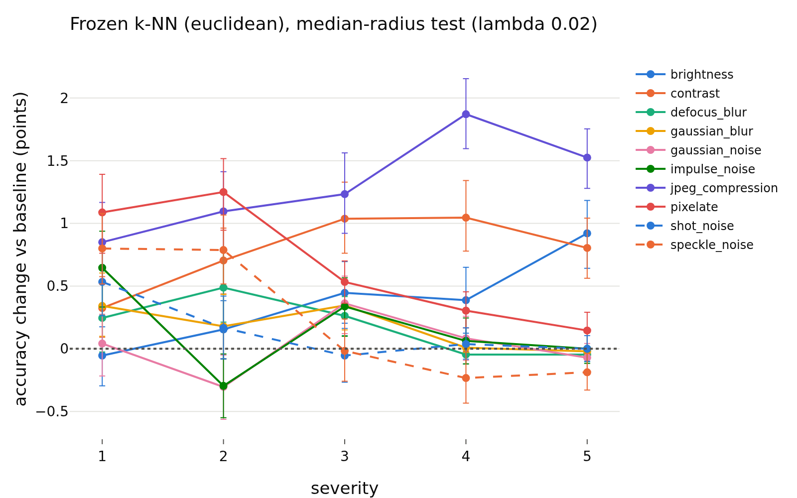
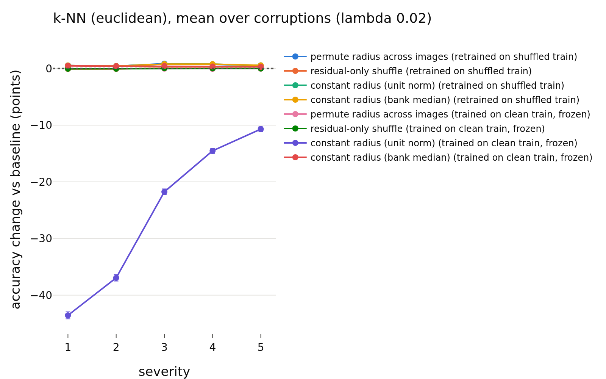
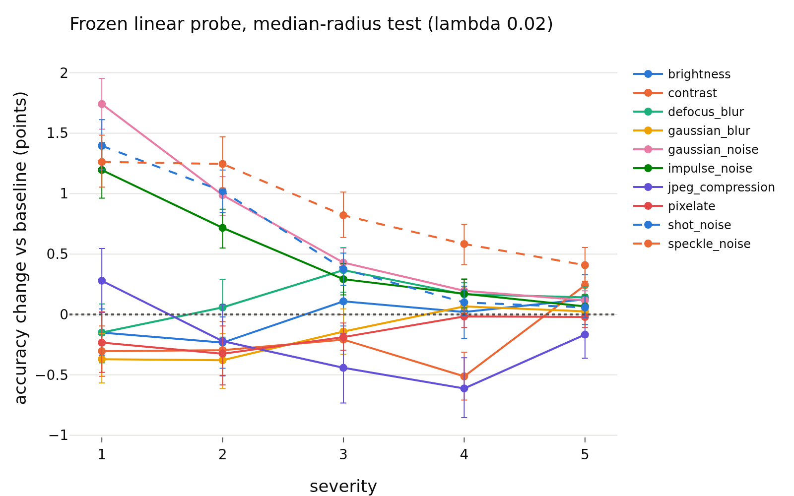
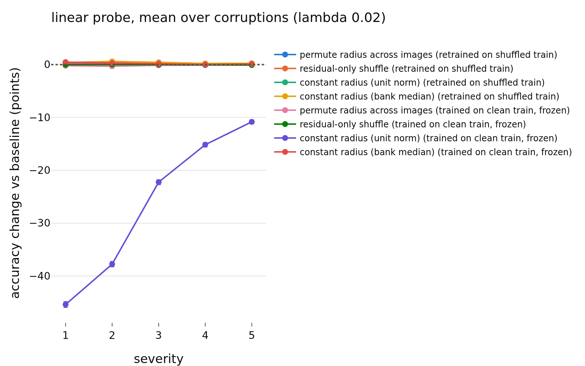
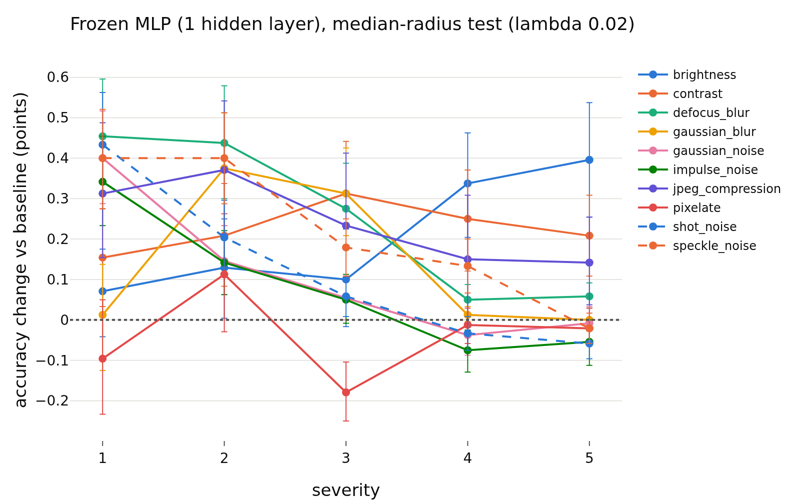
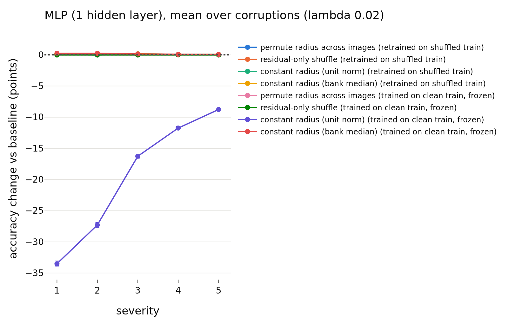

# radius_usage / shift, lambda = 0.02
- **Branch / version:** `radius-usage-shift` @ `2989a9a` (code; notes committed after)
- **Run datetime (UTC):** 2026-10-25T21:35Z (aggregation; unit jobs 20:23Z to 21:20Z, see commands)
- **Command(s):**
  (cluster, SLURM; checkout of the branch at the commit above, `PYTHONPATH=<repo>/src`, `OMP_NUM_THREADS=8`; `.env` with `LEJEPA_NORM_NOTES_DIR` pointing at this checkout's `research_notes/`)
  Per-run units, all nine runs (jobs 2246231 to 2246239, 8 CPUs, 48 GB, 21 to 23 min each; both parts, 2026-10-25T20:23Z to 20:46Z; the classification part was recomputed with the added scale-matched condition in jobs 2246400 to 2246409, 2026-10-25T20:58Z to 21:20Z):
  `sbatch --export=ALL --mem=48G --cpus-per-task=8 slurm/analyze.sbatch configs/base.yaml radius_marginal_lam<lambda>_s<seed> radius_usage/unit.md --shift-unit` (first pass, both parts) and the same with `--shift-unit --shift-part classification` (second pass), for lambda in 0.02, 0.05, 0.1 and seed in 0, 1, 2 (writes `<runs_dir>/<run>/shift_cells.npz` and `shift_ood.npz`).
  Embedding dumps of `radius_marginal_lam0.02_s{0,1,2}` (stl10c, dtd_test, svhn_test were missing) were created first: `sbatch --cpus-per-task=4 slurm/embed.sbatch configs/base.yaml radius_marginal_lam0.02_s<seed> last.pt` (jobs 2246025 to 2246027, about 5 min each).
  Aggregation (this note and the other two lambdas; 2026-10-25T21:35Z, job 2246532, 8 CPUs, 32 GB, about 7 min):
  `python apps/analyze.py --config configs/base.yaml --shift radius_marginal --note radius_usage/shift.md`
- **Datasets:** STL-10 ([canonical](https://cs.stanford.edu/~acoates/stl10/), [HF `tanganke/stl10`](https://huggingface.co/datasets/tanganke/stl10)): `train` (bank / training set) and `test` (ID); canonical archive used, HF for reference only. STL-10-C: built locally from STL-10 `test` (10 corruptions x 5 severities, 400k images; no HF mirror). DTD `test` partition 1 ([canonical](https://www.robots.ox.ac.uk/~vgg/data/dtd/), [HF `tanganke/dtd`](https://huggingface.co/datasets/tanganke/dtd)) and SVHN `test` ([canonical](http://ufldl.stanford.edu/housenumbers/), [HF `ufldl-stanford/svhn`](https://huggingface.co/datasets/ufldl-stanford/svhn)) as OOD sets; the canonical sources (via torchvision) were used, HF pages are for reference only.
- **Backbone:** ResNet-18 from scratch ([HF architecture reference](https://huggingface.co/timm/resnet18.a1_in1k), weights not used); `last.pt` (epoch 200) of `radius_marginal_lam0.02_s{0,1,2}` (Variant A).
- **Scope:** h is not analyzed; LeJEPA's product is z. All results are z-space, un-augmented center views.
- **Margins (fixed before the results):** 0.5 accuracy points (Part 1, as E1); 0.01 AUROC (Part 2). Pre-registration: `shift_summary.md`.

## Question

Is the embedding radius used when the test distribution shifts? Part 1: readers fitted on clean STL-10 `train` are tested on corrupted STL-10-C images with the radius randomized or removed (does the shifted radius hurt or help; does normalizing recover accuracy). Part 2: does the radius separate STL-10 `test` from DTD / SVHN, alone or on top of the direction (k-NN) score. Lambda = 0.02, three training seeds. Cross-lambda reading and verdicts: `shift_summary.md`.

## Setup (deviations from the base config)

No deviation from `configs/base.yaml` (k = 20, 1000 bootstrap replicates, 5 shuffle repeats per randomized condition, MLP weight decay chosen on the clean bank). Conditions, readers, protocols, the clean-fitted direction -> log-radius map and the OOD scores are defined in the docstrings of `lejepa_norm.eval.shift` and `lejepa_norm.eval.ood_radius`. Post-hoc additions (after the first results, not in the pre-registration): the scale-matched `constant radius (bank median)` condition (the unit-norm one collapses frozen readers by a pure scale mismatch, as in E1) and the `post hoc: direction + low radius` OOD score; both are labeled as such.

## Results

<!-- BEGIN GENERATED: analyze.shift_inputs -->
### Inputs

Runs aggregated: `radius_marginal_lam0.02_s0`, `radius_marginal_lam0.02_s1`, `radius_marginal_lam0.02_s2`.

Unit files missing for this lambda:

None.
<!-- END GENERATED: analyze.shift_inputs -->

<!-- BEGIN GENERATED: analyze.shift_context -->
### Radius shift and baseline accuracy per corruption

Averaged over the 5 severities and the seeds. `log-radius shift` = mean paired change of the center-view log-radius vs the clean twin; `clean-map residual` = mean of `log r - f(u)` with the clean-fitted direction -> log-radius map `f`; accuracies are those of the frozen readers on the unmodified corrupted embeddings.

| lambda | corruption | log-radius shift | clean-map residual | k-NN (euclidean) acc | linear probe acc | MLP (1 hidden layer) acc | k-NN (euclidean): frozen, unit norm (points) | k-NN (euclidean): frozen, bank-median radius (points) | linear probe: frozen, unit norm (points) | linear probe: frozen, bank-median radius (points) | MLP (1 hidden layer): frozen, unit norm (points) | MLP (1 hidden layer): frozen, bank-median radius (points) |
|---|---|---|---|---|---|---|---|---|---|---|---|---|
| 0.02 | clean test (reference) | 0 | -0.0066 | 0.7774 | 0.8040 | 0.8037 |  |  |  |  |  |  |
| 0.02 | brightness | -0.0405 | -0.0075 | 0.7286 | 0.7433 | 0.7471 | -60.31 | +0.37 | -61.95 | -0.03 | -48.04 | +0.21 |
| 0.02 | contrast | -0.0679 | -0.0150 | 0.5498 | 0.5693 | 0.5761 | -42.85 | +0.78 | -45.35 | -0.22 | -37.77 | +0.23 |
| 0.02 | defocus_blur | -0.1444 | -0.1050 | 0.2812 | 0.2902 | 0.2984 | -17.24 | +0.18 | -17.90 | +0.12 | -15.34 | +0.26 |
| 0.02 | gaussian_blur | -0.0809 | -0.0857 | 0.3830 | 0.3908 | 0.3927 | -27.01 | +0.17 | -27.76 | -0.16 | -21.59 | +0.14 |
| 0.02 | gaussian_noise | -0.1051 | -0.0098 | 0.1778 | 0.1792 | 0.1760 | -7.63 | +0.02 | -7.89 | +0.69 | -3.18 | +0.11 |
| 0.02 | impulse_noise | -0.1182 | +0.0021 | 0.1777 | 0.1808 | 0.1777 | -7.62 | +0.15 | -8.06 | +0.49 | -3.61 | +0.08 |
| 0.02 | jpeg_compression | -0.2491 | -0.0602 | 0.5358 | 0.5366 | 0.5479 | -41.15 | +1.32 | -41.71 | -0.23 | -31.66 | +0.24 |
| 0.02 | pixelate | -0.1294 | -0.0555 | 0.3728 | 0.3644 | 0.3776 | -27.82 | +0.66 | -25.54 | -0.16 | -19.55 | -0.04 |
| 0.02 | shot_noise | -0.0932 | -0.0001 | 0.1821 | 0.1928 | 0.1838 | -8.01 | +0.14 | -9.19 | +0.59 | -4.37 | +0.12 |
| 0.02 | speckle_noise | -0.0998 | +0.0048 | 0.2595 | 0.2796 | 0.2608 | -15.33 | +0.23 | -17.45 | +0.86 | -10.04 | +0.22 |
<!-- END GENERATED: analyze.shift_context -->

<!-- BEGIN GENERATED: analyze.shift_corruption -->
### Accuracy change per corruption (severities averaged)

Differences are in accuracy points (condition minus baseline on the same corrupted test images), averaged over training seeds; intervals are paired bootstrap percentile intervals (1000 replicates, test images resampled within each seed, the same resample for every cell). Verdict, with the equivalence margin set to ±0.5 points before looking at results: `equivalent` if the 90% interval lies inside the margin, `different` if not equivalent and the 95% interval excludes 0, otherwise `inconclusive`. Bank / training set: clean STL-10 train.

| corruption | reader | protocol | condition | baseline acc (corrupted) | condition acc | change (points) | 90% CI | 95% CI | verdict |
|---|---|---|---|---|---|---|---|---|---|
| brightness | k-NN (euclidean) | retrained on shuffled train | permute radius across images | 0.7286 | 0.7270 | -0.16 | [-0.30, -0.01] | [-0.32, +0.01] | equivalent |
| contrast | k-NN (euclidean) | retrained on shuffled train | permute radius across images | 0.5498 | 0.5587 | +0.89 | [+0.76, +1.02] | [+0.73, +1.05] | different |
| defocus_blur | k-NN (euclidean) | retrained on shuffled train | permute radius across images | 0.2812 | 0.2854 | +0.42 | [+0.33, +0.53] | [+0.30, +0.55] | different |
| gaussian_blur | k-NN (euclidean) | retrained on shuffled train | permute radius across images | 0.3830 | 0.3837 | +0.07 | [-0.01, +0.16] | [-0.02, +0.17] | equivalent |
| gaussian_noise | k-NN (euclidean) | retrained on shuffled train | permute radius across images | 0.1778 | 0.1792 | +0.14 | [-0.01, +0.29] | [-0.04, +0.32] | equivalent |
| impulse_noise | k-NN (euclidean) | retrained on shuffled train | permute radius across images | 0.1777 | 0.1806 | +0.29 | [+0.10, +0.47] | [+0.07, +0.50] | equivalent |
| jpeg_compression | k-NN (euclidean) | retrained on shuffled train | permute radius across images | 0.5358 | 0.5503 | +1.45 | [+1.30, +1.61] | [+1.27, +1.63] | different |
| pixelate | k-NN (euclidean) | retrained on shuffled train | permute radius across images | 0.3728 | 0.3840 | +1.12 | [+1.00, +1.23] | [+0.98, +1.25] | different |
| shot_noise | k-NN (euclidean) | retrained on shuffled train | permute radius across images | 0.1821 | 0.1891 | +0.70 | [+0.54, +0.86] | [+0.52, +0.89] | different |
| speckle_noise | k-NN (euclidean) | retrained on shuffled train | permute radius across images | 0.2595 | 0.2715 | +1.20 | [+1.04, +1.36] | [+1.02, +1.39] | different |
| all corruptions | k-NN (euclidean) | retrained on shuffled train | permute radius across images | 0.3648 | 0.3710 | +0.61 | [+0.54, +0.68] | [+0.52, +0.69] | different |
| brightness | k-NN (euclidean) | retrained on shuffled train | residual-only shuffle | 0.7286 | 0.7272 | -0.15 | [-0.23, -0.07] | [-0.24, -0.05] | equivalent |
| contrast | k-NN (euclidean) | retrained on shuffled train | residual-only shuffle | 0.5498 | 0.5504 | +0.06 | [-0.03, +0.14] | [-0.04, +0.16] | equivalent |
| defocus_blur | k-NN (euclidean) | retrained on shuffled train | residual-only shuffle | 0.2812 | 0.2817 | +0.06 | [+0.00, +0.11] | [-0.01, +0.12] | equivalent |
| gaussian_blur | k-NN (euclidean) | retrained on shuffled train | residual-only shuffle | 0.3830 | 0.3830 | -0.00 | [-0.05, +0.05] | [-0.07, +0.06] | equivalent |
| gaussian_noise | k-NN (euclidean) | retrained on shuffled train | residual-only shuffle | 0.1778 | 0.1783 | +0.05 | [-0.01, +0.12] | [-0.02, +0.13] | equivalent |
| impulse_noise | k-NN (euclidean) | retrained on shuffled train | residual-only shuffle | 0.1777 | 0.1786 | +0.09 | [+0.02, +0.17] | [+0.01, +0.18] | equivalent |
| jpeg_compression | k-NN (euclidean) | retrained on shuffled train | residual-only shuffle | 0.5358 | 0.5343 | -0.16 | [-0.25, -0.07] | [-0.27, -0.05] | equivalent |
| pixelate | k-NN (euclidean) | retrained on shuffled train | residual-only shuffle | 0.3728 | 0.3744 | +0.15 | [+0.08, +0.22] | [+0.07, +0.23] | equivalent |
| shot_noise | k-NN (euclidean) | retrained on shuffled train | residual-only shuffle | 0.1821 | 0.1818 | -0.03 | [-0.10, +0.04] | [-0.11, +0.06] | equivalent |
| speckle_noise | k-NN (euclidean) | retrained on shuffled train | residual-only shuffle | 0.2595 | 0.2586 | -0.09 | [-0.17, -0.01] | [-0.18, +0.01] | equivalent |
| all corruptions | k-NN (euclidean) | retrained on shuffled train | residual-only shuffle | 0.3648 | 0.3648 | -0.00 | [-0.03, +0.02] | [-0.03, +0.03] | equivalent |
| brightness | k-NN (euclidean) | retrained on shuffled train | constant radius (unit norm) | 0.7286 | 0.7305 | +0.18 | [+0.04, +0.33] | [+0.01, +0.36] | equivalent |
| contrast | k-NN (euclidean) | retrained on shuffled train | constant radius (unit norm) | 0.5498 | 0.5599 | +1.01 | [+0.87, +1.16] | [+0.83, +1.18] | different |
| defocus_blur | k-NN (euclidean) | retrained on shuffled train | constant radius (unit norm) | 0.2812 | 0.2869 | +0.58 | [+0.48, +0.68] | [+0.46, +0.71] | different |
| gaussian_blur | k-NN (euclidean) | retrained on shuffled train | constant radius (unit norm) | 0.3830 | 0.3856 | +0.26 | [+0.17, +0.35] | [+0.16, +0.37] | equivalent |
| gaussian_noise | k-NN (euclidean) | retrained on shuffled train | constant radius (unit norm) | 0.1778 | 0.1763 | -0.15 | [-0.28, -0.03] | [-0.31, -0.00] | equivalent |
| impulse_noise | k-NN (euclidean) | retrained on shuffled train | constant radius (unit norm) | 0.1777 | 0.1775 | -0.02 | [-0.16, +0.11] | [-0.18, +0.14] | equivalent |
| jpeg_compression | k-NN (euclidean) | retrained on shuffled train | constant radius (unit norm) | 0.5358 | 0.5569 | +2.11 | [+1.94, +2.27] | [+1.90, +2.31] | different |
| pixelate | k-NN (euclidean) | retrained on shuffled train | constant radius (unit norm) | 0.3728 | 0.3885 | +1.57 | [+1.44, +1.69] | [+1.42, +1.72] | different |
| shot_noise | k-NN (euclidean) | retrained on shuffled train | constant radius (unit norm) | 0.1821 | 0.1838 | +0.17 | [+0.05, +0.29] | [+0.02, +0.31] | equivalent |
| speckle_noise | k-NN (euclidean) | retrained on shuffled train | constant radius (unit norm) | 0.2595 | 0.2644 | +0.49 | [+0.35, +0.64] | [+0.32, +0.67] | different |
| all corruptions | k-NN (euclidean) | retrained on shuffled train | constant radius (unit norm) | 0.3648 | 0.3710 | +0.62 | [+0.56, +0.67] | [+0.55, +0.68] | different |
| brightness | k-NN (euclidean) | retrained on shuffled train | constant radius (bank median) | 0.7286 | 0.7305 | +0.18 | [+0.04, +0.33] | [+0.01, +0.36] | equivalent |
| contrast | k-NN (euclidean) | retrained on shuffled train | constant radius (bank median) | 0.5498 | 0.5599 | +1.01 | [+0.87, +1.16] | [+0.83, +1.18] | different |
| defocus_blur | k-NN (euclidean) | retrained on shuffled train | constant radius (bank median) | 0.2812 | 0.2869 | +0.58 | [+0.48, +0.68] | [+0.46, +0.71] | different |
| gaussian_blur | k-NN (euclidean) | retrained on shuffled train | constant radius (bank median) | 0.3830 | 0.3856 | +0.26 | [+0.17, +0.35] | [+0.16, +0.37] | equivalent |
| gaussian_noise | k-NN (euclidean) | retrained on shuffled train | constant radius (bank median) | 0.1778 | 0.1763 | -0.15 | [-0.28, -0.03] | [-0.31, -0.00] | equivalent |
| impulse_noise | k-NN (euclidean) | retrained on shuffled train | constant radius (bank median) | 0.1777 | 0.1775 | -0.02 | [-0.16, +0.11] | [-0.18, +0.14] | equivalent |
| jpeg_compression | k-NN (euclidean) | retrained on shuffled train | constant radius (bank median) | 0.5358 | 0.5569 | +2.11 | [+1.94, +2.27] | [+1.90, +2.31] | different |
| pixelate | k-NN (euclidean) | retrained on shuffled train | constant radius (bank median) | 0.3728 | 0.3885 | +1.56 | [+1.44, +1.69] | [+1.42, +1.72] | different |
| shot_noise | k-NN (euclidean) | retrained on shuffled train | constant radius (bank median) | 0.1821 | 0.1838 | +0.17 | [+0.05, +0.29] | [+0.02, +0.31] | equivalent |
| speckle_noise | k-NN (euclidean) | retrained on shuffled train | constant radius (bank median) | 0.2595 | 0.2644 | +0.49 | [+0.35, +0.64] | [+0.32, +0.67] | different |
| all corruptions | k-NN (euclidean) | retrained on shuffled train | constant radius (bank median) | 0.3648 | 0.3710 | +0.62 | [+0.56, +0.67] | [+0.55, +0.68] | different |
| brightness | k-NN (euclidean) | trained on clean train, frozen | permute radius across images | 0.7286 | 0.7289 | +0.03 | [-0.06, +0.12] | [-0.08, +0.14] | equivalent |
| contrast | k-NN (euclidean) | trained on clean train, frozen | permute radius across images | 0.5498 | 0.5526 | +0.28 | [+0.20, +0.35] | [+0.19, +0.37] | equivalent |
| defocus_blur | k-NN (euclidean) | trained on clean train, frozen | permute radius across images | 0.2812 | 0.2811 | -0.00 | [-0.06, +0.05] | [-0.07, +0.06] | equivalent |
| gaussian_blur | k-NN (euclidean) | trained on clean train, frozen | permute radius across images | 0.3830 | 0.3828 | -0.02 | [-0.07, +0.04] | [-0.08, +0.05] | equivalent |
| gaussian_noise | k-NN (euclidean) | trained on clean train, frozen | permute radius across images | 0.1778 | 0.1772 | -0.06 | [-0.12, -0.00] | [-0.13, +0.01] | equivalent |
| impulse_noise | k-NN (euclidean) | trained on clean train, frozen | permute radius across images | 0.1777 | 0.1778 | +0.01 | [-0.05, +0.07] | [-0.07, +0.08] | equivalent |
| jpeg_compression | k-NN (euclidean) | trained on clean train, frozen | permute radius across images | 0.5358 | 0.5326 | -0.33 | [-0.41, -0.24] | [-0.43, -0.22] | equivalent |
| pixelate | k-NN (euclidean) | trained on clean train, frozen | permute radius across images | 0.3728 | 0.3732 | +0.03 | [-0.03, +0.10] | [-0.04, +0.11] | equivalent |
| shot_noise | k-NN (euclidean) | trained on clean train, frozen | permute radius across images | 0.1821 | 0.1813 | -0.08 | [-0.14, -0.02] | [-0.15, -0.01] | equivalent |
| speckle_noise | k-NN (euclidean) | trained on clean train, frozen | permute radius across images | 0.2595 | 0.2577 | -0.18 | [-0.25, -0.10] | [-0.26, -0.09] | equivalent |
| all corruptions | k-NN (euclidean) | trained on clean train, frozen | permute radius across images | 0.3648 | 0.3645 | -0.03 | [-0.06, -0.01] | [-0.06, -0.00] | equivalent |
| brightness | k-NN (euclidean) | trained on clean train, frozen | residual-only shuffle | 0.7286 | 0.7278 | -0.08 | [-0.13, -0.03] | [-0.14, -0.02] | equivalent |
| contrast | k-NN (euclidean) | trained on clean train, frozen | residual-only shuffle | 0.5498 | 0.5504 | +0.06 | [+0.00, +0.12] | [-0.01, +0.13] | equivalent |
| defocus_blur | k-NN (euclidean) | trained on clean train, frozen | residual-only shuffle | 0.2812 | 0.2825 | +0.13 | [+0.09, +0.17] | [+0.08, +0.18] | equivalent |
| gaussian_blur | k-NN (euclidean) | trained on clean train, frozen | residual-only shuffle | 0.3830 | 0.3836 | +0.06 | [+0.02, +0.10] | [+0.01, +0.11] | equivalent |
| gaussian_noise | k-NN (euclidean) | trained on clean train, frozen | residual-only shuffle | 0.1778 | 0.1772 | -0.06 | [-0.11, -0.01] | [-0.12, -0.00] | equivalent |
| impulse_noise | k-NN (euclidean) | trained on clean train, frozen | residual-only shuffle | 0.1777 | 0.1777 | +0.00 | [-0.05, +0.05] | [-0.06, +0.06] | equivalent |
| jpeg_compression | k-NN (euclidean) | trained on clean train, frozen | residual-only shuffle | 0.5358 | 0.5352 | -0.07 | [-0.13, -0.00] | [-0.14, +0.01] | equivalent |
| pixelate | k-NN (euclidean) | trained on clean train, frozen | residual-only shuffle | 0.3728 | 0.3743 | +0.15 | [+0.10, +0.20] | [+0.08, +0.21] | equivalent |
| shot_noise | k-NN (euclidean) | trained on clean train, frozen | residual-only shuffle | 0.1821 | 0.1819 | -0.02 | [-0.07, +0.03] | [-0.08, +0.04] | equivalent |
| speckle_noise | k-NN (euclidean) | trained on clean train, frozen | residual-only shuffle | 0.2595 | 0.2586 | -0.09 | [-0.14, -0.03] | [-0.15, -0.02] | equivalent |
| all corruptions | k-NN (euclidean) | trained on clean train, frozen | residual-only shuffle | 0.3648 | 0.3649 | +0.01 | [-0.01, +0.02] | [-0.01, +0.03] | equivalent |
| brightness | k-NN (euclidean) | trained on clean train, frozen | constant radius (unit norm) | 0.7286 | 0.1255 | -60.31 | [-60.90, -59.73] | [-61.02, -59.66] | different |
| contrast | k-NN (euclidean) | trained on clean train, frozen | constant radius (unit norm) | 0.5498 | 0.1213 | -42.85 | [-43.39, -42.30] | [-43.49, -42.22] | different |
| defocus_blur | k-NN (euclidean) | trained on clean train, frozen | constant radius (unit norm) | 0.2812 | 0.1087 | -17.24 | [-17.70, -16.74] | [-17.79, -16.66] | different |
| gaussian_blur | k-NN (euclidean) | trained on clean train, frozen | constant radius (unit norm) | 0.3830 | 0.1128 | -27.01 | [-27.44, -26.58] | [-27.53, -26.52] | different |
| gaussian_noise | k-NN (euclidean) | trained on clean train, frozen | constant radius (unit norm) | 0.1778 | 0.1016 | -7.63 | [-8.10, -7.12] | [-8.18, -7.03] | different |
| impulse_noise | k-NN (euclidean) | trained on clean train, frozen | constant radius (unit norm) | 0.1777 | 0.1015 | -7.62 | [-8.11, -7.14] | [-8.17, -7.05] | different |
| jpeg_compression | k-NN (euclidean) | trained on clean train, frozen | constant radius (unit norm) | 0.5358 | 0.1244 | -41.15 | [-41.72, -40.56] | [-41.79, -40.45] | different |
| pixelate | k-NN (euclidean) | trained on clean train, frozen | constant radius (unit norm) | 0.3728 | 0.0946 | -27.82 | [-28.29, -27.35] | [-28.36, -27.27] | different |
| shot_noise | k-NN (euclidean) | trained on clean train, frozen | constant radius (unit norm) | 0.1821 | 0.1020 | -8.01 | [-8.44, -7.53] | [-8.52, -7.45] | different |
| speckle_noise | k-NN (euclidean) | trained on clean train, frozen | constant radius (unit norm) | 0.2595 | 0.1062 | -15.33 | [-15.80, -14.83] | [-15.91, -14.74] | different |
| all corruptions | k-NN (euclidean) | trained on clean train, frozen | constant radius (unit norm) | 0.3648 | 0.1099 | -25.50 | [-25.91, -25.08] | [-25.97, -25.01] | different |
| brightness | k-NN (euclidean) | trained on clean train, frozen | constant radius (bank median) | 0.7286 | 0.7323 | +0.37 | [+0.27, +0.48] | [+0.24, +0.50] | equivalent |
| contrast | k-NN (euclidean) | trained on clean train, frozen | constant radius (bank median) | 0.5498 | 0.5576 | +0.78 | [+0.68, +0.89] | [+0.66, +0.91] | different |
| defocus_blur | k-NN (euclidean) | trained on clean train, frozen | constant radius (bank median) | 0.2812 | 0.2830 | +0.18 | [+0.10, +0.26] | [+0.09, +0.28] | equivalent |
| gaussian_blur | k-NN (euclidean) | trained on clean train, frozen | constant radius (bank median) | 0.3830 | 0.3847 | +0.17 | [+0.10, +0.24] | [+0.09, +0.26] | equivalent |
| gaussian_noise | k-NN (euclidean) | trained on clean train, frozen | constant radius (bank median) | 0.1778 | 0.1780 | +0.02 | [-0.06, +0.11] | [-0.08, +0.12] | equivalent |
| impulse_noise | k-NN (euclidean) | trained on clean train, frozen | constant radius (bank median) | 0.1777 | 0.1792 | +0.15 | [+0.05, +0.24] | [+0.04, +0.25] | equivalent |
| jpeg_compression | k-NN (euclidean) | trained on clean train, frozen | constant radius (bank median) | 0.5358 | 0.5490 | +1.32 | [+1.19, +1.44] | [+1.17, +1.46] | different |
| pixelate | k-NN (euclidean) | trained on clean train, frozen | constant radius (bank median) | 0.3728 | 0.3795 | +0.66 | [+0.57, +0.75] | [+0.56, +0.77] | different |
| shot_noise | k-NN (euclidean) | trained on clean train, frozen | constant radius (bank median) | 0.1821 | 0.1835 | +0.14 | [+0.05, +0.22] | [+0.04, +0.23] | equivalent |
| speckle_noise | k-NN (euclidean) | trained on clean train, frozen | constant radius (bank median) | 0.2595 | 0.2618 | +0.23 | [+0.14, +0.32] | [+0.12, +0.34] | equivalent |
| all corruptions | k-NN (euclidean) | trained on clean train, frozen | constant radius (bank median) | 0.3648 | 0.3689 | +0.40 | [+0.37, +0.43] | [+0.36, +0.44] | equivalent |
| brightness | linear probe | retrained on shuffled train | permute radius across images | 0.7433 | 0.7440 | +0.06 | [-0.02, +0.13] | [-0.03, +0.15] | equivalent |
| contrast | linear probe | retrained on shuffled train | permute radius across images | 0.5693 | 0.5716 | +0.23 | [+0.16, +0.31] | [+0.14, +0.32] | equivalent |
| defocus_blur | linear probe | retrained on shuffled train | permute radius across images | 0.2902 | 0.2954 | +0.52 | [+0.46, +0.57] | [+0.45, +0.59] | different |
| gaussian_blur | linear probe | retrained on shuffled train | permute radius across images | 0.3908 | 0.3927 | +0.19 | [+0.14, +0.23] | [+0.13, +0.24] | equivalent |
| gaussian_noise | linear probe | retrained on shuffled train | permute radius across images | 0.1792 | 0.1787 | -0.05 | [-0.11, +0.01] | [-0.12, +0.02] | equivalent |
| impulse_noise | linear probe | retrained on shuffled train | permute radius across images | 0.1808 | 0.1820 | +0.12 | [+0.05, +0.19] | [+0.04, +0.20] | equivalent |
| jpeg_compression | linear probe | retrained on shuffled train | permute radius across images | 0.5366 | 0.5404 | +0.38 | [+0.29, +0.47] | [+0.27, +0.48] | equivalent |
| pixelate | linear probe | retrained on shuffled train | permute radius across images | 0.3644 | 0.3681 | +0.37 | [+0.30, +0.45] | [+0.29, +0.46] | equivalent |
| shot_noise | linear probe | retrained on shuffled train | permute radius across images | 0.1928 | 0.1907 | -0.21 | [-0.29, -0.14] | [-0.30, -0.12] | equivalent |
| speckle_noise | linear probe | retrained on shuffled train | permute radius across images | 0.2796 | 0.2771 | -0.26 | [-0.34, -0.17] | [-0.35, -0.15] | equivalent |
| all corruptions | linear probe | retrained on shuffled train | permute radius across images | 0.3727 | 0.3741 | +0.13 | [+0.11, +0.16] | [+0.10, +0.17] | equivalent |
| brightness | linear probe | retrained on shuffled train | residual-only shuffle | 0.7433 | 0.7433 | +0.00 | [-0.05, +0.04] | [-0.06, +0.05] | equivalent |
| contrast | linear probe | retrained on shuffled train | residual-only shuffle | 0.5693 | 0.5676 | -0.16 | [-0.21, -0.12] | [-0.22, -0.11] | equivalent |
| defocus_blur | linear probe | retrained on shuffled train | residual-only shuffle | 0.2902 | 0.2920 | +0.18 | [+0.14, +0.22] | [+0.13, +0.22] | equivalent |
| gaussian_blur | linear probe | retrained on shuffled train | residual-only shuffle | 0.3908 | 0.3915 | +0.07 | [+0.04, +0.10] | [+0.03, +0.11] | equivalent |
| gaussian_noise | linear probe | retrained on shuffled train | residual-only shuffle | 0.1792 | 0.1795 | +0.03 | [-0.00, +0.07] | [-0.01, +0.08] | equivalent |
| impulse_noise | linear probe | retrained on shuffled train | residual-only shuffle | 0.1808 | 0.1807 | -0.00 | [-0.04, +0.03] | [-0.04, +0.04] | equivalent |
| jpeg_compression | linear probe | retrained on shuffled train | residual-only shuffle | 0.5366 | 0.5351 | -0.16 | [-0.21, -0.11] | [-0.22, -0.10] | equivalent |
| pixelate | linear probe | retrained on shuffled train | residual-only shuffle | 0.3644 | 0.3635 | -0.09 | [-0.13, -0.04] | [-0.14, -0.04] | equivalent |
| shot_noise | linear probe | retrained on shuffled train | residual-only shuffle | 0.1928 | 0.1935 | +0.07 | [+0.03, +0.11] | [+0.02, +0.12] | equivalent |
| speckle_noise | linear probe | retrained on shuffled train | residual-only shuffle | 0.2796 | 0.2819 | +0.22 | [+0.18, +0.27] | [+0.17, +0.28] | equivalent |
| all corruptions | linear probe | retrained on shuffled train | residual-only shuffle | 0.3727 | 0.3729 | +0.02 | [+0.00, +0.03] | [-0.00, +0.03] | equivalent |
| brightness | linear probe | retrained on shuffled train | constant radius (unit norm) | 0.7433 | 0.7445 | +0.11 | [+0.02, +0.20] | [+0.01, +0.21] | equivalent |
| contrast | linear probe | retrained on shuffled train | constant radius (unit norm) | 0.5693 | 0.5708 | +0.15 | [+0.07, +0.24] | [+0.05, +0.26] | equivalent |
| defocus_blur | linear probe | retrained on shuffled train | constant radius (unit norm) | 0.2902 | 0.2954 | +0.51 | [+0.45, +0.58] | [+0.44, +0.59] | different |
| gaussian_blur | linear probe | retrained on shuffled train | constant radius (unit norm) | 0.3908 | 0.3928 | +0.20 | [+0.14, +0.25] | [+0.13, +0.26] | equivalent |
| gaussian_noise | linear probe | retrained on shuffled train | constant radius (unit norm) | 0.1792 | 0.1858 | +0.66 | [+0.59, +0.73] | [+0.58, +0.75] | different |
| impulse_noise | linear probe | retrained on shuffled train | constant radius (unit norm) | 0.1808 | 0.1855 | +0.47 | [+0.39, +0.54] | [+0.38, +0.55] | different |
| jpeg_compression | linear probe | retrained on shuffled train | constant radius (unit norm) | 0.5366 | 0.5400 | +0.34 | [+0.24, +0.44] | [+0.23, +0.46] | equivalent |
| pixelate | linear probe | retrained on shuffled train | constant radius (unit norm) | 0.3644 | 0.3680 | +0.36 | [+0.28, +0.43] | [+0.27, +0.45] | equivalent |
| shot_noise | linear probe | retrained on shuffled train | constant radius (unit norm) | 0.1928 | 0.1968 | +0.40 | [+0.33, +0.47] | [+0.32, +0.48] | equivalent |
| speckle_noise | linear probe | retrained on shuffled train | constant radius (unit norm) | 0.2796 | 0.2833 | +0.37 | [+0.28, +0.45] | [+0.26, +0.47] | equivalent |
| all corruptions | linear probe | retrained on shuffled train | constant radius (unit norm) | 0.3727 | 0.3763 | +0.36 | [+0.33, +0.39] | [+0.32, +0.40] | equivalent |
| brightness | linear probe | retrained on shuffled train | constant radius (bank median) | 0.7433 | 0.7444 | +0.11 | [+0.02, +0.19] | [+0.01, +0.21] | equivalent |
| contrast | linear probe | retrained on shuffled train | constant radius (bank median) | 0.5693 | 0.5709 | +0.16 | [+0.07, +0.24] | [+0.06, +0.25] | equivalent |
| defocus_blur | linear probe | retrained on shuffled train | constant radius (bank median) | 0.2902 | 0.2957 | +0.54 | [+0.48, +0.61] | [+0.46, +0.62] | different |
| gaussian_blur | linear probe | retrained on shuffled train | constant radius (bank median) | 0.3908 | 0.3930 | +0.22 | [+0.16, +0.27] | [+0.15, +0.28] | equivalent |
| gaussian_noise | linear probe | retrained on shuffled train | constant radius (bank median) | 0.1792 | 0.1858 | +0.66 | [+0.59, +0.73] | [+0.58, +0.74] | different |
| impulse_noise | linear probe | retrained on shuffled train | constant radius (bank median) | 0.1808 | 0.1854 | +0.46 | [+0.39, +0.53] | [+0.37, +0.54] | different |
| jpeg_compression | linear probe | retrained on shuffled train | constant radius (bank median) | 0.5366 | 0.5402 | +0.36 | [+0.26, +0.46] | [+0.24, +0.48] | equivalent |
| pixelate | linear probe | retrained on shuffled train | constant radius (bank median) | 0.3644 | 0.3680 | +0.36 | [+0.29, +0.44] | [+0.27, +0.45] | equivalent |
| shot_noise | linear probe | retrained on shuffled train | constant radius (bank median) | 0.1928 | 0.1969 | +0.41 | [+0.34, +0.48] | [+0.33, +0.49] | equivalent |
| speckle_noise | linear probe | retrained on shuffled train | constant radius (bank median) | 0.2796 | 0.2836 | +0.40 | [+0.31, +0.48] | [+0.29, +0.49] | equivalent |
| all corruptions | linear probe | retrained on shuffled train | constant radius (bank median) | 0.3727 | 0.3764 | +0.37 | [+0.33, +0.40] | [+0.33, +0.41] | equivalent |
| brightness | linear probe | trained on clean train, frozen | permute radius across images | 0.7433 | 0.7398 | -0.36 | [-0.45, -0.27] | [-0.46, -0.26] | equivalent |
| contrast | linear probe | trained on clean train, frozen | permute radius across images | 0.5693 | 0.5667 | -0.25 | [-0.32, -0.18] | [-0.34, -0.17] | equivalent |
| defocus_blur | linear probe | trained on clean train, frozen | permute radius across images | 0.2902 | 0.2900 | -0.02 | [-0.08, +0.03] | [-0.09, +0.04] | equivalent |
| gaussian_blur | linear probe | trained on clean train, frozen | permute radius across images | 0.3908 | 0.3881 | -0.27 | [-0.32, -0.22] | [-0.33, -0.21] | equivalent |
| gaussian_noise | linear probe | trained on clean train, frozen | permute radius across images | 0.1792 | 0.1798 | +0.06 | [+0.03, +0.10] | [+0.02, +0.11] | equivalent |
| impulse_noise | linear probe | trained on clean train, frozen | permute radius across images | 0.1808 | 0.1814 | +0.07 | [+0.03, +0.11] | [+0.02, +0.12] | equivalent |
| jpeg_compression | linear probe | trained on clean train, frozen | permute radius across images | 0.5366 | 0.5288 | -0.78 | [-0.87, -0.70] | [-0.89, -0.68] | different |
| pixelate | linear probe | trained on clean train, frozen | permute radius across images | 0.3644 | 0.3606 | -0.38 | [-0.43, -0.32] | [-0.45, -0.32] | equivalent |
| shot_noise | linear probe | trained on clean train, frozen | permute radius across images | 0.1928 | 0.1938 | +0.10 | [+0.06, +0.15] | [+0.05, +0.16] | equivalent |
| speckle_noise | linear probe | trained on clean train, frozen | permute radius across images | 0.2796 | 0.2812 | +0.16 | [+0.10, +0.22] | [+0.09, +0.23] | equivalent |
| all corruptions | linear probe | trained on clean train, frozen | permute radius across images | 0.3727 | 0.3710 | -0.17 | [-0.19, -0.14] | [-0.19, -0.14] | equivalent |
| brightness | linear probe | trained on clean train, frozen | residual-only shuffle | 0.7433 | 0.7427 | -0.07 | [-0.11, -0.03] | [-0.12, -0.02] | equivalent |
| contrast | linear probe | trained on clean train, frozen | residual-only shuffle | 0.5693 | 0.5690 | -0.02 | [-0.06, +0.02] | [-0.07, +0.02] | equivalent |
| defocus_blur | linear probe | trained on clean train, frozen | residual-only shuffle | 0.2902 | 0.2922 | +0.20 | [+0.16, +0.24] | [+0.15, +0.24] | equivalent |
| gaussian_blur | linear probe | trained on clean train, frozen | residual-only shuffle | 0.3908 | 0.3914 | +0.06 | [+0.03, +0.09] | [+0.02, +0.10] | equivalent |
| gaussian_noise | linear probe | trained on clean train, frozen | residual-only shuffle | 0.1792 | 0.1788 | -0.04 | [-0.07, -0.01] | [-0.07, -0.01] | equivalent |
| impulse_noise | linear probe | trained on clean train, frozen | residual-only shuffle | 0.1808 | 0.1800 | -0.07 | [-0.10, -0.05] | [-0.10, -0.04] | equivalent |
| jpeg_compression | linear probe | trained on clean train, frozen | residual-only shuffle | 0.5366 | 0.5338 | -0.28 | [-0.33, -0.23] | [-0.34, -0.22] | equivalent |
| pixelate | linear probe | trained on clean train, frozen | residual-only shuffle | 0.3644 | 0.3624 | -0.21 | [-0.24, -0.17] | [-0.25, -0.17] | equivalent |
| shot_noise | linear probe | trained on clean train, frozen | residual-only shuffle | 0.1928 | 0.1927 | -0.00 | [-0.04, +0.03] | [-0.04, +0.03] | equivalent |
| speckle_noise | linear probe | trained on clean train, frozen | residual-only shuffle | 0.2796 | 0.2801 | +0.05 | [+0.01, +0.09] | [+0.01, +0.10] | equivalent |
| all corruptions | linear probe | trained on clean train, frozen | residual-only shuffle | 0.3727 | 0.3723 | -0.04 | [-0.05, -0.03] | [-0.05, -0.03] | equivalent |
| brightness | linear probe | trained on clean train, frozen | constant radius (unit norm) | 0.7433 | 0.1238 | -61.95 | [-62.51, -61.39] | [-62.60, -61.29] | different |
| contrast | linear probe | trained on clean train, frozen | constant radius (unit norm) | 0.5693 | 0.1158 | -45.35 | [-45.87, -44.78] | [-46.00, -44.68] | different |
| defocus_blur | linear probe | trained on clean train, frozen | constant radius (unit norm) | 0.2902 | 0.1112 | -17.90 | [-18.38, -17.44] | [-18.51, -17.35] | different |
| gaussian_blur | linear probe | trained on clean train, frozen | constant radius (unit norm) | 0.3908 | 0.1132 | -27.76 | [-28.20, -27.33] | [-28.30, -27.28] | different |
| gaussian_noise | linear probe | trained on clean train, frozen | constant radius (unit norm) | 0.1792 | 0.1003 | -7.89 | [-8.27, -7.48] | [-8.33, -7.43] | different |
| impulse_noise | linear probe | trained on clean train, frozen | constant radius (unit norm) | 0.1808 | 0.1002 | -8.06 | [-8.44, -7.63] | [-8.50, -7.58] | different |
| jpeg_compression | linear probe | trained on clean train, frozen | constant radius (unit norm) | 0.5366 | 0.1195 | -41.71 | [-42.28, -41.12] | [-42.38, -41.03] | different |
| pixelate | linear probe | trained on clean train, frozen | constant radius (unit norm) | 0.3644 | 0.1090 | -25.54 | [-26.05, -25.03] | [-26.15, -24.97] | different |
| shot_noise | linear probe | trained on clean train, frozen | constant radius (unit norm) | 0.1928 | 0.1009 | -9.19 | [-9.58, -8.77] | [-9.66, -8.69] | different |
| speckle_noise | linear probe | trained on clean train, frozen | constant radius (unit norm) | 0.2796 | 0.1051 | -17.45 | [-17.90, -16.95] | [-17.99, -16.87] | different |
| all corruptions | linear probe | trained on clean train, frozen | constant radius (unit norm) | 0.3727 | 0.1099 | -26.28 | [-26.68, -25.88] | [-26.76, -25.82] | different |
| brightness | linear probe | trained on clean train, frozen | constant radius (bank median) | 0.7433 | 0.7431 | -0.03 | [-0.13, +0.07] | [-0.15, +0.09] | equivalent |
| contrast | linear probe | trained on clean train, frozen | constant radius (bank median) | 0.5693 | 0.5671 | -0.22 | [-0.30, -0.13] | [-0.32, -0.12] | equivalent |
| defocus_blur | linear probe | trained on clean train, frozen | constant radius (bank median) | 0.2902 | 0.2914 | +0.12 | [+0.05, +0.19] | [+0.02, +0.20] | equivalent |
| gaussian_blur | linear probe | trained on clean train, frozen | constant radius (bank median) | 0.3908 | 0.3892 | -0.16 | [-0.22, -0.10] | [-0.24, -0.09] | equivalent |
| gaussian_noise | linear probe | trained on clean train, frozen | constant radius (bank median) | 0.1792 | 0.1861 | +0.69 | [+0.64, +0.75] | [+0.62, +0.77] | different |
| impulse_noise | linear probe | trained on clean train, frozen | constant radius (bank median) | 0.1808 | 0.1857 | +0.49 | [+0.42, +0.55] | [+0.41, +0.56] | different |
| jpeg_compression | linear probe | trained on clean train, frozen | constant radius (bank median) | 0.5366 | 0.5343 | -0.23 | [-0.34, -0.11] | [-0.38, -0.09] | equivalent |
| pixelate | linear probe | trained on clean train, frozen | constant radius (bank median) | 0.3644 | 0.3628 | -0.16 | [-0.23, -0.08] | [-0.24, -0.07] | equivalent |
| shot_noise | linear probe | trained on clean train, frozen | constant radius (bank median) | 0.1928 | 0.1987 | +0.59 | [+0.53, +0.65] | [+0.52, +0.66] | different |
| speckle_noise | linear probe | trained on clean train, frozen | constant radius (bank median) | 0.2796 | 0.2883 | +0.86 | [+0.79, +0.94] | [+0.77, +0.96] | different |
| all corruptions | linear probe | trained on clean train, frozen | constant radius (bank median) | 0.3727 | 0.3747 | +0.20 | [+0.16, +0.23] | [+0.15, +0.23] | equivalent |
| brightness | MLP (1 hidden layer) | retrained on shuffled train | permute radius across images | 0.7471 | 0.7447 | -0.24 | [-0.33, -0.14] | [-0.34, -0.12] | equivalent |
| contrast | MLP (1 hidden layer) | retrained on shuffled train | permute radius across images | 0.5761 | 0.5769 | +0.08 | [-0.00, +0.17] | [-0.02, +0.19] | equivalent |
| defocus_blur | MLP (1 hidden layer) | retrained on shuffled train | permute radius across images | 0.2984 | 0.3013 | +0.29 | [+0.23, +0.35] | [+0.22, +0.36] | equivalent |
| gaussian_blur | MLP (1 hidden layer) | retrained on shuffled train | permute radius across images | 0.3927 | 0.3927 | +0.00 | [-0.05, +0.06] | [-0.06, +0.07] | equivalent |
| gaussian_noise | MLP (1 hidden layer) | retrained on shuffled train | permute radius across images | 0.1760 | 0.1774 | +0.15 | [+0.06, +0.23] | [+0.05, +0.25] | equivalent |
| impulse_noise | MLP (1 hidden layer) | retrained on shuffled train | permute radius across images | 0.1777 | 0.1788 | +0.12 | [+0.02, +0.22] | [-0.00, +0.25] | equivalent |
| jpeg_compression | MLP (1 hidden layer) | retrained on shuffled train | permute radius across images | 0.5479 | 0.5505 | +0.26 | [+0.17, +0.34] | [+0.15, +0.36] | equivalent |
| pixelate | MLP (1 hidden layer) | retrained on shuffled train | permute radius across images | 0.3776 | 0.3798 | +0.22 | [+0.16, +0.28] | [+0.15, +0.30] | equivalent |
| shot_noise | MLP (1 hidden layer) | retrained on shuffled train | permute radius across images | 0.1838 | 0.1819 | -0.18 | [-0.28, -0.08] | [-0.30, -0.05] | equivalent |
| speckle_noise | MLP (1 hidden layer) | retrained on shuffled train | permute radius across images | 0.2608 | 0.2592 | -0.16 | [-0.28, -0.04] | [-0.29, -0.02] | equivalent |
| all corruptions | MLP (1 hidden layer) | retrained on shuffled train | permute radius across images | 0.3738 | 0.3743 | +0.05 | [+0.02, +0.09] | [+0.01, +0.10] | equivalent |
| brightness | MLP (1 hidden layer) | retrained on shuffled train | residual-only shuffle | 0.7471 | 0.7464 | -0.07 | [-0.13, -0.00] | [-0.14, +0.01] | equivalent |
| contrast | MLP (1 hidden layer) | retrained on shuffled train | residual-only shuffle | 0.5761 | 0.5759 | -0.01 | [-0.07, +0.05] | [-0.08, +0.06] | equivalent |
| defocus_blur | MLP (1 hidden layer) | retrained on shuffled train | residual-only shuffle | 0.2984 | 0.2995 | +0.11 | [+0.07, +0.15] | [+0.06, +0.16] | equivalent |
| gaussian_blur | MLP (1 hidden layer) | retrained on shuffled train | residual-only shuffle | 0.3927 | 0.3929 | +0.02 | [-0.02, +0.06] | [-0.03, +0.07] | equivalent |
| gaussian_noise | MLP (1 hidden layer) | retrained on shuffled train | residual-only shuffle | 0.1760 | 0.1778 | +0.18 | [+0.13, +0.23] | [+0.12, +0.24] | equivalent |
| impulse_noise | MLP (1 hidden layer) | retrained on shuffled train | residual-only shuffle | 0.1777 | 0.1796 | +0.19 | [+0.14, +0.25] | [+0.13, +0.26] | equivalent |
| jpeg_compression | MLP (1 hidden layer) | retrained on shuffled train | residual-only shuffle | 0.5479 | 0.5476 | -0.04 | [-0.09, +0.02] | [-0.10, +0.03] | equivalent |
| pixelate | MLP (1 hidden layer) | retrained on shuffled train | residual-only shuffle | 0.3776 | 0.3774 | -0.02 | [-0.07, +0.02] | [-0.07, +0.03] | equivalent |
| shot_noise | MLP (1 hidden layer) | retrained on shuffled train | residual-only shuffle | 0.1838 | 0.1855 | +0.18 | [+0.12, +0.23] | [+0.11, +0.25] | equivalent |
| speckle_noise | MLP (1 hidden layer) | retrained on shuffled train | residual-only shuffle | 0.2608 | 0.2634 | +0.26 | [+0.20, +0.32] | [+0.19, +0.33] | equivalent |
| all corruptions | MLP (1 hidden layer) | retrained on shuffled train | residual-only shuffle | 0.3738 | 0.3746 | +0.08 | [+0.06, +0.10] | [+0.06, +0.10] | equivalent |
| brightness | MLP (1 hidden layer) | retrained on shuffled train | constant radius (unit norm) | 0.7471 | 0.7457 | -0.13 | [-0.25, -0.02] | [-0.26, +0.00] | equivalent |
| contrast | MLP (1 hidden layer) | retrained on shuffled train | constant radius (unit norm) | 0.5761 | 0.5767 | +0.06 | [-0.04, +0.17] | [-0.06, +0.18] | equivalent |
| defocus_blur | MLP (1 hidden layer) | retrained on shuffled train | constant radius (unit norm) | 0.2984 | 0.3043 | +0.59 | [+0.51, +0.66] | [+0.50, +0.68] | different |
| gaussian_blur | MLP (1 hidden layer) | retrained on shuffled train | constant radius (unit norm) | 0.3927 | 0.3943 | +0.17 | [+0.10, +0.23] | [+0.09, +0.24] | equivalent |
| gaussian_noise | MLP (1 hidden layer) | retrained on shuffled train | constant radius (unit norm) | 0.1760 | 0.1768 | +0.08 | [-0.00, +0.18] | [-0.02, +0.19] | equivalent |
| impulse_noise | MLP (1 hidden layer) | retrained on shuffled train | constant radius (unit norm) | 0.1777 | 0.1771 | -0.05 | [-0.16, +0.06] | [-0.18, +0.08] | equivalent |
| jpeg_compression | MLP (1 hidden layer) | retrained on shuffled train | constant radius (unit norm) | 0.5479 | 0.5523 | +0.44 | [+0.33, +0.55] | [+0.31, +0.56] | different |
| pixelate | MLP (1 hidden layer) | retrained on shuffled train | constant radius (unit norm) | 0.3776 | 0.3809 | +0.34 | [+0.26, +0.41] | [+0.24, +0.42] | equivalent |
| shot_noise | MLP (1 hidden layer) | retrained on shuffled train | constant radius (unit norm) | 0.1838 | 0.1808 | -0.30 | [-0.41, -0.19] | [-0.43, -0.16] | equivalent |
| speckle_noise | MLP (1 hidden layer) | retrained on shuffled train | constant radius (unit norm) | 0.2608 | 0.2579 | -0.29 | [-0.42, -0.15] | [-0.44, -0.13] | equivalent |
| all corruptions | MLP (1 hidden layer) | retrained on shuffled train | constant radius (unit norm) | 0.3738 | 0.3747 | +0.09 | [+0.05, +0.13] | [+0.04, +0.14] | equivalent |
| brightness | MLP (1 hidden layer) | retrained on shuffled train | constant radius (bank median) | 0.7471 | 0.7457 | -0.13 | [-0.25, -0.02] | [-0.26, +0.00] | equivalent |
| contrast | MLP (1 hidden layer) | retrained on shuffled train | constant radius (bank median) | 0.5761 | 0.5767 | +0.06 | [-0.04, +0.17] | [-0.06, +0.18] | equivalent |
| defocus_blur | MLP (1 hidden layer) | retrained on shuffled train | constant radius (bank median) | 0.2984 | 0.3043 | +0.59 | [+0.51, +0.66] | [+0.50, +0.68] | different |
| gaussian_blur | MLP (1 hidden layer) | retrained on shuffled train | constant radius (bank median) | 0.3927 | 0.3943 | +0.17 | [+0.10, +0.23] | [+0.09, +0.24] | equivalent |
| gaussian_noise | MLP (1 hidden layer) | retrained on shuffled train | constant radius (bank median) | 0.1760 | 0.1768 | +0.08 | [-0.00, +0.18] | [-0.02, +0.19] | equivalent |
| impulse_noise | MLP (1 hidden layer) | retrained on shuffled train | constant radius (bank median) | 0.1777 | 0.1771 | -0.05 | [-0.16, +0.06] | [-0.18, +0.08] | equivalent |
| jpeg_compression | MLP (1 hidden layer) | retrained on shuffled train | constant radius (bank median) | 0.5479 | 0.5523 | +0.44 | [+0.33, +0.55] | [+0.31, +0.56] | different |
| pixelate | MLP (1 hidden layer) | retrained on shuffled train | constant radius (bank median) | 0.3776 | 0.3809 | +0.34 | [+0.26, +0.41] | [+0.24, +0.42] | equivalent |
| shot_noise | MLP (1 hidden layer) | retrained on shuffled train | constant radius (bank median) | 0.1838 | 0.1808 | -0.30 | [-0.41, -0.19] | [-0.43, -0.16] | equivalent |
| speckle_noise | MLP (1 hidden layer) | retrained on shuffled train | constant radius (bank median) | 0.2608 | 0.2579 | -0.29 | [-0.42, -0.15] | [-0.44, -0.13] | equivalent |
| all corruptions | MLP (1 hidden layer) | retrained on shuffled train | constant radius (bank median) | 0.3738 | 0.3747 | +0.09 | [+0.05, +0.13] | [+0.04, +0.14] | equivalent |
| brightness | MLP (1 hidden layer) | trained on clean train, frozen | permute radius across images | 0.7471 | 0.7478 | +0.07 | [+0.03, +0.12] | [+0.02, +0.13] | equivalent |
| contrast | MLP (1 hidden layer) | trained on clean train, frozen | permute radius across images | 0.5761 | 0.5769 | +0.09 | [+0.05, +0.12] | [+0.04, +0.13] | equivalent |
| defocus_blur | MLP (1 hidden layer) | trained on clean train, frozen | permute radius across images | 0.2984 | 0.2987 | +0.03 | [+0.00, +0.06] | [-0.00, +0.06] | equivalent |
| gaussian_blur | MLP (1 hidden layer) | trained on clean train, frozen | permute radius across images | 0.3927 | 0.3928 | +0.01 | [-0.01, +0.04] | [-0.02, +0.05] | equivalent |
| gaussian_noise | MLP (1 hidden layer) | trained on clean train, frozen | permute radius across images | 0.1760 | 0.1763 | +0.04 | [+0.02, +0.06] | [+0.01, +0.06] | equivalent |
| impulse_noise | MLP (1 hidden layer) | trained on clean train, frozen | permute radius across images | 0.1777 | 0.1777 | +0.00 | [-0.02, +0.02] | [-0.02, +0.03] | equivalent |
| jpeg_compression | MLP (1 hidden layer) | trained on clean train, frozen | permute radius across images | 0.5479 | 0.5463 | -0.16 | [-0.20, -0.11] | [-0.21, -0.11] | equivalent |
| pixelate | MLP (1 hidden layer) | trained on clean train, frozen | permute radius across images | 0.3776 | 0.3768 | -0.08 | [-0.11, -0.05] | [-0.11, -0.04] | equivalent |
| shot_noise | MLP (1 hidden layer) | trained on clean train, frozen | permute radius across images | 0.1838 | 0.1842 | +0.05 | [+0.03, +0.07] | [+0.02, +0.07] | equivalent |
| speckle_noise | MLP (1 hidden layer) | trained on clean train, frozen | permute radius across images | 0.2608 | 0.2612 | +0.04 | [+0.02, +0.07] | [+0.01, +0.07] | equivalent |
| all corruptions | MLP (1 hidden layer) | trained on clean train, frozen | permute radius across images | 0.3738 | 0.3739 | +0.01 | [-0.00, +0.02] | [-0.00, +0.02] | equivalent |
| brightness | MLP (1 hidden layer) | trained on clean train, frozen | residual-only shuffle | 0.7471 | 0.7467 | -0.04 | [-0.06, -0.02] | [-0.07, -0.01] | equivalent |
| contrast | MLP (1 hidden layer) | trained on clean train, frozen | residual-only shuffle | 0.5761 | 0.5763 | +0.02 | [+0.00, +0.05] | [-0.00, +0.05] | equivalent |
| defocus_blur | MLP (1 hidden layer) | trained on clean train, frozen | residual-only shuffle | 0.2984 | 0.2985 | +0.01 | [-0.01, +0.03] | [-0.02, +0.03] | equivalent |
| gaussian_blur | MLP (1 hidden layer) | trained on clean train, frozen | residual-only shuffle | 0.3927 | 0.3926 | -0.01 | [-0.03, +0.01] | [-0.03, +0.01] | equivalent |
| gaussian_noise | MLP (1 hidden layer) | trained on clean train, frozen | residual-only shuffle | 0.1760 | 0.1759 | -0.01 | [-0.02, +0.00] | [-0.03, +0.01] | equivalent |
| impulse_noise | MLP (1 hidden layer) | trained on clean train, frozen | residual-only shuffle | 0.1777 | 0.1776 | -0.01 | [-0.02, +0.00] | [-0.03, +0.01] | equivalent |
| jpeg_compression | MLP (1 hidden layer) | trained on clean train, frozen | residual-only shuffle | 0.5479 | 0.5469 | -0.11 | [-0.13, -0.08] | [-0.14, -0.07] | equivalent |
| pixelate | MLP (1 hidden layer) | trained on clean train, frozen | residual-only shuffle | 0.3776 | 0.3769 | -0.07 | [-0.09, -0.04] | [-0.09, -0.04] | equivalent |
| shot_noise | MLP (1 hidden layer) | trained on clean train, frozen | residual-only shuffle | 0.1838 | 0.1838 | -0.00 | [-0.02, +0.01] | [-0.02, +0.02] | equivalent |
| speckle_noise | MLP (1 hidden layer) | trained on clean train, frozen | residual-only shuffle | 0.2608 | 0.2606 | -0.01 | [-0.03, +0.00] | [-0.03, +0.01] | equivalent |
| all corruptions | MLP (1 hidden layer) | trained on clean train, frozen | residual-only shuffle | 0.3738 | 0.3736 | -0.02 | [-0.03, -0.02] | [-0.03, -0.01] | equivalent |
| brightness | MLP (1 hidden layer) | trained on clean train, frozen | constant radius (unit norm) | 0.7471 | 0.2667 | -48.04 | [-48.58, -47.52] | [-48.68, -47.43] | different |
| contrast | MLP (1 hidden layer) | trained on clean train, frozen | constant radius (unit norm) | 0.5761 | 0.1983 | -37.77 | [-38.22, -37.33] | [-38.30, -37.25] | different |
| defocus_blur | MLP (1 hidden layer) | trained on clean train, frozen | constant radius (unit norm) | 0.2984 | 0.1450 | -15.34 | [-15.60, -15.08] | [-15.65, -15.04] | different |
| gaussian_blur | MLP (1 hidden layer) | trained on clean train, frozen | constant radius (unit norm) | 0.3927 | 0.1768 | -21.59 | [-21.86, -21.35] | [-21.90, -21.31] | different |
| gaussian_noise | MLP (1 hidden layer) | trained on clean train, frozen | constant radius (unit norm) | 0.1760 | 0.1441 | -3.18 | [-3.44, -2.91] | [-3.49, -2.85] | different |
| impulse_noise | MLP (1 hidden layer) | trained on clean train, frozen | constant radius (unit norm) | 0.1777 | 0.1416 | -3.61 | [-3.86, -3.35] | [-3.92, -3.30] | different |
| jpeg_compression | MLP (1 hidden layer) | trained on clean train, frozen | constant radius (unit norm) | 0.5479 | 0.2314 | -31.66 | [-32.17, -31.13] | [-32.26, -31.05] | different |
| pixelate | MLP (1 hidden layer) | trained on clean train, frozen | constant radius (unit norm) | 0.3776 | 0.1821 | -19.55 | [-19.98, -19.08] | [-20.09, -19.01] | different |
| shot_noise | MLP (1 hidden layer) | trained on clean train, frozen | constant radius (unit norm) | 0.1838 | 0.1401 | -4.37 | [-4.63, -4.10] | [-4.67, -4.04] | different |
| speckle_noise | MLP (1 hidden layer) | trained on clean train, frozen | constant radius (unit norm) | 0.2608 | 0.1604 | -10.04 | [-10.35, -9.74] | [-10.41, -9.67] | different |
| all corruptions | MLP (1 hidden layer) | trained on clean train, frozen | constant radius (unit norm) | 0.3738 | 0.1786 | -19.51 | [-19.79, -19.26] | [-19.82, -19.22] | different |
| brightness | MLP (1 hidden layer) | trained on clean train, frozen | constant radius (bank median) | 0.7471 | 0.7491 | +0.21 | [+0.15, +0.26] | [+0.14, +0.27] | equivalent |
| contrast | MLP (1 hidden layer) | trained on clean train, frozen | constant radius (bank median) | 0.5761 | 0.5783 | +0.23 | [+0.18, +0.27] | [+0.17, +0.28] | equivalent |
| defocus_blur | MLP (1 hidden layer) | trained on clean train, frozen | constant radius (bank median) | 0.2984 | 0.3010 | +0.26 | [+0.21, +0.29] | [+0.20, +0.30] | equivalent |
| gaussian_blur | MLP (1 hidden layer) | trained on clean train, frozen | constant radius (bank median) | 0.3927 | 0.3941 | +0.14 | [+0.10, +0.18] | [+0.10, +0.19] | equivalent |
| gaussian_noise | MLP (1 hidden layer) | trained on clean train, frozen | constant radius (bank median) | 0.1760 | 0.1771 | +0.11 | [+0.08, +0.14] | [+0.08, +0.15] | equivalent |
| impulse_noise | MLP (1 hidden layer) | trained on clean train, frozen | constant radius (bank median) | 0.1777 | 0.1785 | +0.08 | [+0.05, +0.11] | [+0.05, +0.11] | equivalent |
| jpeg_compression | MLP (1 hidden layer) | trained on clean train, frozen | constant radius (bank median) | 0.5479 | 0.5504 | +0.24 | [+0.18, +0.31] | [+0.17, +0.32] | equivalent |
| pixelate | MLP (1 hidden layer) | trained on clean train, frozen | constant radius (bank median) | 0.3776 | 0.3772 | -0.04 | [-0.07, +0.00] | [-0.08, +0.01] | equivalent |
| shot_noise | MLP (1 hidden layer) | trained on clean train, frozen | constant radius (bank median) | 0.1838 | 0.1850 | +0.12 | [+0.09, +0.15] | [+0.09, +0.15] | equivalent |
| speckle_noise | MLP (1 hidden layer) | trained on clean train, frozen | constant radius (bank median) | 0.2608 | 0.2630 | +0.22 | [+0.19, +0.25] | [+0.18, +0.26] | equivalent |
| all corruptions | MLP (1 hidden layer) | trained on clean train, frozen | constant radius (bank median) | 0.3738 | 0.3754 | +0.16 | [+0.14, +0.17] | [+0.14, +0.17] | equivalent |
<!-- END GENERATED: analyze.shift_corruption -->

<!-- BEGIN GENERATED: analyze.shift_correlation -->
### Does the radius shift predict the accuracy change?

Spearman correlation over the 50 (corruption, severity) cells of the seed-mean radius shift and the seed-mean accuracy change of the frozen protocol. Descriptive: cells share images and corruption families.

| lambda | reader | condition | Spearman(radius shift, accuracy change) |
|---|---|---|---|
| 0.02 | k-NN (euclidean) | permute radius across images | +0.225 |
| 0.02 | k-NN (euclidean) | residual-only shuffle | +0.022 |
| 0.02 | k-NN (euclidean) | constant radius (unit norm) | +0.049 |
| 0.02 | k-NN (euclidean) | constant radius (bank median) | -0.451 |
| 0.02 | linear probe | permute radius across images | +0.097 |
| 0.02 | linear probe | residual-only shuffle | +0.192 |
| 0.02 | linear probe | constant radius (unit norm) | +0.032 |
| 0.02 | linear probe | constant radius (bank median) | -0.096 |
| 0.02 | MLP (1 hidden layer) | permute radius across images | +0.304 |
| 0.02 | MLP (1 hidden layer) | residual-only shuffle | +0.283 |
| 0.02 | MLP (1 hidden layer) | constant radius (unit norm) | -0.004 |
| 0.02 | MLP (1 hidden layer) | constant radius (bank median) | -0.402 |
<!-- END GENERATED: analyze.shift_correlation -->

<!-- BEGIN GENERATED: analyze.shift_cells -->
### Accuracy change per corruption and severity

Differences are in accuracy points (condition minus baseline on the same corrupted test images), averaged over training seeds; intervals are paired bootstrap percentile intervals (1000 replicates, test images resampled within each seed, the same resample for every cell). Verdict, with the equivalence margin set to ±0.5 points before looking at results: `equivalent` if the 90% interval lies inside the margin, `different` if not equivalent and the 95% interval excludes 0, otherwise `inconclusive`. Bank / training set: clean STL-10 train.

| corruption | severity | reader | condition | baseline acc | frozen: change (points) | frozen: 95% CI | frozen: verdict | retrain: change (points) | retrain: 95% CI | retrain: verdict |
|---|---|---|---|---|---|---|---|---|---|---|
| brightness | 1 | k-NN (euclidean) | permute radius across images | 0.7744 | -0.11 | [-0.31, +0.08] | equivalent | -0.61 | [-0.87, -0.35] | different |
| brightness | 2 | k-NN (euclidean) | permute radius across images | 0.7632 | -0.12 | [-0.32, +0.08] | equivalent | -0.56 | [-0.81, -0.29] | different |
| brightness | 3 | k-NN (euclidean) | permute radius across images | 0.7433 | +0.05 | [-0.15, +0.27] | equivalent | -0.39 | [-0.67, -0.10] | different |
| brightness | 4 | k-NN (euclidean) | permute radius across images | 0.7074 | +0.12 | [-0.10, +0.33] | equivalent | +0.06 | [-0.23, +0.37] | equivalent |
| brightness | 5 | k-NN (euclidean) | permute radius across images | 0.6548 | +0.19 | [-0.02, +0.40] | equivalent | +0.69 | [+0.40, +1.01] | different |
| contrast | 1 | k-NN (euclidean) | permute radius across images | 0.7470 | +0.17 | [-0.02, +0.38] | equivalent | -0.27 | [-0.53, +0.02] | equivalent |
| contrast | 2 | k-NN (euclidean) | permute radius across images | 0.7170 | +0.42 | [+0.23, +0.62] | different | +0.05 | [-0.25, +0.35] | equivalent |
| contrast | 3 | k-NN (euclidean) | permute radius across images | 0.6390 | +0.26 | [+0.06, +0.48] | equivalent | +0.92 | [+0.61, +1.24] | different |
| contrast | 4 | k-NN (euclidean) | permute radius across images | 0.4062 | +0.25 | [+0.04, +0.45] | equivalent | +2.46 | [+2.11, +2.80] | different |
| contrast | 5 | k-NN (euclidean) | permute radius across images | 0.2397 | +0.28 | [+0.12, +0.44] | equivalent | +1.29 | [+0.99, +1.59] | different |
| defocus_blur | 1 | k-NN (euclidean) | permute radius across images | 0.5041 | -0.07 | [-0.27, +0.15] | equivalent | +0.09 | [-0.25, +0.38] | equivalent |
| defocus_blur | 2 | k-NN (euclidean) | permute radius across images | 0.5127 | +0.10 | [-0.09, +0.32] | equivalent | +0.60 | [+0.28, +0.94] | different |
| defocus_blur | 3 | k-NN (euclidean) | permute radius across images | 0.1667 | +0.00 | [-0.12, +0.12] | equivalent | +0.99 | [+0.79, +1.22] | different |
| defocus_blur | 4 | k-NN (euclidean) | permute radius across images | 0.1127 | -0.01 | [-0.06, +0.05] | equivalent | +0.32 | [+0.21, +0.42] | equivalent |
| defocus_blur | 5 | k-NN (euclidean) | permute radius across images | 0.1095 | -0.04 | [-0.10, +0.00] | equivalent | +0.11 | [+0.02, +0.20] | equivalent |
| gaussian_blur | 1 | k-NN (euclidean) | permute radius across images | 0.7697 | -0.07 | [-0.28, +0.13] | equivalent | -0.66 | [-0.92, -0.40] | different |
| gaussian_blur | 2 | k-NN (euclidean) | permute radius across images | 0.7168 | -0.13 | [-0.34, +0.08] | equivalent | -0.46 | [-0.74, -0.17] | different |
| gaussian_blur | 3 | k-NN (euclidean) | permute radius across images | 0.2234 | +0.13 | [-0.02, +0.25] | equivalent | +1.19 | [+0.94, +1.45] | different |
| gaussian_blur | 4 | k-NN (euclidean) | permute radius across images | 0.1037 | +0.01 | [-0.02, +0.04] | equivalent | +0.24 | [+0.17, +0.31] | equivalent |
| gaussian_blur | 5 | k-NN (euclidean) | permute radius across images | 0.1012 | -0.01 | [-0.04, +0.01] | equivalent | +0.06 | [+0.01, +0.10] | equivalent |
| gaussian_noise | 1 | k-NN (euclidean) | permute radius across images | 0.3232 | +0.01 | [-0.17, +0.18] | equivalent | +0.30 | [-0.06, +0.64] | inconclusive |
| gaussian_noise | 2 | k-NN (euclidean) | permute radius across images | 0.2146 | -0.19 | [-0.36, -0.03] | equivalent | -0.56 | [-0.88, -0.24] | different |
| gaussian_noise | 3 | k-NN (euclidean) | permute radius across images | 0.1399 | -0.08 | [-0.24, +0.08] | equivalent | +0.72 | [+0.43, +1.02] | different |
| gaussian_noise | 4 | k-NN (euclidean) | permute radius across images | 0.1081 | -0.01 | [-0.14, +0.11] | equivalent | +0.40 | [+0.10, +0.66] | different |
| gaussian_noise | 5 | k-NN (euclidean) | permute radius across images | 0.1032 | -0.03 | [-0.12, +0.05] | equivalent | -0.15 | [-0.41, +0.12] | equivalent |
| impulse_noise | 1 | k-NN (euclidean) | permute radius across images | 0.3436 | +0.16 | [-0.04, +0.36] | equivalent | +1.03 | [+0.67, +1.40] | different |
| impulse_noise | 2 | k-NN (euclidean) | permute radius across images | 0.1967 | +0.01 | [-0.17, +0.19] | equivalent | -0.46 | [-0.81, -0.13] | different |
| impulse_noise | 3 | k-NN (euclidean) | permute radius across images | 0.1412 | +0.01 | [-0.16, +0.17] | equivalent | +0.63 | [+0.28, +0.98] | different |
| impulse_noise | 4 | k-NN (euclidean) | permute radius across images | 0.1065 | -0.16 | [-0.29, -0.02] | equivalent | +0.28 | [-0.03, +0.59] | inconclusive |
| impulse_noise | 5 | k-NN (euclidean) | permute radius across images | 0.1005 | +0.02 | [-0.09, +0.12] | equivalent | -0.05 | [-0.31, +0.22] | equivalent |
| jpeg_compression | 1 | k-NN (euclidean) | permute radius across images | 0.6760 | -0.11 | [-0.34, +0.12] | equivalent | +0.34 | [+0.03, +0.66] | different |
| jpeg_compression | 2 | k-NN (euclidean) | permute radius across images | 0.6266 | -0.27 | [-0.51, -0.05] | equivalent | +0.86 | [+0.53, +1.18] | different |
| jpeg_compression | 3 | k-NN (euclidean) | permute radius across images | 0.5883 | -0.34 | [-0.58, -0.11] | different | +1.12 | [+0.79, +1.44] | different |
| jpeg_compression | 4 | k-NN (euclidean) | permute radius across images | 0.4540 | -0.47 | [-0.67, -0.27] | different | +2.55 | [+2.24, +2.85] | different |
| jpeg_compression | 5 | k-NN (euclidean) | permute radius across images | 0.3343 | -0.44 | [-0.60, -0.28] | different | +2.39 | [+2.11, +2.64] | different |
| pixelate | 1 | k-NN (euclidean) | permute radius across images | 0.6067 | -0.09 | [-0.32, +0.13] | equivalent | +0.91 | [+0.57, +1.25] | different |
| pixelate | 2 | k-NN (euclidean) | permute radius across images | 0.5385 | +0.15 | [-0.08, +0.35] | equivalent | +1.47 | [+1.14, +1.77] | different |
| pixelate | 3 | k-NN (euclidean) | permute radius across images | 0.2817 | +0.14 | [+0.01, +0.26] | equivalent | +1.39 | [+1.17, +1.61] | different |
| pixelate | 4 | k-NN (euclidean) | permute radius across images | 0.2328 | +0.00 | [-0.10, +0.10] | equivalent | +1.07 | [+0.87, +1.27] | different |
| pixelate | 5 | k-NN (euclidean) | permute radius across images | 0.2045 | -0.03 | [-0.12, +0.07] | equivalent | +0.76 | [+0.57, +0.93] | different |
| shot_noise | 1 | k-NN (euclidean) | permute radius across images | 0.3520 | -0.13 | [-0.33, +0.06] | equivalent | +2.03 | [+1.67, +2.38] | different |
| shot_noise | 2 | k-NN (euclidean) | permute radius across images | 0.2150 | -0.22 | [-0.42, -0.02] | equivalent | +0.86 | [+0.49, +1.19] | different |
| shot_noise | 3 | k-NN (euclidean) | permute radius across images | 0.1336 | -0.06 | [-0.21, +0.09] | equivalent | +0.80 | [+0.48, +1.13] | different |
| shot_noise | 4 | k-NN (euclidean) | permute radius across images | 0.1068 | -0.02 | [-0.12, +0.09] | equivalent | -0.03 | [-0.28, +0.23] | equivalent |
| shot_noise | 5 | k-NN (euclidean) | permute radius across images | 0.1031 | +0.03 | [-0.06, +0.11] | equivalent | -0.13 | [-0.39, +0.12] | equivalent |
| speckle_noise | 1 | k-NN (euclidean) | permute radius across images | 0.4626 | +0.08 | [-0.15, +0.28] | equivalent | +2.19 | [+1.81, +2.55] | different |
| speckle_noise | 2 | k-NN (euclidean) | permute radius across images | 0.3654 | -0.10 | [-0.31, +0.12] | equivalent | +2.37 | [+2.01, +2.71] | different |
| speckle_noise | 3 | k-NN (euclidean) | permute radius across images | 0.1955 | -0.27 | [-0.47, -0.08] | equivalent | +1.22 | [+0.87, +1.58] | different |
| speckle_noise | 4 | k-NN (euclidean) | permute radius across images | 0.1520 | -0.45 | [-0.60, -0.30] | different | +0.13 | [-0.18, +0.44] | equivalent |
| speckle_noise | 5 | k-NN (euclidean) | permute radius across images | 0.1217 | -0.12 | [-0.24, +0.00] | equivalent | +0.09 | [-0.19, +0.34] | equivalent |
| brightness | 1 | k-NN (euclidean) | residual-only shuffle | 0.7744 | -0.04 | [-0.14, +0.08] | equivalent | -0.15 | [-0.32, +0.01] | equivalent |
| brightness | 2 | k-NN (euclidean) | residual-only shuffle | 0.7632 | -0.11 | [-0.23, +0.01] | equivalent | -0.26 | [-0.43, -0.08] | equivalent |
| brightness | 3 | k-NN (euclidean) | residual-only shuffle | 0.7433 | -0.04 | [-0.17, +0.11] | equivalent | -0.11 | [-0.30, +0.10] | equivalent |
| brightness | 4 | k-NN (euclidean) | residual-only shuffle | 0.7074 | -0.09 | [-0.23, +0.05] | equivalent | -0.09 | [-0.30, +0.10] | equivalent |
| brightness | 5 | k-NN (euclidean) | residual-only shuffle | 0.6548 | -0.13 | [-0.28, +0.03] | equivalent | -0.12 | [-0.32, +0.09] | equivalent |
| contrast | 1 | k-NN (euclidean) | residual-only shuffle | 0.7470 | +0.06 | [-0.08, +0.19] | equivalent | -0.04 | [-0.24, +0.15] | equivalent |
| contrast | 2 | k-NN (euclidean) | residual-only shuffle | 0.7170 | +0.05 | [-0.08, +0.18] | equivalent | -0.07 | [-0.27, +0.14] | equivalent |
| contrast | 3 | k-NN (euclidean) | residual-only shuffle | 0.6390 | -0.05 | [-0.21, +0.10] | equivalent | +0.12 | [-0.11, +0.35] | equivalent |
| contrast | 4 | k-NN (euclidean) | residual-only shuffle | 0.4062 | +0.11 | [-0.04, +0.27] | equivalent | +0.20 | [-0.04, +0.44] | equivalent |
| contrast | 5 | k-NN (euclidean) | residual-only shuffle | 0.2397 | +0.12 | [-0.03, +0.28] | equivalent | +0.09 | [-0.12, +0.32] | equivalent |
| defocus_blur | 1 | k-NN (euclidean) | residual-only shuffle | 0.5041 | +0.28 | [+0.12, +0.46] | equivalent | +0.03 | [-0.18, +0.22] | equivalent |
| defocus_blur | 2 | k-NN (euclidean) | residual-only shuffle | 0.5127 | +0.29 | [+0.13, +0.45] | equivalent | +0.15 | [-0.06, +0.36] | equivalent |
| defocus_blur | 3 | k-NN (euclidean) | residual-only shuffle | 0.1667 | +0.07 | [-0.03, +0.17] | equivalent | +0.09 | [-0.05, +0.21] | equivalent |
| defocus_blur | 4 | k-NN (euclidean) | residual-only shuffle | 0.1127 | +0.01 | [-0.03, +0.06] | equivalent | +0.03 | [-0.03, +0.10] | equivalent |
| defocus_blur | 5 | k-NN (euclidean) | residual-only shuffle | 0.1095 | -0.01 | [-0.05, +0.02] | equivalent | -0.00 | [-0.05, +0.04] | equivalent |
| gaussian_blur | 1 | k-NN (euclidean) | residual-only shuffle | 0.7697 | +0.03 | [-0.10, +0.15] | equivalent | -0.08 | [-0.24, +0.09] | equivalent |
| gaussian_blur | 2 | k-NN (euclidean) | residual-only shuffle | 0.7168 | +0.03 | [-0.10, +0.16] | equivalent | -0.12 | [-0.32, +0.07] | equivalent |
| gaussian_blur | 3 | k-NN (euclidean) | residual-only shuffle | 0.2234 | +0.23 | [+0.10, +0.36] | equivalent | +0.18 | [+0.03, +0.33] | equivalent |
| gaussian_blur | 4 | k-NN (euclidean) | residual-only shuffle | 0.1037 | +0.01 | [-0.02, +0.03] | equivalent | +0.01 | [-0.02, +0.04] | equivalent |
| gaussian_blur | 5 | k-NN (euclidean) | residual-only shuffle | 0.1012 | -0.00 | [-0.02, +0.01] | equivalent | +0.00 | [-0.02, +0.02] | equivalent |
| gaussian_noise | 1 | k-NN (euclidean) | residual-only shuffle | 0.3232 | -0.14 | [-0.28, +0.00] | equivalent | -0.06 | [-0.27, +0.15] | equivalent |
| gaussian_noise | 2 | k-NN (euclidean) | residual-only shuffle | 0.2146 | -0.22 | [-0.37, -0.07] | equivalent | -0.03 | [-0.24, +0.16] | equivalent |
| gaussian_noise | 3 | k-NN (euclidean) | residual-only shuffle | 0.1399 | +0.06 | [-0.07, +0.20] | equivalent | +0.21 | [+0.02, +0.40] | equivalent |
| gaussian_noise | 4 | k-NN (euclidean) | residual-only shuffle | 0.1081 | +0.04 | [-0.06, +0.13] | equivalent | +0.13 | [-0.03, +0.27] | equivalent |
| gaussian_noise | 5 | k-NN (euclidean) | residual-only shuffle | 0.1032 | -0.04 | [-0.10, +0.03] | equivalent | +0.02 | [-0.09, +0.14] | equivalent |
| impulse_noise | 1 | k-NN (euclidean) | residual-only shuffle | 0.3436 | -0.05 | [-0.20, +0.11] | equivalent | +0.02 | [-0.21, +0.25] | equivalent |
| impulse_noise | 2 | k-NN (euclidean) | residual-only shuffle | 0.1967 | -0.15 | [-0.29, -0.01] | equivalent | -0.03 | [-0.25, +0.17] | equivalent |
| impulse_noise | 3 | k-NN (euclidean) | residual-only shuffle | 0.1412 | +0.16 | [+0.03, +0.29] | equivalent | +0.24 | [+0.04, +0.42] | equivalent |
| impulse_noise | 4 | k-NN (euclidean) | residual-only shuffle | 0.1065 | -0.04 | [-0.15, +0.06] | equivalent | +0.06 | [-0.09, +0.22] | equivalent |
| impulse_noise | 5 | k-NN (euclidean) | residual-only shuffle | 0.1005 | +0.09 | [+0.00, +0.17] | equivalent | +0.18 | [+0.04, +0.31] | equivalent |
| jpeg_compression | 1 | k-NN (euclidean) | residual-only shuffle | 0.6760 | -0.11 | [-0.28, +0.05] | equivalent | -0.10 | [-0.32, +0.13] | equivalent |
| jpeg_compression | 2 | k-NN (euclidean) | residual-only shuffle | 0.6266 | -0.00 | [-0.18, +0.16] | equivalent | -0.06 | [-0.30, +0.17] | equivalent |
| jpeg_compression | 3 | k-NN (euclidean) | residual-only shuffle | 0.5883 | -0.00 | [-0.18, +0.17] | equivalent | -0.24 | [-0.49, -0.00] | equivalent |
| jpeg_compression | 4 | k-NN (euclidean) | residual-only shuffle | 0.4540 | -0.05 | [-0.21, +0.10] | equivalent | -0.22 | [-0.44, +0.00] | equivalent |
| jpeg_compression | 5 | k-NN (euclidean) | residual-only shuffle | 0.3343 | -0.16 | [-0.29, -0.04] | equivalent | -0.17 | [-0.34, -0.01] | equivalent |
| pixelate | 1 | k-NN (euclidean) | residual-only shuffle | 0.6067 | -0.20 | [-0.37, -0.05] | equivalent | -0.17 | [-0.40, +0.06] | equivalent |
| pixelate | 2 | k-NN (euclidean) | residual-only shuffle | 0.5385 | -0.01 | [-0.19, +0.16] | equivalent | +0.09 | [-0.14, +0.30] | equivalent |
| pixelate | 3 | k-NN (euclidean) | residual-only shuffle | 0.2817 | +0.28 | [+0.18, +0.39] | equivalent | +0.26 | [+0.13, +0.39] | equivalent |
| pixelate | 4 | k-NN (euclidean) | residual-only shuffle | 0.2328 | +0.44 | [+0.33, +0.55] | different | +0.36 | [+0.23, +0.47] | equivalent |
| pixelate | 5 | k-NN (euclidean) | residual-only shuffle | 0.2045 | +0.23 | [+0.14, +0.32] | equivalent | +0.23 | [+0.13, +0.34] | equivalent |
| shot_noise | 1 | k-NN (euclidean) | residual-only shuffle | 0.3520 | -0.23 | [-0.38, -0.07] | equivalent | -0.17 | [-0.41, +0.04] | equivalent |
| shot_noise | 2 | k-NN (euclidean) | residual-only shuffle | 0.2150 | -0.02 | [-0.17, +0.14] | equivalent | -0.02 | [-0.24, +0.19] | equivalent |
| shot_noise | 3 | k-NN (euclidean) | residual-only shuffle | 0.1336 | +0.13 | [-0.00, +0.27] | equivalent | +0.15 | [-0.05, +0.35] | equivalent |
| shot_noise | 4 | k-NN (euclidean) | residual-only shuffle | 0.1068 | +0.05 | [-0.04, +0.15] | equivalent | -0.09 | [-0.22, +0.04] | equivalent |
| shot_noise | 5 | k-NN (euclidean) | residual-only shuffle | 0.1031 | -0.04 | [-0.11, +0.04] | equivalent | -0.02 | [-0.15, +0.10] | equivalent |
| speckle_noise | 1 | k-NN (euclidean) | residual-only shuffle | 0.4626 | -0.00 | [-0.16, +0.15] | equivalent | +0.09 | [-0.14, +0.31] | equivalent |
| speckle_noise | 2 | k-NN (euclidean) | residual-only shuffle | 0.3654 | -0.15 | [-0.31, +0.01] | equivalent | -0.21 | [-0.43, +0.03] | equivalent |
| speckle_noise | 3 | k-NN (euclidean) | residual-only shuffle | 0.1955 | -0.08 | [-0.22, +0.09] | equivalent | +0.04 | [-0.19, +0.25] | equivalent |
| speckle_noise | 4 | k-NN (euclidean) | residual-only shuffle | 0.1520 | -0.17 | [-0.30, -0.04] | equivalent | -0.21 | [-0.39, -0.02] | equivalent |
| speckle_noise | 5 | k-NN (euclidean) | residual-only shuffle | 0.1217 | -0.05 | [-0.15, +0.05] | equivalent | -0.15 | [-0.30, -0.00] | equivalent |
| brightness | 1 | k-NN (euclidean) | constant radius (unit norm) | 0.7744 | -64.45 | [-65.20, -63.72] | different | -0.20 | [-0.50, +0.07] | equivalent |
| brightness | 2 | k-NN (euclidean) | constant radius (unit norm) | 0.7632 | -63.42 | [-64.17, -62.69] | different | -0.25 | [-0.52, +0.03] | equivalent |
| brightness | 3 | k-NN (euclidean) | constant radius (unit norm) | 0.7433 | -61.72 | [-62.48, -61.01] | different | +0.03 | [-0.27, +0.37] | equivalent |
| brightness | 4 | k-NN (euclidean) | constant radius (unit norm) | 0.7074 | -58.42 | [-59.20, -57.65] | different | +0.43 | [+0.09, +0.75] | different |
| brightness | 5 | k-NN (euclidean) | constant radius (unit norm) | 0.6548 | -53.56 | [-54.31, -52.81] | different | +0.90 | [+0.58, +1.22] | different |
| contrast | 1 | k-NN (euclidean) | constant radius (unit norm) | 0.7470 | -61.32 | [-62.10, -60.53] | different | -0.03 | [-0.31, +0.27] | equivalent |
| contrast | 2 | k-NN (euclidean) | constant radius (unit norm) | 0.7170 | -58.45 | [-59.22, -57.67] | different | +0.60 | [+0.28, +0.93] | different |
| contrast | 3 | k-NN (euclidean) | constant radius (unit norm) | 0.6390 | -51.41 | [-52.20, -50.60] | different | +1.38 | [+1.00, +1.76] | different |
| contrast | 4 | k-NN (euclidean) | constant radius (unit norm) | 0.4062 | -29.44 | [-30.23, -28.69] | different | +2.29 | [+1.89, +2.67] | different |
| contrast | 5 | k-NN (euclidean) | constant radius (unit norm) | 0.2397 | -13.65 | [-14.34, -13.00] | different | +0.82 | [+0.46, +1.18] | different |
| defocus_blur | 1 | k-NN (euclidean) | constant radius (unit norm) | 0.5041 | -38.60 | [-39.38, -37.74] | different | +0.46 | [+0.12, +0.80] | different |
| defocus_blur | 2 | k-NN (euclidean) | constant radius (unit norm) | 0.5127 | -39.38 | [-40.13, -38.56] | different | +1.14 | [+0.80, +1.48] | different |
| defocus_blur | 3 | k-NN (euclidean) | constant radius (unit norm) | 0.1667 | -6.35 | [-6.99, -5.69] | different | +0.92 | [+0.70, +1.13] | different |
| defocus_blur | 4 | k-NN (euclidean) | constant radius (unit norm) | 0.1127 | -1.06 | [-1.63, -0.50] | different | +0.26 | [+0.15, +0.37] | equivalent |
| defocus_blur | 5 | k-NN (euclidean) | constant radius (unit norm) | 0.1095 | -0.82 | [-1.37, -0.28] | different | +0.12 | [+0.03, +0.21] | equivalent |
| gaussian_blur | 1 | k-NN (euclidean) | constant radius (unit norm) | 0.7697 | -64.11 | [-64.85, -63.40] | different | -0.13 | [-0.41, +0.15] | equivalent |
| gaussian_blur | 2 | k-NN (euclidean) | constant radius (unit norm) | 0.7168 | -59.04 | [-59.81, -58.27] | different | +0.13 | [-0.18, +0.43] | equivalent |
| gaussian_blur | 3 | k-NN (euclidean) | constant radius (unit norm) | 0.2234 | -11.64 | [-12.30, -10.93] | different | +1.05 | [+0.78, +1.29] | different |
| gaussian_blur | 4 | k-NN (euclidean) | constant radius (unit norm) | 0.1037 | -0.01 | [-0.52, +0.53] | equivalent | +0.19 | [+0.12, +0.26] | equivalent |
| gaussian_blur | 5 | k-NN (euclidean) | constant radius (unit norm) | 0.1012 | -0.26 | [-0.72, +0.20] | inconclusive | +0.06 | [+0.02, +0.11] | equivalent |
| gaussian_noise | 1 | k-NN (euclidean) | constant radius (unit norm) | 0.3232 | -21.68 | [-22.48, -20.87] | different | -0.47 | [-0.84, -0.12] | different |
| gaussian_noise | 2 | k-NN (euclidean) | constant radius (unit norm) | 0.2146 | -11.18 | [-11.83, -10.42] | different | -1.07 | [-1.40, -0.70] | different |
| gaussian_noise | 3 | k-NN (euclidean) | constant radius (unit norm) | 0.1399 | -4.08 | [-4.70, -3.44] | different | +0.37 | [+0.05, +0.67] | different |
| gaussian_noise | 4 | k-NN (euclidean) | constant radius (unit norm) | 0.1081 | -0.89 | [-1.44, -0.31] | different | +0.43 | [+0.20, +0.68] | different |
| gaussian_noise | 5 | k-NN (euclidean) | constant radius (unit norm) | 0.1032 | -0.31 | [-0.85, +0.23] | inconclusive | -0.03 | [-0.22, +0.15] | equivalent |
| impulse_noise | 1 | k-NN (euclidean) | constant radius (unit norm) | 0.3436 | -23.66 | [-24.45, -22.80] | different | +0.32 | [-0.10, +0.71] | inconclusive |
| impulse_noise | 2 | k-NN (euclidean) | constant radius (unit norm) | 0.1967 | -9.55 | [-10.24, -8.85] | different | -0.90 | [-1.26, -0.55] | different |
| impulse_noise | 3 | k-NN (euclidean) | constant radius (unit norm) | 0.1412 | -4.17 | [-4.75, -3.53] | different | +0.45 | [+0.12, +0.77] | different |
| impulse_noise | 4 | k-NN (euclidean) | constant radius (unit norm) | 0.1065 | -0.68 | [-1.23, -0.12] | different | +0.02 | [-0.22, +0.28] | equivalent |
| impulse_noise | 5 | k-NN (euclidean) | constant radius (unit norm) | 0.1005 | -0.05 | [-0.56, +0.51] | inconclusive | +0.01 | [-0.20, +0.20] | equivalent |
| jpeg_compression | 1 | k-NN (euclidean) | constant radius (unit norm) | 0.6760 | -54.27 | [-55.00, -53.46] | different | +1.09 | [+0.75, +1.46] | different |
| jpeg_compression | 2 | k-NN (euclidean) | constant radius (unit norm) | 0.6266 | -49.39 | [-50.15, -48.58] | different | +1.56 | [+1.19, +1.93] | different |
| jpeg_compression | 3 | k-NN (euclidean) | constant radius (unit norm) | 0.5883 | -45.64 | [-46.40, -44.80] | different | +1.93 | [+1.57, +2.30] | different |
| jpeg_compression | 4 | k-NN (euclidean) | constant radius (unit norm) | 0.4540 | -33.39 | [-34.12, -32.64] | different | +3.07 | [+2.73, +3.40] | different |
| jpeg_compression | 5 | k-NN (euclidean) | constant radius (unit norm) | 0.3343 | -23.04 | [-23.76, -22.36] | different | +2.89 | [+2.59, +3.18] | different |
| pixelate | 1 | k-NN (euclidean) | constant radius (unit norm) | 0.6067 | -48.02 | [-48.73, -47.22] | different | +1.48 | [+1.10, +1.84] | different |
| pixelate | 2 | k-NN (euclidean) | constant radius (unit norm) | 0.5385 | -42.40 | [-43.17, -41.65] | different | +2.00 | [+1.62, +2.34] | different |
| pixelate | 3 | k-NN (euclidean) | constant radius (unit norm) | 0.2817 | -20.14 | [-20.78, -19.50] | different | +1.87 | [+1.62, +2.14] | different |
| pixelate | 4 | k-NN (euclidean) | constant radius (unit norm) | 0.2328 | -15.68 | [-16.28, -15.09] | different | +1.45 | [+1.21, +1.70] | different |
| pixelate | 5 | k-NN (euclidean) | constant radius (unit norm) | 0.2045 | -12.85 | [-13.48, -12.27] | different | +1.03 | [+0.81, +1.25] | different |
| shot_noise | 1 | k-NN (euclidean) | constant radius (unit norm) | 0.3520 | -24.45 | [-25.26, -23.71] | different | +1.16 | [+0.77, +1.53] | different |
| shot_noise | 2 | k-NN (euclidean) | constant radius (unit norm) | 0.2150 | -11.20 | [-11.84, -10.51] | different | -0.27 | [-0.64, +0.06] | inconclusive |
| shot_noise | 3 | k-NN (euclidean) | constant radius (unit norm) | 0.1336 | -3.33 | [-3.88, -2.72] | different | +0.01 | [-0.29, +0.35] | equivalent |
| shot_noise | 4 | k-NN (euclidean) | constant radius (unit norm) | 0.1068 | -0.75 | [-1.27, -0.18] | different | -0.06 | [-0.26, +0.15] | equivalent |
| shot_noise | 5 | k-NN (euclidean) | constant radius (unit norm) | 0.1031 | -0.30 | [-0.83, +0.25] | inconclusive | -0.00 | [-0.18, +0.18] | equivalent |
| speckle_noise | 1 | k-NN (euclidean) | constant radius (unit norm) | 0.4626 | -35.05 | [-35.84, -34.25] | different | +1.80 | [+1.44, +2.16] | different |
| speckle_noise | 2 | k-NN (euclidean) | constant radius (unit norm) | 0.3654 | -25.50 | [-26.25, -24.69] | different | +1.42 | [+1.05, +1.79] | different |
| speckle_noise | 3 | k-NN (euclidean) | constant radius (unit norm) | 0.1955 | -9.12 | [-9.75, -8.46] | different | -0.25 | [-0.59, +0.15] | inconclusive |
| speckle_noise | 4 | k-NN (euclidean) | constant radius (unit norm) | 0.1520 | -4.96 | [-5.50, -4.37] | different | -0.37 | [-0.68, -0.08] | different |
| speckle_noise | 5 | k-NN (euclidean) | constant radius (unit norm) | 0.1217 | -2.02 | [-2.57, -1.44] | different | -0.13 | [-0.38, +0.11] | equivalent |
| brightness | 1 | k-NN (euclidean) | constant radius (bank median) | 0.7744 | -0.05 | [-0.30, +0.18] | equivalent | -0.20 | [-0.50, +0.07] | equivalent |
| brightness | 2 | k-NN (euclidean) | constant radius (bank median) | 0.7632 | +0.15 | [-0.08, +0.38] | equivalent | -0.25 | [-0.52, +0.03] | equivalent |
| brightness | 3 | k-NN (euclidean) | constant radius (bank median) | 0.7433 | +0.45 | [+0.20, +0.70] | different | +0.03 | [-0.27, +0.37] | equivalent |
| brightness | 4 | k-NN (euclidean) | constant radius (bank median) | 0.7074 | +0.39 | [+0.12, +0.65] | different | +0.43 | [+0.09, +0.75] | different |
| brightness | 5 | k-NN (euclidean) | constant radius (bank median) | 0.6548 | +0.92 | [+0.64, +1.18] | different | +0.90 | [+0.58, +1.22] | different |
| contrast | 1 | k-NN (euclidean) | constant radius (bank median) | 0.7470 | +0.33 | [+0.09, +0.57] | different | -0.03 | [-0.31, +0.27] | equivalent |
| contrast | 2 | k-NN (euclidean) | constant radius (bank median) | 0.7170 | +0.70 | [+0.44, +0.96] | different | +0.60 | [+0.28, +0.93] | different |
| contrast | 3 | k-NN (euclidean) | constant radius (bank median) | 0.6390 | +1.04 | [+0.76, +1.33] | different | +1.38 | [+1.00, +1.76] | different |
| contrast | 4 | k-NN (euclidean) | constant radius (bank median) | 0.4062 | +1.05 | [+0.78, +1.34] | different | +2.29 | [+1.89, +2.67] | different |
| contrast | 5 | k-NN (euclidean) | constant radius (bank median) | 0.2397 | +0.80 | [+0.56, +1.04] | different | +0.82 | [+0.46, +1.18] | different |
| defocus_blur | 1 | k-NN (euclidean) | constant radius (bank median) | 0.5041 | +0.25 | [-0.03, +0.52] | equivalent | +0.46 | [+0.12, +0.80] | different |
| defocus_blur | 2 | k-NN (euclidean) | constant radius (bank median) | 0.5127 | +0.49 | [+0.21, +0.78] | different | +1.14 | [+0.80, +1.48] | different |
| defocus_blur | 3 | k-NN (euclidean) | constant radius (bank median) | 0.1667 | +0.26 | [+0.10, +0.42] | equivalent | +0.92 | [+0.70, +1.13] | different |
| defocus_blur | 4 | k-NN (euclidean) | constant radius (bank median) | 0.1127 | -0.05 | [-0.12, +0.03] | equivalent | +0.26 | [+0.15, +0.37] | equivalent |
| defocus_blur | 5 | k-NN (euclidean) | constant radius (bank median) | 0.1095 | -0.05 | [-0.10, +0.01] | equivalent | +0.12 | [+0.03, +0.21] | equivalent |
| gaussian_blur | 1 | k-NN (euclidean) | constant radius (bank median) | 0.7697 | +0.34 | [+0.10, +0.60] | different | -0.13 | [-0.41, +0.15] | equivalent |
| gaussian_blur | 2 | k-NN (euclidean) | constant radius (bank median) | 0.7168 | +0.18 | [-0.08, +0.43] | equivalent | +0.13 | [-0.18, +0.43] | equivalent |
| gaussian_blur | 3 | k-NN (euclidean) | constant radius (bank median) | 0.2234 | +0.35 | [+0.15, +0.54] | different | +1.05 | [+0.78, +1.29] | different |
| gaussian_blur | 4 | k-NN (euclidean) | constant radius (bank median) | 0.1037 | +0.01 | [-0.03, +0.05] | equivalent | +0.19 | [+0.12, +0.26] | equivalent |
| gaussian_blur | 5 | k-NN (euclidean) | constant radius (bank median) | 0.1012 | -0.02 | [-0.04, +0.00] | equivalent | +0.06 | [+0.02, +0.11] | equivalent |
| gaussian_noise | 1 | k-NN (euclidean) | constant radius (bank median) | 0.3232 | +0.04 | [-0.22, +0.28] | equivalent | -0.47 | [-0.84, -0.12] | different |
| gaussian_noise | 2 | k-NN (euclidean) | constant radius (bank median) | 0.2146 | -0.30 | [-0.56, -0.05] | different | -1.07 | [-1.40, -0.70] | different |
| gaussian_noise | 3 | k-NN (euclidean) | constant radius (bank median) | 0.1399 | +0.36 | [+0.12, +0.58] | different | +0.37 | [+0.05, +0.67] | different |
| gaussian_noise | 4 | k-NN (euclidean) | constant radius (bank median) | 0.1081 | +0.08 | [-0.09, +0.26] | equivalent | +0.43 | [+0.20, +0.68] | different |
| gaussian_noise | 5 | k-NN (euclidean) | constant radius (bank median) | 0.1032 | -0.07 | [-0.19, +0.04] | equivalent | -0.03 | [-0.22, +0.15] | equivalent |
| impulse_noise | 1 | k-NN (euclidean) | constant radius (bank median) | 0.3436 | +0.65 | [+0.33, +0.94] | different | +0.32 | [-0.10, +0.71] | inconclusive |
| impulse_noise | 2 | k-NN (euclidean) | constant radius (bank median) | 0.1967 | -0.30 | [-0.55, -0.04] | different | -0.90 | [-1.26, -0.55] | different |
| impulse_noise | 3 | k-NN (euclidean) | constant radius (bank median) | 0.1412 | +0.34 | [+0.10, +0.57] | different | +0.45 | [+0.12, +0.77] | different |
| impulse_noise | 4 | k-NN (euclidean) | constant radius (bank median) | 0.1065 | +0.06 | [-0.12, +0.25] | equivalent | +0.02 | [-0.22, +0.28] | equivalent |
| impulse_noise | 5 | k-NN (euclidean) | constant radius (bank median) | 0.1005 | +0.00 | [-0.12, +0.13] | equivalent | +0.01 | [-0.20, +0.20] | equivalent |
| jpeg_compression | 1 | k-NN (euclidean) | constant radius (bank median) | 0.6760 | +0.85 | [+0.55, +1.17] | different | +1.09 | [+0.75, +1.46] | different |
| jpeg_compression | 2 | k-NN (euclidean) | constant radius (bank median) | 0.6266 | +1.10 | [+0.78, +1.41] | different | +1.56 | [+1.19, +1.93] | different |
| jpeg_compression | 3 | k-NN (euclidean) | constant radius (bank median) | 0.5883 | +1.23 | [+0.92, +1.56] | different | +1.93 | [+1.57, +2.30] | different |
| jpeg_compression | 4 | k-NN (euclidean) | constant radius (bank median) | 0.4540 | +1.87 | [+1.60, +2.15] | different | +3.07 | [+2.73, +3.40] | different |
| jpeg_compression | 5 | k-NN (euclidean) | constant radius (bank median) | 0.3343 | +1.52 | [+1.28, +1.75] | different | +2.89 | [+2.59, +3.18] | different |
| pixelate | 1 | k-NN (euclidean) | constant radius (bank median) | 0.6067 | +1.09 | [+0.76, +1.39] | different | +1.48 | [+1.10, +1.84] | different |
| pixelate | 2 | k-NN (euclidean) | constant radius (bank median) | 0.5385 | +1.25 | [+0.95, +1.52] | different | +2.00 | [+1.62, +2.34] | different |
| pixelate | 3 | k-NN (euclidean) | constant radius (bank median) | 0.2817 | +0.53 | [+0.36, +0.70] | different | +1.87 | [+1.62, +2.14] | different |
| pixelate | 4 | k-NN (euclidean) | constant radius (bank median) | 0.2328 | +0.30 | [+0.17, +0.45] | equivalent | +1.45 | [+1.21, +1.70] | different |
| pixelate | 5 | k-NN (euclidean) | constant radius (bank median) | 0.2045 | +0.15 | [+0.01, +0.29] | equivalent | +1.03 | [+0.81, +1.25] | different |
| shot_noise | 1 | k-NN (euclidean) | constant radius (bank median) | 0.3520 | +0.53 | [+0.26, +0.81] | different | +1.16 | [+0.77, +1.53] | different |
| shot_noise | 2 | k-NN (euclidean) | constant radius (bank median) | 0.2150 | +0.17 | [-0.08, +0.42] | equivalent | -0.27 | [-0.64, +0.06] | inconclusive |
| shot_noise | 3 | k-NN (euclidean) | constant radius (bank median) | 0.1336 | -0.05 | [-0.27, +0.16] | equivalent | +0.01 | [-0.29, +0.35] | equivalent |
| shot_noise | 4 | k-NN (euclidean) | constant radius (bank median) | 0.1068 | +0.04 | [-0.08, +0.17] | equivalent | -0.06 | [-0.26, +0.15] | equivalent |
| shot_noise | 5 | k-NN (euclidean) | constant radius (bank median) | 0.1031 | +0.00 | [-0.10, +0.10] | equivalent | -0.00 | [-0.18, +0.18] | equivalent |
| speckle_noise | 1 | k-NN (euclidean) | constant radius (bank median) | 0.4626 | +0.80 | [+0.52, +1.08] | different | +1.80 | [+1.44, +2.16] | different |
| speckle_noise | 2 | k-NN (euclidean) | constant radius (bank median) | 0.3654 | +0.79 | [+0.52, +1.07] | different | +1.42 | [+1.05, +1.79] | different |
| speckle_noise | 3 | k-NN (euclidean) | constant radius (bank median) | 0.1955 | -0.02 | [-0.26, +0.24] | equivalent | -0.25 | [-0.59, +0.15] | inconclusive |
| speckle_noise | 4 | k-NN (euclidean) | constant radius (bank median) | 0.1520 | -0.23 | [-0.43, -0.02] | equivalent | -0.37 | [-0.68, -0.08] | different |
| speckle_noise | 5 | k-NN (euclidean) | constant radius (bank median) | 0.1217 | -0.19 | [-0.33, -0.04] | equivalent | -0.13 | [-0.38, +0.11] | equivalent |
| brightness | 1 | linear probe | permute radius across images | 0.8000 | -0.40 | [-0.58, -0.22] | different | -0.17 | [-0.33, -0.03] | equivalent |
| brightness | 2 | linear probe | permute radius across images | 0.7844 | -0.49 | [-0.67, -0.31] | different | -0.05 | [-0.21, +0.10] | equivalent |
| brightness | 3 | linear probe | permute radius across images | 0.7561 | -0.36 | [-0.55, -0.19] | different | +0.08 | [-0.09, +0.25] | equivalent |
| brightness | 4 | linear probe | permute radius across images | 0.7157 | -0.27 | [-0.46, -0.09] | equivalent | +0.16 | [-0.00, +0.32] | equivalent |
| brightness | 5 | linear probe | permute radius across images | 0.6605 | -0.25 | [-0.44, -0.09] | equivalent | +0.29 | [+0.12, +0.46] | equivalent |
| contrast | 1 | linear probe | permute radius across images | 0.7694 | -0.53 | [-0.72, -0.36] | different | -0.08 | [-0.25, +0.07] | equivalent |
| contrast | 2 | linear probe | permute radius across images | 0.7330 | -0.46 | [-0.64, -0.28] | different | +0.12 | [-0.05, +0.29] | equivalent |
| contrast | 3 | linear probe | permute radius across images | 0.6477 | -0.29 | [-0.45, -0.12] | equivalent | +0.28 | [+0.10, +0.46] | equivalent |
| contrast | 4 | linear probe | permute radius across images | 0.4337 | -0.08 | [-0.23, +0.06] | equivalent | +0.22 | [+0.03, +0.41] | equivalent |
| contrast | 5 | linear probe | permute radius across images | 0.2625 | +0.10 | [-0.03, +0.22] | equivalent | +0.62 | [+0.41, +0.82] | different |
| defocus_blur | 1 | linear probe | permute radius across images | 0.5221 | -0.09 | [-0.27, +0.08] | equivalent | +0.84 | [+0.65, +1.02] | different |
| defocus_blur | 2 | linear probe | permute radius across images | 0.5284 | -0.27 | [-0.44, -0.09] | equivalent | +0.89 | [+0.70, +1.09] | different |
| defocus_blur | 3 | linear probe | permute radius across images | 0.1744 | +0.06 | [-0.05, +0.18] | equivalent | +0.50 | [+0.38, +0.64] | different |
| defocus_blur | 4 | linear probe | permute radius across images | 0.1141 | +0.11 | [+0.05, +0.17] | equivalent | +0.21 | [+0.14, +0.29] | equivalent |
| defocus_blur | 5 | linear probe | permute radius across images | 0.1122 | +0.08 | [+0.02, +0.14] | equivalent | +0.14 | [+0.07, +0.21] | equivalent |
| gaussian_blur | 1 | linear probe | permute radius across images | 0.7925 | -0.57 | [-0.75, -0.40] | different | -0.11 | [-0.26, +0.04] | equivalent |
| gaussian_blur | 2 | linear probe | permute radius across images | 0.7295 | -0.63 | [-0.81, -0.46] | different | +0.26 | [+0.08, +0.41] | equivalent |
| gaussian_blur | 3 | linear probe | permute radius across images | 0.2258 | -0.18 | [-0.30, -0.05] | equivalent | +0.66 | [+0.50, +0.81] | different |
| gaussian_blur | 4 | linear probe | permute radius across images | 0.1040 | +0.03 | [-0.02, +0.07] | equivalent | +0.09 | [+0.05, +0.14] | equivalent |
| gaussian_blur | 5 | linear probe | permute radius across images | 0.1021 | +0.02 | [-0.00, +0.05] | equivalent | +0.04 | [+0.01, +0.07] | equivalent |
| gaussian_noise | 1 | linear probe | permute radius across images | 0.3330 | +0.25 | [+0.11, +0.40] | equivalent | -0.23 | [-0.43, -0.03] | equivalent |
| gaussian_noise | 2 | linear probe | permute radius across images | 0.2007 | +0.02 | [-0.09, +0.13] | equivalent | -0.13 | [-0.30, +0.03] | equivalent |
| gaussian_noise | 3 | linear probe | permute radius across images | 0.1364 | +0.02 | [-0.05, +0.09] | equivalent | +0.13 | [+0.00, +0.25] | equivalent |
| gaussian_noise | 4 | linear probe | permute radius across images | 0.1187 | -0.01 | [-0.07, +0.06] | equivalent | +0.02 | [-0.08, +0.13] | equivalent |
| gaussian_noise | 5 | linear probe | permute radius across images | 0.1072 | +0.02 | [-0.02, +0.07] | equivalent | -0.04 | [-0.12, +0.03] | equivalent |
| impulse_noise | 1 | linear probe | permute radius across images | 0.3560 | +0.10 | [-0.05, +0.25] | equivalent | -0.12 | [-0.32, +0.08] | equivalent |
| impulse_noise | 2 | linear probe | permute radius across images | 0.1838 | +0.16 | [+0.05, +0.27] | equivalent | +0.21 | [+0.04, +0.40] | equivalent |
| impulse_noise | 3 | linear probe | permute radius across images | 0.1395 | +0.05 | [-0.04, +0.14] | equivalent | +0.29 | [+0.14, +0.42] | equivalent |
| impulse_noise | 4 | linear probe | permute radius across images | 0.1170 | +0.03 | [-0.04, +0.10] | equivalent | +0.16 | [+0.04, +0.26] | equivalent |
| impulse_noise | 5 | linear probe | permute radius across images | 0.1076 | -0.00 | [-0.06, +0.06] | equivalent | +0.06 | [-0.03, +0.15] | equivalent |
| jpeg_compression | 1 | linear probe | permute radius across images | 0.6811 | -0.38 | [-0.58, -0.17] | different | +0.34 | [+0.13, +0.53] | different |
| jpeg_compression | 2 | linear probe | permute radius across images | 0.6300 | -1.00 | [-1.21, -0.81] | different | +0.21 | [+0.00, +0.41] | equivalent |
| jpeg_compression | 3 | linear probe | permute radius across images | 0.5892 | -0.95 | [-1.15, -0.76] | different | +0.27 | [+0.06, +0.48] | equivalent |
| jpeg_compression | 4 | linear probe | permute radius across images | 0.4572 | -0.94 | [-1.13, -0.75] | different | +0.55 | [+0.33, +0.77] | different |
| jpeg_compression | 5 | linear probe | permute radius across images | 0.3256 | -0.64 | [-0.79, -0.50] | different | +0.53 | [+0.37, +0.69] | different |
| pixelate | 1 | linear probe | permute radius across images | 0.5972 | -0.75 | [-0.93, -0.56] | different | +0.80 | [+0.57, +1.01] | different |
| pixelate | 2 | linear probe | permute radius across images | 0.5303 | -0.69 | [-0.90, -0.50] | different | +0.68 | [+0.46, +0.90] | different |
| pixelate | 3 | linear probe | permute radius across images | 0.2759 | -0.30 | [-0.40, -0.22] | equivalent | +0.19 | [+0.05, +0.33] | equivalent |
| pixelate | 4 | linear probe | permute radius across images | 0.2211 | -0.03 | [-0.11, +0.05] | equivalent | +0.13 | [+0.01, +0.27] | equivalent |
| pixelate | 5 | linear probe | permute radius across images | 0.1976 | -0.12 | [-0.18, -0.05] | equivalent | +0.06 | [-0.03, +0.16] | equivalent |
| shot_noise | 1 | linear probe | permute radius across images | 0.3659 | +0.20 | [+0.07, +0.35] | equivalent | -0.13 | [-0.35, +0.08] | equivalent |
| shot_noise | 2 | linear probe | permute radius across images | 0.2194 | +0.20 | [+0.08, +0.33] | equivalent | -0.49 | [-0.69, -0.29] | different |
| shot_noise | 3 | linear probe | permute radius across images | 0.1490 | +0.08 | [-0.01, +0.17] | equivalent | -0.39 | [-0.55, -0.25] | different |
| shot_noise | 4 | linear probe | permute radius across images | 0.1197 | +0.02 | [-0.06, +0.10] | equivalent | -0.08 | [-0.20, +0.04] | equivalent |
| shot_noise | 5 | linear probe | permute radius across images | 0.1098 | +0.01 | [-0.05, +0.07] | equivalent | +0.03 | [-0.10, +0.17] | equivalent |
| speckle_noise | 1 | linear probe | permute radius across images | 0.4880 | -0.06 | [-0.24, +0.11] | equivalent | +0.28 | [+0.08, +0.48] | equivalent |
| speckle_noise | 2 | linear probe | permute radius across images | 0.3837 | -0.00 | [-0.17, +0.17] | equivalent | +0.16 | [-0.06, +0.35] | equivalent |
| speckle_noise | 3 | linear probe | permute radius across images | 0.2172 | +0.36 | [+0.24, +0.49] | equivalent | -0.54 | [-0.74, -0.34] | different |
| speckle_noise | 4 | linear probe | permute radius across images | 0.1742 | +0.29 | [+0.17, +0.41] | equivalent | -0.79 | [-0.98, -0.59] | different |
| speckle_noise | 5 | linear probe | permute radius across images | 0.1351 | +0.21 | [+0.11, +0.32] | equivalent | -0.39 | [-0.56, -0.23] | different |
| brightness | 1 | linear probe | residual-only shuffle | 0.8000 | -0.05 | [-0.14, +0.02] | equivalent | -0.01 | [-0.11, +0.08] | equivalent |
| brightness | 2 | linear probe | residual-only shuffle | 0.7844 | -0.00 | [-0.10, +0.09] | equivalent | +0.07 | [-0.03, +0.17] | equivalent |
| brightness | 3 | linear probe | residual-only shuffle | 0.7561 | -0.01 | [-0.11, +0.10] | equivalent | +0.11 | [+0.00, +0.22] | equivalent |
| brightness | 4 | linear probe | residual-only shuffle | 0.7157 | -0.15 | [-0.25, -0.04] | equivalent | -0.06 | [-0.18, +0.05] | equivalent |
| brightness | 5 | linear probe | residual-only shuffle | 0.6605 | -0.12 | [-0.22, -0.01] | equivalent | -0.10 | [-0.22, +0.02] | equivalent |
| contrast | 1 | linear probe | residual-only shuffle | 0.7694 | +0.03 | [-0.07, +0.12] | equivalent | +0.02 | [-0.09, +0.13] | equivalent |
| contrast | 2 | linear probe | residual-only shuffle | 0.7330 | -0.01 | [-0.10, +0.09] | equivalent | -0.04 | [-0.14, +0.07] | equivalent |
| contrast | 3 | linear probe | residual-only shuffle | 0.6477 | -0.12 | [-0.22, -0.02] | equivalent | -0.15 | [-0.27, -0.04] | equivalent |
| contrast | 4 | linear probe | residual-only shuffle | 0.4337 | -0.00 | [-0.10, +0.11] | equivalent | -0.19 | [-0.31, -0.07] | equivalent |
| contrast | 5 | linear probe | residual-only shuffle | 0.2625 | -0.01 | [-0.12, +0.08] | equivalent | -0.46 | [-0.57, -0.34] | different |
| defocus_blur | 1 | linear probe | residual-only shuffle | 0.5221 | +0.31 | [+0.18, +0.45] | equivalent | +0.30 | [+0.17, +0.44] | equivalent |
| defocus_blur | 2 | linear probe | residual-only shuffle | 0.5284 | +0.37 | [+0.25, +0.50] | equivalent | +0.35 | [+0.21, +0.48] | equivalent |
| defocus_blur | 3 | linear probe | residual-only shuffle | 0.1744 | +0.23 | [+0.13, +0.34] | equivalent | +0.26 | [+0.16, +0.37] | equivalent |
| defocus_blur | 4 | linear probe | residual-only shuffle | 0.1141 | +0.05 | [+0.00, +0.10] | equivalent | +0.01 | [-0.04, +0.06] | equivalent |
| defocus_blur | 5 | linear probe | residual-only shuffle | 0.1122 | +0.03 | [-0.02, +0.07] | equivalent | -0.03 | [-0.08, +0.02] | equivalent |
| gaussian_blur | 1 | linear probe | residual-only shuffle | 0.7925 | -0.05 | [-0.15, +0.04] | equivalent | -0.02 | [-0.12, +0.08] | equivalent |
| gaussian_blur | 2 | linear probe | residual-only shuffle | 0.7295 | +0.10 | [-0.01, +0.20] | equivalent | +0.07 | [-0.04, +0.18] | equivalent |
| gaussian_blur | 3 | linear probe | residual-only shuffle | 0.2258 | +0.24 | [+0.14, +0.35] | equivalent | +0.31 | [+0.21, +0.42] | equivalent |
| gaussian_blur | 4 | linear probe | residual-only shuffle | 0.1040 | +0.03 | [+0.00, +0.06] | equivalent | +0.02 | [-0.01, +0.05] | equivalent |
| gaussian_blur | 5 | linear probe | residual-only shuffle | 0.1021 | -0.01 | [-0.03, +0.01] | equivalent | -0.03 | [-0.05, +0.00] | equivalent |
| gaussian_noise | 1 | linear probe | residual-only shuffle | 0.3330 | -0.06 | [-0.16, +0.04] | equivalent | +0.17 | [+0.04, +0.30] | equivalent |
| gaussian_noise | 2 | linear probe | residual-only shuffle | 0.2007 | -0.03 | [-0.12, +0.06] | equivalent | +0.12 | [+0.01, +0.22] | equivalent |
| gaussian_noise | 3 | linear probe | residual-only shuffle | 0.1364 | +0.02 | [-0.05, +0.07] | equivalent | +0.03 | [-0.05, +0.11] | equivalent |
| gaussian_noise | 4 | linear probe | residual-only shuffle | 0.1187 | -0.06 | [-0.12, -0.01] | equivalent | -0.05 | [-0.12, +0.03] | equivalent |
| gaussian_noise | 5 | linear probe | residual-only shuffle | 0.1072 | -0.06 | [-0.10, -0.01] | equivalent | -0.10 | [-0.15, -0.04] | equivalent |
| impulse_noise | 1 | linear probe | residual-only shuffle | 0.3560 | -0.14 | [-0.25, -0.05] | equivalent | +0.03 | [-0.09, +0.15] | equivalent |
| impulse_noise | 2 | linear probe | residual-only shuffle | 0.1838 | -0.03 | [-0.11, +0.05] | equivalent | +0.11 | [+0.02, +0.22] | equivalent |
| impulse_noise | 3 | linear probe | residual-only shuffle | 0.1395 | -0.08 | [-0.14, -0.01] | equivalent | +0.00 | [-0.08, +0.08] | equivalent |
| impulse_noise | 4 | linear probe | residual-only shuffle | 0.1170 | -0.06 | [-0.12, -0.01] | equivalent | -0.06 | [-0.13, +0.01] | equivalent |
| impulse_noise | 5 | linear probe | residual-only shuffle | 0.1076 | -0.05 | [-0.09, -0.01] | equivalent | -0.10 | [-0.16, -0.05] | equivalent |
| jpeg_compression | 1 | linear probe | residual-only shuffle | 0.6811 | -0.09 | [-0.22, +0.02] | equivalent | +0.00 | [-0.12, +0.13] | equivalent |
| jpeg_compression | 2 | linear probe | residual-only shuffle | 0.6300 | -0.22 | [-0.34, -0.08] | equivalent | -0.12 | [-0.26, +0.02] | equivalent |
| jpeg_compression | 3 | linear probe | residual-only shuffle | 0.5892 | -0.29 | [-0.42, -0.17] | equivalent | -0.15 | [-0.29, +0.02] | equivalent |
| jpeg_compression | 4 | linear probe | residual-only shuffle | 0.4572 | -0.41 | [-0.53, -0.28] | different | -0.28 | [-0.41, -0.13] | equivalent |
| jpeg_compression | 5 | linear probe | residual-only shuffle | 0.3256 | -0.40 | [-0.50, -0.30] | equivalent | -0.25 | [-0.36, -0.14] | equivalent |
| pixelate | 1 | linear probe | residual-only shuffle | 0.5972 | -0.34 | [-0.45, -0.23] | equivalent | -0.10 | [-0.25, +0.03] | equivalent |
| pixelate | 2 | linear probe | residual-only shuffle | 0.5303 | -0.19 | [-0.30, -0.08] | equivalent | +0.03 | [-0.12, +0.16] | equivalent |
| pixelate | 3 | linear probe | residual-only shuffle | 0.2759 | -0.22 | [-0.29, -0.15] | equivalent | -0.16 | [-0.26, -0.08] | equivalent |
| pixelate | 4 | linear probe | residual-only shuffle | 0.2211 | -0.16 | [-0.22, -0.10] | equivalent | -0.10 | [-0.16, -0.03] | equivalent |
| pixelate | 5 | linear probe | residual-only shuffle | 0.1976 | -0.12 | [-0.17, -0.07] | equivalent | -0.09 | [-0.15, -0.04] | equivalent |
| shot_noise | 1 | linear probe | residual-only shuffle | 0.3659 | +0.00 | [-0.11, +0.12] | equivalent | +0.16 | [+0.03, +0.29] | equivalent |
| shot_noise | 2 | linear probe | residual-only shuffle | 0.2194 | +0.04 | [-0.05, +0.13] | equivalent | +0.22 | [+0.10, +0.32] | equivalent |
| shot_noise | 3 | linear probe | residual-only shuffle | 0.1490 | +0.02 | [-0.06, +0.09] | equivalent | +0.13 | [+0.03, +0.23] | equivalent |
| shot_noise | 4 | linear probe | residual-only shuffle | 0.1197 | -0.04 | [-0.11, +0.02] | equivalent | -0.07 | [-0.16, +0.01] | equivalent |
| shot_noise | 5 | linear probe | residual-only shuffle | 0.1098 | -0.03 | [-0.09, +0.01] | equivalent | -0.08 | [-0.14, -0.01] | equivalent |
| speckle_noise | 1 | linear probe | residual-only shuffle | 0.4880 | -0.03 | [-0.15, +0.07] | equivalent | +0.19 | [+0.06, +0.32] | equivalent |
| speckle_noise | 2 | linear probe | residual-only shuffle | 0.3837 | +0.03 | [-0.08, +0.14] | equivalent | +0.30 | [+0.16, +0.43] | equivalent |
| speckle_noise | 3 | linear probe | residual-only shuffle | 0.2172 | +0.08 | [-0.02, +0.17] | equivalent | +0.21 | [+0.09, +0.33] | equivalent |
| speckle_noise | 4 | linear probe | residual-only shuffle | 0.1742 | +0.12 | [+0.03, +0.20] | equivalent | +0.22 | [+0.10, +0.33] | equivalent |
| speckle_noise | 5 | linear probe | residual-only shuffle | 0.1351 | +0.07 | [-0.01, +0.15] | equivalent | +0.20 | [+0.10, +0.31] | equivalent |
| brightness | 1 | linear probe | constant radius (unit norm) | 0.8000 | -67.47 | [-68.15, -66.78] | different | -0.14 | [-0.32, +0.04] | equivalent |
| brightness | 2 | linear probe | constant radius (unit norm) | 0.7844 | -65.88 | [-66.56, -65.16] | different | +0.15 | [-0.02, +0.33] | equivalent |
| brightness | 3 | linear probe | constant radius (unit norm) | 0.7561 | -63.10 | [-63.80, -62.40] | different | +0.15 | [-0.05, +0.33] | equivalent |
| brightness | 4 | linear probe | constant radius (unit norm) | 0.7157 | -59.25 | [-59.97, -58.54] | different | +0.12 | [-0.09, +0.32] | equivalent |
| brightness | 5 | linear probe | constant radius (unit norm) | 0.6605 | -54.06 | [-54.83, -53.31] | different | +0.27 | [+0.05, +0.49] | equivalent |
| contrast | 1 | linear probe | constant radius (unit norm) | 0.7694 | -64.49 | [-65.23, -63.74] | different | -0.10 | [-0.29, +0.07] | equivalent |
| contrast | 2 | linear probe | constant radius (unit norm) | 0.7330 | -61.08 | [-61.81, -60.33] | different | -0.01 | [-0.21, +0.18] | equivalent |
| contrast | 3 | linear probe | constant radius (unit norm) | 0.6477 | -53.04 | [-53.80, -52.26] | different | +0.14 | [-0.10, +0.35] | equivalent |
| contrast | 4 | linear probe | constant radius (unit norm) | 0.4337 | -32.42 | [-33.20, -31.65] | different | -0.12 | [-0.33, +0.09] | equivalent |
| contrast | 5 | linear probe | constant radius (unit norm) | 0.2625 | -15.70 | [-16.44, -14.96] | different | +0.87 | [+0.65, +1.12] | different |
| defocus_blur | 1 | linear probe | constant radius (unit norm) | 0.5221 | -40.36 | [-41.16, -39.56] | different | +0.72 | [+0.50, +0.95] | different |
| defocus_blur | 2 | linear probe | constant radius (unit norm) | 0.5284 | -40.67 | [-41.50, -39.91] | different | +0.80 | [+0.58, +1.01] | different |
| defocus_blur | 3 | linear probe | constant radius (unit norm) | 0.1744 | -6.64 | [-7.33, -6.00] | different | +0.53 | [+0.37, +0.69] | different |
| defocus_blur | 4 | linear probe | constant radius (unit norm) | 0.1141 | -0.90 | [-1.49, -0.34] | different | +0.30 | [+0.22, +0.40] | equivalent |
| defocus_blur | 5 | linear probe | constant radius (unit norm) | 0.1122 | -0.93 | [-1.51, -0.37] | different | +0.22 | [+0.14, +0.30] | equivalent |
| gaussian_blur | 1 | linear probe | constant radius (unit norm) | 0.7925 | -66.72 | [-67.40, -66.02] | different | -0.14 | [-0.30, +0.04] | equivalent |
| gaussian_blur | 2 | linear probe | constant radius (unit norm) | 0.7295 | -60.50 | [-61.24, -59.76] | different | +0.23 | [+0.04, +0.42] | equivalent |
| gaussian_blur | 3 | linear probe | constant radius (unit norm) | 0.2258 | -11.58 | [-12.27, -10.93] | different | +0.69 | [+0.52, +0.85] | different |
| gaussian_blur | 4 | linear probe | constant radius (unit norm) | 0.1040 | +0.17 | [-0.38, +0.73] | inconclusive | +0.14 | [+0.08, +0.19] | equivalent |
| gaussian_blur | 5 | linear probe | constant radius (unit norm) | 0.1021 | -0.19 | [-0.73, +0.36] | inconclusive | +0.06 | [+0.03, +0.10] | equivalent |
| gaussian_noise | 1 | linear probe | constant radius (unit norm) | 0.3330 | -22.73 | [-23.40, -21.98] | different | +0.64 | [+0.40, +0.86] | different |
| gaussian_noise | 2 | linear probe | constant radius (unit norm) | 0.2007 | -9.83 | [-10.40, -9.21] | different | +1.09 | [+0.87, +1.30] | different |
| gaussian_noise | 3 | linear probe | constant radius (unit norm) | 0.1364 | -3.75 | [-4.24, -3.26] | different | +0.94 | [+0.77, +1.10] | different |
| gaussian_noise | 4 | linear probe | constant radius (unit norm) | 0.1187 | -2.13 | [-2.61, -1.67] | different | +0.43 | [+0.30, +0.57] | different |
| gaussian_noise | 5 | linear probe | constant radius (unit norm) | 0.1072 | -0.99 | [-1.38, -0.60] | different | +0.22 | [+0.11, +0.33] | equivalent |
| impulse_noise | 1 | linear probe | constant radius (unit norm) | 0.3560 | -25.00 | [-25.75, -24.28] | different | +0.18 | [-0.05, +0.41] | equivalent |
| impulse_noise | 2 | linear probe | constant radius (unit norm) | 0.1838 | -8.26 | [-8.83, -7.62] | different | +0.70 | [+0.49, +0.90] | different |
| impulse_noise | 3 | linear probe | constant radius (unit norm) | 0.1395 | -3.98 | [-4.52, -3.44] | different | +0.82 | [+0.65, +1.00] | different |
| impulse_noise | 4 | linear probe | constant radius (unit norm) | 0.1170 | -1.88 | [-2.36, -1.40] | different | +0.38 | [+0.24, +0.53] | different |
| impulse_noise | 5 | linear probe | constant radius (unit norm) | 0.1076 | -1.15 | [-1.57, -0.72] | different | +0.28 | [+0.14, +0.41] | equivalent |
| jpeg_compression | 1 | linear probe | constant radius (unit norm) | 0.6811 | -55.58 | [-56.27, -54.84] | different | +0.40 | [+0.18, +0.62] | different |
| jpeg_compression | 2 | linear probe | constant radius (unit norm) | 0.6300 | -50.70 | [-51.42, -49.92] | different | +0.30 | [+0.04, +0.52] | equivalent |
| jpeg_compression | 3 | linear probe | constant radius (unit norm) | 0.5892 | -46.77 | [-47.52, -45.98] | different | +0.20 | [-0.05, +0.43] | equivalent |
| jpeg_compression | 4 | linear probe | constant radius (unit norm) | 0.4572 | -34.02 | [-34.80, -33.27] | different | +0.36 | [+0.13, +0.59] | different |
| jpeg_compression | 5 | linear probe | constant radius (unit norm) | 0.3256 | -21.49 | [-22.25, -20.78] | different | +0.45 | [+0.25, +0.62] | different |
| pixelate | 1 | linear probe | constant radius (unit norm) | 0.5972 | -47.95 | [-48.70, -47.20] | different | +0.66 | [+0.40, +0.90] | different |
| pixelate | 2 | linear probe | constant radius (unit norm) | 0.5303 | -41.41 | [-42.13, -40.67] | different | +0.51 | [+0.28, +0.74] | different |
| pixelate | 3 | linear probe | constant radius (unit norm) | 0.2759 | -17.21 | [-17.93, -16.56] | different | +0.28 | [+0.13, +0.42] | equivalent |
| pixelate | 4 | linear probe | constant radius (unit norm) | 0.2211 | -11.77 | [-12.44, -11.18] | different | +0.27 | [+0.13, +0.40] | equivalent |
| pixelate | 5 | linear probe | constant radius (unit norm) | 0.1976 | -9.36 | [-10.05, -8.77] | different | +0.07 | [-0.04, +0.20] | equivalent |
| shot_noise | 1 | linear probe | constant radius (unit norm) | 0.3659 | -25.92 | [-26.62, -25.18] | different | +0.83 | [+0.60, +1.05] | different |
| shot_noise | 2 | linear probe | constant radius (unit norm) | 0.2194 | -11.74 | [-12.33, -11.08] | different | +0.70 | [+0.48, +0.93] | different |
| shot_noise | 3 | linear probe | constant radius (unit norm) | 0.1490 | -4.94 | [-5.49, -4.38] | different | +0.14 | [-0.03, +0.30] | equivalent |
| shot_noise | 4 | linear probe | constant radius (unit norm) | 0.1197 | -2.20 | [-2.65, -1.72] | different | +0.19 | [+0.06, +0.32] | equivalent |
| shot_noise | 5 | linear probe | constant radius (unit norm) | 0.1098 | -1.12 | [-1.56, -0.68] | different | +0.17 | [+0.05, +0.28] | equivalent |
| speckle_noise | 1 | linear probe | constant radius (unit norm) | 0.4880 | -37.72 | [-38.47, -36.90] | different | +0.79 | [+0.57, +1.01] | different |
| speckle_noise | 2 | linear probe | constant radius (unit norm) | 0.3837 | -27.58 | [-28.33, -26.82] | different | +1.22 | [+0.98, +1.47] | different |
| speckle_noise | 3 | linear probe | constant radius (unit norm) | 0.2172 | -11.38 | [-11.97, -10.75] | different | +0.26 | [+0.05, +0.46] | equivalent |
| speckle_noise | 4 | linear probe | constant radius (unit norm) | 0.1742 | -7.20 | [-7.76, -6.60] | different | -0.21 | [-0.41, -0.01] | equivalent |
| speckle_noise | 5 | linear probe | constant radius (unit norm) | 0.1351 | -3.38 | [-3.88, -2.84] | different | -0.21 | [-0.38, -0.04] | equivalent |
| brightness | 1 | linear probe | constant radius (bank median) | 0.8000 | -0.15 | [-0.34, +0.05] | equivalent | -0.11 | [-0.30, +0.06] | equivalent |
| brightness | 2 | linear probe | constant radius (bank median) | 0.7844 | -0.23 | [-0.45, -0.02] | equivalent | +0.17 | [-0.00, +0.34] | equivalent |
| brightness | 3 | linear probe | constant radius (bank median) | 0.7561 | +0.11 | [-0.10, +0.30] | equivalent | +0.12 | [-0.06, +0.31] | equivalent |
| brightness | 4 | linear probe | constant radius (bank median) | 0.7157 | +0.02 | [-0.20, +0.23] | equivalent | +0.11 | [-0.10, +0.32] | equivalent |
| brightness | 5 | linear probe | constant radius (bank median) | 0.6605 | +0.12 | [-0.08, +0.33] | equivalent | +0.25 | [+0.03, +0.47] | equivalent |
| contrast | 1 | linear probe | constant radius (bank median) | 0.7694 | -0.30 | [-0.51, -0.10] | equivalent | -0.12 | [-0.30, +0.05] | equivalent |
| contrast | 2 | linear probe | constant radius (bank median) | 0.7330 | -0.30 | [-0.50, -0.06] | equivalent | -0.01 | [-0.20, +0.19] | equivalent |
| contrast | 3 | linear probe | constant radius (bank median) | 0.6477 | -0.21 | [-0.44, -0.00] | equivalent | +0.13 | [-0.09, +0.35] | equivalent |
| contrast | 4 | linear probe | constant radius (bank median) | 0.4337 | -0.51 | [-0.71, -0.31] | different | -0.04 | [-0.23, +0.18] | equivalent |
| contrast | 5 | linear probe | constant radius (bank median) | 0.2625 | +0.24 | [+0.07, +0.40] | equivalent | +0.83 | [+0.60, +1.07] | different |
| defocus_blur | 1 | linear probe | constant radius (bank median) | 0.5221 | -0.15 | [-0.40, +0.09] | equivalent | +0.72 | [+0.52, +0.95] | different |
| defocus_blur | 2 | linear probe | constant radius (bank median) | 0.5284 | +0.06 | [-0.19, +0.29] | equivalent | +0.82 | [+0.60, +1.05] | different |
| defocus_blur | 3 | linear probe | constant radius (bank median) | 0.1744 | +0.37 | [+0.18, +0.55] | different | +0.61 | [+0.45, +0.78] | different |
| defocus_blur | 4 | linear probe | constant radius (bank median) | 0.1141 | +0.17 | [+0.09, +0.26] | equivalent | +0.32 | [+0.23, +0.42] | equivalent |
| defocus_blur | 5 | linear probe | constant radius (bank median) | 0.1122 | +0.14 | [+0.06, +0.23] | equivalent | +0.23 | [+0.15, +0.32] | equivalent |
| gaussian_blur | 1 | linear probe | constant radius (bank median) | 0.7925 | -0.37 | [-0.57, -0.16] | different | -0.10 | [-0.27, +0.08] | equivalent |
| gaussian_blur | 2 | linear probe | constant radius (bank median) | 0.7295 | -0.38 | [-0.61, -0.16] | different | +0.26 | [+0.05, +0.45] | equivalent |
| gaussian_blur | 3 | linear probe | constant radius (bank median) | 0.2258 | -0.14 | [-0.33, +0.05] | equivalent | +0.71 | [+0.55, +0.88] | different |
| gaussian_blur | 4 | linear probe | constant radius (bank median) | 0.1040 | +0.07 | [+0.02, +0.12] | equivalent | +0.15 | [+0.10, +0.21] | equivalent |
| gaussian_blur | 5 | linear probe | constant radius (bank median) | 0.1021 | +0.03 | [-0.00, +0.06] | equivalent | +0.06 | [+0.03, +0.10] | equivalent |
| gaussian_noise | 1 | linear probe | constant radius (bank median) | 0.3330 | +1.74 | [+1.53, +1.95] | different | +0.67 | [+0.44, +0.89] | different |
| gaussian_noise | 2 | linear probe | constant radius (bank median) | 0.2007 | +0.99 | [+0.82, +1.14] | different | +1.07 | [+0.85, +1.28] | different |
| gaussian_noise | 3 | linear probe | constant radius (bank median) | 0.1364 | +0.43 | [+0.30, +0.55] | different | +0.95 | [+0.78, +1.11] | different |
| gaussian_noise | 4 | linear probe | constant radius (bank median) | 0.1187 | +0.20 | [+0.09, +0.30] | equivalent | +0.41 | [+0.28, +0.55] | different |
| gaussian_noise | 5 | linear probe | constant radius (bank median) | 0.1072 | +0.12 | [+0.04, +0.20] | equivalent | +0.21 | [+0.10, +0.33] | equivalent |
| impulse_noise | 1 | linear probe | constant radius (bank median) | 0.3560 | +1.20 | [+0.96, +1.42] | different | +0.18 | [-0.05, +0.42] | equivalent |
| impulse_noise | 2 | linear probe | constant radius (bank median) | 0.1838 | +0.72 | [+0.55, +0.87] | different | +0.69 | [+0.49, +0.88] | different |
| impulse_noise | 3 | linear probe | constant radius (bank median) | 0.1395 | +0.29 | [+0.16, +0.42] | equivalent | +0.78 | [+0.61, +0.96] | different |
| impulse_noise | 4 | linear probe | constant radius (bank median) | 0.1170 | +0.17 | [+0.05, +0.29] | equivalent | +0.37 | [+0.22, +0.51] | equivalent |
| impulse_noise | 5 | linear probe | constant radius (bank median) | 0.1076 | +0.07 | [-0.03, +0.16] | equivalent | +0.28 | [+0.14, +0.41] | equivalent |
| jpeg_compression | 1 | linear probe | constant radius (bank median) | 0.6811 | +0.28 | [+0.02, +0.55] | different | +0.40 | [+0.18, +0.61] | different |
| jpeg_compression | 2 | linear probe | constant radius (bank median) | 0.6300 | -0.22 | [-0.51, +0.08] | equivalent | +0.35 | [+0.10, +0.57] | different |
| jpeg_compression | 3 | linear probe | constant radius (bank median) | 0.5892 | -0.44 | [-0.73, -0.16] | different | +0.19 | [-0.04, +0.43] | equivalent |
| jpeg_compression | 4 | linear probe | constant radius (bank median) | 0.4572 | -0.61 | [-0.85, -0.36] | different | +0.40 | [+0.18, +0.62] | different |
| jpeg_compression | 5 | linear probe | constant radius (bank median) | 0.3256 | -0.17 | [-0.36, +0.04] | equivalent | +0.46 | [+0.27, +0.63] | different |
| pixelate | 1 | linear probe | constant radius (bank median) | 0.5972 | -0.23 | [-0.48, +0.02] | equivalent | +0.63 | [+0.39, +0.88] | different |
| pixelate | 2 | linear probe | constant radius (bank median) | 0.5303 | -0.33 | [-0.58, -0.10] | different | +0.51 | [+0.28, +0.74] | different |
| pixelate | 3 | linear probe | constant radius (bank median) | 0.2759 | -0.19 | [-0.30, -0.07] | equivalent | +0.28 | [+0.13, +0.41] | equivalent |
| pixelate | 4 | linear probe | constant radius (bank median) | 0.2211 | -0.02 | [-0.11, +0.08] | equivalent | +0.30 | [+0.17, +0.43] | equivalent |
| pixelate | 5 | linear probe | constant radius (bank median) | 0.1976 | -0.02 | [-0.11, +0.08] | equivalent | +0.09 | [-0.02, +0.22] | equivalent |
| shot_noise | 1 | linear probe | constant radius (bank median) | 0.3659 | +1.40 | [+1.20, +1.61] | different | +0.82 | [+0.59, +1.04] | different |
| shot_noise | 2 | linear probe | constant radius (bank median) | 0.2194 | +1.02 | [+0.84, +1.20] | different | +0.70 | [+0.50, +0.92] | different |
| shot_noise | 3 | linear probe | constant radius (bank median) | 0.1490 | +0.38 | [+0.24, +0.51] | equivalent | +0.16 | [-0.01, +0.31] | equivalent |
| shot_noise | 4 | linear probe | constant radius (bank median) | 0.1197 | +0.10 | [-0.01, +0.20] | equivalent | +0.20 | [+0.07, +0.32] | equivalent |
| shot_noise | 5 | linear probe | constant radius (bank median) | 0.1098 | +0.06 | [-0.03, +0.15] | equivalent | +0.17 | [+0.06, +0.29] | equivalent |
| speckle_noise | 1 | linear probe | constant radius (bank median) | 0.4880 | +1.26 | [+1.05, +1.48] | different | +0.87 | [+0.64, +1.10] | different |
| speckle_noise | 2 | linear probe | constant radius (bank median) | 0.3837 | +1.25 | [+1.05, +1.47] | different | +1.25 | [+1.01, +1.50] | different |
| speckle_noise | 3 | linear probe | constant radius (bank median) | 0.2172 | +0.82 | [+0.64, +1.01] | different | +0.26 | [+0.05, +0.47] | equivalent |
| speckle_noise | 4 | linear probe | constant radius (bank median) | 0.1742 | +0.58 | [+0.41, +0.75] | different | -0.22 | [-0.42, -0.02] | equivalent |
| speckle_noise | 5 | linear probe | constant radius (bank median) | 0.1351 | +0.41 | [+0.27, +0.55] | different | -0.19 | [-0.35, -0.02] | equivalent |
| brightness | 1 | MLP (1 hidden layer) | permute radius across images | 0.7976 | +0.02 | [-0.08, +0.12] | equivalent | -0.16 | [-0.33, +0.01] | equivalent |
| brightness | 2 | MLP (1 hidden layer) | permute radius across images | 0.7841 | -0.00 | [-0.11, +0.11] | equivalent | -0.38 | [-0.56, -0.20] | different |
| brightness | 3 | MLP (1 hidden layer) | permute radius across images | 0.7615 | +0.01 | [-0.10, +0.12] | equivalent | -0.45 | [-0.63, -0.27] | different |
| brightness | 4 | MLP (1 hidden layer) | permute radius across images | 0.7214 | +0.15 | [+0.05, +0.26] | equivalent | -0.14 | [-0.33, +0.05] | equivalent |
| brightness | 5 | MLP (1 hidden layer) | permute radius across images | 0.6707 | +0.18 | [+0.07, +0.29] | equivalent | -0.05 | [-0.25, +0.15] | equivalent |
| contrast | 1 | MLP (1 hidden layer) | permute radius across images | 0.7680 | +0.05 | [-0.05, +0.15] | equivalent | -0.20 | [-0.38, -0.01] | equivalent |
| contrast | 2 | MLP (1 hidden layer) | permute radius across images | 0.7354 | +0.09 | [-0.00, +0.19] | equivalent | -0.20 | [-0.38, -0.00] | equivalent |
| contrast | 3 | MLP (1 hidden layer) | permute radius across images | 0.6628 | +0.10 | [+0.01, +0.20] | equivalent | -0.20 | [-0.40, +0.01] | equivalent |
| contrast | 4 | MLP (1 hidden layer) | permute radius across images | 0.4517 | +0.12 | [+0.02, +0.20] | equivalent | +0.12 | [-0.14, +0.35] | equivalent |
| contrast | 5 | MLP (1 hidden layer) | permute radius across images | 0.2624 | +0.08 | [+0.00, +0.14] | equivalent | +0.90 | [+0.68, +1.11] | different |
| defocus_blur | 1 | MLP (1 hidden layer) | permute radius across images | 0.5460 | +0.06 | [-0.04, +0.16] | equivalent | +0.27 | [+0.09, +0.46] | equivalent |
| defocus_blur | 2 | MLP (1 hidden layer) | permute radius across images | 0.5497 | -0.03 | [-0.13, +0.06] | equivalent | +0.12 | [-0.08, +0.32] | equivalent |
| defocus_blur | 3 | MLP (1 hidden layer) | permute radius across images | 0.1781 | +0.06 | [-0.01, +0.12] | equivalent | +0.82 | [+0.68, +0.97] | different |
| defocus_blur | 4 | MLP (1 hidden layer) | permute radius across images | 0.1111 | +0.03 | [+0.00, +0.06] | equivalent | +0.15 | [+0.09, +0.21] | equivalent |
| defocus_blur | 5 | MLP (1 hidden layer) | permute radius across images | 0.1072 | +0.03 | [+0.00, +0.06] | equivalent | +0.10 | [+0.05, +0.16] | equivalent |
| gaussian_blur | 1 | MLP (1 hidden layer) | permute radius across images | 0.7929 | -0.05 | [-0.17, +0.07] | equivalent | -0.37 | [-0.55, -0.19] | different |
| gaussian_blur | 2 | MLP (1 hidden layer) | permute radius across images | 0.7287 | +0.18 | [+0.07, +0.28] | equivalent | -0.14 | [-0.33, +0.04] | equivalent |
| gaussian_blur | 3 | MLP (1 hidden layer) | permute radius across images | 0.2383 | -0.06 | [-0.13, +0.00] | equivalent | +0.47 | [+0.31, +0.64] | different |
| gaussian_blur | 4 | MLP (1 hidden layer) | permute radius across images | 0.1029 | +0.01 | [-0.01, +0.03] | equivalent | +0.05 | [+0.01, +0.08] | equivalent |
| gaussian_blur | 5 | MLP (1 hidden layer) | permute radius across images | 0.1007 | +0.00 | [+0.00, +0.00] | equivalent | +0.01 | [+0.00, +0.01] | equivalent |
| gaussian_noise | 1 | MLP (1 hidden layer) | permute radius across images | 0.3372 | +0.12 | [+0.04, +0.19] | equivalent | +0.57 | [+0.36, +0.80] | different |
| gaussian_noise | 2 | MLP (1 hidden layer) | permute radius across images | 0.1946 | +0.04 | [-0.01, +0.10] | equivalent | +0.22 | [+0.03, +0.42] | equivalent |
| gaussian_noise | 3 | MLP (1 hidden layer) | permute radius across images | 0.1255 | +0.03 | [-0.01, +0.07] | equivalent | +0.11 | [-0.06, +0.28] | equivalent |
| gaussian_noise | 4 | MLP (1 hidden layer) | permute radius across images | 0.1129 | +0.00 | [-0.03, +0.04] | equivalent | +0.09 | [-0.08, +0.28] | equivalent |
| gaussian_noise | 5 | MLP (1 hidden layer) | permute radius across images | 0.1096 | -0.00 | [-0.03, +0.03] | equivalent | -0.25 | [-0.39, -0.11] | equivalent |
| impulse_noise | 1 | MLP (1 hidden layer) | permute radius across images | 0.3522 | -0.03 | [-0.10, +0.05] | equivalent | +0.14 | [-0.09, +0.37] | equivalent |
| impulse_noise | 2 | MLP (1 hidden layer) | permute radius across images | 0.1807 | +0.04 | [-0.00, +0.09] | equivalent | -0.02 | [-0.25, +0.21] | equivalent |
| impulse_noise | 3 | MLP (1 hidden layer) | permute radius across images | 0.1322 | +0.03 | [-0.01, +0.08] | equivalent | +0.42 | [+0.21, +0.63] | different |
| impulse_noise | 4 | MLP (1 hidden layer) | permute radius across images | 0.1120 | -0.03 | [-0.07, +0.01] | equivalent | +0.28 | [+0.09, +0.48] | equivalent |
| impulse_noise | 5 | MLP (1 hidden layer) | permute radius across images | 0.1113 | -0.00 | [-0.05, +0.04] | equivalent | -0.25 | [-0.42, -0.08] | equivalent |
| jpeg_compression | 1 | MLP (1 hidden layer) | permute radius across images | 0.6868 | -0.05 | [-0.17, +0.08] | equivalent | +0.11 | [-0.08, +0.29] | equivalent |
| jpeg_compression | 2 | MLP (1 hidden layer) | permute radius across images | 0.6386 | -0.16 | [-0.28, -0.05] | equivalent | +0.22 | [+0.02, +0.43] | equivalent |
| jpeg_compression | 3 | MLP (1 hidden layer) | permute radius across images | 0.6008 | -0.21 | [-0.33, -0.09] | equivalent | +0.30 | [+0.09, +0.52] | equivalent |
| jpeg_compression | 4 | MLP (1 hidden layer) | permute radius across images | 0.4727 | -0.19 | [-0.30, -0.09] | equivalent | +0.42 | [+0.23, +0.62] | different |
| jpeg_compression | 5 | MLP (1 hidden layer) | permute radius across images | 0.3407 | -0.19 | [-0.27, -0.12] | equivalent | +0.23 | [+0.08, +0.40] | equivalent |
| pixelate | 1 | MLP (1 hidden layer) | permute radius across images | 0.6191 | -0.25 | [-0.36, -0.13] | equivalent | -0.02 | [-0.21, +0.19] | equivalent |
| pixelate | 2 | MLP (1 hidden layer) | permute radius across images | 0.5516 | -0.07 | [-0.17, +0.04] | equivalent | +0.33 | [+0.14, +0.52] | equivalent |
| pixelate | 3 | MLP (1 hidden layer) | permute radius across images | 0.2870 | -0.11 | [-0.16, -0.06] | equivalent | +0.26 | [+0.13, +0.39] | equivalent |
| pixelate | 4 | MLP (1 hidden layer) | permute radius across images | 0.2272 | +0.03 | [-0.01, +0.06] | equivalent | +0.26 | [+0.12, +0.37] | equivalent |
| pixelate | 5 | MLP (1 hidden layer) | permute radius across images | 0.2030 | +0.01 | [-0.02, +0.04] | equivalent | +0.28 | [+0.17, +0.39] | equivalent |
| shot_noise | 1 | MLP (1 hidden layer) | permute radius across images | 0.3545 | +0.16 | [+0.07, +0.24] | equivalent | +0.25 | [+0.02, +0.46] | equivalent |
| shot_noise | 2 | MLP (1 hidden layer) | permute radius across images | 0.2039 | +0.08 | [+0.03, +0.13] | equivalent | -0.38 | [-0.58, -0.17] | different |
| shot_noise | 3 | MLP (1 hidden layer) | permute radius across images | 0.1355 | +0.01 | [-0.03, +0.05] | equivalent | -0.31 | [-0.51, -0.11] | equivalent |
| shot_noise | 4 | MLP (1 hidden layer) | permute radius across images | 0.1134 | +0.02 | [-0.01, +0.05] | equivalent | -0.13 | [-0.35, +0.09] | equivalent |
| shot_noise | 5 | MLP (1 hidden layer) | permute radius across images | 0.1116 | -0.02 | [-0.05, +0.00] | equivalent | -0.34 | [-0.51, -0.14] | equivalent |
| speckle_noise | 1 | MLP (1 hidden layer) | permute radius across images | 0.4703 | +0.05 | [-0.05, +0.15] | equivalent | +0.15 | [-0.09, +0.39] | equivalent |
| speckle_noise | 2 | MLP (1 hidden layer) | permute radius across images | 0.3571 | +0.01 | [-0.08, +0.09] | equivalent | -0.10 | [-0.32, +0.13] | equivalent |
| speckle_noise | 3 | MLP (1 hidden layer) | permute radius across images | 0.1908 | +0.08 | [+0.04, +0.13] | equivalent | -0.11 | [-0.34, +0.14] | equivalent |
| speckle_noise | 4 | MLP (1 hidden layer) | permute radius across images | 0.1558 | +0.08 | [+0.04, +0.13] | equivalent | -0.47 | [-0.71, -0.22] | different |
| speckle_noise | 5 | MLP (1 hidden layer) | permute radius across images | 0.1299 | -0.00 | [-0.03, +0.04] | equivalent | -0.27 | [-0.52, -0.01] | equivalent |
| brightness | 1 | MLP (1 hidden layer) | residual-only shuffle | 0.7976 | -0.00 | [-0.05, +0.05] | equivalent | +0.02 | [-0.10, +0.15] | equivalent |
| brightness | 2 | MLP (1 hidden layer) | residual-only shuffle | 0.7841 | -0.06 | [-0.12, -0.01] | equivalent | -0.07 | [-0.21, +0.07] | equivalent |
| brightness | 3 | MLP (1 hidden layer) | residual-only shuffle | 0.7615 | -0.03 | [-0.09, +0.03] | equivalent | -0.22 | [-0.35, -0.08] | equivalent |
| brightness | 4 | MLP (1 hidden layer) | residual-only shuffle | 0.7214 | -0.02 | [-0.08, +0.04] | equivalent | -0.08 | [-0.23, +0.06] | equivalent |
| brightness | 5 | MLP (1 hidden layer) | residual-only shuffle | 0.6707 | -0.08 | [-0.14, -0.02] | equivalent | +0.01 | [-0.15, +0.16] | equivalent |
| contrast | 1 | MLP (1 hidden layer) | residual-only shuffle | 0.7680 | -0.01 | [-0.07, +0.05] | equivalent | +0.03 | [-0.10, +0.18] | equivalent |
| contrast | 2 | MLP (1 hidden layer) | residual-only shuffle | 0.7354 | +0.03 | [-0.02, +0.08] | equivalent | +0.08 | [-0.06, +0.21] | equivalent |
| contrast | 3 | MLP (1 hidden layer) | residual-only shuffle | 0.6628 | +0.02 | [-0.04, +0.09] | equivalent | -0.01 | [-0.17, +0.16] | equivalent |
| contrast | 4 | MLP (1 hidden layer) | residual-only shuffle | 0.4517 | +0.04 | [-0.02, +0.09] | equivalent | -0.25 | [-0.43, -0.08] | equivalent |
| contrast | 5 | MLP (1 hidden layer) | residual-only shuffle | 0.2624 | +0.05 | [-0.01, +0.10] | equivalent | +0.09 | [-0.06, +0.25] | equivalent |
| defocus_blur | 1 | MLP (1 hidden layer) | residual-only shuffle | 0.5460 | +0.05 | [-0.03, +0.13] | equivalent | +0.20 | [+0.06, +0.35] | equivalent |
| defocus_blur | 2 | MLP (1 hidden layer) | residual-only shuffle | 0.5497 | +0.00 | [-0.07, +0.07] | equivalent | +0.20 | [+0.04, +0.35] | equivalent |
| defocus_blur | 3 | MLP (1 hidden layer) | residual-only shuffle | 0.1781 | -0.00 | [-0.05, +0.05] | equivalent | +0.15 | [+0.05, +0.26] | equivalent |
| defocus_blur | 4 | MLP (1 hidden layer) | residual-only shuffle | 0.1111 | -0.00 | [-0.02, +0.02] | equivalent | -0.02 | [-0.07, +0.02] | equivalent |
| defocus_blur | 5 | MLP (1 hidden layer) | residual-only shuffle | 0.1072 | +0.00 | [-0.01, +0.02] | equivalent | +0.00 | [-0.03, +0.03] | equivalent |
| gaussian_blur | 1 | MLP (1 hidden layer) | residual-only shuffle | 0.7929 | -0.03 | [-0.09, +0.03] | equivalent | -0.08 | [-0.21, +0.05] | equivalent |
| gaussian_blur | 2 | MLP (1 hidden layer) | residual-only shuffle | 0.7287 | -0.00 | [-0.07, +0.06] | equivalent | +0.06 | [-0.07, +0.19] | equivalent |
| gaussian_blur | 3 | MLP (1 hidden layer) | residual-only shuffle | 0.2383 | -0.01 | [-0.08, +0.05] | equivalent | +0.11 | [-0.01, +0.24] | equivalent |
| gaussian_blur | 4 | MLP (1 hidden layer) | residual-only shuffle | 0.1029 | +0.01 | [-0.00, +0.02] | equivalent | -0.00 | [-0.02, +0.02] | equivalent |
| gaussian_blur | 5 | MLP (1 hidden layer) | residual-only shuffle | 0.1007 | -0.00 | [-0.00, +0.00] | equivalent | -0.00 | [-0.01, +0.00] | equivalent |
| gaussian_noise | 1 | MLP (1 hidden layer) | residual-only shuffle | 0.3372 | -0.05 | [-0.10, +0.01] | equivalent | +0.25 | [+0.09, +0.39] | equivalent |
| gaussian_noise | 2 | MLP (1 hidden layer) | residual-only shuffle | 0.1946 | +0.02 | [-0.02, +0.06] | equivalent | +0.42 | [+0.28, +0.56] | different |
| gaussian_noise | 3 | MLP (1 hidden layer) | residual-only shuffle | 0.1255 | -0.01 | [-0.05, +0.02] | equivalent | +0.12 | [-0.01, +0.22] | equivalent |
| gaussian_noise | 4 | MLP (1 hidden layer) | residual-only shuffle | 0.1129 | +0.00 | [-0.03, +0.03] | equivalent | +0.15 | [+0.04, +0.26] | equivalent |
| gaussian_noise | 5 | MLP (1 hidden layer) | residual-only shuffle | 0.1096 | -0.01 | [-0.03, +0.01] | equivalent | -0.01 | [-0.10, +0.09] | equivalent |
| impulse_noise | 1 | MLP (1 hidden layer) | residual-only shuffle | 0.3522 | -0.04 | [-0.09, +0.01] | equivalent | +0.24 | [+0.08, +0.40] | equivalent |
| impulse_noise | 2 | MLP (1 hidden layer) | residual-only shuffle | 0.1807 | +0.01 | [-0.03, +0.05] | equivalent | +0.42 | [+0.27, +0.56] | different |
| impulse_noise | 3 | MLP (1 hidden layer) | residual-only shuffle | 0.1322 | -0.01 | [-0.03, +0.02] | equivalent | +0.24 | [+0.10, +0.36] | equivalent |
| impulse_noise | 4 | MLP (1 hidden layer) | residual-only shuffle | 0.1120 | -0.01 | [-0.04, +0.01] | equivalent | +0.13 | [+0.00, +0.25] | equivalent |
| impulse_noise | 5 | MLP (1 hidden layer) | residual-only shuffle | 0.1113 | -0.00 | [-0.03, +0.02] | equivalent | -0.06 | [-0.18, +0.06] | equivalent |
| jpeg_compression | 1 | MLP (1 hidden layer) | residual-only shuffle | 0.6868 | -0.06 | [-0.13, +0.01] | equivalent | -0.01 | [-0.15, +0.13] | equivalent |
| jpeg_compression | 2 | MLP (1 hidden layer) | residual-only shuffle | 0.6386 | -0.06 | [-0.14, +0.02] | equivalent | -0.01 | [-0.16, +0.13] | equivalent |
| jpeg_compression | 3 | MLP (1 hidden layer) | residual-only shuffle | 0.6008 | -0.12 | [-0.20, -0.04] | equivalent | -0.06 | [-0.21, +0.09] | equivalent |
| jpeg_compression | 4 | MLP (1 hidden layer) | residual-only shuffle | 0.4727 | -0.12 | [-0.20, -0.04] | equivalent | +0.05 | [-0.09, +0.20] | equivalent |
| jpeg_compression | 5 | MLP (1 hidden layer) | residual-only shuffle | 0.3407 | -0.18 | [-0.24, -0.12] | equivalent | -0.14 | [-0.25, -0.03] | equivalent |
| pixelate | 1 | MLP (1 hidden layer) | residual-only shuffle | 0.6191 | -0.11 | [-0.18, -0.04] | equivalent | -0.18 | [-0.33, -0.03] | equivalent |
| pixelate | 2 | MLP (1 hidden layer) | residual-only shuffle | 0.5516 | -0.06 | [-0.13, +0.02] | equivalent | +0.08 | [-0.07, +0.22] | equivalent |
| pixelate | 3 | MLP (1 hidden layer) | residual-only shuffle | 0.2870 | -0.11 | [-0.16, -0.06] | equivalent | -0.09 | [-0.18, +0.00] | equivalent |
| pixelate | 4 | MLP (1 hidden layer) | residual-only shuffle | 0.2272 | -0.04 | [-0.07, -0.01] | equivalent | +0.01 | [-0.08, +0.09] | equivalent |
| pixelate | 5 | MLP (1 hidden layer) | residual-only shuffle | 0.2030 | -0.01 | [-0.04, +0.01] | equivalent | +0.08 | [+0.00, +0.16] | equivalent |
| shot_noise | 1 | MLP (1 hidden layer) | residual-only shuffle | 0.3545 | -0.01 | [-0.07, +0.05] | equivalent | +0.28 | [+0.11, +0.44] | equivalent |
| shot_noise | 2 | MLP (1 hidden layer) | residual-only shuffle | 0.2039 | +0.01 | [-0.03, +0.05] | equivalent | +0.45 | [+0.30, +0.59] | different |
| shot_noise | 3 | MLP (1 hidden layer) | residual-only shuffle | 0.1355 | +0.00 | [-0.03, +0.03] | equivalent | +0.18 | [+0.05, +0.32] | equivalent |
| shot_noise | 4 | MLP (1 hidden layer) | residual-only shuffle | 0.1134 | +0.01 | [-0.02, +0.03] | equivalent | +0.08 | [-0.04, +0.21] | equivalent |
| shot_noise | 5 | MLP (1 hidden layer) | residual-only shuffle | 0.1116 | -0.01 | [-0.04, +0.01] | equivalent | -0.10 | [-0.24, +0.03] | equivalent |
| speckle_noise | 1 | MLP (1 hidden layer) | residual-only shuffle | 0.4703 | -0.03 | [-0.09, +0.03] | equivalent | +0.06 | [-0.10, +0.24] | equivalent |
| speckle_noise | 2 | MLP (1 hidden layer) | residual-only shuffle | 0.3571 | -0.03 | [-0.08, +0.03] | equivalent | +0.30 | [+0.13, +0.47] | equivalent |
| speckle_noise | 3 | MLP (1 hidden layer) | residual-only shuffle | 0.1908 | -0.01 | [-0.04, +0.04] | equivalent | +0.54 | [+0.40, +0.69] | different |
| speckle_noise | 4 | MLP (1 hidden layer) | residual-only shuffle | 0.1558 | +0.03 | [-0.01, +0.06] | equivalent | +0.28 | [+0.13, +0.41] | equivalent |
| speckle_noise | 5 | MLP (1 hidden layer) | residual-only shuffle | 0.1299 | -0.03 | [-0.06, -0.00] | equivalent | +0.10 | [-0.03, +0.23] | equivalent |
| brightness | 1 | MLP (1 hidden layer) | constant radius (unit norm) | 0.7976 | -51.58 | [-52.26, -50.92] | different | +0.00 | [-0.21, +0.22] | equivalent |
| brightness | 2 | MLP (1 hidden layer) | constant radius (unit norm) | 0.7841 | -50.66 | [-51.39, -49.98] | different | -0.25 | [-0.47, -0.02] | equivalent |
| brightness | 3 | MLP (1 hidden layer) | constant radius (unit norm) | 0.7615 | -49.00 | [-49.71, -48.32] | different | -0.43 | [-0.67, -0.20] | different |
| brightness | 4 | MLP (1 hidden layer) | constant radius (unit norm) | 0.7214 | -46.25 | [-46.95, -45.59] | different | -0.06 | [-0.28, +0.18] | equivalent |
| brightness | 5 | MLP (1 hidden layer) | constant radius (unit norm) | 0.6707 | -42.71 | [-43.43, -42.02] | different | +0.07 | [-0.18, +0.33] | equivalent |
| contrast | 1 | MLP (1 hidden layer) | constant radius (unit norm) | 0.7680 | -50.26 | [-51.00, -49.58] | different | -0.07 | [-0.30, +0.13] | equivalent |
| contrast | 2 | MLP (1 hidden layer) | constant radius (unit norm) | 0.7354 | -48.24 | [-49.01, -47.56] | different | -0.32 | [-0.57, -0.09] | different |
| contrast | 3 | MLP (1 hidden layer) | constant radius (unit norm) | 0.6628 | -44.21 | [-44.89, -43.53] | different | -0.10 | [-0.34, +0.16] | equivalent |
| contrast | 4 | MLP (1 hidden layer) | constant radius (unit norm) | 0.4517 | -30.76 | [-31.41, -30.10] | different | +0.02 | [-0.28, +0.31] | equivalent |
| contrast | 5 | MLP (1 hidden layer) | constant radius (unit norm) | 0.2624 | -15.40 | [-15.98, -14.78] | different | +0.79 | [+0.52, +1.05] | different |
| defocus_blur | 1 | MLP (1 hidden layer) | constant radius (unit norm) | 0.5460 | -34.51 | [-35.18, -33.82] | different | +0.80 | [+0.57, +1.05] | different |
| defocus_blur | 2 | MLP (1 hidden layer) | constant radius (unit norm) | 0.5497 | -34.19 | [-34.92, -33.55] | different | +0.65 | [+0.41, +0.90] | different |
| defocus_blur | 3 | MLP (1 hidden layer) | constant radius (unit norm) | 0.1781 | -6.34 | [-6.75, -5.93] | different | +1.25 | [+1.07, +1.46] | different |
| defocus_blur | 4 | MLP (1 hidden layer) | constant radius (unit norm) | 0.1111 | -0.94 | [-1.11, -0.77] | different | +0.17 | [+0.08, +0.25] | equivalent |
| defocus_blur | 5 | MLP (1 hidden layer) | constant radius (unit norm) | 0.1072 | -0.72 | [-0.85, -0.61] | different | +0.06 | [+0.00, +0.12] | equivalent |
| gaussian_blur | 1 | MLP (1 hidden layer) | constant radius (unit norm) | 0.7929 | -50.84 | [-51.58, -50.20] | different | -0.28 | [-0.48, -0.07] | equivalent |
| gaussian_blur | 2 | MLP (1 hidden layer) | constant radius (unit norm) | 0.7287 | -46.02 | [-46.74, -45.37] | different | -0.08 | [-0.31, +0.13] | equivalent |
| gaussian_blur | 3 | MLP (1 hidden layer) | constant radius (unit norm) | 0.2383 | -10.80 | [-11.25, -10.30] | different | +1.12 | [+0.92, +1.33] | different |
| gaussian_blur | 4 | MLP (1 hidden layer) | constant radius (unit norm) | 0.1029 | -0.22 | [-0.32, -0.13] | equivalent | +0.06 | [+0.02, +0.10] | equivalent |
| gaussian_blur | 5 | MLP (1 hidden layer) | constant radius (unit norm) | 0.1007 | -0.06 | [-0.10, -0.03] | equivalent | +0.00 | [+0.00, +0.02] | equivalent |
| gaussian_noise | 1 | MLP (1 hidden layer) | constant radius (unit norm) | 0.3372 | -13.44 | [-14.04, -12.85] | different | +0.55 | [+0.29, +0.81] | different |
| gaussian_noise | 2 | MLP (1 hidden layer) | constant radius (unit norm) | 0.1946 | -1.70 | [-2.17, -1.23] | different | -0.05 | [-0.26, +0.17] | equivalent |
| gaussian_noise | 3 | MLP (1 hidden layer) | constant radius (unit norm) | 0.1255 | +0.76 | [+0.37, +1.16] | different | -0.05 | [-0.23, +0.14] | equivalent |
| gaussian_noise | 4 | MLP (1 hidden layer) | constant radius (unit norm) | 0.1129 | -0.62 | [-0.98, -0.25] | different | +0.07 | [-0.11, +0.26] | equivalent |
| gaussian_noise | 5 | MLP (1 hidden layer) | constant radius (unit norm) | 0.1096 | -0.92 | [-1.25, -0.57] | different | -0.10 | [-0.26, +0.05] | equivalent |
| impulse_noise | 1 | MLP (1 hidden layer) | constant radius (unit norm) | 0.3522 | -15.38 | [-15.91, -14.80] | different | -0.02 | [-0.28, +0.25] | equivalent |
| impulse_noise | 2 | MLP (1 hidden layer) | constant radius (unit norm) | 0.1807 | -1.80 | [-2.27, -1.35] | different | -0.30 | [-0.55, -0.04] | different |
| impulse_noise | 3 | MLP (1 hidden layer) | constant radius (unit norm) | 0.1322 | +0.70 | [+0.30, +1.12] | different | +0.02 | [-0.21, +0.24] | equivalent |
| impulse_noise | 4 | MLP (1 hidden layer) | constant radius (unit norm) | 0.1120 | -0.47 | [-0.85, -0.10] | different | +0.24 | [+0.04, +0.45] | equivalent |
| impulse_noise | 5 | MLP (1 hidden layer) | constant radius (unit norm) | 0.1113 | -1.10 | [-1.45, -0.75] | different | -0.20 | [-0.39, -0.01] | equivalent |
| jpeg_compression | 1 | MLP (1 hidden layer) | constant radius (unit norm) | 0.6868 | -42.71 | [-43.43, -42.01] | different | +0.33 | [+0.10, +0.56] | different |
| jpeg_compression | 2 | MLP (1 hidden layer) | constant radius (unit norm) | 0.6386 | -38.67 | [-39.38, -37.97] | different | +0.48 | [+0.25, +0.73] | different |
| jpeg_compression | 3 | MLP (1 hidden layer) | constant radius (unit norm) | 0.6008 | -35.66 | [-36.38, -34.97] | different | +0.45 | [+0.18, +0.70] | different |
| jpeg_compression | 4 | MLP (1 hidden layer) | constant radius (unit norm) | 0.4727 | -25.63 | [-26.38, -24.95] | different | +0.64 | [+0.39, +0.88] | different |
| jpeg_compression | 5 | MLP (1 hidden layer) | constant radius (unit norm) | 0.3407 | -15.61 | [-16.34, -14.91] | different | +0.30 | [+0.09, +0.50] | equivalent |
| pixelate | 1 | MLP (1 hidden layer) | constant radius (unit norm) | 0.6191 | -37.49 | [-38.22, -36.78] | different | -0.13 | [-0.36, +0.11] | equivalent |
| pixelate | 2 | MLP (1 hidden layer) | constant radius (unit norm) | 0.5516 | -32.18 | [-32.93, -31.46] | different | +0.33 | [+0.10, +0.55] | different |
| pixelate | 3 | MLP (1 hidden layer) | constant radius (unit norm) | 0.2870 | -11.90 | [-12.57, -11.24] | different | +0.38 | [+0.22, +0.53] | different |
| pixelate | 4 | MLP (1 hidden layer) | constant radius (unit norm) | 0.2272 | -8.28 | [-8.89, -7.69] | different | +0.51 | [+0.35, +0.66] | different |
| pixelate | 5 | MLP (1 hidden layer) | constant radius (unit norm) | 0.2030 | -7.89 | [-8.48, -7.29] | different | +0.59 | [+0.45, +0.72] | different |
| shot_noise | 1 | MLP (1 hidden layer) | constant radius (unit norm) | 0.3545 | -14.52 | [-15.15, -13.95] | different | +0.22 | [-0.06, +0.48] | equivalent |
| shot_noise | 2 | MLP (1 hidden layer) | constant radius (unit norm) | 0.2039 | -4.10 | [-4.62, -3.61] | different | -0.60 | [-0.83, -0.35] | different |
| shot_noise | 3 | MLP (1 hidden layer) | constant radius (unit norm) | 0.1355 | -1.20 | [-1.59, -0.81] | different | -0.71 | [-0.94, -0.49] | different |
| shot_noise | 4 | MLP (1 hidden layer) | constant radius (unit norm) | 0.1134 | -0.93 | [-1.27, -0.55] | different | -0.17 | [-0.40, +0.06] | equivalent |
| shot_noise | 5 | MLP (1 hidden layer) | constant radius (unit norm) | 0.1116 | -1.09 | [-1.40, -0.76] | different | -0.22 | [-0.40, -0.02] | equivalent |
| speckle_noise | 1 | MLP (1 hidden layer) | constant radius (unit norm) | 0.4703 | -24.37 | [-25.08, -23.73] | different | +0.29 | [+0.02, +0.58] | different |
| speckle_noise | 2 | MLP (1 hidden layer) | constant radius (unit norm) | 0.3571 | -15.27 | [-15.86, -14.65] | different | -0.06 | [-0.34, +0.23] | equivalent |
| speckle_noise | 3 | MLP (1 hidden layer) | constant radius (unit norm) | 0.1908 | -5.05 | [-5.52, -4.60] | different | -0.40 | [-0.67, -0.15] | different |
| speckle_noise | 4 | MLP (1 hidden layer) | constant radius (unit norm) | 0.1558 | -3.30 | [-3.72, -2.88] | different | -0.77 | [-1.06, -0.48] | different |
| speckle_noise | 5 | MLP (1 hidden layer) | constant radius (unit norm) | 0.1299 | -2.19 | [-2.56, -1.79] | different | -0.49 | [-0.76, -0.23] | different |
| brightness | 1 | MLP (1 hidden layer) | constant radius (bank median) | 0.7976 | +0.07 | [-0.04, +0.18] | equivalent | +0.00 | [-0.21, +0.22] | equivalent |
| brightness | 2 | MLP (1 hidden layer) | constant radius (bank median) | 0.7841 | +0.13 | [+0.00, +0.25] | equivalent | -0.25 | [-0.47, -0.02] | equivalent |
| brightness | 3 | MLP (1 hidden layer) | constant radius (bank median) | 0.7615 | +0.10 | [-0.02, +0.23] | equivalent | -0.43 | [-0.67, -0.20] | different |
| brightness | 4 | MLP (1 hidden layer) | constant radius (bank median) | 0.7214 | +0.34 | [+0.20, +0.46] | equivalent | -0.06 | [-0.28, +0.18] | equivalent |
| brightness | 5 | MLP (1 hidden layer) | constant radius (bank median) | 0.6707 | +0.40 | [+0.25, +0.54] | different | +0.07 | [-0.18, +0.33] | equivalent |
| contrast | 1 | MLP (1 hidden layer) | constant radius (bank median) | 0.7680 | +0.15 | [+0.03, +0.27] | equivalent | -0.07 | [-0.30, +0.13] | equivalent |
| contrast | 2 | MLP (1 hidden layer) | constant radius (bank median) | 0.7354 | +0.21 | [+0.08, +0.34] | equivalent | -0.32 | [-0.57, -0.09] | different |
| contrast | 3 | MLP (1 hidden layer) | constant radius (bank median) | 0.6628 | +0.31 | [+0.18, +0.44] | equivalent | -0.10 | [-0.34, +0.16] | equivalent |
| contrast | 4 | MLP (1 hidden layer) | constant radius (bank median) | 0.4517 | +0.25 | [+0.12, +0.37] | equivalent | +0.02 | [-0.28, +0.31] | equivalent |
| contrast | 5 | MLP (1 hidden layer) | constant radius (bank median) | 0.2624 | +0.21 | [+0.11, +0.31] | equivalent | +0.79 | [+0.52, +1.05] | different |
| defocus_blur | 1 | MLP (1 hidden layer) | constant radius (bank median) | 0.5460 | +0.45 | [+0.32, +0.60] | different | +0.80 | [+0.57, +1.05] | different |
| defocus_blur | 2 | MLP (1 hidden layer) | constant radius (bank median) | 0.5497 | +0.44 | [+0.30, +0.58] | different | +0.65 | [+0.41, +0.90] | different |
| defocus_blur | 3 | MLP (1 hidden layer) | constant radius (bank median) | 0.1781 | +0.28 | [+0.17, +0.39] | equivalent | +1.25 | [+1.07, +1.46] | different |
| defocus_blur | 4 | MLP (1 hidden layer) | constant radius (bank median) | 0.1111 | +0.05 | [+0.01, +0.09] | equivalent | +0.17 | [+0.08, +0.25] | equivalent |
| defocus_blur | 5 | MLP (1 hidden layer) | constant radius (bank median) | 0.1072 | +0.06 | [+0.03, +0.09] | equivalent | +0.06 | [+0.00, +0.12] | equivalent |
| gaussian_blur | 1 | MLP (1 hidden layer) | constant radius (bank median) | 0.7929 | +0.01 | [-0.12, +0.14] | equivalent | -0.28 | [-0.48, -0.07] | equivalent |
| gaussian_blur | 2 | MLP (1 hidden layer) | constant radius (bank median) | 0.7287 | +0.38 | [+0.23, +0.51] | equivalent | -0.08 | [-0.31, +0.13] | equivalent |
| gaussian_blur | 3 | MLP (1 hidden layer) | constant radius (bank median) | 0.2383 | +0.31 | [+0.21, +0.43] | equivalent | +1.12 | [+0.92, +1.33] | different |
| gaussian_blur | 4 | MLP (1 hidden layer) | constant radius (bank median) | 0.1029 | +0.01 | [-0.00, +0.03] | equivalent | +0.06 | [+0.02, +0.10] | equivalent |
| gaussian_blur | 5 | MLP (1 hidden layer) | constant radius (bank median) | 0.1007 | +0.00 | [+0.00, +0.00] | equivalent | +0.00 | [+0.00, +0.02] | equivalent |
| gaussian_noise | 1 | MLP (1 hidden layer) | constant radius (bank median) | 0.3372 | +0.40 | [+0.29, +0.52] | equivalent | +0.55 | [+0.29, +0.81] | different |
| gaussian_noise | 2 | MLP (1 hidden layer) | constant radius (bank median) | 0.1946 | +0.15 | [+0.06, +0.23] | equivalent | -0.05 | [-0.26, +0.17] | equivalent |
| gaussian_noise | 3 | MLP (1 hidden layer) | constant radius (bank median) | 0.1255 | +0.05 | [+0.00, +0.11] | equivalent | -0.05 | [-0.23, +0.14] | equivalent |
| gaussian_noise | 4 | MLP (1 hidden layer) | constant radius (bank median) | 0.1129 | -0.04 | [-0.09, +0.01] | equivalent | +0.07 | [-0.11, +0.26] | equivalent |
| gaussian_noise | 5 | MLP (1 hidden layer) | constant radius (bank median) | 0.1096 | -0.01 | [-0.05, +0.03] | equivalent | -0.10 | [-0.26, +0.05] | equivalent |
| impulse_noise | 1 | MLP (1 hidden layer) | constant radius (bank median) | 0.3522 | +0.34 | [+0.23, +0.45] | equivalent | -0.02 | [-0.28, +0.25] | equivalent |
| impulse_noise | 2 | MLP (1 hidden layer) | constant radius (bank median) | 0.1807 | +0.14 | [+0.06, +0.22] | equivalent | -0.30 | [-0.55, -0.04] | different |
| impulse_noise | 3 | MLP (1 hidden layer) | constant radius (bank median) | 0.1322 | +0.05 | [-0.01, +0.11] | equivalent | +0.02 | [-0.21, +0.24] | equivalent |
| impulse_noise | 4 | MLP (1 hidden layer) | constant radius (bank median) | 0.1120 | -0.08 | [-0.13, -0.03] | equivalent | +0.24 | [+0.04, +0.45] | equivalent |
| impulse_noise | 5 | MLP (1 hidden layer) | constant radius (bank median) | 0.1113 | -0.05 | [-0.11, +0.00] | equivalent | -0.20 | [-0.39, -0.01] | equivalent |
| jpeg_compression | 1 | MLP (1 hidden layer) | constant radius (bank median) | 0.6868 | +0.31 | [+0.15, +0.49] | equivalent | +0.33 | [+0.10, +0.56] | different |
| jpeg_compression | 2 | MLP (1 hidden layer) | constant radius (bank median) | 0.6386 | +0.37 | [+0.21, +0.54] | different | +0.48 | [+0.25, +0.73] | different |
| jpeg_compression | 3 | MLP (1 hidden layer) | constant radius (bank median) | 0.6008 | +0.23 | [+0.05, +0.41] | equivalent | +0.45 | [+0.18, +0.70] | different |
| jpeg_compression | 4 | MLP (1 hidden layer) | constant radius (bank median) | 0.4727 | +0.15 | [-0.02, +0.31] | equivalent | +0.64 | [+0.39, +0.88] | different |
| jpeg_compression | 5 | MLP (1 hidden layer) | constant radius (bank median) | 0.3407 | +0.14 | [+0.04, +0.25] | equivalent | +0.30 | [+0.09, +0.50] | equivalent |
| pixelate | 1 | MLP (1 hidden layer) | constant radius (bank median) | 0.6191 | -0.10 | [-0.23, +0.05] | equivalent | -0.13 | [-0.36, +0.11] | equivalent |
| pixelate | 2 | MLP (1 hidden layer) | constant radius (bank median) | 0.5516 | +0.11 | [-0.03, +0.26] | equivalent | +0.33 | [+0.10, +0.55] | different |
| pixelate | 3 | MLP (1 hidden layer) | constant radius (bank median) | 0.2870 | -0.18 | [-0.25, -0.10] | equivalent | +0.38 | [+0.22, +0.53] | different |
| pixelate | 4 | MLP (1 hidden layer) | constant radius (bank median) | 0.2272 | -0.01 | [-0.06, +0.03] | equivalent | +0.51 | [+0.35, +0.66] | different |
| pixelate | 5 | MLP (1 hidden layer) | constant radius (bank median) | 0.2030 | -0.02 | [-0.06, +0.03] | equivalent | +0.59 | [+0.45, +0.72] | different |
| shot_noise | 1 | MLP (1 hidden layer) | constant radius (bank median) | 0.3545 | +0.43 | [+0.32, +0.56] | different | +0.22 | [-0.06, +0.48] | equivalent |
| shot_noise | 2 | MLP (1 hidden layer) | constant radius (bank median) | 0.2039 | +0.20 | [+0.12, +0.30] | equivalent | -0.60 | [-0.83, -0.35] | different |
| shot_noise | 3 | MLP (1 hidden layer) | constant radius (bank median) | 0.1355 | +0.06 | [+0.01, +0.11] | equivalent | -0.71 | [-0.94, -0.49] | different |
| shot_noise | 4 | MLP (1 hidden layer) | constant radius (bank median) | 0.1134 | -0.03 | [-0.07, +0.01] | equivalent | -0.17 | [-0.40, +0.06] | equivalent |
| shot_noise | 5 | MLP (1 hidden layer) | constant radius (bank median) | 0.1116 | -0.06 | [-0.10, -0.02] | equivalent | -0.22 | [-0.40, -0.02] | equivalent |
| speckle_noise | 1 | MLP (1 hidden layer) | constant radius (bank median) | 0.4703 | +0.40 | [+0.28, +0.52] | different | +0.29 | [+0.02, +0.58] | different |
| speckle_noise | 2 | MLP (1 hidden layer) | constant radius (bank median) | 0.3571 | +0.40 | [+0.29, +0.51] | equivalent | -0.06 | [-0.34, +0.23] | equivalent |
| speckle_noise | 3 | MLP (1 hidden layer) | constant radius (bank median) | 0.1908 | +0.18 | [+0.11, +0.25] | equivalent | -0.40 | [-0.67, -0.15] | different |
| speckle_noise | 4 | MLP (1 hidden layer) | constant radius (bank median) | 0.1558 | +0.13 | [+0.07, +0.20] | equivalent | -0.77 | [-1.06, -0.48] | different |
| speckle_noise | 5 | MLP (1 hidden layer) | constant radius (bank median) | 0.1299 | -0.02 | [-0.06, +0.02] | equivalent | -0.49 | [-0.76, -0.23] | different |
<!-- END GENERATED: analyze.shift_cells -->

<!-- BEGIN GENERATED: analyze.ood_scores -->
### OOD detection: AUROC and FPR@95TPR

STL-10 test (ID) vs OOD, z center views, bank = STL-10 train; higher score = more OOD; AUROC = P(OOD score > ID score); FPR@95TPR = fraction of OOD images kept when 95% of the ID images are kept. Seed means with 95% paired bootstrap intervals (1000 replicates, ID and OOD images resampled separately). Definitions and pre-registered criteria: docstring of `lejepa_norm.eval.ood_radius`.

| lambda | OOD set | score | AUROC [95% CI] | FPR@95TPR [95% CI] | reading (pre-registered) |
|---|---|---|---|---|---|
| 0.02 | dtd_test | radius \|\|z\|\| (high = OOD) | 0.334 [0.327, 0.341] | 0.993 [0.991, 0.995] | informative |
| 0.02 | dtd_test | radius deviation \|log r - mu\| / sd | 0.538 [0.530, 0.547] | 0.961 [0.955, 0.967] | not informative |
| 0.02 | dtd_test | kNN distance, direction only (unit z) | 0.903 [0.899, 0.907] | 0.460 [0.444, 0.480] |  |
| 0.02 | dtd_test | kNN distance, raw z | 0.895 [0.891, 0.899] | 0.464 [0.444, 0.481] |  |
| 0.02 | dtd_test | direction + radius deviation (equal weights) | 0.811 [0.806, 0.816] | 0.851 [0.838, 0.865] |  |
| 0.02 | dtd_test | direction + signed log-radius, best weight (optimistic) | 0.916 [0.912, 0.919] | 0.402 [0.385, 0.419] |  |
| 0.02 | dtd_test | post hoc: direction + low radius (w = -1 on signed log-radius) | 0.819 [0.814, 0.824] | 0.796 [0.782, 0.813] |  |
| 0.02 | dtd_test | control: kNN distance, raw z, radius permuted | 0.848 [0.844, 0.852] | 0.728 [0.717, 0.737] |  |
| 0.02 | dtd_test | control: radius deviation, radius permuted | 0.506 [0.502, 0.510] | 0.950 [0.947, 0.953] |  |
| 0.02 | dtd_test | control: direction + radius deviation, radius permuted | 0.798 [0.794, 0.802] | 0.803 [0.795, 0.809] |  |
| 0.02 | svhn_test | radius \|\|z\|\| (high = OOD) | 0.164 [0.160, 0.167] | 1.000 [1.000, 1.000] | informative |
| 0.02 | svhn_test | radius deviation \|log r - mu\| / sd | 0.719 [0.715, 0.723] | 0.830 [0.820, 0.841] | informative |
| 0.02 | svhn_test | kNN distance, direction only (unit z) | 0.547 [0.543, 0.551] | 0.883 [0.878, 0.889] |  |
| 0.02 | svhn_test | kNN distance, raw z | 0.469 [0.465, 0.474] | 0.982 [0.980, 0.983] |  |
| 0.02 | svhn_test | direction + radius deviation (equal weights) | 0.668 [0.664, 0.671] | 0.808 [0.800, 0.815] |  |
| 0.02 | svhn_test | direction + signed log-radius, best weight (optimistic) | 0.796 [0.793, 0.799] | 0.770 [0.759, 0.780] |  |
| 0.02 | svhn_test | post hoc: direction + low radius (w = -1 on signed log-radius) | 0.710 [0.707, 0.714] | 0.822 [0.815, 0.830] |  |
| 0.02 | svhn_test | control: kNN distance, raw z, radius permuted | 0.527 [0.523, 0.531] | 0.923 [0.921, 0.926] |  |
| 0.02 | svhn_test | control: radius deviation, radius permuted | 0.498 [0.496, 0.500] | 0.951 [0.949, 0.952] |  |
| 0.02 | svhn_test | control: direction + radius deviation, radius permuted | 0.534 [0.531, 0.537] | 0.933 [0.931, 0.935] |  |
<!-- END GENERATED: analyze.ood_scores -->

<!-- BEGIN GENERATED: analyze.ood_differences -->
### Does the radius add information? Pre-registered comparisons

Margin 0.01 AUROC; `radius adds information` iff the lower 95% bound of the difference exceeds the margin.

| lambda | OOD set | comparison | AUROC difference [95% CI] | 90% CI | verdict |
|---|---|---|---|---|---|
| 0.02 | dtd_test | direction + radius  minus  direction only | -0.092 [-0.095, -0.088] | [-0.095, -0.089] | worse |
| 0.02 | dtd_test | best-weight signed radius  minus  direction only | 0.013 [0.012, 0.014] | [+0.012, +0.014] | radius adds information |
| 0.02 | dtd_test | post hoc: direction + low radius (w=-1)  minus  direction only | -0.084 [-0.087, -0.081] | [-0.086, -0.081] | worse |
| 0.02 | dtd_test | raw kNN  minus  direction only | -0.008 [-0.011, -0.004] | [-0.011, -0.005] | inconclusive |
| 0.02 | dtd_test | raw kNN  minus  raw kNN with radius permuted | 0.047 [0.043, 0.051] | [+0.044, +0.050] | radius adds information |
| 0.02 | dtd_test | control: direction + permuted radius  minus  direction only | -0.105 [-0.108, -0.103] | [-0.107, -0.103] | worse |
| 0.02 | svhn_test | direction + radius  minus  direction only | 0.120 [0.118, 0.123] | [+0.118, +0.123] | radius adds information |
| 0.02 | svhn_test | best-weight signed radius  minus  direction only | 0.249 [0.246, 0.251] | [+0.246, +0.251] | radius adds information |
| 0.02 | svhn_test | post hoc: direction + low radius (w=-1)  minus  direction only | 0.163 [0.161, 0.165] | [+0.161, +0.165] | radius adds information |
| 0.02 | svhn_test | raw kNN  minus  direction only | -0.078 [-0.080, -0.076] | [-0.080, -0.076] | worse |
| 0.02 | svhn_test | raw kNN  minus  raw kNN with radius permuted | -0.058 [-0.060, -0.055] | [-0.060, -0.056] | worse |
| 0.02 | svhn_test | control: direction + permuted radius  minus  direction only | -0.013 [-0.015, -0.011] | [-0.015, -0.011] | worse |
<!-- END GENERATED: analyze.ood_differences -->

<!-- BEGIN GENERATED: analyze.ood_oracle -->
### Weight picked by the optimistic combination

| lambda | OOD set | best weight per seed | images (ID / OOD) |
|---|---|---|---|
| 0.02 | dtd_test | 0.25, 0.25, 0.25 | 8000 / 1880 |
| 0.02 | svhn_test | -4, -4, -4 | 8000 / 26032 |
<!-- END GENERATED: analyze.ood_oracle -->

<!-- BEGIN GENERATED: analyze.shift_figures -->
### Figures

<!-- END GENERATED: analyze.shift_figures -->

## Interpretation

## Next steps
