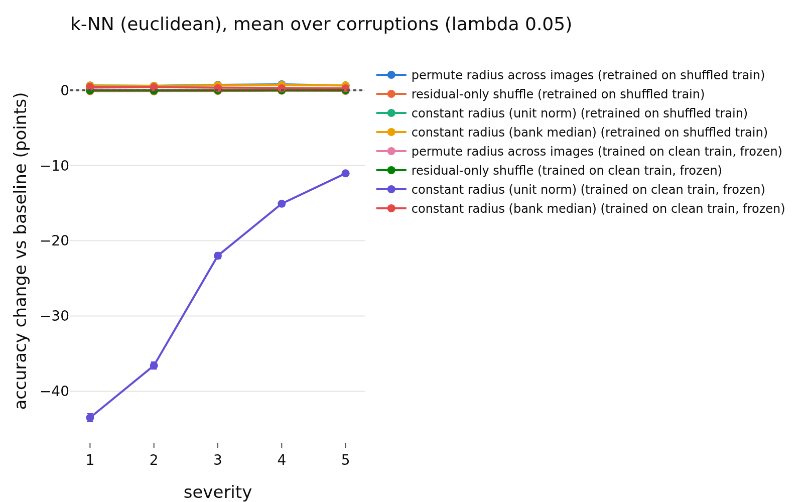
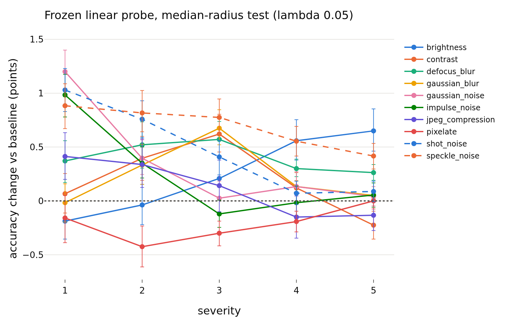
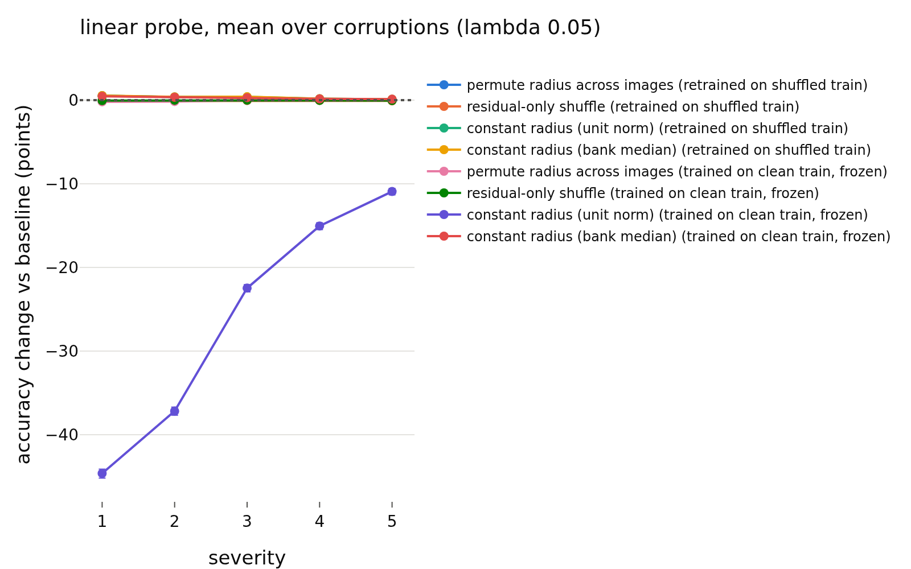
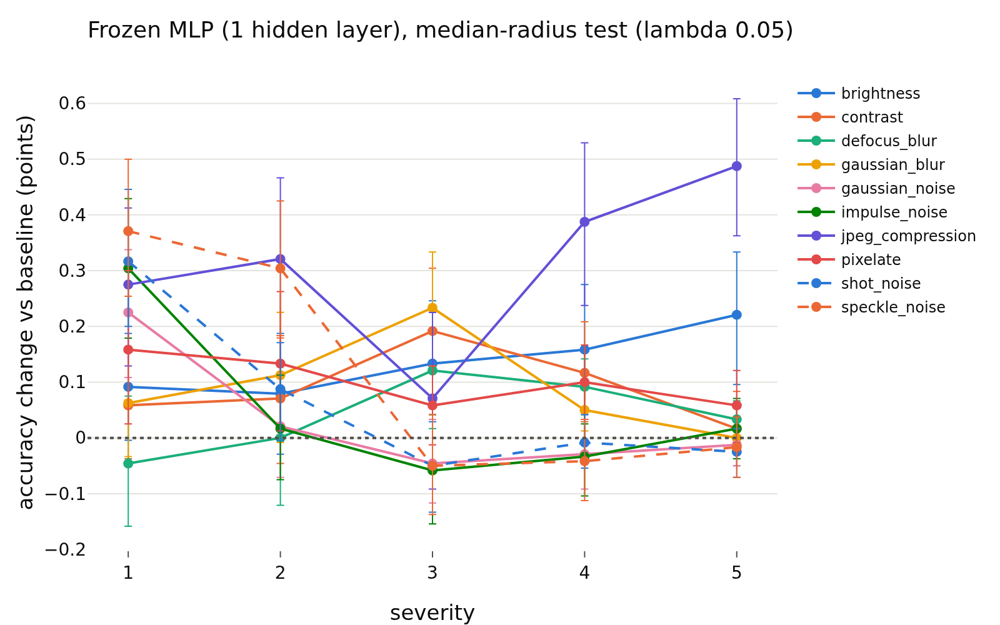
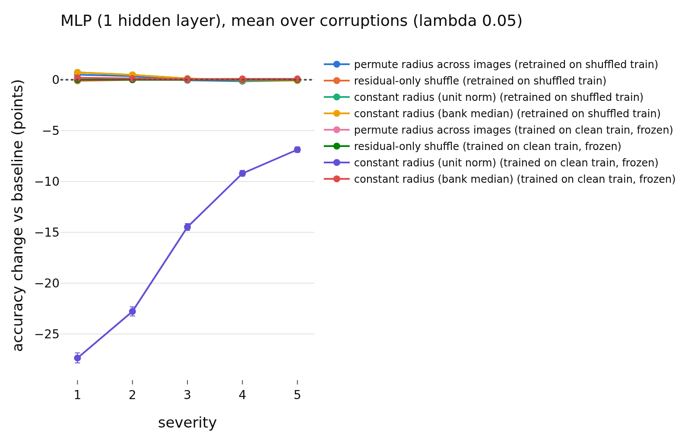

# radius_usage / shift, lambda = 0.05
- **Branch / version:** `radius-usage-shift` @ `2989a9a` (code; notes committed after)
- **Run datetime (UTC):** 2026-10-25T21:35Z (aggregation; unit jobs 20:23Z to 21:20Z, see commands)
- **Command(s):**
  (cluster, SLURM; checkout of the branch at the commit above, `PYTHONPATH=<repo>/src`, `OMP_NUM_THREADS=8`; `.env` with `LEJEPA_NORM_NOTES_DIR` pointing at this checkout's `research_notes/`)
  Per-run units, all nine runs (jobs 2246231 to 2246239, 8 CPUs, 48 GB, 21 to 23 min each; both parts, 2026-10-25T20:23Z to 20:46Z; the classification part was recomputed with the added scale-matched condition in jobs 2246400 to 2246409, 2026-10-25T20:58Z to 21:20Z):
  `sbatch --export=ALL --mem=48G --cpus-per-task=8 slurm/analyze.sbatch configs/base.yaml radius_marginal_lam<lambda>_s<seed> radius_usage/unit.md --shift-unit` (first pass, both parts) and the same with `--shift-unit --shift-part classification` (second pass), for lambda in 0.02, 0.05, 0.1 and seed in 0, 1, 2 (writes `<runs_dir>/<run>/shift_cells.npz` and `shift_ood.npz`).
  Embedding dumps of `radius_marginal_lam0.02_s{0,1,2}` (stl10c, dtd_test, svhn_test were missing) were created first: `sbatch --cpus-per-task=4 slurm/embed.sbatch configs/base.yaml radius_marginal_lam0.02_s<seed> last.pt` (jobs 2246025 to 2246027, about 5 min each).
  Aggregation (this note and the other two lambdas; 2026-10-25T21:35Z, job 2246532, 8 CPUs, 32 GB, about 7 min):
  `python apps/analyze.py --config configs/base.yaml --shift radius_marginal --note radius_usage/shift.md`
- **Datasets:** STL-10 ([canonical](https://cs.stanford.edu/~acoates/stl10/), [HF `tanganke/stl10`](https://huggingface.co/datasets/tanganke/stl10)): `train` (bank / training set) and `test` (ID); canonical archive used, HF for reference only. STL-10-C: built locally from STL-10 `test` (10 corruptions x 5 severities, 400k images; no HF mirror). DTD `test` partition 1 ([canonical](https://www.robots.ox.ac.uk/~vgg/data/dtd/), [HF `tanganke/dtd`](https://huggingface.co/datasets/tanganke/dtd)) and SVHN `test` ([canonical](http://ufldl.stanford.edu/housenumbers/), [HF `ufldl-stanford/svhn`](https://huggingface.co/datasets/ufldl-stanford/svhn)) as OOD sets; the canonical sources (via torchvision) were used, HF pages are for reference only.
- **Backbone:** ResNet-18 from scratch ([HF architecture reference](https://huggingface.co/timm/resnet18.a1_in1k), weights not used); `last.pt` (epoch 200) of `radius_marginal_lam0.05_s{0,1,2}` (Variant A).
- **Scope:** h is not analyzed; LeJEPA's product is z. All results are z-space, un-augmented center views.
- **Margins (fixed before the results):** 0.5 accuracy points (Part 1, as E1); 0.01 AUROC (Part 2). Pre-registration: `shift_summary.md`.

## Question

Is the embedding radius used when the test distribution shifts? Part 1: readers fitted on clean STL-10 `train` are tested on corrupted STL-10-C images with the radius randomized or removed (does the shifted radius hurt or help; does normalizing recover accuracy). Part 2: does the radius separate STL-10 `test` from DTD / SVHN, alone or on top of the direction (k-NN) score. Lambda = 0.05, three training seeds. Cross-lambda reading and verdicts: `shift_summary.md`.

## Setup (deviations from the base config)

No deviation from `configs/base.yaml` (k = 20, 1000 bootstrap replicates, 5 shuffle repeats per randomized condition, MLP weight decay chosen on the clean bank). Conditions, readers, protocols, the clean-fitted direction -> log-radius map and the OOD scores are defined in the docstrings of `lejepa_norm.eval.shift` and `lejepa_norm.eval.ood_radius`. Post-hoc additions (after the first results, not in the pre-registration): the scale-matched `constant radius (bank median)` condition (the unit-norm one collapses frozen readers by a pure scale mismatch, as in E1) and the `post hoc: direction + low radius` OOD score; both are labeled as such.

## Results

<!-- BEGIN GENERATED: analyze.shift_inputs -->
### Inputs

Runs aggregated: `radius_marginal_lam0.05_s0`, `radius_marginal_lam0.05_s1`, `radius_marginal_lam0.05_s2`.

Unit files missing for this lambda:

None.
<!-- END GENERATED: analyze.shift_inputs -->

<!-- BEGIN GENERATED: analyze.shift_context -->
### Radius shift and baseline accuracy per corruption

Averaged over the 5 severities and the seeds. `log-radius shift` = mean paired change of the center-view log-radius vs the clean twin; `clean-map residual` = mean of `log r - f(u)` with the clean-fitted direction -> log-radius map `f`; accuracies are those of the frozen readers on the unmodified corrupted embeddings.

| lambda | corruption | log-radius shift | clean-map residual | k-NN (euclidean) acc | linear probe acc | MLP (1 hidden layer) acc | k-NN (euclidean): frozen, unit norm (points) | k-NN (euclidean): frozen, bank-median radius (points) | linear probe: frozen, unit norm (points) | linear probe: frozen, bank-median radius (points) | MLP (1 hidden layer): frozen, unit norm (points) | MLP (1 hidden layer): frozen, bank-median radius (points) |
|---|---|---|---|---|---|---|---|---|---|---|---|---|
| 0.05 | clean test (reference) | 0 | -0.0084 | 0.7870 | 0.8176 | 0.8155 |  |  |  |  |  |  |
| 0.05 | brightness | -0.0400 | -0.0147 | 0.7301 | 0.7451 | 0.7474 | -59.40 | +0.48 | -61.87 | +0.24 | -36.96 | +0.14 |
| 0.05 | contrast | -0.0374 | -0.0409 | 0.5460 | 0.5491 | 0.5617 | -43.11 | +0.36 | -43.17 | +0.20 | -26.66 | +0.09 |
| 0.05 | defocus_blur | -0.0965 | -0.0886 | 0.2890 | 0.3024 | 0.3155 | -18.00 | +0.16 | -18.80 | +0.40 | -14.58 | +0.04 |
| 0.05 | gaussian_blur | -0.0456 | -0.0756 | 0.3868 | 0.3947 | 0.4018 | -27.05 | +0.13 | -28.00 | +0.24 | -18.14 | +0.09 |
| 0.05 | gaussian_noise | -0.0866 | -0.0379 | 0.1715 | 0.1842 | 0.1740 | -6.82 | -0.00 | -8.15 | +0.36 | -4.32 | +0.03 |
| 0.05 | impulse_noise | -0.1064 | -0.0347 | 0.1683 | 0.1752 | 0.1735 | -6.74 | +0.07 | -7.18 | +0.25 | -3.75 | +0.05 |
| 0.05 | jpeg_compression | -0.1921 | -0.0553 | 0.5516 | 0.5299 | 0.5495 | -42.94 | +0.99 | -41.20 | +0.12 | -25.19 | +0.31 |
| 0.05 | pixelate | -0.1165 | -0.0534 | 0.3972 | 0.3710 | 0.3906 | -29.21 | +0.74 | -25.87 | -0.22 | -17.43 | +0.10 |
| 0.05 | shot_noise | -0.0699 | -0.0209 | 0.1788 | 0.1984 | 0.1905 | -7.64 | +0.14 | -9.59 | +0.47 | -5.15 | +0.06 |
| 0.05 | speckle_noise | -0.0829 | -0.0182 | 0.2581 | 0.2742 | 0.2719 | -15.50 | +0.26 | -16.67 | +0.69 | -9.27 | +0.11 |
<!-- END GENERATED: analyze.shift_context -->

<!-- BEGIN GENERATED: analyze.shift_corruption -->
### Accuracy change per corruption (severities averaged)

Differences are in accuracy points (condition minus baseline on the same corrupted test images), averaged over training seeds; intervals are paired bootstrap percentile intervals (1000 replicates, test images resampled within each seed, the same resample for every cell). Verdict, with the equivalence margin set to ±0.5 points before looking at results: `equivalent` if the 90% interval lies inside the margin, `different` if not equivalent and the 95% interval excludes 0, otherwise `inconclusive`. Bank / training set: clean STL-10 train.

| corruption | reader | protocol | condition | baseline acc (corrupted) | condition acc | change (points) | 90% CI | 95% CI | verdict |
|---|---|---|---|---|---|---|---|---|---|
| brightness | k-NN (euclidean) | retrained on shuffled train | permute radius across images | 0.7301 | 0.7301 | -0.00 | [-0.15, +0.15] | [-0.18, +0.17] | equivalent |
| contrast | k-NN (euclidean) | retrained on shuffled train | permute radius across images | 0.5460 | 0.5517 | +0.56 | [+0.42, +0.70] | [+0.40, +0.73] | different |
| defocus_blur | k-NN (euclidean) | retrained on shuffled train | permute radius across images | 0.2890 | 0.2909 | +0.19 | [+0.09, +0.29] | [+0.07, +0.31] | equivalent |
| gaussian_blur | k-NN (euclidean) | retrained on shuffled train | permute radius across images | 0.3868 | 0.3861 | -0.07 | [-0.15, +0.02] | [-0.17, +0.04] | equivalent |
| gaussian_noise | k-NN (euclidean) | retrained on shuffled train | permute radius across images | 0.1715 | 0.1765 | +0.50 | [+0.34, +0.67] | [+0.31, +0.70] | different |
| impulse_noise | k-NN (euclidean) | retrained on shuffled train | permute radius across images | 0.1683 | 0.1700 | +0.17 | [-0.01, +0.36] | [-0.05, +0.39] | equivalent |
| jpeg_compression | k-NN (euclidean) | retrained on shuffled train | permute radius across images | 0.5515 | 0.5669 | +1.54 | [+1.38, +1.69] | [+1.35, +1.73] | different |
| pixelate | k-NN (euclidean) | retrained on shuffled train | permute radius across images | 0.3972 | 0.4135 | +1.63 | [+1.51, +1.75] | [+1.48, +1.78] | different |
| shot_noise | k-NN (euclidean) | retrained on shuffled train | permute radius across images | 0.1788 | 0.1890 | +1.02 | [+0.85, +1.18] | [+0.81, +1.21] | different |
| speckle_noise | k-NN (euclidean) | retrained on shuffled train | permute radius across images | 0.2581 | 0.2702 | +1.21 | [+1.04, +1.38] | [+1.02, +1.40] | different |
| all corruptions | k-NN (euclidean) | retrained on shuffled train | permute radius across images | 0.3677 | 0.3745 | +0.68 | [+0.61, +0.74] | [+0.59, +0.75] | different |
| brightness | k-NN (euclidean) | retrained on shuffled train | residual-only shuffle | 0.7301 | 0.7304 | +0.02 | [-0.06, +0.11] | [-0.08, +0.12] | equivalent |
| contrast | k-NN (euclidean) | retrained on shuffled train | residual-only shuffle | 0.5460 | 0.5455 | -0.05 | [-0.15, +0.04] | [-0.16, +0.06] | equivalent |
| defocus_blur | k-NN (euclidean) | retrained on shuffled train | residual-only shuffle | 0.2890 | 0.2894 | +0.05 | [-0.01, +0.11] | [-0.02, +0.12] | equivalent |
| gaussian_blur | k-NN (euclidean) | retrained on shuffled train | residual-only shuffle | 0.3868 | 0.3862 | -0.06 | [-0.11, -0.01] | [-0.12, +0.00] | equivalent |
| gaussian_noise | k-NN (euclidean) | retrained on shuffled train | residual-only shuffle | 0.1715 | 0.1698 | -0.17 | [-0.25, -0.09] | [-0.26, -0.08] | equivalent |
| impulse_noise | k-NN (euclidean) | retrained on shuffled train | residual-only shuffle | 0.1683 | 0.1682 | -0.02 | [-0.09, +0.07] | [-0.11, +0.08] | equivalent |
| jpeg_compression | k-NN (euclidean) | retrained on shuffled train | residual-only shuffle | 0.5515 | 0.5498 | -0.17 | [-0.27, -0.09] | [-0.28, -0.07] | equivalent |
| pixelate | k-NN (euclidean) | retrained on shuffled train | residual-only shuffle | 0.3972 | 0.3962 | -0.09 | [-0.16, -0.02] | [-0.18, -0.00] | equivalent |
| shot_noise | k-NN (euclidean) | retrained on shuffled train | residual-only shuffle | 0.1788 | 0.1772 | -0.16 | [-0.24, -0.08] | [-0.25, -0.06] | equivalent |
| speckle_noise | k-NN (euclidean) | retrained on shuffled train | residual-only shuffle | 0.2581 | 0.2552 | -0.28 | [-0.37, -0.21] | [-0.39, -0.19] | equivalent |
| all corruptions | k-NN (euclidean) | retrained on shuffled train | residual-only shuffle | 0.3677 | 0.3668 | -0.09 | [-0.12, -0.07] | [-0.12, -0.06] | equivalent |
| brightness | k-NN (euclidean) | retrained on shuffled train | constant radius (unit norm) | 0.7301 | 0.7335 | +0.33 | [+0.19, +0.49] | [+0.16, +0.52] | equivalent |
| contrast | k-NN (euclidean) | retrained on shuffled train | constant radius (unit norm) | 0.5460 | 0.5529 | +0.69 | [+0.53, +0.85] | [+0.51, +0.88] | different |
| defocus_blur | k-NN (euclidean) | retrained on shuffled train | constant radius (unit norm) | 0.2890 | 0.2922 | +0.32 | [+0.22, +0.42] | [+0.20, +0.44] | equivalent |
| gaussian_blur | k-NN (euclidean) | retrained on shuffled train | constant radius (unit norm) | 0.3868 | 0.3875 | +0.07 | [-0.01, +0.17] | [-0.04, +0.18] | equivalent |
| gaussian_noise | k-NN (euclidean) | retrained on shuffled train | constant radius (unit norm) | 0.1715 | 0.1733 | +0.19 | [+0.06, +0.31] | [+0.02, +0.33] | equivalent |
| impulse_noise | k-NN (euclidean) | retrained on shuffled train | constant radius (unit norm) | 0.1683 | 0.1680 | -0.04 | [-0.17, +0.10] | [-0.21, +0.13] | equivalent |
| jpeg_compression | k-NN (euclidean) | retrained on shuffled train | constant radius (unit norm) | 0.5515 | 0.5690 | +1.74 | [+1.58, +1.92] | [+1.54, +1.94] | different |
| pixelate | k-NN (euclidean) | retrained on shuffled train | constant radius (unit norm) | 0.3972 | 0.4161 | +1.90 | [+1.75, +2.04] | [+1.71, +2.07] | different |
| shot_noise | k-NN (euclidean) | retrained on shuffled train | constant radius (unit norm) | 0.1788 | 0.1835 | +0.47 | [+0.34, +0.61] | [+0.32, +0.63] | different |
| speckle_noise | k-NN (euclidean) | retrained on shuffled train | constant radius (unit norm) | 0.2581 | 0.2656 | +0.76 | [+0.61, +0.90] | [+0.59, +0.93] | different |
| all corruptions | k-NN (euclidean) | retrained on shuffled train | constant radius (unit norm) | 0.3677 | 0.3742 | +0.64 | [+0.59, +0.70] | [+0.58, +0.71] | different |
| brightness | k-NN (euclidean) | retrained on shuffled train | constant radius (bank median) | 0.7301 | 0.7335 | +0.33 | [+0.19, +0.49] | [+0.16, +0.52] | equivalent |
| contrast | k-NN (euclidean) | retrained on shuffled train | constant radius (bank median) | 0.5460 | 0.5529 | +0.69 | [+0.53, +0.85] | [+0.51, +0.88] | different |
| defocus_blur | k-NN (euclidean) | retrained on shuffled train | constant radius (bank median) | 0.2890 | 0.2922 | +0.32 | [+0.22, +0.42] | [+0.20, +0.44] | equivalent |
| gaussian_blur | k-NN (euclidean) | retrained on shuffled train | constant radius (bank median) | 0.3868 | 0.3875 | +0.07 | [-0.01, +0.17] | [-0.04, +0.18] | equivalent |
| gaussian_noise | k-NN (euclidean) | retrained on shuffled train | constant radius (bank median) | 0.1715 | 0.1733 | +0.19 | [+0.06, +0.31] | [+0.02, +0.33] | equivalent |
| impulse_noise | k-NN (euclidean) | retrained on shuffled train | constant radius (bank median) | 0.1683 | 0.1680 | -0.04 | [-0.17, +0.10] | [-0.21, +0.13] | equivalent |
| jpeg_compression | k-NN (euclidean) | retrained on shuffled train | constant radius (bank median) | 0.5515 | 0.5690 | +1.74 | [+1.58, +1.92] | [+1.54, +1.94] | different |
| pixelate | k-NN (euclidean) | retrained on shuffled train | constant radius (bank median) | 0.3972 | 0.4161 | +1.90 | [+1.75, +2.04] | [+1.71, +2.07] | different |
| shot_noise | k-NN (euclidean) | retrained on shuffled train | constant radius (bank median) | 0.1788 | 0.1835 | +0.47 | [+0.34, +0.61] | [+0.32, +0.63] | different |
| speckle_noise | k-NN (euclidean) | retrained on shuffled train | constant radius (bank median) | 0.2581 | 0.2656 | +0.76 | [+0.61, +0.90] | [+0.59, +0.93] | different |
| all corruptions | k-NN (euclidean) | retrained on shuffled train | constant radius (bank median) | 0.3677 | 0.3742 | +0.64 | [+0.59, +0.70] | [+0.58, +0.71] | different |
| brightness | k-NN (euclidean) | trained on clean train, frozen | permute radius across images | 0.7301 | 0.7328 | +0.27 | [+0.19, +0.35] | [+0.18, +0.37] | equivalent |
| contrast | k-NN (euclidean) | trained on clean train, frozen | permute radius across images | 0.5460 | 0.5474 | +0.14 | [+0.06, +0.21] | [+0.05, +0.22] | equivalent |
| defocus_blur | k-NN (euclidean) | trained on clean train, frozen | permute radius across images | 0.2890 | 0.2893 | +0.04 | [-0.01, +0.09] | [-0.03, +0.10] | equivalent |
| gaussian_blur | k-NN (euclidean) | trained on clean train, frozen | permute radius across images | 0.3868 | 0.3870 | +0.02 | [-0.03, +0.07] | [-0.04, +0.08] | equivalent |
| gaussian_noise | k-NN (euclidean) | trained on clean train, frozen | permute radius across images | 0.1715 | 0.1713 | -0.01 | [-0.06, +0.04] | [-0.07, +0.05] | equivalent |
| impulse_noise | k-NN (euclidean) | trained on clean train, frozen | permute radius across images | 0.1683 | 0.1691 | +0.08 | [+0.03, +0.13] | [+0.01, +0.15] | equivalent |
| jpeg_compression | k-NN (euclidean) | trained on clean train, frozen | permute radius across images | 0.5515 | 0.5519 | +0.04 | [-0.05, +0.11] | [-0.06, +0.12] | equivalent |
| pixelate | k-NN (euclidean) | trained on clean train, frozen | permute radius across images | 0.3972 | 0.3992 | +0.21 | [+0.14, +0.27] | [+0.13, +0.28] | equivalent |
| shot_noise | k-NN (euclidean) | trained on clean train, frozen | permute radius across images | 0.1788 | 0.1790 | +0.02 | [-0.04, +0.07] | [-0.06, +0.08] | equivalent |
| speckle_noise | k-NN (euclidean) | trained on clean train, frozen | permute radius across images | 0.2581 | 0.2572 | -0.08 | [-0.15, -0.02] | [-0.16, -0.01] | equivalent |
| all corruptions | k-NN (euclidean) | trained on clean train, frozen | permute radius across images | 0.3677 | 0.3684 | +0.07 | [+0.05, +0.09] | [+0.04, +0.10] | equivalent |
| brightness | k-NN (euclidean) | trained on clean train, frozen | residual-only shuffle | 0.7301 | 0.7302 | +0.00 | [-0.04, +0.05] | [-0.05, +0.05] | equivalent |
| contrast | k-NN (euclidean) | trained on clean train, frozen | residual-only shuffle | 0.5460 | 0.5465 | +0.05 | [-0.01, +0.11] | [-0.02, +0.11] | equivalent |
| defocus_blur | k-NN (euclidean) | trained on clean train, frozen | residual-only shuffle | 0.2890 | 0.2894 | +0.04 | [+0.00, +0.08] | [-0.01, +0.08] | equivalent |
| gaussian_blur | k-NN (euclidean) | trained on clean train, frozen | residual-only shuffle | 0.3868 | 0.3870 | +0.02 | [-0.02, +0.05] | [-0.02, +0.06] | equivalent |
| gaussian_noise | k-NN (euclidean) | trained on clean train, frozen | residual-only shuffle | 0.1715 | 0.1709 | -0.06 | [-0.10, -0.02] | [-0.11, -0.01] | equivalent |
| impulse_noise | k-NN (euclidean) | trained on clean train, frozen | residual-only shuffle | 0.1683 | 0.1686 | +0.03 | [-0.02, +0.08] | [-0.02, +0.08] | equivalent |
| jpeg_compression | k-NN (euclidean) | trained on clean train, frozen | residual-only shuffle | 0.5515 | 0.5507 | -0.09 | [-0.15, -0.03] | [-0.16, -0.02] | equivalent |
| pixelate | k-NN (euclidean) | trained on clean train, frozen | residual-only shuffle | 0.3972 | 0.3976 | +0.05 | [-0.00, +0.10] | [-0.01, +0.10] | equivalent |
| shot_noise | k-NN (euclidean) | trained on clean train, frozen | residual-only shuffle | 0.1788 | 0.1783 | -0.05 | [-0.09, -0.01] | [-0.11, +0.01] | equivalent |
| speckle_noise | k-NN (euclidean) | trained on clean train, frozen | residual-only shuffle | 0.2581 | 0.2569 | -0.12 | [-0.17, -0.07] | [-0.18, -0.06] | equivalent |
| all corruptions | k-NN (euclidean) | trained on clean train, frozen | residual-only shuffle | 0.3677 | 0.3676 | -0.01 | [-0.03, +0.00] | [-0.03, +0.00] | equivalent |
| brightness | k-NN (euclidean) | trained on clean train, frozen | constant radius (unit norm) | 0.7301 | 0.1362 | -59.40 | [-59.94, -58.87] | [-60.06, -58.77] | different |
| contrast | k-NN (euclidean) | trained on clean train, frozen | constant radius (unit norm) | 0.5460 | 0.1150 | -43.11 | [-43.58, -42.61] | [-43.67, -42.52] | different |
| defocus_blur | k-NN (euclidean) | trained on clean train, frozen | constant radius (unit norm) | 0.2890 | 0.1090 | -18.00 | [-18.33, -17.64] | [-18.40, -17.58] | different |
| gaussian_blur | k-NN (euclidean) | trained on clean train, frozen | constant radius (unit norm) | 0.3868 | 0.1163 | -27.05 | [-27.37, -26.73] | [-27.42, -26.67] | different |
| gaussian_noise | k-NN (euclidean) | trained on clean train, frozen | constant radius (unit norm) | 0.1715 | 0.1032 | -6.82 | [-7.15, -6.47] | [-7.22, -6.39] | different |
| impulse_noise | k-NN (euclidean) | trained on clean train, frozen | constant radius (unit norm) | 0.1683 | 0.1010 | -6.74 | [-7.04, -6.41] | [-7.10, -6.35] | different |
| jpeg_compression | k-NN (euclidean) | trained on clean train, frozen | constant radius (unit norm) | 0.5515 | 0.1222 | -42.94 | [-43.44, -42.40] | [-43.57, -42.28] | different |
| pixelate | k-NN (euclidean) | trained on clean train, frozen | constant radius (unit norm) | 0.3972 | 0.1051 | -29.21 | [-29.71, -28.69] | [-29.82, -28.61] | different |
| shot_noise | k-NN (euclidean) | trained on clean train, frozen | constant radius (unit norm) | 0.1788 | 0.1024 | -7.64 | [-7.92, -7.33] | [-7.98, -7.28] | different |
| speckle_noise | k-NN (euclidean) | trained on clean train, frozen | constant radius (unit norm) | 0.2581 | 0.1031 | -15.50 | [-15.84, -15.18] | [-15.92, -15.12] | different |
| all corruptions | k-NN (euclidean) | trained on clean train, frozen | constant radius (unit norm) | 0.3677 | 0.1113 | -25.64 | [-25.96, -25.32] | [-26.01, -25.27] | different |
| brightness | k-NN (euclidean) | trained on clean train, frozen | constant radius (bank median) | 0.7301 | 0.7349 | +0.48 | [+0.38, +0.57] | [+0.36, +0.59] | different |
| contrast | k-NN (euclidean) | trained on clean train, frozen | constant radius (bank median) | 0.5460 | 0.5496 | +0.36 | [+0.27, +0.45] | [+0.25, +0.46] | equivalent |
| defocus_blur | k-NN (euclidean) | trained on clean train, frozen | constant radius (bank median) | 0.2890 | 0.2905 | +0.16 | [+0.09, +0.22] | [+0.07, +0.24] | equivalent |
| gaussian_blur | k-NN (euclidean) | trained on clean train, frozen | constant radius (bank median) | 0.3868 | 0.3881 | +0.13 | [+0.06, +0.19] | [+0.05, +0.21] | equivalent |
| gaussian_noise | k-NN (euclidean) | trained on clean train, frozen | constant radius (bank median) | 0.1715 | 0.1714 | -0.00 | [-0.08, +0.07] | [-0.09, +0.09] | equivalent |
| impulse_noise | k-NN (euclidean) | trained on clean train, frozen | constant radius (bank median) | 0.1683 | 0.1690 | +0.07 | [-0.01, +0.14] | [-0.03, +0.16] | equivalent |
| jpeg_compression | k-NN (euclidean) | trained on clean train, frozen | constant radius (bank median) | 0.5515 | 0.5614 | +0.99 | [+0.87, +1.10] | [+0.84, +1.12] | different |
| pixelate | k-NN (euclidean) | trained on clean train, frozen | constant radius (bank median) | 0.3972 | 0.4045 | +0.74 | [+0.65, +0.82] | [+0.64, +0.84] | different |
| shot_noise | k-NN (euclidean) | trained on clean train, frozen | constant radius (bank median) | 0.1788 | 0.1803 | +0.14 | [+0.07, +0.22] | [+0.05, +0.23] | equivalent |
| speckle_noise | k-NN (euclidean) | trained on clean train, frozen | constant radius (bank median) | 0.2581 | 0.2607 | +0.26 | [+0.18, +0.34] | [+0.17, +0.36] | equivalent |
| all corruptions | k-NN (euclidean) | trained on clean train, frozen | constant radius (bank median) | 0.3677 | 0.3710 | +0.33 | [+0.30, +0.36] | [+0.29, +0.37] | equivalent |
| brightness | linear probe | retrained on shuffled train | permute radius across images | 0.7451 | 0.7454 | +0.02 | [-0.05, +0.10] | [-0.06, +0.11] | equivalent |
| contrast | linear probe | retrained on shuffled train | permute radius across images | 0.5491 | 0.5500 | +0.09 | [+0.00, +0.17] | [-0.01, +0.19] | equivalent |
| defocus_blur | linear probe | retrained on shuffled train | permute radius across images | 0.3024 | 0.3109 | +0.85 | [+0.79, +0.91] | [+0.78, +0.93] | different |
| gaussian_blur | linear probe | retrained on shuffled train | permute radius across images | 0.3947 | 0.3988 | +0.41 | [+0.36, +0.46] | [+0.35, +0.47] | equivalent |
| gaussian_noise | linear probe | retrained on shuffled train | permute radius across images | 0.1842 | 0.1842 | +0.00 | [-0.09, +0.08] | [-0.10, +0.10] | equivalent |
| impulse_noise | linear probe | retrained on shuffled train | permute radius across images | 0.1752 | 0.1776 | +0.24 | [+0.14, +0.33] | [+0.12, +0.35] | equivalent |
| jpeg_compression | linear probe | retrained on shuffled train | permute radius across images | 0.5299 | 0.5318 | +0.19 | [+0.11, +0.26] | [+0.10, +0.27] | equivalent |
| pixelate | linear probe | retrained on shuffled train | permute radius across images | 0.3710 | 0.3733 | +0.24 | [+0.17, +0.30] | [+0.16, +0.31] | equivalent |
| shot_noise | linear probe | retrained on shuffled train | permute radius across images | 0.1984 | 0.1995 | +0.11 | [-0.00, +0.21] | [-0.03, +0.23] | equivalent |
| speckle_noise | linear probe | retrained on shuffled train | permute radius across images | 0.2742 | 0.2800 | +0.58 | [+0.48, +0.69] | [+0.47, +0.70] | different |
| all corruptions | linear probe | retrained on shuffled train | permute radius across images | 0.3724 | 0.3751 | +0.27 | [+0.24, +0.31] | [+0.23, +0.31] | equivalent |
| brightness | linear probe | retrained on shuffled train | residual-only shuffle | 0.7451 | 0.7448 | -0.04 | [-0.08, +0.00] | [-0.08, +0.01] | equivalent |
| contrast | linear probe | retrained on shuffled train | residual-only shuffle | 0.5491 | 0.5493 | +0.02 | [-0.02, +0.07] | [-0.03, +0.08] | equivalent |
| defocus_blur | linear probe | retrained on shuffled train | residual-only shuffle | 0.3024 | 0.3028 | +0.04 | [+0.01, +0.08] | [+0.00, +0.08] | equivalent |
| gaussian_blur | linear probe | retrained on shuffled train | residual-only shuffle | 0.3947 | 0.3949 | +0.02 | [-0.01, +0.05] | [-0.01, +0.06] | equivalent |
| gaussian_noise | linear probe | retrained on shuffled train | residual-only shuffle | 0.1842 | 0.1828 | -0.14 | [-0.18, -0.09] | [-0.19, -0.08] | equivalent |
| impulse_noise | linear probe | retrained on shuffled train | residual-only shuffle | 0.1752 | 0.1743 | -0.08 | [-0.13, -0.03] | [-0.14, -0.03] | equivalent |
| jpeg_compression | linear probe | retrained on shuffled train | residual-only shuffle | 0.5299 | 0.5286 | -0.12 | [-0.17, -0.08] | [-0.18, -0.07] | equivalent |
| pixelate | linear probe | retrained on shuffled train | residual-only shuffle | 0.3710 | 0.3705 | -0.05 | [-0.09, -0.02] | [-0.09, -0.01] | equivalent |
| shot_noise | linear probe | retrained on shuffled train | residual-only shuffle | 0.1984 | 0.1975 | -0.09 | [-0.14, -0.04] | [-0.15, -0.03] | equivalent |
| speckle_noise | linear probe | retrained on shuffled train | residual-only shuffle | 0.2742 | 0.2725 | -0.17 | [-0.22, -0.12] | [-0.23, -0.12] | equivalent |
| all corruptions | linear probe | retrained on shuffled train | residual-only shuffle | 0.3724 | 0.3718 | -0.06 | [-0.08, -0.05] | [-0.08, -0.04] | equivalent |
| brightness | linear probe | retrained on shuffled train | constant radius (unit norm) | 0.7451 | 0.7468 | +0.17 | [+0.09, +0.25] | [+0.08, +0.27] | equivalent |
| contrast | linear probe | retrained on shuffled train | constant radius (unit norm) | 0.5491 | 0.5521 | +0.30 | [+0.20, +0.39] | [+0.18, +0.40] | equivalent |
| defocus_blur | linear probe | retrained on shuffled train | constant radius (unit norm) | 0.3024 | 0.3113 | +0.89 | [+0.83, +0.96] | [+0.81, +0.97] | different |
| gaussian_blur | linear probe | retrained on shuffled train | constant radius (unit norm) | 0.3947 | 0.3995 | +0.48 | [+0.43, +0.54] | [+0.42, +0.55] | different |
| gaussian_noise | linear probe | retrained on shuffled train | constant radius (unit norm) | 0.1842 | 0.1856 | +0.14 | [+0.06, +0.23] | [+0.04, +0.24] | equivalent |
| impulse_noise | linear probe | retrained on shuffled train | constant radius (unit norm) | 0.1752 | 0.1771 | +0.19 | [+0.11, +0.28] | [+0.10, +0.29] | equivalent |
| jpeg_compression | linear probe | retrained on shuffled train | constant radius (unit norm) | 0.5299 | 0.5326 | +0.27 | [+0.19, +0.36] | [+0.17, +0.37] | equivalent |
| pixelate | linear probe | retrained on shuffled train | constant radius (unit norm) | 0.3710 | 0.3711 | +0.01 | [-0.05, +0.08] | [-0.06, +0.09] | equivalent |
| shot_noise | linear probe | retrained on shuffled train | constant radius (unit norm) | 0.1984 | 0.2008 | +0.24 | [+0.15, +0.32] | [+0.13, +0.34] | equivalent |
| speckle_noise | linear probe | retrained on shuffled train | constant radius (unit norm) | 0.2742 | 0.2788 | +0.46 | [+0.38, +0.54] | [+0.36, +0.56] | different |
| all corruptions | linear probe | retrained on shuffled train | constant radius (unit norm) | 0.3724 | 0.3756 | +0.32 | [+0.29, +0.35] | [+0.28, +0.35] | equivalent |
| brightness | linear probe | retrained on shuffled train | constant radius (bank median) | 0.7451 | 0.7470 | +0.18 | [+0.10, +0.27] | [+0.09, +0.28] | equivalent |
| contrast | linear probe | retrained on shuffled train | constant radius (bank median) | 0.5491 | 0.5523 | +0.32 | [+0.22, +0.41] | [+0.21, +0.42] | equivalent |
| defocus_blur | linear probe | retrained on shuffled train | constant radius (bank median) | 0.3024 | 0.3112 | +0.88 | [+0.81, +0.95] | [+0.80, +0.96] | different |
| gaussian_blur | linear probe | retrained on shuffled train | constant radius (bank median) | 0.3947 | 0.3995 | +0.48 | [+0.43, +0.54] | [+0.42, +0.55] | different |
| gaussian_noise | linear probe | retrained on shuffled train | constant radius (bank median) | 0.1842 | 0.1858 | +0.16 | [+0.08, +0.25] | [+0.07, +0.26] | equivalent |
| impulse_noise | linear probe | retrained on shuffled train | constant radius (bank median) | 0.1752 | 0.1773 | +0.21 | [+0.13, +0.30] | [+0.12, +0.31] | equivalent |
| jpeg_compression | linear probe | retrained on shuffled train | constant radius (bank median) | 0.5299 | 0.5326 | +0.27 | [+0.19, +0.36] | [+0.17, +0.37] | equivalent |
| pixelate | linear probe | retrained on shuffled train | constant radius (bank median) | 0.3710 | 0.3710 | +0.00 | [-0.06, +0.06] | [-0.07, +0.07] | equivalent |
| shot_noise | linear probe | retrained on shuffled train | constant radius (bank median) | 0.1984 | 0.2010 | +0.26 | [+0.17, +0.35] | [+0.16, +0.37] | equivalent |
| speckle_noise | linear probe | retrained on shuffled train | constant radius (bank median) | 0.2742 | 0.2792 | +0.50 | [+0.41, +0.58] | [+0.40, +0.59] | different |
| all corruptions | linear probe | retrained on shuffled train | constant radius (bank median) | 0.3724 | 0.3757 | +0.33 | [+0.30, +0.36] | [+0.29, +0.36] | equivalent |
| brightness | linear probe | trained on clean train, frozen | permute radius across images | 0.7451 | 0.7438 | -0.13 | [-0.20, -0.06] | [-0.21, -0.05] | equivalent |
| contrast | linear probe | trained on clean train, frozen | permute radius across images | 0.5491 | 0.5490 | -0.01 | [-0.06, +0.05] | [-0.07, +0.06] | equivalent |
| defocus_blur | linear probe | trained on clean train, frozen | permute radius across images | 0.3024 | 0.3036 | +0.12 | [+0.07, +0.16] | [+0.07, +0.17] | equivalent |
| gaussian_blur | linear probe | trained on clean train, frozen | permute radius across images | 0.3947 | 0.3944 | -0.04 | [-0.08, +0.01] | [-0.09, +0.02] | equivalent |
| gaussian_noise | linear probe | trained on clean train, frozen | permute radius across images | 0.1842 | 0.1838 | -0.04 | [-0.08, +0.00] | [-0.09, +0.01] | equivalent |
| impulse_noise | linear probe | trained on clean train, frozen | permute radius across images | 0.1752 | 0.1749 | -0.03 | [-0.07, +0.01] | [-0.07, +0.02] | equivalent |
| jpeg_compression | linear probe | trained on clean train, frozen | permute radius across images | 0.5299 | 0.5258 | -0.41 | [-0.47, -0.34] | [-0.48, -0.33] | equivalent |
| pixelate | linear probe | trained on clean train, frozen | permute radius across images | 0.3710 | 0.3681 | -0.29 | [-0.33, -0.24] | [-0.34, -0.23] | equivalent |
| shot_noise | linear probe | trained on clean train, frozen | permute radius across images | 0.1984 | 0.1990 | +0.06 | [+0.02, +0.10] | [+0.02, +0.11] | equivalent |
| speckle_noise | linear probe | trained on clean train, frozen | permute radius across images | 0.2742 | 0.2743 | +0.01 | [-0.04, +0.06] | [-0.05, +0.07] | equivalent |
| all corruptions | linear probe | trained on clean train, frozen | permute radius across images | 0.3724 | 0.3717 | -0.07 | [-0.09, -0.05] | [-0.10, -0.05] | equivalent |
| brightness | linear probe | trained on clean train, frozen | residual-only shuffle | 0.7451 | 0.7449 | -0.02 | [-0.05, +0.02] | [-0.06, +0.02] | equivalent |
| contrast | linear probe | trained on clean train, frozen | residual-only shuffle | 0.5491 | 0.5491 | +0.00 | [-0.03, +0.04] | [-0.04, +0.04] | equivalent |
| defocus_blur | linear probe | trained on clean train, frozen | residual-only shuffle | 0.3024 | 0.3029 | +0.05 | [+0.02, +0.07] | [+0.01, +0.08] | equivalent |
| gaussian_blur | linear probe | trained on clean train, frozen | residual-only shuffle | 0.3947 | 0.3950 | +0.03 | [+0.01, +0.06] | [+0.00, +0.06] | equivalent |
| gaussian_noise | linear probe | trained on clean train, frozen | residual-only shuffle | 0.1842 | 0.1837 | -0.05 | [-0.08, -0.02] | [-0.09, -0.02] | equivalent |
| impulse_noise | linear probe | trained on clean train, frozen | residual-only shuffle | 0.1752 | 0.1749 | -0.03 | [-0.05, +0.00] | [-0.06, +0.01] | equivalent |
| jpeg_compression | linear probe | trained on clean train, frozen | residual-only shuffle | 0.5299 | 0.5287 | -0.11 | [-0.15, -0.08] | [-0.16, -0.07] | equivalent |
| pixelate | linear probe | trained on clean train, frozen | residual-only shuffle | 0.3710 | 0.3700 | -0.10 | [-0.13, -0.07] | [-0.14, -0.07] | equivalent |
| shot_noise | linear probe | trained on clean train, frozen | residual-only shuffle | 0.1984 | 0.1984 | +0.00 | [-0.03, +0.03] | [-0.03, +0.04] | equivalent |
| speckle_noise | linear probe | trained on clean train, frozen | residual-only shuffle | 0.2742 | 0.2741 | -0.00 | [-0.04, +0.03] | [-0.05, +0.04] | equivalent |
| all corruptions | linear probe | trained on clean train, frozen | residual-only shuffle | 0.3724 | 0.3722 | -0.02 | [-0.03, -0.01] | [-0.04, -0.01] | equivalent |
| brightness | linear probe | trained on clean train, frozen | constant radius (unit norm) | 0.7451 | 0.1264 | -61.87 | [-62.40, -61.36] | [-62.51, -61.23] | different |
| contrast | linear probe | trained on clean train, frozen | constant radius (unit norm) | 0.5491 | 0.1174 | -43.17 | [-43.69, -42.68] | [-43.78, -42.56] | different |
| defocus_blur | linear probe | trained on clean train, frozen | constant radius (unit norm) | 0.3024 | 0.1144 | -18.80 | [-19.30, -18.32] | [-19.40, -18.24] | different |
| gaussian_blur | linear probe | trained on clean train, frozen | constant radius (unit norm) | 0.3947 | 0.1147 | -28.00 | [-28.45, -27.54] | [-28.54, -27.45] | different |
| gaussian_noise | linear probe | trained on clean train, frozen | constant radius (unit norm) | 0.1842 | 0.1027 | -8.15 | [-8.42, -7.86] | [-8.47, -7.78] | different |
| impulse_noise | linear probe | trained on clean train, frozen | constant radius (unit norm) | 0.1752 | 0.1034 | -7.18 | [-7.54, -6.80] | [-7.61, -6.73] | different |
| jpeg_compression | linear probe | trained on clean train, frozen | constant radius (unit norm) | 0.5299 | 0.1179 | -41.20 | [-41.73, -40.67] | [-41.83, -40.56] | different |
| pixelate | linear probe | trained on clean train, frozen | constant radius (unit norm) | 0.3710 | 0.1123 | -25.87 | [-26.41, -25.33] | [-26.47, -25.24] | different |
| shot_noise | linear probe | trained on clean train, frozen | constant radius (unit norm) | 0.1984 | 0.1025 | -9.59 | [-9.94, -9.24] | [-9.99, -9.17] | different |
| speckle_noise | linear probe | trained on clean train, frozen | constant radius (unit norm) | 0.2742 | 0.1074 | -16.67 | [-17.12, -16.25] | [-17.21, -16.17] | different |
| all corruptions | linear probe | trained on clean train, frozen | constant radius (unit norm) | 0.3724 | 0.1119 | -26.05 | [-26.42, -25.70] | [-26.50, -25.65] | different |
| brightness | linear probe | trained on clean train, frozen | constant radius (bank median) | 0.7451 | 0.7475 | +0.24 | [+0.16, +0.33] | [+0.14, +0.35] | equivalent |
| contrast | linear probe | trained on clean train, frozen | constant radius (bank median) | 0.5491 | 0.5511 | +0.20 | [+0.13, +0.26] | [+0.12, +0.27] | equivalent |
| defocus_blur | linear probe | trained on clean train, frozen | constant radius (bank median) | 0.3024 | 0.3065 | +0.40 | [+0.34, +0.46] | [+0.33, +0.48] | equivalent |
| gaussian_blur | linear probe | trained on clean train, frozen | constant radius (bank median) | 0.3947 | 0.3971 | +0.24 | [+0.18, +0.29] | [+0.17, +0.30] | equivalent |
| gaussian_noise | linear probe | trained on clean train, frozen | constant radius (bank median) | 0.1842 | 0.1878 | +0.36 | [+0.30, +0.42] | [+0.29, +0.43] | equivalent |
| impulse_noise | linear probe | trained on clean train, frozen | constant radius (bank median) | 0.1752 | 0.1777 | +0.25 | [+0.19, +0.31] | [+0.18, +0.32] | equivalent |
| jpeg_compression | linear probe | trained on clean train, frozen | constant radius (bank median) | 0.5299 | 0.5311 | +0.12 | [+0.03, +0.22] | [+0.02, +0.23] | equivalent |
| pixelate | linear probe | trained on clean train, frozen | constant radius (bank median) | 0.3710 | 0.3688 | -0.22 | [-0.27, -0.15] | [-0.29, -0.14] | equivalent |
| shot_noise | linear probe | trained on clean train, frozen | constant radius (bank median) | 0.1984 | 0.2031 | +0.47 | [+0.41, +0.52] | [+0.40, +0.54] | different |
| speckle_noise | linear probe | trained on clean train, frozen | constant radius (bank median) | 0.2742 | 0.2811 | +0.69 | [+0.62, +0.76] | [+0.61, +0.77] | different |
| all corruptions | linear probe | trained on clean train, frozen | constant radius (bank median) | 0.3724 | 0.3752 | +0.28 | [+0.25, +0.30] | [+0.24, +0.31] | equivalent |
| brightness | MLP (1 hidden layer) | retrained on shuffled train | permute radius across images | 0.7474 | 0.7470 | -0.04 | [-0.13, +0.04] | [-0.14, +0.06] | equivalent |
| contrast | MLP (1 hidden layer) | retrained on shuffled train | permute radius across images | 0.5617 | 0.5612 | -0.06 | [-0.14, +0.03] | [-0.16, +0.04] | equivalent |
| defocus_blur | MLP (1 hidden layer) | retrained on shuffled train | permute radius across images | 0.3155 | 0.3154 | -0.02 | [-0.08, +0.05] | [-0.10, +0.06] | equivalent |
| gaussian_blur | MLP (1 hidden layer) | retrained on shuffled train | permute radius across images | 0.4018 | 0.4024 | +0.06 | [+0.00, +0.11] | [-0.00, +0.12] | equivalent |
| gaussian_noise | MLP (1 hidden layer) | retrained on shuffled train | permute radius across images | 0.1740 | 0.1763 | +0.23 | [+0.16, +0.31] | [+0.15, +0.32] | equivalent |
| impulse_noise | MLP (1 hidden layer) | retrained on shuffled train | permute radius across images | 0.1735 | 0.1757 | +0.22 | [+0.14, +0.30] | [+0.12, +0.31] | equivalent |
| jpeg_compression | MLP (1 hidden layer) | retrained on shuffled train | permute radius across images | 0.5495 | 0.5535 | +0.40 | [+0.32, +0.47] | [+0.31, +0.49] | equivalent |
| pixelate | MLP (1 hidden layer) | retrained on shuffled train | permute radius across images | 0.3906 | 0.3918 | +0.12 | [+0.06, +0.17] | [+0.05, +0.18] | equivalent |
| shot_noise | MLP (1 hidden layer) | retrained on shuffled train | permute radius across images | 0.1905 | 0.1916 | +0.12 | [+0.04, +0.19] | [+0.02, +0.21] | equivalent |
| speckle_noise | MLP (1 hidden layer) | retrained on shuffled train | permute radius across images | 0.2719 | 0.2729 | +0.10 | [+0.00, +0.19] | [-0.01, +0.21] | equivalent |
| all corruptions | MLP (1 hidden layer) | retrained on shuffled train | permute radius across images | 0.3777 | 0.3788 | +0.11 | [+0.08, +0.14] | [+0.08, +0.15] | equivalent |
| brightness | MLP (1 hidden layer) | retrained on shuffled train | residual-only shuffle | 0.7474 | 0.7472 | -0.02 | [-0.08, +0.04] | [-0.10, +0.05] | equivalent |
| contrast | MLP (1 hidden layer) | retrained on shuffled train | residual-only shuffle | 0.5617 | 0.5624 | +0.06 | [-0.00, +0.13] | [-0.01, +0.14] | equivalent |
| defocus_blur | MLP (1 hidden layer) | retrained on shuffled train | residual-only shuffle | 0.3155 | 0.3145 | -0.10 | [-0.15, -0.06] | [-0.16, -0.05] | equivalent |
| gaussian_blur | MLP (1 hidden layer) | retrained on shuffled train | residual-only shuffle | 0.4018 | 0.4020 | +0.02 | [-0.02, +0.06] | [-0.03, +0.07] | equivalent |
| gaussian_noise | MLP (1 hidden layer) | retrained on shuffled train | residual-only shuffle | 0.1740 | 0.1736 | -0.04 | [-0.10, +0.01] | [-0.10, +0.02] | equivalent |
| impulse_noise | MLP (1 hidden layer) | retrained on shuffled train | residual-only shuffle | 0.1735 | 0.1724 | -0.12 | [-0.17, -0.06] | [-0.18, -0.05] | equivalent |
| jpeg_compression | MLP (1 hidden layer) | retrained on shuffled train | residual-only shuffle | 0.5495 | 0.5494 | -0.02 | [-0.07, +0.04] | [-0.08, +0.05] | equivalent |
| pixelate | MLP (1 hidden layer) | retrained on shuffled train | residual-only shuffle | 0.3906 | 0.3900 | -0.06 | [-0.10, -0.01] | [-0.11, -0.00] | equivalent |
| shot_noise | MLP (1 hidden layer) | retrained on shuffled train | residual-only shuffle | 0.1905 | 0.1896 | -0.09 | [-0.14, -0.03] | [-0.16, -0.02] | equivalent |
| speckle_noise | MLP (1 hidden layer) | retrained on shuffled train | residual-only shuffle | 0.2719 | 0.2708 | -0.11 | [-0.18, -0.04] | [-0.20, -0.03] | equivalent |
| all corruptions | MLP (1 hidden layer) | retrained on shuffled train | residual-only shuffle | 0.3777 | 0.3772 | -0.05 | [-0.07, -0.03] | [-0.07, -0.02] | equivalent |
| brightness | MLP (1 hidden layer) | retrained on shuffled train | constant radius (unit norm) | 0.7474 | 0.7465 | -0.09 | [-0.19, +0.01] | [-0.21, +0.03] | equivalent |
| contrast | MLP (1 hidden layer) | retrained on shuffled train | constant radius (unit norm) | 0.5617 | 0.5598 | -0.20 | [-0.30, -0.10] | [-0.31, -0.07] | equivalent |
| defocus_blur | MLP (1 hidden layer) | retrained on shuffled train | constant radius (unit norm) | 0.3155 | 0.3164 | +0.08 | [+0.01, +0.16] | [-0.01, +0.18] | equivalent |
| gaussian_blur | MLP (1 hidden layer) | retrained on shuffled train | constant radius (unit norm) | 0.4018 | 0.4030 | +0.12 | [+0.06, +0.19] | [+0.05, +0.20] | equivalent |
| gaussian_noise | MLP (1 hidden layer) | retrained on shuffled train | constant radius (unit norm) | 0.1740 | 0.1803 | +0.63 | [+0.54, +0.70] | [+0.53, +0.72] | different |
| impulse_noise | MLP (1 hidden layer) | retrained on shuffled train | constant radius (unit norm) | 0.1735 | 0.1790 | +0.55 | [+0.46, +0.64] | [+0.44, +0.65] | different |
| jpeg_compression | MLP (1 hidden layer) | retrained on shuffled train | constant radius (unit norm) | 0.5495 | 0.5531 | +0.36 | [+0.27, +0.45] | [+0.26, +0.47] | equivalent |
| pixelate | MLP (1 hidden layer) | retrained on shuffled train | constant radius (unit norm) | 0.3906 | 0.3908 | +0.03 | [-0.04, +0.10] | [-0.06, +0.11] | equivalent |
| shot_noise | MLP (1 hidden layer) | retrained on shuffled train | constant radius (unit norm) | 0.1905 | 0.1950 | +0.46 | [+0.37, +0.55] | [+0.35, +0.56] | different |
| speckle_noise | MLP (1 hidden layer) | retrained on shuffled train | constant radius (unit norm) | 0.2719 | 0.2759 | +0.39 | [+0.29, +0.50] | [+0.26, +0.52] | different |
| all corruptions | MLP (1 hidden layer) | retrained on shuffled train | constant radius (unit norm) | 0.3777 | 0.3800 | +0.23 | [+0.20, +0.27] | [+0.19, +0.27] | equivalent |
| brightness | MLP (1 hidden layer) | retrained on shuffled train | constant radius (bank median) | 0.7474 | 0.7465 | -0.09 | [-0.19, +0.01] | [-0.21, +0.03] | equivalent |
| contrast | MLP (1 hidden layer) | retrained on shuffled train | constant radius (bank median) | 0.5617 | 0.5598 | -0.20 | [-0.30, -0.10] | [-0.31, -0.07] | equivalent |
| defocus_blur | MLP (1 hidden layer) | retrained on shuffled train | constant radius (bank median) | 0.3155 | 0.3164 | +0.08 | [+0.01, +0.16] | [-0.01, +0.18] | equivalent |
| gaussian_blur | MLP (1 hidden layer) | retrained on shuffled train | constant radius (bank median) | 0.4018 | 0.4030 | +0.12 | [+0.06, +0.19] | [+0.05, +0.20] | equivalent |
| gaussian_noise | MLP (1 hidden layer) | retrained on shuffled train | constant radius (bank median) | 0.1740 | 0.1803 | +0.63 | [+0.54, +0.70] | [+0.53, +0.72] | different |
| impulse_noise | MLP (1 hidden layer) | retrained on shuffled train | constant radius (bank median) | 0.1735 | 0.1790 | +0.55 | [+0.46, +0.64] | [+0.44, +0.65] | different |
| jpeg_compression | MLP (1 hidden layer) | retrained on shuffled train | constant radius (bank median) | 0.5495 | 0.5531 | +0.36 | [+0.27, +0.45] | [+0.26, +0.47] | equivalent |
| pixelate | MLP (1 hidden layer) | retrained on shuffled train | constant radius (bank median) | 0.3906 | 0.3908 | +0.03 | [-0.04, +0.10] | [-0.06, +0.11] | equivalent |
| shot_noise | MLP (1 hidden layer) | retrained on shuffled train | constant radius (bank median) | 0.1905 | 0.1950 | +0.46 | [+0.37, +0.55] | [+0.35, +0.56] | different |
| speckle_noise | MLP (1 hidden layer) | retrained on shuffled train | constant radius (bank median) | 0.2719 | 0.2759 | +0.39 | [+0.29, +0.50] | [+0.26, +0.52] | different |
| all corruptions | MLP (1 hidden layer) | retrained on shuffled train | constant radius (bank median) | 0.3777 | 0.3800 | +0.23 | [+0.20, +0.27] | [+0.19, +0.27] | equivalent |
| brightness | MLP (1 hidden layer) | trained on clean train, frozen | permute radius across images | 0.7474 | 0.7478 | +0.04 | [+0.00, +0.07] | [-0.01, +0.08] | equivalent |
| contrast | MLP (1 hidden layer) | trained on clean train, frozen | permute radius across images | 0.5617 | 0.5620 | +0.02 | [-0.01, +0.06] | [-0.01, +0.06] | equivalent |
| defocus_blur | MLP (1 hidden layer) | trained on clean train, frozen | permute radius across images | 0.3155 | 0.3151 | -0.05 | [-0.07, -0.02] | [-0.08, -0.02] | equivalent |
| gaussian_blur | MLP (1 hidden layer) | trained on clean train, frozen | permute radius across images | 0.4018 | 0.4020 | +0.01 | [-0.01, +0.04] | [-0.02, +0.04] | equivalent |
| gaussian_noise | MLP (1 hidden layer) | trained on clean train, frozen | permute radius across images | 0.1740 | 0.1742 | +0.02 | [-0.00, +0.04] | [-0.01, +0.04] | equivalent |
| impulse_noise | MLP (1 hidden layer) | trained on clean train, frozen | permute radius across images | 0.1735 | 0.1736 | +0.01 | [-0.01, +0.03] | [-0.02, +0.04] | equivalent |
| jpeg_compression | MLP (1 hidden layer) | trained on clean train, frozen | permute radius across images | 0.5495 | 0.5495 | -0.00 | [-0.04, +0.04] | [-0.05, +0.04] | equivalent |
| pixelate | MLP (1 hidden layer) | trained on clean train, frozen | permute radius across images | 0.3906 | 0.3902 | -0.04 | [-0.06, -0.01] | [-0.07, -0.00] | equivalent |
| shot_noise | MLP (1 hidden layer) | trained on clean train, frozen | permute radius across images | 0.1905 | 0.1905 | +0.00 | [-0.02, +0.02] | [-0.02, +0.03] | equivalent |
| speckle_noise | MLP (1 hidden layer) | trained on clean train, frozen | permute radius across images | 0.2719 | 0.2718 | -0.01 | [-0.04, +0.02] | [-0.04, +0.02] | equivalent |
| all corruptions | MLP (1 hidden layer) | trained on clean train, frozen | permute radius across images | 0.3777 | 0.3777 | +0.00 | [-0.01, +0.01] | [-0.01, +0.01] | equivalent |
| brightness | MLP (1 hidden layer) | trained on clean train, frozen | residual-only shuffle | 0.7474 | 0.7474 | -0.00 | [-0.02, +0.02] | [-0.03, +0.02] | equivalent |
| contrast | MLP (1 hidden layer) | trained on clean train, frozen | residual-only shuffle | 0.5617 | 0.5620 | +0.02 | [+0.00, +0.04] | [-0.00, +0.05] | equivalent |
| defocus_blur | MLP (1 hidden layer) | trained on clean train, frozen | residual-only shuffle | 0.3155 | 0.3155 | -0.00 | [-0.02, +0.02] | [-0.02, +0.02] | equivalent |
| gaussian_blur | MLP (1 hidden layer) | trained on clean train, frozen | residual-only shuffle | 0.4018 | 0.4021 | +0.02 | [+0.01, +0.04] | [+0.01, +0.04] | equivalent |
| gaussian_noise | MLP (1 hidden layer) | trained on clean train, frozen | residual-only shuffle | 0.1740 | 0.1742 | +0.02 | [+0.01, +0.04] | [+0.00, +0.04] | equivalent |
| impulse_noise | MLP (1 hidden layer) | trained on clean train, frozen | residual-only shuffle | 0.1735 | 0.1737 | +0.02 | [+0.00, +0.04] | [+0.00, +0.04] | equivalent |
| jpeg_compression | MLP (1 hidden layer) | trained on clean train, frozen | residual-only shuffle | 0.5495 | 0.5498 | +0.02 | [-0.00, +0.05] | [-0.01, +0.05] | equivalent |
| pixelate | MLP (1 hidden layer) | trained on clean train, frozen | residual-only shuffle | 0.3906 | 0.3905 | -0.01 | [-0.03, +0.01] | [-0.03, +0.01] | equivalent |
| shot_noise | MLP (1 hidden layer) | trained on clean train, frozen | residual-only shuffle | 0.1905 | 0.1904 | -0.00 | [-0.02, +0.01] | [-0.02, +0.01] | equivalent |
| speckle_noise | MLP (1 hidden layer) | trained on clean train, frozen | residual-only shuffle | 0.2719 | 0.2718 | -0.02 | [-0.03, +0.00] | [-0.04, +0.00] | equivalent |
| all corruptions | MLP (1 hidden layer) | trained on clean train, frozen | residual-only shuffle | 0.3777 | 0.3777 | +0.01 | [+0.00, +0.01] | [+0.00, +0.01] | equivalent |
| brightness | MLP (1 hidden layer) | trained on clean train, frozen | constant radius (unit norm) | 0.7474 | 0.3779 | -36.96 | [-37.48, -36.40] | [-37.56, -36.30] | different |
| contrast | MLP (1 hidden layer) | trained on clean train, frozen | constant radius (unit norm) | 0.5617 | 0.2952 | -26.66 | [-27.12, -26.16] | [-27.21, -26.07] | different |
| defocus_blur | MLP (1 hidden layer) | trained on clean train, frozen | constant radius (unit norm) | 0.3155 | 0.1697 | -14.58 | [-14.86, -14.31] | [-14.91, -14.25] | different |
| gaussian_blur | MLP (1 hidden layer) | trained on clean train, frozen | constant radius (unit norm) | 0.4018 | 0.2204 | -18.14 | [-18.38, -17.87] | [-18.44, -17.83] | different |
| gaussian_noise | MLP (1 hidden layer) | trained on clean train, frozen | constant radius (unit norm) | 0.1740 | 0.1308 | -4.32 | [-4.68, -3.97] | [-4.73, -3.91] | different |
| impulse_noise | MLP (1 hidden layer) | trained on clean train, frozen | constant radius (unit norm) | 0.1735 | 0.1361 | -3.75 | [-4.08, -3.42] | [-4.16, -3.35] | different |
| jpeg_compression | MLP (1 hidden layer) | trained on clean train, frozen | constant radius (unit norm) | 0.5495 | 0.2977 | -25.19 | [-25.67, -24.69] | [-25.76, -24.57] | different |
| pixelate | MLP (1 hidden layer) | trained on clean train, frozen | constant radius (unit norm) | 0.3906 | 0.2162 | -17.43 | [-17.80, -17.04] | [-17.86, -16.96] | different |
| shot_noise | MLP (1 hidden layer) | trained on clean train, frozen | constant radius (unit norm) | 0.1905 | 0.1389 | -5.15 | [-5.47, -4.84] | [-5.54, -4.77] | different |
| speckle_noise | MLP (1 hidden layer) | trained on clean train, frozen | constant radius (unit norm) | 0.2719 | 0.1792 | -9.27 | [-9.60, -8.95] | [-9.66, -8.88] | different |
| all corruptions | MLP (1 hidden layer) | trained on clean train, frozen | constant radius (unit norm) | 0.3777 | 0.2162 | -16.15 | [-16.41, -15.86] | [-16.47, -15.80] | different |
| brightness | MLP (1 hidden layer) | trained on clean train, frozen | constant radius (bank median) | 0.7474 | 0.7488 | +0.14 | [+0.09, +0.18] | [+0.09, +0.19] | equivalent |
| contrast | MLP (1 hidden layer) | trained on clean train, frozen | constant radius (bank median) | 0.5617 | 0.5626 | +0.09 | [+0.05, +0.13] | [+0.05, +0.14] | equivalent |
| defocus_blur | MLP (1 hidden layer) | trained on clean train, frozen | constant radius (bank median) | 0.3155 | 0.3159 | +0.04 | [+0.00, +0.08] | [-0.00, +0.08] | equivalent |
| gaussian_blur | MLP (1 hidden layer) | trained on clean train, frozen | constant radius (bank median) | 0.4018 | 0.4028 | +0.09 | [+0.06, +0.12] | [+0.05, +0.13] | equivalent |
| gaussian_noise | MLP (1 hidden layer) | trained on clean train, frozen | constant radius (bank median) | 0.1740 | 0.1743 | +0.03 | [+0.00, +0.06] | [-0.01, +0.07] | equivalent |
| impulse_noise | MLP (1 hidden layer) | trained on clean train, frozen | constant radius (bank median) | 0.1735 | 0.1740 | +0.05 | [+0.01, +0.08] | [+0.00, +0.09] | equivalent |
| jpeg_compression | MLP (1 hidden layer) | trained on clean train, frozen | constant radius (bank median) | 0.5495 | 0.5526 | +0.31 | [+0.25, +0.37] | [+0.24, +0.38] | equivalent |
| pixelate | MLP (1 hidden layer) | trained on clean train, frozen | constant radius (bank median) | 0.3906 | 0.3916 | +0.10 | [+0.07, +0.14] | [+0.06, +0.15] | equivalent |
| shot_noise | MLP (1 hidden layer) | trained on clean train, frozen | constant radius (bank median) | 0.1905 | 0.1911 | +0.06 | [+0.03, +0.10] | [+0.03, +0.10] | equivalent |
| speckle_noise | MLP (1 hidden layer) | trained on clean train, frozen | constant radius (bank median) | 0.2719 | 0.2731 | +0.11 | [+0.08, +0.15] | [+0.07, +0.16] | equivalent |
| all corruptions | MLP (1 hidden layer) | trained on clean train, frozen | constant radius (bank median) | 0.3777 | 0.3787 | +0.10 | [+0.09, +0.12] | [+0.09, +0.12] | equivalent |
<!-- END GENERATED: analyze.shift_corruption -->

<!-- BEGIN GENERATED: analyze.shift_correlation -->
### Does the radius shift predict the accuracy change?

Spearman correlation over the 50 (corruption, severity) cells of the seed-mean radius shift and the seed-mean accuracy change of the frozen protocol. Descriptive: cells share images and corruption families.

| lambda | reader | condition | Spearman(radius shift, accuracy change) |
|---|---|---|---|
| 0.05 | k-NN (euclidean) | permute radius across images | +0.040 |
| 0.05 | k-NN (euclidean) | residual-only shuffle | +0.105 |
| 0.05 | k-NN (euclidean) | constant radius (unit norm) | +0.152 |
| 0.05 | k-NN (euclidean) | constant radius (bank median) | -0.493 |
| 0.05 | linear probe | permute radius across images | +0.282 |
| 0.05 | linear probe | residual-only shuffle | +0.253 |
| 0.05 | linear probe | constant radius (unit norm) | +0.138 |
| 0.05 | linear probe | constant radius (bank median) | -0.217 |
| 0.05 | MLP (1 hidden layer) | permute radius across images | +0.262 |
| 0.05 | MLP (1 hidden layer) | residual-only shuffle | -0.063 |
| 0.05 | MLP (1 hidden layer) | constant radius (unit norm) | +0.163 |
| 0.05 | MLP (1 hidden layer) | constant radius (bank median) | -0.368 |
<!-- END GENERATED: analyze.shift_correlation -->

<!-- BEGIN GENERATED: analyze.shift_cells -->
### Accuracy change per corruption and severity

Differences are in accuracy points (condition minus baseline on the same corrupted test images), averaged over training seeds; intervals are paired bootstrap percentile intervals (1000 replicates, test images resampled within each seed, the same resample for every cell). Verdict, with the equivalence margin set to ±0.5 points before looking at results: `equivalent` if the 90% interval lies inside the margin, `different` if not equivalent and the 95% interval excludes 0, otherwise `inconclusive`. Bank / training set: clean STL-10 train.

| corruption | severity | reader | condition | baseline acc | frozen: change (points) | frozen: 95% CI | frozen: verdict | retrain: change (points) | retrain: 95% CI | retrain: verdict |
|---|---|---|---|---|---|---|---|---|---|---|
| brightness | 1 | k-NN (euclidean) | permute radius across images | 0.7807 | +0.17 | [-0.01, +0.34] | equivalent | -0.45 | [-0.71, -0.20] | different |
| brightness | 2 | k-NN (euclidean) | permute radius across images | 0.7672 | +0.11 | [-0.08, +0.30] | equivalent | -0.54 | [-0.82, -0.27] | different |
| brightness | 3 | k-NN (euclidean) | permute radius across images | 0.7426 | +0.32 | [+0.14, +0.48] | equivalent | -0.04 | [-0.35, +0.22] | equivalent |
| brightness | 4 | k-NN (euclidean) | permute radius across images | 0.7047 | +0.40 | [+0.22, +0.58] | different | +0.33 | [+0.04, +0.64] | different |
| brightness | 5 | k-NN (euclidean) | permute radius across images | 0.6555 | +0.36 | [+0.16, +0.56] | different | +0.69 | [+0.37, +1.02] | different |
| contrast | 1 | k-NN (euclidean) | permute radius across images | 0.7409 | +0.24 | [+0.06, +0.43] | equivalent | +0.05 | [-0.23, +0.36] | equivalent |
| contrast | 2 | k-NN (euclidean) | permute radius across images | 0.7105 | +0.05 | [-0.14, +0.23] | equivalent | +0.12 | [-0.19, +0.43] | equivalent |
| contrast | 3 | k-NN (euclidean) | permute radius across images | 0.6216 | +0.30 | [+0.12, +0.49] | equivalent | +1.43 | [+1.09, +1.76] | different |
| contrast | 4 | k-NN (euclidean) | permute radius across images | 0.4021 | +0.17 | [-0.02, +0.35] | equivalent | +1.65 | [+1.29, +1.97] | different |
| contrast | 5 | k-NN (euclidean) | permute radius across images | 0.2549 | -0.08 | [-0.25, +0.09] | equivalent | -0.43 | [-0.78, -0.13] | different |
| defocus_blur | 1 | k-NN (euclidean) | permute radius across images | 0.5165 | -0.05 | [-0.24, +0.12] | equivalent | -0.59 | [-0.91, -0.28] | different |
| defocus_blur | 2 | k-NN (euclidean) | permute radius across images | 0.5168 | +0.11 | [-0.07, +0.29] | equivalent | +0.18 | [-0.11, +0.50] | equivalent |
| defocus_blur | 3 | k-NN (euclidean) | permute radius across images | 0.1762 | +0.07 | [-0.05, +0.18] | equivalent | +0.69 | [+0.48, +0.93] | different |
| defocus_blur | 4 | k-NN (euclidean) | permute radius across images | 0.1193 | +0.05 | [-0.02, +0.11] | equivalent | +0.46 | [+0.34, +0.59] | different |
| defocus_blur | 5 | k-NN (euclidean) | permute radius across images | 0.1161 | +0.02 | [-0.04, +0.08] | equivalent | +0.22 | [+0.11, +0.32] | equivalent |
| gaussian_blur | 1 | k-NN (euclidean) | permute radius across images | 0.7763 | +0.02 | [-0.16, +0.19] | equivalent | -0.71 | [-0.97, -0.44] | different |
| gaussian_blur | 2 | k-NN (euclidean) | permute radius across images | 0.7197 | +0.03 | [-0.16, +0.21] | equivalent | -0.34 | [-0.63, -0.06] | different |
| gaussian_blur | 3 | k-NN (euclidean) | permute radius across images | 0.2245 | +0.00 | [-0.12, +0.13] | equivalent | +0.50 | [+0.23, +0.75] | different |
| gaussian_blur | 4 | k-NN (euclidean) | permute radius across images | 0.1088 | +0.04 | [-0.01, +0.09] | equivalent | +0.17 | [+0.07, +0.26] | equivalent |
| gaussian_blur | 5 | k-NN (euclidean) | permute radius across images | 0.1046 | +0.02 | [-0.01, +0.05] | equivalent | +0.06 | [+0.01, +0.11] | equivalent |
| gaussian_noise | 1 | k-NN (euclidean) | permute radius across images | 0.3086 | -0.04 | [-0.21, +0.12] | equivalent | +1.15 | [+0.80, +1.52] | different |
| gaussian_noise | 2 | k-NN (euclidean) | permute radius across images | 0.1914 | -0.01 | [-0.15, +0.13] | equivalent | +0.79 | [+0.49, +1.12] | different |
| gaussian_noise | 3 | k-NN (euclidean) | permute radius across images | 0.1355 | -0.07 | [-0.21, +0.07] | equivalent | +0.37 | [+0.06, +0.68] | different |
| gaussian_noise | 4 | k-NN (euclidean) | permute radius across images | 0.1156 | -0.00 | [-0.12, +0.12] | equivalent | +0.15 | [-0.17, +0.50] | equivalent |
| gaussian_noise | 5 | k-NN (euclidean) | permute radius across images | 0.1061 | +0.05 | [-0.04, +0.14] | equivalent | +0.05 | [-0.27, +0.37] | equivalent |
| impulse_noise | 1 | k-NN (euclidean) | permute radius across images | 0.3139 | +0.20 | [+0.02, +0.38] | equivalent | +1.43 | [+1.06, +1.80] | different |
| impulse_noise | 2 | k-NN (euclidean) | permute radius across images | 0.1756 | +0.01 | [-0.13, +0.17] | equivalent | -0.37 | [-0.72, -0.03] | different |
| impulse_noise | 3 | k-NN (euclidean) | permute radius across images | 0.1375 | +0.10 | [-0.04, +0.24] | equivalent | -0.33 | [-0.67, -0.02] | different |
| impulse_noise | 4 | k-NN (euclidean) | permute radius across images | 0.1108 | +0.08 | [-0.05, +0.20] | equivalent | +0.08 | [-0.27, +0.41] | equivalent |
| impulse_noise | 5 | k-NN (euclidean) | permute radius across images | 0.1040 | +0.01 | [-0.08, +0.11] | equivalent | +0.05 | [-0.29, +0.36] | equivalent |
| jpeg_compression | 1 | k-NN (euclidean) | permute radius across images | 0.6898 | +0.09 | [-0.12, +0.30] | equivalent | +0.18 | [-0.15, +0.51] | equivalent |
| jpeg_compression | 2 | k-NN (euclidean) | permute radius across images | 0.6430 | +0.10 | [-0.12, +0.31] | equivalent | +0.73 | [+0.40, +1.05] | different |
| jpeg_compression | 3 | k-NN (euclidean) | permute radius across images | 0.6024 | +0.23 | [+0.04, +0.43] | equivalent | +1.38 | [+1.03, +1.70] | different |
| jpeg_compression | 4 | k-NN (euclidean) | permute radius across images | 0.4761 | -0.16 | [-0.36, +0.03] | equivalent | +2.39 | [+2.06, +2.74] | different |
| jpeg_compression | 5 | k-NN (euclidean) | permute radius across images | 0.3463 | -0.07 | [-0.22, +0.07] | equivalent | +3.01 | [+2.74, +3.31] | different |
| pixelate | 1 | k-NN (euclidean) | permute radius across images | 0.6459 | +0.46 | [+0.25, +0.67] | different | +0.38 | [+0.05, +0.69] | different |
| pixelate | 2 | k-NN (euclidean) | permute radius across images | 0.5528 | +0.17 | [-0.01, +0.39] | equivalent | +0.93 | [+0.60, +1.25] | different |
| pixelate | 3 | k-NN (euclidean) | permute radius across images | 0.3166 | +0.10 | [-0.04, +0.24] | equivalent | +2.02 | [+1.74, +2.26] | different |
| pixelate | 4 | k-NN (euclidean) | permute radius across images | 0.2571 | +0.22 | [+0.07, +0.36] | equivalent | +2.25 | [+1.97, +2.51] | different |
| pixelate | 5 | k-NN (euclidean) | permute radius across images | 0.2134 | +0.07 | [-0.05, +0.21] | equivalent | +2.58 | [+2.32, +2.83] | different |
| shot_noise | 1 | k-NN (euclidean) | permute radius across images | 0.3434 | +0.05 | [-0.13, +0.25] | equivalent | +2.91 | [+2.52, +3.29] | different |
| shot_noise | 2 | k-NN (euclidean) | permute radius across images | 0.1997 | -0.02 | [-0.19, +0.14] | equivalent | +1.48 | [+1.15, +1.86] | different |
| shot_noise | 3 | k-NN (euclidean) | permute radius across images | 0.1359 | +0.00 | [-0.15, +0.15] | equivalent | +0.33 | [+0.04, +0.65] | different |
| shot_noise | 4 | k-NN (euclidean) | permute radius across images | 0.1090 | +0.02 | [-0.08, +0.13] | equivalent | +0.23 | [-0.06, +0.53] | equivalent |
| shot_noise | 5 | k-NN (euclidean) | permute radius across images | 0.1060 | +0.03 | [-0.07, +0.12] | equivalent | +0.13 | [-0.16, +0.42] | equivalent |
| speckle_noise | 1 | k-NN (euclidean) | permute radius across images | 0.4698 | +0.09 | [-0.12, +0.29] | equivalent | +1.97 | [+1.56, +2.34] | different |
| speckle_noise | 2 | k-NN (euclidean) | permute radius across images | 0.3635 | -0.10 | [-0.31, +0.10] | equivalent | +3.00 | [+2.59, +3.41] | different |
| speckle_noise | 3 | k-NN (euclidean) | permute radius across images | 0.1898 | -0.17 | [-0.32, -0.00] | equivalent | +0.86 | [+0.53, +1.18] | different |
| speckle_noise | 4 | k-NN (euclidean) | permute radius across images | 0.1463 | -0.22 | [-0.36, -0.08] | equivalent | +0.21 | [-0.08, +0.52] | equivalent |
| speckle_noise | 5 | k-NN (euclidean) | permute radius across images | 0.1209 | -0.03 | [-0.14, +0.08] | equivalent | +0.03 | [-0.24, +0.31] | equivalent |
| brightness | 1 | k-NN (euclidean) | residual-only shuffle | 0.7807 | +0.00 | [-0.10, +0.11] | equivalent | -0.05 | [-0.23, +0.13] | equivalent |
| brightness | 2 | k-NN (euclidean) | residual-only shuffle | 0.7672 | -0.01 | [-0.12, +0.11] | equivalent | -0.02 | [-0.21, +0.16] | equivalent |
| brightness | 3 | k-NN (euclidean) | residual-only shuffle | 0.7426 | +0.05 | [-0.06, +0.16] | equivalent | +0.07 | [-0.13, +0.26] | equivalent |
| brightness | 4 | k-NN (euclidean) | residual-only shuffle | 0.7047 | -0.02 | [-0.14, +0.11] | equivalent | +0.05 | [-0.16, +0.27] | equivalent |
| brightness | 5 | k-NN (euclidean) | residual-only shuffle | 0.6555 | -0.01 | [-0.15, +0.12] | equivalent | +0.06 | [-0.17, +0.27] | equivalent |
| contrast | 1 | k-NN (euclidean) | residual-only shuffle | 0.7409 | +0.09 | [-0.03, +0.21] | equivalent | +0.07 | [-0.13, +0.26] | equivalent |
| contrast | 2 | k-NN (euclidean) | residual-only shuffle | 0.7105 | -0.07 | [-0.20, +0.06] | equivalent | -0.30 | [-0.53, -0.09] | equivalent |
| contrast | 3 | k-NN (euclidean) | residual-only shuffle | 0.6216 | +0.11 | [-0.05, +0.25] | equivalent | -0.14 | [-0.39, +0.08] | equivalent |
| contrast | 4 | k-NN (euclidean) | residual-only shuffle | 0.4021 | +0.20 | [+0.05, +0.38] | equivalent | +0.12 | [-0.13, +0.37] | equivalent |
| contrast | 5 | k-NN (euclidean) | residual-only shuffle | 0.2549 | -0.07 | [-0.24, +0.08] | equivalent | +0.02 | [-0.23, +0.23] | equivalent |
| defocus_blur | 1 | k-NN (euclidean) | residual-only shuffle | 0.5165 | +0.08 | [-0.08, +0.22] | equivalent | -0.02 | [-0.24, +0.20] | equivalent |
| defocus_blur | 2 | k-NN (euclidean) | residual-only shuffle | 0.5168 | +0.15 | [+0.01, +0.28] | equivalent | +0.25 | [+0.05, +0.48] | equivalent |
| defocus_blur | 3 | k-NN (euclidean) | residual-only shuffle | 0.1762 | +0.03 | [-0.05, +0.12] | equivalent | +0.07 | [-0.07, +0.22] | equivalent |
| defocus_blur | 4 | k-NN (euclidean) | residual-only shuffle | 0.1193 | -0.01 | [-0.06, +0.03] | equivalent | -0.01 | [-0.08, +0.06] | equivalent |
| defocus_blur | 5 | k-NN (euclidean) | residual-only shuffle | 0.1161 | -0.04 | [-0.09, +0.00] | equivalent | -0.05 | [-0.11, +0.00] | equivalent |
| gaussian_blur | 1 | k-NN (euclidean) | residual-only shuffle | 0.7763 | +0.07 | [-0.04, +0.19] | equivalent | -0.20 | [-0.38, -0.02] | equivalent |
| gaussian_blur | 2 | k-NN (euclidean) | residual-only shuffle | 0.7197 | -0.07 | [-0.20, +0.06] | equivalent | -0.14 | [-0.33, +0.06] | equivalent |
| gaussian_blur | 3 | k-NN (euclidean) | residual-only shuffle | 0.2245 | +0.10 | [+0.01, +0.20] | equivalent | +0.04 | [-0.12, +0.19] | equivalent |
| gaussian_blur | 4 | k-NN (euclidean) | residual-only shuffle | 0.1088 | +0.00 | [-0.03, +0.03] | equivalent | +0.02 | [-0.03, +0.06] | equivalent |
| gaussian_blur | 5 | k-NN (euclidean) | residual-only shuffle | 0.1046 | -0.02 | [-0.04, +0.01] | equivalent | -0.02 | [-0.05, +0.01] | equivalent |
| gaussian_noise | 1 | k-NN (euclidean) | residual-only shuffle | 0.3086 | -0.08 | [-0.23, +0.06] | equivalent | -0.35 | [-0.58, -0.13] | different |
| gaussian_noise | 2 | k-NN (euclidean) | residual-only shuffle | 0.1914 | -0.07 | [-0.19, +0.06] | equivalent | +0.01 | [-0.20, +0.22] | equivalent |
| gaussian_noise | 3 | k-NN (euclidean) | residual-only shuffle | 0.1355 | -0.09 | [-0.21, +0.03] | equivalent | -0.20 | [-0.41, +0.00] | equivalent |
| gaussian_noise | 4 | k-NN (euclidean) | residual-only shuffle | 0.1156 | -0.04 | [-0.13, +0.06] | equivalent | -0.21 | [-0.41, -0.00] | equivalent |
| gaussian_noise | 5 | k-NN (euclidean) | residual-only shuffle | 0.1061 | -0.00 | [-0.09, +0.07] | equivalent | -0.09 | [-0.27, +0.08] | equivalent |
| impulse_noise | 1 | k-NN (euclidean) | residual-only shuffle | 0.3139 | +0.02 | [-0.13, +0.16] | equivalent | -0.04 | [-0.28, +0.19] | equivalent |
| impulse_noise | 2 | k-NN (euclidean) | residual-only shuffle | 0.1756 | -0.00 | [-0.13, +0.13] | equivalent | -0.02 | [-0.23, +0.19] | equivalent |
| impulse_noise | 3 | k-NN (euclidean) | residual-only shuffle | 0.1375 | +0.02 | [-0.09, +0.12] | equivalent | +0.02 | [-0.19, +0.22] | equivalent |
| impulse_noise | 4 | k-NN (euclidean) | residual-only shuffle | 0.1108 | +0.07 | [-0.03, +0.16] | equivalent | -0.02 | [-0.19, +0.16] | equivalent |
| impulse_noise | 5 | k-NN (euclidean) | residual-only shuffle | 0.1040 | +0.05 | [-0.03, +0.12] | equivalent | -0.03 | [-0.20, +0.14] | equivalent |
| jpeg_compression | 1 | k-NN (euclidean) | residual-only shuffle | 0.6898 | -0.09 | [-0.23, +0.06] | equivalent | -0.00 | [-0.22, +0.22] | equivalent |
| jpeg_compression | 2 | k-NN (euclidean) | residual-only shuffle | 0.6430 | -0.08 | [-0.23, +0.08] | equivalent | -0.18 | [-0.41, +0.02] | equivalent |
| jpeg_compression | 3 | k-NN (euclidean) | residual-only shuffle | 0.6024 | +0.03 | [-0.13, +0.19] | equivalent | -0.09 | [-0.33, +0.14] | equivalent |
| jpeg_compression | 4 | k-NN (euclidean) | residual-only shuffle | 0.4761 | -0.16 | [-0.31, -0.02] | equivalent | -0.25 | [-0.48, -0.02] | equivalent |
| jpeg_compression | 5 | k-NN (euclidean) | residual-only shuffle | 0.3463 | -0.13 | [-0.25, -0.01] | equivalent | -0.34 | [-0.51, -0.16] | equivalent |
| pixelate | 1 | k-NN (euclidean) | residual-only shuffle | 0.6459 | +0.01 | [-0.15, +0.15] | equivalent | +0.08 | [-0.15, +0.32] | equivalent |
| pixelate | 2 | k-NN (euclidean) | residual-only shuffle | 0.5528 | -0.01 | [-0.15, +0.13] | equivalent | -0.24 | [-0.45, -0.02] | equivalent |
| pixelate | 3 | k-NN (euclidean) | residual-only shuffle | 0.3166 | -0.01 | [-0.12, +0.12] | equivalent | -0.24 | [-0.39, -0.09] | equivalent |
| pixelate | 4 | k-NN (euclidean) | residual-only shuffle | 0.2571 | +0.08 | [-0.03, +0.20] | equivalent | +0.01 | [-0.15, +0.17] | equivalent |
| pixelate | 5 | k-NN (euclidean) | residual-only shuffle | 0.2134 | +0.16 | [+0.04, +0.29] | equivalent | -0.08 | [-0.22, +0.07] | equivalent |
| shot_noise | 1 | k-NN (euclidean) | residual-only shuffle | 0.3434 | -0.16 | [-0.31, -0.00] | equivalent | -0.33 | [-0.56, -0.08] | different |
| shot_noise | 2 | k-NN (euclidean) | residual-only shuffle | 0.1997 | -0.10 | [-0.23, +0.04] | equivalent | -0.28 | [-0.52, -0.07] | equivalent |
| shot_noise | 3 | k-NN (euclidean) | residual-only shuffle | 0.1359 | -0.02 | [-0.13, +0.09] | equivalent | -0.14 | [-0.34, +0.05] | equivalent |
| shot_noise | 4 | k-NN (euclidean) | residual-only shuffle | 0.1090 | +0.02 | [-0.06, +0.10] | equivalent | -0.05 | [-0.22, +0.11] | equivalent |
| shot_noise | 5 | k-NN (euclidean) | residual-only shuffle | 0.1060 | +0.01 | [-0.07, +0.08] | equivalent | +0.01 | [-0.14, +0.17] | equivalent |
| speckle_noise | 1 | k-NN (euclidean) | residual-only shuffle | 0.4698 | -0.19 | [-0.35, -0.04] | equivalent | -0.26 | [-0.51, -0.03] | equivalent |
| speckle_noise | 2 | k-NN (euclidean) | residual-only shuffle | 0.3635 | -0.20 | [-0.36, -0.05] | equivalent | -0.50 | [-0.76, -0.23] | different |
| speckle_noise | 3 | k-NN (euclidean) | residual-only shuffle | 0.1898 | -0.11 | [-0.23, +0.02] | equivalent | -0.24 | [-0.46, -0.04] | equivalent |
| speckle_noise | 4 | k-NN (euclidean) | residual-only shuffle | 0.1463 | -0.10 | [-0.20, +0.01] | equivalent | -0.20 | [-0.40, -0.01] | equivalent |
| speckle_noise | 5 | k-NN (euclidean) | residual-only shuffle | 0.1209 | +0.01 | [-0.08, +0.10] | equivalent | -0.23 | [-0.41, -0.06] | equivalent |
| brightness | 1 | k-NN (euclidean) | constant radius (unit norm) | 0.7807 | -63.91 | [-64.61, -63.25] | different | +0.05 | [-0.25, +0.32] | equivalent |
| brightness | 2 | k-NN (euclidean) | constant radius (unit norm) | 0.7672 | -62.92 | [-63.65, -62.21] | different | -0.12 | [-0.40, +0.20] | equivalent |
| brightness | 3 | k-NN (euclidean) | constant radius (unit norm) | 0.7426 | -60.66 | [-61.33, -59.98] | different | +0.26 | [-0.07, +0.58] | inconclusive |
| brightness | 4 | k-NN (euclidean) | constant radius (unit norm) | 0.7047 | -57.05 | [-57.80, -56.34] | different | +0.54 | [+0.22, +0.86] | different |
| brightness | 5 | k-NN (euclidean) | constant radius (unit norm) | 0.6555 | -52.43 | [-53.17, -51.67] | different | +0.94 | [+0.58, +1.30] | different |
| contrast | 1 | k-NN (euclidean) | constant radius (unit norm) | 0.7409 | -60.97 | [-61.68, -60.25] | different | +0.52 | [+0.19, +0.87] | different |
| contrast | 2 | k-NN (euclidean) | constant radius (unit norm) | 0.7105 | -58.61 | [-59.34, -57.94] | different | +0.63 | [+0.30, +0.97] | different |
| contrast | 3 | k-NN (euclidean) | constant radius (unit norm) | 0.6216 | -50.69 | [-51.40, -49.97] | different | +1.68 | [+1.30, +2.07] | different |
| contrast | 4 | k-NN (euclidean) | constant radius (unit norm) | 0.4021 | -29.82 | [-30.52, -29.04] | different | +1.64 | [+1.21, +2.04] | different |
| contrast | 5 | k-NN (euclidean) | constant radius (unit norm) | 0.2549 | -15.43 | [-16.06, -14.80] | different | -1.03 | [-1.41, -0.66] | different |
| defocus_blur | 1 | k-NN (euclidean) | constant radius (unit norm) | 0.5165 | -39.78 | [-40.47, -39.07] | different | -0.38 | [-0.74, -0.06] | different |
| defocus_blur | 2 | k-NN (euclidean) | constant radius (unit norm) | 0.5168 | -40.15 | [-40.87, -39.38] | different | +0.53 | [+0.18, +0.85] | different |
| defocus_blur | 3 | k-NN (euclidean) | constant radius (unit norm) | 0.1762 | -7.17 | [-7.61, -6.69] | different | +0.75 | [+0.52, +0.98] | different |
| defocus_blur | 4 | k-NN (euclidean) | constant radius (unit norm) | 0.1193 | -1.58 | [-1.98, -1.19] | different | +0.48 | [+0.36, +0.63] | different |
| defocus_blur | 5 | k-NN (euclidean) | constant radius (unit norm) | 0.1161 | -1.31 | [-1.70, -0.89] | different | +0.22 | [+0.12, +0.33] | equivalent |
| gaussian_blur | 1 | k-NN (euclidean) | constant radius (unit norm) | 0.7763 | -63.76 | [-64.42, -63.05] | different | -0.45 | [-0.76, -0.14] | different |
| gaussian_blur | 2 | k-NN (euclidean) | constant radius (unit norm) | 0.7197 | -58.92 | [-59.63, -58.20] | different | -0.03 | [-0.34, +0.28] | equivalent |
| gaussian_blur | 3 | k-NN (euclidean) | constant radius (unit norm) | 0.2245 | -11.74 | [-12.27, -11.21] | different | +0.61 | [+0.35, +0.87] | different |
| gaussian_blur | 4 | k-NN (euclidean) | constant radius (unit norm) | 0.1088 | -0.54 | [-0.93, -0.18] | different | +0.16 | [+0.07, +0.25] | equivalent |
| gaussian_blur | 5 | k-NN (euclidean) | constant radius (unit norm) | 0.1046 | -0.29 | [-0.65, +0.05] | inconclusive | +0.07 | [+0.02, +0.12] | equivalent |
| gaussian_noise | 1 | k-NN (euclidean) | constant radius (unit norm) | 0.3086 | -19.54 | [-20.23, -18.81] | different | +0.75 | [+0.38, +1.12] | different |
| gaussian_noise | 2 | k-NN (euclidean) | constant radius (unit norm) | 0.1914 | -8.56 | [-9.15, -7.91] | different | +0.40 | [+0.07, +0.74] | different |
| gaussian_noise | 3 | k-NN (euclidean) | constant radius (unit norm) | 0.1355 | -3.47 | [-4.02, -2.94] | different | +0.01 | [-0.30, +0.32] | equivalent |
| gaussian_noise | 4 | k-NN (euclidean) | constant radius (unit norm) | 0.1156 | -1.73 | [-2.13, -1.30] | different | -0.32 | [-0.59, -0.04] | different |
| gaussian_noise | 5 | k-NN (euclidean) | constant radius (unit norm) | 0.1061 | -0.82 | [-1.16, -0.47] | different | +0.09 | [-0.16, +0.34] | equivalent |
| impulse_noise | 1 | k-NN (euclidean) | constant radius (unit norm) | 0.3139 | -20.42 | [-21.10, -19.75] | different | +1.04 | [+0.60, +1.46] | different |
| impulse_noise | 2 | k-NN (euclidean) | constant radius (unit norm) | 0.1756 | -7.29 | [-7.86, -6.68] | different | -0.43 | [-0.80, -0.10] | different |
| impulse_noise | 3 | k-NN (euclidean) | constant radius (unit norm) | 0.1375 | -3.80 | [-4.24, -3.29] | different | -0.40 | [-0.70, -0.09] | different |
| impulse_noise | 4 | k-NN (euclidean) | constant radius (unit norm) | 0.1108 | -1.41 | [-1.80, -1.01] | different | -0.22 | [-0.50, +0.07] | equivalent |
| impulse_noise | 5 | k-NN (euclidean) | constant radius (unit norm) | 0.1040 | -0.76 | [-1.09, -0.40] | different | -0.18 | [-0.43, +0.07] | equivalent |
| jpeg_compression | 1 | k-NN (euclidean) | constant radius (unit norm) | 0.6898 | -55.77 | [-56.52, -55.03] | different | +0.38 | [+0.02, +0.74] | different |
| jpeg_compression | 2 | k-NN (euclidean) | constant radius (unit norm) | 0.6430 | -51.39 | [-52.13, -50.63] | different | +1.05 | [+0.69, +1.40] | different |
| jpeg_compression | 3 | k-NN (euclidean) | constant radius (unit norm) | 0.6024 | -47.60 | [-48.35, -46.84] | different | +1.64 | [+1.25, +2.02] | different |
| jpeg_compression | 4 | k-NN (euclidean) | constant radius (unit norm) | 0.4761 | -35.85 | [-36.62, -35.12] | different | +2.50 | [+2.12, +2.87] | different |
| jpeg_compression | 5 | k-NN (euclidean) | constant radius (unit norm) | 0.3463 | -24.07 | [-24.77, -23.37] | different | +3.15 | [+2.83, +3.47] | different |
| pixelate | 1 | k-NN (euclidean) | constant radius (unit norm) | 0.6459 | -51.73 | [-52.46, -50.96] | different | +0.42 | [+0.05, +0.78] | different |
| pixelate | 2 | k-NN (euclidean) | constant radius (unit norm) | 0.5528 | -42.94 | [-43.70, -42.17] | different | +1.17 | [+0.78, +1.54] | different |
| pixelate | 3 | k-NN (euclidean) | constant radius (unit norm) | 0.3166 | -22.09 | [-22.84, -21.36] | different | +2.31 | [+2.00, +2.64] | different |
| pixelate | 4 | k-NN (euclidean) | constant radius (unit norm) | 0.2571 | -16.88 | [-17.58, -16.24] | different | +2.47 | [+2.17, +2.76] | different |
| pixelate | 5 | k-NN (euclidean) | constant radius (unit norm) | 0.2134 | -12.38 | [-12.98, -11.75] | different | +3.12 | [+2.80, +3.45] | different |
| shot_noise | 1 | k-NN (euclidean) | constant radius (unit norm) | 0.3434 | -23.39 | [-24.13, -22.67] | different | +2.15 | [+1.75, +2.55] | different |
| shot_noise | 2 | k-NN (euclidean) | constant radius (unit norm) | 0.1997 | -9.56 | [-10.13, -8.97] | different | +0.61 | [+0.22, +1.01] | different |
| shot_noise | 3 | k-NN (euclidean) | constant radius (unit norm) | 0.1359 | -3.66 | [-4.15, -3.19] | different | -0.35 | [-0.68, -0.04] | different |
| shot_noise | 4 | k-NN (euclidean) | constant radius (unit norm) | 0.1090 | -0.99 | [-1.31, -0.63] | different | -0.08 | [-0.31, +0.15] | equivalent |
| shot_noise | 5 | k-NN (euclidean) | constant radius (unit norm) | 0.1060 | -0.58 | [-0.88, -0.29] | different | +0.04 | [-0.21, +0.29] | equivalent |
| speckle_noise | 1 | k-NN (euclidean) | constant radius (unit norm) | 0.4698 | -35.83 | [-36.59, -35.10] | different | +1.77 | [+1.33, +2.14] | different |
| speckle_noise | 2 | k-NN (euclidean) | constant radius (unit norm) | 0.3635 | -25.47 | [-26.18, -24.81] | different | +2.02 | [+1.60, +2.43] | different |
| speckle_noise | 3 | k-NN (euclidean) | constant radius (unit norm) | 0.1898 | -9.00 | [-9.47, -8.51] | different | +0.06 | [-0.28, +0.39] | equivalent |
| speckle_noise | 4 | k-NN (euclidean) | constant radius (unit norm) | 0.1463 | -4.89 | [-5.30, -4.52] | different | -0.03 | [-0.35, +0.28] | equivalent |
| speckle_noise | 5 | k-NN (euclidean) | constant radius (unit norm) | 0.1209 | -2.31 | [-2.65, -2.00] | different | -0.05 | [-0.30, +0.22] | equivalent |
| brightness | 1 | k-NN (euclidean) | constant radius (bank median) | 0.7807 | +0.22 | [+0.01, +0.43] | equivalent | +0.05 | [-0.25, +0.32] | equivalent |
| brightness | 2 | k-NN (euclidean) | constant radius (bank median) | 0.7672 | +0.31 | [+0.07, +0.53] | different | -0.12 | [-0.40, +0.20] | equivalent |
| brightness | 3 | k-NN (euclidean) | constant radius (bank median) | 0.7426 | +0.57 | [+0.35, +0.78] | different | +0.26 | [-0.07, +0.58] | inconclusive |
| brightness | 4 | k-NN (euclidean) | constant radius (bank median) | 0.7047 | +0.47 | [+0.24, +0.71] | different | +0.54 | [+0.22, +0.86] | different |
| brightness | 5 | k-NN (euclidean) | constant radius (bank median) | 0.6555 | +0.82 | [+0.55, +1.06] | different | +0.94 | [+0.58, +1.30] | different |
| contrast | 1 | k-NN (euclidean) | constant radius (bank median) | 0.7409 | +0.28 | [+0.07, +0.50] | equivalent | +0.52 | [+0.19, +0.87] | different |
| contrast | 2 | k-NN (euclidean) | constant radius (bank median) | 0.7105 | +0.23 | [-0.01, +0.46] | equivalent | +0.63 | [+0.30, +0.97] | different |
| contrast | 3 | k-NN (euclidean) | constant radius (bank median) | 0.6216 | +0.70 | [+0.45, +0.95] | different | +1.68 | [+1.30, +2.07] | different |
| contrast | 4 | k-NN (euclidean) | constant radius (bank median) | 0.4021 | +0.56 | [+0.32, +0.82] | different | +1.64 | [+1.21, +2.04] | different |
| contrast | 5 | k-NN (euclidean) | constant radius (bank median) | 0.2549 | +0.03 | [-0.19, +0.25] | equivalent | -1.03 | [-1.41, -0.66] | different |
| defocus_blur | 1 | k-NN (euclidean) | constant radius (bank median) | 0.5165 | +0.12 | [-0.14, +0.35] | equivalent | -0.38 | [-0.74, -0.06] | different |
| defocus_blur | 2 | k-NN (euclidean) | constant radius (bank median) | 0.5168 | +0.48 | [+0.24, +0.73] | different | +0.53 | [+0.18, +0.85] | different |
| defocus_blur | 3 | k-NN (euclidean) | constant radius (bank median) | 0.1762 | +0.05 | [-0.11, +0.22] | equivalent | +0.75 | [+0.52, +0.98] | different |
| defocus_blur | 4 | k-NN (euclidean) | constant radius (bank median) | 0.1193 | +0.10 | [+0.01, +0.18] | equivalent | +0.48 | [+0.36, +0.63] | different |
| defocus_blur | 5 | k-NN (euclidean) | constant radius (bank median) | 0.1161 | +0.04 | [-0.03, +0.11] | equivalent | +0.22 | [+0.12, +0.33] | equivalent |
| gaussian_blur | 1 | k-NN (euclidean) | constant radius (bank median) | 0.7763 | +0.15 | [-0.07, +0.35] | equivalent | -0.45 | [-0.76, -0.14] | different |
| gaussian_blur | 2 | k-NN (euclidean) | constant radius (bank median) | 0.7197 | +0.24 | [-0.00, +0.47] | equivalent | -0.03 | [-0.34, +0.28] | equivalent |
| gaussian_blur | 3 | k-NN (euclidean) | constant radius (bank median) | 0.2245 | +0.19 | [+0.01, +0.36] | equivalent | +0.61 | [+0.35, +0.87] | different |
| gaussian_blur | 4 | k-NN (euclidean) | constant radius (bank median) | 0.1088 | +0.05 | [-0.01, +0.11] | equivalent | +0.16 | [+0.07, +0.25] | equivalent |
| gaussian_blur | 5 | k-NN (euclidean) | constant radius (bank median) | 0.1046 | +0.03 | [+0.00, +0.07] | equivalent | +0.07 | [+0.02, +0.12] | equivalent |
| gaussian_noise | 1 | k-NN (euclidean) | constant radius (bank median) | 0.3086 | +0.30 | [+0.07, +0.54] | different | +0.75 | [+0.38, +1.12] | different |
| gaussian_noise | 2 | k-NN (euclidean) | constant radius (bank median) | 0.1914 | +0.12 | [-0.10, +0.32] | equivalent | +0.40 | [+0.07, +0.74] | different |
| gaussian_noise | 3 | k-NN (euclidean) | constant radius (bank median) | 0.1355 | -0.14 | [-0.34, +0.06] | equivalent | +0.01 | [-0.30, +0.32] | equivalent |
| gaussian_noise | 4 | k-NN (euclidean) | constant radius (bank median) | 0.1156 | -0.28 | [-0.45, -0.11] | equivalent | -0.32 | [-0.59, -0.04] | different |
| gaussian_noise | 5 | k-NN (euclidean) | constant radius (bank median) | 0.1061 | -0.01 | [-0.14, +0.11] | equivalent | +0.09 | [-0.16, +0.34] | equivalent |
| impulse_noise | 1 | k-NN (euclidean) | constant radius (bank median) | 0.3139 | +0.33 | [+0.04, +0.59] | different | +1.04 | [+0.60, +1.46] | different |
| impulse_noise | 2 | k-NN (euclidean) | constant radius (bank median) | 0.1756 | +0.06 | [-0.17, +0.29] | equivalent | -0.43 | [-0.80, -0.10] | different |
| impulse_noise | 3 | k-NN (euclidean) | constant radius (bank median) | 0.1375 | +0.08 | [-0.13, +0.29] | equivalent | -0.40 | [-0.70, -0.09] | different |
| impulse_noise | 4 | k-NN (euclidean) | constant radius (bank median) | 0.1108 | -0.12 | [-0.28, +0.05] | equivalent | -0.22 | [-0.50, +0.07] | equivalent |
| impulse_noise | 5 | k-NN (euclidean) | constant radius (bank median) | 0.1040 | -0.02 | [-0.15, +0.11] | equivalent | -0.18 | [-0.43, +0.07] | equivalent |
| jpeg_compression | 1 | k-NN (euclidean) | constant radius (bank median) | 0.6898 | +0.67 | [+0.39, +0.92] | different | +0.38 | [+0.02, +0.74] | different |
| jpeg_compression | 2 | k-NN (euclidean) | constant radius (bank median) | 0.6430 | +0.75 | [+0.47, +1.05] | different | +1.05 | [+0.69, +1.40] | different |
| jpeg_compression | 3 | k-NN (euclidean) | constant radius (bank median) | 0.6024 | +1.03 | [+0.74, +1.31] | different | +1.64 | [+1.25, +2.02] | different |
| jpeg_compression | 4 | k-NN (euclidean) | constant radius (bank median) | 0.4761 | +1.31 | [+1.02, +1.60] | different | +2.50 | [+2.12, +2.87] | different |
| jpeg_compression | 5 | k-NN (euclidean) | constant radius (bank median) | 0.3463 | +1.19 | [+0.96, +1.43] | different | +3.15 | [+2.83, +3.47] | different |
| pixelate | 1 | k-NN (euclidean) | constant radius (bank median) | 0.6459 | +1.09 | [+0.81, +1.39] | different | +0.42 | [+0.05, +0.78] | different |
| pixelate | 2 | k-NN (euclidean) | constant radius (bank median) | 0.5528 | +0.74 | [+0.49, +1.02] | different | +1.17 | [+0.78, +1.54] | different |
| pixelate | 3 | k-NN (euclidean) | constant radius (bank median) | 0.3166 | +0.52 | [+0.32, +0.70] | different | +2.31 | [+2.00, +2.64] | different |
| pixelate | 4 | k-NN (euclidean) | constant radius (bank median) | 0.2571 | +0.65 | [+0.46, +0.83] | different | +2.47 | [+2.17, +2.76] | different |
| pixelate | 5 | k-NN (euclidean) | constant radius (bank median) | 0.2134 | +0.69 | [+0.51, +0.86] | different | +3.12 | [+2.80, +3.45] | different |
| shot_noise | 1 | k-NN (euclidean) | constant radius (bank median) | 0.3434 | +0.55 | [+0.29, +0.83] | different | +2.15 | [+1.75, +2.55] | different |
| shot_noise | 2 | k-NN (euclidean) | constant radius (bank median) | 0.1997 | +0.24 | [+0.01, +0.49] | equivalent | +0.61 | [+0.22, +1.01] | different |
| shot_noise | 3 | k-NN (euclidean) | constant radius (bank median) | 0.1359 | -0.04 | [-0.25, +0.14] | equivalent | -0.35 | [-0.68, -0.04] | different |
| shot_noise | 4 | k-NN (euclidean) | constant radius (bank median) | 0.1090 | -0.07 | [-0.21, +0.07] | equivalent | -0.08 | [-0.31, +0.15] | equivalent |
| shot_noise | 5 | k-NN (euclidean) | constant radius (bank median) | 0.1060 | +0.05 | [-0.08, +0.16] | equivalent | +0.04 | [-0.21, +0.29] | equivalent |
| speckle_noise | 1 | k-NN (euclidean) | constant radius (bank median) | 0.4698 | +0.84 | [+0.58, +1.11] | different | +1.77 | [+1.33, +2.14] | different |
| speckle_noise | 2 | k-NN (euclidean) | constant radius (bank median) | 0.3635 | +0.86 | [+0.59, +1.10] | different | +2.02 | [+1.60, +2.43] | different |
| speckle_noise | 3 | k-NN (euclidean) | constant radius (bank median) | 0.1898 | -0.12 | [-0.31, +0.07] | equivalent | +0.06 | [-0.28, +0.39] | equivalent |
| speckle_noise | 4 | k-NN (euclidean) | constant radius (bank median) | 0.1463 | -0.11 | [-0.31, +0.07] | equivalent | -0.03 | [-0.35, +0.28] | equivalent |
| speckle_noise | 5 | k-NN (euclidean) | constant radius (bank median) | 0.1209 | -0.16 | [-0.30, -0.02] | equivalent | -0.05 | [-0.30, +0.22] | equivalent |
| brightness | 1 | linear probe | permute radius across images | 0.8091 | -0.38 | [-0.54, -0.22] | different | -0.09 | [-0.24, +0.06] | equivalent |
| brightness | 2 | linear probe | permute radius across images | 0.7887 | -0.21 | [-0.37, -0.05] | equivalent | -0.12 | [-0.28, +0.03] | equivalent |
| brightness | 3 | linear probe | permute radius across images | 0.7604 | -0.10 | [-0.25, +0.06] | equivalent | -0.08 | [-0.24, +0.07] | equivalent |
| brightness | 4 | linear probe | permute radius across images | 0.7131 | +0.08 | [-0.07, +0.24] | equivalent | +0.15 | [-0.01, +0.32] | equivalent |
| brightness | 5 | linear probe | permute radius across images | 0.6542 | -0.05 | [-0.20, +0.10] | equivalent | +0.27 | [+0.11, +0.43] | equivalent |
| contrast | 1 | linear probe | permute radius across images | 0.7643 | -0.12 | [-0.26, +0.03] | equivalent | -0.02 | [-0.18, +0.13] | equivalent |
| contrast | 2 | linear probe | permute radius across images | 0.7165 | +0.03 | [-0.13, +0.17] | equivalent | +0.22 | [+0.05, +0.39] | equivalent |
| contrast | 3 | linear probe | permute radius across images | 0.6124 | +0.13 | [-0.00, +0.28] | equivalent | +0.56 | [+0.38, +0.75] | different |
| contrast | 4 | linear probe | permute radius across images | 0.3949 | +0.07 | [-0.05, +0.18] | equivalent | +0.36 | [+0.16, +0.54] | different |
| contrast | 5 | linear probe | permute radius across images | 0.2575 | -0.15 | [-0.26, -0.04] | equivalent | -0.67 | [-0.91, -0.42] | different |
| defocus_blur | 1 | linear probe | permute radius across images | 0.5444 | -0.06 | [-0.21, +0.08] | equivalent | +1.02 | [+0.84, +1.20] | different |
| defocus_blur | 2 | linear probe | permute radius across images | 0.5378 | +0.06 | [-0.09, +0.22] | equivalent | +1.02 | [+0.83, +1.21] | different |
| defocus_blur | 3 | linear probe | permute radius across images | 0.1888 | +0.22 | [+0.12, +0.32] | equivalent | +0.97 | [+0.82, +1.12] | different |
| defocus_blur | 4 | linear probe | permute radius across images | 0.1204 | +0.17 | [+0.11, +0.22] | equivalent | +0.61 | [+0.52, +0.71] | different |
| defocus_blur | 5 | linear probe | permute radius across images | 0.1207 | +0.22 | [+0.17, +0.29] | equivalent | +0.64 | [+0.54, +0.74] | different |
| gaussian_blur | 1 | linear probe | permute radius across images | 0.7967 | -0.29 | [-0.45, -0.13] | equivalent | -0.04 | [-0.19, +0.12] | equivalent |
| gaussian_blur | 2 | linear probe | permute radius across images | 0.7289 | -0.23 | [-0.40, -0.08] | equivalent | +0.29 | [+0.13, +0.44] | equivalent |
| gaussian_blur | 3 | linear probe | permute radius across images | 0.2315 | +0.20 | [+0.09, +0.32] | equivalent | +1.17 | [+1.02, +1.34] | different |
| gaussian_blur | 4 | linear probe | permute radius across images | 0.1080 | +0.09 | [+0.05, +0.13] | equivalent | +0.32 | [+0.26, +0.39] | equivalent |
| gaussian_blur | 5 | linear probe | permute radius across images | 0.1084 | +0.06 | [+0.03, +0.09] | equivalent | +0.29 | [+0.23, +0.35] | equivalent |
| gaussian_noise | 1 | linear probe | permute radius across images | 0.3164 | +0.13 | [-0.00, +0.26] | equivalent | +1.00 | [+0.81, +1.22] | different |
| gaussian_noise | 2 | linear probe | permute radius across images | 0.2050 | -0.13 | [-0.23, -0.02] | equivalent | +0.28 | [+0.09, +0.47] | equivalent |
| gaussian_noise | 3 | linear probe | permute radius across images | 0.1554 | -0.13 | [-0.23, -0.03] | equivalent | -0.23 | [-0.42, -0.06] | equivalent |
| gaussian_noise | 4 | linear probe | permute radius across images | 0.1309 | -0.07 | [-0.14, +0.01] | equivalent | -0.54 | [-0.74, -0.36] | different |
| gaussian_noise | 5 | linear probe | permute radius across images | 0.1133 | -0.01 | [-0.07, +0.05] | equivalent | -0.51 | [-0.69, -0.34] | different |
| impulse_noise | 1 | linear probe | permute radius across images | 0.3104 | -0.01 | [-0.13, +0.11] | equivalent | +1.01 | [+0.82, +1.22] | different |
| impulse_noise | 2 | linear probe | permute radius across images | 0.1749 | +0.02 | [-0.07, +0.12] | equivalent | +0.57 | [+0.41, +0.75] | different |
| impulse_noise | 3 | linear probe | permute radius across images | 0.1500 | -0.06 | [-0.15, +0.03] | equivalent | +0.14 | [-0.04, +0.31] | equivalent |
| impulse_noise | 4 | linear probe | permute radius across images | 0.1269 | -0.02 | [-0.10, +0.07] | equivalent | -0.12 | [-0.34, +0.08] | equivalent |
| impulse_noise | 5 | linear probe | permute radius across images | 0.1136 | -0.06 | [-0.13, +0.02] | equivalent | -0.40 | [-0.63, -0.16] | different |
| jpeg_compression | 1 | linear probe | permute radius across images | 0.6775 | -0.30 | [-0.45, -0.13] | equivalent | +0.22 | [+0.05, +0.39] | equivalent |
| jpeg_compression | 2 | linear probe | permute radius across images | 0.6242 | -0.49 | [-0.64, -0.33] | different | +0.05 | [-0.12, +0.23] | equivalent |
| jpeg_compression | 3 | linear probe | permute radius across images | 0.5785 | -0.45 | [-0.62, -0.29] | different | +0.26 | [+0.07, +0.46] | equivalent |
| jpeg_compression | 4 | linear probe | permute radius across images | 0.4470 | -0.50 | [-0.63, -0.37] | different | +0.06 | [-0.12, +0.23] | equivalent |
| jpeg_compression | 5 | linear probe | permute radius across images | 0.3222 | -0.30 | [-0.40, -0.19] | equivalent | +0.35 | [+0.21, +0.49] | equivalent |
| pixelate | 1 | linear probe | permute radius across images | 0.6242 | -0.60 | [-0.76, -0.43] | different | +0.11 | [-0.08, +0.31] | equivalent |
| pixelate | 2 | linear probe | permute radius across images | 0.5131 | -0.50 | [-0.65, -0.33] | different | +0.05 | [-0.15, +0.25] | equivalent |
| pixelate | 3 | linear probe | permute radius across images | 0.2928 | -0.22 | [-0.33, -0.13] | equivalent | +0.19 | [+0.05, +0.32] | equivalent |
| pixelate | 4 | linear probe | permute radius across images | 0.2329 | -0.09 | [-0.18, -0.00] | equivalent | +0.53 | [+0.40, +0.66] | different |
| pixelate | 5 | linear probe | permute radius across images | 0.1920 | -0.02 | [-0.09, +0.04] | equivalent | +0.30 | [+0.20, +0.40] | equivalent |
| shot_noise | 1 | linear probe | permute radius across images | 0.3564 | -0.00 | [-0.14, +0.13] | equivalent | +1.17 | [+0.96, +1.37] | different |
| shot_noise | 2 | linear probe | permute radius across images | 0.2312 | +0.12 | [+0.01, +0.24] | equivalent | +0.31 | [+0.09, +0.51] | equivalent |
| shot_noise | 3 | linear probe | permute radius across images | 0.1626 | +0.15 | [+0.05, +0.25] | equivalent | -0.05 | [-0.25, +0.15] | equivalent |
| shot_noise | 4 | linear probe | permute radius across images | 0.1251 | +0.02 | [-0.05, +0.10] | equivalent | -0.41 | [-0.65, -0.18] | different |
| shot_noise | 5 | linear probe | permute radius across images | 0.1168 | +0.03 | [-0.04, +0.10] | equivalent | -0.48 | [-0.73, -0.25] | different |
| speckle_noise | 1 | linear probe | permute radius across images | 0.4740 | -0.30 | [-0.47, -0.13] | equivalent | +0.86 | [+0.65, +1.07] | different |
| speckle_noise | 2 | linear probe | permute radius across images | 0.3728 | -0.24 | [-0.40, -0.10] | equivalent | +1.03 | [+0.82, +1.26] | different |
| speckle_noise | 3 | linear probe | permute radius across images | 0.2185 | +0.15 | [+0.04, +0.28] | equivalent | +0.39 | [+0.19, +0.59] | different |
| speckle_noise | 4 | linear probe | permute radius across images | 0.1695 | +0.23 | [+0.13, +0.33] | equivalent | +0.34 | [+0.12, +0.56] | different |
| speckle_noise | 5 | linear probe | permute radius across images | 0.1361 | +0.21 | [+0.13, +0.30] | equivalent | +0.27 | [+0.05, +0.50] | equivalent |
| brightness | 1 | linear probe | residual-only shuffle | 0.8091 | -0.03 | [-0.10, +0.05] | equivalent | -0.03 | [-0.12, +0.06] | equivalent |
| brightness | 2 | linear probe | residual-only shuffle | 0.7887 | -0.10 | [-0.18, -0.03] | equivalent | -0.08 | [-0.18, +0.01] | equivalent |
| brightness | 3 | linear probe | residual-only shuffle | 0.7604 | -0.02 | [-0.10, +0.07] | equivalent | -0.02 | [-0.12, +0.07] | equivalent |
| brightness | 4 | linear probe | residual-only shuffle | 0.7131 | +0.08 | [-0.01, +0.17] | equivalent | +0.02 | [-0.08, +0.12] | equivalent |
| brightness | 5 | linear probe | residual-only shuffle | 0.6542 | -0.02 | [-0.11, +0.07] | equivalent | -0.07 | [-0.18, +0.04] | equivalent |
| contrast | 1 | linear probe | residual-only shuffle | 0.7643 | -0.01 | [-0.09, +0.07] | equivalent | -0.01 | [-0.11, +0.08] | equivalent |
| contrast | 2 | linear probe | residual-only shuffle | 0.7165 | +0.04 | [-0.05, +0.14] | equivalent | +0.04 | [-0.07, +0.15] | equivalent |
| contrast | 3 | linear probe | residual-only shuffle | 0.6124 | +0.08 | [-0.02, +0.18] | equivalent | +0.01 | [-0.11, +0.12] | equivalent |
| contrast | 4 | linear probe | residual-only shuffle | 0.3949 | +0.00 | [-0.09, +0.08] | equivalent | +0.11 | [-0.01, +0.23] | equivalent |
| contrast | 5 | linear probe | residual-only shuffle | 0.2575 | -0.09 | [-0.18, -0.01] | equivalent | -0.03 | [-0.16, +0.11] | equivalent |
| defocus_blur | 1 | linear probe | residual-only shuffle | 0.5444 | +0.10 | [+0.01, +0.19] | equivalent | +0.14 | [+0.02, +0.25] | equivalent |
| defocus_blur | 2 | linear probe | residual-only shuffle | 0.5378 | +0.15 | [+0.05, +0.24] | equivalent | +0.18 | [+0.06, +0.30] | equivalent |
| defocus_blur | 3 | linear probe | residual-only shuffle | 0.1888 | +0.03 | [-0.03, +0.10] | equivalent | -0.02 | [-0.10, +0.07] | equivalent |
| defocus_blur | 4 | linear probe | residual-only shuffle | 0.1204 | -0.03 | [-0.06, +0.00] | equivalent | -0.04 | [-0.09, +0.00] | equivalent |
| defocus_blur | 5 | linear probe | residual-only shuffle | 0.1207 | -0.02 | [-0.05, +0.02] | equivalent | -0.04 | [-0.09, +0.01] | equivalent |
| gaussian_blur | 1 | linear probe | residual-only shuffle | 0.7967 | -0.03 | [-0.10, +0.06] | equivalent | +0.00 | [-0.10, +0.10] | equivalent |
| gaussian_blur | 2 | linear probe | residual-only shuffle | 0.7289 | +0.06 | [-0.02, +0.16] | equivalent | +0.05 | [-0.05, +0.16] | equivalent |
| gaussian_blur | 3 | linear probe | residual-only shuffle | 0.2315 | +0.13 | [+0.06, +0.20] | equivalent | +0.08 | [-0.01, +0.17] | equivalent |
| gaussian_blur | 4 | linear probe | residual-only shuffle | 0.1080 | -0.00 | [-0.03, +0.02] | equivalent | -0.00 | [-0.03, +0.02] | equivalent |
| gaussian_blur | 5 | linear probe | residual-only shuffle | 0.1084 | -0.01 | [-0.03, +0.01] | equivalent | -0.02 | [-0.04, +0.01] | equivalent |
| gaussian_noise | 1 | linear probe | residual-only shuffle | 0.3164 | -0.09 | [-0.19, +0.01] | equivalent | -0.15 | [-0.26, -0.03] | equivalent |
| gaussian_noise | 2 | linear probe | residual-only shuffle | 0.2050 | -0.01 | [-0.09, +0.07] | equivalent | -0.14 | [-0.24, -0.04] | equivalent |
| gaussian_noise | 3 | linear probe | residual-only shuffle | 0.1554 | -0.08 | [-0.16, -0.01] | equivalent | -0.10 | [-0.21, +0.01] | equivalent |
| gaussian_noise | 4 | linear probe | residual-only shuffle | 0.1309 | -0.04 | [-0.11, +0.02] | equivalent | -0.10 | [-0.21, +0.01] | equivalent |
| gaussian_noise | 5 | linear probe | residual-only shuffle | 0.1133 | -0.03 | [-0.09, +0.02] | equivalent | -0.20 | [-0.29, -0.09] | equivalent |
| impulse_noise | 1 | linear probe | residual-only shuffle | 0.3104 | -0.06 | [-0.15, +0.02] | equivalent | -0.20 | [-0.32, -0.09] | equivalent |
| impulse_noise | 2 | linear probe | residual-only shuffle | 0.1749 | +0.04 | [-0.02, +0.11] | equivalent | -0.08 | [-0.18, +0.03] | equivalent |
| impulse_noise | 3 | linear probe | residual-only shuffle | 0.1500 | -0.02 | [-0.09, +0.05] | equivalent | +0.02 | [-0.09, +0.13] | equivalent |
| impulse_noise | 4 | linear probe | residual-only shuffle | 0.1269 | -0.03 | [-0.10, +0.04] | equivalent | +0.01 | [-0.13, +0.14] | equivalent |
| impulse_noise | 5 | linear probe | residual-only shuffle | 0.1136 | -0.06 | [-0.12, -0.00] | equivalent | -0.16 | [-0.29, -0.02] | equivalent |
| jpeg_compression | 1 | linear probe | residual-only shuffle | 0.6775 | -0.03 | [-0.13, +0.06] | equivalent | -0.07 | [-0.18, +0.05] | equivalent |
| jpeg_compression | 2 | linear probe | residual-only shuffle | 0.6242 | -0.10 | [-0.20, +0.00] | equivalent | -0.20 | [-0.31, -0.08] | equivalent |
| jpeg_compression | 3 | linear probe | residual-only shuffle | 0.5785 | -0.12 | [-0.22, -0.01] | equivalent | -0.10 | [-0.23, +0.03] | equivalent |
| jpeg_compression | 4 | linear probe | residual-only shuffle | 0.4470 | -0.16 | [-0.25, -0.06] | equivalent | -0.14 | [-0.25, -0.03] | equivalent |
| jpeg_compression | 5 | linear probe | residual-only shuffle | 0.3222 | -0.17 | [-0.24, -0.10] | equivalent | -0.11 | [-0.19, -0.03] | equivalent |
| pixelate | 1 | linear probe | residual-only shuffle | 0.6242 | -0.09 | [-0.20, +0.01] | equivalent | -0.10 | [-0.21, +0.02] | equivalent |
| pixelate | 2 | linear probe | residual-only shuffle | 0.5131 | -0.10 | [-0.20, -0.01] | equivalent | -0.03 | [-0.15, +0.08] | equivalent |
| pixelate | 3 | linear probe | residual-only shuffle | 0.2928 | -0.10 | [-0.17, -0.02] | equivalent | -0.08 | [-0.17, +0.00] | equivalent |
| pixelate | 4 | linear probe | residual-only shuffle | 0.2329 | -0.12 | [-0.18, -0.06] | equivalent | -0.00 | [-0.08, +0.07] | equivalent |
| pixelate | 5 | linear probe | residual-only shuffle | 0.1920 | -0.10 | [-0.15, -0.05] | equivalent | -0.05 | [-0.10, +0.00] | equivalent |
| shot_noise | 1 | linear probe | residual-only shuffle | 0.3564 | -0.11 | [-0.21, -0.01] | equivalent | -0.23 | [-0.36, -0.11] | equivalent |
| shot_noise | 2 | linear probe | residual-only shuffle | 0.2312 | +0.07 | [-0.02, +0.15] | equivalent | -0.12 | [-0.23, -0.01] | equivalent |
| shot_noise | 3 | linear probe | residual-only shuffle | 0.1626 | +0.07 | [-0.01, +0.15] | equivalent | +0.01 | [-0.10, +0.12] | equivalent |
| shot_noise | 4 | linear probe | residual-only shuffle | 0.1251 | -0.01 | [-0.07, +0.05] | equivalent | -0.01 | [-0.15, +0.12] | equivalent |
| shot_noise | 5 | linear probe | residual-only shuffle | 0.1168 | -0.00 | [-0.06, +0.06] | equivalent | -0.08 | [-0.21, +0.05] | equivalent |
| speckle_noise | 1 | linear probe | residual-only shuffle | 0.4740 | -0.13 | [-0.24, -0.01] | equivalent | -0.26 | [-0.39, -0.14] | equivalent |
| speckle_noise | 2 | linear probe | residual-only shuffle | 0.3728 | -0.13 | [-0.23, -0.02] | equivalent | -0.26 | [-0.38, -0.14] | equivalent |
| speckle_noise | 3 | linear probe | residual-only shuffle | 0.2185 | +0.07 | [-0.03, +0.16] | equivalent | -0.17 | [-0.28, -0.05] | equivalent |
| speckle_noise | 4 | linear probe | residual-only shuffle | 0.1695 | +0.08 | [+0.00, +0.15] | equivalent | -0.14 | [-0.25, -0.04] | equivalent |
| speckle_noise | 5 | linear probe | residual-only shuffle | 0.1361 | +0.09 | [+0.02, +0.17] | equivalent | -0.02 | [-0.13, +0.10] | equivalent |
| brightness | 1 | linear probe | constant radius (unit norm) | 0.8091 | -68.06 | [-68.73, -67.39] | different | -0.03 | [-0.18, +0.12] | equivalent |
| brightness | 2 | linear probe | constant radius (unit norm) | 0.7887 | -66.08 | [-66.75, -65.42] | different | -0.00 | [-0.19, +0.17] | equivalent |
| brightness | 3 | linear probe | constant radius (unit norm) | 0.7604 | -63.35 | [-64.03, -62.69] | different | +0.03 | [-0.15, +0.20] | equivalent |
| brightness | 4 | linear probe | constant radius (unit norm) | 0.7131 | -58.77 | [-59.47, -58.07] | different | +0.28 | [+0.09, +0.47] | equivalent |
| brightness | 5 | linear probe | constant radius (unit norm) | 0.6542 | -53.08 | [-53.80, -52.38] | different | +0.59 | [+0.39, +0.78] | different |
| contrast | 1 | linear probe | constant radius (unit norm) | 0.7643 | -63.82 | [-64.48, -63.11] | different | +0.21 | [+0.03, +0.37] | equivalent |
| contrast | 2 | linear probe | constant radius (unit norm) | 0.7165 | -59.20 | [-59.93, -58.50] | different | +0.37 | [+0.19, +0.56] | different |
| contrast | 3 | linear probe | constant radius (unit norm) | 0.6124 | -49.25 | [-49.97, -48.52] | different | +0.83 | [+0.63, +1.05] | different |
| contrast | 4 | linear probe | constant radius (unit norm) | 0.3949 | -28.39 | [-29.18, -27.65] | different | +0.50 | [+0.27, +0.71] | different |
| contrast | 5 | linear probe | constant radius (unit norm) | 0.2575 | -15.19 | [-15.93, -14.45] | different | -0.41 | [-0.71, -0.09] | different |
| defocus_blur | 1 | linear probe | constant radius (unit norm) | 0.5444 | -41.75 | [-42.54, -40.95] | different | +1.00 | [+0.80, +1.18] | different |
| defocus_blur | 2 | linear probe | constant radius (unit norm) | 0.5378 | -40.93 | [-41.72, -40.10] | different | +1.10 | [+0.88, +1.30] | different |
| defocus_blur | 3 | linear probe | constant radius (unit norm) | 0.1888 | -7.82 | [-8.48, -7.19] | different | +1.14 | [+0.97, +1.33] | different |
| defocus_blur | 4 | linear probe | constant radius (unit norm) | 0.1204 | -1.61 | [-2.23, -1.01] | different | +0.60 | [+0.50, +0.71] | different |
| defocus_blur | 5 | linear probe | constant radius (unit norm) | 0.1207 | -1.90 | [-2.55, -1.27] | different | +0.62 | [+0.52, +0.74] | different |
| gaussian_blur | 1 | linear probe | constant radius (unit norm) | 0.7967 | -66.75 | [-67.38, -66.02] | different | +0.03 | [-0.13, +0.19] | equivalent |
| gaussian_blur | 2 | linear probe | constant radius (unit norm) | 0.7289 | -59.82 | [-60.53, -59.07] | different | +0.49 | [+0.31, +0.66] | different |
| gaussian_blur | 3 | linear probe | constant radius (unit norm) | 0.2315 | -11.91 | [-12.64, -11.24] | different | +1.33 | [+1.17, +1.52] | different |
| gaussian_blur | 4 | linear probe | constant radius (unit norm) | 0.1080 | -0.72 | [-1.34, -0.14] | different | +0.32 | [+0.24, +0.39] | equivalent |
| gaussian_blur | 5 | linear probe | constant radius (unit norm) | 0.1084 | -0.82 | [-1.45, -0.23] | different | +0.25 | [+0.18, +0.31] | equivalent |
| gaussian_noise | 1 | linear probe | constant radius (unit norm) | 0.3164 | -20.57 | [-21.20, -19.96] | different | +0.75 | [+0.54, +0.97] | different |
| gaussian_noise | 2 | linear probe | constant radius (unit norm) | 0.2050 | -10.20 | [-10.70, -9.65] | different | +0.12 | [-0.07, +0.33] | equivalent |
| gaussian_noise | 3 | linear probe | constant radius (unit norm) | 0.1554 | -5.52 | [-5.93, -5.06] | different | +0.00 | [-0.21, +0.21] | equivalent |
| gaussian_noise | 4 | linear probe | constant radius (unit norm) | 0.1309 | -3.09 | [-3.45, -2.71] | different | -0.06 | [-0.25, +0.13] | equivalent |
| gaussian_noise | 5 | linear probe | constant radius (unit norm) | 0.1133 | -1.37 | [-1.66, -1.08] | different | -0.11 | [-0.29, +0.06] | equivalent |
| impulse_noise | 1 | linear probe | constant radius (unit norm) | 0.3104 | -19.82 | [-20.53, -19.15] | different | +0.85 | [+0.65, +1.05] | different |
| impulse_noise | 2 | linear probe | constant radius (unit norm) | 0.1749 | -7.07 | [-7.64, -6.45] | different | +0.33 | [+0.17, +0.50] | equivalent |
| impulse_noise | 3 | linear probe | constant radius (unit norm) | 0.1500 | -4.94 | [-5.47, -4.40] | different | -0.02 | [-0.19, +0.16] | equivalent |
| impulse_noise | 4 | linear probe | constant radius (unit norm) | 0.1269 | -2.67 | [-3.13, -2.15] | different | -0.04 | [-0.23, +0.16] | equivalent |
| impulse_noise | 5 | linear probe | constant radius (unit norm) | 0.1136 | -1.40 | [-1.76, -1.03] | different | -0.14 | [-0.35, +0.07] | equivalent |
| jpeg_compression | 1 | linear probe | constant radius (unit norm) | 0.6775 | -55.26 | [-55.96, -54.51] | different | +0.49 | [+0.27, +0.70] | different |
| jpeg_compression | 2 | linear probe | constant radius (unit norm) | 0.6242 | -50.22 | [-50.94, -49.45] | different | +0.33 | [+0.10, +0.53] | equivalent |
| jpeg_compression | 3 | linear probe | constant radius (unit norm) | 0.5785 | -45.86 | [-46.59, -45.11] | different | +0.40 | [+0.19, +0.63] | different |
| jpeg_compression | 4 | linear probe | constant radius (unit norm) | 0.4470 | -33.25 | [-33.98, -32.54] | different | -0.08 | [-0.27, +0.12] | equivalent |
| jpeg_compression | 5 | linear probe | constant radius (unit norm) | 0.3222 | -21.42 | [-22.15, -20.68] | different | +0.21 | [+0.06, +0.36] | equivalent |
| pixelate | 1 | linear probe | constant radius (unit norm) | 0.6242 | -49.99 | [-50.70, -49.23] | different | -0.05 | [-0.26, +0.15] | equivalent |
| pixelate | 2 | linear probe | constant radius (unit norm) | 0.5131 | -39.35 | [-40.12, -38.53] | different | -0.27 | [-0.47, -0.07] | equivalent |
| pixelate | 3 | linear probe | constant radius (unit norm) | 0.2928 | -18.38 | [-19.08, -17.65] | different | -0.02 | [-0.16, +0.11] | equivalent |
| pixelate | 4 | linear probe | constant radius (unit norm) | 0.2329 | -12.73 | [-13.42, -12.04] | different | +0.23 | [+0.11, +0.34] | equivalent |
| pixelate | 5 | linear probe | constant radius (unit norm) | 0.1920 | -8.90 | [-9.59, -8.25] | different | +0.18 | [+0.09, +0.27] | equivalent |
| shot_noise | 1 | linear probe | constant radius (unit norm) | 0.3564 | -24.54 | [-25.20, -23.85] | different | +1.16 | [+0.95, +1.38] | different |
| shot_noise | 2 | linear probe | constant radius (unit norm) | 0.2312 | -12.78 | [-13.35, -12.20] | different | +0.31 | [+0.10, +0.52] | equivalent |
| shot_noise | 3 | linear probe | constant radius (unit norm) | 0.1626 | -6.33 | [-6.88, -5.80] | different | -0.02 | [-0.19, +0.18] | equivalent |
| shot_noise | 4 | linear probe | constant radius (unit norm) | 0.1251 | -2.56 | [-2.97, -2.16] | different | -0.10 | [-0.30, +0.12] | equivalent |
| shot_noise | 5 | linear probe | constant radius (unit norm) | 0.1168 | -1.75 | [-2.12, -1.40] | different | -0.18 | [-0.42, +0.05] | equivalent |
| speckle_noise | 1 | linear probe | constant radius (unit norm) | 0.4740 | -35.77 | [-36.51, -35.05] | different | +0.86 | [+0.63, +1.08] | different |
| speckle_noise | 2 | linear probe | constant radius (unit norm) | 0.3728 | -26.17 | [-26.92, -25.46] | different | +1.03 | [+0.79, +1.25] | different |
| speckle_noise | 3 | linear probe | constant radius (unit norm) | 0.2185 | -11.40 | [-12.01, -10.83] | different | +0.26 | [+0.07, +0.47] | equivalent |
| speckle_noise | 4 | linear probe | constant radius (unit norm) | 0.1695 | -6.65 | [-7.28, -6.07] | different | +0.08 | [-0.11, +0.27] | equivalent |
| speckle_noise | 5 | linear probe | constant radius (unit norm) | 0.1361 | -3.38 | [-3.91, -2.86] | different | +0.06 | [-0.12, +0.27] | equivalent |
| brightness | 1 | linear probe | constant radius (bank median) | 0.8091 | -0.19 | [-0.35, -0.00] | equivalent | -0.02 | [-0.17, +0.14] | equivalent |
| brightness | 2 | linear probe | constant radius (bank median) | 0.7887 | -0.04 | [-0.22, +0.15] | equivalent | -0.02 | [-0.21, +0.16] | equivalent |
| brightness | 3 | linear probe | constant radius (bank median) | 0.7604 | +0.21 | [+0.03, +0.40] | equivalent | +0.03 | [-0.14, +0.23] | equivalent |
| brightness | 4 | linear probe | constant radius (bank median) | 0.7131 | +0.56 | [+0.38, +0.75] | different | +0.32 | [+0.12, +0.50] | equivalent |
| brightness | 5 | linear probe | constant radius (bank median) | 0.6542 | +0.65 | [+0.46, +0.85] | different | +0.60 | [+0.40, +0.80] | different |
| contrast | 1 | linear probe | constant radius (bank median) | 0.7643 | +0.07 | [-0.11, +0.25] | equivalent | +0.21 | [+0.03, +0.37] | equivalent |
| contrast | 2 | linear probe | constant radius (bank median) | 0.7165 | +0.40 | [+0.19, +0.60] | different | +0.35 | [+0.17, +0.55] | different |
| contrast | 3 | linear probe | constant radius (bank median) | 0.6124 | +0.62 | [+0.45, +0.80] | different | +0.87 | [+0.66, +1.07] | different |
| contrast | 4 | linear probe | constant radius (bank median) | 0.3949 | +0.12 | [-0.02, +0.26] | equivalent | +0.56 | [+0.35, +0.78] | different |
| contrast | 5 | linear probe | constant radius (bank median) | 0.2575 | -0.22 | [-0.35, -0.10] | equivalent | -0.40 | [-0.72, -0.07] | different |
| defocus_blur | 1 | linear probe | constant radius (bank median) | 0.5444 | +0.37 | [+0.17, +0.56] | different | +1.00 | [+0.81, +1.20] | different |
| defocus_blur | 2 | linear probe | constant radius (bank median) | 0.5378 | +0.52 | [+0.30, +0.73] | different | +1.06 | [+0.84, +1.27] | different |
| defocus_blur | 3 | linear probe | constant radius (bank median) | 0.1888 | +0.57 | [+0.41, +0.74] | different | +1.11 | [+0.94, +1.30] | different |
| defocus_blur | 4 | linear probe | constant radius (bank median) | 0.1204 | +0.30 | [+0.22, +0.39] | equivalent | +0.61 | [+0.50, +0.72] | different |
| defocus_blur | 5 | linear probe | constant radius (bank median) | 0.1207 | +0.26 | [+0.19, +0.34] | equivalent | +0.61 | [+0.51, +0.73] | different |
| gaussian_blur | 1 | linear probe | constant radius (bank median) | 0.7967 | -0.02 | [-0.20, +0.16] | equivalent | +0.04 | [-0.13, +0.20] | equivalent |
| gaussian_blur | 2 | linear probe | constant radius (bank median) | 0.7289 | +0.33 | [+0.15, +0.53] | equivalent | +0.51 | [+0.33, +0.68] | different |
| gaussian_blur | 3 | linear probe | constant radius (bank median) | 0.2315 | +0.68 | [+0.52, +0.85] | different | +1.32 | [+1.15, +1.51] | different |
| gaussian_blur | 4 | linear probe | constant radius (bank median) | 0.1080 | +0.13 | [+0.08, +0.19] | equivalent | +0.30 | [+0.23, +0.38] | equivalent |
| gaussian_blur | 5 | linear probe | constant radius (bank median) | 0.1084 | +0.05 | [+0.02, +0.08] | equivalent | +0.23 | [+0.17, +0.30] | equivalent |
| gaussian_noise | 1 | linear probe | constant radius (bank median) | 0.3164 | +1.20 | [+0.99, +1.40] | different | +0.80 | [+0.60, +1.03] | different |
| gaussian_noise | 2 | linear probe | constant radius (bank median) | 0.2050 | +0.40 | [+0.25, +0.57] | different | +0.15 | [-0.04, +0.36] | equivalent |
| gaussian_noise | 3 | linear probe | constant radius (bank median) | 0.1554 | +0.02 | [-0.13, +0.18] | equivalent | +0.02 | [-0.19, +0.22] | equivalent |
| gaussian_noise | 4 | linear probe | constant radius (bank median) | 0.1309 | +0.13 | [-0.00, +0.27] | equivalent | -0.08 | [-0.26, +0.12] | equivalent |
| gaussian_noise | 5 | linear probe | constant radius (bank median) | 0.1133 | +0.04 | [-0.05, +0.13] | equivalent | -0.10 | [-0.28, +0.08] | equivalent |
| impulse_noise | 1 | linear probe | constant radius (bank median) | 0.3104 | +0.98 | [+0.78, +1.18] | different | +0.84 | [+0.63, +1.03] | different |
| impulse_noise | 2 | linear probe | constant radius (bank median) | 0.1749 | +0.35 | [+0.21, +0.50] | equivalent | +0.38 | [+0.22, +0.56] | different |
| impulse_noise | 3 | linear probe | constant radius (bank median) | 0.1500 | -0.12 | [-0.25, +0.01] | equivalent | +0.01 | [-0.17, +0.20] | equivalent |
| impulse_noise | 4 | linear probe | constant radius (bank median) | 0.1269 | -0.02 | [-0.16, +0.14] | equivalent | -0.03 | [-0.23, +0.17] | equivalent |
| impulse_noise | 5 | linear probe | constant radius (bank median) | 0.1136 | +0.05 | [-0.06, +0.17] | equivalent | -0.13 | [-0.33, +0.08] | equivalent |
| jpeg_compression | 1 | linear probe | constant radius (bank median) | 0.6775 | +0.41 | [+0.20, +0.63] | different | +0.53 | [+0.31, +0.73] | different |
| jpeg_compression | 2 | linear probe | constant radius (bank median) | 0.6242 | +0.34 | [+0.13, +0.58] | different | +0.35 | [+0.13, +0.55] | different |
| jpeg_compression | 3 | linear probe | constant radius (bank median) | 0.5785 | +0.14 | [-0.10, +0.38] | equivalent | +0.41 | [+0.19, +0.63] | different |
| jpeg_compression | 4 | linear probe | constant radius (bank median) | 0.4470 | -0.15 | [-0.35, +0.05] | equivalent | -0.12 | [-0.31, +0.06] | equivalent |
| jpeg_compression | 5 | linear probe | constant radius (bank median) | 0.3222 | -0.13 | [-0.27, +0.02] | equivalent | +0.19 | [+0.04, +0.34] | equivalent |
| pixelate | 1 | linear probe | constant radius (bank median) | 0.6242 | -0.16 | [-0.39, +0.05] | equivalent | -0.04 | [-0.25, +0.16] | equivalent |
| pixelate | 2 | linear probe | constant radius (bank median) | 0.5131 | -0.43 | [-0.61, -0.23] | different | -0.26 | [-0.46, -0.06] | equivalent |
| pixelate | 3 | linear probe | constant radius (bank median) | 0.2928 | -0.30 | [-0.42, -0.19] | equivalent | -0.05 | [-0.19, +0.09] | equivalent |
| pixelate | 4 | linear probe | constant radius (bank median) | 0.2329 | -0.19 | [-0.29, -0.10] | equivalent | +0.20 | [+0.07, +0.31] | equivalent |
| pixelate | 5 | linear probe | constant radius (bank median) | 0.1920 | -0.00 | [-0.07, +0.07] | equivalent | +0.16 | [+0.07, +0.25] | equivalent |
| shot_noise | 1 | linear probe | constant radius (bank median) | 0.3564 | +1.03 | [+0.83, +1.23] | different | +1.22 | [+1.01, +1.45] | different |
| shot_noise | 2 | linear probe | constant radius (bank median) | 0.2312 | +0.76 | [+0.59, +0.93] | different | +0.33 | [+0.12, +0.54] | different |
| shot_noise | 3 | linear probe | constant radius (bank median) | 0.1626 | +0.41 | [+0.24, +0.56] | different | +0.04 | [-0.15, +0.23] | equivalent |
| shot_noise | 4 | linear probe | constant radius (bank median) | 0.1251 | +0.07 | [-0.03, +0.18] | equivalent | -0.12 | [-0.31, +0.09] | equivalent |
| shot_noise | 5 | linear probe | constant radius (bank median) | 0.1168 | +0.09 | [-0.01, +0.18] | equivalent | -0.16 | [-0.40, +0.07] | equivalent |
| speckle_noise | 1 | linear probe | constant radius (bank median) | 0.4740 | +0.88 | [+0.67, +1.09] | different | +0.90 | [+0.67, +1.12] | different |
| speckle_noise | 2 | linear probe | constant radius (bank median) | 0.3728 | +0.82 | [+0.64, +1.03] | different | +1.08 | [+0.85, +1.30] | different |
| speckle_noise | 3 | linear probe | constant radius (bank median) | 0.2185 | +0.78 | [+0.61, +0.95] | different | +0.31 | [+0.14, +0.51] | equivalent |
| speckle_noise | 4 | linear probe | constant radius (bank median) | 0.1695 | +0.55 | [+0.42, +0.69] | different | +0.10 | [-0.11, +0.30] | equivalent |
| speckle_noise | 5 | linear probe | constant radius (bank median) | 0.1361 | +0.42 | [+0.30, +0.53] | different | +0.07 | [-0.11, +0.28] | equivalent |
| brightness | 1 | MLP (1 hidden layer) | permute radius across images | 0.8075 | +0.02 | [-0.07, +0.11] | equivalent | -0.04 | [-0.21, +0.11] | equivalent |
| brightness | 2 | MLP (1 hidden layer) | permute radius across images | 0.7872 | +0.06 | [-0.02, +0.15] | equivalent | +0.02 | [-0.15, +0.18] | equivalent |
| brightness | 3 | MLP (1 hidden layer) | permute radius across images | 0.7602 | +0.02 | [-0.06, +0.11] | equivalent | -0.05 | [-0.21, +0.13] | equivalent |
| brightness | 4 | MLP (1 hidden layer) | permute radius across images | 0.7172 | +0.06 | [-0.02, +0.15] | equivalent | -0.00 | [-0.20, +0.18] | equivalent |
| brightness | 5 | MLP (1 hidden layer) | permute radius across images | 0.6650 | +0.02 | [-0.07, +0.11] | equivalent | -0.14 | [-0.34, +0.04] | equivalent |
| contrast | 1 | MLP (1 hidden layer) | permute radius across images | 0.7702 | -0.04 | [-0.13, +0.04] | equivalent | -0.30 | [-0.48, -0.13] | equivalent |
| contrast | 2 | MLP (1 hidden layer) | permute radius across images | 0.7322 | +0.00 | [-0.08, +0.09] | equivalent | -0.25 | [-0.43, -0.06] | equivalent |
| contrast | 3 | MLP (1 hidden layer) | permute radius across images | 0.6410 | +0.04 | [-0.05, +0.13] | equivalent | -0.42 | [-0.62, -0.21] | different |
| contrast | 4 | MLP (1 hidden layer) | permute radius across images | 0.4103 | +0.12 | [+0.05, +0.19] | equivalent | +0.07 | [-0.15, +0.28] | equivalent |
| contrast | 5 | MLP (1 hidden layer) | permute radius across images | 0.2550 | +0.00 | [-0.06, +0.06] | equivalent | +0.61 | [+0.41, +0.82] | different |
| defocus_blur | 1 | MLP (1 hidden layer) | permute radius across images | 0.5731 | -0.07 | [-0.16, +0.01] | equivalent | +0.02 | [-0.17, +0.20] | equivalent |
| defocus_blur | 2 | MLP (1 hidden layer) | permute radius across images | 0.5549 | -0.09 | [-0.18, -0.01] | equivalent | +0.32 | [+0.12, +0.51] | equivalent |
| defocus_blur | 3 | MLP (1 hidden layer) | permute radius across images | 0.2146 | -0.10 | [-0.17, -0.03] | equivalent | -0.04 | [-0.23, +0.14] | equivalent |
| defocus_blur | 4 | MLP (1 hidden layer) | permute radius across images | 0.1215 | +0.01 | [-0.02, +0.04] | equivalent | -0.27 | [-0.38, -0.18] | equivalent |
| defocus_blur | 5 | MLP (1 hidden layer) | permute radius across images | 0.1136 | +0.02 | [-0.01, +0.05] | equivalent | -0.10 | [-0.17, -0.05] | equivalent |
| gaussian_blur | 1 | MLP (1 hidden layer) | permute radius across images | 0.8040 | -0.01 | [-0.10, +0.08] | equivalent | +0.07 | [-0.09, +0.23] | equivalent |
| gaussian_blur | 2 | MLP (1 hidden layer) | permute radius across images | 0.7371 | +0.05 | [-0.05, +0.14] | equivalent | +0.20 | [+0.02, +0.37] | equivalent |
| gaussian_blur | 3 | MLP (1 hidden layer) | permute radius across images | 0.2574 | -0.02 | [-0.09, +0.05] | equivalent | +0.11 | [-0.07, +0.29] | equivalent |
| gaussian_blur | 4 | MLP (1 hidden layer) | permute radius across images | 0.1070 | +0.03 | [+0.01, +0.06] | equivalent | -0.07 | [-0.13, -0.01] | equivalent |
| gaussian_blur | 5 | MLP (1 hidden layer) | permute radius across images | 0.1038 | +0.00 | [+0.00, +0.01] | equivalent | -0.03 | [-0.05, -0.01] | equivalent |
| gaussian_noise | 1 | MLP (1 hidden layer) | permute radius across images | 0.3209 | +0.06 | [-0.02, +0.14] | equivalent | +1.27 | [+1.06, +1.49] | different |
| gaussian_noise | 2 | MLP (1 hidden layer) | permute radius across images | 0.1963 | +0.01 | [-0.05, +0.08] | equivalent | +0.50 | [+0.33, +0.68] | different |
| gaussian_noise | 3 | MLP (1 hidden layer) | permute radius across images | 0.1349 | +0.02 | [-0.03, +0.07] | equivalent | -0.12 | [-0.29, +0.03] | equivalent |
| gaussian_noise | 4 | MLP (1 hidden layer) | permute radius across images | 0.1135 | -0.02 | [-0.06, +0.01] | equivalent | -0.33 | [-0.46, -0.20] | equivalent |
| gaussian_noise | 5 | MLP (1 hidden layer) | permute radius across images | 0.1043 | +0.02 | [-0.01, +0.05] | equivalent | -0.15 | [-0.29, -0.01] | equivalent |
| impulse_noise | 1 | MLP (1 hidden layer) | permute radius across images | 0.3280 | +0.05 | [-0.02, +0.12] | equivalent | +1.07 | [+0.85, +1.31] | different |
| impulse_noise | 2 | MLP (1 hidden layer) | permute radius across images | 0.1758 | +0.02 | [-0.04, +0.08] | equivalent | +0.47 | [+0.29, +0.65] | different |
| impulse_noise | 3 | MLP (1 hidden layer) | permute radius across images | 0.1431 | -0.03 | [-0.10, +0.03] | equivalent | -0.03 | [-0.21, +0.13] | equivalent |
| impulse_noise | 4 | MLP (1 hidden layer) | permute radius across images | 0.1140 | +0.00 | [-0.03, +0.04] | equivalent | -0.24 | [-0.39, -0.08] | equivalent |
| impulse_noise | 5 | MLP (1 hidden layer) | permute radius across images | 0.1068 | +0.02 | [-0.02, +0.06] | equivalent | -0.18 | [-0.35, -0.02] | equivalent |
| jpeg_compression | 1 | MLP (1 hidden layer) | permute radius across images | 0.6920 | +0.02 | [-0.08, +0.12] | equivalent | +0.22 | [+0.06, +0.40] | equivalent |
| jpeg_compression | 2 | MLP (1 hidden layer) | permute radius across images | 0.6407 | +0.06 | [-0.04, +0.15] | equivalent | +0.41 | [+0.23, +0.59] | different |
| jpeg_compression | 3 | MLP (1 hidden layer) | permute radius across images | 0.6008 | -0.10 | [-0.20, +0.00] | equivalent | +0.41 | [+0.24, +0.59] | different |
| jpeg_compression | 4 | MLP (1 hidden layer) | permute radius across images | 0.4716 | +0.01 | [-0.08, +0.09] | equivalent | +0.68 | [+0.50, +0.87] | different |
| jpeg_compression | 5 | MLP (1 hidden layer) | permute radius across images | 0.3425 | +0.01 | [-0.06, +0.08] | equivalent | +0.26 | [+0.11, +0.40] | equivalent |
| pixelate | 1 | MLP (1 hidden layer) | permute radius across images | 0.6402 | +0.03 | [-0.06, +0.13] | equivalent | +0.25 | [+0.07, +0.43] | equivalent |
| pixelate | 2 | MLP (1 hidden layer) | permute radius across images | 0.5487 | -0.10 | [-0.19, -0.01] | equivalent | +0.17 | [+0.01, +0.33] | equivalent |
| pixelate | 3 | MLP (1 hidden layer) | permute radius across images | 0.3147 | -0.04 | [-0.09, +0.02] | equivalent | +0.20 | [+0.08, +0.32] | equivalent |
| pixelate | 4 | MLP (1 hidden layer) | permute radius across images | 0.2465 | -0.03 | [-0.07, +0.02] | equivalent | +0.02 | [-0.08, +0.13] | equivalent |
| pixelate | 5 | MLP (1 hidden layer) | permute radius across images | 0.2027 | -0.06 | [-0.10, -0.02] | equivalent | -0.05 | [-0.14, +0.04] | equivalent |
| shot_noise | 1 | MLP (1 hidden layer) | permute radius across images | 0.3714 | -0.03 | [-0.12, +0.06] | equivalent | +1.24 | [+1.01, +1.47] | different |
| shot_noise | 2 | MLP (1 hidden layer) | permute radius across images | 0.2164 | +0.02 | [-0.04, +0.08] | equivalent | +0.38 | [+0.18, +0.57] | different |
| shot_noise | 3 | MLP (1 hidden layer) | permute radius across images | 0.1435 | +0.01 | [-0.04, +0.07] | equivalent | -0.34 | [-0.50, -0.17] | equivalent |
| shot_noise | 4 | MLP (1 hidden layer) | permute radius across images | 0.1135 | +0.00 | [-0.03, +0.04] | equivalent | -0.47 | [-0.61, -0.32] | different |
| shot_noise | 5 | MLP (1 hidden layer) | permute radius across images | 0.1075 | +0.00 | [-0.03, +0.04] | equivalent | -0.24 | [-0.41, -0.08] | equivalent |
| speckle_noise | 1 | MLP (1 hidden layer) | permute radius across images | 0.4875 | +0.04 | [-0.06, +0.13] | equivalent | +1.14 | [+0.90, +1.36] | different |
| speckle_noise | 2 | MLP (1 hidden layer) | permute radius across images | 0.3785 | -0.06 | [-0.14, +0.02] | equivalent | +1.24 | [+1.01, +1.47] | different |
| speckle_noise | 3 | MLP (1 hidden layer) | permute radius across images | 0.2027 | -0.02 | [-0.08, +0.04] | equivalent | -0.30 | [-0.52, -0.09] | equivalent |
| speckle_noise | 4 | MLP (1 hidden layer) | permute radius across images | 0.1590 | -0.01 | [-0.05, +0.04] | equivalent | -0.88 | [-1.08, -0.69] | different |
| speckle_noise | 5 | MLP (1 hidden layer) | permute radius across images | 0.1320 | -0.01 | [-0.05, +0.03] | equivalent | -0.71 | [-0.89, -0.53] | different |
| brightness | 1 | MLP (1 hidden layer) | residual-only shuffle | 0.8075 | +0.01 | [-0.04, +0.06] | equivalent | +0.01 | [-0.12, +0.13] | equivalent |
| brightness | 2 | MLP (1 hidden layer) | residual-only shuffle | 0.7872 | -0.02 | [-0.07, +0.02] | equivalent | +0.07 | [-0.07, +0.21] | equivalent |
| brightness | 3 | MLP (1 hidden layer) | residual-only shuffle | 0.7602 | -0.01 | [-0.05, +0.04] | equivalent | -0.05 | [-0.18, +0.09] | equivalent |
| brightness | 4 | MLP (1 hidden layer) | residual-only shuffle | 0.7172 | +0.01 | [-0.04, +0.07] | equivalent | -0.07 | [-0.20, +0.07] | equivalent |
| brightness | 5 | MLP (1 hidden layer) | residual-only shuffle | 0.6650 | -0.01 | [-0.06, +0.05] | equivalent | -0.08 | [-0.22, +0.07] | equivalent |
| contrast | 1 | MLP (1 hidden layer) | residual-only shuffle | 0.7702 | +0.02 | [-0.03, +0.06] | equivalent | -0.11 | [-0.25, +0.03] | equivalent |
| contrast | 2 | MLP (1 hidden layer) | residual-only shuffle | 0.7322 | -0.01 | [-0.06, +0.05] | equivalent | +0.02 | [-0.13, +0.16] | equivalent |
| contrast | 3 | MLP (1 hidden layer) | residual-only shuffle | 0.6410 | +0.02 | [-0.05, +0.08] | equivalent | -0.16 | [-0.32, +0.03] | equivalent |
| contrast | 4 | MLP (1 hidden layer) | residual-only shuffle | 0.4103 | +0.10 | [+0.04, +0.15] | equivalent | +0.19 | [+0.02, +0.37] | equivalent |
| contrast | 5 | MLP (1 hidden layer) | residual-only shuffle | 0.2550 | -0.01 | [-0.05, +0.03] | equivalent | +0.39 | [+0.23, +0.57] | different |
| defocus_blur | 1 | MLP (1 hidden layer) | residual-only shuffle | 0.5731 | -0.01 | [-0.07, +0.04] | equivalent | -0.18 | [-0.33, -0.04] | equivalent |
| defocus_blur | 2 | MLP (1 hidden layer) | residual-only shuffle | 0.5549 | +0.01 | [-0.05, +0.06] | equivalent | -0.08 | [-0.24, +0.06] | equivalent |
| defocus_blur | 3 | MLP (1 hidden layer) | residual-only shuffle | 0.2146 | -0.00 | [-0.05, +0.05] | equivalent | -0.06 | [-0.19, +0.07] | equivalent |
| defocus_blur | 4 | MLP (1 hidden layer) | residual-only shuffle | 0.1215 | +0.01 | [-0.01, +0.03] | equivalent | -0.11 | [-0.17, -0.04] | equivalent |
| defocus_blur | 5 | MLP (1 hidden layer) | residual-only shuffle | 0.1136 | -0.01 | [-0.03, +0.01] | equivalent | -0.07 | [-0.12, -0.02] | equivalent |
| gaussian_blur | 1 | MLP (1 hidden layer) | residual-only shuffle | 0.8040 | +0.01 | [-0.02, +0.05] | equivalent | +0.02 | [-0.11, +0.15] | equivalent |
| gaussian_blur | 2 | MLP (1 hidden layer) | residual-only shuffle | 0.7371 | +0.01 | [-0.05, +0.06] | equivalent | +0.08 | [-0.05, +0.22] | equivalent |
| gaussian_blur | 3 | MLP (1 hidden layer) | residual-only shuffle | 0.2574 | +0.08 | [+0.04, +0.13] | equivalent | -0.01 | [-0.13, +0.13] | equivalent |
| gaussian_blur | 4 | MLP (1 hidden layer) | residual-only shuffle | 0.1070 | +0.02 | [+0.00, +0.04] | equivalent | -0.01 | [-0.05, +0.04] | equivalent |
| gaussian_blur | 5 | MLP (1 hidden layer) | residual-only shuffle | 0.1038 | +0.00 | [+0.00, +0.00] | equivalent | -0.01 | [-0.03, +0.01] | equivalent |
| gaussian_noise | 1 | MLP (1 hidden layer) | residual-only shuffle | 0.3209 | +0.03 | [-0.02, +0.09] | equivalent | -0.01 | [-0.19, +0.17] | equivalent |
| gaussian_noise | 2 | MLP (1 hidden layer) | residual-only shuffle | 0.1963 | +0.03 | [-0.02, +0.08] | equivalent | -0.15 | [-0.31, +0.01] | equivalent |
| gaussian_noise | 3 | MLP (1 hidden layer) | residual-only shuffle | 0.1349 | +0.02 | [-0.02, +0.06] | equivalent | -0.02 | [-0.16, +0.11] | equivalent |
| gaussian_noise | 4 | MLP (1 hidden layer) | residual-only shuffle | 0.1135 | -0.00 | [-0.03, +0.03] | equivalent | -0.01 | [-0.11, +0.08] | equivalent |
| gaussian_noise | 5 | MLP (1 hidden layer) | residual-only shuffle | 0.1043 | +0.02 | [-0.00, +0.05] | equivalent | -0.01 | [-0.11, +0.09] | equivalent |
| impulse_noise | 1 | MLP (1 hidden layer) | residual-only shuffle | 0.3280 | +0.01 | [-0.05, +0.06] | equivalent | -0.30 | [-0.48, -0.13] | equivalent |
| impulse_noise | 2 | MLP (1 hidden layer) | residual-only shuffle | 0.1758 | +0.04 | [+0.00, +0.08] | equivalent | -0.19 | [-0.35, -0.04] | equivalent |
| impulse_noise | 3 | MLP (1 hidden layer) | residual-only shuffle | 0.1431 | +0.01 | [-0.03, +0.04] | equivalent | -0.08 | [-0.22, +0.04] | equivalent |
| impulse_noise | 4 | MLP (1 hidden layer) | residual-only shuffle | 0.1140 | +0.02 | [-0.01, +0.06] | equivalent | -0.03 | [-0.15, +0.09] | equivalent |
| impulse_noise | 5 | MLP (1 hidden layer) | residual-only shuffle | 0.1068 | +0.03 | [-0.01, +0.06] | equivalent | +0.02 | [-0.10, +0.14] | equivalent |
| jpeg_compression | 1 | MLP (1 hidden layer) | residual-only shuffle | 0.6920 | +0.04 | [-0.02, +0.10] | equivalent | +0.01 | [-0.12, +0.15] | equivalent |
| jpeg_compression | 2 | MLP (1 hidden layer) | residual-only shuffle | 0.6407 | +0.04 | [-0.02, +0.10] | equivalent | +0.08 | [-0.06, +0.22] | equivalent |
| jpeg_compression | 3 | MLP (1 hidden layer) | residual-only shuffle | 0.6008 | +0.02 | [-0.06, +0.09] | equivalent | -0.06 | [-0.19, +0.09] | equivalent |
| jpeg_compression | 4 | MLP (1 hidden layer) | residual-only shuffle | 0.4716 | -0.01 | [-0.07, +0.06] | equivalent | -0.03 | [-0.16, +0.11] | equivalent |
| jpeg_compression | 5 | MLP (1 hidden layer) | residual-only shuffle | 0.3425 | +0.03 | [-0.03, +0.08] | equivalent | -0.08 | [-0.19, +0.02] | equivalent |
| pixelate | 1 | MLP (1 hidden layer) | residual-only shuffle | 0.6402 | +0.02 | [-0.04, +0.08] | equivalent | +0.09 | [-0.05, +0.24] | equivalent |
| pixelate | 2 | MLP (1 hidden layer) | residual-only shuffle | 0.5487 | -0.01 | [-0.06, +0.05] | equivalent | -0.04 | [-0.18, +0.09] | equivalent |
| pixelate | 3 | MLP (1 hidden layer) | residual-only shuffle | 0.3147 | -0.01 | [-0.04, +0.03] | equivalent | -0.04 | [-0.14, +0.06] | equivalent |
| pixelate | 4 | MLP (1 hidden layer) | residual-only shuffle | 0.2465 | -0.02 | [-0.06, +0.02] | equivalent | -0.15 | [-0.25, -0.06] | equivalent |
| pixelate | 5 | MLP (1 hidden layer) | residual-only shuffle | 0.2027 | -0.04 | [-0.08, -0.01] | equivalent | -0.15 | [-0.24, -0.07] | equivalent |
| shot_noise | 1 | MLP (1 hidden layer) | residual-only shuffle | 0.3714 | -0.09 | [-0.16, -0.03] | equivalent | -0.32 | [-0.51, -0.13] | equivalent |
| shot_noise | 2 | MLP (1 hidden layer) | residual-only shuffle | 0.2164 | +0.01 | [-0.04, +0.06] | equivalent | +0.05 | [-0.12, +0.19] | equivalent |
| shot_noise | 3 | MLP (1 hidden layer) | residual-only shuffle | 0.1435 | +0.04 | [+0.00, +0.08] | equivalent | +0.12 | [-0.02, +0.24] | equivalent |
| shot_noise | 4 | MLP (1 hidden layer) | residual-only shuffle | 0.1135 | +0.00 | [-0.03, +0.04] | equivalent | -0.16 | [-0.27, -0.04] | equivalent |
| shot_noise | 5 | MLP (1 hidden layer) | residual-only shuffle | 0.1075 | +0.02 | [-0.01, +0.05] | equivalent | -0.11 | [-0.23, -0.00] | equivalent |
| speckle_noise | 1 | MLP (1 hidden layer) | residual-only shuffle | 0.4875 | -0.03 | [-0.09, +0.03] | equivalent | -0.28 | [-0.47, -0.10] | equivalent |
| speckle_noise | 2 | MLP (1 hidden layer) | residual-only shuffle | 0.3785 | -0.03 | [-0.08, +0.03] | equivalent | +0.01 | [-0.19, +0.18] | equivalent |
| speckle_noise | 3 | MLP (1 hidden layer) | residual-only shuffle | 0.2027 | -0.03 | [-0.07, +0.01] | equivalent | +0.12 | [-0.05, +0.29] | equivalent |
| speckle_noise | 4 | MLP (1 hidden layer) | residual-only shuffle | 0.1590 | -0.00 | [-0.04, +0.04] | equivalent | -0.20 | [-0.34, -0.06] | equivalent |
| speckle_noise | 5 | MLP (1 hidden layer) | residual-only shuffle | 0.1320 | +0.01 | [-0.02, +0.04] | equivalent | -0.20 | [-0.36, -0.06] | equivalent |
| brightness | 1 | MLP (1 hidden layer) | constant radius (unit norm) | 0.8075 | -40.83 | [-41.55, -40.09] | different | -0.07 | [-0.26, +0.12] | equivalent |
| brightness | 2 | MLP (1 hidden layer) | constant radius (unit norm) | 0.7872 | -39.63 | [-40.31, -38.90] | different | +0.04 | [-0.16, +0.28] | equivalent |
| brightness | 3 | MLP (1 hidden layer) | constant radius (unit norm) | 0.7602 | -37.93 | [-38.62, -37.19] | different | -0.09 | [-0.31, +0.13] | equivalent |
| brightness | 4 | MLP (1 hidden layer) | constant radius (unit norm) | 0.7172 | -35.02 | [-35.72, -34.29] | different | -0.10 | [-0.33, +0.10] | equivalent |
| brightness | 5 | MLP (1 hidden layer) | constant radius (unit norm) | 0.6650 | -31.36 | [-32.05, -30.65] | different | -0.24 | [-0.48, -0.01] | equivalent |
| contrast | 1 | MLP (1 hidden layer) | constant radius (unit norm) | 0.7702 | -38.90 | [-39.58, -38.13] | different | -0.27 | [-0.48, -0.07] | equivalent |
| contrast | 2 | MLP (1 hidden layer) | constant radius (unit norm) | 0.7322 | -36.90 | [-37.62, -36.10] | different | -0.43 | [-0.66, -0.20] | different |
| contrast | 3 | MLP (1 hidden layer) | constant radius (unit norm) | 0.6410 | -30.94 | [-31.66, -30.21] | different | -0.33 | [-0.58, -0.10] | different |
| contrast | 4 | MLP (1 hidden layer) | constant radius (unit norm) | 0.4103 | -16.87 | [-17.59, -16.18] | different | -0.00 | [-0.27, +0.25] | equivalent |
| contrast | 5 | MLP (1 hidden layer) | constant radius (unit norm) | 0.2550 | -9.67 | [-10.33, -8.95] | different | +0.04 | [-0.21, +0.30] | equivalent |
| defocus_blur | 1 | MLP (1 hidden layer) | constant radius (unit norm) | 0.5731 | -31.50 | [-32.15, -30.82] | different | +0.04 | [-0.22, +0.27] | equivalent |
| defocus_blur | 2 | MLP (1 hidden layer) | constant radius (unit norm) | 0.5549 | -28.68 | [-29.39, -27.94] | different | +0.20 | [-0.03, +0.45] | equivalent |
| defocus_blur | 3 | MLP (1 hidden layer) | constant radius (unit norm) | 0.2146 | -9.58 | [-10.03, -9.15] | different | +0.25 | [+0.01, +0.45] | equivalent |
| defocus_blur | 4 | MLP (1 hidden layer) | constant radius (unit norm) | 0.1215 | -1.93 | [-2.12, -1.72] | different | -0.07 | [-0.18, +0.04] | equivalent |
| defocus_blur | 5 | MLP (1 hidden layer) | constant radius (unit norm) | 0.1136 | -1.24 | [-1.40, -1.08] | different | -0.01 | [-0.08, +0.06] | equivalent |
| gaussian_blur | 1 | MLP (1 hidden layer) | constant radius (unit norm) | 0.8040 | -40.03 | [-40.74, -39.28] | different | +0.04 | [-0.14, +0.24] | equivalent |
| gaussian_blur | 2 | MLP (1 hidden layer) | constant radius (unit norm) | 0.7371 | -37.43 | [-38.13, -36.75] | different | +0.18 | [-0.03, +0.39] | equivalent |
| gaussian_blur | 3 | MLP (1 hidden layer) | constant radius (unit norm) | 0.2574 | -12.30 | [-12.80, -11.78] | different | +0.39 | [+0.17, +0.60] | different |
| gaussian_blur | 4 | MLP (1 hidden layer) | constant radius (unit norm) | 0.1070 | -0.59 | [-0.71, -0.47] | different | -0.00 | [-0.07, +0.07] | equivalent |
| gaussian_blur | 5 | MLP (1 hidden layer) | constant radius (unit norm) | 0.1038 | -0.35 | [-0.43, -0.27] | equivalent | -0.02 | [-0.05, +0.02] | equivalent |
| gaussian_noise | 1 | MLP (1 hidden layer) | constant radius (unit norm) | 0.3209 | -11.69 | [-12.32, -11.07] | different | +1.96 | [+1.68, +2.24] | different |
| gaussian_noise | 2 | MLP (1 hidden layer) | constant radius (unit norm) | 0.1963 | -5.45 | [-6.00, -4.87] | different | +1.10 | [+0.88, +1.32] | different |
| gaussian_noise | 3 | MLP (1 hidden layer) | constant radius (unit norm) | 0.1349 | -2.72 | [-3.19, -2.23] | different | +0.26 | [+0.07, +0.43] | equivalent |
| gaussian_noise | 4 | MLP (1 hidden layer) | constant radius (unit norm) | 0.1135 | -1.28 | [-1.73, -0.81] | different | -0.18 | [-0.32, -0.04] | equivalent |
| gaussian_noise | 5 | MLP (1 hidden layer) | constant radius (unit norm) | 0.1043 | -0.48 | [-0.95, +0.01] | inconclusive | -0.01 | [-0.16, +0.13] | equivalent |
| impulse_noise | 1 | MLP (1 hidden layer) | constant radius (unit norm) | 0.3280 | -10.09 | [-10.69, -9.52] | different | +1.90 | [+1.61, +2.19] | different |
| impulse_noise | 2 | MLP (1 hidden layer) | constant radius (unit norm) | 0.1758 | -3.60 | [-4.14, -3.06] | different | +0.79 | [+0.56, +1.01] | different |
| impulse_noise | 3 | MLP (1 hidden layer) | constant radius (unit norm) | 0.1431 | -3.09 | [-3.59, -2.63] | different | +0.36 | [+0.14, +0.56] | different |
| impulse_noise | 4 | MLP (1 hidden layer) | constant radius (unit norm) | 0.1140 | -1.32 | [-1.76, -0.87] | different | -0.19 | [-0.35, -0.04] | equivalent |
| impulse_noise | 5 | MLP (1 hidden layer) | constant radius (unit norm) | 0.1068 | -0.63 | [-1.10, -0.12] | different | -0.11 | [-0.26, +0.05] | equivalent |
| jpeg_compression | 1 | MLP (1 hidden layer) | constant radius (unit norm) | 0.6920 | -31.99 | [-32.70, -31.29] | different | +0.10 | [-0.10, +0.31] | equivalent |
| jpeg_compression | 2 | MLP (1 hidden layer) | constant radius (unit norm) | 0.6407 | -29.10 | [-29.80, -28.38] | different | +0.45 | [+0.23, +0.68] | different |
| jpeg_compression | 3 | MLP (1 hidden layer) | constant radius (unit norm) | 0.6008 | -27.18 | [-27.86, -26.49] | different | +0.25 | [+0.03, +0.48] | equivalent |
| jpeg_compression | 4 | MLP (1 hidden layer) | constant radius (unit norm) | 0.4716 | -21.60 | [-22.28, -20.90] | different | +0.68 | [+0.48, +0.90] | different |
| jpeg_compression | 5 | MLP (1 hidden layer) | constant radius (unit norm) | 0.3425 | -16.07 | [-16.66, -15.45] | different | +0.31 | [+0.14, +0.48] | equivalent |
| pixelate | 1 | MLP (1 hidden layer) | constant radius (unit norm) | 0.6402 | -30.45 | [-31.16, -29.71] | different | +0.22 | [+0.00, +0.45] | equivalent |
| pixelate | 2 | MLP (1 hidden layer) | constant radius (unit norm) | 0.5487 | -25.44 | [-26.13, -24.74] | different | +0.01 | [-0.18, +0.22] | equivalent |
| pixelate | 3 | MLP (1 hidden layer) | constant radius (unit norm) | 0.3147 | -14.11 | [-14.65, -13.56] | different | +0.05 | [-0.09, +0.19] | equivalent |
| pixelate | 4 | MLP (1 hidden layer) | constant radius (unit norm) | 0.2465 | -10.15 | [-10.63, -9.69] | different | -0.02 | [-0.15, +0.11] | equivalent |
| pixelate | 5 | MLP (1 hidden layer) | constant radius (unit norm) | 0.2027 | -7.01 | [-7.43, -6.59] | different | -0.14 | [-0.27, -0.01] | equivalent |
| shot_noise | 1 | MLP (1 hidden layer) | constant radius (unit norm) | 0.3714 | -15.47 | [-16.08, -14.89] | different | +1.93 | [+1.62, +2.24] | different |
| shot_noise | 2 | MLP (1 hidden layer) | constant radius (unit norm) | 0.2164 | -6.16 | [-6.68, -5.65] | different | +0.72 | [+0.49, +0.94] | different |
| shot_noise | 3 | MLP (1 hidden layer) | constant radius (unit norm) | 0.1435 | -2.35 | [-2.80, -1.90] | different | -0.08 | [-0.27, +0.10] | equivalent |
| shot_noise | 4 | MLP (1 hidden layer) | constant radius (unit norm) | 0.1135 | -1.05 | [-1.48, -0.60] | different | -0.19 | [-0.34, -0.04] | equivalent |
| shot_noise | 5 | MLP (1 hidden layer) | constant radius (unit norm) | 0.1075 | -0.73 | [-1.19, -0.30] | different | -0.10 | [-0.27, +0.07] | equivalent |
| speckle_noise | 1 | MLP (1 hidden layer) | constant radius (unit norm) | 0.4875 | -22.69 | [-23.38, -22.03] | different | +1.32 | [+1.01, +1.59] | different |
| speckle_noise | 2 | MLP (1 hidden layer) | constant radius (unit norm) | 0.3785 | -15.43 | [-16.04, -14.84] | different | +1.69 | [+1.39, +1.99] | different |
| speckle_noise | 3 | MLP (1 hidden layer) | constant radius (unit norm) | 0.2027 | -4.67 | [-5.13, -4.19] | different | +0.04 | [-0.20, +0.28] | equivalent |
| speckle_noise | 4 | MLP (1 hidden layer) | constant radius (unit norm) | 0.1590 | -2.35 | [-2.76, -1.90] | different | -0.52 | [-0.73, -0.30] | different |
| speckle_noise | 5 | MLP (1 hidden layer) | constant radius (unit norm) | 0.1320 | -1.23 | [-1.65, -0.77] | different | -0.56 | [-0.75, -0.37] | different |
| brightness | 1 | MLP (1 hidden layer) | constant radius (bank median) | 0.8075 | +0.09 | [-0.00, +0.19] | equivalent | -0.07 | [-0.26, +0.12] | equivalent |
| brightness | 2 | MLP (1 hidden layer) | constant radius (bank median) | 0.7872 | +0.08 | [-0.03, +0.19] | equivalent | +0.04 | [-0.16, +0.28] | equivalent |
| brightness | 3 | MLP (1 hidden layer) | constant radius (bank median) | 0.7602 | +0.13 | [+0.03, +0.25] | equivalent | -0.09 | [-0.31, +0.13] | equivalent |
| brightness | 4 | MLP (1 hidden layer) | constant radius (bank median) | 0.7172 | +0.16 | [+0.05, +0.28] | equivalent | -0.10 | [-0.33, +0.10] | equivalent |
| brightness | 5 | MLP (1 hidden layer) | constant radius (bank median) | 0.6650 | +0.22 | [+0.10, +0.33] | equivalent | -0.24 | [-0.48, -0.01] | equivalent |
| contrast | 1 | MLP (1 hidden layer) | constant radius (bank median) | 0.7702 | +0.06 | [-0.04, +0.16] | equivalent | -0.27 | [-0.48, -0.07] | equivalent |
| contrast | 2 | MLP (1 hidden layer) | constant radius (bank median) | 0.7322 | +0.07 | [-0.05, +0.18] | equivalent | -0.43 | [-0.66, -0.20] | different |
| contrast | 3 | MLP (1 hidden layer) | constant radius (bank median) | 0.6410 | +0.19 | [+0.07, +0.30] | equivalent | -0.33 | [-0.58, -0.10] | different |
| contrast | 4 | MLP (1 hidden layer) | constant radius (bank median) | 0.4103 | +0.12 | [+0.03, +0.21] | equivalent | -0.00 | [-0.27, +0.25] | equivalent |
| contrast | 5 | MLP (1 hidden layer) | constant radius (bank median) | 0.2550 | +0.02 | [-0.05, +0.08] | equivalent | +0.04 | [-0.21, +0.30] | equivalent |
| defocus_blur | 1 | MLP (1 hidden layer) | constant radius (bank median) | 0.5731 | -0.05 | [-0.16, +0.07] | equivalent | +0.04 | [-0.22, +0.27] | equivalent |
| defocus_blur | 2 | MLP (1 hidden layer) | constant radius (bank median) | 0.5549 | +0.00 | [-0.12, +0.12] | equivalent | +0.20 | [-0.03, +0.45] | equivalent |
| defocus_blur | 3 | MLP (1 hidden layer) | constant radius (bank median) | 0.2146 | +0.12 | [+0.02, +0.23] | equivalent | +0.25 | [+0.01, +0.45] | equivalent |
| defocus_blur | 4 | MLP (1 hidden layer) | constant radius (bank median) | 0.1215 | +0.09 | [+0.04, +0.14] | equivalent | -0.07 | [-0.18, +0.04] | equivalent |
| defocus_blur | 5 | MLP (1 hidden layer) | constant radius (bank median) | 0.1136 | +0.03 | [-0.01, +0.07] | equivalent | -0.01 | [-0.08, +0.06] | equivalent |
| gaussian_blur | 1 | MLP (1 hidden layer) | constant radius (bank median) | 0.8040 | +0.06 | [-0.03, +0.16] | equivalent | +0.04 | [-0.14, +0.24] | equivalent |
| gaussian_blur | 2 | MLP (1 hidden layer) | constant radius (bank median) | 0.7371 | +0.11 | [-0.01, +0.23] | equivalent | +0.18 | [-0.03, +0.39] | equivalent |
| gaussian_blur | 3 | MLP (1 hidden layer) | constant radius (bank median) | 0.2574 | +0.23 | [+0.13, +0.33] | equivalent | +0.39 | [+0.17, +0.60] | different |
| gaussian_blur | 4 | MLP (1 hidden layer) | constant radius (bank median) | 0.1070 | +0.05 | [+0.01, +0.10] | equivalent | -0.00 | [-0.07, +0.07] | equivalent |
| gaussian_blur | 5 | MLP (1 hidden layer) | constant radius (bank median) | 0.1038 | +0.00 | [+0.00, +0.00] | equivalent | -0.02 | [-0.05, +0.02] | equivalent |
| gaussian_noise | 1 | MLP (1 hidden layer) | constant radius (bank median) | 0.3209 | +0.22 | [+0.11, +0.34] | equivalent | +1.96 | [+1.68, +2.24] | different |
| gaussian_noise | 2 | MLP (1 hidden layer) | constant radius (bank median) | 0.1963 | +0.02 | [-0.07, +0.11] | equivalent | +1.10 | [+0.88, +1.32] | different |
| gaussian_noise | 3 | MLP (1 hidden layer) | constant radius (bank median) | 0.1349 | -0.05 | [-0.12, +0.03] | equivalent | +0.26 | [+0.07, +0.43] | equivalent |
| gaussian_noise | 4 | MLP (1 hidden layer) | constant radius (bank median) | 0.1135 | -0.03 | [-0.09, +0.03] | equivalent | -0.18 | [-0.32, -0.04] | equivalent |
| gaussian_noise | 5 | MLP (1 hidden layer) | constant radius (bank median) | 0.1043 | -0.01 | [-0.05, +0.02] | equivalent | -0.01 | [-0.16, +0.13] | equivalent |
| impulse_noise | 1 | MLP (1 hidden layer) | constant radius (bank median) | 0.3280 | +0.30 | [+0.18, +0.43] | equivalent | +1.90 | [+1.61, +2.19] | different |
| impulse_noise | 2 | MLP (1 hidden layer) | constant radius (bank median) | 0.1758 | +0.02 | [-0.07, +0.11] | equivalent | +0.79 | [+0.56, +1.01] | different |
| impulse_noise | 3 | MLP (1 hidden layer) | constant radius (bank median) | 0.1431 | -0.06 | [-0.15, +0.04] | equivalent | +0.36 | [+0.14, +0.56] | different |
| impulse_noise | 4 | MLP (1 hidden layer) | constant radius (bank median) | 0.1140 | -0.03 | [-0.10, +0.03] | equivalent | -0.19 | [-0.35, -0.04] | equivalent |
| impulse_noise | 5 | MLP (1 hidden layer) | constant radius (bank median) | 0.1068 | +0.02 | [-0.04, +0.07] | equivalent | -0.11 | [-0.26, +0.05] | equivalent |
| jpeg_compression | 1 | MLP (1 hidden layer) | constant radius (bank median) | 0.6920 | +0.28 | [+0.13, +0.41] | equivalent | +0.10 | [-0.10, +0.31] | equivalent |
| jpeg_compression | 2 | MLP (1 hidden layer) | constant radius (bank median) | 0.6407 | +0.32 | [+0.18, +0.47] | equivalent | +0.45 | [+0.23, +0.68] | different |
| jpeg_compression | 3 | MLP (1 hidden layer) | constant radius (bank median) | 0.6008 | +0.07 | [-0.09, +0.22] | equivalent | +0.25 | [+0.03, +0.48] | equivalent |
| jpeg_compression | 4 | MLP (1 hidden layer) | constant radius (bank median) | 0.4716 | +0.39 | [+0.24, +0.53] | different | +0.68 | [+0.48, +0.90] | different |
| jpeg_compression | 5 | MLP (1 hidden layer) | constant radius (bank median) | 0.3425 | +0.49 | [+0.36, +0.61] | different | +0.31 | [+0.14, +0.48] | equivalent |
| pixelate | 1 | MLP (1 hidden layer) | constant radius (bank median) | 0.6402 | +0.16 | [+0.03, +0.30] | equivalent | +0.22 | [+0.00, +0.45] | equivalent |
| pixelate | 2 | MLP (1 hidden layer) | constant radius (bank median) | 0.5487 | +0.13 | [+0.01, +0.26] | equivalent | +0.01 | [-0.18, +0.22] | equivalent |
| pixelate | 3 | MLP (1 hidden layer) | constant radius (bank median) | 0.3147 | +0.06 | [-0.01, +0.13] | equivalent | +0.05 | [-0.09, +0.19] | equivalent |
| pixelate | 4 | MLP (1 hidden layer) | constant radius (bank median) | 0.2465 | +0.10 | [+0.03, +0.17] | equivalent | -0.02 | [-0.15, +0.11] | equivalent |
| pixelate | 5 | MLP (1 hidden layer) | constant radius (bank median) | 0.2027 | +0.06 | [-0.01, +0.12] | equivalent | -0.14 | [-0.27, -0.01] | equivalent |
| shot_noise | 1 | MLP (1 hidden layer) | constant radius (bank median) | 0.3714 | +0.32 | [+0.20, +0.45] | equivalent | +1.93 | [+1.62, +2.24] | different |
| shot_noise | 2 | MLP (1 hidden layer) | constant radius (bank median) | 0.2164 | +0.09 | [-0.00, +0.17] | equivalent | +0.72 | [+0.49, +0.94] | different |
| shot_noise | 3 | MLP (1 hidden layer) | constant radius (bank median) | 0.1435 | -0.05 | [-0.13, +0.03] | equivalent | -0.08 | [-0.27, +0.10] | equivalent |
| shot_noise | 4 | MLP (1 hidden layer) | constant radius (bank median) | 0.1135 | -0.01 | [-0.05, +0.04] | equivalent | -0.19 | [-0.34, -0.04] | equivalent |
| shot_noise | 5 | MLP (1 hidden layer) | constant radius (bank median) | 0.1075 | -0.03 | [-0.07, +0.02] | equivalent | -0.10 | [-0.27, +0.07] | equivalent |
| speckle_noise | 1 | MLP (1 hidden layer) | constant radius (bank median) | 0.4875 | +0.37 | [+0.25, +0.50] | equivalent | +1.32 | [+1.01, +1.59] | different |
| speckle_noise | 2 | MLP (1 hidden layer) | constant radius (bank median) | 0.3785 | +0.30 | [+0.18, +0.43] | equivalent | +1.69 | [+1.39, +1.99] | different |
| speckle_noise | 3 | MLP (1 hidden layer) | constant radius (bank median) | 0.2027 | -0.05 | [-0.14, +0.04] | equivalent | +0.04 | [-0.20, +0.28] | equivalent |
| speckle_noise | 4 | MLP (1 hidden layer) | constant radius (bank median) | 0.1590 | -0.04 | [-0.11, +0.03] | equivalent | -0.52 | [-0.73, -0.30] | different |
| speckle_noise | 5 | MLP (1 hidden layer) | constant radius (bank median) | 0.1320 | -0.02 | [-0.07, +0.04] | equivalent | -0.56 | [-0.75, -0.37] | different |
<!-- END GENERATED: analyze.shift_cells -->

<!-- BEGIN GENERATED: analyze.ood_scores -->
### OOD detection: AUROC and FPR@95TPR

STL-10 test (ID) vs OOD, z center views, bank = STL-10 train; higher score = more OOD; AUROC = P(OOD score > ID score); FPR@95TPR = fraction of OOD images kept when 95% of the ID images are kept. Seed means with 95% paired bootstrap intervals (1000 replicates, ID and OOD images resampled separately). Definitions and pre-registered criteria: docstring of `lejepa_norm.eval.ood_radius`.

| lambda | OOD set | score | AUROC [95% CI] | FPR@95TPR [95% CI] | reading (pre-registered) |
|---|---|---|---|---|---|
| 0.05 | dtd_test | radius \|\|z\|\| (high = OOD) | 0.340 [0.332, 0.348] | 0.990 [0.987, 0.993] | informative |
| 0.05 | dtd_test | radius deviation \|log r - mu\| / sd | 0.535 [0.526, 0.543] | 0.962 [0.956, 0.968] | not informative |
| 0.05 | dtd_test | kNN distance, direction only (unit z) | 0.901 [0.897, 0.905] | 0.445 [0.425, 0.462] |  |
| 0.05 | dtd_test | kNN distance, raw z | 0.884 [0.879, 0.888] | 0.506 [0.490, 0.525] |  |
| 0.05 | dtd_test | direction + radius deviation (equal weights) | 0.795 [0.789, 0.800] | 0.886 [0.873, 0.897] |  |
| 0.05 | dtd_test | direction + signed log-radius, best weight (optimistic) | 0.911 [0.907, 0.915] | 0.382 [0.366, 0.398] |  |
| 0.05 | dtd_test | post hoc: direction + low radius (w = -1 on signed log-radius) | 0.807 [0.802, 0.813] | 0.842 [0.826, 0.857] |  |
| 0.05 | dtd_test | control: kNN distance, raw z, radius permuted | 0.843 [0.840, 0.847] | 0.723 [0.714, 0.733] |  |
| 0.05 | dtd_test | control: radius deviation, radius permuted | 0.506 [0.503, 0.510] | 0.949 [0.946, 0.952] |  |
| 0.05 | dtd_test | control: direction + radius deviation, radius permuted | 0.779 [0.776, 0.783] | 0.824 [0.818, 0.830] |  |
| 0.05 | svhn_test | radius \|\|z\|\| (high = OOD) | 0.218 [0.215, 0.222] | 1.000 [1.000, 1.000] | informative |
| 0.05 | svhn_test | radius deviation \|log r - mu\| / sd | 0.646 [0.641, 0.649] | 0.927 [0.921, 0.933] | informative |
| 0.05 | svhn_test | kNN distance, direction only (unit z) | 0.580 [0.576, 0.584] | 0.884 [0.877, 0.890] |  |
| 0.05 | svhn_test | kNN distance, raw z | 0.500 [0.495, 0.504] | 0.979 [0.977, 0.980] |  |
| 0.05 | svhn_test | direction + radius deviation (equal weights) | 0.637 [0.634, 0.641] | 0.879 [0.869, 0.887] |  |
| 0.05 | svhn_test | direction + signed log-radius, best weight (optimistic) | 0.752 [0.748, 0.756] | 0.872 [0.861, 0.881] |  |
| 0.05 | svhn_test | post hoc: direction + low radius (w = -1 on signed log-radius) | 0.693 [0.689, 0.697] | 0.873 [0.862, 0.882] |  |
| 0.05 | svhn_test | control: kNN distance, raw z, radius permuted | 0.557 [0.553, 0.561] | 0.919 [0.916, 0.922] |  |
| 0.05 | svhn_test | control: radius deviation, radius permuted | 0.498 [0.496, 0.500] | 0.952 [0.950, 0.953] |  |
| 0.05 | svhn_test | control: direction + radius deviation, radius permuted | 0.556 [0.553, 0.559] | 0.929 [0.927, 0.931] |  |
<!-- END GENERATED: analyze.ood_scores -->

<!-- BEGIN GENERATED: analyze.ood_differences -->
### Does the radius add information? Pre-registered comparisons

Margin 0.01 AUROC; `radius adds information` iff the lower 95% bound of the difference exceeds the margin.

| lambda | OOD set | comparison | AUROC difference [95% CI] | 90% CI | verdict |
|---|---|---|---|---|---|
| 0.05 | dtd_test | direction + radius  minus  direction only | -0.106 [-0.111, -0.103] | [-0.110, -0.103] | worse |
| 0.05 | dtd_test | best-weight signed radius  minus  direction only | 0.010 [0.009, 0.012] | [+0.009, +0.011] | inconclusive |
| 0.05 | dtd_test | post hoc: direction + low radius (w=-1)  minus  direction only | -0.094 [-0.098, -0.090] | [-0.097, -0.091] | worse |
| 0.05 | dtd_test | raw kNN  minus  direction only | -0.017 [-0.022, -0.013] | [-0.021, -0.014] | worse |
| 0.05 | dtd_test | raw kNN  minus  raw kNN with radius permuted | 0.040 [0.036, 0.044] | [+0.037, +0.044] | radius adds information |
| 0.05 | dtd_test | control: direction + permuted radius  minus  direction only | -0.122 [-0.124, -0.119] | [-0.124, -0.120] | worse |
| 0.05 | svhn_test | direction + radius  minus  direction only | 0.058 [0.055, 0.060] | [+0.056, +0.060] | radius adds information |
| 0.05 | svhn_test | best-weight signed radius  minus  direction only | 0.173 [0.170, 0.175] | [+0.170, +0.175] | radius adds information |
| 0.05 | svhn_test | post hoc: direction + low radius (w=-1)  minus  direction only | 0.114 [0.112, 0.115] | [+0.112, +0.115] | radius adds information |
| 0.05 | svhn_test | raw kNN  minus  direction only | -0.080 [-0.083, -0.077] | [-0.082, -0.078] | worse |
| 0.05 | svhn_test | raw kNN  minus  raw kNN with radius permuted | -0.057 [-0.060, -0.055] | [-0.059, -0.055] | worse |
| 0.05 | svhn_test | control: direction + permuted radius  minus  direction only | -0.023 [-0.025, -0.021] | [-0.025, -0.021] | worse |
<!-- END GENERATED: analyze.ood_differences -->

<!-- BEGIN GENERATED: analyze.ood_oracle -->
### Weight picked by the optimistic combination

| lambda | OOD set | best weight per seed | images (ID / OOD) |
|---|---|---|---|
| 0.05 | dtd_test | 0.25, 0.25, 0.25 | 8000 / 1880 |
| 0.05 | svhn_test | -4, -4, -4 | 8000 / 26032 |
<!-- END GENERATED: analyze.ood_oracle -->

<!-- BEGIN GENERATED: analyze.shift_figures -->
### Figures

<!-- END GENERATED: analyze.shift_figures -->

## Interpretation

## Next steps
