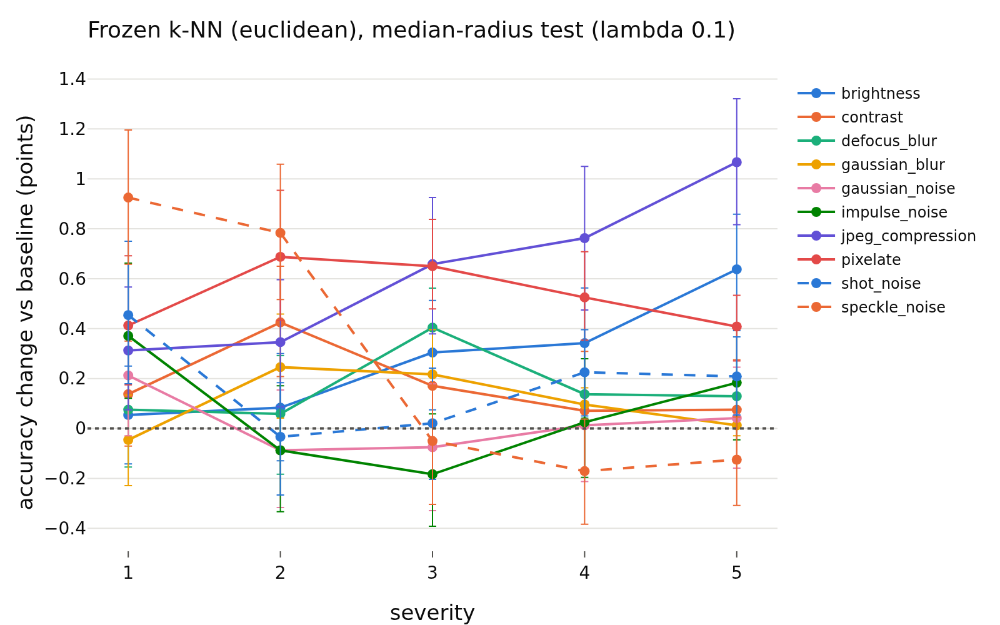
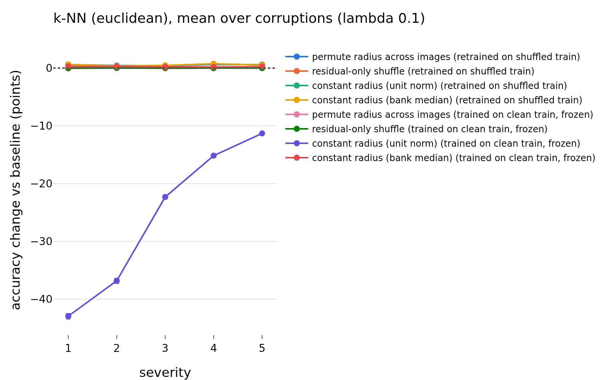
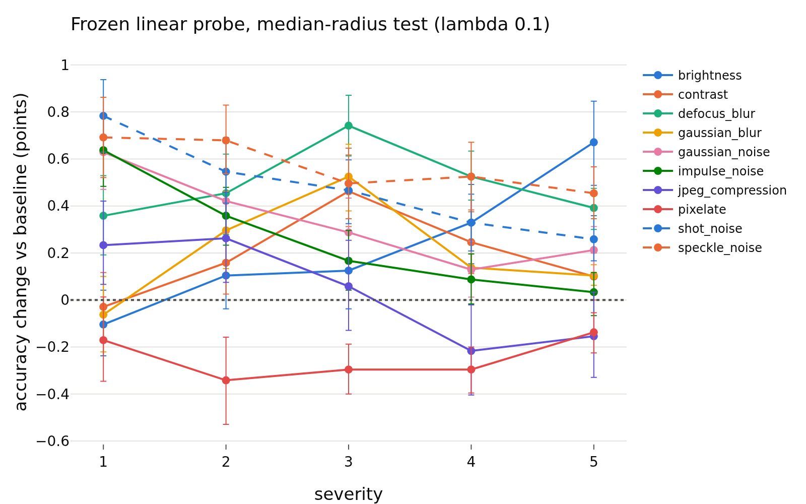
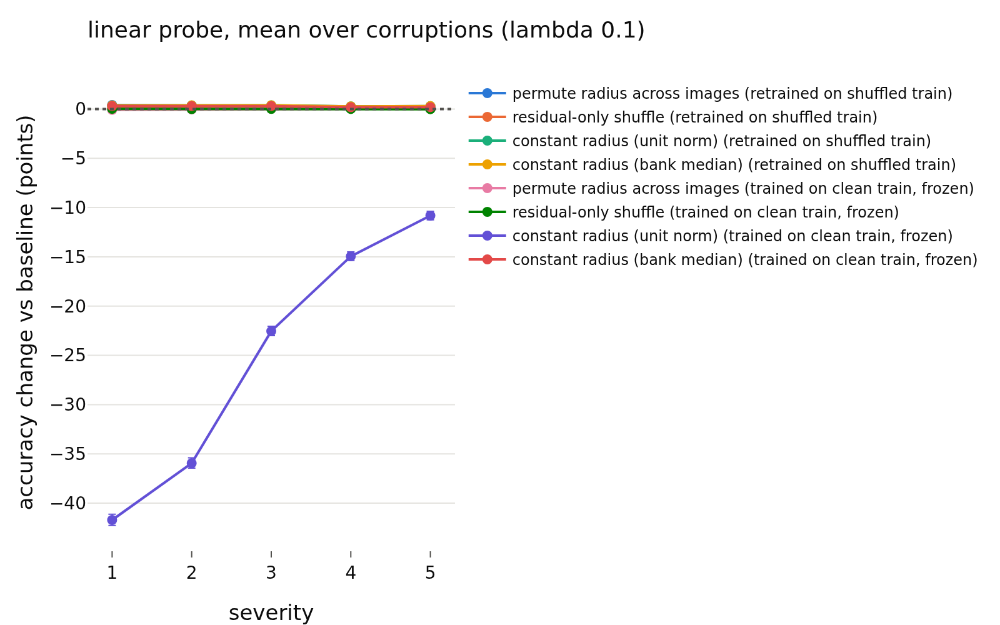
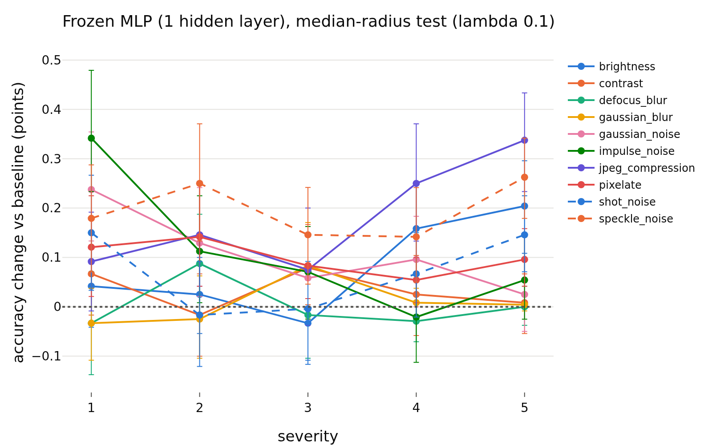
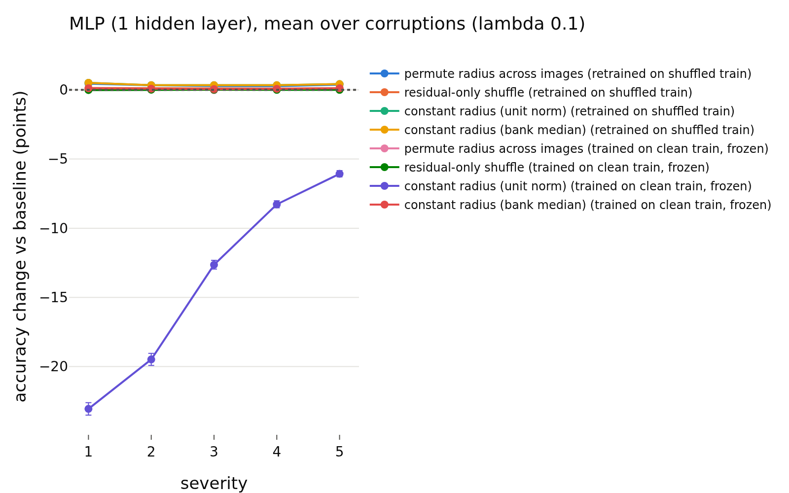

# radius_usage / shift, lambda = 0.1
- **Branch / version:** `radius-usage-shift` @ `2989a9a` (code; notes committed after)
- **Run datetime (UTC):** 2026-10-25T21:35Z (aggregation; unit jobs 20:23Z to 21:20Z, see commands)
- **Command(s):**
  (cluster, SLURM; checkout of the branch at the commit above, `PYTHONPATH=<repo>/src`, `OMP_NUM_THREADS=8`; `.env` with `LEJEPA_NORM_NOTES_DIR` pointing at this checkout's `research_notes/`)
  Per-run units, all nine runs (jobs 2246231 to 2246239, 8 CPUs, 48 GB, 21 to 23 min each; both parts, 2026-10-25T20:23Z to 20:46Z; the classification part was recomputed with the added scale-matched condition in jobs 2246400 to 2246409, 2026-10-25T20:58Z to 21:20Z):
  `sbatch --export=ALL --mem=48G --cpus-per-task=8 slurm/analyze.sbatch configs/base.yaml radius_marginal_lam<lambda>_s<seed> radius_usage/unit.md --shift-unit` (first pass, both parts) and the same with `--shift-unit --shift-part classification` (second pass), for lambda in 0.02, 0.05, 0.1 and seed in 0, 1, 2 (writes `<runs_dir>/<run>/shift_cells.npz` and `shift_ood.npz`).
  Embedding dumps of `radius_marginal_lam0.02_s{0,1,2}` (stl10c, dtd_test, svhn_test were missing) were created first: `sbatch --cpus-per-task=4 slurm/embed.sbatch configs/base.yaml radius_marginal_lam0.02_s<seed> last.pt` (jobs 2246025 to 2246027, about 5 min each).
  Aggregation (this note and the other two lambdas; 2026-10-25T21:35Z, job 2246532, 8 CPUs, 32 GB, about 7 min):
  `python apps/analyze.py --config configs/base.yaml --shift radius_marginal --note radius_usage/shift.md`
- **Datasets:** STL-10 ([canonical](https://cs.stanford.edu/~acoates/stl10/), [HF `tanganke/stl10`](https://huggingface.co/datasets/tanganke/stl10)): `train` (bank / training set) and `test` (ID); canonical archive used, HF for reference only. STL-10-C: built locally from STL-10 `test` (10 corruptions x 5 severities, 400k images; no HF mirror). DTD `test` partition 1 ([canonical](https://www.robots.ox.ac.uk/~vgg/data/dtd/), [HF `tanganke/dtd`](https://huggingface.co/datasets/tanganke/dtd)) and SVHN `test` ([canonical](http://ufldl.stanford.edu/housenumbers/), [HF `ufldl-stanford/svhn`](https://huggingface.co/datasets/ufldl-stanford/svhn)) as OOD sets; the canonical sources (via torchvision) were used, HF pages are for reference only.
- **Backbone:** ResNet-18 from scratch ([HF architecture reference](https://huggingface.co/timm/resnet18.a1_in1k), weights not used); `last.pt` (epoch 200) of `radius_marginal_lam0.1_s{0,1,2}` (Variant A).
- **Scope:** h is not analyzed; LeJEPA's product is z. All results are z-space, un-augmented center views.
- **Margins (fixed before the results):** 0.5 accuracy points (Part 1, as E1); 0.01 AUROC (Part 2). Pre-registration: `shift_summary.md`.

## Question

Is the embedding radius used when the test distribution shifts? Part 1: readers fitted on clean STL-10 `train` are tested on corrupted STL-10-C images with the radius randomized or removed (does the shifted radius hurt or help; does normalizing recover accuracy). Part 2: does the radius separate STL-10 `test` from DTD / SVHN, alone or on top of the direction (k-NN) score. Lambda = 0.1, three training seeds. Cross-lambda reading and verdicts: `shift_summary.md`.

## Setup (deviations from the base config)

No deviation from `configs/base.yaml` (k = 20, 1000 bootstrap replicates, 5 shuffle repeats per randomized condition, MLP weight decay chosen on the clean bank). Conditions, readers, protocols, the clean-fitted direction -> log-radius map and the OOD scores are defined in the docstrings of `lejepa_norm.eval.shift` and `lejepa_norm.eval.ood_radius`. Post-hoc additions (after the first results, not in the pre-registration): the scale-matched `constant radius (bank median)` condition (the unit-norm one collapses frozen readers by a pure scale mismatch, as in E1) and the `post hoc: direction + low radius` OOD score; both are labeled as such.

## Results

<!-- BEGIN GENERATED: analyze.shift_inputs -->
### Inputs

Runs aggregated: `radius_marginal_lam0.1_s0`, `radius_marginal_lam0.1_s1`, `radius_marginal_lam0.1_s2`.

Unit files missing for this lambda:

None.
<!-- END GENERATED: analyze.shift_inputs -->

<!-- BEGIN GENERATED: analyze.shift_context -->
### Radius shift and baseline accuracy per corruption

Averaged over the 5 severities and the seeds. `log-radius shift` = mean paired change of the center-view log-radius vs the clean twin; `clean-map residual` = mean of `log r - f(u)` with the clean-fitted direction -> log-radius map `f`; accuracies are those of the frozen readers on the unmodified corrupted embeddings.

| lambda | corruption | log-radius shift | clean-map residual | k-NN (euclidean) acc | linear probe acc | MLP (1 hidden layer) acc | k-NN (euclidean): frozen, unit norm (points) | k-NN (euclidean): frozen, bank-median radius (points) | linear probe: frozen, unit norm (points) | linear probe: frozen, bank-median radius (points) | MLP (1 hidden layer): frozen, unit norm (points) | MLP (1 hidden layer): frozen, bank-median radius (points) |
|---|---|---|---|---|---|---|---|---|---|---|---|---|
| 0.1 | clean test (reference) | 0 | -0.0122 | 0.7886 | 0.8121 | 0.8175 |  |  |  |  |  |  |
| 0.1 | brightness | -0.0373 | -0.0230 | 0.7297 | 0.7410 | 0.7474 | -60.25 | +0.28 | -59.12 | +0.23 | -30.76 | +0.08 |
| 0.1 | contrast | -0.0306 | -0.0465 | 0.5337 | 0.5310 | 0.5488 | -41.95 | +0.18 | -40.14 | +0.19 | -22.17 | +0.03 |
| 0.1 | defocus_blur | -0.0920 | -0.0883 | 0.2868 | 0.3117 | 0.3129 | -18.20 | +0.16 | -19.47 | +0.49 | -11.64 | +0.00 |
| 0.1 | gaussian_blur | -0.0476 | -0.0750 | 0.3916 | 0.4035 | 0.4067 | -27.83 | +0.11 | -27.85 | +0.20 | -15.03 | +0.01 |
| 0.1 | gaussian_noise | -0.0973 | -0.1063 | 0.1596 | 0.1774 | 0.1804 | -6.08 | +0.02 | -6.40 | +0.34 | -3.98 | +0.11 |
| 0.1 | impulse_noise | -0.1256 | -0.1082 | 0.1652 | 0.1711 | 0.1745 | -6.61 | +0.06 | -5.99 | +0.26 | -2.91 | +0.11 |
| 0.1 | jpeg_compression | -0.1575 | -0.0600 | 0.5689 | 0.5525 | 0.5753 | -44.99 | +0.63 | -41.90 | +0.04 | -23.17 | +0.18 |
| 0.1 | pixelate | -0.1049 | -0.0514 | 0.4166 | 0.3927 | 0.4097 | -30.48 | +0.54 | -27.67 | -0.25 | -15.13 | +0.10 |
| 0.1 | shot_noise | -0.0838 | -0.0928 | 0.1688 | 0.1965 | 0.1981 | -6.84 | +0.18 | -8.47 | +0.48 | -5.01 | +0.07 |
| 0.1 | speckle_noise | -0.0808 | -0.0728 | 0.2416 | 0.2646 | 0.2741 | -13.87 | +0.27 | -14.92 | +0.57 | -9.25 | +0.20 |
<!-- END GENERATED: analyze.shift_context -->

<!-- BEGIN GENERATED: analyze.shift_corruption -->
### Accuracy change per corruption (severities averaged)

Differences are in accuracy points (condition minus baseline on the same corrupted test images), averaged over training seeds; intervals are paired bootstrap percentile intervals (1000 replicates, test images resampled within each seed, the same resample for every cell). Verdict, with the equivalence margin set to ±0.5 points before looking at results: `equivalent` if the 90% interval lies inside the margin, `different` if not equivalent and the 95% interval excludes 0, otherwise `inconclusive`. Bank / training set: clean STL-10 train.

| corruption | reader | protocol | condition | baseline acc (corrupted) | condition acc | change (points) | 90% CI | 95% CI | verdict |
|---|---|---|---|---|---|---|---|---|---|
| brightness | k-NN (euclidean) | retrained on shuffled train | permute radius across images | 0.7297 | 0.7296 | -0.01 | [-0.16, +0.14] | [-0.20, +0.17] | equivalent |
| contrast | k-NN (euclidean) | retrained on shuffled train | permute radius across images | 0.5337 | 0.5349 | +0.12 | [-0.02, +0.26] | [-0.05, +0.29] | equivalent |
| defocus_blur | k-NN (euclidean) | retrained on shuffled train | permute radius across images | 0.2868 | 0.2911 | +0.42 | [+0.32, +0.53] | [+0.29, +0.55] | different |
| gaussian_blur | k-NN (euclidean) | retrained on shuffled train | permute radius across images | 0.3916 | 0.3925 | +0.10 | [+0.01, +0.17] | [-0.01, +0.18] | equivalent |
| gaussian_noise | k-NN (euclidean) | retrained on shuffled train | permute radius across images | 0.1596 | 0.1648 | +0.52 | [+0.35, +0.68] | [+0.32, +0.71] | different |
| impulse_noise | k-NN (euclidean) | retrained on shuffled train | permute radius across images | 0.1652 | 0.1644 | -0.08 | [-0.24, +0.08] | [-0.28, +0.11] | equivalent |
| jpeg_compression | k-NN (euclidean) | retrained on shuffled train | permute radius across images | 0.5689 | 0.5804 | +1.15 | [+0.98, +1.31] | [+0.96, +1.34] | different |
| pixelate | k-NN (euclidean) | retrained on shuffled train | permute radius across images | 0.4166 | 0.4315 | +1.49 | [+1.37, +1.62] | [+1.35, +1.64] | different |
| shot_noise | k-NN (euclidean) | retrained on shuffled train | permute radius across images | 0.1688 | 0.1759 | +0.71 | [+0.56, +0.87] | [+0.52, +0.90] | different |
| speckle_noise | k-NN (euclidean) | retrained on shuffled train | permute radius across images | 0.2416 | 0.2517 | +1.01 | [+0.86, +1.18] | [+0.83, +1.20] | different |
| all corruptions | k-NN (euclidean) | retrained on shuffled train | permute radius across images | 0.3663 | 0.3717 | +0.54 | [+0.47, +0.61] | [+0.46, +0.62] | different |
| brightness | k-NN (euclidean) | retrained on shuffled train | residual-only shuffle | 0.7297 | 0.7295 | -0.03 | [-0.12, +0.06] | [-0.14, +0.08] | equivalent |
| contrast | k-NN (euclidean) | retrained on shuffled train | residual-only shuffle | 0.5337 | 0.5326 | -0.11 | [-0.21, -0.02] | [-0.23, +0.00] | equivalent |
| defocus_blur | k-NN (euclidean) | retrained on shuffled train | residual-only shuffle | 0.2868 | 0.2879 | +0.10 | [+0.04, +0.17] | [+0.03, +0.18] | equivalent |
| gaussian_blur | k-NN (euclidean) | retrained on shuffled train | residual-only shuffle | 0.3916 | 0.3919 | +0.03 | [-0.03, +0.08] | [-0.04, +0.09] | equivalent |
| gaussian_noise | k-NN (euclidean) | retrained on shuffled train | residual-only shuffle | 0.1596 | 0.1606 | +0.10 | [+0.01, +0.19] | [-0.01, +0.21] | equivalent |
| impulse_noise | k-NN (euclidean) | retrained on shuffled train | residual-only shuffle | 0.1652 | 0.1647 | -0.05 | [-0.15, +0.04] | [-0.16, +0.06] | equivalent |
| jpeg_compression | k-NN (euclidean) | retrained on shuffled train | residual-only shuffle | 0.5689 | 0.5693 | +0.04 | [-0.06, +0.13] | [-0.08, +0.14] | equivalent |
| pixelate | k-NN (euclidean) | retrained on shuffled train | residual-only shuffle | 0.4166 | 0.4168 | +0.03 | [-0.04, +0.10] | [-0.06, +0.11] | equivalent |
| shot_noise | k-NN (euclidean) | retrained on shuffled train | residual-only shuffle | 0.1688 | 0.1683 | -0.05 | [-0.13, +0.04] | [-0.15, +0.05] | equivalent |
| speckle_noise | k-NN (euclidean) | retrained on shuffled train | residual-only shuffle | 0.2416 | 0.2411 | -0.05 | [-0.15, +0.05] | [-0.17, +0.07] | equivalent |
| all corruptions | k-NN (euclidean) | retrained on shuffled train | residual-only shuffle | 0.3663 | 0.3663 | +0.00 | [-0.03, +0.03] | [-0.03, +0.04] | equivalent |
| brightness | k-NN (euclidean) | retrained on shuffled train | constant radius (unit norm) | 0.7297 | 0.7315 | +0.18 | [+0.01, +0.33] | [-0.02, +0.35] | equivalent |
| contrast | k-NN (euclidean) | retrained on shuffled train | constant radius (unit norm) | 0.5337 | 0.5354 | +0.17 | [+0.02, +0.33] | [-0.02, +0.36] | equivalent |
| defocus_blur | k-NN (euclidean) | retrained on shuffled train | constant radius (unit norm) | 0.2868 | 0.2919 | +0.50 | [+0.39, +0.60] | [+0.37, +0.62] | different |
| gaussian_blur | k-NN (euclidean) | retrained on shuffled train | constant radius (unit norm) | 0.3916 | 0.3933 | +0.18 | [+0.09, +0.26] | [+0.07, +0.28] | equivalent |
| gaussian_noise | k-NN (euclidean) | retrained on shuffled train | constant radius (unit norm) | 0.1596 | 0.1629 | +0.33 | [+0.20, +0.48] | [+0.17, +0.51] | equivalent |
| impulse_noise | k-NN (euclidean) | retrained on shuffled train | constant radius (unit norm) | 0.1652 | 0.1628 | -0.24 | [-0.38, -0.08] | [-0.42, -0.06] | equivalent |
| jpeg_compression | k-NN (euclidean) | retrained on shuffled train | constant radius (unit norm) | 0.5689 | 0.5804 | +1.15 | [+0.97, +1.31] | [+0.95, +1.35] | different |
| pixelate | k-NN (euclidean) | retrained on shuffled train | constant radius (unit norm) | 0.4166 | 0.4342 | +1.76 | [+1.62, +1.91] | [+1.59, +1.93] | different |
| shot_noise | k-NN (euclidean) | retrained on shuffled train | constant radius (unit norm) | 0.1688 | 0.1735 | +0.48 | [+0.33, +0.62] | [+0.31, +0.65] | different |
| speckle_noise | k-NN (euclidean) | retrained on shuffled train | constant radius (unit norm) | 0.2416 | 0.2502 | +0.86 | [+0.70, +1.04] | [+0.67, +1.08] | different |
| all corruptions | k-NN (euclidean) | retrained on shuffled train | constant radius (unit norm) | 0.3663 | 0.3716 | +0.54 | [+0.48, +0.60] | [+0.46, +0.61] | different |
| brightness | k-NN (euclidean) | retrained on shuffled train | constant radius (bank median) | 0.7297 | 0.7315 | +0.18 | [+0.01, +0.33] | [-0.02, +0.35] | equivalent |
| contrast | k-NN (euclidean) | retrained on shuffled train | constant radius (bank median) | 0.5337 | 0.5354 | +0.17 | [+0.02, +0.33] | [-0.02, +0.36] | equivalent |
| defocus_blur | k-NN (euclidean) | retrained on shuffled train | constant radius (bank median) | 0.2868 | 0.2919 | +0.50 | [+0.39, +0.60] | [+0.37, +0.62] | different |
| gaussian_blur | k-NN (euclidean) | retrained on shuffled train | constant radius (bank median) | 0.3916 | 0.3933 | +0.18 | [+0.09, +0.26] | [+0.07, +0.28] | equivalent |
| gaussian_noise | k-NN (euclidean) | retrained on shuffled train | constant radius (bank median) | 0.1596 | 0.1629 | +0.34 | [+0.20, +0.48] | [+0.17, +0.51] | equivalent |
| impulse_noise | k-NN (euclidean) | retrained on shuffled train | constant radius (bank median) | 0.1652 | 0.1628 | -0.24 | [-0.38, -0.08] | [-0.42, -0.06] | equivalent |
| jpeg_compression | k-NN (euclidean) | retrained on shuffled train | constant radius (bank median) | 0.5689 | 0.5804 | +1.15 | [+0.97, +1.31] | [+0.95, +1.35] | different |
| pixelate | k-NN (euclidean) | retrained on shuffled train | constant radius (bank median) | 0.4166 | 0.4342 | +1.76 | [+1.62, +1.91] | [+1.59, +1.93] | different |
| shot_noise | k-NN (euclidean) | retrained on shuffled train | constant radius (bank median) | 0.1688 | 0.1735 | +0.48 | [+0.33, +0.62] | [+0.31, +0.65] | different |
| speckle_noise | k-NN (euclidean) | retrained on shuffled train | constant radius (bank median) | 0.2416 | 0.2502 | +0.86 | [+0.70, +1.04] | [+0.67, +1.08] | different |
| all corruptions | k-NN (euclidean) | retrained on shuffled train | constant radius (bank median) | 0.3663 | 0.3716 | +0.54 | [+0.48, +0.60] | [+0.46, +0.61] | different |
| brightness | k-NN (euclidean) | trained on clean train, frozen | permute radius across images | 0.7297 | 0.7311 | +0.14 | [+0.06, +0.20] | [+0.05, +0.22] | equivalent |
| contrast | k-NN (euclidean) | trained on clean train, frozen | permute radius across images | 0.5337 | 0.5340 | +0.02 | [-0.04, +0.09] | [-0.06, +0.10] | equivalent |
| defocus_blur | k-NN (euclidean) | trained on clean train, frozen | permute radius across images | 0.2868 | 0.2874 | +0.06 | [+0.01, +0.10] | [-0.00, +0.11] | equivalent |
| gaussian_blur | k-NN (euclidean) | trained on clean train, frozen | permute radius across images | 0.3916 | 0.3924 | +0.08 | [+0.04, +0.12] | [+0.03, +0.13] | equivalent |
| gaussian_noise | k-NN (euclidean) | trained on clean train, frozen | permute radius across images | 0.1596 | 0.1600 | +0.04 | [-0.02, +0.10] | [-0.03, +0.11] | equivalent |
| impulse_noise | k-NN (euclidean) | trained on clean train, frozen | permute radius across images | 0.1652 | 0.1659 | +0.07 | [+0.01, +0.12] | [+0.00, +0.13] | equivalent |
| jpeg_compression | k-NN (euclidean) | trained on clean train, frozen | permute radius across images | 0.5689 | 0.5701 | +0.12 | [+0.05, +0.19] | [+0.04, +0.21] | equivalent |
| pixelate | k-NN (euclidean) | trained on clean train, frozen | permute radius across images | 0.4166 | 0.4176 | +0.10 | [+0.04, +0.15] | [+0.04, +0.16] | equivalent |
| shot_noise | k-NN (euclidean) | trained on clean train, frozen | permute radius across images | 0.1688 | 0.1686 | -0.01 | [-0.07, +0.04] | [-0.08, +0.05] | equivalent |
| speckle_noise | k-NN (euclidean) | trained on clean train, frozen | permute radius across images | 0.2416 | 0.2415 | -0.01 | [-0.07, +0.06] | [-0.08, +0.07] | equivalent |
| all corruptions | k-NN (euclidean) | trained on clean train, frozen | permute radius across images | 0.3663 | 0.3669 | +0.06 | [+0.04, +0.08] | [+0.04, +0.08] | equivalent |
| brightness | k-NN (euclidean) | trained on clean train, frozen | residual-only shuffle | 0.7297 | 0.7295 | -0.02 | [-0.07, +0.02] | [-0.07, +0.03] | equivalent |
| contrast | k-NN (euclidean) | trained on clean train, frozen | residual-only shuffle | 0.5337 | 0.5331 | -0.07 | [-0.12, -0.02] | [-0.13, -0.01] | equivalent |
| defocus_blur | k-NN (euclidean) | trained on clean train, frozen | residual-only shuffle | 0.2868 | 0.2873 | +0.04 | [+0.01, +0.08] | [+0.00, +0.09] | equivalent |
| gaussian_blur | k-NN (euclidean) | trained on clean train, frozen | residual-only shuffle | 0.3916 | 0.3919 | +0.03 | [-0.01, +0.06] | [-0.01, +0.07] | equivalent |
| gaussian_noise | k-NN (euclidean) | trained on clean train, frozen | residual-only shuffle | 0.1596 | 0.1602 | +0.06 | [+0.01, +0.11] | [+0.00, +0.12] | equivalent |
| impulse_noise | k-NN (euclidean) | trained on clean train, frozen | residual-only shuffle | 0.1652 | 0.1656 | +0.04 | [-0.01, +0.09] | [-0.01, +0.10] | equivalent |
| jpeg_compression | k-NN (euclidean) | trained on clean train, frozen | residual-only shuffle | 0.5689 | 0.5691 | +0.01 | [-0.04, +0.06] | [-0.05, +0.07] | equivalent |
| pixelate | k-NN (euclidean) | trained on clean train, frozen | residual-only shuffle | 0.4166 | 0.4168 | +0.02 | [-0.02, +0.06] | [-0.03, +0.07] | equivalent |
| shot_noise | k-NN (euclidean) | trained on clean train, frozen | residual-only shuffle | 0.1688 | 0.1692 | +0.04 | [-0.01, +0.09] | [-0.02, +0.10] | equivalent |
| speckle_noise | k-NN (euclidean) | trained on clean train, frozen | residual-only shuffle | 0.2416 | 0.2422 | +0.06 | [+0.01, +0.12] | [+0.00, +0.12] | equivalent |
| all corruptions | k-NN (euclidean) | trained on clean train, frozen | residual-only shuffle | 0.3663 | 0.3665 | +0.02 | [+0.01, +0.04] | [+0.01, +0.04] | equivalent |
| brightness | k-NN (euclidean) | trained on clean train, frozen | constant radius (unit norm) | 0.7297 | 0.1272 | -60.25 | [-60.78, -59.71] | [-60.88, -59.61] | different |
| contrast | k-NN (euclidean) | trained on clean train, frozen | constant radius (unit norm) | 0.5337 | 0.1142 | -41.95 | [-42.42, -41.49] | [-42.52, -41.40] | different |
| defocus_blur | k-NN (euclidean) | trained on clean train, frozen | constant radius (unit norm) | 0.2868 | 0.1049 | -18.20 | [-18.51, -17.89] | [-18.55, -17.83] | different |
| gaussian_blur | k-NN (euclidean) | trained on clean train, frozen | constant radius (unit norm) | 0.3916 | 0.1133 | -27.83 | [-28.13, -27.56] | [-28.18, -27.52] | different |
| gaussian_noise | k-NN (euclidean) | trained on clean train, frozen | constant radius (unit norm) | 0.1596 | 0.0988 | -6.08 | [-6.35, -5.79] | [-6.42, -5.71] | different |
| impulse_noise | k-NN (euclidean) | trained on clean train, frozen | constant radius (unit norm) | 0.1652 | 0.0991 | -6.61 | [-6.90, -6.31] | [-6.95, -6.26] | different |
| jpeg_compression | k-NN (euclidean) | trained on clean train, frozen | constant radius (unit norm) | 0.5689 | 0.1190 | -44.99 | [-45.54, -44.41] | [-45.64, -44.33] | different |
| pixelate | k-NN (euclidean) | trained on clean train, frozen | constant radius (unit norm) | 0.4166 | 0.1118 | -30.48 | [-31.01, -29.95] | [-31.12, -29.83] | different |
| shot_noise | k-NN (euclidean) | trained on clean train, frozen | constant radius (unit norm) | 0.1688 | 0.1004 | -6.84 | [-7.10, -6.59] | [-7.14, -6.53] | different |
| speckle_noise | k-NN (euclidean) | trained on clean train, frozen | constant radius (unit norm) | 0.2416 | 0.1028 | -13.87 | [-14.19, -13.56] | [-14.23, -13.51] | different |
| all corruptions | k-NN (euclidean) | trained on clean train, frozen | constant radius (unit norm) | 0.3663 | 0.1091 | -25.71 | [-25.99, -25.42] | [-26.04, -25.37] | different |
| brightness | k-NN (euclidean) | trained on clean train, frozen | constant radius (bank median) | 0.7297 | 0.7326 | +0.28 | [+0.19, +0.37] | [+0.18, +0.39] | equivalent |
| contrast | k-NN (euclidean) | trained on clean train, frozen | constant radius (bank median) | 0.5337 | 0.5355 | +0.18 | [+0.08, +0.26] | [+0.07, +0.27] | equivalent |
| defocus_blur | k-NN (euclidean) | trained on clean train, frozen | constant radius (bank median) | 0.2868 | 0.2884 | +0.16 | [+0.10, +0.23] | [+0.08, +0.24] | equivalent |
| gaussian_blur | k-NN (euclidean) | trained on clean train, frozen | constant radius (bank median) | 0.3916 | 0.3926 | +0.11 | [+0.05, +0.16] | [+0.04, +0.17] | equivalent |
| gaussian_noise | k-NN (euclidean) | trained on clean train, frozen | constant radius (bank median) | 0.1596 | 0.1598 | +0.02 | [-0.07, +0.10] | [-0.08, +0.12] | equivalent |
| impulse_noise | k-NN (euclidean) | trained on clean train, frozen | constant radius (bank median) | 0.1652 | 0.1658 | +0.06 | [-0.03, +0.16] | [-0.04, +0.18] | equivalent |
| jpeg_compression | k-NN (euclidean) | trained on clean train, frozen | constant radius (bank median) | 0.5689 | 0.5752 | +0.63 | [+0.52, +0.74] | [+0.50, +0.76] | different |
| pixelate | k-NN (euclidean) | trained on clean train, frozen | constant radius (bank median) | 0.4166 | 0.4219 | +0.54 | [+0.47, +0.63] | [+0.45, +0.64] | different |
| shot_noise | k-NN (euclidean) | trained on clean train, frozen | constant radius (bank median) | 0.1688 | 0.1705 | +0.18 | [+0.09, +0.26] | [+0.07, +0.27] | equivalent |
| speckle_noise | k-NN (euclidean) | trained on clean train, frozen | constant radius (bank median) | 0.2416 | 0.2443 | +0.27 | [+0.18, +0.37] | [+0.16, +0.39] | equivalent |
| all corruptions | k-NN (euclidean) | trained on clean train, frozen | constant radius (bank median) | 0.3663 | 0.3687 | +0.24 | [+0.21, +0.28] | [+0.21, +0.28] | equivalent |
| brightness | linear probe | retrained on shuffled train | permute radius across images | 0.7410 | 0.7405 | -0.06 | [-0.13, +0.01] | [-0.15, +0.02] | equivalent |
| contrast | linear probe | retrained on shuffled train | permute radius across images | 0.5310 | 0.5329 | +0.18 | [+0.12, +0.25] | [+0.10, +0.26] | equivalent |
| defocus_blur | linear probe | retrained on shuffled train | permute radius across images | 0.3117 | 0.3180 | +0.63 | [+0.57, +0.68] | [+0.56, +0.70] | different |
| gaussian_blur | linear probe | retrained on shuffled train | permute radius across images | 0.4035 | 0.4059 | +0.23 | [+0.19, +0.28] | [+0.18, +0.28] | equivalent |
| gaussian_noise | linear probe | retrained on shuffled train | permute radius across images | 0.1774 | 0.1824 | +0.50 | [+0.39, +0.60] | [+0.37, +0.62] | different |
| impulse_noise | linear probe | retrained on shuffled train | permute radius across images | 0.1711 | 0.1768 | +0.57 | [+0.48, +0.66] | [+0.46, +0.68] | different |
| jpeg_compression | linear probe | retrained on shuffled train | permute radius across images | 0.5525 | 0.5518 | -0.07 | [-0.13, -0.00] | [-0.14, +0.01] | equivalent |
| pixelate | linear probe | retrained on shuffled train | permute radius across images | 0.3927 | 0.3930 | +0.03 | [-0.02, +0.08] | [-0.03, +0.09] | equivalent |
| shot_noise | linear probe | retrained on shuffled train | permute radius across images | 0.1965 | 0.2009 | +0.45 | [+0.35, +0.54] | [+0.33, +0.57] | different |
| speckle_noise | linear probe | retrained on shuffled train | permute radius across images | 0.2646 | 0.2701 | +0.55 | [+0.46, +0.64] | [+0.44, +0.66] | different |
| all corruptions | linear probe | retrained on shuffled train | permute radius across images | 0.3742 | 0.3772 | +0.30 | [+0.27, +0.34] | [+0.26, +0.34] | equivalent |
| brightness | linear probe | retrained on shuffled train | residual-only shuffle | 0.7410 | 0.7408 | -0.02 | [-0.06, +0.02] | [-0.07, +0.03] | equivalent |
| contrast | linear probe | retrained on shuffled train | residual-only shuffle | 0.5310 | 0.5304 | -0.06 | [-0.10, -0.01] | [-0.11, -0.00] | equivalent |
| defocus_blur | linear probe | retrained on shuffled train | residual-only shuffle | 0.3117 | 0.3125 | +0.08 | [+0.05, +0.12] | [+0.04, +0.12] | equivalent |
| gaussian_blur | linear probe | retrained on shuffled train | residual-only shuffle | 0.4035 | 0.4039 | +0.04 | [+0.01, +0.07] | [+0.01, +0.07] | equivalent |
| gaussian_noise | linear probe | retrained on shuffled train | residual-only shuffle | 0.1774 | 0.1797 | +0.23 | [+0.18, +0.28] | [+0.18, +0.29] | equivalent |
| impulse_noise | linear probe | retrained on shuffled train | residual-only shuffle | 0.1711 | 0.1735 | +0.24 | [+0.19, +0.28] | [+0.19, +0.28] | equivalent |
| jpeg_compression | linear probe | retrained on shuffled train | residual-only shuffle | 0.5525 | 0.5518 | -0.07 | [-0.11, -0.03] | [-0.12, -0.02] | equivalent |
| pixelate | linear probe | retrained on shuffled train | residual-only shuffle | 0.3927 | 0.3915 | -0.11 | [-0.15, -0.08] | [-0.15, -0.08] | equivalent |
| shot_noise | linear probe | retrained on shuffled train | residual-only shuffle | 0.1965 | 0.1981 | +0.16 | [+0.12, +0.21] | [+0.11, +0.22] | equivalent |
| speckle_noise | linear probe | retrained on shuffled train | residual-only shuffle | 0.2646 | 0.2670 | +0.24 | [+0.19, +0.29] | [+0.18, +0.30] | equivalent |
| all corruptions | linear probe | retrained on shuffled train | residual-only shuffle | 0.3742 | 0.3749 | +0.07 | [+0.06, +0.09] | [+0.05, +0.09] | equivalent |
| brightness | linear probe | retrained on shuffled train | constant radius (unit norm) | 0.7410 | 0.7412 | +0.01 | [-0.06, +0.08] | [-0.08, +0.10] | equivalent |
| contrast | linear probe | retrained on shuffled train | constant radius (unit norm) | 0.5310 | 0.5329 | +0.18 | [+0.11, +0.26] | [+0.09, +0.27] | equivalent |
| defocus_blur | linear probe | retrained on shuffled train | constant radius (unit norm) | 0.3117 | 0.3199 | +0.82 | [+0.76, +0.88] | [+0.74, +0.89] | different |
| gaussian_blur | linear probe | retrained on shuffled train | constant radius (unit norm) | 0.4035 | 0.4072 | +0.36 | [+0.31, +0.41] | [+0.30, +0.42] | equivalent |
| gaussian_noise | linear probe | retrained on shuffled train | constant radius (unit norm) | 0.1774 | 0.1825 | +0.51 | [+0.41, +0.60] | [+0.40, +0.62] | different |
| impulse_noise | linear probe | retrained on shuffled train | constant radius (unit norm) | 0.1711 | 0.1741 | +0.30 | [+0.22, +0.39] | [+0.21, +0.41] | equivalent |
| jpeg_compression | linear probe | retrained on shuffled train | constant radius (unit norm) | 0.5525 | 0.5523 | -0.02 | [-0.09, +0.05] | [-0.11, +0.07] | equivalent |
| pixelate | linear probe | retrained on shuffled train | constant radius (unit norm) | 0.3927 | 0.3912 | -0.15 | [-0.21, -0.09] | [-0.21, -0.08] | equivalent |
| shot_noise | linear probe | retrained on shuffled train | constant radius (unit norm) | 0.1965 | 0.2020 | +0.55 | [+0.46, +0.65] | [+0.45, +0.66] | different |
| speckle_noise | linear probe | retrained on shuffled train | constant radius (unit norm) | 0.2646 | 0.2716 | +0.70 | [+0.61, +0.79] | [+0.59, +0.80] | different |
| all corruptions | linear probe | retrained on shuffled train | constant radius (unit norm) | 0.3742 | 0.3775 | +0.33 | [+0.30, +0.36] | [+0.29, +0.36] | equivalent |
| brightness | linear probe | retrained on shuffled train | constant radius (bank median) | 0.7410 | 0.7412 | +0.02 | [-0.06, +0.09] | [-0.07, +0.10] | equivalent |
| contrast | linear probe | retrained on shuffled train | constant radius (bank median) | 0.5310 | 0.5329 | +0.19 | [+0.11, +0.26] | [+0.09, +0.28] | equivalent |
| defocus_blur | linear probe | retrained on shuffled train | constant radius (bank median) | 0.3117 | 0.3199 | +0.82 | [+0.75, +0.88] | [+0.74, +0.89] | different |
| gaussian_blur | linear probe | retrained on shuffled train | constant radius (bank median) | 0.4035 | 0.4072 | +0.36 | [+0.31, +0.41] | [+0.30, +0.42] | equivalent |
| gaussian_noise | linear probe | retrained on shuffled train | constant radius (bank median) | 0.1774 | 0.1826 | +0.52 | [+0.43, +0.62] | [+0.41, +0.63] | different |
| impulse_noise | linear probe | retrained on shuffled train | constant radius (bank median) | 0.1711 | 0.1744 | +0.33 | [+0.25, +0.42] | [+0.24, +0.44] | equivalent |
| jpeg_compression | linear probe | retrained on shuffled train | constant radius (bank median) | 0.5525 | 0.5523 | -0.02 | [-0.09, +0.06] | [-0.11, +0.07] | equivalent |
| pixelate | linear probe | retrained on shuffled train | constant radius (bank median) | 0.3927 | 0.3912 | -0.15 | [-0.21, -0.09] | [-0.22, -0.08] | equivalent |
| shot_noise | linear probe | retrained on shuffled train | constant radius (bank median) | 0.1965 | 0.2023 | +0.59 | [+0.49, +0.68] | [+0.48, +0.70] | different |
| speckle_noise | linear probe | retrained on shuffled train | constant radius (bank median) | 0.2646 | 0.2716 | +0.70 | [+0.61, +0.79] | [+0.59, +0.80] | different |
| all corruptions | linear probe | retrained on shuffled train | constant radius (bank median) | 0.3742 | 0.3776 | +0.34 | [+0.30, +0.36] | [+0.30, +0.37] | equivalent |
| brightness | linear probe | trained on clean train, frozen | permute radius across images | 0.7410 | 0.7405 | -0.05 | [-0.11, +0.01] | [-0.12, +0.02] | equivalent |
| contrast | linear probe | trained on clean train, frozen | permute radius across images | 0.5310 | 0.5311 | +0.01 | [-0.03, +0.06] | [-0.04, +0.06] | equivalent |
| defocus_blur | linear probe | trained on clean train, frozen | permute radius across images | 0.3117 | 0.3135 | +0.19 | [+0.15, +0.22] | [+0.14, +0.23] | equivalent |
| gaussian_blur | linear probe | trained on clean train, frozen | permute radius across images | 0.4035 | 0.4038 | +0.03 | [-0.01, +0.06] | [-0.02, +0.07] | equivalent |
| gaussian_noise | linear probe | trained on clean train, frozen | permute radius across images | 0.1774 | 0.1777 | +0.03 | [-0.01, +0.06] | [-0.01, +0.06] | equivalent |
| impulse_noise | linear probe | trained on clean train, frozen | permute radius across images | 0.1711 | 0.1713 | +0.02 | [-0.01, +0.04] | [-0.02, +0.05] | equivalent |
| jpeg_compression | linear probe | trained on clean train, frozen | permute radius across images | 0.5525 | 0.5508 | -0.17 | [-0.22, -0.12] | [-0.23, -0.11] | equivalent |
| pixelate | linear probe | trained on clean train, frozen | permute radius across images | 0.3927 | 0.3906 | -0.21 | [-0.26, -0.17] | [-0.26, -0.16] | equivalent |
| shot_noise | linear probe | trained on clean train, frozen | permute radius across images | 0.1965 | 0.1974 | +0.09 | [+0.05, +0.12] | [+0.05, +0.13] | equivalent |
| speckle_noise | linear probe | trained on clean train, frozen | permute radius across images | 0.2646 | 0.2651 | +0.04 | [+0.00, +0.09] | [-0.00, +0.10] | equivalent |
| all corruptions | linear probe | trained on clean train, frozen | permute radius across images | 0.3742 | 0.3742 | -0.00 | [-0.02, +0.01] | [-0.02, +0.01] | equivalent |
| brightness | linear probe | trained on clean train, frozen | residual-only shuffle | 0.7410 | 0.7410 | -0.00 | [-0.03, +0.03] | [-0.04, +0.03] | equivalent |
| contrast | linear probe | trained on clean train, frozen | residual-only shuffle | 0.5310 | 0.5310 | -0.01 | [-0.03, +0.02] | [-0.04, +0.03] | equivalent |
| defocus_blur | linear probe | trained on clean train, frozen | residual-only shuffle | 0.3117 | 0.3122 | +0.05 | [+0.03, +0.08] | [+0.02, +0.08] | equivalent |
| gaussian_blur | linear probe | trained on clean train, frozen | residual-only shuffle | 0.4035 | 0.4038 | +0.03 | [+0.01, +0.05] | [+0.00, +0.05] | equivalent |
| gaussian_noise | linear probe | trained on clean train, frozen | residual-only shuffle | 0.1774 | 0.1774 | -0.00 | [-0.03, +0.02] | [-0.03, +0.02] | equivalent |
| impulse_noise | linear probe | trained on clean train, frozen | residual-only shuffle | 0.1711 | 0.1714 | +0.03 | [+0.01, +0.05] | [+0.00, +0.05] | equivalent |
| jpeg_compression | linear probe | trained on clean train, frozen | residual-only shuffle | 0.5525 | 0.5522 | -0.02 | [-0.05, +0.01] | [-0.06, +0.02] | equivalent |
| pixelate | linear probe | trained on clean train, frozen | residual-only shuffle | 0.3927 | 0.3919 | -0.08 | [-0.10, -0.06] | [-0.11, -0.05] | equivalent |
| shot_noise | linear probe | trained on clean train, frozen | residual-only shuffle | 0.1965 | 0.1963 | -0.01 | [-0.04, +0.02] | [-0.04, +0.02] | equivalent |
| speckle_noise | linear probe | trained on clean train, frozen | residual-only shuffle | 0.2646 | 0.2646 | -0.00 | [-0.03, +0.03] | [-0.04, +0.04] | equivalent |
| all corruptions | linear probe | trained on clean train, frozen | residual-only shuffle | 0.3742 | 0.3742 | -0.00 | [-0.01, +0.01] | [-0.01, +0.01] | equivalent |
| brightness | linear probe | trained on clean train, frozen | constant radius (unit norm) | 0.7410 | 0.1498 | -59.12 | [-59.71, -58.58] | [-59.79, -58.47] | different |
| contrast | linear probe | trained on clean train, frozen | constant radius (unit norm) | 0.5310 | 0.1296 | -40.14 | [-40.63, -39.64] | [-40.73, -39.51] | different |
| defocus_blur | linear probe | trained on clean train, frozen | constant radius (unit norm) | 0.3117 | 0.1170 | -19.47 | [-19.91, -19.03] | [-19.97, -18.97] | different |
| gaussian_blur | linear probe | trained on clean train, frozen | constant radius (unit norm) | 0.4035 | 0.1250 | -27.85 | [-28.23, -27.47] | [-28.30, -27.40] | different |
| gaussian_noise | linear probe | trained on clean train, frozen | constant radius (unit norm) | 0.1774 | 0.1135 | -6.40 | [-6.79, -5.98] | [-6.88, -5.92] | different |
| impulse_noise | linear probe | trained on clean train, frozen | constant radius (unit norm) | 0.1711 | 0.1112 | -5.99 | [-6.41, -5.56] | [-6.50, -5.48] | different |
| jpeg_compression | linear probe | trained on clean train, frozen | constant radius (unit norm) | 0.5525 | 0.1334 | -41.90 | [-42.44, -41.33] | [-42.58, -41.21] | different |
| pixelate | linear probe | trained on clean train, frozen | constant radius (unit norm) | 0.3927 | 0.1160 | -27.67 | [-28.18, -27.15] | [-28.30, -27.03] | different |
| shot_noise | linear probe | trained on clean train, frozen | constant radius (unit norm) | 0.1965 | 0.1118 | -8.47 | [-8.91, -8.01] | [-8.99, -7.96] | different |
| speckle_noise | linear probe | trained on clean train, frozen | constant radius (unit norm) | 0.2646 | 0.1154 | -14.92 | [-15.40, -14.42] | [-15.47, -14.32] | different |
| all corruptions | linear probe | trained on clean train, frozen | constant radius (unit norm) | 0.3742 | 0.1223 | -25.19 | [-25.57, -24.81] | [-25.63, -24.71] | different |
| brightness | linear probe | trained on clean train, frozen | constant radius (bank median) | 0.7410 | 0.7433 | +0.23 | [+0.15, +0.30] | [+0.14, +0.31] | equivalent |
| contrast | linear probe | trained on clean train, frozen | constant radius (bank median) | 0.5310 | 0.5329 | +0.19 | [+0.13, +0.24] | [+0.12, +0.25] | equivalent |
| defocus_blur | linear probe | trained on clean train, frozen | constant radius (bank median) | 0.3117 | 0.3166 | +0.49 | [+0.44, +0.55] | [+0.43, +0.56] | different |
| gaussian_blur | linear probe | trained on clean train, frozen | constant radius (bank median) | 0.4035 | 0.4055 | +0.20 | [+0.15, +0.25] | [+0.14, +0.26] | equivalent |
| gaussian_noise | linear probe | trained on clean train, frozen | constant radius (bank median) | 0.1774 | 0.1808 | +0.34 | [+0.29, +0.39] | [+0.28, +0.40] | equivalent |
| impulse_noise | linear probe | trained on clean train, frozen | constant radius (bank median) | 0.1711 | 0.1737 | +0.26 | [+0.21, +0.30] | [+0.20, +0.31] | equivalent |
| jpeg_compression | linear probe | trained on clean train, frozen | constant radius (bank median) | 0.5525 | 0.5528 | +0.04 | [-0.04, +0.12] | [-0.06, +0.14] | equivalent |
| pixelate | linear probe | trained on clean train, frozen | constant radius (bank median) | 0.3927 | 0.3902 | -0.25 | [-0.30, -0.19] | [-0.31, -0.18] | equivalent |
| shot_noise | linear probe | trained on clean train, frozen | constant radius (bank median) | 0.1965 | 0.2012 | +0.48 | [+0.43, +0.53] | [+0.41, +0.54] | different |
| speckle_noise | linear probe | trained on clean train, frozen | constant radius (bank median) | 0.2646 | 0.2703 | +0.57 | [+0.51, +0.63] | [+0.50, +0.64] | different |
| all corruptions | linear probe | trained on clean train, frozen | constant radius (bank median) | 0.3742 | 0.3767 | +0.25 | [+0.23, +0.27] | [+0.23, +0.28] | equivalent |
| brightness | MLP (1 hidden layer) | retrained on shuffled train | permute radius across images | 0.7474 | 0.7486 | +0.11 | [+0.04, +0.19] | [+0.03, +0.20] | equivalent |
| contrast | MLP (1 hidden layer) | retrained on shuffled train | permute radius across images | 0.5488 | 0.5516 | +0.28 | [+0.20, +0.35] | [+0.18, +0.36] | equivalent |
| defocus_blur | MLP (1 hidden layer) | retrained on shuffled train | permute radius across images | 0.3129 | 0.3161 | +0.32 | [+0.27, +0.38] | [+0.25, +0.39] | equivalent |
| gaussian_blur | MLP (1 hidden layer) | retrained on shuffled train | permute radius across images | 0.4067 | 0.4079 | +0.12 | [+0.08, +0.17] | [+0.07, +0.18] | equivalent |
| gaussian_noise | MLP (1 hidden layer) | retrained on shuffled train | permute radius across images | 0.1804 | 0.1832 | +0.27 | [+0.19, +0.36] | [+0.17, +0.37] | equivalent |
| impulse_noise | MLP (1 hidden layer) | retrained on shuffled train | permute radius across images | 0.1744 | 0.1795 | +0.51 | [+0.44, +0.58] | [+0.42, +0.59] | different |
| jpeg_compression | MLP (1 hidden layer) | retrained on shuffled train | permute radius across images | 0.5753 | 0.5781 | +0.28 | [+0.20, +0.36] | [+0.19, +0.37] | equivalent |
| pixelate | MLP (1 hidden layer) | retrained on shuffled train | permute radius across images | 0.4097 | 0.4123 | +0.26 | [+0.21, +0.32] | [+0.20, +0.33] | equivalent |
| shot_noise | MLP (1 hidden layer) | retrained on shuffled train | permute radius across images | 0.1981 | 0.2027 | +0.46 | [+0.38, +0.54] | [+0.36, +0.55] | different |
| speckle_noise | MLP (1 hidden layer) | retrained on shuffled train | permute radius across images | 0.2741 | 0.2822 | +0.80 | [+0.72, +0.88] | [+0.70, +0.90] | different |
| all corruptions | MLP (1 hidden layer) | retrained on shuffled train | permute radius across images | 0.3828 | 0.3862 | +0.34 | [+0.31, +0.37] | [+0.31, +0.37] | equivalent |
| brightness | MLP (1 hidden layer) | retrained on shuffled train | residual-only shuffle | 0.7474 | 0.7480 | +0.06 | [+0.01, +0.12] | [-0.00, +0.13] | equivalent |
| contrast | MLP (1 hidden layer) | retrained on shuffled train | residual-only shuffle | 0.5488 | 0.5494 | +0.06 | [-0.00, +0.12] | [-0.02, +0.13] | equivalent |
| defocus_blur | MLP (1 hidden layer) | retrained on shuffled train | residual-only shuffle | 0.3129 | 0.3131 | +0.02 | [-0.03, +0.06] | [-0.03, +0.06] | equivalent |
| gaussian_blur | MLP (1 hidden layer) | retrained on shuffled train | residual-only shuffle | 0.4067 | 0.4065 | -0.02 | [-0.06, +0.01] | [-0.07, +0.02] | equivalent |
| gaussian_noise | MLP (1 hidden layer) | retrained on shuffled train | residual-only shuffle | 0.1804 | 0.1821 | +0.17 | [+0.09, +0.24] | [+0.08, +0.26] | equivalent |
| impulse_noise | MLP (1 hidden layer) | retrained on shuffled train | residual-only shuffle | 0.1744 | 0.1766 | +0.21 | [+0.14, +0.28] | [+0.13, +0.29] | equivalent |
| jpeg_compression | MLP (1 hidden layer) | retrained on shuffled train | residual-only shuffle | 0.5753 | 0.5762 | +0.09 | [+0.03, +0.14] | [+0.02, +0.15] | equivalent |
| pixelate | MLP (1 hidden layer) | retrained on shuffled train | residual-only shuffle | 0.4097 | 0.4102 | +0.05 | [+0.01, +0.09] | [-0.00, +0.10] | equivalent |
| shot_noise | MLP (1 hidden layer) | retrained on shuffled train | residual-only shuffle | 0.1981 | 0.1994 | +0.13 | [+0.06, +0.20] | [+0.04, +0.21] | equivalent |
| speckle_noise | MLP (1 hidden layer) | retrained on shuffled train | residual-only shuffle | 0.2741 | 0.2773 | +0.32 | [+0.23, +0.39] | [+0.22, +0.40] | equivalent |
| all corruptions | MLP (1 hidden layer) | retrained on shuffled train | residual-only shuffle | 0.3828 | 0.3839 | +0.11 | [+0.08, +0.13] | [+0.08, +0.13] | equivalent |
| brightness | MLP (1 hidden layer) | retrained on shuffled train | constant radius (unit norm) | 0.7474 | 0.7491 | +0.17 | [+0.08, +0.25] | [+0.07, +0.26] | equivalent |
| contrast | MLP (1 hidden layer) | retrained on shuffled train | constant radius (unit norm) | 0.5488 | 0.5507 | +0.19 | [+0.10, +0.28] | [+0.08, +0.29] | equivalent |
| defocus_blur | MLP (1 hidden layer) | retrained on shuffled train | constant radius (unit norm) | 0.3129 | 0.3160 | +0.31 | [+0.24, +0.37] | [+0.23, +0.38] | equivalent |
| gaussian_blur | MLP (1 hidden layer) | retrained on shuffled train | constant radius (unit norm) | 0.4067 | 0.4074 | +0.07 | [+0.01, +0.12] | [-0.00, +0.13] | equivalent |
| gaussian_noise | MLP (1 hidden layer) | retrained on shuffled train | constant radius (unit norm) | 0.1804 | 0.1848 | +0.44 | [+0.33, +0.54] | [+0.31, +0.56] | different |
| impulse_noise | MLP (1 hidden layer) | retrained on shuffled train | constant radius (unit norm) | 0.1744 | 0.1792 | +0.48 | [+0.39, +0.57] | [+0.38, +0.58] | different |
| jpeg_compression | MLP (1 hidden layer) | retrained on shuffled train | constant radius (unit norm) | 0.5753 | 0.5798 | +0.45 | [+0.36, +0.55] | [+0.35, +0.57] | different |
| pixelate | MLP (1 hidden layer) | retrained on shuffled train | constant radius (unit norm) | 0.4097 | 0.4128 | +0.32 | [+0.26, +0.38] | [+0.24, +0.39] | equivalent |
| shot_noise | MLP (1 hidden layer) | retrained on shuffled train | constant radius (unit norm) | 0.1981 | 0.2041 | +0.60 | [+0.49, +0.71] | [+0.47, +0.73] | different |
| speckle_noise | MLP (1 hidden layer) | retrained on shuffled train | constant radius (unit norm) | 0.2741 | 0.2828 | +0.87 | [+0.76, +0.97] | [+0.74, +1.00] | different |
| all corruptions | MLP (1 hidden layer) | retrained on shuffled train | constant radius (unit norm) | 0.3828 | 0.3867 | +0.39 | [+0.36, +0.42] | [+0.35, +0.43] | equivalent |
| brightness | MLP (1 hidden layer) | retrained on shuffled train | constant radius (bank median) | 0.7474 | 0.7491 | +0.17 | [+0.08, +0.25] | [+0.07, +0.26] | equivalent |
| contrast | MLP (1 hidden layer) | retrained on shuffled train | constant radius (bank median) | 0.5488 | 0.5507 | +0.19 | [+0.10, +0.28] | [+0.08, +0.29] | equivalent |
| defocus_blur | MLP (1 hidden layer) | retrained on shuffled train | constant radius (bank median) | 0.3129 | 0.3160 | +0.31 | [+0.24, +0.37] | [+0.23, +0.38] | equivalent |
| gaussian_blur | MLP (1 hidden layer) | retrained on shuffled train | constant radius (bank median) | 0.4067 | 0.4074 | +0.07 | [+0.01, +0.12] | [-0.00, +0.13] | equivalent |
| gaussian_noise | MLP (1 hidden layer) | retrained on shuffled train | constant radius (bank median) | 0.1804 | 0.1848 | +0.44 | [+0.33, +0.54] | [+0.31, +0.56] | different |
| impulse_noise | MLP (1 hidden layer) | retrained on shuffled train | constant radius (bank median) | 0.1744 | 0.1792 | +0.48 | [+0.39, +0.57] | [+0.38, +0.58] | different |
| jpeg_compression | MLP (1 hidden layer) | retrained on shuffled train | constant radius (bank median) | 0.5753 | 0.5798 | +0.45 | [+0.36, +0.55] | [+0.35, +0.57] | different |
| pixelate | MLP (1 hidden layer) | retrained on shuffled train | constant radius (bank median) | 0.4097 | 0.4128 | +0.32 | [+0.26, +0.38] | [+0.24, +0.39] | equivalent |
| shot_noise | MLP (1 hidden layer) | retrained on shuffled train | constant radius (bank median) | 0.1981 | 0.2041 | +0.60 | [+0.49, +0.71] | [+0.47, +0.73] | different |
| speckle_noise | MLP (1 hidden layer) | retrained on shuffled train | constant radius (bank median) | 0.2741 | 0.2828 | +0.87 | [+0.76, +0.97] | [+0.74, +1.00] | different |
| all corruptions | MLP (1 hidden layer) | retrained on shuffled train | constant radius (bank median) | 0.3828 | 0.3867 | +0.39 | [+0.36, +0.42] | [+0.35, +0.43] | equivalent |
| brightness | MLP (1 hidden layer) | trained on clean train, frozen | permute radius across images | 0.7474 | 0.7476 | +0.02 | [-0.01, +0.04] | [-0.01, +0.05] | equivalent |
| contrast | MLP (1 hidden layer) | trained on clean train, frozen | permute radius across images | 0.5488 | 0.5490 | +0.02 | [-0.01, +0.04] | [-0.01, +0.04] | equivalent |
| defocus_blur | MLP (1 hidden layer) | trained on clean train, frozen | permute radius across images | 0.3129 | 0.3127 | -0.02 | [-0.04, +0.00] | [-0.04, +0.00] | equivalent |
| gaussian_blur | MLP (1 hidden layer) | trained on clean train, frozen | permute radius across images | 0.4067 | 0.4063 | -0.04 | [-0.05, -0.02] | [-0.06, -0.01] | equivalent |
| gaussian_noise | MLP (1 hidden layer) | trained on clean train, frozen | permute radius across images | 0.1804 | 0.1807 | +0.02 | [-0.00, +0.05] | [-0.00, +0.05] | equivalent |
| impulse_noise | MLP (1 hidden layer) | trained on clean train, frozen | permute radius across images | 0.1744 | 0.1746 | +0.01 | [-0.01, +0.03] | [-0.01, +0.04] | equivalent |
| jpeg_compression | MLP (1 hidden layer) | trained on clean train, frozen | permute radius across images | 0.5753 | 0.5755 | +0.02 | [-0.01, +0.05] | [-0.01, +0.06] | equivalent |
| pixelate | MLP (1 hidden layer) | trained on clean train, frozen | permute radius across images | 0.4097 | 0.4097 | +0.00 | [-0.02, +0.03] | [-0.02, +0.03] | equivalent |
| shot_noise | MLP (1 hidden layer) | trained on clean train, frozen | permute radius across images | 0.1981 | 0.1979 | -0.02 | [-0.04, +0.01] | [-0.05, +0.01] | equivalent |
| speckle_noise | MLP (1 hidden layer) | trained on clean train, frozen | permute radius across images | 0.2741 | 0.2745 | +0.03 | [+0.01, +0.06] | [+0.00, +0.06] | equivalent |
| all corruptions | MLP (1 hidden layer) | trained on clean train, frozen | permute radius across images | 0.3828 | 0.3828 | +0.01 | [-0.00, +0.01] | [-0.00, +0.01] | equivalent |
| brightness | MLP (1 hidden layer) | trained on clean train, frozen | residual-only shuffle | 0.7474 | 0.7474 | -0.01 | [-0.02, +0.01] | [-0.02, +0.01] | equivalent |
| contrast | MLP (1 hidden layer) | trained on clean train, frozen | residual-only shuffle | 0.5488 | 0.5490 | +0.02 | [+0.00, +0.03] | [-0.00, +0.04] | equivalent |
| defocus_blur | MLP (1 hidden layer) | trained on clean train, frozen | residual-only shuffle | 0.3129 | 0.3130 | +0.01 | [-0.01, +0.02] | [-0.01, +0.02] | equivalent |
| gaussian_blur | MLP (1 hidden layer) | trained on clean train, frozen | residual-only shuffle | 0.4067 | 0.4067 | -0.00 | [-0.01, +0.01] | [-0.02, +0.01] | equivalent |
| gaussian_noise | MLP (1 hidden layer) | trained on clean train, frozen | residual-only shuffle | 0.1804 | 0.1804 | -0.01 | [-0.03, +0.01] | [-0.03, +0.01] | equivalent |
| impulse_noise | MLP (1 hidden layer) | trained on clean train, frozen | residual-only shuffle | 0.1744 | 0.1746 | +0.01 | [-0.00, +0.03] | [-0.01, +0.03] | equivalent |
| jpeg_compression | MLP (1 hidden layer) | trained on clean train, frozen | residual-only shuffle | 0.5753 | 0.5754 | +0.01 | [-0.01, +0.03] | [-0.01, +0.03] | equivalent |
| pixelate | MLP (1 hidden layer) | trained on clean train, frozen | residual-only shuffle | 0.4097 | 0.4097 | -0.00 | [-0.01, +0.01] | [-0.02, +0.01] | equivalent |
| shot_noise | MLP (1 hidden layer) | trained on clean train, frozen | residual-only shuffle | 0.1981 | 0.1980 | -0.01 | [-0.03, +0.01] | [-0.03, +0.01] | equivalent |
| speckle_noise | MLP (1 hidden layer) | trained on clean train, frozen | residual-only shuffle | 0.2741 | 0.2742 | +0.00 | [-0.02, +0.02] | [-0.02, +0.03] | equivalent |
| all corruptions | MLP (1 hidden layer) | trained on clean train, frozen | residual-only shuffle | 0.3828 | 0.3828 | +0.00 | [-0.00, +0.01] | [-0.00, +0.01] | equivalent |
| brightness | MLP (1 hidden layer) | trained on clean train, frozen | constant radius (unit norm) | 0.7474 | 0.4398 | -30.76 | [-31.26, -30.26] | [-31.34, -30.16] | different |
| contrast | MLP (1 hidden layer) | trained on clean train, frozen | constant radius (unit norm) | 0.5488 | 0.3271 | -22.17 | [-22.60, -21.73] | [-22.68, -21.65] | different |
| defocus_blur | MLP (1 hidden layer) | trained on clean train, frozen | constant radius (unit norm) | 0.3129 | 0.1965 | -11.64 | [-11.90, -11.37] | [-11.97, -11.33] | different |
| gaussian_blur | MLP (1 hidden layer) | trained on clean train, frozen | constant radius (unit norm) | 0.4067 | 0.2564 | -15.03 | [-15.29, -14.78] | [-15.33, -14.73] | different |
| gaussian_noise | MLP (1 hidden layer) | trained on clean train, frozen | constant radius (unit norm) | 0.1804 | 0.1407 | -3.98 | [-4.30, -3.63] | [-4.35, -3.57] | different |
| impulse_noise | MLP (1 hidden layer) | trained on clean train, frozen | constant radius (unit norm) | 0.1744 | 0.1453 | -2.91 | [-3.22, -2.56] | [-3.27, -2.50] | different |
| jpeg_compression | MLP (1 hidden layer) | trained on clean train, frozen | constant radius (unit norm) | 0.5753 | 0.3436 | -23.17 | [-23.61, -22.72] | [-23.67, -22.63] | different |
| pixelate | MLP (1 hidden layer) | trained on clean train, frozen | constant radius (unit norm) | 0.4097 | 0.2584 | -15.13 | [-15.47, -14.80] | [-15.51, -14.74] | different |
| shot_noise | MLP (1 hidden layer) | trained on clean train, frozen | constant radius (unit norm) | 0.1981 | 0.1480 | -5.01 | [-5.32, -4.68] | [-5.38, -4.63] | different |
| speckle_noise | MLP (1 hidden layer) | trained on clean train, frozen | constant radius (unit norm) | 0.2741 | 0.1816 | -9.25 | [-9.60, -8.90] | [-9.66, -8.82] | different |
| all corruptions | MLP (1 hidden layer) | trained on clean train, frozen | constant radius (unit norm) | 0.3828 | 0.2437 | -13.90 | [-14.16, -13.64] | [-14.21, -13.60] | different |
| brightness | MLP (1 hidden layer) | trained on clean train, frozen | constant radius (bank median) | 0.7474 | 0.7482 | +0.08 | [+0.04, +0.11] | [+0.04, +0.12] | equivalent |
| contrast | MLP (1 hidden layer) | trained on clean train, frozen | constant radius (bank median) | 0.5488 | 0.5492 | +0.03 | [+0.00, +0.06] | [-0.00, +0.07] | equivalent |
| defocus_blur | MLP (1 hidden layer) | trained on clean train, frozen | constant radius (bank median) | 0.3129 | 0.3129 | +0.00 | [-0.03, +0.03] | [-0.04, +0.04] | equivalent |
| gaussian_blur | MLP (1 hidden layer) | trained on clean train, frozen | constant radius (bank median) | 0.4067 | 0.4068 | +0.01 | [-0.02, +0.03] | [-0.02, +0.04] | equivalent |
| gaussian_noise | MLP (1 hidden layer) | trained on clean train, frozen | constant radius (bank median) | 0.1804 | 0.1815 | +0.11 | [+0.07, +0.15] | [+0.06, +0.15] | equivalent |
| impulse_noise | MLP (1 hidden layer) | trained on clean train, frozen | constant radius (bank median) | 0.1744 | 0.1756 | +0.11 | [+0.07, +0.15] | [+0.07, +0.16] | equivalent |
| jpeg_compression | MLP (1 hidden layer) | trained on clean train, frozen | constant radius (bank median) | 0.5753 | 0.5771 | +0.18 | [+0.14, +0.22] | [+0.13, +0.23] | equivalent |
| pixelate | MLP (1 hidden layer) | trained on clean train, frozen | constant radius (bank median) | 0.4097 | 0.4107 | +0.10 | [+0.07, +0.13] | [+0.06, +0.14] | equivalent |
| shot_noise | MLP (1 hidden layer) | trained on clean train, frozen | constant radius (bank median) | 0.1981 | 0.1988 | +0.07 | [+0.03, +0.11] | [+0.02, +0.12] | equivalent |
| speckle_noise | MLP (1 hidden layer) | trained on clean train, frozen | constant radius (bank median) | 0.2741 | 0.2761 | +0.20 | [+0.16, +0.24] | [+0.15, +0.24] | equivalent |
| all corruptions | MLP (1 hidden layer) | trained on clean train, frozen | constant radius (bank median) | 0.3828 | 0.3837 | +0.09 | [+0.08, +0.10] | [+0.07, +0.10] | equivalent |
<!-- END GENERATED: analyze.shift_corruption -->

<!-- BEGIN GENERATED: analyze.shift_correlation -->
### Does the radius shift predict the accuracy change?

Spearman correlation over the 50 (corruption, severity) cells of the seed-mean radius shift and the seed-mean accuracy change of the frozen protocol. Descriptive: cells share images and corruption families.

| lambda | reader | condition | Spearman(radius shift, accuracy change) |
|---|---|---|---|
| 0.1 | k-NN (euclidean) | permute radius across images | -0.171 |
| 0.1 | k-NN (euclidean) | residual-only shuffle | -0.376 |
| 0.1 | k-NN (euclidean) | constant radius (unit norm) | -0.166 |
| 0.1 | k-NN (euclidean) | constant radius (bank median) | -0.266 |
| 0.1 | linear probe | permute radius across images | +0.156 |
| 0.1 | linear probe | residual-only shuffle | -0.104 |
| 0.1 | linear probe | constant radius (unit norm) | -0.185 |
| 0.1 | linear probe | constant radius (bank median) | -0.004 |
| 0.1 | MLP (1 hidden layer) | permute radius across images | -0.005 |
| 0.1 | MLP (1 hidden layer) | residual-only shuffle | -0.084 |
| 0.1 | MLP (1 hidden layer) | constant radius (unit norm) | -0.176 |
| 0.1 | MLP (1 hidden layer) | constant radius (bank median) | -0.370 |
<!-- END GENERATED: analyze.shift_correlation -->

<!-- BEGIN GENERATED: analyze.shift_cells -->
### Accuracy change per corruption and severity

Differences are in accuracy points (condition minus baseline on the same corrupted test images), averaged over training seeds; intervals are paired bootstrap percentile intervals (1000 replicates, test images resampled within each seed, the same resample for every cell). Verdict, with the equivalence margin set to ±0.5 points before looking at results: `equivalent` if the 90% interval lies inside the margin, `different` if not equivalent and the 95% interval excludes 0, otherwise `inconclusive`. Bank / training set: clean STL-10 train.

| corruption | severity | reader | condition | baseline acc | frozen: change (points) | frozen: 95% CI | frozen: verdict | retrain: change (points) | retrain: 95% CI | retrain: verdict |
|---|---|---|---|---|---|---|---|---|---|---|
| brightness | 1 | k-NN (euclidean) | permute radius across images | 0.7828 | -0.00 | [-0.18, +0.17] | equivalent | -0.58 | [-0.86, -0.33] | different |
| brightness | 2 | k-NN (euclidean) | permute radius across images | 0.7654 | +0.12 | [-0.05, +0.29] | equivalent | -0.28 | [-0.56, -0.00] | different |
| brightness | 3 | k-NN (euclidean) | permute radius across images | 0.7428 | +0.13 | [-0.03, +0.31] | equivalent | -0.20 | [-0.50, +0.09] | equivalent |
| brightness | 4 | k-NN (euclidean) | permute radius across images | 0.7072 | +0.14 | [-0.03, +0.32] | equivalent | +0.08 | [-0.21, +0.38] | equivalent |
| brightness | 5 | k-NN (euclidean) | permute radius across images | 0.6506 | +0.28 | [+0.10, +0.45] | equivalent | +0.93 | [+0.62, +1.23] | different |
| contrast | 1 | k-NN (euclidean) | permute radius across images | 0.7412 | +0.09 | [-0.07, +0.27] | equivalent | -0.15 | [-0.44, +0.14] | equivalent |
| contrast | 2 | k-NN (euclidean) | permute radius across images | 0.7013 | +0.26 | [+0.09, +0.42] | equivalent | +0.28 | [-0.04, +0.61] | inconclusive |
| contrast | 3 | k-NN (euclidean) | permute radius across images | 0.6070 | -0.06 | [-0.25, +0.10] | equivalent | +0.79 | [+0.44, +1.15] | different |
| contrast | 4 | k-NN (euclidean) | permute radius across images | 0.3738 | -0.17 | [-0.36, +0.02] | equivalent | +0.47 | [+0.12, +0.81] | different |
| contrast | 5 | k-NN (euclidean) | permute radius across images | 0.2453 | +0.00 | [-0.17, +0.16] | equivalent | -0.81 | [-1.12, -0.51] | different |
| defocus_blur | 1 | k-NN (euclidean) | permute radius across images | 0.4919 | -0.06 | [-0.23, +0.10] | equivalent | -0.01 | [-0.32, +0.30] | equivalent |
| defocus_blur | 2 | k-NN (euclidean) | permute radius across images | 0.5177 | -0.00 | [-0.18, +0.16] | equivalent | +0.41 | [+0.09, +0.70] | different |
| defocus_blur | 3 | k-NN (euclidean) | permute radius across images | 0.1856 | +0.18 | [+0.06, +0.29] | equivalent | +0.99 | [+0.76, +1.21] | different |
| defocus_blur | 4 | k-NN (euclidean) | permute radius across images | 0.1225 | +0.07 | [+0.00, +0.14] | equivalent | +0.37 | [+0.23, +0.52] | equivalent |
| defocus_blur | 5 | k-NN (euclidean) | permute radius across images | 0.1166 | +0.10 | [+0.04, +0.16] | equivalent | +0.35 | [+0.23, +0.47] | equivalent |
| gaussian_blur | 1 | k-NN (euclidean) | permute radius across images | 0.7778 | -0.07 | [-0.22, +0.09] | equivalent | -0.51 | [-0.76, -0.28] | different |
| gaussian_blur | 2 | k-NN (euclidean) | permute radius across images | 0.7230 | +0.20 | [+0.04, +0.36] | equivalent | +0.03 | [-0.23, +0.31] | equivalent |
| gaussian_blur | 3 | k-NN (euclidean) | permute radius across images | 0.2409 | +0.20 | [+0.07, +0.33] | equivalent | +0.54 | [+0.30, +0.79] | different |
| gaussian_blur | 4 | k-NN (euclidean) | permute radius across images | 0.1114 | +0.06 | [+0.00, +0.11] | equivalent | +0.33 | [+0.23, +0.43] | equivalent |
| gaussian_blur | 5 | k-NN (euclidean) | permute radius across images | 0.1048 | +0.01 | [-0.02, +0.05] | equivalent | +0.08 | [+0.03, +0.13] | equivalent |
| gaussian_noise | 1 | k-NN (euclidean) | permute radius across images | 0.2747 | +0.01 | [-0.19, +0.20] | equivalent | +1.62 | [+1.23, +1.99] | different |
| gaussian_noise | 2 | k-NN (euclidean) | permute radius across images | 0.1735 | +0.03 | [-0.13, +0.20] | equivalent | +0.37 | [+0.04, +0.69] | different |
| gaussian_noise | 3 | k-NN (euclidean) | permute radius across images | 0.1361 | +0.09 | [-0.08, +0.25] | equivalent | -0.15 | [-0.44, +0.16] | equivalent |
| gaussian_noise | 4 | k-NN (euclidean) | permute radius across images | 0.1099 | +0.13 | [-0.02, +0.26] | equivalent | +0.37 | [+0.05, +0.68] | different |
| gaussian_noise | 5 | k-NN (euclidean) | permute radius across images | 0.1037 | -0.05 | [-0.14, +0.06] | equivalent | +0.41 | [+0.11, +0.71] | different |
| impulse_noise | 1 | k-NN (euclidean) | permute radius across images | 0.2926 | +0.04 | [-0.13, +0.20] | equivalent | +1.33 | [+0.96, +1.71] | different |
| impulse_noise | 2 | k-NN (euclidean) | permute radius across images | 0.1694 | +0.13 | [-0.02, +0.29] | equivalent | -0.87 | [-1.18, -0.56] | different |
| impulse_noise | 3 | k-NN (euclidean) | permute radius across images | 0.1450 | +0.10 | [-0.04, +0.25] | equivalent | -1.04 | [-1.32, -0.73] | different |
| impulse_noise | 4 | k-NN (euclidean) | permute radius across images | 0.1138 | +0.10 | [-0.03, +0.23] | equivalent | -0.03 | [-0.33, +0.27] | equivalent |
| impulse_noise | 5 | k-NN (euclidean) | permute radius across images | 0.1053 | -0.04 | [-0.16, +0.08] | equivalent | +0.20 | [-0.12, +0.53] | equivalent |
| jpeg_compression | 1 | k-NN (euclidean) | permute radius across images | 0.6793 | +0.13 | [-0.05, +0.33] | equivalent | +0.22 | [-0.09, +0.56] | inconclusive |
| jpeg_compression | 2 | k-NN (euclidean) | permute radius across images | 0.6416 | +0.06 | [-0.13, +0.24] | equivalent | +0.60 | [+0.26, +0.90] | different |
| jpeg_compression | 3 | k-NN (euclidean) | permute radius across images | 0.6134 | +0.23 | [+0.05, +0.42] | equivalent | +0.92 | [+0.57, +1.27] | different |
| jpeg_compression | 4 | k-NN (euclidean) | permute radius across images | 0.5134 | +0.12 | [-0.05, +0.31] | equivalent | +1.68 | [+1.35, +2.04] | different |
| jpeg_compression | 5 | k-NN (euclidean) | permute radius across images | 0.3968 | +0.06 | [-0.10, +0.23] | equivalent | +2.32 | [+2.01, +2.61] | different |
| pixelate | 1 | k-NN (euclidean) | permute radius across images | 0.6639 | +0.07 | [-0.11, +0.26] | equivalent | +0.08 | [-0.22, +0.43] | equivalent |
| pixelate | 2 | k-NN (euclidean) | permute radius across images | 0.6146 | +0.37 | [+0.18, +0.55] | different | +0.87 | [+0.57, +1.19] | different |
| pixelate | 3 | k-NN (euclidean) | permute radius across images | 0.3285 | +0.21 | [+0.08, +0.33] | equivalent | +2.10 | [+1.84, +2.37] | different |
| pixelate | 4 | k-NN (euclidean) | permute radius across images | 0.2589 | -0.06 | [-0.17, +0.07] | equivalent | +2.32 | [+2.05, +2.58] | different |
| pixelate | 5 | k-NN (euclidean) | permute radius across images | 0.2170 | -0.10 | [-0.20, -0.01] | equivalent | +2.06 | [+1.84, +2.29] | different |
| shot_noise | 1 | k-NN (euclidean) | permute radius across images | 0.3125 | -0.15 | [-0.35, +0.04] | equivalent | +2.13 | [+1.73, +2.53] | different |
| shot_noise | 2 | k-NN (euclidean) | permute radius across images | 0.1860 | -0.12 | [-0.29, +0.04] | equivalent | +0.68 | [+0.35, +1.03] | different |
| shot_noise | 3 | k-NN (euclidean) | permute radius across images | 0.1356 | +0.06 | [-0.09, +0.21] | equivalent | -0.02 | [-0.33, +0.28] | equivalent |
| shot_noise | 4 | k-NN (euclidean) | permute radius across images | 0.1060 | +0.10 | [-0.01, +0.20] | equivalent | +0.44 | [+0.17, +0.72] | different |
| shot_noise | 5 | k-NN (euclidean) | permute radius across images | 0.1038 | +0.04 | [-0.06, +0.13] | equivalent | +0.33 | [+0.08, +0.60] | different |
| speckle_noise | 1 | k-NN (euclidean) | permute radius across images | 0.4395 | +0.14 | [-0.05, +0.34] | equivalent | +1.95 | [+1.57, +2.34] | different |
| speckle_noise | 2 | k-NN (euclidean) | permute radius across images | 0.3303 | +0.00 | [-0.19, +0.22] | equivalent | +2.36 | [+1.97, +2.77] | different |
| speckle_noise | 3 | k-NN (euclidean) | permute radius across images | 0.1820 | -0.08 | [-0.25, +0.08] | equivalent | +0.26 | [-0.06, +0.62] | inconclusive |
| speckle_noise | 4 | k-NN (euclidean) | permute radius across images | 0.1410 | -0.12 | [-0.26, +0.02] | equivalent | +0.20 | [-0.09, +0.53] | equivalent |
| speckle_noise | 5 | k-NN (euclidean) | permute radius across images | 0.1152 | +0.02 | [-0.10, +0.13] | equivalent | +0.29 | [+0.03, +0.55] | different |
| brightness | 1 | k-NN (euclidean) | residual-only shuffle | 0.7828 | -0.05 | [-0.15, +0.06] | equivalent | -0.15 | [-0.35, +0.03] | equivalent |
| brightness | 2 | k-NN (euclidean) | residual-only shuffle | 0.7654 | -0.03 | [-0.13, +0.07] | equivalent | -0.03 | [-0.23, +0.17] | equivalent |
| brightness | 3 | k-NN (euclidean) | residual-only shuffle | 0.7428 | +0.01 | [-0.10, +0.12] | equivalent | -0.08 | [-0.30, +0.10] | equivalent |
| brightness | 4 | k-NN (euclidean) | residual-only shuffle | 0.7072 | -0.12 | [-0.24, +0.01] | equivalent | -0.05 | [-0.26, +0.20] | equivalent |
| brightness | 5 | k-NN (euclidean) | residual-only shuffle | 0.6506 | +0.08 | [-0.04, +0.20] | equivalent | +0.18 | [-0.05, +0.39] | equivalent |
| contrast | 1 | k-NN (euclidean) | residual-only shuffle | 0.7412 | -0.07 | [-0.19, +0.05] | equivalent | -0.04 | [-0.24, +0.18] | equivalent |
| contrast | 2 | k-NN (euclidean) | residual-only shuffle | 0.7013 | -0.05 | [-0.16, +0.07] | equivalent | -0.03 | [-0.27, +0.19] | equivalent |
| contrast | 3 | k-NN (euclidean) | residual-only shuffle | 0.6070 | -0.10 | [-0.24, +0.04] | equivalent | -0.21 | [-0.46, +0.04] | equivalent |
| contrast | 4 | k-NN (euclidean) | residual-only shuffle | 0.3738 | -0.06 | [-0.22, +0.10] | equivalent | -0.41 | [-0.69, -0.13] | different |
| contrast | 5 | k-NN (euclidean) | residual-only shuffle | 0.2453 | -0.06 | [-0.20, +0.08] | equivalent | +0.14 | [-0.10, +0.37] | equivalent |
| defocus_blur | 1 | k-NN (euclidean) | residual-only shuffle | 0.4919 | +0.05 | [-0.08, +0.18] | equivalent | +0.14 | [-0.07, +0.34] | equivalent |
| defocus_blur | 2 | k-NN (euclidean) | residual-only shuffle | 0.5177 | +0.09 | [-0.05, +0.22] | equivalent | +0.14 | [-0.06, +0.37] | equivalent |
| defocus_blur | 3 | k-NN (euclidean) | residual-only shuffle | 0.1856 | +0.07 | [-0.01, +0.15] | equivalent | +0.21 | [+0.06, +0.36] | equivalent |
| defocus_blur | 4 | k-NN (euclidean) | residual-only shuffle | 0.1225 | -0.01 | [-0.06, +0.04] | equivalent | +0.00 | [-0.09, +0.09] | equivalent |
| defocus_blur | 5 | k-NN (euclidean) | residual-only shuffle | 0.1166 | +0.02 | [-0.03, +0.07] | equivalent | +0.03 | [-0.05, +0.10] | equivalent |
| gaussian_blur | 1 | k-NN (euclidean) | residual-only shuffle | 0.7778 | -0.04 | [-0.14, +0.06] | equivalent | -0.12 | [-0.30, +0.07] | equivalent |
| gaussian_blur | 2 | k-NN (euclidean) | residual-only shuffle | 0.7230 | +0.05 | [-0.07, +0.17] | equivalent | +0.05 | [-0.15, +0.26] | equivalent |
| gaussian_blur | 3 | k-NN (euclidean) | residual-only shuffle | 0.2409 | +0.13 | [+0.03, +0.23] | equivalent | +0.15 | [-0.01, +0.31] | equivalent |
| gaussian_blur | 4 | k-NN (euclidean) | residual-only shuffle | 0.1114 | +0.01 | [-0.03, +0.05] | equivalent | +0.04 | [-0.03, +0.11] | equivalent |
| gaussian_blur | 5 | k-NN (euclidean) | residual-only shuffle | 0.1048 | -0.00 | [-0.02, +0.01] | equivalent | +0.03 | [+0.00, +0.06] | equivalent |
| gaussian_noise | 1 | k-NN (euclidean) | residual-only shuffle | 0.2747 | +0.12 | [-0.04, +0.27] | equivalent | +0.06 | [-0.20, +0.31] | equivalent |
| gaussian_noise | 2 | k-NN (euclidean) | residual-only shuffle | 0.1735 | +0.09 | [-0.04, +0.23] | equivalent | +0.10 | [-0.12, +0.35] | equivalent |
| gaussian_noise | 3 | k-NN (euclidean) | residual-only shuffle | 0.1361 | +0.04 | [-0.09, +0.19] | equivalent | +0.05 | [-0.19, +0.30] | equivalent |
| gaussian_noise | 4 | k-NN (euclidean) | residual-only shuffle | 0.1099 | +0.15 | [+0.04, +0.27] | equivalent | +0.26 | [+0.01, +0.46] | equivalent |
| gaussian_noise | 5 | k-NN (euclidean) | residual-only shuffle | 0.1037 | -0.09 | [-0.18, -0.00] | equivalent | +0.03 | [-0.16, +0.23] | equivalent |
| impulse_noise | 1 | k-NN (euclidean) | residual-only shuffle | 0.2926 | +0.17 | [+0.03, +0.32] | equivalent | -0.03 | [-0.30, +0.22] | equivalent |
| impulse_noise | 2 | k-NN (euclidean) | residual-only shuffle | 0.1694 | +0.02 | [-0.11, +0.16] | equivalent | +0.02 | [-0.21, +0.25] | equivalent |
| impulse_noise | 3 | k-NN (euclidean) | residual-only shuffle | 0.1450 | +0.07 | [-0.06, +0.20] | equivalent | -0.25 | [-0.48, -0.02] | equivalent |
| impulse_noise | 4 | k-NN (euclidean) | residual-only shuffle | 0.1138 | +0.07 | [-0.05, +0.18] | equivalent | -0.01 | [-0.22, +0.21] | equivalent |
| impulse_noise | 5 | k-NN (euclidean) | residual-only shuffle | 0.1053 | -0.12 | [-0.23, -0.02] | equivalent | +0.02 | [-0.19, +0.22] | equivalent |
| jpeg_compression | 1 | k-NN (euclidean) | residual-only shuffle | 0.6793 | -0.01 | [-0.15, +0.12] | equivalent | -0.06 | [-0.27, +0.17] | equivalent |
| jpeg_compression | 2 | k-NN (euclidean) | residual-only shuffle | 0.6416 | +0.03 | [-0.10, +0.16] | equivalent | +0.02 | [-0.23, +0.24] | equivalent |
| jpeg_compression | 3 | k-NN (euclidean) | residual-only shuffle | 0.6134 | +0.12 | [-0.02, +0.26] | equivalent | +0.22 | [-0.03, +0.45] | equivalent |
| jpeg_compression | 4 | k-NN (euclidean) | residual-only shuffle | 0.5134 | -0.02 | [-0.16, +0.13] | equivalent | +0.02 | [-0.20, +0.26] | equivalent |
| jpeg_compression | 5 | k-NN (euclidean) | residual-only shuffle | 0.3968 | -0.05 | [-0.18, +0.07] | equivalent | -0.00 | [-0.20, +0.22] | equivalent |
| pixelate | 1 | k-NN (euclidean) | residual-only shuffle | 0.6639 | -0.02 | [-0.15, +0.12] | equivalent | -0.03 | [-0.27, +0.20] | equivalent |
| pixelate | 2 | k-NN (euclidean) | residual-only shuffle | 0.6146 | +0.06 | [-0.09, +0.20] | equivalent | +0.15 | [-0.10, +0.38] | equivalent |
| pixelate | 3 | k-NN (euclidean) | residual-only shuffle | 0.3285 | +0.04 | [-0.06, +0.14] | equivalent | -0.05 | [-0.19, +0.10] | equivalent |
| pixelate | 4 | k-NN (euclidean) | residual-only shuffle | 0.2589 | -0.01 | [-0.11, +0.08] | equivalent | +0.06 | [-0.07, +0.21] | equivalent |
| pixelate | 5 | k-NN (euclidean) | residual-only shuffle | 0.2170 | +0.02 | [-0.05, +0.09] | equivalent | +0.00 | [-0.11, +0.11] | equivalent |
| shot_noise | 1 | k-NN (euclidean) | residual-only shuffle | 0.3125 | -0.15 | [-0.31, +0.01] | equivalent | -0.26 | [-0.53, +0.02] | equivalent |
| shot_noise | 2 | k-NN (euclidean) | residual-only shuffle | 0.1860 | +0.05 | [-0.09, +0.19] | equivalent | -0.11 | [-0.36, +0.13] | equivalent |
| shot_noise | 3 | k-NN (euclidean) | residual-only shuffle | 0.1356 | +0.15 | [+0.01, +0.29] | equivalent | -0.06 | [-0.31, +0.19] | equivalent |
| shot_noise | 4 | k-NN (euclidean) | residual-only shuffle | 0.1060 | +0.06 | [-0.04, +0.15] | equivalent | +0.17 | [-0.02, +0.36] | equivalent |
| shot_noise | 5 | k-NN (euclidean) | residual-only shuffle | 0.1038 | +0.10 | [+0.02, +0.17] | equivalent | +0.03 | [-0.13, +0.19] | equivalent |
| speckle_noise | 1 | k-NN (euclidean) | residual-only shuffle | 0.4395 | +0.04 | [-0.12, +0.20] | equivalent | +0.04 | [-0.21, +0.31] | equivalent |
| speckle_noise | 2 | k-NN (euclidean) | residual-only shuffle | 0.3303 | +0.02 | [-0.14, +0.20] | equivalent | +0.27 | [-0.01, +0.55] | inconclusive |
| speckle_noise | 3 | k-NN (euclidean) | residual-only shuffle | 0.1820 | +0.08 | [-0.07, +0.21] | equivalent | -0.30 | [-0.55, -0.06] | different |
| speckle_noise | 4 | k-NN (euclidean) | residual-only shuffle | 0.1410 | +0.07 | [-0.06, +0.19] | equivalent | -0.30 | [-0.52, -0.09] | equivalent |
| speckle_noise | 5 | k-NN (euclidean) | residual-only shuffle | 0.1152 | +0.11 | [+0.01, +0.20] | equivalent | +0.04 | [-0.15, +0.21] | equivalent |
| brightness | 1 | k-NN (euclidean) | constant radius (unit norm) | 0.7828 | -65.05 | [-65.74, -64.37] | different | -0.38 | [-0.70, -0.11] | different |
| brightness | 2 | k-NN (euclidean) | constant radius (unit norm) | 0.7654 | -63.42 | [-64.13, -62.73] | different | -0.17 | [-0.48, +0.11] | equivalent |
| brightness | 3 | k-NN (euclidean) | constant radius (unit norm) | 0.7428 | -61.36 | [-62.05, -60.65] | different | +0.06 | [-0.28, +0.40] | equivalent |
| brightness | 4 | k-NN (euclidean) | constant radius (unit norm) | 0.7072 | -58.28 | [-58.99, -57.57] | different | +0.29 | [-0.04, +0.63] | inconclusive |
| brightness | 5 | k-NN (euclidean) | constant radius (unit norm) | 0.6506 | -53.15 | [-53.82, -52.39] | different | +1.08 | [+0.72, +1.42] | different |
| contrast | 1 | k-NN (euclidean) | constant radius (unit norm) | 0.7412 | -61.47 | [-62.22, -60.76] | different | +0.15 | [-0.15, +0.48] | equivalent |
| contrast | 2 | k-NN (euclidean) | constant radius (unit norm) | 0.7013 | -57.90 | [-58.65, -57.17] | different | +0.45 | [+0.11, +0.78] | different |
| contrast | 3 | k-NN (euclidean) | constant radius (unit norm) | 0.6070 | -49.09 | [-49.83, -48.38] | different | +0.87 | [+0.53, +1.28] | different |
| contrast | 4 | k-NN (euclidean) | constant radius (unit norm) | 0.3738 | -26.97 | [-27.68, -26.28] | different | +0.66 | [+0.24, +1.07] | different |
| contrast | 5 | k-NN (euclidean) | constant radius (unit norm) | 0.2453 | -14.33 | [-14.97, -13.70] | different | -1.28 | [-1.64, -0.95] | different |
| defocus_blur | 1 | k-NN (euclidean) | constant radius (unit norm) | 0.4919 | -37.75 | [-38.48, -37.04] | different | +0.13 | [-0.18, +0.47] | equivalent |
| defocus_blur | 2 | k-NN (euclidean) | constant radius (unit norm) | 0.5177 | -40.59 | [-41.39, -39.84] | different | +0.58 | [+0.26, +0.90] | different |
| defocus_blur | 3 | k-NN (euclidean) | constant radius (unit norm) | 0.1856 | -8.33 | [-8.82, -7.88] | different | +0.97 | [+0.75, +1.22] | different |
| defocus_blur | 4 | k-NN (euclidean) | constant radius (unit norm) | 0.1225 | -2.40 | [-2.68, -2.12] | different | +0.45 | [+0.30, +0.62] | different |
| defocus_blur | 5 | k-NN (euclidean) | constant radius (unit norm) | 0.1166 | -1.90 | [-2.15, -1.67] | different | +0.38 | [+0.25, +0.51] | equivalent |
| gaussian_blur | 1 | k-NN (euclidean) | constant radius (unit norm) | 0.7778 | -64.27 | [-65.03, -63.61] | different | -0.22 | [-0.51, +0.03] | equivalent |
| gaussian_blur | 2 | k-NN (euclidean) | constant radius (unit norm) | 0.7230 | -59.72 | [-60.48, -59.02] | different | +0.17 | [-0.13, +0.47] | equivalent |
| gaussian_blur | 3 | k-NN (euclidean) | constant radius (unit norm) | 0.2409 | -13.26 | [-13.79, -12.72] | different | +0.53 | [+0.26, +0.79] | different |
| gaussian_blur | 4 | k-NN (euclidean) | constant radius (unit norm) | 0.1114 | -1.33 | [-1.58, -1.08] | different | +0.31 | [+0.20, +0.42] | equivalent |
| gaussian_blur | 5 | k-NN (euclidean) | constant radius (unit norm) | 0.1048 | -0.58 | [-0.75, -0.39] | different | +0.10 | [+0.05, +0.15] | equivalent |
| gaussian_noise | 1 | k-NN (euclidean) | constant radius (unit norm) | 0.2747 | -17.71 | [-18.36, -17.09] | different | +0.95 | [+0.55, +1.35] | different |
| gaussian_noise | 2 | k-NN (euclidean) | constant radius (unit norm) | 0.1735 | -7.55 | [-8.05, -7.02] | different | -0.09 | [-0.45, +0.26] | equivalent |
| gaussian_noise | 3 | k-NN (euclidean) | constant radius (unit norm) | 0.1361 | -3.72 | [-4.15, -3.25] | different | +0.05 | [-0.30, +0.39] | equivalent |
| gaussian_noise | 4 | k-NN (euclidean) | constant radius (unit norm) | 0.1099 | -1.07 | [-1.46, -0.69] | different | +0.61 | [+0.26, +0.91] | different |
| gaussian_noise | 5 | k-NN (euclidean) | constant radius (unit norm) | 0.1037 | -0.36 | [-0.65, -0.06] | different | +0.15 | [-0.11, +0.44] | equivalent |
| impulse_noise | 1 | k-NN (euclidean) | constant radius (unit norm) | 0.2926 | -19.20 | [-19.82, -18.58] | different | +0.72 | [+0.33, +1.17] | different |
| impulse_noise | 2 | k-NN (euclidean) | constant radius (unit norm) | 0.1694 | -7.13 | [-7.63, -6.62] | different | -1.08 | [-1.45, -0.70] | different |
| impulse_noise | 3 | k-NN (euclidean) | constant radius (unit norm) | 0.1450 | -4.67 | [-5.11, -4.17] | different | -0.86 | [-1.21, -0.50] | different |
| impulse_noise | 4 | k-NN (euclidean) | constant radius (unit norm) | 0.1138 | -1.51 | [-1.89, -1.15] | different | +0.00 | [-0.30, +0.34] | equivalent |
| impulse_noise | 5 | k-NN (euclidean) | constant radius (unit norm) | 0.1053 | -0.53 | [-0.83, -0.23] | different | +0.02 | [-0.25, +0.30] | equivalent |
| jpeg_compression | 1 | k-NN (euclidean) | constant radius (unit norm) | 0.6793 | -55.77 | [-56.50, -55.02] | different | +0.48 | [+0.15, +0.84] | different |
| jpeg_compression | 2 | k-NN (euclidean) | constant radius (unit norm) | 0.6416 | -52.08 | [-52.88, -51.32] | different | +0.53 | [+0.15, +0.90] | different |
| jpeg_compression | 3 | k-NN (euclidean) | constant radius (unit norm) | 0.6134 | -49.43 | [-50.20, -48.65] | different | +0.91 | [+0.55, +1.28] | different |
| jpeg_compression | 4 | k-NN (euclidean) | constant radius (unit norm) | 0.5134 | -39.55 | [-40.35, -38.78] | different | +1.68 | [+1.28, +2.04] | different |
| jpeg_compression | 5 | k-NN (euclidean) | constant radius (unit norm) | 0.3968 | -28.13 | [-28.88, -27.32] | different | +2.15 | [+1.82, +2.50] | different |
| pixelate | 1 | k-NN (euclidean) | constant radius (unit norm) | 0.6639 | -53.86 | [-54.65, -53.09] | different | +0.21 | [-0.15, +0.58] | inconclusive |
| pixelate | 2 | k-NN (euclidean) | constant radius (unit norm) | 0.6146 | -48.90 | [-49.68, -48.10] | different | +1.04 | [+0.70, +1.43] | different |
| pixelate | 3 | k-NN (euclidean) | constant radius (unit norm) | 0.3285 | -22.07 | [-22.83, -21.28] | different | +2.39 | [+2.07, +2.71] | different |
| pixelate | 4 | k-NN (euclidean) | constant radius (unit norm) | 0.2589 | -15.75 | [-16.45, -15.00] | different | +2.75 | [+2.44, +3.04] | different |
| pixelate | 5 | k-NN (euclidean) | constant radius (unit norm) | 0.2170 | -11.84 | [-12.50, -11.15] | different | +2.42 | [+2.14, +2.68] | different |
| shot_noise | 1 | k-NN (euclidean) | constant radius (unit norm) | 0.3125 | -20.99 | [-21.63, -20.36] | different | +1.73 | [+1.29, +2.19] | different |
| shot_noise | 2 | k-NN (euclidean) | constant radius (unit norm) | 0.1860 | -8.37 | [-8.90, -7.88] | different | -0.13 | [-0.49, +0.24] | equivalent |
| shot_noise | 3 | k-NN (euclidean) | constant radius (unit norm) | 0.1356 | -3.48 | [-3.89, -3.07] | different | +0.08 | [-0.25, +0.44] | equivalent |
| shot_noise | 4 | k-NN (euclidean) | constant radius (unit norm) | 0.1060 | -0.77 | [-1.09, -0.47] | different | +0.52 | [+0.26, +0.82] | different |
| shot_noise | 5 | k-NN (euclidean) | constant radius (unit norm) | 0.1038 | -0.60 | [-0.90, -0.26] | different | +0.19 | [-0.05, +0.43] | equivalent |
| speckle_noise | 1 | k-NN (euclidean) | constant radius (unit norm) | 0.4395 | -33.42 | [-34.15, -32.74] | different | +2.28 | [+1.85, +2.70] | different |
| speckle_noise | 2 | k-NN (euclidean) | constant radius (unit norm) | 0.3303 | -22.62 | [-23.27, -21.97] | different | +2.21 | [+1.76, +2.65] | different |
| speckle_noise | 3 | k-NN (euclidean) | constant radius (unit norm) | 0.1820 | -7.71 | [-8.15, -7.27] | different | -0.41 | [-0.80, -0.03] | different |
| speckle_noise | 4 | k-NN (euclidean) | constant radius (unit norm) | 0.1410 | -3.95 | [-4.34, -3.56] | different | +0.15 | [-0.17, +0.50] | equivalent |
| speckle_noise | 5 | k-NN (euclidean) | constant radius (unit norm) | 0.1152 | -1.65 | [-1.95, -1.37] | different | +0.09 | [-0.20, +0.38] | equivalent |
| brightness | 1 | k-NN (euclidean) | constant radius (bank median) | 0.7828 | +0.05 | [-0.14, +0.25] | equivalent | -0.38 | [-0.70, -0.11] | different |
| brightness | 2 | k-NN (euclidean) | constant radius (bank median) | 0.7654 | +0.08 | [-0.13, +0.30] | equivalent | -0.17 | [-0.48, +0.11] | equivalent |
| brightness | 3 | k-NN (euclidean) | constant radius (bank median) | 0.7428 | +0.30 | [+0.07, +0.51] | equivalent | +0.06 | [-0.28, +0.40] | equivalent |
| brightness | 4 | k-NN (euclidean) | constant radius (bank median) | 0.7072 | +0.34 | [+0.11, +0.56] | different | +0.29 | [-0.04, +0.63] | inconclusive |
| brightness | 5 | k-NN (euclidean) | constant radius (bank median) | 0.6506 | +0.64 | [+0.39, +0.86] | different | +1.08 | [+0.72, +1.42] | different |
| contrast | 1 | k-NN (euclidean) | constant radius (bank median) | 0.7412 | +0.14 | [-0.07, +0.35] | equivalent | +0.15 | [-0.15, +0.48] | equivalent |
| contrast | 2 | k-NN (euclidean) | constant radius (bank median) | 0.7013 | +0.43 | [+0.21, +0.65] | different | +0.45 | [+0.11, +0.78] | different |
| contrast | 3 | k-NN (euclidean) | constant radius (bank median) | 0.6070 | +0.17 | [-0.08, +0.41] | equivalent | +0.87 | [+0.53, +1.28] | different |
| contrast | 4 | k-NN (euclidean) | constant radius (bank median) | 0.3738 | +0.07 | [-0.18, +0.31] | equivalent | +0.66 | [+0.24, +1.07] | different |
| contrast | 5 | k-NN (euclidean) | constant radius (bank median) | 0.2453 | +0.08 | [-0.13, +0.27] | equivalent | -1.28 | [-1.64, -0.95] | different |
| defocus_blur | 1 | k-NN (euclidean) | constant radius (bank median) | 0.4919 | +0.08 | [-0.15, +0.30] | equivalent | +0.13 | [-0.18, +0.47] | equivalent |
| defocus_blur | 2 | k-NN (euclidean) | constant radius (bank median) | 0.5177 | +0.06 | [-0.18, +0.29] | equivalent | +0.58 | [+0.26, +0.90] | different |
| defocus_blur | 3 | k-NN (euclidean) | constant radius (bank median) | 0.1856 | +0.40 | [+0.24, +0.56] | different | +0.97 | [+0.75, +1.22] | different |
| defocus_blur | 4 | k-NN (euclidean) | constant radius (bank median) | 0.1225 | +0.14 | [+0.04, +0.23] | equivalent | +0.45 | [+0.30, +0.62] | different |
| defocus_blur | 5 | k-NN (euclidean) | constant radius (bank median) | 0.1166 | +0.13 | [+0.04, +0.22] | equivalent | +0.38 | [+0.25, +0.51] | equivalent |
| gaussian_blur | 1 | k-NN (euclidean) | constant radius (bank median) | 0.7778 | -0.05 | [-0.23, +0.13] | equivalent | -0.22 | [-0.51, +0.03] | equivalent |
| gaussian_blur | 2 | k-NN (euclidean) | constant radius (bank median) | 0.7230 | +0.25 | [+0.04, +0.46] | equivalent | +0.17 | [-0.13, +0.47] | equivalent |
| gaussian_blur | 3 | k-NN (euclidean) | constant radius (bank median) | 0.2409 | +0.22 | [+0.02, +0.40] | equivalent | +0.53 | [+0.26, +0.79] | different |
| gaussian_blur | 4 | k-NN (euclidean) | constant radius (bank median) | 0.1114 | +0.10 | [+0.03, +0.16] | equivalent | +0.31 | [+0.20, +0.42] | equivalent |
| gaussian_blur | 5 | k-NN (euclidean) | constant radius (bank median) | 0.1048 | +0.01 | [-0.03, +0.05] | equivalent | +0.10 | [+0.05, +0.15] | equivalent |
| gaussian_noise | 1 | k-NN (euclidean) | constant radius (bank median) | 0.2747 | +0.21 | [-0.03, +0.45] | equivalent | +0.95 | [+0.55, +1.35] | different |
| gaussian_noise | 2 | k-NN (euclidean) | constant radius (bank median) | 0.1735 | -0.09 | [-0.32, +0.15] | equivalent | -0.09 | [-0.45, +0.26] | equivalent |
| gaussian_noise | 3 | k-NN (euclidean) | constant radius (bank median) | 0.1361 | -0.08 | [-0.33, +0.18] | equivalent | +0.05 | [-0.30, +0.39] | equivalent |
| gaussian_noise | 4 | k-NN (euclidean) | constant radius (bank median) | 0.1099 | +0.01 | [-0.21, +0.23] | equivalent | +0.61 | [+0.26, +0.91] | different |
| gaussian_noise | 5 | k-NN (euclidean) | constant radius (bank median) | 0.1037 | +0.04 | [-0.16, +0.25] | equivalent | +0.15 | [-0.11, +0.44] | equivalent |
| impulse_noise | 1 | k-NN (euclidean) | constant radius (bank median) | 0.2926 | +0.37 | [+0.12, +0.66] | different | +0.72 | [+0.33, +1.17] | different |
| impulse_noise | 2 | k-NN (euclidean) | constant radius (bank median) | 0.1694 | -0.09 | [-0.33, +0.17] | equivalent | -1.08 | [-1.45, -0.70] | different |
| impulse_noise | 3 | k-NN (euclidean) | constant radius (bank median) | 0.1450 | -0.18 | [-0.39, +0.06] | equivalent | -0.86 | [-1.21, -0.50] | different |
| impulse_noise | 4 | k-NN (euclidean) | constant radius (bank median) | 0.1138 | +0.03 | [-0.20, +0.28] | equivalent | +0.00 | [-0.30, +0.34] | equivalent |
| impulse_noise | 5 | k-NN (euclidean) | constant radius (bank median) | 0.1053 | +0.18 | [-0.05, +0.40] | equivalent | +0.02 | [-0.25, +0.30] | equivalent |
| jpeg_compression | 1 | k-NN (euclidean) | constant radius (bank median) | 0.6793 | +0.31 | [+0.07, +0.57] | different | +0.48 | [+0.15, +0.84] | different |
| jpeg_compression | 2 | k-NN (euclidean) | constant radius (bank median) | 0.6416 | +0.35 | [+0.09, +0.60] | different | +0.53 | [+0.15, +0.90] | different |
| jpeg_compression | 3 | k-NN (euclidean) | constant radius (bank median) | 0.6134 | +0.66 | [+0.38, +0.92] | different | +0.91 | [+0.55, +1.28] | different |
| jpeg_compression | 4 | k-NN (euclidean) | constant radius (bank median) | 0.5134 | +0.76 | [+0.47, +1.05] | different | +1.68 | [+1.28, +2.04] | different |
| jpeg_compression | 5 | k-NN (euclidean) | constant radius (bank median) | 0.3968 | +1.07 | [+0.82, +1.32] | different | +2.15 | [+1.82, +2.50] | different |
| pixelate | 1 | k-NN (euclidean) | constant radius (bank median) | 0.6639 | +0.41 | [+0.17, +0.69] | different | +0.21 | [-0.15, +0.58] | inconclusive |
| pixelate | 2 | k-NN (euclidean) | constant radius (bank median) | 0.6146 | +0.69 | [+0.43, +0.95] | different | +1.04 | [+0.70, +1.43] | different |
| pixelate | 3 | k-NN (euclidean) | constant radius (bank median) | 0.3285 | +0.65 | [+0.48, +0.84] | different | +2.39 | [+2.07, +2.71] | different |
| pixelate | 4 | k-NN (euclidean) | constant radius (bank median) | 0.2589 | +0.53 | [+0.35, +0.71] | different | +2.75 | [+2.44, +3.04] | different |
| pixelate | 5 | k-NN (euclidean) | constant radius (bank median) | 0.2170 | +0.41 | [+0.27, +0.53] | different | +2.42 | [+2.14, +2.68] | different |
| shot_noise | 1 | k-NN (euclidean) | constant radius (bank median) | 0.3125 | +0.45 | [+0.18, +0.75] | different | +1.73 | [+1.29, +2.19] | different |
| shot_noise | 2 | k-NN (euclidean) | constant radius (bank median) | 0.1860 | -0.03 | [-0.27, +0.18] | equivalent | -0.13 | [-0.49, +0.24] | equivalent |
| shot_noise | 3 | k-NN (euclidean) | constant radius (bank median) | 0.1356 | +0.02 | [-0.20, +0.24] | equivalent | +0.08 | [-0.25, +0.44] | equivalent |
| shot_noise | 4 | k-NN (euclidean) | constant radius (bank median) | 0.1060 | +0.23 | [+0.05, +0.40] | equivalent | +0.52 | [+0.26, +0.82] | different |
| shot_noise | 5 | k-NN (euclidean) | constant radius (bank median) | 0.1038 | +0.21 | [+0.05, +0.37] | equivalent | +0.19 | [-0.05, +0.43] | equivalent |
| speckle_noise | 1 | k-NN (euclidean) | constant radius (bank median) | 0.4395 | +0.92 | [+0.66, +1.20] | different | +2.28 | [+1.85, +2.70] | different |
| speckle_noise | 2 | k-NN (euclidean) | constant radius (bank median) | 0.3303 | +0.78 | [+0.52, +1.06] | different | +2.21 | [+1.76, +2.65] | different |
| speckle_noise | 3 | k-NN (euclidean) | constant radius (bank median) | 0.1820 | -0.05 | [-0.30, +0.18] | equivalent | -0.41 | [-0.80, -0.03] | different |
| speckle_noise | 4 | k-NN (euclidean) | constant radius (bank median) | 0.1410 | -0.17 | [-0.38, +0.04] | equivalent | +0.15 | [-0.17, +0.50] | equivalent |
| speckle_noise | 5 | k-NN (euclidean) | constant radius (bank median) | 0.1152 | -0.12 | [-0.31, +0.05] | equivalent | +0.09 | [-0.20, +0.38] | equivalent |
| brightness | 1 | linear probe | permute radius across images | 0.8050 | -0.16 | [-0.29, -0.03] | equivalent | -0.22 | [-0.36, -0.07] | equivalent |
| brightness | 2 | linear probe | permute radius across images | 0.7844 | -0.11 | [-0.24, +0.02] | equivalent | -0.18 | [-0.32, -0.04] | equivalent |
| brightness | 3 | linear probe | permute radius across images | 0.7547 | -0.15 | [-0.29, -0.02] | equivalent | -0.11 | [-0.28, +0.04] | equivalent |
| brightness | 4 | linear probe | permute radius across images | 0.7108 | -0.00 | [-0.13, +0.13] | equivalent | -0.06 | [-0.22, +0.10] | equivalent |
| brightness | 5 | linear probe | permute radius across images | 0.6504 | +0.17 | [+0.04, +0.30] | equivalent | +0.28 | [+0.10, +0.44] | equivalent |
| contrast | 1 | linear probe | permute radius across images | 0.7552 | -0.11 | [-0.22, +0.02] | equivalent | -0.20 | [-0.34, -0.07] | equivalent |
| contrast | 2 | linear probe | permute radius across images | 0.7096 | -0.07 | [-0.19, +0.04] | equivalent | -0.07 | [-0.23, +0.09] | equivalent |
| contrast | 3 | linear probe | permute radius across images | 0.6055 | +0.02 | [-0.08, +0.13] | equivalent | +0.30 | [+0.12, +0.48] | equivalent |
| contrast | 4 | linear probe | permute radius across images | 0.3627 | +0.18 | [+0.08, +0.28] | equivalent | +0.43 | [+0.24, +0.62] | different |
| contrast | 5 | linear probe | permute radius across images | 0.2222 | +0.03 | [-0.05, +0.11] | equivalent | +0.47 | [+0.28, +0.67] | different |
| defocus_blur | 1 | linear probe | permute radius across images | 0.5321 | +0.05 | [-0.06, +0.17] | equivalent | +0.58 | [+0.40, +0.75] | different |
| defocus_blur | 2 | linear probe | permute radius across images | 0.5395 | +0.14 | [+0.02, +0.26] | equivalent | +0.74 | [+0.58, +0.89] | different |
| defocus_blur | 3 | linear probe | permute radius across images | 0.2218 | +0.25 | [+0.17, +0.33] | equivalent | +0.57 | [+0.43, +0.71] | different |
| defocus_blur | 4 | linear probe | permute radius across images | 0.1348 | +0.26 | [+0.19, +0.33] | equivalent | +0.65 | [+0.53, +0.75] | different |
| defocus_blur | 5 | linear probe | permute radius across images | 0.1301 | +0.23 | [+0.16, +0.29] | equivalent | +0.61 | [+0.51, +0.71] | different |
| gaussian_blur | 1 | linear probe | permute radius across images | 0.7983 | -0.18 | [-0.32, -0.05] | equivalent | -0.22 | [-0.37, -0.09] | equivalent |
| gaussian_blur | 2 | linear probe | permute radius across images | 0.7267 | +0.04 | [-0.09, +0.16] | equivalent | +0.08 | [-0.06, +0.22] | equivalent |
| gaussian_blur | 3 | linear probe | permute radius across images | 0.2715 | +0.15 | [+0.06, +0.23] | equivalent | +0.77 | [+0.62, +0.92] | different |
| gaussian_blur | 4 | linear probe | permute radius across images | 0.1134 | +0.07 | [+0.02, +0.11] | equivalent | +0.29 | [+0.21, +0.36] | equivalent |
| gaussian_blur | 5 | linear probe | permute radius across images | 0.1078 | +0.07 | [+0.04, +0.11] | equivalent | +0.27 | [+0.21, +0.33] | equivalent |
| gaussian_noise | 1 | linear probe | permute radius across images | 0.2875 | -0.06 | [-0.17, +0.05] | equivalent | +1.16 | [+0.95, +1.36] | different |
| gaussian_noise | 2 | linear probe | permute radius across images | 0.1995 | +0.07 | [-0.03, +0.17] | equivalent | +0.84 | [+0.62, +1.05] | different |
| gaussian_noise | 3 | linear probe | permute radius across images | 0.1592 | +0.04 | [-0.04, +0.11] | equivalent | +0.03 | [-0.18, +0.24] | equivalent |
| gaussian_noise | 4 | linear probe | permute radius across images | 0.1299 | +0.07 | [+0.01, +0.13] | equivalent | +0.10 | [-0.14, +0.32] | equivalent |
| gaussian_noise | 5 | linear probe | permute radius across images | 0.1111 | +0.01 | [-0.04, +0.06] | equivalent | +0.36 | [+0.14, +0.58] | different |
| impulse_noise | 1 | linear probe | permute radius across images | 0.2835 | +0.02 | [-0.07, +0.11] | equivalent | +1.31 | [+1.13, +1.50] | different |
| impulse_noise | 2 | linear probe | permute radius across images | 0.1768 | +0.03 | [-0.04, +0.10] | equivalent | +0.90 | [+0.72, +1.07] | different |
| impulse_noise | 3 | linear probe | permute radius across images | 0.1512 | +0.00 | [-0.07, +0.07] | equivalent | +0.48 | [+0.31, +0.67] | different |
| impulse_noise | 4 | linear probe | permute radius across images | 0.1298 | +0.05 | [-0.01, +0.11] | equivalent | +0.14 | [-0.04, +0.36] | equivalent |
| impulse_noise | 5 | linear probe | permute radius across images | 0.1143 | -0.01 | [-0.06, +0.04] | equivalent | +0.02 | [-0.20, +0.23] | equivalent |
| jpeg_compression | 1 | linear probe | permute radius across images | 0.6815 | -0.02 | [-0.15, +0.11] | equivalent | -0.05 | [-0.20, +0.11] | equivalent |
| jpeg_compression | 2 | linear probe | permute radius across images | 0.6350 | -0.18 | [-0.31, -0.05] | equivalent | -0.09 | [-0.25, +0.07] | equivalent |
| jpeg_compression | 3 | linear probe | permute radius across images | 0.6005 | -0.19 | [-0.31, -0.06] | equivalent | -0.14 | [-0.30, +0.01] | equivalent |
| jpeg_compression | 4 | linear probe | permute radius across images | 0.4893 | -0.25 | [-0.37, -0.13] | equivalent | -0.09 | [-0.26, +0.08] | equivalent |
| jpeg_compression | 5 | linear probe | permute radius across images | 0.3560 | -0.20 | [-0.31, -0.10] | equivalent | +0.04 | [-0.12, +0.19] | equivalent |
| pixelate | 1 | linear probe | permute radius across images | 0.6432 | -0.35 | [-0.48, -0.21] | equivalent | -0.22 | [-0.38, -0.05] | equivalent |
| pixelate | 2 | linear probe | permute radius across images | 0.5791 | -0.41 | [-0.54, -0.27] | different | -0.20 | [-0.36, -0.02] | equivalent |
| pixelate | 3 | linear probe | permute radius across images | 0.3023 | -0.20 | [-0.28, -0.11] | equivalent | +0.34 | [+0.19, +0.48] | equivalent |
| pixelate | 4 | linear probe | permute radius across images | 0.2345 | +0.00 | [-0.07, +0.07] | equivalent | +0.20 | [+0.08, +0.31] | equivalent |
| pixelate | 5 | linear probe | permute radius across images | 0.2043 | -0.12 | [-0.18, -0.05] | equivalent | +0.02 | [-0.07, +0.12] | equivalent |
| shot_noise | 1 | linear probe | permute radius across images | 0.3232 | +0.12 | [+0.01, +0.23] | equivalent | +1.19 | [+0.99, +1.39] | different |
| shot_noise | 2 | linear probe | permute radius across images | 0.2262 | +0.09 | [-0.01, +0.20] | equivalent | +0.51 | [+0.29, +0.73] | different |
| shot_noise | 3 | linear probe | permute radius across images | 0.1766 | +0.19 | [+0.10, +0.27] | equivalent | +0.29 | [+0.06, +0.49] | equivalent |
| shot_noise | 4 | linear probe | permute radius across images | 0.1352 | +0.03 | [-0.04, +0.10] | equivalent | +0.12 | [-0.07, +0.33] | equivalent |
| shot_noise | 5 | linear probe | permute radius across images | 0.1211 | +0.02 | [-0.04, +0.07] | equivalent | +0.13 | [-0.08, +0.36] | equivalent |
| speckle_noise | 1 | linear probe | permute radius across images | 0.4311 | -0.21 | [-0.34, -0.07] | equivalent | +0.75 | [+0.55, +0.95] | different |
| speckle_noise | 2 | linear probe | permute radius across images | 0.3363 | -0.03 | [-0.14, +0.09] | equivalent | +0.90 | [+0.68, +1.11] | different |
| speckle_noise | 3 | linear probe | permute radius across images | 0.2195 | +0.17 | [+0.07, +0.27] | equivalent | +0.50 | [+0.28, +0.71] | different |
| speckle_noise | 4 | linear probe | permute radius across images | 0.1824 | +0.19 | [+0.10, +0.28] | equivalent | +0.45 | [+0.25, +0.65] | different |
| speckle_noise | 5 | linear probe | permute radius across images | 0.1538 | +0.10 | [+0.02, +0.18] | equivalent | +0.13 | [-0.06, +0.32] | equivalent |
| brightness | 1 | linear probe | residual-only shuffle | 0.8050 | +0.01 | [-0.06, +0.09] | equivalent | -0.04 | [-0.13, +0.05] | equivalent |
| brightness | 2 | linear probe | residual-only shuffle | 0.7844 | -0.04 | [-0.12, +0.03] | equivalent | -0.05 | [-0.14, +0.04] | equivalent |
| brightness | 3 | linear probe | residual-only shuffle | 0.7547 | -0.02 | [-0.09, +0.05] | equivalent | -0.09 | [-0.19, +0.01] | equivalent |
| brightness | 4 | linear probe | residual-only shuffle | 0.7108 | -0.02 | [-0.10, +0.05] | equivalent | -0.07 | [-0.17, +0.03] | equivalent |
| brightness | 5 | linear probe | residual-only shuffle | 0.6504 | +0.08 | [-0.00, +0.16] | equivalent | +0.13 | [+0.02, +0.24] | equivalent |
| contrast | 1 | linear probe | residual-only shuffle | 0.7552 | -0.07 | [-0.15, +0.00] | equivalent | -0.08 | [-0.18, +0.01] | equivalent |
| contrast | 2 | linear probe | residual-only shuffle | 0.7096 | -0.04 | [-0.12, +0.04] | equivalent | -0.05 | [-0.16, +0.06] | equivalent |
| contrast | 3 | linear probe | residual-only shuffle | 0.6055 | +0.00 | [-0.08, +0.08] | equivalent | -0.07 | [-0.19, +0.06] | equivalent |
| contrast | 4 | linear probe | residual-only shuffle | 0.3627 | +0.13 | [+0.05, +0.21] | equivalent | +0.00 | [-0.11, +0.12] | equivalent |
| contrast | 5 | linear probe | residual-only shuffle | 0.2222 | -0.04 | [-0.11, +0.02] | equivalent | -0.10 | [-0.22, +0.03] | equivalent |
| defocus_blur | 1 | linear probe | residual-only shuffle | 0.5321 | +0.09 | [+0.01, +0.17] | equivalent | +0.03 | [-0.08, +0.13] | equivalent |
| defocus_blur | 2 | linear probe | residual-only shuffle | 0.5395 | +0.11 | [+0.03, +0.20] | equivalent | +0.17 | [+0.06, +0.28] | equivalent |
| defocus_blur | 3 | linear probe | residual-only shuffle | 0.2218 | +0.03 | [-0.03, +0.09] | equivalent | +0.03 | [-0.07, +0.12] | equivalent |
| defocus_blur | 4 | linear probe | residual-only shuffle | 0.1348 | +0.02 | [-0.02, +0.06] | equivalent | +0.05 | [-0.02, +0.11] | equivalent |
| defocus_blur | 5 | linear probe | residual-only shuffle | 0.1301 | +0.01 | [-0.02, +0.04] | equivalent | +0.15 | [+0.09, +0.20] | equivalent |
| gaussian_blur | 1 | linear probe | residual-only shuffle | 0.7983 | +0.01 | [-0.06, +0.09] | equivalent | -0.04 | [-0.14, +0.05] | equivalent |
| gaussian_blur | 2 | linear probe | residual-only shuffle | 0.7267 | +0.05 | [-0.02, +0.12] | equivalent | +0.03 | [-0.06, +0.12] | equivalent |
| gaussian_blur | 3 | linear probe | residual-only shuffle | 0.2715 | +0.10 | [+0.04, +0.17] | equivalent | +0.16 | [+0.06, +0.26] | equivalent |
| gaussian_blur | 4 | linear probe | residual-only shuffle | 0.1134 | -0.02 | [-0.05, +0.01] | equivalent | +0.02 | [-0.02, +0.06] | equivalent |
| gaussian_blur | 5 | linear probe | residual-only shuffle | 0.1078 | +0.00 | [-0.02, +0.02] | equivalent | +0.04 | [+0.01, +0.07] | equivalent |
| gaussian_noise | 1 | linear probe | residual-only shuffle | 0.2875 | -0.01 | [-0.09, +0.07] | equivalent | +0.46 | [+0.33, +0.59] | different |
| gaussian_noise | 2 | linear probe | residual-only shuffle | 0.1995 | -0.02 | [-0.09, +0.05] | equivalent | +0.39 | [+0.26, +0.51] | equivalent |
| gaussian_noise | 3 | linear probe | residual-only shuffle | 0.1592 | -0.01 | [-0.07, +0.05] | equivalent | +0.20 | [+0.07, +0.31] | equivalent |
| gaussian_noise | 4 | linear probe | residual-only shuffle | 0.1299 | +0.02 | [-0.04, +0.07] | equivalent | +0.11 | [+0.00, +0.22] | equivalent |
| gaussian_noise | 5 | linear probe | residual-only shuffle | 0.1111 | +0.00 | [-0.04, +0.04] | equivalent | +0.00 | [-0.10, +0.10] | equivalent |
| impulse_noise | 1 | linear probe | residual-only shuffle | 0.2835 | +0.12 | [+0.04, +0.18] | equivalent | +0.46 | [+0.35, +0.57] | different |
| impulse_noise | 2 | linear probe | residual-only shuffle | 0.1768 | +0.00 | [-0.05, +0.06] | equivalent | +0.37 | [+0.26, +0.47] | equivalent |
| impulse_noise | 3 | linear probe | residual-only shuffle | 0.1512 | +0.02 | [-0.04, +0.07] | equivalent | +0.21 | [+0.11, +0.32] | equivalent |
| impulse_noise | 4 | linear probe | residual-only shuffle | 0.1298 | +0.01 | [-0.04, +0.06] | equivalent | +0.15 | [+0.06, +0.26] | equivalent |
| impulse_noise | 5 | linear probe | residual-only shuffle | 0.1143 | -0.01 | [-0.05, +0.03] | equivalent | -0.01 | [-0.11, +0.08] | equivalent |
| jpeg_compression | 1 | linear probe | residual-only shuffle | 0.6815 | +0.03 | [-0.05, +0.11] | equivalent | -0.05 | [-0.15, +0.06] | equivalent |
| jpeg_compression | 2 | linear probe | residual-only shuffle | 0.6350 | -0.01 | [-0.09, +0.07] | equivalent | -0.08 | [-0.19, +0.03] | equivalent |
| jpeg_compression | 3 | linear probe | residual-only shuffle | 0.6005 | -0.02 | [-0.11, +0.06] | equivalent | -0.05 | [-0.15, +0.07] | equivalent |
| jpeg_compression | 4 | linear probe | residual-only shuffle | 0.4893 | -0.03 | [-0.10, +0.06] | equivalent | -0.06 | [-0.17, +0.05] | equivalent |
| jpeg_compression | 5 | linear probe | residual-only shuffle | 0.3560 | -0.09 | [-0.17, -0.02] | equivalent | -0.12 | [-0.22, -0.02] | equivalent |
| pixelate | 1 | linear probe | residual-only shuffle | 0.6432 | -0.08 | [-0.16, -0.01] | equivalent | -0.17 | [-0.27, -0.06] | equivalent |
| pixelate | 2 | linear probe | residual-only shuffle | 0.5791 | -0.12 | [-0.21, -0.04] | equivalent | -0.22 | [-0.31, -0.12] | equivalent |
| pixelate | 3 | linear probe | residual-only shuffle | 0.3023 | -0.03 | [-0.09, +0.02] | equivalent | -0.00 | [-0.08, +0.08] | equivalent |
| pixelate | 4 | linear probe | residual-only shuffle | 0.2345 | -0.09 | [-0.14, -0.04] | equivalent | -0.08 | [-0.15, -0.01] | equivalent |
| pixelate | 5 | linear probe | residual-only shuffle | 0.2043 | -0.07 | [-0.11, -0.03] | equivalent | -0.11 | [-0.16, -0.05] | equivalent |
| shot_noise | 1 | linear probe | residual-only shuffle | 0.3232 | +0.04 | [-0.04, +0.12] | equivalent | +0.34 | [+0.21, +0.45] | equivalent |
| shot_noise | 2 | linear probe | residual-only shuffle | 0.2262 | -0.01 | [-0.08, +0.07] | equivalent | +0.23 | [+0.10, +0.37] | equivalent |
| shot_noise | 3 | linear probe | residual-only shuffle | 0.1766 | -0.03 | [-0.10, +0.04] | equivalent | +0.30 | [+0.18, +0.41] | equivalent |
| shot_noise | 4 | linear probe | residual-only shuffle | 0.1352 | -0.04 | [-0.11, +0.02] | equivalent | +0.01 | [-0.11, +0.12] | equivalent |
| shot_noise | 5 | linear probe | residual-only shuffle | 0.1211 | -0.02 | [-0.07, +0.03] | equivalent | -0.05 | [-0.14, +0.04] | equivalent |
| speckle_noise | 1 | linear probe | residual-only shuffle | 0.4311 | +0.02 | [-0.07, +0.11] | equivalent | +0.19 | [+0.06, +0.32] | equivalent |
| speckle_noise | 2 | linear probe | residual-only shuffle | 0.3363 | -0.02 | [-0.11, +0.06] | equivalent | +0.27 | [+0.14, +0.40] | equivalent |
| speckle_noise | 3 | linear probe | residual-only shuffle | 0.2195 | +0.01 | [-0.07, +0.09] | equivalent | +0.29 | [+0.17, +0.41] | equivalent |
| speckle_noise | 4 | linear probe | residual-only shuffle | 0.1824 | +0.02 | [-0.05, +0.09] | equivalent | +0.29 | [+0.17, +0.40] | equivalent |
| speckle_noise | 5 | linear probe | residual-only shuffle | 0.1538 | -0.03 | [-0.10, +0.04] | equivalent | +0.15 | [+0.04, +0.27] | equivalent |
| brightness | 1 | linear probe | constant radius (unit norm) | 0.8050 | -64.99 | [-65.68, -64.32] | different | -0.20 | [-0.35, -0.05] | equivalent |
| brightness | 2 | linear probe | constant radius (unit norm) | 0.7844 | -63.05 | [-63.76, -62.34] | different | -0.06 | [-0.21, +0.09] | equivalent |
| brightness | 3 | linear probe | constant radius (unit norm) | 0.7547 | -60.35 | [-61.05, -59.64] | different | -0.09 | [-0.26, +0.08] | equivalent |
| brightness | 4 | linear probe | constant radius (unit norm) | 0.7108 | -56.30 | [-57.05, -55.57] | different | +0.01 | [-0.18, +0.19] | equivalent |
| brightness | 5 | linear probe | constant radius (unit norm) | 0.6504 | -50.91 | [-51.63, -50.18] | different | +0.42 | [+0.22, +0.60] | different |
| contrast | 1 | linear probe | constant radius (unit norm) | 0.7552 | -60.57 | [-61.27, -59.85] | different | -0.16 | [-0.31, -0.02] | equivalent |
| contrast | 2 | linear probe | constant radius (unit norm) | 0.7096 | -56.63 | [-57.37, -55.85] | different | +0.05 | [-0.14, +0.23] | equivalent |
| contrast | 3 | linear probe | constant radius (unit norm) | 0.6055 | -47.23 | [-48.02, -46.45] | different | +0.30 | [+0.08, +0.52] | equivalent |
| contrast | 4 | linear probe | constant radius (unit norm) | 0.3627 | -24.66 | [-25.41, -23.92] | different | +0.31 | [+0.09, +0.54] | equivalent |
| contrast | 5 | linear probe | constant radius (unit norm) | 0.2222 | -11.61 | [-12.23, -10.98] | different | +0.42 | [+0.21, +0.63] | different |
| defocus_blur | 1 | linear probe | constant radius (unit norm) | 0.5321 | -40.17 | [-40.98, -39.41] | different | +0.67 | [+0.50, +0.86] | different |
| defocus_blur | 2 | linear probe | constant radius (unit norm) | 0.5395 | -40.42 | [-41.17, -39.66] | different | +0.77 | [+0.60, +0.94] | different |
| defocus_blur | 3 | linear probe | constant radius (unit norm) | 0.2218 | -10.97 | [-11.59, -10.32] | different | +1.00 | [+0.84, +1.16] | different |
| defocus_blur | 4 | linear probe | constant radius (unit norm) | 0.1348 | -3.05 | [-3.55, -2.58] | different | +0.90 | [+0.76, +1.03] | different |
| defocus_blur | 5 | linear probe | constant radius (unit norm) | 0.1301 | -2.72 | [-3.18, -2.25] | different | +0.76 | [+0.63, +0.89] | different |
| gaussian_blur | 1 | linear probe | constant radius (unit norm) | 0.7983 | -64.34 | [-65.06, -63.62] | different | -0.14 | [-0.30, -0.00] | equivalent |
| gaussian_blur | 2 | linear probe | constant radius (unit norm) | 0.7267 | -58.13 | [-58.85, -57.42] | different | +0.28 | [+0.11, +0.44] | equivalent |
| gaussian_blur | 3 | linear probe | constant radius (unit norm) | 0.2715 | -14.97 | [-15.66, -14.29] | different | +1.02 | [+0.86, +1.19] | different |
| gaussian_blur | 4 | linear probe | constant radius (unit norm) | 0.1134 | -1.07 | [-1.50, -0.65] | different | +0.41 | [+0.32, +0.51] | equivalent |
| gaussian_blur | 5 | linear probe | constant radius (unit norm) | 0.1078 | -0.75 | [-1.13, -0.38] | different | +0.25 | [+0.18, +0.32] | equivalent |
| gaussian_noise | 1 | linear probe | constant radius (unit norm) | 0.2875 | -16.18 | [-16.86, -15.45] | different | +0.85 | [+0.60, +1.08] | different |
| gaussian_noise | 2 | linear probe | constant radius (unit norm) | 0.1995 | -8.10 | [-8.70, -7.48] | different | +0.69 | [+0.51, +0.90] | different |
| gaussian_noise | 3 | linear probe | constant radius (unit norm) | 0.1592 | -4.74 | [-5.27, -4.17] | different | +0.19 | [-0.01, +0.40] | equivalent |
| gaussian_noise | 4 | linear probe | constant radius (unit norm) | 0.1299 | -2.22 | [-2.75, -1.70] | different | +0.37 | [+0.15, +0.60] | different |
| gaussian_noise | 5 | linear probe | constant radius (unit norm) | 0.1111 | -0.75 | [-1.29, -0.24] | different | +0.44 | [+0.21, +0.66] | different |
| impulse_noise | 1 | linear probe | constant radius (unit norm) | 0.2835 | -16.06 | [-16.80, -15.36] | different | +0.91 | [+0.71, +1.12] | different |
| impulse_noise | 2 | linear probe | constant radius (unit norm) | 0.1768 | -6.19 | [-6.79, -5.57] | different | +0.60 | [+0.42, +0.78] | different |
| impulse_noise | 3 | linear probe | constant radius (unit norm) | 0.1512 | -3.99 | [-4.58, -3.40] | different | +0.06 | [-0.11, +0.24] | equivalent |
| impulse_noise | 4 | linear probe | constant radius (unit norm) | 0.1298 | -2.55 | [-3.08, -1.98] | different | -0.18 | [-0.38, +0.04] | equivalent |
| impulse_noise | 5 | linear probe | constant radius (unit norm) | 0.1143 | -1.15 | [-1.72, -0.61] | different | +0.12 | [-0.10, +0.32] | equivalent |
| jpeg_compression | 1 | linear probe | constant radius (unit norm) | 0.6815 | -53.72 | [-54.46, -53.00] | different | +0.05 | [-0.12, +0.23] | equivalent |
| jpeg_compression | 2 | linear probe | constant radius (unit norm) | 0.6350 | -49.50 | [-50.23, -48.75] | different | +0.10 | [-0.08, +0.28] | equivalent |
| jpeg_compression | 3 | linear probe | constant radius (unit norm) | 0.6005 | -46.39 | [-47.14, -45.63] | different | +0.05 | [-0.13, +0.23] | equivalent |
| jpeg_compression | 4 | linear probe | constant radius (unit norm) | 0.4893 | -36.27 | [-37.03, -35.47] | different | -0.15 | [-0.34, +0.04] | equivalent |
| jpeg_compression | 5 | linear probe | constant radius (unit norm) | 0.3560 | -23.64 | [-24.38, -22.84] | different | -0.16 | [-0.33, +0.01] | equivalent |
| pixelate | 1 | linear probe | constant radius (unit norm) | 0.6432 | -50.81 | [-51.54, -50.06] | different | -0.33 | [-0.51, -0.13] | equivalent |
| pixelate | 2 | linear probe | constant radius (unit norm) | 0.5791 | -44.82 | [-45.56, -44.03] | different | -0.39 | [-0.57, -0.20] | different |
| pixelate | 3 | linear probe | constant radius (unit norm) | 0.3023 | -19.42 | [-20.16, -18.73] | different | +0.01 | [-0.14, +0.17] | equivalent |
| pixelate | 4 | linear probe | constant radius (unit norm) | 0.2345 | -13.12 | [-13.81, -12.40] | different | -0.07 | [-0.20, +0.05] | equivalent |
| pixelate | 5 | linear probe | constant radius (unit norm) | 0.2043 | -10.18 | [-10.85, -9.46] | different | +0.02 | [-0.07, +0.12] | equivalent |
| shot_noise | 1 | linear probe | constant radius (unit norm) | 0.3232 | -19.87 | [-20.60, -19.17] | different | +1.05 | [+0.84, +1.26] | different |
| shot_noise | 2 | linear probe | constant radius (unit norm) | 0.2262 | -11.03 | [-11.67, -10.37] | different | +0.53 | [+0.33, +0.75] | different |
| shot_noise | 3 | linear probe | constant radius (unit norm) | 0.1766 | -6.62 | [-7.22, -6.02] | different | +0.50 | [+0.28, +0.71] | different |
| shot_noise | 4 | linear probe | constant radius (unit norm) | 0.1352 | -2.99 | [-3.57, -2.41] | different | +0.41 | [+0.17, +0.62] | different |
| shot_noise | 5 | linear probe | constant radius (unit norm) | 0.1211 | -1.85 | [-2.43, -1.32] | different | +0.28 | [+0.08, +0.50] | equivalent |
| speckle_noise | 1 | linear probe | constant radius (unit norm) | 0.4311 | -30.38 | [-31.11, -29.60] | different | +0.79 | [+0.58, +1.01] | different |
| speckle_noise | 2 | linear probe | constant radius (unit norm) | 0.3363 | -21.53 | [-22.29, -20.80] | different | +1.01 | [+0.78, +1.23] | different |
| speckle_noise | 3 | linear probe | constant radius (unit norm) | 0.2195 | -10.77 | [-11.35, -10.15] | different | +0.66 | [+0.45, +0.88] | different |
| speckle_noise | 4 | linear probe | constant radius (unit norm) | 0.1824 | -7.28 | [-7.91, -6.62] | different | +0.66 | [+0.45, +0.88] | different |
| speckle_noise | 5 | linear probe | constant radius (unit norm) | 0.1538 | -4.62 | [-5.24, -4.01] | different | +0.38 | [+0.17, +0.57] | different |
| brightness | 1 | linear probe | constant radius (bank median) | 0.8050 | -0.10 | [-0.24, +0.04] | equivalent | -0.21 | [-0.36, -0.05] | equivalent |
| brightness | 2 | linear probe | constant radius (bank median) | 0.7844 | +0.10 | [-0.04, +0.25] | equivalent | -0.06 | [-0.21, +0.08] | equivalent |
| brightness | 3 | linear probe | constant radius (bank median) | 0.7547 | +0.12 | [-0.04, +0.28] | equivalent | -0.08 | [-0.24, +0.10] | equivalent |
| brightness | 4 | linear probe | constant radius (bank median) | 0.7108 | +0.33 | [+0.15, +0.49] | equivalent | +0.02 | [-0.16, +0.21] | equivalent |
| brightness | 5 | linear probe | constant radius (bank median) | 0.6504 | +0.67 | [+0.49, +0.85] | different | +0.43 | [+0.23, +0.60] | different |
| contrast | 1 | linear probe | constant radius (bank median) | 0.7552 | -0.03 | [-0.16, +0.12] | equivalent | -0.16 | [-0.31, -0.01] | equivalent |
| contrast | 2 | linear probe | constant radius (bank median) | 0.7096 | +0.16 | [+0.02, +0.30] | equivalent | +0.06 | [-0.12, +0.24] | equivalent |
| contrast | 3 | linear probe | constant radius (bank median) | 0.6055 | +0.46 | [+0.31, +0.62] | different | +0.34 | [+0.13, +0.55] | different |
| contrast | 4 | linear probe | constant radius (bank median) | 0.3627 | +0.25 | [+0.11, +0.38] | equivalent | +0.29 | [+0.08, +0.52] | equivalent |
| contrast | 5 | linear probe | constant radius (bank median) | 0.2222 | +0.10 | [+0.00, +0.20] | equivalent | +0.40 | [+0.19, +0.62] | different |
| defocus_blur | 1 | linear probe | constant radius (bank median) | 0.5321 | +0.36 | [+0.19, +0.53] | different | +0.65 | [+0.47, +0.83] | different |
| defocus_blur | 2 | linear probe | constant radius (bank median) | 0.5395 | +0.45 | [+0.28, +0.62] | different | +0.78 | [+0.62, +0.94] | different |
| defocus_blur | 3 | linear probe | constant radius (bank median) | 0.2218 | +0.74 | [+0.61, +0.87] | different | +1.00 | [+0.83, +1.16] | different |
| defocus_blur | 4 | linear probe | constant radius (bank median) | 0.1348 | +0.53 | [+0.42, +0.63] | different | +0.89 | [+0.75, +1.02] | different |
| defocus_blur | 5 | linear probe | constant radius (bank median) | 0.1301 | +0.39 | [+0.30, +0.47] | equivalent | +0.77 | [+0.64, +0.90] | different |
| gaussian_blur | 1 | linear probe | constant radius (bank median) | 0.7983 | -0.06 | [-0.22, +0.10] | equivalent | -0.15 | [-0.31, -0.01] | equivalent |
| gaussian_blur | 2 | linear probe | constant radius (bank median) | 0.7267 | +0.30 | [+0.13, +0.46] | equivalent | +0.29 | [+0.12, +0.44] | equivalent |
| gaussian_blur | 3 | linear probe | constant radius (bank median) | 0.2715 | +0.53 | [+0.38, +0.66] | different | +1.02 | [+0.86, +1.19] | different |
| gaussian_blur | 4 | linear probe | constant radius (bank median) | 0.1134 | +0.14 | [+0.08, +0.20] | equivalent | +0.40 | [+0.31, +0.50] | equivalent |
| gaussian_blur | 5 | linear probe | constant radius (bank median) | 0.1078 | +0.10 | [+0.06, +0.15] | equivalent | +0.25 | [+0.19, +0.33] | equivalent |
| gaussian_noise | 1 | linear probe | constant radius (bank median) | 0.2875 | +0.63 | [+0.47, +0.79] | different | +0.86 | [+0.62, +1.09] | different |
| gaussian_noise | 2 | linear probe | constant radius (bank median) | 0.1995 | +0.42 | [+0.29, +0.55] | different | +0.72 | [+0.54, +0.93] | different |
| gaussian_noise | 3 | linear probe | constant radius (bank median) | 0.1592 | +0.29 | [+0.17, +0.43] | equivalent | +0.20 | [-0.00, +0.41] | equivalent |
| gaussian_noise | 4 | linear probe | constant radius (bank median) | 0.1299 | +0.13 | [+0.01, +0.25] | equivalent | +0.39 | [+0.17, +0.62] | different |
| gaussian_noise | 5 | linear probe | constant radius (bank median) | 0.1111 | +0.21 | [+0.11, +0.31] | equivalent | +0.43 | [+0.20, +0.65] | different |
| impulse_noise | 1 | linear probe | constant radius (bank median) | 0.2835 | +0.64 | [+0.48, +0.78] | different | +0.95 | [+0.75, +1.16] | different |
| impulse_noise | 2 | linear probe | constant radius (bank median) | 0.1768 | +0.36 | [+0.23, +0.48] | equivalent | +0.62 | [+0.45, +0.80] | different |
| impulse_noise | 3 | linear probe | constant radius (bank median) | 0.1512 | +0.17 | [+0.04, +0.30] | equivalent | +0.10 | [-0.06, +0.28] | equivalent |
| impulse_noise | 4 | linear probe | constant radius (bank median) | 0.1298 | +0.09 | [-0.02, +0.20] | equivalent | -0.16 | [-0.35, +0.05] | equivalent |
| impulse_noise | 5 | linear probe | constant radius (bank median) | 0.1143 | +0.03 | [-0.07, +0.12] | equivalent | +0.14 | [-0.07, +0.34] | equivalent |
| jpeg_compression | 1 | linear probe | constant radius (bank median) | 0.6815 | +0.23 | [+0.07, +0.42] | equivalent | +0.05 | [-0.12, +0.22] | equivalent |
| jpeg_compression | 2 | linear probe | constant radius (bank median) | 0.6350 | +0.26 | [+0.07, +0.46] | equivalent | +0.10 | [-0.08, +0.27] | equivalent |
| jpeg_compression | 3 | linear probe | constant radius (bank median) | 0.6005 | +0.06 | [-0.13, +0.25] | equivalent | +0.05 | [-0.14, +0.22] | equivalent |
| jpeg_compression | 4 | linear probe | constant radius (bank median) | 0.4893 | -0.22 | [-0.40, -0.02] | equivalent | -0.12 | [-0.31, +0.07] | equivalent |
| jpeg_compression | 5 | linear probe | constant radius (bank median) | 0.3560 | -0.15 | [-0.33, +0.03] | equivalent | -0.17 | [-0.33, +0.00] | equivalent |
| pixelate | 1 | linear probe | constant radius (bank median) | 0.6432 | -0.17 | [-0.35, +0.01] | equivalent | -0.31 | [-0.50, -0.12] | equivalent |
| pixelate | 2 | linear probe | constant radius (bank median) | 0.5791 | -0.34 | [-0.53, -0.16] | different | -0.38 | [-0.58, -0.20] | different |
| pixelate | 3 | linear probe | constant radius (bank median) | 0.3023 | -0.30 | [-0.40, -0.19] | equivalent | +0.01 | [-0.14, +0.17] | equivalent |
| pixelate | 4 | linear probe | constant radius (bank median) | 0.2345 | -0.30 | [-0.40, -0.20] | equivalent | -0.10 | [-0.22, +0.03] | equivalent |
| pixelate | 5 | linear probe | constant radius (bank median) | 0.2043 | -0.14 | [-0.23, -0.05] | equivalent | +0.02 | [-0.08, +0.11] | equivalent |
| shot_noise | 1 | linear probe | constant radius (bank median) | 0.3232 | +0.78 | [+0.63, +0.94] | different | +1.07 | [+0.86, +1.28] | different |
| shot_noise | 2 | linear probe | constant radius (bank median) | 0.2262 | +0.55 | [+0.41, +0.69] | different | +0.58 | [+0.38, +0.80] | different |
| shot_noise | 3 | linear probe | constant radius (bank median) | 0.1766 | +0.47 | [+0.33, +0.60] | different | +0.52 | [+0.31, +0.73] | different |
| shot_noise | 4 | linear probe | constant radius (bank median) | 0.1352 | +0.33 | [+0.21, +0.45] | equivalent | +0.44 | [+0.21, +0.65] | different |
| shot_noise | 5 | linear probe | constant radius (bank median) | 0.1211 | +0.26 | [+0.17, +0.36] | equivalent | +0.31 | [+0.10, +0.52] | equivalent |
| speckle_noise | 1 | linear probe | constant radius (bank median) | 0.4311 | +0.69 | [+0.52, +0.86] | different | +0.82 | [+0.60, +1.03] | different |
| speckle_noise | 2 | linear probe | constant radius (bank median) | 0.3363 | +0.68 | [+0.54, +0.83] | different | +1.02 | [+0.81, +1.25] | different |
| speckle_noise | 3 | linear probe | constant radius (bank median) | 0.2195 | +0.50 | [+0.35, +0.65] | different | +0.67 | [+0.46, +0.88] | different |
| speckle_noise | 4 | linear probe | constant radius (bank median) | 0.1824 | +0.53 | [+0.38, +0.67] | different | +0.63 | [+0.42, +0.84] | different |
| speckle_noise | 5 | linear probe | constant radius (bank median) | 0.1538 | +0.45 | [+0.35, +0.57] | different | +0.35 | [+0.15, +0.55] | different |
| brightness | 1 | MLP (1 hidden layer) | permute radius across images | 0.8102 | +0.03 | [-0.04, +0.09] | equivalent | -0.02 | [-0.17, +0.13] | equivalent |
| brightness | 2 | MLP (1 hidden layer) | permute radius across images | 0.7873 | +0.01 | [-0.05, +0.07] | equivalent | +0.13 | [-0.02, +0.29] | equivalent |
| brightness | 3 | MLP (1 hidden layer) | permute radius across images | 0.7600 | -0.03 | [-0.10, +0.04] | equivalent | +0.04 | [-0.13, +0.21] | equivalent |
| brightness | 4 | MLP (1 hidden layer) | permute radius across images | 0.7180 | +0.05 | [-0.02, +0.13] | equivalent | +0.05 | [-0.12, +0.24] | equivalent |
| brightness | 5 | MLP (1 hidden layer) | permute radius across images | 0.6617 | +0.03 | [-0.04, +0.10] | equivalent | +0.36 | [+0.20, +0.54] | different |
| contrast | 1 | MLP (1 hidden layer) | permute radius across images | 0.7612 | +0.06 | [-0.01, +0.13] | equivalent | +0.17 | [-0.00, +0.34] | equivalent |
| contrast | 2 | MLP (1 hidden layer) | permute radius across images | 0.7243 | -0.05 | [-0.12, +0.01] | equivalent | -0.06 | [-0.22, +0.12] | equivalent |
| contrast | 3 | MLP (1 hidden layer) | permute radius across images | 0.6280 | +0.02 | [-0.03, +0.09] | equivalent | +0.27 | [+0.07, +0.47] | equivalent |
| contrast | 4 | MLP (1 hidden layer) | permute radius across images | 0.3943 | +0.04 | [-0.02, +0.10] | equivalent | +0.43 | [+0.24, +0.62] | different |
| contrast | 5 | MLP (1 hidden layer) | permute radius across images | 0.2363 | +0.01 | [-0.05, +0.06] | equivalent | +0.57 | [+0.40, +0.75] | different |
| defocus_blur | 1 | MLP (1 hidden layer) | permute radius across images | 0.5515 | -0.04 | [-0.11, +0.03] | equivalent | +0.47 | [+0.29, +0.64] | different |
| defocus_blur | 2 | MLP (1 hidden layer) | permute radius across images | 0.5534 | +0.05 | [-0.01, +0.12] | equivalent | +0.47 | [+0.30, +0.63] | different |
| defocus_blur | 3 | MLP (1 hidden layer) | permute radius across images | 0.2169 | -0.10 | [-0.16, -0.04] | equivalent | +0.34 | [+0.19, +0.51] | equivalent |
| defocus_blur | 4 | MLP (1 hidden layer) | permute radius across images | 0.1245 | -0.02 | [-0.05, +0.01] | equivalent | +0.14 | [+0.05, +0.22] | equivalent |
| defocus_blur | 5 | MLP (1 hidden layer) | permute radius across images | 0.1182 | +0.01 | [-0.02, +0.04] | equivalent | +0.18 | [+0.12, +0.25] | equivalent |
| gaussian_blur | 1 | MLP (1 hidden layer) | permute radius across images | 0.8022 | -0.05 | [-0.12, +0.02] | equivalent | -0.07 | [-0.22, +0.07] | equivalent |
| gaussian_blur | 2 | MLP (1 hidden layer) | permute radius across images | 0.7390 | -0.04 | [-0.10, +0.03] | equivalent | +0.11 | [-0.04, +0.26] | equivalent |
| gaussian_blur | 3 | MLP (1 hidden layer) | permute radius across images | 0.2779 | -0.09 | [-0.15, -0.04] | equivalent | +0.40 | [+0.23, +0.57] | different |
| gaussian_blur | 4 | MLP (1 hidden layer) | permute radius across images | 0.1103 | +0.00 | [-0.01, +0.02] | equivalent | +0.11 | [+0.05, +0.17] | equivalent |
| gaussian_blur | 5 | MLP (1 hidden layer) | permute radius across images | 0.1040 | +0.00 | [-0.01, +0.01] | equivalent | +0.07 | [+0.03, +0.11] | equivalent |
| gaussian_noise | 1 | MLP (1 hidden layer) | permute radius across images | 0.3190 | +0.06 | [-0.02, +0.15] | equivalent | +0.76 | [+0.53, +0.99] | different |
| gaussian_noise | 2 | MLP (1 hidden layer) | permute radius across images | 0.2063 | +0.06 | [-0.01, +0.13] | equivalent | +0.39 | [+0.15, +0.60] | different |
| gaussian_noise | 3 | MLP (1 hidden layer) | permute radius across images | 0.1454 | -0.00 | [-0.07, +0.06] | equivalent | -0.08 | [-0.25, +0.10] | equivalent |
| gaussian_noise | 4 | MLP (1 hidden layer) | permute radius across images | 0.1244 | -0.00 | [-0.05, +0.04] | equivalent | -0.05 | [-0.21, +0.11] | equivalent |
| gaussian_noise | 5 | MLP (1 hidden layer) | permute radius across images | 0.1071 | +0.01 | [-0.04, +0.05] | equivalent | +0.34 | [+0.18, +0.49] | equivalent |
| impulse_noise | 1 | MLP (1 hidden layer) | permute radius across images | 0.3237 | +0.05 | [-0.02, +0.12] | equivalent | +1.13 | [+0.92, +1.33] | different |
| impulse_noise | 2 | MLP (1 hidden layer) | permute radius across images | 0.1832 | +0.05 | [-0.01, +0.11] | equivalent | +0.50 | [+0.33, +0.70] | different |
| impulse_noise | 3 | MLP (1 hidden layer) | permute radius across images | 0.1432 | -0.01 | [-0.06, +0.04] | equivalent | +0.27 | [+0.11, +0.43] | equivalent |
| impulse_noise | 4 | MLP (1 hidden layer) | permute radius across images | 0.1157 | -0.01 | [-0.06, +0.04] | equivalent | +0.24 | [+0.08, +0.40] | equivalent |
| impulse_noise | 5 | MLP (1 hidden layer) | permute radius across images | 0.1065 | -0.01 | [-0.05, +0.03] | equivalent | +0.39 | [+0.24, +0.55] | different |
| jpeg_compression | 1 | MLP (1 hidden layer) | permute radius across images | 0.6985 | -0.02 | [-0.08, +0.05] | equivalent | +0.35 | [+0.17, +0.52] | equivalent |
| jpeg_compression | 2 | MLP (1 hidden layer) | permute radius across images | 0.6577 | +0.08 | [+0.01, +0.15] | equivalent | +0.35 | [+0.17, +0.53] | equivalent |
| jpeg_compression | 3 | MLP (1 hidden layer) | permute radius across images | 0.6253 | +0.01 | [-0.07, +0.09] | equivalent | +0.31 | [+0.14, +0.49] | equivalent |
| jpeg_compression | 4 | MLP (1 hidden layer) | permute radius across images | 0.5145 | +0.01 | [-0.08, +0.08] | equivalent | +0.24 | [+0.06, +0.40] | equivalent |
| jpeg_compression | 5 | MLP (1 hidden layer) | permute radius across images | 0.3802 | +0.03 | [-0.03, +0.09] | equivalent | +0.15 | [+0.01, +0.30] | equivalent |
| pixelate | 1 | MLP (1 hidden layer) | permute radius across images | 0.6684 | -0.03 | [-0.10, +0.05] | equivalent | +0.12 | [-0.04, +0.27] | equivalent |
| pixelate | 2 | MLP (1 hidden layer) | permute radius across images | 0.6150 | +0.05 | [-0.02, +0.12] | equivalent | +0.07 | [-0.09, +0.23] | equivalent |
| pixelate | 3 | MLP (1 hidden layer) | permute radius across images | 0.3189 | -0.02 | [-0.07, +0.03] | equivalent | +0.31 | [+0.18, +0.44] | equivalent |
| pixelate | 4 | MLP (1 hidden layer) | permute radius across images | 0.2390 | +0.02 | [-0.01, +0.04] | equivalent | +0.50 | [+0.39, +0.61] | different |
| pixelate | 5 | MLP (1 hidden layer) | permute radius across images | 0.2071 | +0.00 | [-0.03, +0.04] | equivalent | +0.32 | [+0.22, +0.41] | equivalent |
| shot_noise | 1 | MLP (1 hidden layer) | permute radius across images | 0.3607 | -0.02 | [-0.12, +0.07] | equivalent | +0.91 | [+0.69, +1.16] | different |
| shot_noise | 2 | MLP (1 hidden layer) | permute radius across images | 0.2251 | -0.05 | [-0.12, +0.03] | equivalent | +0.36 | [+0.16, +0.56] | different |
| shot_noise | 3 | MLP (1 hidden layer) | permute radius across images | 0.1623 | +0.00 | [-0.06, +0.07] | equivalent | +0.14 | [-0.03, +0.30] | equivalent |
| shot_noise | 4 | MLP (1 hidden layer) | permute radius across images | 0.1285 | +0.01 | [-0.03, +0.06] | equivalent | +0.35 | [+0.18, +0.53] | equivalent |
| shot_noise | 5 | MLP (1 hidden layer) | permute radius across images | 0.1138 | -0.04 | [-0.08, -0.00] | equivalent | +0.53 | [+0.35, +0.70] | different |
| speckle_noise | 1 | MLP (1 hidden layer) | permute radius across images | 0.4763 | -0.04 | [-0.13, +0.03] | equivalent | +0.70 | [+0.49, +0.91] | different |
| speckle_noise | 2 | MLP (1 hidden layer) | permute radius across images | 0.3680 | +0.02 | [-0.06, +0.10] | equivalent | +0.99 | [+0.77, +1.21] | different |
| speckle_noise | 3 | MLP (1 hidden layer) | permute radius across images | 0.2056 | +0.07 | [+0.01, +0.14] | equivalent | +0.80 | [+0.61, +1.00] | different |
| speckle_noise | 4 | MLP (1 hidden layer) | permute radius across images | 0.1726 | +0.06 | [+0.00, +0.12] | equivalent | +0.66 | [+0.47, +0.84] | different |
| speckle_noise | 5 | MLP (1 hidden layer) | permute radius across images | 0.1482 | +0.06 | [+0.01, +0.11] | equivalent | +0.88 | [+0.68, +1.08] | different |
| brightness | 1 | MLP (1 hidden layer) | residual-only shuffle | 0.8102 | +0.02 | [-0.02, +0.06] | equivalent | +0.02 | [-0.10, +0.14] | equivalent |
| brightness | 2 | MLP (1 hidden layer) | residual-only shuffle | 0.7873 | +0.00 | [-0.04, +0.04] | equivalent | +0.09 | [-0.05, +0.21] | equivalent |
| brightness | 3 | MLP (1 hidden layer) | residual-only shuffle | 0.7600 | -0.03 | [-0.07, +0.01] | equivalent | +0.02 | [-0.11, +0.15] | equivalent |
| brightness | 4 | MLP (1 hidden layer) | residual-only shuffle | 0.7180 | -0.02 | [-0.06, +0.02] | equivalent | -0.04 | [-0.16, +0.09] | equivalent |
| brightness | 5 | MLP (1 hidden layer) | residual-only shuffle | 0.6617 | -0.00 | [-0.04, +0.04] | equivalent | +0.22 | [+0.08, +0.36] | equivalent |
| contrast | 1 | MLP (1 hidden layer) | residual-only shuffle | 0.7612 | +0.02 | [-0.02, +0.06] | equivalent | +0.16 | [+0.03, +0.29] | equivalent |
| contrast | 2 | MLP (1 hidden layer) | residual-only shuffle | 0.7243 | +0.01 | [-0.04, +0.04] | equivalent | -0.00 | [-0.14, +0.13] | equivalent |
| contrast | 3 | MLP (1 hidden layer) | residual-only shuffle | 0.6280 | +0.06 | [+0.00, +0.11] | equivalent | +0.06 | [-0.08, +0.23] | equivalent |
| contrast | 4 | MLP (1 hidden layer) | residual-only shuffle | 0.3943 | +0.03 | [-0.02, +0.07] | equivalent | +0.09 | [-0.07, +0.26] | equivalent |
| contrast | 5 | MLP (1 hidden layer) | residual-only shuffle | 0.2363 | -0.02 | [-0.06, +0.02] | equivalent | -0.04 | [-0.18, +0.11] | equivalent |
| defocus_blur | 1 | MLP (1 hidden layer) | residual-only shuffle | 0.5515 | -0.01 | [-0.06, +0.04] | equivalent | +0.03 | [-0.11, +0.16] | equivalent |
| defocus_blur | 2 | MLP (1 hidden layer) | residual-only shuffle | 0.5534 | +0.05 | [+0.01, +0.10] | equivalent | +0.05 | [-0.08, +0.20] | equivalent |
| defocus_blur | 3 | MLP (1 hidden layer) | residual-only shuffle | 0.2169 | -0.00 | [-0.04, +0.04] | equivalent | +0.07 | [-0.05, +0.19] | equivalent |
| defocus_blur | 4 | MLP (1 hidden layer) | residual-only shuffle | 0.1245 | -0.01 | [-0.03, +0.01] | equivalent | -0.03 | [-0.09, +0.04] | equivalent |
| defocus_blur | 5 | MLP (1 hidden layer) | residual-only shuffle | 0.1182 | +0.01 | [-0.01, +0.02] | equivalent | -0.04 | [-0.09, +0.01] | equivalent |
| gaussian_blur | 1 | MLP (1 hidden layer) | residual-only shuffle | 0.8022 | -0.01 | [-0.04, +0.02] | equivalent | -0.05 | [-0.15, +0.06] | equivalent |
| gaussian_blur | 2 | MLP (1 hidden layer) | residual-only shuffle | 0.7390 | +0.00 | [-0.04, +0.04] | equivalent | +0.07 | [-0.06, +0.19] | equivalent |
| gaussian_blur | 3 | MLP (1 hidden layer) | residual-only shuffle | 0.2779 | +0.01 | [-0.03, +0.06] | equivalent | -0.09 | [-0.22, +0.03] | equivalent |
| gaussian_blur | 4 | MLP (1 hidden layer) | residual-only shuffle | 0.1103 | -0.00 | [-0.02, +0.01] | equivalent | -0.05 | [-0.09, -0.00] | equivalent |
| gaussian_blur | 5 | MLP (1 hidden layer) | residual-only shuffle | 0.1040 | +0.00 | [+0.00, +0.01] | equivalent | -0.00 | [-0.03, +0.02] | equivalent |
| gaussian_noise | 1 | MLP (1 hidden layer) | residual-only shuffle | 0.3190 | -0.02 | [-0.09, +0.04] | equivalent | +0.21 | [+0.04, +0.38] | equivalent |
| gaussian_noise | 2 | MLP (1 hidden layer) | residual-only shuffle | 0.2063 | +0.03 | [-0.03, +0.09] | equivalent | +0.22 | [+0.04, +0.40] | equivalent |
| gaussian_noise | 3 | MLP (1 hidden layer) | residual-only shuffle | 0.1454 | -0.03 | [-0.08, +0.02] | equivalent | +0.14 | [-0.03, +0.32] | equivalent |
| gaussian_noise | 4 | MLP (1 hidden layer) | residual-only shuffle | 0.1244 | -0.01 | [-0.05, +0.02] | equivalent | +0.09 | [-0.10, +0.26] | equivalent |
| gaussian_noise | 5 | MLP (1 hidden layer) | residual-only shuffle | 0.1071 | -0.00 | [-0.04, +0.03] | equivalent | +0.19 | [+0.02, +0.33] | equivalent |
| impulse_noise | 1 | MLP (1 hidden layer) | residual-only shuffle | 0.3237 | +0.02 | [-0.03, +0.08] | equivalent | +0.37 | [+0.23, +0.53] | different |
| impulse_noise | 2 | MLP (1 hidden layer) | residual-only shuffle | 0.1832 | +0.03 | [-0.03, +0.09] | equivalent | +0.25 | [+0.08, +0.42] | equivalent |
| impulse_noise | 3 | MLP (1 hidden layer) | residual-only shuffle | 0.1432 | +0.01 | [-0.03, +0.06] | equivalent | +0.05 | [-0.11, +0.22] | equivalent |
| impulse_noise | 4 | MLP (1 hidden layer) | residual-only shuffle | 0.1157 | +0.00 | [-0.03, +0.03] | equivalent | +0.15 | [-0.03, +0.31] | equivalent |
| impulse_noise | 5 | MLP (1 hidden layer) | residual-only shuffle | 0.1065 | +0.00 | [-0.03, +0.03] | equivalent | +0.23 | [+0.08, +0.38] | equivalent |
| jpeg_compression | 1 | MLP (1 hidden layer) | residual-only shuffle | 0.6985 | -0.01 | [-0.06, +0.03] | equivalent | +0.12 | [-0.02, +0.26] | equivalent |
| jpeg_compression | 2 | MLP (1 hidden layer) | residual-only shuffle | 0.6577 | -0.00 | [-0.05, +0.04] | equivalent | +0.16 | [+0.02, +0.30] | equivalent |
| jpeg_compression | 3 | MLP (1 hidden layer) | residual-only shuffle | 0.6253 | +0.04 | [-0.02, +0.09] | equivalent | +0.02 | [-0.12, +0.16] | equivalent |
| jpeg_compression | 4 | MLP (1 hidden layer) | residual-only shuffle | 0.5145 | -0.00 | [-0.05, +0.04] | equivalent | +0.10 | [-0.03, +0.24] | equivalent |
| jpeg_compression | 5 | MLP (1 hidden layer) | residual-only shuffle | 0.3802 | +0.03 | [-0.01, +0.07] | equivalent | +0.05 | [-0.07, +0.17] | equivalent |
| pixelate | 1 | MLP (1 hidden layer) | residual-only shuffle | 0.6684 | -0.01 | [-0.06, +0.03] | equivalent | -0.03 | [-0.15, +0.10] | equivalent |
| pixelate | 2 | MLP (1 hidden layer) | residual-only shuffle | 0.6150 | +0.03 | [-0.02, +0.07] | equivalent | -0.04 | [-0.17, +0.09] | equivalent |
| pixelate | 3 | MLP (1 hidden layer) | residual-only shuffle | 0.3189 | -0.02 | [-0.06, +0.01] | equivalent | +0.06 | [-0.03, +0.15] | equivalent |
| pixelate | 4 | MLP (1 hidden layer) | residual-only shuffle | 0.2390 | +0.01 | [-0.01, +0.04] | equivalent | +0.17 | [+0.09, +0.25] | equivalent |
| pixelate | 5 | MLP (1 hidden layer) | residual-only shuffle | 0.2071 | -0.01 | [-0.04, +0.01] | equivalent | +0.08 | [+0.01, +0.15] | equivalent |
| shot_noise | 1 | MLP (1 hidden layer) | residual-only shuffle | 0.3607 | -0.05 | [-0.11, +0.01] | equivalent | +0.35 | [+0.17, +0.54] | different |
| shot_noise | 2 | MLP (1 hidden layer) | residual-only shuffle | 0.2251 | +0.00 | [-0.06, +0.07] | equivalent | -0.04 | [-0.21, +0.13] | equivalent |
| shot_noise | 3 | MLP (1 hidden layer) | residual-only shuffle | 0.1623 | +0.01 | [-0.04, +0.06] | equivalent | +0.02 | [-0.16, +0.20] | equivalent |
| shot_noise | 4 | MLP (1 hidden layer) | residual-only shuffle | 0.1285 | -0.00 | [-0.04, +0.04] | equivalent | +0.16 | [-0.02, +0.33] | equivalent |
| shot_noise | 5 | MLP (1 hidden layer) | residual-only shuffle | 0.1138 | -0.01 | [-0.04, +0.02] | equivalent | +0.16 | [+0.03, +0.30] | equivalent |
| speckle_noise | 1 | MLP (1 hidden layer) | residual-only shuffle | 0.4763 | -0.06 | [-0.12, -0.00] | equivalent | +0.20 | [+0.02, +0.37] | equivalent |
| speckle_noise | 2 | MLP (1 hidden layer) | residual-only shuffle | 0.3680 | -0.00 | [-0.07, +0.07] | equivalent | +0.40 | [+0.21, +0.59] | different |
| speckle_noise | 3 | MLP (1 hidden layer) | residual-only shuffle | 0.2056 | +0.05 | [-0.01, +0.10] | equivalent | +0.29 | [+0.10, +0.46] | equivalent |
| speckle_noise | 4 | MLP (1 hidden layer) | residual-only shuffle | 0.1726 | +0.01 | [-0.03, +0.06] | equivalent | +0.31 | [+0.13, +0.49] | equivalent |
| speckle_noise | 5 | MLP (1 hidden layer) | residual-only shuffle | 0.1482 | +0.03 | [-0.02, +0.07] | equivalent | +0.39 | [+0.23, +0.55] | different |
| brightness | 1 | MLP (1 hidden layer) | constant radius (unit norm) | 0.8102 | -33.68 | [-34.38, -33.00] | different | -0.02 | [-0.19, +0.15] | equivalent |
| brightness | 2 | MLP (1 hidden layer) | constant radius (unit norm) | 0.7873 | -32.70 | [-33.39, -32.01] | different | +0.10 | [-0.09, +0.27] | equivalent |
| brightness | 3 | MLP (1 hidden layer) | constant radius (unit norm) | 0.7600 | -31.35 | [-31.99, -30.66] | different | +0.05 | [-0.14, +0.23] | equivalent |
| brightness | 4 | MLP (1 hidden layer) | constant radius (unit norm) | 0.7180 | -29.44 | [-30.07, -28.76] | different | +0.18 | [-0.03, +0.38] | equivalent |
| brightness | 5 | MLP (1 hidden layer) | constant radius (unit norm) | 0.6617 | -26.65 | [-27.30, -25.98] | different | +0.53 | [+0.33, +0.73] | different |
| contrast | 1 | MLP (1 hidden layer) | constant radius (unit norm) | 0.7612 | -32.60 | [-33.29, -31.94] | different | +0.06 | [-0.16, +0.26] | equivalent |
| contrast | 2 | MLP (1 hidden layer) | constant radius (unit norm) | 0.7243 | -31.41 | [-32.10, -30.74] | different | -0.13 | [-0.33, +0.08] | equivalent |
| contrast | 3 | MLP (1 hidden layer) | constant radius (unit norm) | 0.6280 | -26.92 | [-27.64, -26.22] | different | +0.17 | [-0.05, +0.40] | equivalent |
| contrast | 4 | MLP (1 hidden layer) | constant radius (unit norm) | 0.3943 | -13.83 | [-14.50, -13.16] | different | +0.38 | [+0.14, +0.61] | different |
| contrast | 5 | MLP (1 hidden layer) | constant radius (unit norm) | 0.2363 | -6.10 | [-6.66, -5.48] | different | +0.45 | [+0.25, +0.66] | different |
| defocus_blur | 1 | MLP (1 hidden layer) | constant radius (unit norm) | 0.5515 | -24.34 | [-25.01, -23.70] | different | +0.48 | [+0.28, +0.70] | different |
| defocus_blur | 2 | MLP (1 hidden layer) | constant radius (unit norm) | 0.5534 | -22.92 | [-23.57, -22.19] | different | +0.41 | [+0.22, +0.61] | different |
| defocus_blur | 3 | MLP (1 hidden layer) | constant radius (unit norm) | 0.2169 | -7.80 | [-8.22, -7.36] | different | +0.49 | [+0.30, +0.68] | different |
| defocus_blur | 4 | MLP (1 hidden layer) | constant radius (unit norm) | 0.1245 | -1.80 | [-2.02, -1.58] | different | +0.08 | [-0.01, +0.17] | equivalent |
| defocus_blur | 5 | MLP (1 hidden layer) | constant radius (unit norm) | 0.1182 | -1.35 | [-1.52, -1.16] | different | +0.07 | [-0.00, +0.15] | equivalent |
| gaussian_blur | 1 | MLP (1 hidden layer) | constant radius (unit norm) | 0.8022 | -32.07 | [-32.73, -31.38] | different | -0.13 | [-0.30, +0.04] | equivalent |
| gaussian_blur | 2 | MLP (1 hidden layer) | constant radius (unit norm) | 0.7390 | -29.88 | [-30.58, -29.22] | different | +0.00 | [-0.18, +0.20] | equivalent |
| gaussian_blur | 3 | MLP (1 hidden layer) | constant radius (unit norm) | 0.2779 | -11.94 | [-12.45, -11.40] | different | +0.32 | [+0.12, +0.50] | equivalent |
| gaussian_blur | 4 | MLP (1 hidden layer) | constant radius (unit norm) | 0.1103 | -0.92 | [-1.07, -0.78] | different | +0.13 | [+0.06, +0.20] | equivalent |
| gaussian_blur | 5 | MLP (1 hidden layer) | constant radius (unit norm) | 0.1040 | -0.33 | [-0.41, -0.25] | equivalent | +0.01 | [-0.03, +0.04] | equivalent |
| gaussian_noise | 1 | MLP (1 hidden layer) | constant radius (unit norm) | 0.3190 | -9.99 | [-10.58, -9.37] | different | +1.07 | [+0.78, +1.36] | different |
| gaussian_noise | 2 | MLP (1 hidden layer) | constant radius (unit norm) | 0.2063 | -4.77 | [-5.33, -4.23] | different | +0.58 | [+0.27, +0.86] | different |
| gaussian_noise | 3 | MLP (1 hidden layer) | constant radius (unit norm) | 0.1454 | -2.77 | [-3.26, -2.26] | different | +0.08 | [-0.13, +0.32] | equivalent |
| gaussian_noise | 4 | MLP (1 hidden layer) | constant radius (unit norm) | 0.1244 | -1.93 | [-2.39, -1.48] | different | +0.01 | [-0.20, +0.22] | equivalent |
| gaussian_noise | 5 | MLP (1 hidden layer) | constant radius (unit norm) | 0.1071 | -0.42 | [-0.85, -0.00] | different | +0.46 | [+0.28, +0.64] | different |
| impulse_noise | 1 | MLP (1 hidden layer) | constant radius (unit norm) | 0.3237 | -8.73 | [-9.32, -8.11] | different | +1.08 | [+0.85, +1.33] | different |
| impulse_noise | 2 | MLP (1 hidden layer) | constant radius (unit norm) | 0.1832 | -2.73 | [-3.22, -2.20] | different | +0.33 | [+0.12, +0.54] | different |
| impulse_noise | 3 | MLP (1 hidden layer) | constant radius (unit norm) | 0.1432 | -1.70 | [-2.17, -1.18] | different | +0.31 | [+0.11, +0.49] | equivalent |
| impulse_noise | 4 | MLP (1 hidden layer) | constant radius (unit norm) | 0.1157 | -1.07 | [-1.51, -0.60] | different | +0.21 | [+0.03, +0.38] | equivalent |
| impulse_noise | 5 | MLP (1 hidden layer) | constant radius (unit norm) | 0.1065 | -0.32 | [-0.73, +0.10] | inconclusive | +0.46 | [+0.31, +0.62] | different |
| jpeg_compression | 1 | MLP (1 hidden layer) | constant radius (unit norm) | 0.6985 | -28.02 | [-28.68, -27.35] | different | +0.36 | [+0.15, +0.56] | different |
| jpeg_compression | 2 | MLP (1 hidden layer) | constant radius (unit norm) | 0.6577 | -26.45 | [-27.10, -25.78] | different | +0.52 | [+0.31, +0.73] | different |
| jpeg_compression | 3 | MLP (1 hidden layer) | constant radius (unit norm) | 0.6253 | -25.02 | [-25.65, -24.37] | different | +0.41 | [+0.18, +0.63] | different |
| jpeg_compression | 4 | MLP (1 hidden layer) | constant radius (unit norm) | 0.5145 | -21.01 | [-21.61, -20.36] | different | +0.58 | [+0.37, +0.79] | different |
| jpeg_compression | 5 | MLP (1 hidden layer) | constant radius (unit norm) | 0.3802 | -15.36 | [-15.93, -14.76] | different | +0.41 | [+0.23, +0.60] | different |
| pixelate | 1 | MLP (1 hidden layer) | constant radius (unit norm) | 0.6684 | -27.18 | [-27.86, -26.54] | different | +0.06 | [-0.12, +0.26] | equivalent |
| pixelate | 2 | MLP (1 hidden layer) | constant radius (unit norm) | 0.6150 | -24.57 | [-25.27, -23.90] | different | +0.03 | [-0.15, +0.24] | equivalent |
| pixelate | 3 | MLP (1 hidden layer) | constant radius (unit norm) | 0.3189 | -10.73 | [-11.24, -10.25] | different | +0.51 | [+0.35, +0.66] | different |
| pixelate | 4 | MLP (1 hidden layer) | constant radius (unit norm) | 0.2390 | -6.92 | [-7.36, -6.47] | different | +0.55 | [+0.43, +0.68] | different |
| pixelate | 5 | MLP (1 hidden layer) | constant radius (unit norm) | 0.2071 | -6.22 | [-6.60, -5.83] | different | +0.42 | [+0.32, +0.54] | different |
| shot_noise | 1 | MLP (1 hidden layer) | constant radius (unit norm) | 0.3607 | -13.03 | [-13.63, -12.41] | different | +1.31 | [+1.01, +1.61] | different |
| shot_noise | 2 | MLP (1 hidden layer) | constant radius (unit norm) | 0.2251 | -5.50 | [-6.04, -4.95] | different | +0.46 | [+0.18, +0.73] | different |
| shot_noise | 3 | MLP (1 hidden layer) | constant radius (unit norm) | 0.1623 | -3.49 | [-3.96, -2.97] | different | +0.16 | [-0.08, +0.40] | equivalent |
| shot_noise | 4 | MLP (1 hidden layer) | constant radius (unit norm) | 0.1285 | -2.07 | [-2.49, -1.62] | different | +0.50 | [+0.27, +0.72] | different |
| shot_noise | 5 | MLP (1 hidden layer) | constant radius (unit norm) | 0.1138 | -0.95 | [-1.35, -0.56] | different | +0.57 | [+0.36, +0.76] | different |
| speckle_noise | 1 | MLP (1 hidden layer) | constant radius (unit norm) | 0.4763 | -20.91 | [-21.60, -20.18] | different | +0.81 | [+0.55, +1.08] | different |
| speckle_noise | 2 | MLP (1 hidden layer) | constant radius (unit norm) | 0.3680 | -13.91 | [-14.53, -13.34] | different | +1.10 | [+0.80, +1.39] | different |
| speckle_noise | 3 | MLP (1 hidden layer) | constant radius (unit norm) | 0.2056 | -4.67 | [-5.15, -4.17] | different | +0.87 | [+0.61, +1.13] | different |
| speckle_noise | 4 | MLP (1 hidden layer) | constant radius (unit norm) | 0.1726 | -3.77 | [-4.24, -3.30] | different | +0.74 | [+0.51, +0.97] | different |
| speckle_noise | 5 | MLP (1 hidden layer) | constant radius (unit norm) | 0.1482 | -2.99 | [-3.43, -2.54] | different | +0.81 | [+0.57, +1.07] | different |
| brightness | 1 | MLP (1 hidden layer) | constant radius (bank median) | 0.8102 | +0.04 | [-0.04, +0.12] | equivalent | -0.02 | [-0.19, +0.15] | equivalent |
| brightness | 2 | MLP (1 hidden layer) | constant radius (bank median) | 0.7873 | +0.03 | [-0.05, +0.10] | equivalent | +0.10 | [-0.09, +0.27] | equivalent |
| brightness | 3 | MLP (1 hidden layer) | constant radius (bank median) | 0.7600 | -0.03 | [-0.12, +0.05] | equivalent | +0.05 | [-0.14, +0.23] | equivalent |
| brightness | 4 | MLP (1 hidden layer) | constant radius (bank median) | 0.7180 | +0.16 | [+0.06, +0.25] | equivalent | +0.18 | [-0.03, +0.38] | equivalent |
| brightness | 5 | MLP (1 hidden layer) | constant radius (bank median) | 0.6617 | +0.20 | [+0.11, +0.30] | equivalent | +0.53 | [+0.33, +0.73] | different |
| contrast | 1 | MLP (1 hidden layer) | constant radius (bank median) | 0.7612 | +0.07 | [-0.02, +0.15] | equivalent | +0.06 | [-0.16, +0.26] | equivalent |
| contrast | 2 | MLP (1 hidden layer) | constant radius (bank median) | 0.7243 | -0.02 | [-0.10, +0.07] | equivalent | -0.13 | [-0.33, +0.08] | equivalent |
| contrast | 3 | MLP (1 hidden layer) | constant radius (bank median) | 0.6280 | +0.08 | [+0.00, +0.17] | equivalent | +0.17 | [-0.05, +0.40] | equivalent |
| contrast | 4 | MLP (1 hidden layer) | constant radius (bank median) | 0.3943 | +0.03 | [-0.06, +0.10] | equivalent | +0.38 | [+0.14, +0.61] | different |
| contrast | 5 | MLP (1 hidden layer) | constant radius (bank median) | 0.2363 | +0.01 | [-0.05, +0.07] | equivalent | +0.45 | [+0.25, +0.66] | different |
| defocus_blur | 1 | MLP (1 hidden layer) | constant radius (bank median) | 0.5515 | -0.03 | [-0.14, +0.07] | equivalent | +0.48 | [+0.28, +0.70] | different |
| defocus_blur | 2 | MLP (1 hidden layer) | constant radius (bank median) | 0.5534 | +0.09 | [-0.02, +0.19] | equivalent | +0.41 | [+0.22, +0.61] | different |
| defocus_blur | 3 | MLP (1 hidden layer) | constant radius (bank median) | 0.2169 | -0.02 | [-0.10, +0.07] | equivalent | +0.49 | [+0.30, +0.68] | different |
| defocus_blur | 4 | MLP (1 hidden layer) | constant radius (bank median) | 0.1245 | -0.03 | [-0.07, +0.01] | equivalent | +0.08 | [-0.01, +0.17] | equivalent |
| defocus_blur | 5 | MLP (1 hidden layer) | constant radius (bank median) | 0.1182 | +0.00 | [-0.04, +0.04] | equivalent | +0.07 | [-0.00, +0.15] | equivalent |
| gaussian_blur | 1 | MLP (1 hidden layer) | constant radius (bank median) | 0.8022 | -0.03 | [-0.11, +0.04] | equivalent | -0.13 | [-0.30, +0.04] | equivalent |
| gaussian_blur | 2 | MLP (1 hidden layer) | constant radius (bank median) | 0.7390 | -0.02 | [-0.10, +0.06] | equivalent | +0.00 | [-0.18, +0.20] | equivalent |
| gaussian_blur | 3 | MLP (1 hidden layer) | constant radius (bank median) | 0.2779 | +0.08 | [-0.00, +0.17] | equivalent | +0.32 | [+0.12, +0.50] | equivalent |
| gaussian_blur | 4 | MLP (1 hidden layer) | constant radius (bank median) | 0.1103 | +0.01 | [-0.03, +0.04] | equivalent | +0.13 | [+0.06, +0.20] | equivalent |
| gaussian_blur | 5 | MLP (1 hidden layer) | constant radius (bank median) | 0.1040 | +0.00 | [-0.01, +0.02] | equivalent | +0.01 | [-0.03, +0.04] | equivalent |
| gaussian_noise | 1 | MLP (1 hidden layer) | constant radius (bank median) | 0.3190 | +0.24 | [+0.13, +0.35] | equivalent | +1.07 | [+0.78, +1.36] | different |
| gaussian_noise | 2 | MLP (1 hidden layer) | constant radius (bank median) | 0.2063 | +0.13 | [+0.02, +0.24] | equivalent | +0.58 | [+0.27, +0.86] | different |
| gaussian_noise | 3 | MLP (1 hidden layer) | constant radius (bank median) | 0.1454 | +0.06 | [-0.04, +0.16] | equivalent | +0.08 | [-0.13, +0.32] | equivalent |
| gaussian_noise | 4 | MLP (1 hidden layer) | constant radius (bank median) | 0.1244 | +0.10 | [-0.00, +0.18] | equivalent | +0.01 | [-0.20, +0.22] | equivalent |
| gaussian_noise | 5 | MLP (1 hidden layer) | constant radius (bank median) | 0.1071 | +0.03 | [-0.05, +0.10] | equivalent | +0.46 | [+0.28, +0.64] | different |
| impulse_noise | 1 | MLP (1 hidden layer) | constant radius (bank median) | 0.3237 | +0.34 | [+0.23, +0.48] | equivalent | +1.08 | [+0.85, +1.33] | different |
| impulse_noise | 2 | MLP (1 hidden layer) | constant radius (bank median) | 0.1832 | +0.11 | [+0.01, +0.22] | equivalent | +0.33 | [+0.12, +0.54] | different |
| impulse_noise | 3 | MLP (1 hidden layer) | constant radius (bank median) | 0.1432 | +0.07 | [-0.02, +0.16] | equivalent | +0.31 | [+0.11, +0.49] | equivalent |
| impulse_noise | 4 | MLP (1 hidden layer) | constant radius (bank median) | 0.1157 | -0.02 | [-0.11, +0.06] | equivalent | +0.21 | [+0.03, +0.38] | equivalent |
| impulse_noise | 5 | MLP (1 hidden layer) | constant radius (bank median) | 0.1065 | +0.05 | [-0.03, +0.14] | equivalent | +0.46 | [+0.31, +0.62] | different |
| jpeg_compression | 1 | MLP (1 hidden layer) | constant radius (bank median) | 0.6985 | +0.09 | [-0.01, +0.19] | equivalent | +0.36 | [+0.15, +0.56] | different |
| jpeg_compression | 2 | MLP (1 hidden layer) | constant radius (bank median) | 0.6577 | +0.15 | [+0.04, +0.25] | equivalent | +0.52 | [+0.31, +0.73] | different |
| jpeg_compression | 3 | MLP (1 hidden layer) | constant radius (bank median) | 0.6253 | +0.08 | [-0.04, +0.20] | equivalent | +0.41 | [+0.18, +0.63] | different |
| jpeg_compression | 4 | MLP (1 hidden layer) | constant radius (bank median) | 0.5145 | +0.25 | [+0.13, +0.37] | equivalent | +0.58 | [+0.37, +0.79] | different |
| jpeg_compression | 5 | MLP (1 hidden layer) | constant radius (bank median) | 0.3802 | +0.34 | [+0.23, +0.43] | equivalent | +0.41 | [+0.23, +0.60] | different |
| pixelate | 1 | MLP (1 hidden layer) | constant radius (bank median) | 0.6684 | +0.12 | [+0.02, +0.23] | equivalent | +0.06 | [-0.12, +0.26] | equivalent |
| pixelate | 2 | MLP (1 hidden layer) | constant radius (bank median) | 0.6150 | +0.14 | [+0.04, +0.25] | equivalent | +0.03 | [-0.15, +0.24] | equivalent |
| pixelate | 3 | MLP (1 hidden layer) | constant radius (bank median) | 0.3189 | +0.08 | [+0.02, +0.15] | equivalent | +0.51 | [+0.35, +0.66] | different |
| pixelate | 4 | MLP (1 hidden layer) | constant radius (bank median) | 0.2390 | +0.05 | [+0.01, +0.10] | equivalent | +0.55 | [+0.43, +0.68] | different |
| pixelate | 5 | MLP (1 hidden layer) | constant radius (bank median) | 0.2071 | +0.10 | [+0.04, +0.16] | equivalent | +0.42 | [+0.32, +0.54] | different |
| shot_noise | 1 | MLP (1 hidden layer) | constant radius (bank median) | 0.3607 | +0.15 | [+0.03, +0.27] | equivalent | +1.31 | [+1.01, +1.61] | different |
| shot_noise | 2 | MLP (1 hidden layer) | constant radius (bank median) | 0.2251 | -0.02 | [-0.12, +0.09] | equivalent | +0.46 | [+0.18, +0.73] | different |
| shot_noise | 3 | MLP (1 hidden layer) | constant radius (bank median) | 0.1623 | -0.00 | [-0.11, +0.09] | equivalent | +0.16 | [-0.08, +0.40] | equivalent |
| shot_noise | 4 | MLP (1 hidden layer) | constant radius (bank median) | 0.1285 | +0.07 | [-0.02, +0.15] | equivalent | +0.50 | [+0.27, +0.72] | different |
| shot_noise | 5 | MLP (1 hidden layer) | constant radius (bank median) | 0.1138 | +0.15 | [+0.07, +0.23] | equivalent | +0.57 | [+0.36, +0.76] | different |
| speckle_noise | 1 | MLP (1 hidden layer) | constant radius (bank median) | 0.4763 | +0.18 | [+0.07, +0.29] | equivalent | +0.81 | [+0.55, +1.08] | different |
| speckle_noise | 2 | MLP (1 hidden layer) | constant radius (bank median) | 0.3680 | +0.25 | [+0.13, +0.37] | equivalent | +1.10 | [+0.80, +1.39] | different |
| speckle_noise | 3 | MLP (1 hidden layer) | constant radius (bank median) | 0.2056 | +0.15 | [+0.05, +0.24] | equivalent | +0.87 | [+0.61, +1.13] | different |
| speckle_noise | 4 | MLP (1 hidden layer) | constant radius (bank median) | 0.1726 | +0.14 | [+0.05, +0.24] | equivalent | +0.74 | [+0.51, +0.97] | different |
| speckle_noise | 5 | MLP (1 hidden layer) | constant radius (bank median) | 0.1482 | +0.26 | [+0.18, +0.34] | equivalent | +0.81 | [+0.57, +1.07] | different |
<!-- END GENERATED: analyze.shift_cells -->

<!-- BEGIN GENERATED: analyze.ood_scores -->
### OOD detection: AUROC and FPR@95TPR

STL-10 test (ID) vs OOD, z center views, bank = STL-10 train; higher score = more OOD; AUROC = P(OOD score > ID score); FPR@95TPR = fraction of OOD images kept when 95% of the ID images are kept. Seed means with 95% paired bootstrap intervals (1000 replicates, ID and OOD images resampled separately). Definitions and pre-registered criteria: docstring of `lejepa_norm.eval.ood_radius`.

| lambda | OOD set | score | AUROC [95% CI] | FPR@95TPR [95% CI] | reading (pre-registered) |
|---|---|---|---|---|---|
| 0.1 | dtd_test | radius \|\|z\|\| (high = OOD) | 0.352 [0.345, 0.359] | 0.986 [0.983, 0.989] | informative |
| 0.1 | dtd_test | radius deviation \|log r - mu\| / sd | 0.536 [0.528, 0.544] | 0.960 [0.954, 0.966] | not informative |
| 0.1 | dtd_test | kNN distance, direction only (unit z) | 0.899 [0.894, 0.904] | 0.432 [0.414, 0.448] |  |
| 0.1 | dtd_test | kNN distance, raw z | 0.871 [0.866, 0.875] | 0.566 [0.549, 0.585] |  |
| 0.1 | dtd_test | direction + radius deviation (equal weights) | 0.784 [0.778, 0.789] | 0.896 [0.885, 0.907] |  |
| 0.1 | dtd_test | direction + signed log-radius, best weight (optimistic) | 0.905 [0.901, 0.909] | 0.386 [0.370, 0.404] |  |
| 0.1 | dtd_test | post hoc: direction + low radius (w = -1 on signed log-radius) | 0.795 [0.790, 0.801] | 0.869 [0.855, 0.881] |  |
| 0.1 | dtd_test | control: kNN distance, raw z, radius permuted | 0.835 [0.831, 0.839] | 0.728 [0.718, 0.736] |  |
| 0.1 | dtd_test | control: radius deviation, radius permuted | 0.507 [0.503, 0.510] | 0.949 [0.946, 0.952] |  |
| 0.1 | dtd_test | control: direction + radius deviation, radius permuted | 0.766 [0.762, 0.770] | 0.838 [0.832, 0.844] |  |
| 0.1 | svhn_test | radius \|\|z\|\| (high = OOD) | 0.240 [0.235, 0.243] | 1.000 [1.000, 1.000] | informative |
| 0.1 | svhn_test | radius deviation \|log r - mu\| / sd | 0.620 [0.616, 0.624] | 0.954 [0.949, 0.957] | informative |
| 0.1 | svhn_test | kNN distance, direction only (unit z) | 0.596 [0.591, 0.600] | 0.896 [0.890, 0.903] |  |
| 0.1 | svhn_test | kNN distance, raw z | 0.510 [0.506, 0.515] | 0.965 [0.962, 0.968] |  |
| 0.1 | svhn_test | direction + radius deviation (equal weights) | 0.636 [0.632, 0.639] | 0.913 [0.906, 0.921] |  |
| 0.1 | svhn_test | direction + signed log-radius, best weight (optimistic) | 0.738 [0.734, 0.742] | 0.911 [0.903, 0.920] |  |
| 0.1 | svhn_test | post hoc: direction + low radius (w = -1 on signed log-radius) | 0.691 [0.687, 0.695] | 0.906 [0.898, 0.914] |  |
| 0.1 | svhn_test | control: kNN distance, raw z, radius permuted | 0.573 [0.569, 0.577] | 0.922 [0.919, 0.924] |  |
| 0.1 | svhn_test | control: radius deviation, radius permuted | 0.499 [0.497, 0.501] | 0.951 [0.949, 0.952] |  |
| 0.1 | svhn_test | control: direction + radius deviation, radius permuted | 0.566 [0.563, 0.569] | 0.928 [0.926, 0.930] |  |
<!-- END GENERATED: analyze.ood_scores -->

<!-- BEGIN GENERATED: analyze.ood_differences -->
### Does the radius add information? Pre-registered comparisons

Margin 0.01 AUROC; `radius adds information` iff the lower 95% bound of the difference exceeds the margin.

| lambda | OOD set | comparison | AUROC difference [95% CI] | 90% CI | verdict |
|---|---|---|---|---|---|
| 0.1 | dtd_test | direction + radius  minus  direction only | -0.115 [-0.119, -0.110] | [-0.119, -0.111] | worse |
| 0.1 | dtd_test | best-weight signed radius  minus  direction only | 0.006 [0.005, 0.008] | [+0.005, +0.007] | does not add (equivalent) |
| 0.1 | dtd_test | post hoc: direction + low radius (w=-1)  minus  direction only | -0.104 [-0.108, -0.100] | [-0.107, -0.101] | worse |
| 0.1 | dtd_test | raw kNN  minus  direction only | -0.028 [-0.033, -0.024] | [-0.032, -0.025] | worse |
| 0.1 | dtd_test | raw kNN  minus  raw kNN with radius permuted | 0.036 [0.031, 0.040] | [+0.032, +0.039] | radius adds information |
| 0.1 | dtd_test | control: direction + permuted radius  minus  direction only | -0.133 [-0.136, -0.130] | [-0.136, -0.131] | worse |
| 0.1 | svhn_test | direction + radius  minus  direction only | 0.040 [0.038, 0.043] | [+0.038, +0.042] | radius adds information |
| 0.1 | svhn_test | best-weight signed radius  minus  direction only | 0.143 [0.140, 0.146] | [+0.140, +0.145] | radius adds information |
| 0.1 | svhn_test | post hoc: direction + low radius (w=-1)  minus  direction only | 0.095 [0.093, 0.097] | [+0.093, +0.097] | radius adds information |
| 0.1 | svhn_test | raw kNN  minus  direction only | -0.085 [-0.088, -0.083] | [-0.088, -0.083] | worse |
| 0.1 | svhn_test | raw kNN  minus  raw kNN with radius permuted | -0.063 [-0.065, -0.060] | [-0.065, -0.060] | worse |
| 0.1 | svhn_test | control: direction + permuted radius  minus  direction only | -0.030 [-0.032, -0.028] | [-0.031, -0.028] | worse |
<!-- END GENERATED: analyze.ood_differences -->

<!-- BEGIN GENERATED: analyze.ood_oracle -->
### Weight picked by the optimistic combination

| lambda | OOD set | best weight per seed | images (ID / OOD) |
|---|---|---|---|
| 0.1 | dtd_test | 0.25, 0.25, 0.25 | 8000 / 1880 |
| 0.1 | svhn_test | -4, -4, -4 | 8000 / 26032 |
<!-- END GENERATED: analyze.ood_oracle -->

<!-- BEGIN GENERATED: analyze.shift_figures -->
### Figures

<!-- END GENERATED: analyze.shift_figures -->

## Interpretation

## Next steps
