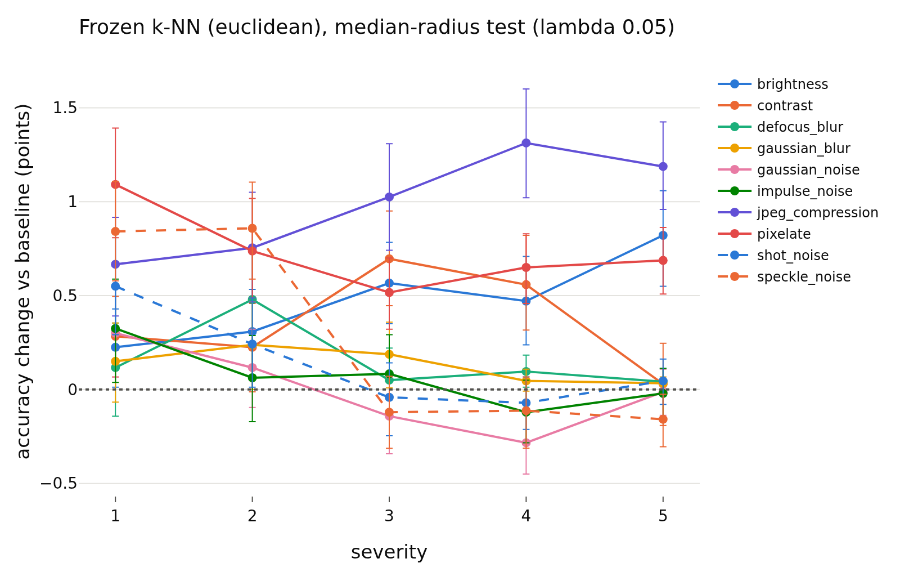

# radius_usage / shift: is the radius used under distribution shift? (follow-up to E1)

**Status: pre-registration committed before any result of this study was computed. Results, interpretation and the full header are added below this section after the runs.**

h is not analyzed; LeJEPA's product is z.

## Pre-registration (written and committed before the analysis jobs were submitted)

Claim under test: the embedding radius `||z||` is a nuisance parameter. E1 (`research_notes/radius_randomization/`) found how readers on *clean* STL-10 use it; here the radius is tested where it plausibly could matter: corrupted test images and out-of-distribution images. Only z, only the un-augmented center view, runs `radius_marginal_lam{0.02,0.05,0.1}_s{0,1,2}` (`last.pt`), bank = clean STL-10 `train`.

### Part 1: classification of corrupted STL-10-C test images

- Test images: STL-10-C center views (10 vendored corruptions x 5 severities of the 8000 STL-10 `test` images). The 17-corruption flag is out of scope.
- Readers: Euclidean k-NN (k = 20), logistic linear probe, one-hidden-layer MLP (weight decay chosen once on a validation split of the clean bank, as in E1). Cosine k-NN is dropped (radius-invariant by construction).
- Conditions on the corrupted test embeddings, within each (corruption, severity) cell: `baseline`, `permute` (radius permuted across the cell's images), `residual` (log-radius = clean-fitted direction-predicted part + permuted residual), `constant` (unit norm).
- Protocols: `frozen` (reader fitted on the clean unmodified bank; primary) and `retrain` (reader fitted on the bank with the same type of modification; for `constant`, unit-norm on both bank and test).
- Statistic: accuracy change of each condition against the baseline on the *same* corrupted test images, paired bootstrap over test images within each seed (1000 resamples), mean over the three seeds; reported per cell, per corruption (mean over severities, same resample so paired) and over all corruptions.
- Equivalence margin: **0.5 accuracy points** (identical to E1, `eval.equivalence_margin`, `shift.EQUIVALENCE_MARGIN`): `equivalent` iff the 90% CI lies inside (-0.5, +0.5); `different` iff not equivalent and the 95% CI excludes 0; otherwise `inconclusive`.
- Descriptive link to E6 (`research_notes/radius_transfer/`): per corruption, the center-view log-radius shift, the mean residual of the clean-fitted direction -> log-radius map, and the Spearman correlation over the 50 cells of the radius shift with the accuracy change (no p-value: cells share images).
- Reading rule: if `constant` (frozen) gains accuracy on a corruption (95% CI above 0 and not equivalent), the shifted radius hurts the frozen reader; if it loses, the shifted radius helps; `equivalent` everywhere means the radius is not used even where it shifts.

### Part 2: OOD detection

- ID: STL-10 `test` (8000); OOD: DTD `test` and SVHN `test`. Scores, all oriented higher = more OOD: (a) raw radius `||z||`; (b) radius deviation `|log r - mu| / sd` (mu, sd from the clean bank; orientation-free, unsupervised); (c) k-NN distance (k = 20 to the bank) on normalized z (direction only); (d) k-NN distance on raw z; (e) combination: bank-standardized (c) + bank-standardized (b), equal weights, no OOD data used to build it; (f) optimistic upper bound: (c) + w x standardized signed log-radius with the best w of {-4, -2, -1, -0.5, -0.25, 0, 0.25, 0.5, 1, 2, 4} chosen on the evaluation data (inside each bootstrap replicate).
- Metrics: AUROC (OOD positive) and FPR@95TPR (ID positive: threshold keeps 95% of ID images, FPR = fraction of OOD kept), 95% bootstrap CIs resampling ID and OOD images separately (paired across scores), mean over the three seeds.
- Controls analogous to E1: radius permuted across the *pooled* query set (ID test + OOD set) with bank radii permuted within the bank (5 repeats): k-NN on raw z, radius deviation, and the combination, all with permuted radii. The constant-radius control is score (c) itself. No residual-shuffle control (the clean direction -> radius map is not defined for off-support OOD images).
- **Criterion for "radius adds information" (fixed now): the lower end of the 95% paired bootstrap CI of AUROC(e) - AUROC(c) exceeds +0.01 AUROC**, for a given OOD set and lambda. `does not add (equivalent)` iff the 90% CI of that difference lies inside (-0.01, +0.01) (margin 0.01 AUROC, `ood_radius.OOD_AUROC_MARGIN`); `worse` iff the upper end of the 95% CI is below -0.01; else `inconclusive`. Justification: 0.01 AUROC is the smallest difference regarded as practically meaningful for an OOD score (one AUROC point), far above the bootstrap noise at 8000 + 1880 / 26032 images, and the same order as the 0.5-point accuracy margin of E1. The same rule is applied to (f) - (c) as an upper-bound check.
- **Criterion for "the radius alone is informative" (fixed now): the 95% CI of its AUROC lies entirely outside [0.45, 0.55]** (`ood_radius.RADIUS_NULL_BAND` = 0.05); `not informative` iff entirely inside; else `inconclusive`.
- Reading rule, stated before looking: if the radius alone is informative or the combination adds information, the radius carries OOD information beyond the direction and this is a counterexample to the nuisance claim for OOD detection, and will be reported as such.

### Code

`lejepa_norm.eval.shift` (Part 1), `lejepa_norm.eval.ood_radius` (Part 2), `lejepa_norm.eval.usage_shift` (driver), `apps/analyze.py --shift-unit` / `--shift PREFIX`. Tests: `tests/test_usage_shift.py`.

---

# Results and interpretation (added after the runs)

- **Branch / version:** `radius-usage-shift` @ `2989a9a` (code; this note and the three `shift_lam*.md` committed after). Pre-registration commit: `1db2b6a`.
- **Run datetime (UTC):** 2026-10-25, unit jobs 20:23Z to 21:20Z, aggregation 21:35Z.
- **Commands:** exact commands and job ids are at the top of each `shift_lam{0.02,0.05,0.1}.md` (per-run `--shift-unit` jobs, then `python apps/analyze.py --config configs/base.yaml --shift radius_marginal --note radius_usage/shift.md`). All tables are generated into those three notes; the numbers quoted here are read from them.
- **Datasets / backbone:** links in the per-lambda notes (STL-10, STL-10-C built locally, DTD, SVHN; ResNet-18 from scratch, Variant A, nine runs lambda in {0.02, 0.05, 0.1} x seeds {0, 1, 2}).

h is not analyzed; LeJEPA's product is z.

## Deviations from the pre-registration (both post hoc, labeled in the notes)

1. **Scale-matched constant radius.** The pre-registered `constant` condition (unit norm) collapses *frozen* readers to near chance on corrupted images (k-NN / linear -25 to -26 points, MLP -14 to -20, all three lambdas) for the same reason as in E1 on clean images: unit-norm features are about 16x smaller than any the readers were fitted on. That is a scale mismatch, not information in the radius. After seeing it, `constant radius (bank median)` (same direction, every radius set to the median bank radius) was added and is the condition used to answer "does normalizing recover accuracy". The unit-norm results stay in the notes. The classification units were recomputed (jobs 2246400 to 2246409).
2. **A post-hoc OOD score**, `direction + low radius (w = -1)`, added after the radius-alone AUROC came out below 0.5 (OOD images have the *smaller* radius). It is exploratory; the pre-registered verdicts use only the pre-registered scores.

## Part 1: corrupted STL-10-C, readers fitted on clean STL-10

Mean accuracy change over the 10 corruptions and 5 severities, in points, versus the unmodified corrupted embeddings (paired bootstrap over test images, mean of 3 seeds; verdict at the 0.5-point margin; lambda 0.02 / 0.05 / 0.1). Baseline accuracies on corrupted data are about 37 / 37 / 38 percent (k-NN / linear / MLP) against 78.7 / 81.8 / 81.6 clean at lambda 0.05. Positive = removing or randomizing the radius of the corrupted images helps.

| condition | k-NN | linear | MLP |
|---|---|---|---|
| frozen, permute radius within cell | -0.03 / +0.07 / +0.06 (all equivalent) | -0.17 / -0.07 / -0.00 (equivalent) | +0.01 / +0.00 / +0.01 (equivalent) |
| frozen, residual-only shuffle | +0.01 / -0.01 / +0.02 (equivalent) | -0.04 / -0.02 / -0.00 (equivalent) | -0.02 / +0.01 / +0.00 (equivalent) |
| frozen, constant radius, scale-matched | +0.40 / +0.33 / +0.24 (equivalent) | +0.20 / +0.28 / +0.25 (equivalent) | +0.16 / +0.10 / +0.09 (equivalent) |
| frozen, constant radius, unit norm | -25.5 / -25.6 / -25.7 (different) | -26.3 / -26.1 / -25.2 (different) | -19.5 / -16.2 / -13.9 (different) |
| retrain, permute | +0.61 / +0.68 / +0.54 (different) | +0.13 / +0.27 / +0.30 (equivalent) | +0.05 / +0.11 / +0.34 (equivalent) |
| retrain, residual-only | -0.00 / -0.09 / +0.00 (equivalent) | +0.02 / -0.06 / +0.07 (equivalent) | +0.08 / -0.05 / +0.11 (equivalent) |
| retrain, constant (unit = scale-matched) | +0.62 / +0.64 / +0.54 (different) | +0.36 / +0.32 / +0.33 (equivalent) | +0.09 / +0.23 / +0.39 (equivalent) |

(90% CIs and per-corruption and per-cell rows with all verdicts are in the three notes.)

Per corruption (30 corruption x reader cells per protocol and lambda): permuting the radius of the corrupted test images is equivalent to the baseline in 29/30, 30/30 and 30/30 cells for the frozen readers (the exception is the linear probe on JPEG at lambda 0.02, -0.78, the only decrease anywhere); the residual-only shuffle is equivalent in 30/30 in every lambda and protocol; the scale-matched constant is not equivalent (always a gain) in 7, 5 and 5 of 30 cells (frozen) and 10, 12 and 14 of 30 (retrain). The largest gains are k-NN on JPEG and pixelate (+0.5 to +1.3 frozen, up to +2.1 retrained), then speckle and shot noise for the linear probe (+0.5 to +0.9). No cell loses more than 0.8 points.

Figure (lambda 0.05, frozen k-NN, scale-matched constant, change per corruption and severity; the other readers, lambdas and the mean over corruptions per condition are in the per-lambda notes):

**Relation to E6 (radius transfer).** The center-view log-radius falls under every corruption (mean paired shift -0.04 for brightness and contrast to -0.19 for JPEG at lambda 0.05), and the clean-fitted direction -> radius map over-predicts it for blur, noise and JPEG (clean-map residual -0.09 defocus blur, -0.08 Gaussian blur, -0.06 JPEG, -0.04 contrast): the E6 finding, reproduced here on the center view and for all lambda. Across the 50 cells, the larger the (negative) radius shift, the larger the gain from the scale-matched normalization (Spearman -0.49 k-NN, -0.22 linear, -0.37 MLP at lambda 0.05; descriptive, cells share images), so a shrunken radius costs the readers something, but the effect is small (a few tenths of a point on average) and unevenly distributed: the corruptions whose radius E6 finds least explained by the direction (blur, noise) gain least (up to 0.5 points), the largest gains are on JPEG and pixelate. Reading: the shifted radius hurts frozen readers slightly and never helps; it is not carrying class evidence the readers use (permuting it leaves them unchanged), and removing it recovers at most about one accuracy point of a 20 to 60 point corruption loss. This extends the clean-data result of E1 (radius is a nuisance for classification) to corrupted data.

## Part 2: OOD detection, STL-10 test vs DTD / SVHN

AUROC (OOD positive; seed means; 95% CIs, half-widths about 0.01 or less, are in the notes). Lambda 0.02 / 0.05 / 0.1:

| score | DTD | SVHN |
|---|---|---|
| radius, raw (high = OOD) | 0.334 / 0.340 / 0.352 | 0.164 / 0.218 / 0.240 |
| radius deviation (two-sided), lambda 0.05 | 0.535 (not informative) | 0.646 (informative) |
| kNN, direction only | 0.903 / 0.901 / 0.899 | 0.547 / 0.580 / 0.596 |
| kNN, raw z | 0.895 / 0.884 / 0.871 | 0.469 / 0.500 / 0.510 |
| direction + radius deviation (pre-registered combination) | 0.811 / 0.795 / 0.784 | 0.668 / 0.637 / 0.636 |
| direction + signed log-radius, best weight (optimistic) | 0.916 / 0.911 / 0.905 | 0.796 / 0.752 / 0.738 |
| control: raw kNN with radius permuted, lambda 0.05 | 0.843 | 0.557 |
| control: radius deviation of permuted radius, lambda 0.05 | 0.506 | 0.498 |

**Pre-registered verdicts.**

- *The radius alone is informative* (95% CI of the AUROC outside [0.45, 0.55]): yes, for DTD and SVHN at all three lambdas, for the raw radius. The AUROC is below 0.5: OOD images have the smaller radius (equivalently AUROC 0.65 to 0.67 for DTD and 0.76 to 0.84 for SVHN with the orientation reversed; the orientation is read from the data, the band criterion itself is two-sided). The orientation-free deviation score is informative for SVHN (0.65) but not for DTD (0.54). FPR@95TPR of the raw radius is reported in the notes only for the "high = OOD" orientation, which is the wrong direction (FPR about 1), so it says nothing about the reversed score.
- *Radius adds information* (lower 95% bound of AUROC(direction + radius deviation) minus AUROC(direction) above +0.01): SVHN yes at all three lambdas (+0.120 / +0.058 / +0.040). DTD no: the equal-weight combination is worse than the direction score (-0.092 / -0.106 / -0.115), because the symmetric deviation adds noise on top of a direction score that is already good (0.90). The permuted-radius control of the same combination is also below the direction score (DTD -0.105 / -0.122 / -0.133; SVHN -0.013 / -0.023 / -0.030), so the loss on DTD is the cost of adding a score that is not useful in this form, not a property of the radius.
- *Optimistic best weight on the signed log-radius* (upper bound; the chosen weight is -4, the edge of the grid, on SVHN in every seed and +0.25 on DTD): SVHN +0.249 / +0.173 / +0.143 (`adds information` by a wide margin); DTD +0.013 (`adds`) / +0.010 (`inconclusive`) / +0.006 (`does not add`): at most about one AUROC point and not robust across lambda.
- *Radius permutation control* (E1 analogue): permuting the radius over the pooled ID + OOD query set lowers raw-z kNN on DTD by 0.047 / 0.040 / 0.036 AUROC (verdict `radius adds information` for that comparison) but raises it on SVHN (+0.058 / +0.057 / +0.063; direction-only, 0.55 to 0.60, beats raw kNN at 0.47 to 0.51). On SVHN the raw radius entering the raw-z distance misleads a distance score (SVHN embeddings sit at a smaller radius and are therefore closer to the bank in raw distance), which is a different use of the radius than carrying OOD evidence. The radius-deviation control sits at 0.50 as it must.
- Post-hoc `direction + low radius (w = -1)`: SVHN +0.163 / +0.114 / +0.095 over direction (adds), DTD -0.084 / -0.094 / -0.104 (worse). On DTD the best weight is positive (+0.25) although the radius alone has AUROC 0.34: conditional on the direction the sign of the useful radius signal flips (the direction already predicts a small radius for those images, the redundancy of E1/E6), so "OOD images have a smaller radius" does not translate into a fixed-sign score on top of the direction.

**Honest reading.** For OOD detection the radius is not a nuisance on SVHN: alone it gives AUROC 0.76 to 0.84 (oriented), against 0.55 to 0.60 for the direction (k-NN on unit z), and adding it to the direction score raises AUROC by 0.04 to 0.12 with the pre-registered equal-weight rule and by 0.14 to 0.25 with an optimistic weight. This is a counterexample to the claim that the radius carries no information, for an OOD set whose direction score is weak. On DTD the direction score is already good (0.90) and the radius adds at most about 0.01 (one AUROC point; `adds`, `inconclusive`, `does not add` across lambda), while the pre-registered equal-weight combination is worse than direction alone: there the radius is close to redundant. Together with Part 1: the radius is a nuisance for classification (clean E1, corrupted here) and carries real OOD information, partly independent of the direction, for at least one OOD set.

## Caveats

- Only z, only center views, one architecture and recipe (nine runs). Intervals resample images and average three seeds; seed variability beyond that mean is not modeled. The three lambdas agree in sign and mostly in verdict.
- The OOD combination is a single simple equal-weight unsupervised rule fixed in advance; the optimistic weight uses OOD labels on the evaluation data. How much of the radius information a better combiner or a trained detector would use is untested. The SVHN radius effect may reflect a low-level difference (small, low-texture digit crops give a smaller radius) rather than semantic novelty; no control for image statistics was run.
- Corruptions: 10 of the 17 types (the vendored set; the 17-corruption flag is out of scope); the corruption-level intervals share the same 8000 test images across severities and corruptions.
- The residual condition uses the clean-fitted map applied to corrupted directions, the map E6 says does not transfer; its residual therefore also contains the corruption's systematic radius shift, shuffled within the cell.
- Frozen unit-norm `constant` is a scale-mismatch artifact (see deviations). The scale-matched variant fixes the radius at the bank median for all test images; for Euclidean k-NN it still compares those test points with bank points that keep their own varying radii.

## Next steps

- A combiner fitted on held-out ID data plus synthetic OOD samples (or a logistic regression on `[direction score, log-radius, residual log-radius]` evaluated on a disjoint OOD split), to bound how much of the SVHN radius information a practical detector can use.
- Check the SVHN effect against image statistics (regress the radius on pixel-level contrast and colorfulness) and on a third OOD set.
