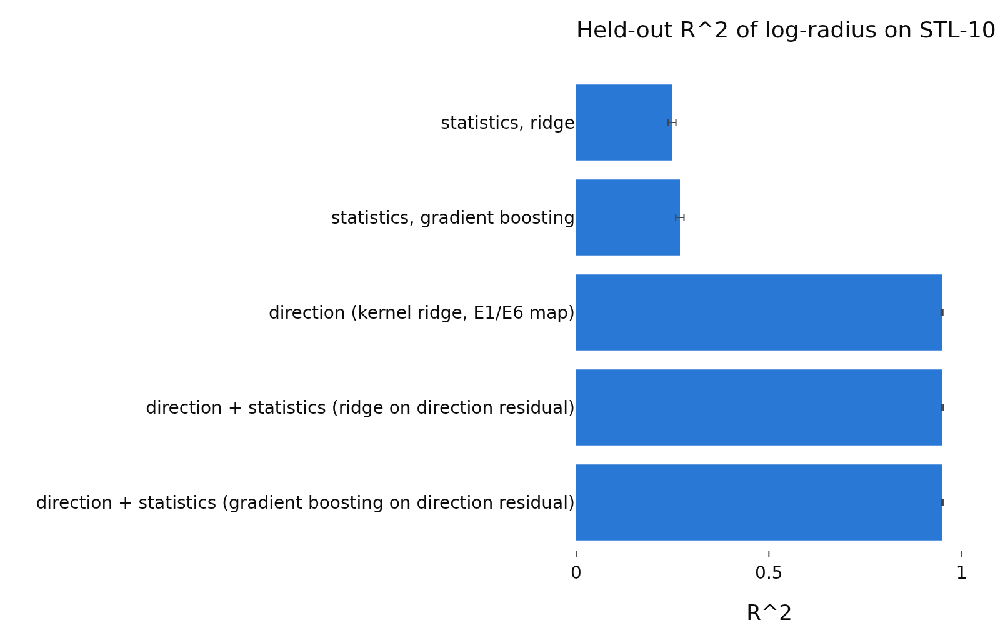
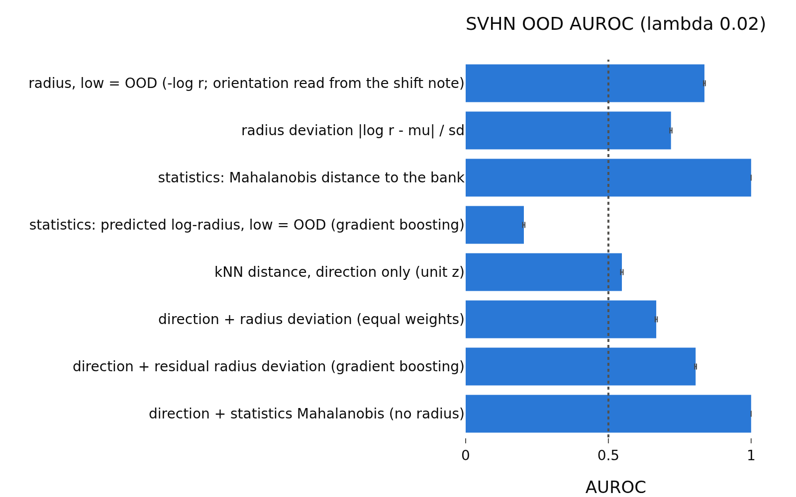
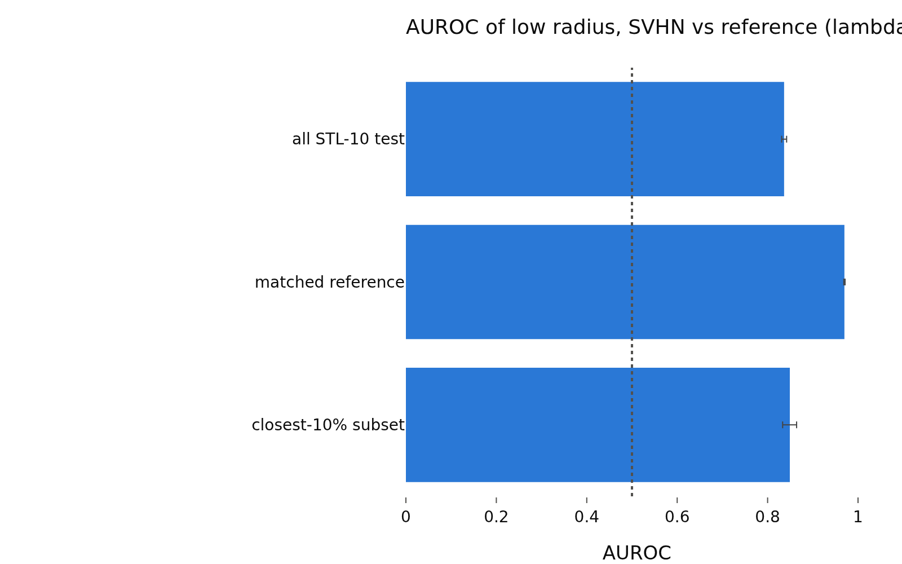

# svhn_control_lam0.02
- **Branch / version:** radius-usage-svhn-control @ a1e6f73 (analysis code; this note is committed right after)
- **Run datetime (UTC):** 2026-10-26T01:47:00Z
- **Command(s):**
  `sbatch ... --wrap "python apps/analyze.py --config configs/base.yaml --svhn-control radius_marginal --svhn-control-stats"` (job 2247653, CPU, 4 cpus);
  `sbatch ... --wrap "python apps/analyze.py --config configs/base.yaml --svhn-control radius_marginal --svhn-control-run radius_marginal_lam<L>_s<S>"` for L in 0.02 0.05 0.1, S in 0 1 2 (jobs 2247794-2247802, CPU, 4 cpus, 24G);
  `sbatch ... --wrap "python apps/analyze.py --config configs/base.yaml --svhn-control radius_marginal --note radius_usage/svhn_control.md"` (job 2247980, CPU). All with `PYTHONPATH=<worktree>/src`, `--export=ALL`. No GPU used (z dumps of the existing checkpoints only).
- **Datasets:** STL-10 ([canonical](https://cs.stanford.edu/~acoates/stl10/), [HF](https://huggingface.co/datasets/tanganke/stl10); the HF copy is not what was used, the prepared arrays come from the canonical source), DTD ([canonical](https://www.robots.ox.ac.uk/~vgg/data/dtd/), [HF](https://huggingface.co/datasets/tanganke/dtd)), SVHN ([canonical](http://ufldl.stanford.edu/housenumbers/), [HF](https://huggingface.co/datasets/ufldl-stanford/svhn)); which source was used: canonical, prepared by `apps/prepare_data.py`.
- **Backbone:** ResNet-18 (torchvision architecture, trained from scratch by this repo; [HF reference](https://huggingface.co/timm/resnet18.a1_in1k) for the architecture only).

h is not analyzed; LeJEPA's product is z.

## Question

Is the SVHN OOD signal of the radius (lambda 0.02) explained by low-level image statistics? Pre-registration and definitions: `svhn_control.md`; summary over lambdas and interpretation: `svhn_control.md`.

## Setup (deviations from the base config)

None beyond `svhn_control.md` (center views, z only, 3 seeds averaged, 1000 bootstrap replicates).

## Results

<!-- BEGIN GENERATED: analyze.svhn_control_inputs -->
### Inputs

Runs aggregated: `radius_marginal_lam0.02_s0`, `radius_marginal_lam0.02_s1`, `radius_marginal_lam0.02_s2`.

Unit files missing for this lambda:

None.
<!-- END GENERATED: analyze.svhn_control_inputs -->

<!-- BEGIN GENERATED: analyze.svhn_control_r2 -->
### (a) Held-out R^2 of the ID log-radius (fit on STL-10 train, evaluated on STL-10 test)

Seed means with 95% percentile intervals (1000 image bootstrap replicates, ID and OOD images resampled separately, paired across scores). Rules and margins: docstring of `lejepa_norm.eval.svhn_control`.

| lambda | predictor | R^2 [95% CI] | explains log-radius materially (lower bound > 0.05) |
|---|---|---|---|
| 0.02 | statistics, ridge | 0.249 [0.238, 0.259] | yes |
| 0.02 | statistics, gradient boosting | 0.269 [0.258, 0.280] | yes |
| 0.02 | direction (kernel ridge, E1/E6 map) | 0.949 [0.947, 0.951] |  |
| 0.02 | direction + statistics (ridge on direction residual) | 0.950 [0.947, 0.952] |  |
| 0.02 | direction + statistics (gradient boosting on direction residual) | 0.950 [0.947, 0.952] |  |

| lambda | comparison | R^2 difference [95% CI] | verdict (margin 0.01) |
|---|---|---|---|
| 0.02 | statistics (gradient boosting) - direction | -0.680 [-0.690, -0.669] | B higher |
| 0.02 | statistics (ridge) - direction | -0.700 [-0.710, -0.690] | B higher |
| 0.02 | direction + statistics (GB) - direction  (increment of statistics) | 0.000 [0.000, 0.001] | equivalent |
| 0.02 | direction + statistics (ridge) - direction  (increment of statistics) | 0.001 [0.001, 0.001] | equivalent |
| 0.02 | R^2(statistics, GB) / R^2(direction) | 0.284 [0.272, 0.295] | descriptive |
<!-- END GENERATED: analyze.svhn_control_r2 -->

<!-- BEGIN GENERATED: analyze.svhn_control_auroc -->
### (b) AUROC of each score (higher = more OOD)

Seed means with 95% percentile intervals (1000 image bootstrap replicates, ID and OOD images resampled separately, paired across scores). Rules and margins: docstring of `lejepa_norm.eval.svhn_control`.

| lambda | OOD set | score | AUROC [95% CI] | alone: reading |
|---|---|---|---|---|
| 0.02 | dtd_test | radius \|\|z\|\| (high = OOD) | 0.334 [0.327, 0.342] | informative |
| 0.02 | dtd_test | radius deviation \|log r - mu\| / sd | 0.538 [0.531, 0.547] | not informative |
| 0.02 | dtd_test | radius, low = OOD (-log r; orientation read from the shift note) | 0.666 [0.658, 0.673] |  |
| 0.02 | dtd_test | kNN distance, direction only (unit z) | 0.903 [0.899, 0.907] |  |
| 0.02 | dtd_test | direction + radius deviation (equal weights) | 0.811 [0.806, 0.816] |  |
| 0.02 | dtd_test | direction + signed log-radius, best weight (optimistic) \| w=-1 | 0.819 [0.814, 0.824] |  |
| 0.02 | dtd_test | statistics: Mahalanobis distance to the bank | 0.841 [0.836, 0.847] | informative |
| 0.02 | dtd_test | statistics: predicted log-radius, low = OOD (gradient boosting) | 0.491 [0.483, 0.499] |  |
| 0.02 | dtd_test | residual radius deviation given statistics (gradient boosting) | 0.590 [0.582, 0.599] | informative |
| 0.02 | dtd_test | residual radius deviation given statistics (ridge) | 0.552 [0.543, 0.560] |  |
| 0.02 | dtd_test | residual log-radius given statistics, low = OOD (gradient boosting) | 0.676 [0.668, 0.683] | informative |
| 0.02 | dtd_test | direction + residual radius deviation (gradient boosting) | 0.821 [0.816, 0.826] |  |
| 0.02 | dtd_test | direction + residual radius deviation (ridge) | 0.810 [0.805, 0.816] |  |
| 0.02 | dtd_test | post hoc: direction + low residual radius (w = -1, gradient boosting) | 0.826 [0.821, 0.831] |  |
| 0.02 | dtd_test | direction + statistics Mahalanobis (no radius) | 0.935 [0.931, 0.938] |  |
| 0.02 | dtd_test | direction + statistics-predicted low radius (no radius) | 0.778 [0.772, 0.784] |  |
| 0.02 | dtd_test | direction + statistics Mahalanobis + radius deviation | 0.897 [0.893, 0.901] |  |
| 0.02 | svhn_test | radius \|\|z\|\| (high = OOD) | 0.164 [0.161, 0.167] | informative |
| 0.02 | svhn_test | radius deviation \|log r - mu\| / sd | 0.719 [0.715, 0.723] | informative |
| 0.02 | svhn_test | radius, low = OOD (-log r; orientation read from the shift note) | 0.836 [0.833, 0.839] |  |
| 0.02 | svhn_test | kNN distance, direction only (unit z) | 0.547 [0.543, 0.552] |  |
| 0.02 | svhn_test | direction + radius deviation (equal weights) | 0.668 [0.664, 0.671] |  |
| 0.02 | svhn_test | direction + signed log-radius, best weight (optimistic) \| w=-1 | 0.710 [0.706, 0.714] |  |
| 0.02 | svhn_test | statistics: Mahalanobis distance to the bank | 1.000 [1.000, 1.000] | informative |
| 0.02 | svhn_test | statistics: predicted log-radius, low = OOD (gradient boosting) | 0.204 [0.200, 0.207] |  |
| 0.02 | svhn_test | residual radius deviation given statistics (gradient boosting) | 0.866 [0.863, 0.868] | informative |
| 0.02 | svhn_test | residual radius deviation given statistics (ridge) | 0.640 [0.636, 0.644] |  |
| 0.02 | svhn_test | residual log-radius given statistics, low = OOD (gradient boosting) | 0.915 [0.913, 0.917] | informative |
| 0.02 | svhn_test | direction + residual radius deviation (gradient boosting) | 0.806 [0.803, 0.809] |  |
| 0.02 | svhn_test | direction + residual radius deviation (ridge) | 0.701 [0.697, 0.706] |  |
| 0.02 | svhn_test | post hoc: direction + low residual radius (w = -1, gradient boosting) | 0.812 [0.809, 0.815] |  |
| 0.02 | svhn_test | direction + statistics Mahalanobis (no radius) | 1.000 [1.000, 1.000] |  |
| 0.02 | svhn_test | direction + statistics-predicted low radius (no radius) | 0.335 [0.331, 0.339] |  |
| 0.02 | svhn_test | direction + statistics Mahalanobis + radius deviation | 1.000 [1.000, 1.000] |  |
<!-- END GENERATED: analyze.svhn_control_auroc -->

<!-- BEGIN GENERATED: analyze.svhn_control_compare -->
### (b)-(d) Pre-registered AUROC differences

Seed means with 95% percentile intervals (1000 image bootstrap replicates, ID and OOD images resampled separately, paired across scores). Rules and margins: docstring of `lejepa_norm.eval.svhn_control`. Margin 0.01 AUROC: `A higher` iff the lower 95% bound exceeds the margin, `equivalent` iff the 90% interval lies inside (-0.01, +0.01), `B higher` iff the upper 95% bound is below -0.01.

| lambda | OOD set | comparison (A - B) | AUROC difference [95% CI] | 90% CI | verdict |
|---|---|---|---|---|---|
| 0.02 | dtd_test | (b) statistics Mahalanobis - radius deviation | 0.303 [0.292, 0.313] | [+0.294, +0.311] | A higher |
| 0.02 | dtd_test | (b) statistics-predicted low radius - low radius | -0.175 [-0.184, -0.165] | [-0.183, -0.167] | B higher |
| 0.02 | dtd_test | (b) statistics Mahalanobis - direction only | -0.062 [-0.068, -0.055] | [-0.067, -0.056] | B higher |
| 0.02 | dtd_test | (b) low radius - direction only | -0.237 [-0.245, -0.231] | [-0.243, -0.231] | B higher |
| 0.02 | dtd_test | (c) reference: direction + radius deviation - direction | -0.092 [-0.095, -0.088] | [-0.095, -0.089] | B higher |
| 0.02 | dtd_test | (c) PRIMARY: direction + residual deviation (GB) - direction | -0.083 [-0.086, -0.079] | [-0.086, -0.079] | B higher |
| 0.02 | dtd_test | (c) direction + residual deviation (ridge) - direction | -0.093 [-0.097, -0.089] | [-0.096, -0.090] | B higher |
| 0.02 | dtd_test | (c) direction + residual deviation (GB) - direction + radius deviation | 0.009 [0.007, 0.012] | [+0.007, +0.012] | inconclusive |
| 0.02 | dtd_test | (c) post hoc: direction + low residual - direction | -0.077 [-0.081, -0.073] | [-0.080, -0.074] | B higher |
| 0.02 | dtd_test | (d) direction + statistics - direction | 0.032 [0.028, 0.035] | [+0.029, +0.035] | A higher |
| 0.02 | dtd_test | (d) PRIMARY: direction + radius deviation - direction + statistics | -0.124 [-0.129, -0.119] | [-0.128, -0.119] | B higher |
| 0.02 | dtd_test | (d) post hoc: direction + low radius - direction + statistics-predicted low radius | 0.041 [0.036, 0.047] | [+0.037, +0.045] | A higher |
| 0.02 | dtd_test | (d) radius deviation on top of direction + statistics | -0.038 [-0.040, -0.035] | [-0.039, -0.035] | B higher |
| 0.02 | svhn_test | (b) statistics Mahalanobis - radius deviation | 0.281 [0.277, 0.285] | [+0.278, +0.284] | A higher |
| 0.02 | svhn_test | (b) statistics-predicted low radius - low radius | -0.633 [-0.637, -0.628] | [-0.636, -0.629] | B higher |
| 0.02 | svhn_test | (b) statistics Mahalanobis - direction only | 0.453 [0.448, 0.457] | [+0.449, +0.456] | A higher |
| 0.02 | svhn_test | (b) low radius - direction only | 0.289 [0.286, 0.292] | [+0.286, +0.292] | A higher |
| 0.02 | svhn_test | (c) reference: direction + radius deviation - direction | 0.120 [0.118, 0.123] | [+0.118, +0.123] | A higher |
| 0.02 | svhn_test | (c) PRIMARY: direction + residual deviation (GB) - direction | 0.258 [0.255, 0.261] | [+0.256, +0.261] | A higher |
| 0.02 | svhn_test | (c) direction + residual deviation (ridge) - direction | 0.154 [0.150, 0.157] | [+0.151, +0.157] | A higher |
| 0.02 | svhn_test | (c) direction + residual deviation (GB) - direction + radius deviation | 0.138 [0.136, 0.140] | [+0.136, +0.139] | A higher |
| 0.02 | svhn_test | (c) post hoc: direction + low residual - direction | 0.265 [0.262, 0.268] | [+0.263, +0.267] | A higher |
| 0.02 | svhn_test | (d) direction + statistics - direction | 0.453 [0.448, 0.457] | [+0.449, +0.456] | A higher |
| 0.02 | svhn_test | (d) PRIMARY: direction + radius deviation - direction + statistics | -0.332 [-0.336, -0.329] | [-0.335, -0.329] | B higher |
| 0.02 | svhn_test | (d) post hoc: direction + low radius - direction + statistics-predicted low radius | 0.375 [0.372, 0.378] | [+0.372, +0.378] | A higher |
| 0.02 | svhn_test | (d) radius deviation on top of direction + statistics | -0.000 [-0.000, -0.000] | [-0.000, -0.000] | equivalent |
<!-- END GENERATED: analyze.svhn_control_compare -->

<!-- BEGIN GENERATED: analyze.svhn_control_matched -->
### Matched control

Each OOD image is matched to its nearest STL-10 test image in the (mean luminance, contrast, log Laplacian variance) space.

| lambda | OOD set | log-radius gap OOD - STL-10 [95% CI] | gap after matching [95% CI] | fraction of gap closed [95% CI] | AUROC low radius vs all STL-10 | vs matched reference | matched reading | vs closest-10% subset |
|---|---|---|---|---|---|---|---|---|
| 0.02 | dtd_test | -0.112 [-0.119, -0.105] | -0.152 [-0.163, -0.141] | -0.357 [-0.440, -0.274] | 0.666 [0.655, 0.677] | 0.723 [0.708, 0.737] | informative | 0.680 [0.657, 0.700] |
| 0.02 | svhn_test | -0.254 [-0.256, -0.253] | -0.293 [-0.295, -0.292] | -0.154 [-0.156, -0.153] | 0.836 [0.831, 0.842] | 0.970 [0.969, 0.971] | informative | 0.849 [0.833, 0.864] |

Balance of the matching statistics:

| lambda | OOD set | statistic (bank-standardized, log where applicable) | STL-10 test | closest 10% subset | matched reference (weighted) | OOD set mean | std. mean difference, matched - OOD | std. mean difference, all STL-10 - OOD |
|---|---|---|---|---|---|---|---|---|
| 0.02 | dtd_test | lum_mean | -0.001217 | 0.06919 | 0.3664 | 0.4155 | -0.03303 | -0.2799 |
| 0.02 | dtd_test | lum_std | 0.003567 | -0.5002 | -0.9427 | -1.038 | 0.08149 | 0.887 |
| 0.02 | dtd_test | laplacian_var | -0.001182 | 0.1063 | -0.1459 | -0.09832 | -0.02496 | 0.05099 |
| 0.02 | dtd_test | match counts | unique matches 1129 | subset size 800 | max multiplicity 23 |  |  |  |
| 0.02 | svhn_test | lum_mean | -0.001217 | 0.311 | 1.255 | 0.1462 | 0.6943 | -0.09228 |
| 0.02 | svhn_test | lum_std | 0.003567 | -0.4106 | -0.6555 | -1.544 | 1.126 | 1.961 |
| 0.02 | svhn_test | laplacian_var | -0.001182 | -1.843 | -6.182 | -10.26 | 3.011 | 7.574 |
| 0.02 | svhn_test | match counts | unique matches 16 | subset size 800 | max multiplicity 23901 |  |  |  |
<!-- END GENERATED: analyze.svhn_control_matched -->

<!-- BEGIN GENERATED: analyze.svhn_control_overall -->
### Overall reading (pre-registered rule)

| lambda | OOD set | (c) residual combination vs direction | (d) radius combination vs statistics combination | matched AUROC reading | AUROC gain of shift combination | AUROC gain after removing statistics | fraction of gain retained | overall (pre-registered rule) |
|---|---|---|---|---|---|---|---|---|
| 0.02 | dtd_test | B higher | B higher | informative | -0.092 [-0.095, -0.088] | -0.083 [-0.086, -0.079] | 0.8975 | partly explained |
| 0.02 | svhn_test | A higher | B higher | informative | 0.120 [0.118, 0.123] | 0.258 [0.255, 0.261] | 2.146 | partly explained |
<!-- END GENERATED: analyze.svhn_control_overall -->

<!-- BEGIN GENERATED: analyze.svhn_control_single -->
### Single statistics (descriptive, point estimates)

| lambda | OOD set | statistic | AUROC two-sided \|z\| | AUROC oriented by ID (low-radius direction) |
|---|---|---|---|---|
| 0.02 | dtd_test | lum_mean | 0.6314 | 0.4043 |
| 0.02 | dtd_test | lum_std | 0.6869 | 0.2378 |
| 0.02 | dtd_test | r_mean | 0.686 | 0.6481 |
| 0.02 | dtd_test | g_mean | 0.6318 | 0.434 |
| 0.02 | dtd_test | b_mean | 0.6207 | 0.4734 |
| 0.02 | dtd_test | r_std | 0.7078 | 0.2389 |
| 0.02 | dtd_test | g_std | 0.6796 | 0.2518 |
| 0.02 | dtd_test | b_std | 0.661 | 0.7523 |
| 0.02 | dtd_test | saturation | 0.6941 | 0.4937 |
| 0.02 | dtd_test | grad_energy | 0.6938 | 0.4691 |
| 0.02 | dtd_test | hf_fraction | 0.703 | 0.743 |
| 0.02 | dtd_test | laplacian_var | 0.6828 | 0.4958 |
| 0.02 | dtd_test | colorfulness | 0.6727 | 0.5744 |
| 0.02 | dtd_test | jpeg_bytes | 0.6323 | 0.5732 |
| 0.02 | dtd_test | png_bytes | 0.5796 | 0.5989 |
| 0.02 | svhn_test | lum_mean | 0.6707 | 0.4833 |
| 0.02 | svhn_test | lum_std | 0.8028 | 0.1131 |
| 0.02 | svhn_test | r_mean | 0.6454 | 0.4994 |
| 0.02 | svhn_test | g_mean | 0.6687 | 0.4906 |
| 0.02 | svhn_test | b_mean | 0.6523 | 0.4015 |
| 0.02 | svhn_test | r_std | 0.8287 | 0.09677 |
| 0.02 | svhn_test | g_std | 0.7931 | 0.1207 |
| 0.02 | svhn_test | b_std | 0.8196 | 0.905 |
| 0.02 | svhn_test | saturation | 0.6105 | 0.5616 |
| 0.02 | svhn_test | grad_energy | 0.9992 | 0.0006986 |
| 0.02 | svhn_test | hf_fraction | 0.995 | 0.002495 |
| 0.02 | svhn_test | laplacian_var | 1 | 1.565e-06 |
| 0.02 | svhn_test | colorfulness | 0.7305 | 0.8621 |
| 0.02 | svhn_test | jpeg_bytes | 0.996 | 0.003734 |
| 0.02 | svhn_test | png_bytes | 0.9968 | 0.003111 |
<!-- END GENERATED: analyze.svhn_control_single -->

<!-- BEGIN GENERATED: analyze.svhn_control_figures -->
### Figures

<!-- END GENERATED: analyze.svhn_control_figures -->

## Interpretation

See `svhn_control.md` (the SVHN statistics control is degenerate, see there).

## Next steps

See `svhn_control.md`.
