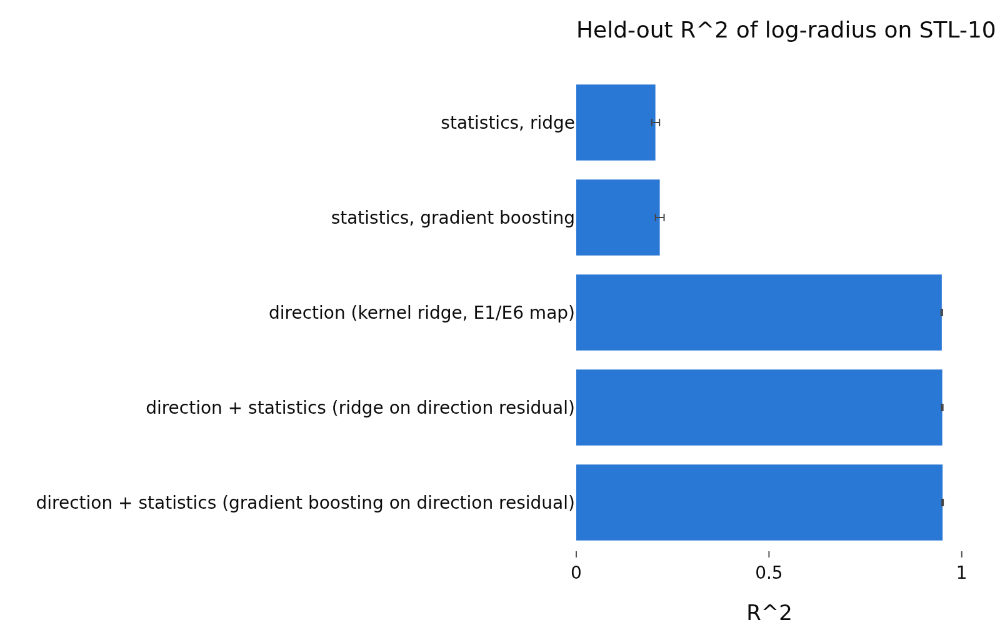
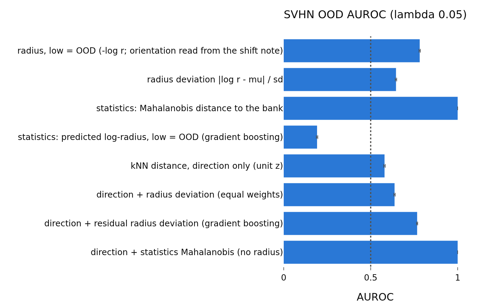
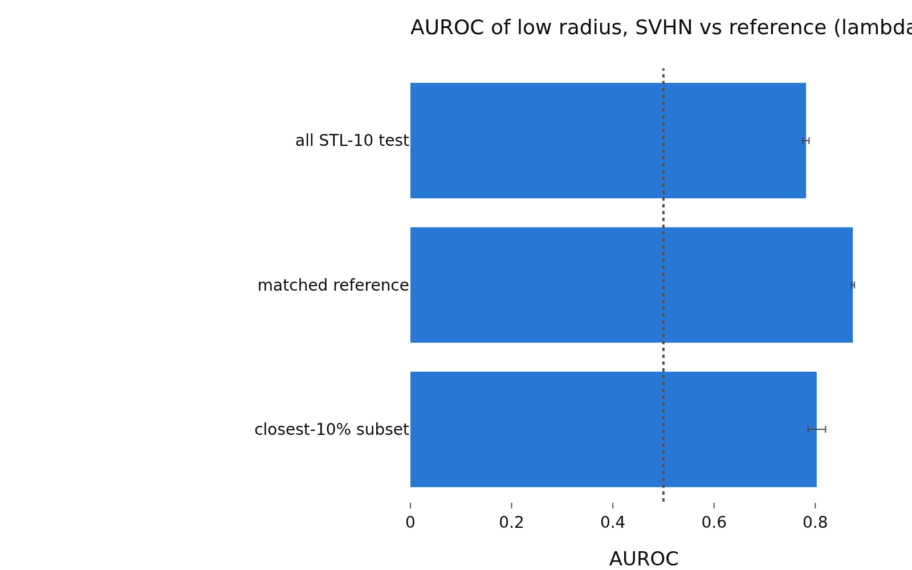

# svhn_control_lam0.05
- **Branch / version:** radius-usage-svhn-control @ a1e6f73 (analysis code; this note is committed right after)
- **Run datetime (UTC):** 2026-10-26T01:47:00Z
- **Command(s):**
  `sbatch ... --wrap "python apps/analyze.py --config configs/base.yaml --svhn-control radius_marginal --svhn-control-stats"` (job 2247653, CPU, 4 cpus);
  `sbatch ... --wrap "python apps/analyze.py --config configs/base.yaml --svhn-control radius_marginal --svhn-control-run radius_marginal_lam<L>_s<S>"` for L in 0.02 0.05 0.1, S in 0 1 2 (jobs 2247794-2247802, CPU, 4 cpus, 24G);
  `sbatch ... --wrap "python apps/analyze.py --config configs/base.yaml --svhn-control radius_marginal --note radius_usage/svhn_control.md"` (job 2247980, CPU). All with `PYTHONPATH=<worktree>/src`, `--export=ALL`. No GPU used (z dumps of the existing checkpoints only).
- **Datasets:** STL-10 ([canonical](https://cs.stanford.edu/~acoates/stl10/), [HF](https://huggingface.co/datasets/tanganke/stl10); the HF copy is not what was used, the prepared arrays come from the canonical source), DTD ([canonical](https://www.robots.ox.ac.uk/~vgg/data/dtd/), [HF](https://huggingface.co/datasets/tanganke/dtd)), SVHN ([canonical](http://ufldl.stanford.edu/housenumbers/), [HF](https://huggingface.co/datasets/ufldl-stanford/svhn)); which source was used: canonical, prepared by `apps/prepare_data.py`.
- **Backbone:** ResNet-18 (torchvision architecture, trained from scratch by this repo; [HF reference](https://huggingface.co/timm/resnet18.a1_in1k) for the architecture only).

h is not analyzed; LeJEPA's product is z.

## Question

Is the SVHN OOD signal of the radius (lambda 0.05) explained by low-level image statistics? Pre-registration and definitions: `svhn_control.md`; summary over lambdas and interpretation: `svhn_control.md`.

## Setup (deviations from the base config)

None beyond `svhn_control.md` (center views, z only, 3 seeds averaged, 1000 bootstrap replicates).

## Results

<!-- BEGIN GENERATED: analyze.svhn_control_inputs -->
### Inputs

Runs aggregated: `radius_marginal_lam0.05_s0`, `radius_marginal_lam0.05_s1`, `radius_marginal_lam0.05_s2`.

Unit files missing for this lambda:

None.
<!-- END GENERATED: analyze.svhn_control_inputs -->

<!-- BEGIN GENERATED: analyze.svhn_control_r2 -->
### (a) Held-out R^2 of the ID log-radius (fit on STL-10 train, evaluated on STL-10 test)

Seed means with 95% percentile intervals (1000 image bootstrap replicates, ID and OOD images resampled separately, paired across scores). Rules and margins: docstring of `lejepa_norm.eval.svhn_control`.

| lambda | predictor | R^2 [95% CI] | explains log-radius materially (lower bound > 0.05) |
|---|---|---|---|
| 0.05 | statistics, ridge | 0.205 [0.196, 0.216] | yes |
| 0.05 | statistics, gradient boosting | 0.217 [0.206, 0.228] | yes |
| 0.05 | direction (kernel ridge, E1/E6 map) | 0.948 [0.946, 0.950] |  |
| 0.05 | direction + statistics (ridge on direction residual) | 0.949 [0.948, 0.951] |  |
| 0.05 | direction + statistics (gradient boosting on direction residual) | 0.950 [0.949, 0.952] |  |

| lambda | comparison | R^2 difference [95% CI] | verdict (margin 0.01) |
|---|---|---|---|
| 0.05 | statistics (gradient boosting) - direction | -0.732 [-0.743, -0.721] | B higher |
| 0.05 | statistics (ridge) - direction | -0.743 [-0.752, -0.732] | B higher |
| 0.05 | direction + statistics (GB) - direction  (increment of statistics) | 0.002 [0.002, 0.002] | equivalent |
| 0.05 | direction + statistics (ridge) - direction  (increment of statistics) | 0.001 [0.001, 0.001] | equivalent |
| 0.05 | R^2(statistics, GB) / R^2(direction) | 0.228 [0.217, 0.240] | descriptive |
<!-- END GENERATED: analyze.svhn_control_r2 -->

<!-- BEGIN GENERATED: analyze.svhn_control_auroc -->
### (b) AUROC of each score (higher = more OOD)

Seed means with 95% percentile intervals (1000 image bootstrap replicates, ID and OOD images resampled separately, paired across scores). Rules and margins: docstring of `lejepa_norm.eval.svhn_control`.

| lambda | OOD set | score | AUROC [95% CI] | alone: reading |
|---|---|---|---|---|
| 0.05 | dtd_test | radius \|\|z\|\| (high = OOD) | 0.340 [0.333, 0.347] | informative |
| 0.05 | dtd_test | radius deviation \|log r - mu\| / sd | 0.535 [0.527, 0.543] | not informative |
| 0.05 | dtd_test | radius, low = OOD (-log r; orientation read from the shift note) | 0.660 [0.653, 0.667] |  |
| 0.05 | dtd_test | kNN distance, direction only (unit z) | 0.901 [0.897, 0.905] |  |
| 0.05 | dtd_test | direction + radius deviation (equal weights) | 0.795 [0.789, 0.800] |  |
| 0.05 | dtd_test | direction + signed log-radius, best weight (optimistic) \| w=-1 | 0.807 [0.802, 0.812] |  |
| 0.05 | dtd_test | statistics: Mahalanobis distance to the bank | 0.841 [0.836, 0.847] | informative |
| 0.05 | dtd_test | statistics: predicted log-radius, low = OOD (gradient boosting) | 0.482 [0.474, 0.490] |  |
| 0.05 | dtd_test | residual radius deviation given statistics (gradient boosting) | 0.578 [0.570, 0.586] | informative |
| 0.05 | dtd_test | residual radius deviation given statistics (ridge) | 0.529 [0.521, 0.537] |  |
| 0.05 | dtd_test | residual log-radius given statistics, low = OOD (gradient boosting) | 0.675 [0.667, 0.681] | informative |
| 0.05 | dtd_test | direction + residual radius deviation (gradient boosting) | 0.803 [0.798, 0.809] |  |
| 0.05 | dtd_test | direction + residual radius deviation (ridge) | 0.786 [0.781, 0.792] |  |
| 0.05 | dtd_test | post hoc: direction + low residual radius (w = -1, gradient boosting) | 0.818 [0.813, 0.823] |  |
| 0.05 | dtd_test | direction + statistics Mahalanobis (no radius) | 0.934 [0.931, 0.937] |  |
| 0.05 | dtd_test | direction + statistics-predicted low radius (no radius) | 0.753 [0.746, 0.759] |  |
| 0.05 | dtd_test | direction + statistics Mahalanobis + radius deviation | 0.897 [0.893, 0.900] |  |
| 0.05 | svhn_test | radius \|\|z\|\| (high = OOD) | 0.218 [0.214, 0.222] | informative |
| 0.05 | svhn_test | radius deviation \|log r - mu\| / sd | 0.646 [0.642, 0.650] | informative |
| 0.05 | svhn_test | radius, low = OOD (-log r; orientation read from the shift note) | 0.782 [0.778, 0.786] |  |
| 0.05 | svhn_test | kNN distance, direction only (unit z) | 0.580 [0.575, 0.584] |  |
| 0.05 | svhn_test | direction + radius deviation (equal weights) | 0.637 [0.634, 0.641] |  |
| 0.05 | svhn_test | direction + signed log-radius, best weight (optimistic) \| w=-1 | 0.693 [0.689, 0.697] |  |
| 0.05 | svhn_test | statistics: Mahalanobis distance to the bank | 1.000 [1.000, 1.000] | informative |
| 0.05 | svhn_test | statistics: predicted log-radius, low = OOD (gradient boosting) | 0.192 [0.188, 0.196] |  |
| 0.05 | svhn_test | residual radius deviation given statistics (gradient boosting) | 0.824 [0.821, 0.827] | informative |
| 0.05 | svhn_test | residual radius deviation given statistics (ridge) | 0.688 [0.684, 0.691] |  |
| 0.05 | svhn_test | residual log-radius given statistics, low = OOD (gradient boosting) | 0.886 [0.883, 0.888] | informative |
| 0.05 | svhn_test | direction + residual radius deviation (gradient boosting) | 0.767 [0.764, 0.770] |  |
| 0.05 | svhn_test | direction + residual radius deviation (ridge) | 0.774 [0.770, 0.777] |  |
| 0.05 | svhn_test | post hoc: direction + low residual radius (w = -1, gradient boosting) | 0.786 [0.783, 0.789] |  |
| 0.05 | svhn_test | direction + statistics Mahalanobis (no radius) | 1.000 [1.000, 1.000] |  |
| 0.05 | svhn_test | direction + statistics-predicted low radius (no radius) | 0.333 [0.328, 0.338] |  |
| 0.05 | svhn_test | direction + statistics Mahalanobis + radius deviation | 1.000 [1.000, 1.000] |  |
<!-- END GENERATED: analyze.svhn_control_auroc -->

<!-- BEGIN GENERATED: analyze.svhn_control_compare -->
### (b)-(d) Pre-registered AUROC differences

Seed means with 95% percentile intervals (1000 image bootstrap replicates, ID and OOD images resampled separately, paired across scores). Rules and margins: docstring of `lejepa_norm.eval.svhn_control`. Margin 0.01 AUROC: `A higher` iff the lower 95% bound exceeds the margin, `equivalent` iff the 90% interval lies inside (-0.01, +0.01), `B higher` iff the upper 95% bound is below -0.01.

| lambda | OOD set | comparison (A - B) | AUROC difference [95% CI] | 90% CI | verdict |
|---|---|---|---|---|---|
| 0.05 | dtd_test | (b) statistics Mahalanobis - radius deviation | 0.307 [0.296, 0.316] | [+0.298, +0.315] | A higher |
| 0.05 | dtd_test | (b) statistics-predicted low radius - low radius | -0.178 [-0.186, -0.168] | [-0.185, -0.170] | B higher |
| 0.05 | dtd_test | (b) statistics Mahalanobis - direction only | -0.060 [-0.067, -0.053] | [-0.065, -0.054] | B higher |
| 0.05 | dtd_test | (b) low radius - direction only | -0.241 [-0.248, -0.234] | [-0.247, -0.235] | B higher |
| 0.05 | dtd_test | (c) reference: direction + radius deviation - direction | -0.106 [-0.111, -0.102] | [-0.110, -0.103] | B higher |
| 0.05 | dtd_test | (c) PRIMARY: direction + residual deviation (GB) - direction | -0.098 [-0.102, -0.094] | [-0.101, -0.094] | B higher |
| 0.05 | dtd_test | (c) direction + residual deviation (ridge) - direction | -0.115 [-0.119, -0.110] | [-0.119, -0.111] | B higher |
| 0.05 | dtd_test | (c) direction + residual deviation (GB) - direction + radius deviation | 0.008 [0.006, 0.011] | [+0.006, +0.011] | inconclusive |
| 0.05 | dtd_test | (c) post hoc: direction + low residual - direction | -0.083 [-0.087, -0.080] | [-0.086, -0.080] | B higher |
| 0.05 | dtd_test | (d) direction + statistics - direction | 0.033 [0.029, 0.037] | [+0.030, +0.036] | A higher |
| 0.05 | dtd_test | (d) PRIMARY: direction + radius deviation - direction + statistics | -0.139 [-0.145, -0.134] | [-0.144, -0.134] | B higher |
| 0.05 | dtd_test | (d) post hoc: direction + low radius - direction + statistics-predicted low radius | 0.054 [0.049, 0.060] | [+0.050, +0.059] | A higher |
| 0.05 | dtd_test | (d) radius deviation on top of direction + statistics | -0.037 [-0.040, -0.035] | [-0.040, -0.035] | B higher |
| 0.05 | svhn_test | (b) statistics Mahalanobis - radius deviation | 0.354 [0.350, 0.358] | [+0.351, +0.358] | A higher |
| 0.05 | svhn_test | (b) statistics-predicted low radius - low radius | -0.590 [-0.594, -0.586] | [-0.594, -0.586] | B higher |
| 0.05 | svhn_test | (b) statistics Mahalanobis - direction only | 0.420 [0.416, 0.425] | [+0.417, +0.424] | A higher |
| 0.05 | svhn_test | (b) low radius - direction only | 0.202 [0.199, 0.205] | [+0.200, +0.205] | A higher |
| 0.05 | svhn_test | (c) reference: direction + radius deviation - direction | 0.058 [0.055, 0.060] | [+0.056, +0.060] | A higher |
| 0.05 | svhn_test | (c) PRIMARY: direction + residual deviation (GB) - direction | 0.187 [0.185, 0.190] | [+0.185, +0.190] | A higher |
| 0.05 | svhn_test | (c) direction + residual deviation (ridge) - direction | 0.194 [0.190, 0.198] | [+0.191, +0.197] | A higher |
| 0.05 | svhn_test | (c) direction + residual deviation (GB) - direction + radius deviation | 0.130 [0.128, 0.131] | [+0.129, +0.131] | A higher |
| 0.05 | svhn_test | (c) post hoc: direction + low residual - direction | 0.207 [0.204, 0.209] | [+0.205, +0.209] | A higher |
| 0.05 | svhn_test | (d) direction + statistics - direction | 0.420 [0.416, 0.425] | [+0.417, +0.424] | A higher |
| 0.05 | svhn_test | (d) PRIMARY: direction + radius deviation - direction + statistics | -0.363 [-0.366, -0.359] | [-0.366, -0.360] | B higher |
| 0.05 | svhn_test | (d) post hoc: direction + low radius - direction + statistics-predicted low radius | 0.360 [0.356, 0.363] | [+0.357, +0.363] | A higher |
| 0.05 | svhn_test | (d) radius deviation on top of direction + statistics | 0.000 [-0.000, 0.000] | [-0.000, +0.000] | equivalent |
<!-- END GENERATED: analyze.svhn_control_compare -->

<!-- BEGIN GENERATED: analyze.svhn_control_matched -->
### Matched control

Each OOD image is matched to its nearest STL-10 test image in the (mean luminance, contrast, log Laplacian variance) space.

| lambda | OOD set | log-radius gap OOD - STL-10 [95% CI] | gap after matching [95% CI] | fraction of gap closed [95% CI] | AUROC low radius vs all STL-10 | vs matched reference | matched reading | vs closest-10% subset |
|---|---|---|---|---|---|---|---|---|
| 0.05 | dtd_test | -0.089 [-0.095, -0.083] | -0.123 [-0.131, -0.114] | -0.381 [-0.463, -0.298] | 0.660 [0.648, 0.671] | 0.724 [0.709, 0.739] | informative | 0.677 [0.654, 0.696] |
| 0.05 | svhn_test | -0.163 [-0.165, -0.162] | -0.145 [-0.146, -0.144] | 0.114 [0.113, 0.116] | 0.782 [0.775, 0.788] | 0.874 [0.872, 0.877] | informative | 0.803 [0.786, 0.820] |

Balance of the matching statistics:

| lambda | OOD set | statistic (bank-standardized, log where applicable) | STL-10 test | closest 10% subset | matched reference (weighted) | OOD set mean | std. mean difference, matched - OOD | std. mean difference, all STL-10 - OOD |
|---|---|---|---|---|---|---|---|---|
| 0.05 | dtd_test | lum_mean | -0.001217 | 0.06919 | 0.3664 | 0.4155 | -0.03303 | -0.2799 |
| 0.05 | dtd_test | lum_std | 0.003567 | -0.5002 | -0.9427 | -1.038 | 0.08149 | 0.887 |
| 0.05 | dtd_test | laplacian_var | -0.001182 | 0.1063 | -0.1459 | -0.09832 | -0.02496 | 0.05099 |
| 0.05 | dtd_test | match counts | unique matches 1129 | subset size 800 | max multiplicity 23 |  |  |  |
| 0.05 | svhn_test | lum_mean | -0.001217 | 0.311 | 1.255 | 0.1462 | 0.6943 | -0.09228 |
| 0.05 | svhn_test | lum_std | 0.003567 | -0.4106 | -0.6555 | -1.544 | 1.126 | 1.961 |
| 0.05 | svhn_test | laplacian_var | -0.001182 | -1.843 | -6.182 | -10.26 | 3.011 | 7.574 |
| 0.05 | svhn_test | match counts | unique matches 16 | subset size 800 | max multiplicity 23901 |  |  |  |
<!-- END GENERATED: analyze.svhn_control_matched -->

<!-- BEGIN GENERATED: analyze.svhn_control_overall -->
### Overall reading (pre-registered rule)

| lambda | OOD set | (c) residual combination vs direction | (d) radius combination vs statistics combination | matched AUROC reading | AUROC gain of shift combination | AUROC gain after removing statistics | fraction of gain retained | overall (pre-registered rule) |
|---|---|---|---|---|---|---|---|---|
| 0.05 | dtd_test | B higher | B higher | informative | -0.106 [-0.111, -0.102] | -0.098 [-0.102, -0.094] | 0.9203 | partly explained |
| 0.05 | svhn_test | A higher | B higher | informative | 0.058 [0.055, 0.060] | 0.187 [0.185, 0.190] | 3.253 | partly explained |
<!-- END GENERATED: analyze.svhn_control_overall -->

<!-- BEGIN GENERATED: analyze.svhn_control_single -->
### Single statistics (descriptive, point estimates)

| lambda | OOD set | statistic | AUROC two-sided \|z\| | AUROC oriented by ID (low-radius direction) |
|---|---|---|---|---|
| 0.05 | dtd_test | lum_mean | 0.6314 | 0.4043 |
| 0.05 | dtd_test | lum_std | 0.6869 | 0.2378 |
| 0.05 | dtd_test | r_mean | 0.686 | 0.6481 |
| 0.05 | dtd_test | g_mean | 0.6318 | 0.434 |
| 0.05 | dtd_test | b_mean | 0.6207 | 0.4734 |
| 0.05 | dtd_test | r_std | 0.7078 | 0.2389 |
| 0.05 | dtd_test | g_std | 0.6796 | 0.2518 |
| 0.05 | dtd_test | b_std | 0.661 | 0.7523 |
| 0.05 | dtd_test | saturation | 0.6941 | 0.4805 |
| 0.05 | dtd_test | grad_energy | 0.6938 | 0.4691 |
| 0.05 | dtd_test | hf_fraction | 0.703 | 0.743 |
| 0.05 | dtd_test | laplacian_var | 0.6828 | 0.4958 |
| 0.05 | dtd_test | colorfulness | 0.6727 | 0.5744 |
| 0.05 | dtd_test | jpeg_bytes | 0.6323 | 0.5732 |
| 0.05 | dtd_test | png_bytes | 0.5796 | 0.5989 |
| 0.05 | svhn_test | lum_mean | 0.6707 | 0.4833 |
| 0.05 | svhn_test | lum_std | 0.8028 | 0.1131 |
| 0.05 | svhn_test | r_mean | 0.6454 | 0.4994 |
| 0.05 | svhn_test | g_mean | 0.6687 | 0.4906 |
| 0.05 | svhn_test | b_mean | 0.6523 | 0.4015 |
| 0.05 | svhn_test | r_std | 0.8287 | 0.09677 |
| 0.05 | svhn_test | g_std | 0.7931 | 0.1207 |
| 0.05 | svhn_test | b_std | 0.8196 | 0.905 |
| 0.05 | svhn_test | saturation | 0.6105 | 0.6849 |
| 0.05 | svhn_test | grad_energy | 0.9992 | 0.0006986 |
| 0.05 | svhn_test | hf_fraction | 0.995 | 0.002495 |
| 0.05 | svhn_test | laplacian_var | 1 | 1.565e-06 |
| 0.05 | svhn_test | colorfulness | 0.7305 | 0.8621 |
| 0.05 | svhn_test | jpeg_bytes | 0.996 | 0.003734 |
| 0.05 | svhn_test | png_bytes | 0.9968 | 0.003111 |
<!-- END GENERATED: analyze.svhn_control_single -->

<!-- BEGIN GENERATED: analyze.svhn_control_figures -->
### Figures

<!-- END GENERATED: analyze.svhn_control_figures -->

## Interpretation

See `svhn_control.md` (the SVHN statistics control is degenerate, see there).

## Next steps

See `svhn_control.md`.
