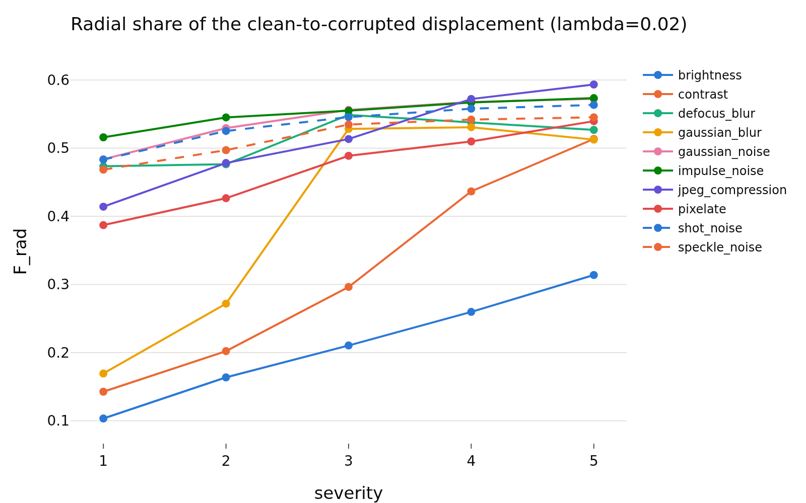
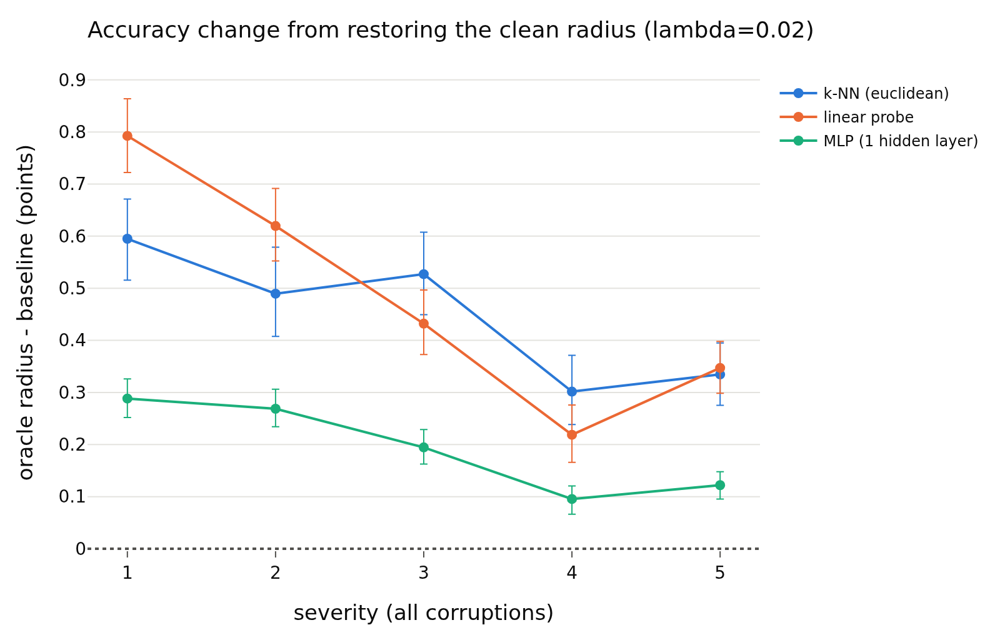

# radius_view_signal, lambda = 0.02
- **Branch / version:** `radius-view-signal` @ `6ff28d6` (code; notes committed after)
- **Run datetime (UTC):** 2026-10-26T04:01Z to 05:20Z (units and aggregation, see commands)
- **Command(s):**
  Per-run units (CPU, 8 CPUs, 64 GB, about 15 to 20 min each; jobs 2248755 to 2248758, 2248941, 2248943 to 2248945 and 2248964, 2026-10-26T04:01Z to 04:46Z; checkout of this branch at `6ff28d6`, `PYTHONPATH=<repo>/src`, `.env` with `LEJEPA_NORM_NOTES_DIR` pointing at this checkout's `research_notes/`):
  `sbatch --export=ALL slurm/view_signal.sbatch configs/base.yaml radius_marginal radius_marginal_lam<lambda>_s<seed>` for lambda in 0.02, 0.05, 0.1 and seed in 0, 1, 2 (writes `<runs_dir>/<run>/view_signal.npz`).
  Aggregation (this note and the three per-lambda notes; job 2248965, 8 CPUs, 32 GB, 33 min, finished about 2026-10-26T05:20Z):
  `python apps/analyze.py --config configs/base.yaml --view-signal radius_marginal --note radius_view_signal/view_signal.md`
  History: a first pass of the units (jobs 2248076, 2248257 to 2248260, 2248336 to 2248338, 2248365, 2248547 at commit `de18063`, aggregation job 2248628) lacked the post hoc additions marked below; they were added after seeing it and everything was recomputed. The numbers of the pre-registered comparisons were identical in both passes (all steps are deterministic).
- **Datasets:** STL-10 ([canonical](https://cs.stanford.edu/~acoates/stl10/), [HF `tanganke/stl10`](https://huggingface.co/datasets/tanganke/stl10); the canonical archive was used, HF is for reference) `train` (clean labeled bank) and `test` (clean twins); STL-10-C built locally from STL-10 `test` (10 corruptions x 5 severities, 400k images; no HF mirror).
- **Backbone:** ResNet-18 from scratch ([HF architecture reference](https://huggingface.co/timm/resnet18.a1_in1k), weights not used); `last.pt` (epoch 200) of `radius_marginal_lam{0.02,0.05,0.1}_s{0,1,2}` (Variant A, trained on A100s in earlier work; this study is CPU-only, no GPU was used).
- **Scope:** h is not analyzed; LeJEPA's product is z. All results are z-space.
- **Margins (fixed before the results):** 0.5 accuracy points; 0.01 Spearman. Pre-registration: `preregistration.md` (committed before any analysis code was run).

## Question

Is there a usable signal in how the radius moves under corruption, and in the per-view radius? Parts A to D of `preregistration.md` (geometry, oracle radius, severity from the radius residual, radius-weighted multi-view aggregation), at this lambda only, three training seeds. The cross-lambda summary, the prediction scorecard and the interpretation are in `view_signal.md`.

## Setup (deviations from the base config)

No training. No deviation from `configs/base.yaml` (k = 20, 1000 bootstrap replicates). Post hoc additions (after the first pass, not in the pre-registration, labeled "post hoc" wherever they appear): the radius-change share and the direction cosine in part A, the `random single view`, `highest-residual view` and `lowest-residual view` schemes and their contrasts in part D, and the bank-median-radius `scaled constant` condition in part B was pre-registered. Retrieval is not run in part D (deviation from the original idea list).

## Results

<!-- BEGIN GENERATED: analyze.view_inputs -->
### Inputs

Runs aggregated: `radius_marginal_lam0.02_s0`, `radius_marginal_lam0.02_s1`, `radius_marginal_lam0.02_s2`.

Unit files missing for this lambda:

None.
<!-- END GENERATED: analyze.view_inputs -->

<!-- BEGIN GENERATED: analyze.view_geometry -->
### A. Radial vs tangential share of the displacement

Clean twin -> corrupted image. `F_rad = sum a^2 / sum (a^2 + t^2)` with `a = <z_x - z_c, u_c>` (radial, along the clean direction) and `t` the orthogonal remainder; ratio of sums over images and the level's cells (so strong severities weigh more), seed mean, 95% bootstrap interval. A displacement in a random direction has `F_rad` about 1/256. The null row is the displacement from a clean image to a different clean image.

| lambda | level | radial share F_rad | 95% CI | median r_x / r_c | radius-change share (post hoc) | 95% CI (radius change) | median cos(u_x, u_c) (post hoc) |
|---|---|---|---|---|---|---|---|
| 0.02 | brightness | 0.2675 | [0.2638, 0.2712] | 0.981 | 0.0607 | [0.0593, 0.0621] | 0.959 |
| 0.02 | contrast | 0.4282 | [0.4263, 0.4301] | 0.944 | 0.0440 | [0.0432, 0.0448] | 0.757 |
| 0.02 | defocus_blur | 0.5255 | [0.5236, 0.5272] | 0.874 | 0.0664 | [0.0653, 0.0673] | 0.296 |
| 0.02 | gaussian_blur | 0.5106 | [0.5088, 0.5124] | 0.942 | 0.0525 | [0.0516, 0.0532] | 0.507 |
| 0.02 | gaussian_noise | 0.5481 | [0.5460, 0.5500] | 0.914 | 0.0438 | [0.0429, 0.0446] | 0.110 |
| 0.02 | impulse_noise | 0.5550 | [0.5529, 0.5569] | 0.900 | 0.0466 | [0.0457, 0.0474] | 0.105 |
| 0.02 | jpeg_compression | 0.5437 | [0.5417, 0.5457] | 0.800 | 0.1614 | [0.1598, 0.1632] | 0.823 |
| 0.02 | pixelate | 0.5001 | [0.4984, 0.5018] | 0.887 | 0.0592 | [0.0583, 0.0601] | 0.581 |
| 0.02 | shot_noise | 0.5406 | [0.5385, 0.5427] | 0.925 | 0.0436 | [0.0428, 0.0445] | 0.119 |
| 0.02 | speckle_noise | 0.5250 | [0.5227, 0.5273] | 0.923 | 0.0504 | [0.0495, 0.0513] | 0.237 |
| 0.02 | severity 1 (all corruptions) | 0.4675 | [0.4651, 0.4698] | 0.930 | 0.0817 | [0.0806, 0.0828] | 0.839 |
| 0.02 | severity 2 (all corruptions) | 0.4968 | [0.4947, 0.4989] | 0.912 | 0.0702 | [0.0693, 0.0711] | 0.740 |
| 0.02 | severity 3 (all corruptions) | 0.5241 | [0.5223, 0.5259] | 0.899 | 0.0591 | [0.0582, 0.0600] | 0.360 |
| 0.02 | severity 4 (all corruptions) | 0.5333 | [0.5317, 0.5348] | 0.912 | 0.0476 | [0.0468, 0.0483] | 0.166 |
| 0.02 | severity 5 (all corruptions) | 0.5404 | [0.5388, 0.5418] | 0.920 | 0.0423 | [0.0416, 0.0430] | 0.077 |
| 0.02 | all corruptions | 0.5219 | [0.5201, 0.5235] | 0.915 | 0.0549 | [0.0541, 0.0557] | 0.423 |
| 0.02 | null: clean image -> other clean image | 0.5174 | [0.5154, 0.5195] |  | 0.0446 | [0.0438, 0.0454] | -0.057 |
<!-- END GENERATED: analyze.view_geometry -->

<!-- BEGIN GENERATED: analyze.view_geometry_cells -->
### A. Radial share per cell

| lambda | corruption | severity | radial share F_rad | median r_x / r_c | radius-change share (post hoc) | median cos(u_x, u_c) (post hoc) |
|---|---|---|---|---|---|---|
| 0.02 | brightness | 1 | 0.1034 | 0.997 | 0.0649 | 0.996 |
| 0.02 | brightness | 2 | 0.1637 | 0.988 | 0.0638 | 0.981 |
| 0.02 | brightness | 3 | 0.2105 | 0.974 | 0.0604 | 0.952 |
| 0.02 | brightness | 4 | 0.2598 | 0.954 | 0.0594 | 0.896 |
| 0.02 | brightness | 5 | 0.3139 | 0.930 | 0.0610 | 0.811 |
| 0.02 | contrast | 1 | 0.1427 | 0.971 | 0.0471 | 0.960 |
| 0.02 | contrast | 2 | 0.2022 | 0.950 | 0.0491 | 0.909 |
| 0.02 | contrast | 3 | 0.2964 | 0.918 | 0.0516 | 0.770 |
| 0.02 | contrast | 4 | 0.4366 | 0.903 | 0.0492 | 0.394 |
| 0.02 | contrast | 5 | 0.5135 | 0.925 | 0.0372 | 0.108 |
| 0.02 | defocus_blur | 1 | 0.4734 | 0.858 | 0.0990 | 0.759 |
| 0.02 | defocus_blur | 2 | 0.4764 | 0.844 | 0.1143 | 0.770 |
| 0.02 | defocus_blur | 3 | 0.5488 | 0.835 | 0.0771 | 0.212 |
| 0.02 | defocus_blur | 4 | 0.5378 | 0.921 | 0.0531 | 0.073 |
| 0.02 | defocus_blur | 5 | 0.5268 | 0.962 | 0.0471 | 0.040 |
| 0.02 | gaussian_blur | 1 | 0.1694 | 0.967 | 0.1008 | 0.980 |
| 0.02 | gaussian_blur | 2 | 0.2719 | 0.929 | 0.1097 | 0.943 |
| 0.02 | gaussian_blur | 3 | 0.5282 | 0.826 | 0.0843 | 0.329 |
| 0.02 | gaussian_blur | 4 | 0.5307 | 0.935 | 0.0440 | 0.051 |
| 0.02 | gaussian_blur | 5 | 0.5125 | 1.014 | 0.0360 | -0.001 |
| 0.02 | gaussian_noise | 1 | 0.4837 | 0.894 | 0.0670 | 0.420 |
| 0.02 | gaussian_noise | 2 | 0.5294 | 0.898 | 0.0525 | 0.208 |
| 0.02 | gaussian_noise | 3 | 0.5562 | 0.910 | 0.0426 | 0.070 |
| 0.02 | gaussian_noise | 4 | 0.5678 | 0.927 | 0.0365 | -0.004 |
| 0.02 | gaussian_noise | 5 | 0.5724 | 0.941 | 0.0324 | -0.041 |
| 0.02 | impulse_noise | 1 | 0.5159 | 0.844 | 0.0774 | 0.399 |
| 0.02 | impulse_noise | 2 | 0.5451 | 0.888 | 0.0523 | 0.159 |
| 0.02 | impulse_noise | 3 | 0.5550 | 0.907 | 0.0451 | 0.079 |
| 0.02 | impulse_noise | 4 | 0.5670 | 0.928 | 0.0380 | -0.001 |
| 0.02 | impulse_noise | 5 | 0.5734 | 0.936 | 0.0342 | -0.034 |
| 0.02 | jpeg_compression | 1 | 0.4141 | 0.855 | 0.1940 | 0.913 |
| 0.02 | jpeg_compression | 2 | 0.4782 | 0.816 | 0.2003 | 0.872 |
| 0.02 | jpeg_compression | 3 | 0.5134 | 0.792 | 0.1972 | 0.836 |
| 0.02 | jpeg_compression | 4 | 0.5721 | 0.754 | 0.1642 | 0.690 |
| 0.02 | jpeg_compression | 5 | 0.5934 | 0.756 | 0.1215 | 0.473 |
| 0.02 | pixelate | 1 | 0.3871 | 0.875 | 0.1245 | 0.884 |
| 0.02 | pixelate | 2 | 0.4266 | 0.859 | 0.1227 | 0.807 |
| 0.02 | pixelate | 3 | 0.4888 | 0.906 | 0.0549 | 0.302 |
| 0.02 | pixelate | 4 | 0.5098 | 0.913 | 0.0452 | 0.134 |
| 0.02 | pixelate | 5 | 0.5396 | 0.882 | 0.0474 | 0.101 |
| 0.02 | shot_noise | 1 | 0.4832 | 0.900 | 0.0684 | 0.444 |
| 0.02 | shot_noise | 2 | 0.5252 | 0.909 | 0.0540 | 0.211 |
| 0.02 | shot_noise | 3 | 0.5456 | 0.924 | 0.0426 | 0.082 |
| 0.02 | shot_noise | 4 | 0.5579 | 0.943 | 0.0343 | -0.002 |
| 0.02 | shot_noise | 5 | 0.5635 | 0.947 | 0.0320 | -0.026 |
| 0.02 | speckle_noise | 1 | 0.4685 | 0.906 | 0.0757 | 0.591 |
| 0.02 | speckle_noise | 2 | 0.4971 | 0.902 | 0.0681 | 0.425 |
| 0.02 | speckle_noise | 3 | 0.5347 | 0.921 | 0.0498 | 0.164 |
| 0.02 | speckle_noise | 4 | 0.5419 | 0.935 | 0.0420 | 0.088 |
| 0.02 | speckle_noise | 5 | 0.5453 | 0.951 | 0.0359 | 0.035 |
<!-- END GENERATED: analyze.view_geometry_cells -->

<!-- BEGIN GENERATED: analyze.view_oracle -->
### B. Oracle radius: accuracy of frozen readers

Differences are in accuracy points (condition minus reference on the same images), averaged over training seeds; intervals are paired bootstrap percentile intervals (1000 replicates, test images resampled within each seed, the same resample for every comparison of a seed). Verdict, with the equivalence margin set to ±0.5 points before looking at results: `equivalent` if the 90% interval lies inside the margin, `different` if not equivalent and the 95% interval excludes 0, otherwise `inconclusive`. Readers are fitted on the clean STL-10 train bank only.

| lambda | level | reader | contrast | accuracy | reference accuracy | difference (points) | 90% CI | 95% CI | verdict |
|---|---|---|---|---|---|---|---|---|---|
| 0.02 | brightness | k-NN (euclidean) | oracle radius - baseline | 0.7315 | 0.7286 | +0.29 | [+0.21, +0.36] | [+0.20, +0.38] | equivalent |
| 0.02 | brightness | k-NN (euclidean) | scaled constant - baseline | 0.7323 | 0.7286 | +0.37 | [+0.27, +0.48] | [+0.24, +0.50] | equivalent |
| 0.02 | brightness | k-NN (euclidean) | oracle direction - clean twin | 0.7761 | 0.7774 | -0.12 | [-0.23, -0.01] | [-0.25, +0.01] | equivalent |
| 0.02 | brightness | k-NN (euclidean) | baseline - clean twin (total corruption loss) | 0.7286 | 0.7774 | -4.87 | [-5.17, -4.57] | [-5.23, -4.53] | different |
| 0.02 | contrast | k-NN (euclidean) | oracle radius - baseline | 0.5562 | 0.5498 | +0.64 | [+0.55, +0.73] | [+0.54, +0.76] | different |
| 0.02 | contrast | k-NN (euclidean) | scaled constant - baseline | 0.5576 | 0.5498 | +0.78 | [+0.68, +0.88] | [+0.66, +0.91] | different |
| 0.02 | contrast | k-NN (euclidean) | oracle direction - clean twin | 0.7770 | 0.7774 | -0.04 | [-0.17, +0.09] | [-0.20, +0.11] | equivalent |
| 0.02 | contrast | k-NN (euclidean) | baseline - clean twin (total corruption loss) | 0.5498 | 0.7774 | -22.76 | [-23.13, -22.39] | [-23.20, -22.33] | different |
| 0.02 | defocus_blur | k-NN (euclidean) | oracle radius - baseline | 0.2873 | 0.2812 | +0.61 | [+0.53, +0.69] | [+0.52, +0.71] | different |
| 0.02 | defocus_blur | k-NN (euclidean) | scaled constant - baseline | 0.2830 | 0.2812 | +0.18 | [+0.10, +0.26] | [+0.09, +0.28] | equivalent |
| 0.02 | defocus_blur | k-NN (euclidean) | oracle direction - clean twin | 0.7772 | 0.7774 | -0.02 | [-0.17, +0.13] | [-0.19, +0.16] | equivalent |
| 0.02 | defocus_blur | k-NN (euclidean) | baseline - clean twin (total corruption loss) | 0.2812 | 0.7774 | -49.62 | [-50.11, -49.15] | [-50.20, -49.05] | different |
| 0.02 | gaussian_blur | k-NN (euclidean) | oracle radius - baseline | 0.3863 | 0.3830 | +0.34 | [+0.28, +0.39] | [+0.26, +0.41] | equivalent |
| 0.02 | gaussian_blur | k-NN (euclidean) | scaled constant - baseline | 0.3847 | 0.3830 | +0.17 | [+0.10, +0.24] | [+0.09, +0.26] | equivalent |
| 0.02 | gaussian_blur | k-NN (euclidean) | oracle direction - clean twin | 0.7771 | 0.7774 | -0.03 | [-0.16, +0.11] | [-0.17, +0.13] | equivalent |
| 0.02 | gaussian_blur | k-NN (euclidean) | baseline - clean twin (total corruption loss) | 0.3830 | 0.7774 | -39.44 | [-39.84, -39.04] | [-39.91, -38.96] | different |
| 0.02 | gaussian_noise | k-NN (euclidean) | oracle radius - baseline | 0.1774 | 0.1778 | -0.04 | [-0.13, +0.06] | [-0.15, +0.08] | equivalent |
| 0.02 | gaussian_noise | k-NN (euclidean) | scaled constant - baseline | 0.1780 | 0.1778 | +0.02 | [-0.06, +0.11] | [-0.08, +0.12] | equivalent |
| 0.02 | gaussian_noise | k-NN (euclidean) | oracle direction - clean twin | 0.7768 | 0.7774 | -0.05 | [-0.22, +0.10] | [-0.26, +0.14] | equivalent |
| 0.02 | gaussian_noise | k-NN (euclidean) | baseline - clean twin (total corruption loss) | 0.1778 | 0.7774 | -59.96 | [-60.51, -59.39] | [-60.60, -59.31] | different |
| 0.02 | impulse_noise | k-NN (euclidean) | oracle radius - baseline | 0.1790 | 0.1777 | +0.13 | [+0.03, +0.24] | [+0.01, +0.26] | equivalent |
| 0.02 | impulse_noise | k-NN (euclidean) | scaled constant - baseline | 0.1792 | 0.1777 | +0.15 | [+0.06, +0.24] | [+0.04, +0.25] | equivalent |
| 0.02 | impulse_noise | k-NN (euclidean) | oracle direction - clean twin | 0.7769 | 0.7774 | -0.05 | [-0.22, +0.11] | [-0.25, +0.14] | equivalent |
| 0.02 | impulse_noise | k-NN (euclidean) | baseline - clean twin (total corruption loss) | 0.1777 | 0.7774 | -59.97 | [-60.50, -59.46] | [-60.61, -59.37] | different |
| 0.02 | jpeg_compression | k-NN (euclidean) | oracle radius - baseline | 0.5501 | 0.5358 | +1.43 | [+1.31, +1.54] | [+1.29, +1.57] | different |
| 0.02 | jpeg_compression | k-NN (euclidean) | scaled constant - baseline | 0.5490 | 0.5358 | +1.31 | [+1.19, +1.44] | [+1.17, +1.46] | different |
| 0.02 | jpeg_compression | k-NN (euclidean) | oracle direction - clean twin | 0.7719 | 0.7774 | -0.55 | [-0.75, -0.35] | [-0.78, -0.32] | different |
| 0.02 | jpeg_compression | k-NN (euclidean) | baseline - clean twin (total corruption loss) | 0.5358 | 0.7774 | -24.15 | [-24.59, -23.73] | [-24.65, -23.67] | different |
| 0.02 | pixelate | k-NN (euclidean) | oracle radius - baseline | 0.3782 | 0.3728 | +0.53 | [+0.45, +0.62] | [+0.43, +0.63] | different |
| 0.02 | pixelate | k-NN (euclidean) | scaled constant - baseline | 0.3795 | 0.3728 | +0.66 | [+0.57, +0.75] | [+0.56, +0.77] | different |
| 0.02 | pixelate | k-NN (euclidean) | oracle direction - clean twin | 0.7769 | 0.7774 | -0.04 | [-0.20, +0.11] | [-0.23, +0.14] | equivalent |
| 0.02 | pixelate | k-NN (euclidean) | baseline - clean twin (total corruption loss) | 0.3728 | 0.7774 | -40.46 | [-40.89, -40.01] | [-40.96, -39.93] | different |
| 0.02 | shot_noise | k-NN (euclidean) | oracle radius - baseline | 0.1839 | 0.1821 | +0.18 | [+0.09, +0.28] | [+0.08, +0.29] | equivalent |
| 0.02 | shot_noise | k-NN (euclidean) | scaled constant - baseline | 0.1835 | 0.1821 | +0.14 | [+0.05, +0.22] | [+0.04, +0.23] | equivalent |
| 0.02 | shot_noise | k-NN (euclidean) | oracle direction - clean twin | 0.7770 | 0.7774 | -0.03 | [-0.21, +0.12] | [-0.24, +0.15] | equivalent |
| 0.02 | shot_noise | k-NN (euclidean) | baseline - clean twin (total corruption loss) | 0.1821 | 0.7774 | -59.53 | [-60.08, -59.01] | [-60.16, -58.90] | different |
| 0.02 | speckle_noise | k-NN (euclidean) | oracle radius - baseline | 0.2633 | 0.2595 | +0.39 | [+0.28, +0.49] | [+0.26, +0.51] | equivalent |
| 0.02 | speckle_noise | k-NN (euclidean) | scaled constant - baseline | 0.2618 | 0.2595 | +0.23 | [+0.14, +0.32] | [+0.12, +0.34] | equivalent |
| 0.02 | speckle_noise | k-NN (euclidean) | oracle direction - clean twin | 0.7773 | 0.7774 | -0.00 | [-0.16, +0.15] | [-0.20, +0.18] | equivalent |
| 0.02 | speckle_noise | k-NN (euclidean) | baseline - clean twin (total corruption loss) | 0.2595 | 0.7774 | -51.79 | [-52.33, -51.29] | [-52.43, -51.20] | different |
| 0.02 | severity 1 (all corruptions) | k-NN (euclidean) | oracle radius - baseline | 0.5619 | 0.5559 | +0.60 | [+0.53, +0.66] | [+0.52, +0.67] | different |
| 0.02 | severity 1 (all corruptions) | k-NN (euclidean) | scaled constant - baseline | 0.5608 | 0.5559 | +0.48 | [+0.40, +0.55] | [+0.39, +0.57] | different |
| 0.02 | severity 1 (all corruptions) | k-NN (euclidean) | oracle direction - clean twin | 0.7764 | 0.7774 | -0.10 | [-0.21, +0.02] | [-0.24, +0.04] | equivalent |
| 0.02 | severity 1 (all corruptions) | k-NN (euclidean) | baseline - clean twin (total corruption loss) | 0.5559 | 0.7774 | -22.14 | [-22.47, -21.82] | [-22.52, -21.77] | different |
| 0.02 | severity 2 (all corruptions) | k-NN (euclidean) | oracle radius - baseline | 0.4915 | 0.4866 | +0.49 | [+0.42, +0.56] | [+0.41, +0.58] | different |
| 0.02 | severity 2 (all corruptions) | k-NN (euclidean) | scaled constant - baseline | 0.4909 | 0.4866 | +0.42 | [+0.35, +0.50] | [+0.34, +0.51] | equivalent |
| 0.02 | severity 2 (all corruptions) | k-NN (euclidean) | oracle direction - clean twin | 0.7762 | 0.7774 | -0.12 | [-0.24, +0.01] | [-0.27, +0.04] | equivalent |
| 0.02 | severity 2 (all corruptions) | k-NN (euclidean) | baseline - clean twin (total corruption loss) | 0.4866 | 0.7774 | -29.07 | [-29.45, -28.75] | [-29.50, -28.66] | different |
| 0.02 | severity 3 (all corruptions) | k-NN (euclidean) | oracle radius - baseline | 0.3305 | 0.3253 | +0.53 | [+0.46, +0.59] | [+0.45, +0.61] | different |
| 0.02 | severity 3 (all corruptions) | k-NN (euclidean) | scaled constant - baseline | 0.3298 | 0.3253 | +0.45 | [+0.38, +0.51] | [+0.37, +0.52] | different |
| 0.02 | severity 3 (all corruptions) | k-NN (euclidean) | oracle direction - clean twin | 0.7763 | 0.7774 | -0.11 | [-0.25, +0.03] | [-0.28, +0.06] | equivalent |
| 0.02 | severity 3 (all corruptions) | k-NN (euclidean) | baseline - clean twin (total corruption loss) | 0.3253 | 0.7774 | -45.21 | [-45.65, -44.81] | [-45.72, -44.73] | different |
| 0.02 | severity 4 (all corruptions) | k-NN (euclidean) | oracle radius - baseline | 0.2521 | 0.2490 | +0.30 | [+0.25, +0.36] | [+0.24, +0.37] | equivalent |
| 0.02 | severity 4 (all corruptions) | k-NN (euclidean) | scaled constant - baseline | 0.2526 | 0.2490 | +0.35 | [+0.30, +0.40] | [+0.29, +0.41] | equivalent |
| 0.02 | severity 4 (all corruptions) | k-NN (euclidean) | oracle direction - clean twin | 0.7765 | 0.7774 | -0.09 | [-0.24, +0.05] | [-0.27, +0.08] | equivalent |
| 0.02 | severity 4 (all corruptions) | k-NN (euclidean) | baseline - clean twin (total corruption loss) | 0.2490 | 0.7774 | -52.83 | [-53.27, -52.39] | [-53.38, -52.31] | different |
| 0.02 | severity 5 (all corruptions) | k-NN (euclidean) | oracle radius - baseline | 0.2106 | 0.2073 | +0.33 | [+0.28, +0.39] | [+0.28, +0.40] | equivalent |
| 0.02 | severity 5 (all corruptions) | k-NN (euclidean) | scaled constant - baseline | 0.2103 | 0.2073 | +0.31 | [+0.26, +0.35] | [+0.26, +0.36] | equivalent |
| 0.02 | severity 5 (all corruptions) | k-NN (euclidean) | oracle direction - clean twin | 0.7768 | 0.7774 | -0.06 | [-0.20, +0.09] | [-0.23, +0.12] | equivalent |
| 0.02 | severity 5 (all corruptions) | k-NN (euclidean) | baseline - clean twin (total corruption loss) | 0.2073 | 0.7774 | -57.01 | [-57.46, -56.56] | [-57.57, -56.48] | different |
| 0.02 | all corruptions | k-NN (euclidean) | oracle radius - baseline | 0.3693 | 0.3648 | +0.45 | [+0.42, +0.48] | [+0.41, +0.49] | equivalent |
| 0.02 | all corruptions | k-NN (euclidean) | scaled constant - baseline | 0.3689 | 0.3648 | +0.40 | [+0.37, +0.43] | [+0.36, +0.44] | equivalent |
| 0.02 | all corruptions | k-NN (euclidean) | oracle direction - clean twin | 0.7764 | 0.7774 | -0.09 | [-0.22, +0.03] | [-0.25, +0.06] | equivalent |
| 0.02 | all corruptions | k-NN (euclidean) | baseline - clean twin (total corruption loss) | 0.3648 | 0.7774 | -41.25 | [-41.64, -40.89] | [-41.74, -40.79] | different |
| 0.02 | brightness | linear probe | oracle radius - baseline | 0.7441 | 0.7433 | +0.07 | [+0.02, +0.13] | [+0.00, +0.14] | equivalent |
| 0.02 | brightness | linear probe | scaled constant - baseline | 0.7431 | 0.7433 | -0.03 | [-0.13, +0.07] | [-0.15, +0.09] | equivalent |
| 0.02 | brightness | linear probe | oracle direction - clean twin | 0.8037 | 0.8040 | -0.03 | [-0.12, +0.05] | [-0.14, +0.07] | equivalent |
| 0.02 | brightness | linear probe | baseline - clean twin (total corruption loss) | 0.7433 | 0.8040 | -6.07 | [-6.36, -5.78] | [-6.41, -5.74] | different |
| 0.02 | contrast | linear probe | oracle radius - baseline | 0.5700 | 0.5693 | +0.07 | [+0.01, +0.14] | [-0.01, +0.15] | equivalent |
| 0.02 | contrast | linear probe | scaled constant - baseline | 0.5671 | 0.5693 | -0.22 | [-0.30, -0.13] | [-0.32, -0.12] | equivalent |
| 0.02 | contrast | linear probe | oracle direction - clean twin | 0.8039 | 0.8040 | -0.01 | [-0.10, +0.09] | [-0.13, +0.11] | equivalent |
| 0.02 | contrast | linear probe | baseline - clean twin (total corruption loss) | 0.5693 | 0.8040 | -23.47 | [-23.84, -23.10] | [-23.94, -23.04] | different |
| 0.02 | defocus_blur | linear probe | oracle radius - baseline | 0.2943 | 0.2902 | +0.41 | [+0.34, +0.48] | [+0.32, +0.50] | equivalent |
| 0.02 | defocus_blur | linear probe | scaled constant - baseline | 0.2914 | 0.2902 | +0.12 | [+0.05, +0.19] | [+0.02, +0.20] | equivalent |
| 0.02 | defocus_blur | linear probe | oracle direction - clean twin | 0.8014 | 0.8040 | -0.26 | [-0.39, -0.13] | [-0.41, -0.11] | equivalent |
| 0.02 | defocus_blur | linear probe | baseline - clean twin (total corruption loss) | 0.2902 | 0.8040 | -51.38 | [-51.87, -50.90] | [-51.96, -50.82] | different |
| 0.02 | gaussian_blur | linear probe | oracle radius - baseline | 0.3916 | 0.3908 | +0.08 | [+0.03, +0.13] | [+0.02, +0.14] | equivalent |
| 0.02 | gaussian_blur | linear probe | scaled constant - baseline | 0.3892 | 0.3908 | -0.16 | [-0.22, -0.10] | [-0.24, -0.09] | equivalent |
| 0.02 | gaussian_blur | linear probe | oracle direction - clean twin | 0.8021 | 0.8040 | -0.19 | [-0.30, -0.10] | [-0.32, -0.08] | equivalent |
| 0.02 | gaussian_blur | linear probe | baseline - clean twin (total corruption loss) | 0.3908 | 0.8040 | -41.32 | [-41.70, -40.94] | [-41.79, -40.86] | different |
| 0.02 | gaussian_noise | linear probe | oracle radius - baseline | 0.1876 | 0.1792 | +0.84 | [+0.78, +0.91] | [+0.76, +0.92] | different |
| 0.02 | gaussian_noise | linear probe | scaled constant - baseline | 0.1861 | 0.1792 | +0.69 | [+0.64, +0.75] | [+0.62, +0.77] | different |
| 0.02 | gaussian_noise | linear probe | oracle direction - clean twin | 0.8016 | 0.8040 | -0.24 | [-0.38, -0.10] | [-0.41, -0.07] | equivalent |
| 0.02 | gaussian_noise | linear probe | baseline - clean twin (total corruption loss) | 0.1792 | 0.8040 | -62.48 | [-63.04, -61.93] | [-63.15, -61.82] | different |
| 0.02 | impulse_noise | linear probe | oracle radius - baseline | 0.1886 | 0.1808 | +0.78 | [+0.71, +0.86] | [+0.70, +0.87] | different |
| 0.02 | impulse_noise | linear probe | scaled constant - baseline | 0.1857 | 0.1808 | +0.49 | [+0.42, +0.55] | [+0.41, +0.56] | different |
| 0.02 | impulse_noise | linear probe | oracle direction - clean twin | 0.8013 | 0.8040 | -0.27 | [-0.41, -0.12] | [-0.43, -0.09] | equivalent |
| 0.02 | impulse_noise | linear probe | baseline - clean twin (total corruption loss) | 0.1808 | 0.8040 | -62.32 | [-62.87, -61.79] | [-62.94, -61.69] | different |
| 0.02 | jpeg_compression | linear probe | oracle radius - baseline | 0.5376 | 0.5366 | +0.09 | [-0.01, +0.20] | [-0.03, +0.21] | equivalent |
| 0.02 | jpeg_compression | linear probe | scaled constant - baseline | 0.5343 | 0.5366 | -0.23 | [-0.35, -0.11] | [-0.38, -0.09] | equivalent |
| 0.02 | jpeg_compression | linear probe | oracle direction - clean twin | 0.7956 | 0.8040 | -0.84 | [-1.02, -0.66] | [-1.06, -0.61] | different |
| 0.02 | jpeg_compression | linear probe | baseline - clean twin (total corruption loss) | 0.5366 | 0.8040 | -26.73 | [-27.18, -26.31] | [-27.25, -26.23] | different |
| 0.02 | pixelate | linear probe | oracle radius - baseline | 0.3671 | 0.3644 | +0.27 | [+0.21, +0.34] | [+0.20, +0.35] | equivalent |
| 0.02 | pixelate | linear probe | scaled constant - baseline | 0.3628 | 0.3644 | -0.16 | [-0.23, -0.08] | [-0.24, -0.07] | equivalent |
| 0.02 | pixelate | linear probe | oracle direction - clean twin | 0.7999 | 0.8040 | -0.41 | [-0.54, -0.27] | [-0.56, -0.25] | different |
| 0.02 | pixelate | linear probe | baseline - clean twin (total corruption loss) | 0.3644 | 0.8040 | -43.96 | [-44.42, -43.49] | [-44.51, -43.42] | different |
| 0.02 | shot_noise | linear probe | oracle radius - baseline | 0.2007 | 0.1928 | +0.79 | [+0.71, +0.87] | [+0.70, +0.88] | different |
| 0.02 | shot_noise | linear probe | scaled constant - baseline | 0.1987 | 0.1928 | +0.59 | [+0.53, +0.65] | [+0.52, +0.66] | different |
| 0.02 | shot_noise | linear probe | oracle direction - clean twin | 0.8016 | 0.8040 | -0.24 | [-0.38, -0.10] | [-0.41, -0.07] | equivalent |
| 0.02 | shot_noise | linear probe | baseline - clean twin (total corruption loss) | 0.1928 | 0.8040 | -61.12 | [-61.68, -60.59] | [-61.79, -60.48] | different |
| 0.02 | speckle_noise | linear probe | oracle radius - baseline | 0.2937 | 0.2796 | +1.41 | [+1.31, +1.51] | [+1.29, +1.52] | different |
| 0.02 | speckle_noise | linear probe | scaled constant - baseline | 0.2883 | 0.2796 | +0.86 | [+0.79, +0.94] | [+0.77, +0.96] | different |
| 0.02 | speckle_noise | linear probe | oracle direction - clean twin | 0.8018 | 0.8040 | -0.22 | [-0.37, -0.07] | [-0.38, -0.06] | equivalent |
| 0.02 | speckle_noise | linear probe | baseline - clean twin (total corruption loss) | 0.2796 | 0.8040 | -52.44 | [-53.00, -51.93] | [-53.10, -51.84] | different |
| 0.02 | severity 1 (all corruptions) | linear probe | oracle radius - baseline | 0.5784 | 0.5705 | +0.79 | [+0.73, +0.85] | [+0.72, +0.86] | different |
| 0.02 | severity 1 (all corruptions) | linear probe | scaled constant - baseline | 0.5752 | 0.5705 | +0.47 | [+0.40, +0.54] | [+0.38, +0.55] | different |
| 0.02 | severity 1 (all corruptions) | linear probe | oracle direction - clean twin | 0.8020 | 0.8040 | -0.20 | [-0.29, -0.11] | [-0.31, -0.08] | equivalent |
| 0.02 | severity 1 (all corruptions) | linear probe | baseline - clean twin (total corruption loss) | 0.5705 | 0.8040 | -23.35 | [-23.68, -23.02] | [-23.75, -22.97] | different |
| 0.02 | severity 2 (all corruptions) | linear probe | oracle radius - baseline | 0.4985 | 0.4923 | +0.62 | [+0.56, +0.68] | [+0.55, +0.69] | different |
| 0.02 | severity 2 (all corruptions) | linear probe | scaled constant - baseline | 0.4949 | 0.4923 | +0.26 | [+0.19, +0.32] | [+0.18, +0.33] | equivalent |
| 0.02 | severity 2 (all corruptions) | linear probe | oracle direction - clean twin | 0.8015 | 0.8040 | -0.25 | [-0.35, -0.15] | [-0.36, -0.13] | equivalent |
| 0.02 | severity 2 (all corruptions) | linear probe | baseline - clean twin (total corruption loss) | 0.4923 | 0.8040 | -31.17 | [-31.52, -30.82] | [-31.60, -30.76] | different |
| 0.02 | severity 3 (all corruptions) | linear probe | oracle radius - baseline | 0.3354 | 0.3311 | +0.43 | [+0.38, +0.49] | [+0.37, +0.50] | equivalent |
| 0.02 | severity 3 (all corruptions) | linear probe | scaled constant - baseline | 0.3325 | 0.3311 | +0.14 | [+0.09, +0.19] | [+0.08, +0.20] | equivalent |
| 0.02 | severity 3 (all corruptions) | linear probe | oracle direction - clean twin | 0.8010 | 0.8040 | -0.30 | [-0.41, -0.19] | [-0.43, -0.16] | equivalent |
| 0.02 | severity 3 (all corruptions) | linear probe | baseline - clean twin (total corruption loss) | 0.3311 | 0.8040 | -47.29 | [-47.70, -46.89] | [-47.77, -46.81] | different |
| 0.02 | severity 4 (all corruptions) | linear probe | oracle radius - baseline | 0.2597 | 0.2575 | +0.22 | [+0.18, +0.27] | [+0.17, +0.28] | equivalent |
| 0.02 | severity 4 (all corruptions) | linear probe | scaled constant - baseline | 0.2577 | 0.2575 | +0.02 | [-0.03, +0.06] | [-0.04, +0.07] | equivalent |
| 0.02 | severity 4 (all corruptions) | linear probe | oracle direction - clean twin | 0.8010 | 0.8040 | -0.30 | [-0.42, -0.18] | [-0.44, -0.15] | equivalent |
| 0.02 | severity 4 (all corruptions) | linear probe | baseline - clean twin (total corruption loss) | 0.2575 | 0.8040 | -54.65 | [-55.06, -54.22] | [-55.16, -54.14] | different |
| 0.02 | severity 5 (all corruptions) | linear probe | oracle radius - baseline | 0.2155 | 0.2120 | +0.35 | [+0.30, +0.39] | [+0.30, +0.40] | equivalent |
| 0.02 | severity 5 (all corruptions) | linear probe | scaled constant - baseline | 0.2130 | 0.2120 | +0.10 | [+0.06, +0.14] | [+0.06, +0.14] | equivalent |
| 0.02 | severity 5 (all corruptions) | linear probe | oracle direction - clean twin | 0.8009 | 0.8040 | -0.31 | [-0.43, -0.19] | [-0.46, -0.16] | equivalent |
| 0.02 | severity 5 (all corruptions) | linear probe | baseline - clean twin (total corruption loss) | 0.2120 | 0.8040 | -59.20 | [-59.63, -58.76] | [-59.70, -58.68] | different |
| 0.02 | all corruptions | linear probe | oracle radius - baseline | 0.3775 | 0.3727 | +0.48 | [+0.45, +0.51] | [+0.45, +0.52] | different |
| 0.02 | all corruptions | linear probe | scaled constant - baseline | 0.3747 | 0.3727 | +0.20 | [+0.16, +0.23] | [+0.15, +0.23] | equivalent |
| 0.02 | all corruptions | linear probe | oracle direction - clean twin | 0.8013 | 0.8040 | -0.27 | [-0.37, -0.17] | [-0.39, -0.15] | equivalent |
| 0.02 | all corruptions | linear probe | baseline - clean twin (total corruption loss) | 0.3727 | 0.8040 | -43.13 | [-43.50, -42.76] | [-43.58, -42.69] | different |
| 0.02 | brightness | MLP (1 hidden layer) | oracle radius - baseline | 0.7486 | 0.7471 | +0.15 | [+0.12, +0.18] | [+0.11, +0.19] | equivalent |
| 0.02 | brightness | MLP (1 hidden layer) | scaled constant - baseline | 0.7491 | 0.7471 | +0.21 | [+0.15, +0.26] | [+0.14, +0.27] | equivalent |
| 0.02 | brightness | MLP (1 hidden layer) | oracle direction - clean twin | 0.8033 | 0.8037 | -0.04 | [-0.10, +0.01] | [-0.11, +0.02] | equivalent |
| 0.02 | brightness | MLP (1 hidden layer) | baseline - clean twin (total corruption loss) | 0.7471 | 0.8037 | -5.67 | [-5.97, -5.39] | [-6.02, -5.33] | different |
| 0.02 | contrast | MLP (1 hidden layer) | oracle radius - baseline | 0.5782 | 0.5761 | +0.21 | [+0.17, +0.25] | [+0.16, +0.26] | equivalent |
| 0.02 | contrast | MLP (1 hidden layer) | scaled constant - baseline | 0.5783 | 0.5761 | +0.23 | [+0.18, +0.27] | [+0.17, +0.28] | equivalent |
| 0.02 | contrast | MLP (1 hidden layer) | oracle direction - clean twin | 0.8033 | 0.8037 | -0.04 | [-0.10, +0.01] | [-0.11, +0.03] | equivalent |
| 0.02 | contrast | MLP (1 hidden layer) | baseline - clean twin (total corruption loss) | 0.5761 | 0.8037 | -22.77 | [-23.14, -22.39] | [-23.19, -22.34] | different |
| 0.02 | defocus_blur | MLP (1 hidden layer) | oracle radius - baseline | 0.3013 | 0.2984 | +0.29 | [+0.25, +0.33] | [+0.24, +0.34] | equivalent |
| 0.02 | defocus_blur | MLP (1 hidden layer) | scaled constant - baseline | 0.3010 | 0.2984 | +0.26 | [+0.21, +0.29] | [+0.20, +0.30] | equivalent |
| 0.02 | defocus_blur | MLP (1 hidden layer) | oracle direction - clean twin | 0.8030 | 0.8037 | -0.08 | [-0.16, +0.01] | [-0.18, +0.02] | equivalent |
| 0.02 | defocus_blur | MLP (1 hidden layer) | baseline - clean twin (total corruption loss) | 0.2984 | 0.8037 | -50.53 | [-51.02, -50.08] | [-51.13, -50.00] | different |
| 0.02 | gaussian_blur | MLP (1 hidden layer) | oracle radius - baseline | 0.3942 | 0.3927 | +0.15 | [+0.12, +0.18] | [+0.12, +0.19] | equivalent |
| 0.02 | gaussian_blur | MLP (1 hidden layer) | scaled constant - baseline | 0.3941 | 0.3927 | +0.14 | [+0.10, +0.18] | [+0.10, +0.19] | equivalent |
| 0.02 | gaussian_blur | MLP (1 hidden layer) | oracle direction - clean twin | 0.8029 | 0.8037 | -0.08 | [-0.14, -0.02] | [-0.16, -0.01] | equivalent |
| 0.02 | gaussian_blur | MLP (1 hidden layer) | baseline - clean twin (total corruption loss) | 0.3927 | 0.8037 | -41.11 | [-41.48, -40.73] | [-41.57, -40.67] | different |
| 0.02 | gaussian_noise | MLP (1 hidden layer) | oracle radius - baseline | 0.1772 | 0.1760 | +0.13 | [+0.10, +0.16] | [+0.09, +0.17] | equivalent |
| 0.02 | gaussian_noise | MLP (1 hidden layer) | scaled constant - baseline | 0.1771 | 0.1760 | +0.11 | [+0.08, +0.14] | [+0.08, +0.14] | equivalent |
| 0.02 | gaussian_noise | MLP (1 hidden layer) | oracle direction - clean twin | 0.8034 | 0.8037 | -0.04 | [-0.11, +0.04] | [-0.13, +0.06] | equivalent |
| 0.02 | gaussian_noise | MLP (1 hidden layer) | baseline - clean twin (total corruption loss) | 0.1760 | 0.8037 | -62.78 | [-63.30, -62.26] | [-63.42, -62.12] | different |
| 0.02 | impulse_noise | MLP (1 hidden layer) | oracle radius - baseline | 0.1792 | 0.1777 | +0.15 | [+0.11, +0.19] | [+0.11, +0.19] | equivalent |
| 0.02 | impulse_noise | MLP (1 hidden layer) | scaled constant - baseline | 0.1785 | 0.1777 | +0.08 | [+0.05, +0.11] | [+0.05, +0.11] | equivalent |
| 0.02 | impulse_noise | MLP (1 hidden layer) | oracle direction - clean twin | 0.8036 | 0.8037 | -0.02 | [-0.09, +0.07] | [-0.11, +0.08] | equivalent |
| 0.02 | impulse_noise | MLP (1 hidden layer) | baseline - clean twin (total corruption loss) | 0.1777 | 0.8037 | -62.61 | [-63.11, -62.11] | [-63.19, -61.98] | different |
| 0.02 | jpeg_compression | MLP (1 hidden layer) | oracle radius - baseline | 0.5510 | 0.5479 | +0.31 | [+0.25, +0.37] | [+0.24, +0.38] | equivalent |
| 0.02 | jpeg_compression | MLP (1 hidden layer) | scaled constant - baseline | 0.5504 | 0.5479 | +0.24 | [+0.18, +0.31] | [+0.17, +0.32] | equivalent |
| 0.02 | jpeg_compression | MLP (1 hidden layer) | oracle direction - clean twin | 0.8024 | 0.8037 | -0.13 | [-0.25, -0.01] | [-0.28, +0.02] | equivalent |
| 0.02 | jpeg_compression | MLP (1 hidden layer) | baseline - clean twin (total corruption loss) | 0.5479 | 0.8037 | -25.58 | [-26.03, -25.15] | [-26.11, -25.08] | different |
| 0.02 | pixelate | MLP (1 hidden layer) | oracle radius - baseline | 0.3783 | 0.3776 | +0.08 | [+0.04, +0.11] | [+0.03, +0.12] | equivalent |
| 0.02 | pixelate | MLP (1 hidden layer) | scaled constant - baseline | 0.3772 | 0.3776 | -0.04 | [-0.07, +0.00] | [-0.08, +0.01] | equivalent |
| 0.02 | pixelate | MLP (1 hidden layer) | oracle direction - clean twin | 0.8030 | 0.8037 | -0.07 | [-0.15, +0.02] | [-0.17, +0.03] | equivalent |
| 0.02 | pixelate | MLP (1 hidden layer) | baseline - clean twin (total corruption loss) | 0.3776 | 0.8037 | -42.62 | [-43.04, -42.17] | [-43.14, -42.09] | different |
| 0.02 | shot_noise | MLP (1 hidden layer) | oracle radius - baseline | 0.1859 | 0.1838 | +0.22 | [+0.18, +0.25] | [+0.17, +0.26] | equivalent |
| 0.02 | shot_noise | MLP (1 hidden layer) | scaled constant - baseline | 0.1850 | 0.1838 | +0.12 | [+0.09, +0.15] | [+0.09, +0.16] | equivalent |
| 0.02 | shot_noise | MLP (1 hidden layer) | oracle direction - clean twin | 0.8036 | 0.8037 | -0.01 | [-0.09, +0.07] | [-0.11, +0.08] | equivalent |
| 0.02 | shot_noise | MLP (1 hidden layer) | baseline - clean twin (total corruption loss) | 0.1838 | 0.8037 | -62.00 | [-62.52, -61.49] | [-62.62, -61.35] | different |
| 0.02 | speckle_noise | MLP (1 hidden layer) | oracle radius - baseline | 0.2633 | 0.2608 | +0.26 | [+0.22, +0.30] | [+0.21, +0.30] | equivalent |
| 0.02 | speckle_noise | MLP (1 hidden layer) | scaled constant - baseline | 0.2630 | 0.2608 | +0.22 | [+0.19, +0.25] | [+0.18, +0.26] | equivalent |
| 0.02 | speckle_noise | MLP (1 hidden layer) | oracle direction - clean twin | 0.8037 | 0.8037 | -0.01 | [-0.08, +0.07] | [-0.10, +0.08] | equivalent |
| 0.02 | speckle_noise | MLP (1 hidden layer) | baseline - clean twin (total corruption loss) | 0.2608 | 0.8037 | -54.30 | [-54.83, -53.81] | [-54.91, -53.72] | different |
| 0.02 | severity 1 (all corruptions) | MLP (1 hidden layer) | oracle radius - baseline | 0.5753 | 0.5725 | +0.29 | [+0.26, +0.32] | [+0.25, +0.33] | equivalent |
| 0.02 | severity 1 (all corruptions) | MLP (1 hidden layer) | scaled constant - baseline | 0.5749 | 0.5725 | +0.25 | [+0.21, +0.28] | [+0.21, +0.29] | equivalent |
| 0.02 | severity 1 (all corruptions) | MLP (1 hidden layer) | oracle direction - clean twin | 0.8034 | 0.8037 | -0.04 | [-0.10, +0.02] | [-0.10, +0.03] | equivalent |
| 0.02 | severity 1 (all corruptions) | MLP (1 hidden layer) | baseline - clean twin (total corruption loss) | 0.5725 | 0.8037 | -23.13 | [-23.46, -22.82] | [-23.52, -22.76] | different |
| 0.02 | severity 2 (all corruptions) | MLP (1 hidden layer) | oracle radius - baseline | 0.4951 | 0.4924 | +0.27 | [+0.24, +0.30] | [+0.23, +0.31] | equivalent |
| 0.02 | severity 2 (all corruptions) | MLP (1 hidden layer) | scaled constant - baseline | 0.4950 | 0.4924 | +0.25 | [+0.22, +0.29] | [+0.21, +0.29] | equivalent |
| 0.02 | severity 2 (all corruptions) | MLP (1 hidden layer) | oracle direction - clean twin | 0.8034 | 0.8037 | -0.04 | [-0.10, +0.03] | [-0.11, +0.04] | equivalent |
| 0.02 | severity 2 (all corruptions) | MLP (1 hidden layer) | baseline - clean twin (total corruption loss) | 0.4924 | 0.8037 | -31.13 | [-31.47, -30.79] | [-31.55, -30.74] | different |
| 0.02 | severity 3 (all corruptions) | MLP (1 hidden layer) | oracle radius - baseline | 0.3332 | 0.3313 | +0.19 | [+0.17, +0.22] | [+0.16, +0.23] | equivalent |
| 0.02 | severity 3 (all corruptions) | MLP (1 hidden layer) | scaled constant - baseline | 0.3326 | 0.3313 | +0.14 | [+0.11, +0.17] | [+0.11, +0.18] | equivalent |
| 0.02 | severity 3 (all corruptions) | MLP (1 hidden layer) | oracle direction - clean twin | 0.8031 | 0.8037 | -0.06 | [-0.13, +0.01] | [-0.15, +0.02] | equivalent |
| 0.02 | severity 3 (all corruptions) | MLP (1 hidden layer) | baseline - clean twin (total corruption loss) | 0.3313 | 0.8037 | -47.25 | [-47.66, -46.87] | [-47.74, -46.79] | different |
| 0.02 | severity 4 (all corruptions) | MLP (1 hidden layer) | oracle radius - baseline | 0.2591 | 0.2581 | +0.10 | [+0.07, +0.12] | [+0.07, +0.12] | equivalent |
| 0.02 | severity 4 (all corruptions) | MLP (1 hidden layer) | scaled constant - baseline | 0.2589 | 0.2581 | +0.08 | [+0.05, +0.10] | [+0.05, +0.10] | equivalent |
| 0.02 | severity 4 (all corruptions) | MLP (1 hidden layer) | oracle direction - clean twin | 0.8031 | 0.8037 | -0.07 | [-0.14, +0.00] | [-0.15, +0.02] | equivalent |
| 0.02 | severity 4 (all corruptions) | MLP (1 hidden layer) | baseline - clean twin (total corruption loss) | 0.2581 | 0.8037 | -54.56 | [-54.99, -54.16] | [-55.08, -54.08] | different |
| 0.02 | severity 5 (all corruptions) | MLP (1 hidden layer) | oracle radius - baseline | 0.2159 | 0.2147 | +0.12 | [+0.10, +0.14] | [+0.10, +0.15] | equivalent |
| 0.02 | severity 5 (all corruptions) | MLP (1 hidden layer) | scaled constant - baseline | 0.2154 | 0.2147 | +0.06 | [+0.05, +0.09] | [+0.04, +0.09] | equivalent |
| 0.02 | severity 5 (all corruptions) | MLP (1 hidden layer) | oracle direction - clean twin | 0.8032 | 0.8037 | -0.06 | [-0.13, +0.01] | [-0.14, +0.03] | equivalent |
| 0.02 | severity 5 (all corruptions) | MLP (1 hidden layer) | baseline - clean twin (total corruption loss) | 0.2147 | 0.8037 | -58.90 | [-59.32, -58.50] | [-59.42, -58.39] | different |
| 0.02 | all corruptions | MLP (1 hidden layer) | oracle radius - baseline | 0.3757 | 0.3738 | +0.19 | [+0.18, +0.21] | [+0.18, +0.21] | equivalent |
| 0.02 | all corruptions | MLP (1 hidden layer) | scaled constant - baseline | 0.3754 | 0.3738 | +0.16 | [+0.14, +0.17] | [+0.14, +0.17] | equivalent |
| 0.02 | all corruptions | MLP (1 hidden layer) | oracle direction - clean twin | 0.8032 | 0.8037 | -0.05 | [-0.11, +0.01] | [-0.13, +0.02] | equivalent |
| 0.02 | all corruptions | MLP (1 hidden layer) | baseline - clean twin (total corruption loss) | 0.3738 | 0.8037 | -43.00 | [-43.37, -42.65] | [-43.44, -42.57] | different |
<!-- END GENERATED: analyze.view_oracle -->

<!-- BEGIN GENERATED: analyze.view_recovery -->
### B. Share of the corruption loss recovered by the oracle radius

`(oracle radius - baseline) / (clean twin - baseline)`, only where the mean loss exceeds 1 points; 95% bootstrap interval of the ratio of seed-mean paired differences.

| lambda | level | reader | corruption loss (points) | recovered by oracle radius | 95% CI |
|---|---|---|---|---|---|
| 0.02 | brightness | k-NN (euclidean) | 4.87 | +0.059 | [+0.043, +0.077] |
| 0.02 | contrast | k-NN (euclidean) | 22.76 | +0.028 | [+0.023, +0.033] |
| 0.02 | defocus_blur | k-NN (euclidean) | 49.62 | +0.012 | [+0.010, +0.014] |
| 0.02 | gaussian_blur | k-NN (euclidean) | 39.44 | +0.009 | [+0.007, +0.010] |
| 0.02 | gaussian_noise | k-NN (euclidean) | 59.96 | -0.001 | [-0.003, +0.001] |
| 0.02 | impulse_noise | k-NN (euclidean) | 59.97 | +0.002 | [+0.000, +0.004] |
| 0.02 | jpeg_compression | k-NN (euclidean) | 24.15 | +0.059 | [+0.053, +0.065] |
| 0.02 | pixelate | k-NN (euclidean) | 40.45 | +0.013 | [+0.011, +0.016] |
| 0.02 | shot_noise | k-NN (euclidean) | 59.53 | +0.003 | [+0.001, +0.005] |
| 0.02 | speckle_noise | k-NN (euclidean) | 51.79 | +0.007 | [+0.005, +0.010] |
| 0.02 | all corruptions | k-NN (euclidean) | 41.25 | +0.011 | [+0.010, +0.012] |
| 0.02 | brightness | linear probe | 6.07 | +0.012 | [+0.000, +0.023] |
| 0.02 | contrast | linear probe | 23.47 | +0.003 | [-0.000, +0.007] |
| 0.02 | defocus_blur | linear probe | 51.38 | +0.008 | [+0.006, +0.010] |
| 0.02 | gaussian_blur | linear probe | 41.32 | +0.002 | [+0.001, +0.003] |
| 0.02 | gaussian_noise | linear probe | 62.48 | +0.013 | [+0.012, +0.015] |
| 0.02 | impulse_noise | linear probe | 62.32 | +0.013 | [+0.011, +0.014] |
| 0.02 | jpeg_compression | linear probe | 26.74 | +0.003 | [-0.001, +0.008] |
| 0.02 | pixelate | linear probe | 43.96 | +0.006 | [+0.005, +0.008] |
| 0.02 | shot_noise | linear probe | 61.12 | +0.013 | [+0.011, +0.014] |
| 0.02 | speckle_noise | linear probe | 52.44 | +0.027 | [+0.025, +0.029] |
| 0.02 | all corruptions | linear probe | 43.13 | +0.011 | [+0.010, +0.012] |
| 0.02 | brightness | MLP (1 hidden layer) | 5.67 | +0.027 | [+0.020, +0.033] |
| 0.02 | contrast | MLP (1 hidden layer) | 22.77 | +0.009 | [+0.007, +0.011] |
| 0.02 | defocus_blur | MLP (1 hidden layer) | 50.53 | +0.006 | [+0.005, +0.007] |
| 0.02 | gaussian_blur | MLP (1 hidden layer) | 41.11 | +0.004 | [+0.003, +0.004] |
| 0.02 | gaussian_noise | MLP (1 hidden layer) | 62.78 | +0.002 | [+0.001, +0.003] |
| 0.02 | impulse_noise | MLP (1 hidden layer) | 62.61 | +0.002 | [+0.002, +0.003] |
| 0.02 | jpeg_compression | MLP (1 hidden layer) | 25.58 | +0.012 | [+0.009, +0.015] |
| 0.02 | pixelate | MLP (1 hidden layer) | 42.62 | +0.002 | [+0.001, +0.003] |
| 0.02 | shot_noise | MLP (1 hidden layer) | 62.00 | +0.003 | [+0.003, +0.004] |
| 0.02 | speckle_noise | MLP (1 hidden layer) | 54.30 | +0.005 | [+0.004, +0.006] |
| 0.02 | all corruptions | MLP (1 hidden layer) | 43.00 | +0.005 | [+0.004, +0.005] |
<!-- END GENERATED: analyze.view_recovery -->

<!-- BEGIN GENERATED: analyze.view_severity -->
### C. Corruption severity from the radius residual

Per corruption, 6 x 8000 rows (clean twins = severity 0). `res = log r - f(u)` with the clean-fitted direction -> log-radius map. Spearman values: seed mean [95% bootstrap interval, images resampled with their 6 rows]. Held-out predictions: ridge (RidgeCV) on the standardized direction, on `[res, |res|, log r]` and on both, 5 folds grouped by image. Verdict on `direction + radius - direction` with the margin 0.01 Spearman fixed in advance: `does not add` if the 90% interval is inside the margin, `adds` if the lower 95% bound exceeds it, `worse` if the upper 95% bound is below minus the margin.

| lambda | corruption | Spearman(res, severity), signed | held-out Spearman: direction | held-out Spearman: radius | held-out Spearman: direction + radius | direction + radius - direction | verdict |
|---|---|---|---|---|---|---|---|
| 0.02 | brightness | -0.033 [-0.039, -0.027] | +0.727 [+0.724, +0.730] | +0.145 [+0.142, +0.149] | +0.727 [+0.724, +0.730] | +0.000 [-0.000, +0.000] | does not add |
| 0.02 | contrast | -0.123 [-0.129, -0.117] | +0.911 [+0.910, +0.912] | +0.347 [+0.341, +0.352] | +0.911 [+0.910, +0.912] | +0.000 [+0.000, +0.000] | does not add |
| 0.02 | defocus_blur | -0.448 [-0.452, -0.443] | +0.932 [+0.931, +0.932] | +0.474 [+0.469, +0.478] | +0.932 [+0.932, +0.933] | +0.001 [+0.000, +0.001] | does not add |
| 0.02 | gaussian_blur | -0.585 [-0.590, -0.581] | +0.937 [+0.937, +0.938] | +0.598 [+0.594, +0.601] | +0.938 [+0.938, +0.939] | +0.001 [+0.001, +0.001] | does not add |
| 0.02 | gaussian_noise | -0.144 [-0.149, -0.139] | +0.977 [+0.976, +0.977] | +0.162 [+0.156, +0.167] | +0.977 [+0.977, +0.977] | +0.000 [+0.000, +0.000] | does not add |
| 0.02 | impulse_noise | -0.150 [-0.155, -0.145] | +0.977 [+0.977, +0.978] | +0.136 [+0.131, +0.141] | +0.977 [+0.977, +0.978] | +0.000 [+0.000, +0.000] | does not add |
| 0.02 | jpeg_compression | -0.209 [-0.214, -0.203] | +0.779 [+0.776, +0.781] | +0.359 [+0.356, +0.363] | +0.781 [+0.779, +0.784] | +0.003 [+0.002, +0.003] | does not add |
| 0.02 | pixelate | -0.221 [-0.226, -0.215] | +0.907 [+0.906, +0.908] | +0.217 [+0.212, +0.222] | +0.907 [+0.906, +0.909] | +0.001 [+0.000, +0.001] | does not add |
| 0.02 | shot_noise | -0.123 [-0.128, -0.118] | +0.977 [+0.977, +0.978] | +0.115 [+0.109, +0.120] | +0.978 [+0.977, +0.978] | +0.000 [+0.000, +0.000] | does not add |
| 0.02 | speckle_noise | +0.118 [+0.113, +0.124] | +0.965 [+0.965, +0.966] | +0.152 [+0.146, +0.157] | +0.966 [+0.965, +0.966] | +0.000 [+0.000, +0.000] | does not add |
| 0.02 | mean over corruptions | -0.192 | +0.909 | +0.270 | +0.909 | +0.001 |  |
<!-- END GENERATED: analyze.view_severity -->

<!-- BEGIN GENERATED: analyze.view_aggregation -->
### D. Radius-weighted multi-view aggregation

Image embedding = unit vector of the weighted sum of the K = 8 augmented view directions (scheme weights in the pre-registration), scaled to the bank-median radius; readers fitted on the bank directions at that scale. Differences are in accuracy points (condition minus reference on the same images), averaged over training seeds; intervals are paired bootstrap percentile intervals (1000 replicates, test images resampled within each seed, the same resample for every comparison of a seed). Verdict, with the equivalence margin set to ±0.5 points before looking at results: `equivalent` if the 90% interval lies inside the margin, `different` if not equivalent and the 95% interval excludes 0, otherwise `inconclusive`. Readers are fitted on the clean STL-10 train bank only.

| lambda | level | reader | contrast | accuracy | reference accuracy | difference (points) | 90% CI | 95% CI | verdict |
|---|---|---|---|---|---|---|---|---|---|
| 0.02 | brightness | k-NN (euclidean) | radius-weighted - mean | 0.7252 | 0.7244 | +0.08 | [+0.03, +0.12] | [+0.02, +0.13] | equivalent |
| 0.02 | brightness | k-NN (euclidean) | inverse-radius-weighted - mean | 0.7236 | 0.7244 | -0.08 | [-0.13, -0.03] | [-0.14, -0.03] | equivalent |
| 0.02 | brightness | k-NN (euclidean) | residual-weighted - mean | 0.7260 | 0.7244 | +0.15 | [+0.05, +0.26] | [+0.03, +0.28] | equivalent |
| 0.02 | brightness | k-NN (euclidean) | top-radius view - mean | 0.7096 | 0.7244 | -1.48 | [-1.66, -1.32] | [-1.69, -1.29] | different |
| 0.02 | brightness | k-NN (euclidean) | bottom-radius view - mean | 0.6466 | 0.7244 | -7.79 | [-8.02, -7.57] | [-8.05, -7.53] | different |
| 0.02 | brightness | k-NN (euclidean) | center view only (context) - mean | 0.7304 | 0.7244 | +0.60 | [+0.42, +0.79] | [+0.38, +0.83] | different |
| 0.02 | brightness | k-NN (euclidean) | random single view (post hoc context) - mean | 0.6941 | 0.7244 | -3.04 | [-3.20, -2.88] | [-3.24, -2.85] | different |
| 0.02 | brightness | k-NN (euclidean) | highest-residual view (post hoc) - mean | 0.7010 | 0.7244 | -2.35 | [-2.52, -2.16] | [-2.56, -2.13] | different |
| 0.02 | brightness | k-NN (euclidean) | lowest-residual view (post hoc) - mean | 0.6561 | 0.7244 | -6.83 | [-7.05, -6.63] | [-7.08, -6.58] | different |
| 0.02 | brightness | k-NN (euclidean) | top-radius view - bottom-radius view | 0.7096 | 0.6466 | +6.30 | [+6.05, +6.56] | [+6.00, +6.59] | different |
| 0.02 | brightness | k-NN (euclidean) | top-radius view - random single view (post hoc) | 0.7096 | 0.6941 | +1.55 | [+1.38, +1.73] | [+1.34, +1.77] | different |
| 0.02 | brightness | k-NN (euclidean) | bottom-radius view - random single view (post hoc) | 0.6466 | 0.6941 | -4.75 | [-4.96, -4.54] | [-5.02, -4.51] | different |
| 0.02 | brightness | k-NN (euclidean) | highest-residual view - lowest-residual view (post hoc) | 0.7010 | 0.6561 | +4.48 | [+4.26, +4.73] | [+4.21, +4.78] | different |
| 0.02 | brightness | k-NN (euclidean) | highest-residual view - random single view (post hoc) | 0.7010 | 0.6941 | +0.69 | [+0.51, +0.89] | [+0.48, +0.91] | different |
| 0.02 | brightness | k-NN (euclidean) | lowest-residual view - random single view (post hoc) | 0.6561 | 0.6941 | -3.80 | [-4.01, -3.60] | [-4.05, -3.55] | different |
| 0.02 | contrast | k-NN (euclidean) | radius-weighted - mean | 0.5338 | 0.5342 | -0.03 | [-0.08, +0.01] | [-0.09, +0.02] | equivalent |
| 0.02 | contrast | k-NN (euclidean) | inverse-radius-weighted - mean | 0.5340 | 0.5342 | -0.02 | [-0.06, +0.03] | [-0.07, +0.04] | equivalent |
| 0.02 | contrast | k-NN (euclidean) | residual-weighted - mean | 0.5388 | 0.5342 | +0.46 | [+0.36, +0.56] | [+0.34, +0.58] | different |
| 0.02 | contrast | k-NN (euclidean) | top-radius view - mean | 0.5140 | 0.5342 | -2.02 | [-2.17, -1.85] | [-2.20, -1.82] | different |
| 0.02 | contrast | k-NN (euclidean) | bottom-radius view - mean | 0.4784 | 0.5342 | -5.58 | [-5.78, -5.39] | [-5.82, -5.36] | different |
| 0.02 | contrast | k-NN (euclidean) | center view only (context) - mean | 0.5599 | 0.5342 | +2.58 | [+2.43, +2.74] | [+2.40, +2.77] | different |
| 0.02 | contrast | k-NN (euclidean) | random single view (post hoc context) - mean | 0.5099 | 0.5342 | -2.42 | [-2.59, -2.27] | [-2.61, -2.24] | different |
| 0.02 | contrast | k-NN (euclidean) | highest-residual view (post hoc) - mean | 0.5217 | 0.5342 | -1.25 | [-1.41, -1.08] | [-1.45, -1.06] | different |
| 0.02 | contrast | k-NN (euclidean) | lowest-residual view (post hoc) - mean | 0.4640 | 0.5342 | -7.01 | [-7.23, -6.82] | [-7.26, -6.78] | different |
| 0.02 | contrast | k-NN (euclidean) | top-radius view - bottom-radius view | 0.5140 | 0.4784 | +3.56 | [+3.33, +3.79] | [+3.29, +3.83] | different |
| 0.02 | contrast | k-NN (euclidean) | top-radius view - random single view (post hoc) | 0.5140 | 0.5099 | +0.41 | [+0.23, +0.59] | [+0.19, +0.62] | different |
| 0.02 | contrast | k-NN (euclidean) | bottom-radius view - random single view (post hoc) | 0.4784 | 0.5099 | -3.15 | [-3.37, -2.95] | [-3.40, -2.91] | different |
| 0.02 | contrast | k-NN (euclidean) | highest-residual view - lowest-residual view (post hoc) | 0.5217 | 0.4640 | +5.77 | [+5.54, +6.03] | [+5.50, +6.07] | different |
| 0.02 | contrast | k-NN (euclidean) | highest-residual view - random single view (post hoc) | 0.5217 | 0.5099 | +1.18 | [+1.00, +1.37] | [+0.96, +1.40] | different |
| 0.02 | contrast | k-NN (euclidean) | lowest-residual view - random single view (post hoc) | 0.4640 | 0.5099 | -4.59 | [-4.80, -4.40] | [-4.83, -4.36] | different |
| 0.02 | defocus_blur | k-NN (euclidean) | radius-weighted - mean | 0.2183 | 0.2147 | +0.36 | [+0.32, +0.40] | [+0.31, +0.41] | equivalent |
| 0.02 | defocus_blur | k-NN (euclidean) | inverse-radius-weighted - mean | 0.2120 | 0.2147 | -0.27 | [-0.31, -0.23] | [-0.31, -0.22] | equivalent |
| 0.02 | defocus_blur | k-NN (euclidean) | residual-weighted - mean | 0.2359 | 0.2147 | +2.12 | [+2.02, +2.23] | [+2.01, +2.24] | different |
| 0.02 | defocus_blur | k-NN (euclidean) | top-radius view - mean | 0.2385 | 0.2147 | +2.38 | [+2.26, +2.51] | [+2.23, +2.53] | different |
| 0.02 | defocus_blur | k-NN (euclidean) | bottom-radius view - mean | 0.1902 | 0.2147 | -2.45 | [-2.62, -2.29] | [-2.65, -2.27] | different |
| 0.02 | defocus_blur | k-NN (euclidean) | center view only (context) - mean | 0.2869 | 0.2147 | +7.23 | [+7.06, +7.40] | [+7.03, +7.42] | different |
| 0.02 | defocus_blur | k-NN (euclidean) | random single view (post hoc context) - mean | 0.2152 | 0.2147 | +0.05 | [-0.09, +0.19] | [-0.13, +0.21] | equivalent |
| 0.02 | defocus_blur | k-NN (euclidean) | highest-residual view (post hoc) - mean | 0.2432 | 0.2147 | +2.85 | [+2.71, +2.99] | [+2.69, +3.02] | different |
| 0.02 | defocus_blur | k-NN (euclidean) | lowest-residual view (post hoc) - mean | 0.1856 | 0.2147 | -2.91 | [-3.07, -2.77] | [-3.09, -2.74] | different |
| 0.02 | defocus_blur | k-NN (euclidean) | top-radius view - bottom-radius view | 0.2385 | 0.1902 | +4.83 | [+4.63, +5.03] | [+4.60, +5.07] | different |
| 0.02 | defocus_blur | k-NN (euclidean) | top-radius view - random single view (post hoc) | 0.2385 | 0.2152 | +2.33 | [+2.17, +2.48] | [+2.14, +2.51] | different |
| 0.02 | defocus_blur | k-NN (euclidean) | bottom-radius view - random single view (post hoc) | 0.1902 | 0.2152 | -2.50 | [-2.67, -2.33] | [-2.69, -2.31] | different |
| 0.02 | defocus_blur | k-NN (euclidean) | highest-residual view - lowest-residual view (post hoc) | 0.2432 | 0.1856 | +5.76 | [+5.57, +5.96] | [+5.54, +6.01] | different |
| 0.02 | defocus_blur | k-NN (euclidean) | highest-residual view - random single view (post hoc) | 0.2432 | 0.2152 | +2.80 | [+2.64, +2.96] | [+2.61, +2.98] | different |
| 0.02 | defocus_blur | k-NN (euclidean) | lowest-residual view - random single view (post hoc) | 0.1856 | 0.2152 | -2.96 | [-3.12, -2.81] | [-3.15, -2.77] | different |
| 0.02 | gaussian_blur | k-NN (euclidean) | radius-weighted - mean | 0.2999 | 0.2972 | +0.27 | [+0.23, +0.30] | [+0.22, +0.31] | equivalent |
| 0.02 | gaussian_blur | k-NN (euclidean) | inverse-radius-weighted - mean | 0.2942 | 0.2972 | -0.30 | [-0.34, -0.26] | [-0.35, -0.25] | equivalent |
| 0.02 | gaussian_blur | k-NN (euclidean) | residual-weighted - mean | 0.3129 | 0.2972 | +1.57 | [+1.49, +1.66] | [+1.47, +1.68] | different |
| 0.02 | gaussian_blur | k-NN (euclidean) | top-radius view - mean | 0.3105 | 0.2972 | +1.33 | [+1.21, +1.45] | [+1.19, +1.47] | different |
| 0.02 | gaussian_blur | k-NN (euclidean) | bottom-radius view - mean | 0.2653 | 0.2972 | -3.19 | [-3.34, -3.05] | [-3.37, -3.03] | different |
| 0.02 | gaussian_blur | k-NN (euclidean) | center view only (context) - mean | 0.3856 | 0.2972 | +8.84 | [+8.69, +8.97] | [+8.67, +9.00] | different |
| 0.02 | gaussian_blur | k-NN (euclidean) | random single view (post hoc context) - mean | 0.2909 | 0.2972 | -0.63 | [-0.76, -0.51] | [-0.78, -0.49] | different |
| 0.02 | gaussian_blur | k-NN (euclidean) | highest-residual view (post hoc) - mean | 0.3140 | 0.2972 | +1.68 | [+1.55, +1.81] | [+1.52, +1.83] | different |
| 0.02 | gaussian_blur | k-NN (euclidean) | lowest-residual view (post hoc) - mean | 0.2632 | 0.2972 | -3.40 | [-3.55, -3.28] | [-3.57, -3.25] | different |
| 0.02 | gaussian_blur | k-NN (euclidean) | top-radius view - bottom-radius view | 0.3105 | 0.2653 | +4.53 | [+4.35, +4.70] | [+4.33, +4.74] | different |
| 0.02 | gaussian_blur | k-NN (euclidean) | top-radius view - random single view (post hoc) | 0.3105 | 0.2909 | +1.97 | [+1.83, +2.11] | [+1.80, +2.15] | different |
| 0.02 | gaussian_blur | k-NN (euclidean) | bottom-radius view - random single view (post hoc) | 0.2653 | 0.2909 | -2.56 | [-2.72, -2.40] | [-2.75, -2.38] | different |
| 0.02 | gaussian_blur | k-NN (euclidean) | highest-residual view - lowest-residual view (post hoc) | 0.3140 | 0.2632 | +5.08 | [+4.92, +5.26] | [+4.89, +5.30] | different |
| 0.02 | gaussian_blur | k-NN (euclidean) | highest-residual view - random single view (post hoc) | 0.3140 | 0.2909 | +2.31 | [+2.16, +2.46] | [+2.14, +2.50] | different |
| 0.02 | gaussian_blur | k-NN (euclidean) | lowest-residual view - random single view (post hoc) | 0.2632 | 0.2909 | -2.77 | [-2.93, -2.62] | [-2.96, -2.59] | different |
| 0.02 | gaussian_noise | k-NN (euclidean) | radius-weighted - mean | 0.1909 | 0.1890 | +0.18 | [+0.12, +0.24] | [+0.11, +0.24] | equivalent |
| 0.02 | gaussian_noise | k-NN (euclidean) | inverse-radius-weighted - mean | 0.1882 | 0.1890 | -0.08 | [-0.14, -0.03] | [-0.15, -0.01] | equivalent |
| 0.02 | gaussian_noise | k-NN (euclidean) | residual-weighted - mean | 0.1911 | 0.1890 | +0.21 | [+0.10, +0.32] | [+0.08, +0.34] | equivalent |
| 0.02 | gaussian_noise | k-NN (euclidean) | top-radius view - mean | 0.1965 | 0.1890 | +0.74 | [+0.56, +0.91] | [+0.54, +0.95] | different |
| 0.02 | gaussian_noise | k-NN (euclidean) | bottom-radius view - mean | 0.1882 | 0.1890 | -0.08 | [-0.25, +0.08] | [-0.29, +0.12] | equivalent |
| 0.02 | gaussian_noise | k-NN (euclidean) | center view only (context) - mean | 0.1763 | 0.1890 | -1.28 | [-1.43, -1.12] | [-1.45, -1.08] | different |
| 0.02 | gaussian_noise | k-NN (euclidean) | random single view (post hoc context) - mean | 0.1855 | 0.1890 | -0.36 | [-0.52, -0.20] | [-0.56, -0.17] | different |
| 0.02 | gaussian_noise | k-NN (euclidean) | highest-residual view (post hoc) - mean | 0.1833 | 0.1890 | -0.57 | [-0.73, -0.42] | [-0.76, -0.39] | different |
| 0.02 | gaussian_noise | k-NN (euclidean) | lowest-residual view (post hoc) - mean | 0.1838 | 0.1890 | -0.52 | [-0.70, -0.35] | [-0.74, -0.31] | different |
| 0.02 | gaussian_noise | k-NN (euclidean) | top-radius view - bottom-radius view | 0.1965 | 0.1882 | +0.83 | [+0.61, +1.03] | [+0.57, +1.09] | different |
| 0.02 | gaussian_noise | k-NN (euclidean) | top-radius view - random single view (post hoc) | 0.1965 | 0.1855 | +1.10 | [+0.93, +1.28] | [+0.89, +1.31] | different |
| 0.02 | gaussian_noise | k-NN (euclidean) | bottom-radius view - random single view (post hoc) | 0.1882 | 0.1855 | +0.28 | [+0.10, +0.45] | [+0.07, +0.49] | equivalent |
| 0.02 | gaussian_noise | k-NN (euclidean) | highest-residual view - lowest-residual view (post hoc) | 0.1833 | 0.1838 | -0.05 | [-0.26, +0.14] | [-0.30, +0.18] | equivalent |
| 0.02 | gaussian_noise | k-NN (euclidean) | highest-residual view - random single view (post hoc) | 0.1833 | 0.1855 | -0.22 | [-0.39, -0.04] | [-0.43, -0.01] | equivalent |
| 0.02 | gaussian_noise | k-NN (euclidean) | lowest-residual view - random single view (post hoc) | 0.1838 | 0.1855 | -0.17 | [-0.33, +0.01] | [-0.37, +0.04] | equivalent |
| 0.02 | impulse_noise | k-NN (euclidean) | radius-weighted - mean | 0.2187 | 0.2194 | -0.07 | [-0.14, -0.00] | [-0.15, +0.01] | equivalent |
| 0.02 | impulse_noise | k-NN (euclidean) | inverse-radius-weighted - mean | 0.2189 | 0.2194 | -0.05 | [-0.11, +0.01] | [-0.13, +0.03] | equivalent |
| 0.02 | impulse_noise | k-NN (euclidean) | residual-weighted - mean | 0.2145 | 0.2194 | -0.49 | [-0.61, -0.36] | [-0.63, -0.33] | different |
| 0.02 | impulse_noise | k-NN (euclidean) | top-radius view - mean | 0.2113 | 0.2194 | -0.81 | [-0.99, -0.61] | [-1.03, -0.58] | different |
| 0.02 | impulse_noise | k-NN (euclidean) | bottom-radius view - mean | 0.2027 | 0.2194 | -1.66 | [-1.86, -1.46] | [-1.90, -1.42] | different |
| 0.02 | impulse_noise | k-NN (euclidean) | center view only (context) - mean | 0.1775 | 0.2194 | -4.19 | [-4.37, -4.00] | [-4.40, -3.98] | different |
| 0.02 | impulse_noise | k-NN (euclidean) | random single view (post hoc context) - mean | 0.2053 | 0.2194 | -1.40 | [-1.57, -1.22] | [-1.61, -1.19] | different |
| 0.02 | impulse_noise | k-NN (euclidean) | highest-residual view (post hoc) - mean | 0.1991 | 0.2194 | -2.02 | [-2.19, -1.84] | [-2.23, -1.81] | different |
| 0.02 | impulse_noise | k-NN (euclidean) | lowest-residual view (post hoc) - mean | 0.2061 | 0.2194 | -1.33 | [-1.53, -1.12] | [-1.55, -1.08] | different |
| 0.02 | impulse_noise | k-NN (euclidean) | top-radius view - bottom-radius view | 0.2113 | 0.2027 | +0.86 | [+0.64, +1.07] | [+0.59, +1.12] | different |
| 0.02 | impulse_noise | k-NN (euclidean) | top-radius view - random single view (post hoc) | 0.2113 | 0.2053 | +0.60 | [+0.41, +0.77] | [+0.37, +0.81] | different |
| 0.02 | impulse_noise | k-NN (euclidean) | bottom-radius view - random single view (post hoc) | 0.2027 | 0.2053 | -0.26 | [-0.44, -0.06] | [-0.48, -0.02] | equivalent |
| 0.02 | impulse_noise | k-NN (euclidean) | highest-residual view - lowest-residual view (post hoc) | 0.1991 | 0.2061 | -0.69 | [-0.90, -0.48] | [-0.94, -0.43] | different |
| 0.02 | impulse_noise | k-NN (euclidean) | highest-residual view - random single view (post hoc) | 0.1991 | 0.2053 | -0.62 | [-0.79, -0.44] | [-0.83, -0.41] | different |
| 0.02 | impulse_noise | k-NN (euclidean) | lowest-residual view - random single view (post hoc) | 0.2061 | 0.2053 | +0.07 | [-0.12, +0.26] | [-0.15, +0.29] | equivalent |
| 0.02 | jpeg_compression | k-NN (euclidean) | radius-weighted - mean | 0.5943 | 0.5926 | +0.18 | [+0.11, +0.25] | [+0.09, +0.27] | equivalent |
| 0.02 | jpeg_compression | k-NN (euclidean) | inverse-radius-weighted - mean | 0.5893 | 0.5926 | -0.32 | [-0.39, -0.25] | [-0.40, -0.24] | equivalent |
| 0.02 | jpeg_compression | k-NN (euclidean) | residual-weighted - mean | 0.5938 | 0.5926 | +0.12 | [-0.02, +0.28] | [-0.04, +0.30] | equivalent |
| 0.02 | jpeg_compression | k-NN (euclidean) | top-radius view - mean | 0.5723 | 0.5926 | -2.02 | [-2.23, -1.81] | [-2.28, -1.77] | different |
| 0.02 | jpeg_compression | k-NN (euclidean) | bottom-radius view - mean | 0.4740 | 0.5926 | -11.85 | [-12.11, -11.61] | [-12.15, -11.56] | different |
| 0.02 | jpeg_compression | k-NN (euclidean) | center view only (context) - mean | 0.5569 | 0.5926 | -3.56 | [-3.80, -3.36] | [-3.84, -3.32] | different |
| 0.02 | jpeg_compression | k-NN (euclidean) | random single view (post hoc context) - mean | 0.5402 | 0.5926 | -5.24 | [-5.44, -5.05] | [-5.48, -5.01] | different |
| 0.02 | jpeg_compression | k-NN (euclidean) | highest-residual view (post hoc) - mean | 0.5107 | 0.5926 | -8.18 | [-8.41, -7.96] | [-8.47, -7.91] | different |
| 0.02 | jpeg_compression | k-NN (euclidean) | lowest-residual view (post hoc) - mean | 0.5184 | 0.5926 | -7.41 | [-7.64, -7.17] | [-7.69, -7.13] | different |
| 0.02 | jpeg_compression | k-NN (euclidean) | top-radius view - bottom-radius view | 0.5723 | 0.4740 | +9.83 | [+9.51, +10.15] | [+9.48, +10.19] | different |
| 0.02 | jpeg_compression | k-NN (euclidean) | top-radius view - random single view (post hoc) | 0.5723 | 0.5402 | +3.22 | [+2.99, +3.46] | [+2.94, +3.51] | different |
| 0.02 | jpeg_compression | k-NN (euclidean) | bottom-radius view - random single view (post hoc) | 0.4740 | 0.5402 | -6.61 | [-6.86, -6.37] | [-6.91, -6.33] | different |
| 0.02 | jpeg_compression | k-NN (euclidean) | highest-residual view - lowest-residual view (post hoc) | 0.5107 | 0.5184 | -0.77 | [-1.07, -0.46] | [-1.12, -0.41] | different |
| 0.02 | jpeg_compression | k-NN (euclidean) | highest-residual view - random single view (post hoc) | 0.5107 | 0.5402 | -2.95 | [-3.17, -2.71] | [-3.21, -2.65] | different |
| 0.02 | jpeg_compression | k-NN (euclidean) | lowest-residual view - random single view (post hoc) | 0.5184 | 0.5402 | -2.17 | [-2.42, -1.92] | [-2.46, -1.88] | different |
| 0.02 | pixelate | k-NN (euclidean) | radius-weighted - mean | 0.4044 | 0.3936 | +1.07 | [+1.00, +1.14] | [+0.98, +1.15] | different |
| 0.02 | pixelate | k-NN (euclidean) | inverse-radius-weighted - mean | 0.3844 | 0.3936 | -0.92 | [-0.99, -0.85] | [-1.01, -0.84] | different |
| 0.02 | pixelate | k-NN (euclidean) | residual-weighted - mean | 0.4290 | 0.3936 | +3.54 | [+3.33, +3.73] | [+3.30, +3.77] | different |
| 0.02 | pixelate | k-NN (euclidean) | top-radius view - mean | 0.4776 | 0.3936 | +8.39 | [+8.17, +8.63] | [+8.12, +8.67] | different |
| 0.02 | pixelate | k-NN (euclidean) | bottom-radius view - mean | 0.3583 | 0.3936 | -3.54 | [-3.80, -3.28] | [-3.85, -3.23] | different |
| 0.02 | pixelate | k-NN (euclidean) | center view only (context) - mean | 0.3885 | 0.3936 | -0.52 | [-0.68, -0.33] | [-0.73, -0.29] | different |
| 0.02 | pixelate | k-NN (euclidean) | random single view (post hoc context) - mean | 0.3845 | 0.3936 | -0.92 | [-1.11, -0.73] | [-1.14, -0.69] | different |
| 0.02 | pixelate | k-NN (euclidean) | highest-residual view (post hoc) - mean | 0.4125 | 0.3936 | +1.88 | [+1.61, +2.15] | [+1.56, +2.21] | different |
| 0.02 | pixelate | k-NN (euclidean) | lowest-residual view (post hoc) - mean | 0.4018 | 0.3936 | +0.81 | [+0.55, +1.08] | [+0.52, +1.12] | different |
| 0.02 | pixelate | k-NN (euclidean) | top-radius view - bottom-radius view | 0.4776 | 0.3583 | +11.93 | [+11.60, +12.27] | [+11.53, +12.35] | different |
| 0.02 | pixelate | k-NN (euclidean) | top-radius view - random single view (post hoc) | 0.4776 | 0.3845 | +9.31 | [+9.07, +9.59] | [+9.02, +9.62] | different |
| 0.02 | pixelate | k-NN (euclidean) | bottom-radius view - random single view (post hoc) | 0.3583 | 0.3845 | -2.62 | [-2.87, -2.36] | [-2.92, -2.30] | different |
| 0.02 | pixelate | k-NN (euclidean) | highest-residual view - lowest-residual view (post hoc) | 0.4125 | 0.4018 | +1.07 | [+0.70, +1.45] | [+0.64, +1.54] | different |
| 0.02 | pixelate | k-NN (euclidean) | highest-residual view - random single view (post hoc) | 0.4125 | 0.3845 | +2.80 | [+2.55, +3.08] | [+2.49, +3.14] | different |
| 0.02 | pixelate | k-NN (euclidean) | lowest-residual view - random single view (post hoc) | 0.4018 | 0.3845 | +1.73 | [+1.47, +2.00] | [+1.42, +2.05] | different |
| 0.02 | shot_noise | k-NN (euclidean) | radius-weighted - mean | 0.1958 | 0.1947 | +0.11 | [+0.04, +0.17] | [+0.03, +0.18] | equivalent |
| 0.02 | shot_noise | k-NN (euclidean) | inverse-radius-weighted - mean | 0.1946 | 0.1947 | -0.00 | [-0.07, +0.05] | [-0.08, +0.06] | equivalent |
| 0.02 | shot_noise | k-NN (euclidean) | residual-weighted - mean | 0.1952 | 0.1947 | +0.05 | [-0.07, +0.16] | [-0.10, +0.20] | equivalent |
| 0.02 | shot_noise | k-NN (euclidean) | top-radius view - mean | 0.1965 | 0.1947 | +0.18 | [-0.02, +0.37] | [-0.05, +0.41] | equivalent |
| 0.02 | shot_noise | k-NN (euclidean) | bottom-radius view - mean | 0.1951 | 0.1947 | +0.05 | [-0.15, +0.22] | [-0.19, +0.26] | equivalent |
| 0.02 | shot_noise | k-NN (euclidean) | center view only (context) - mean | 0.1838 | 0.1947 | -1.09 | [-1.26, -0.91] | [-1.29, -0.87] | different |
| 0.02 | shot_noise | k-NN (euclidean) | random single view (post hoc context) - mean | 0.1885 | 0.1947 | -0.62 | [-0.78, -0.45] | [-0.80, -0.42] | different |
| 0.02 | shot_noise | k-NN (euclidean) | highest-residual view (post hoc) - mean | 0.1874 | 0.1947 | -0.73 | [-0.89, -0.55] | [-0.92, -0.51] | different |
| 0.02 | shot_noise | k-NN (euclidean) | lowest-residual view (post hoc) - mean | 0.1914 | 0.1947 | -0.32 | [-0.52, -0.13] | [-0.56, -0.07] | different |
| 0.02 | shot_noise | k-NN (euclidean) | top-radius view - bottom-radius view | 0.1965 | 0.1951 | +0.13 | [-0.10, +0.36] | [-0.13, +0.40] | equivalent |
| 0.02 | shot_noise | k-NN (euclidean) | top-radius view - random single view (post hoc) | 0.1965 | 0.1885 | +0.80 | [+0.60, +0.99] | [+0.56, +1.02] | different |
| 0.02 | shot_noise | k-NN (euclidean) | bottom-radius view - random single view (post hoc) | 0.1951 | 0.1885 | +0.66 | [+0.48, +0.84] | [+0.44, +0.88] | different |
| 0.02 | shot_noise | k-NN (euclidean) | highest-residual view - lowest-residual view (post hoc) | 0.1874 | 0.1914 | -0.40 | [-0.63, -0.18] | [-0.66, -0.15] | different |
| 0.02 | shot_noise | k-NN (euclidean) | highest-residual view - random single view (post hoc) | 0.1874 | 0.1885 | -0.11 | [-0.28, +0.05] | [-0.33, +0.09] | equivalent |
| 0.02 | shot_noise | k-NN (euclidean) | lowest-residual view - random single view (post hoc) | 0.1914 | 0.1885 | +0.29 | [+0.11, +0.48] | [+0.07, +0.53] | equivalent |
| 0.02 | speckle_noise | k-NN (euclidean) | radius-weighted - mean | 0.2786 | 0.2771 | +0.15 | [+0.08, +0.21] | [+0.07, +0.23] | equivalent |
| 0.02 | speckle_noise | k-NN (euclidean) | inverse-radius-weighted - mean | 0.2758 | 0.2771 | -0.13 | [-0.20, -0.07] | [-0.21, -0.06] | equivalent |
| 0.02 | speckle_noise | k-NN (euclidean) | residual-weighted - mean | 0.2773 | 0.2771 | +0.02 | [-0.10, +0.15] | [-0.12, +0.17] | equivalent |
| 0.02 | speckle_noise | k-NN (euclidean) | top-radius view - mean | 0.2753 | 0.2771 | -0.18 | [-0.38, +0.04] | [-0.41, +0.08] | equivalent |
| 0.02 | speckle_noise | k-NN (euclidean) | bottom-radius view - mean | 0.2645 | 0.2771 | -1.26 | [-1.49, -1.04] | [-1.53, -0.99] | different |
| 0.02 | speckle_noise | k-NN (euclidean) | center view only (context) - mean | 0.2644 | 0.2771 | -1.27 | [-1.45, -1.08] | [-1.49, -1.04] | different |
| 0.02 | speckle_noise | k-NN (euclidean) | random single view (post hoc context) - mean | 0.2656 | 0.2771 | -1.15 | [-1.34, -0.96] | [-1.36, -0.92] | different |
| 0.02 | speckle_noise | k-NN (euclidean) | highest-residual view (post hoc) - mean | 0.2602 | 0.2771 | -1.69 | [-1.88, -1.50] | [-1.91, -1.47] | different |
| 0.02 | speckle_noise | k-NN (euclidean) | lowest-residual view (post hoc) - mean | 0.2622 | 0.2771 | -1.49 | [-1.71, -1.28] | [-1.75, -1.22] | different |
| 0.02 | speckle_noise | k-NN (euclidean) | top-radius view - bottom-radius view | 0.2753 | 0.2645 | +1.08 | [+0.83, +1.36] | [+0.78, +1.43] | different |
| 0.02 | speckle_noise | k-NN (euclidean) | top-radius view - random single view (post hoc) | 0.2753 | 0.2656 | +0.97 | [+0.77, +1.19] | [+0.72, +1.24] | different |
| 0.02 | speckle_noise | k-NN (euclidean) | bottom-radius view - random single view (post hoc) | 0.2645 | 0.2656 | -0.11 | [-0.33, +0.11] | [-0.37, +0.13] | equivalent |
| 0.02 | speckle_noise | k-NN (euclidean) | highest-residual view - lowest-residual view (post hoc) | 0.2602 | 0.2622 | -0.20 | [-0.45, +0.06] | [-0.51, +0.10] | equivalent |
| 0.02 | speckle_noise | k-NN (euclidean) | highest-residual view - random single view (post hoc) | 0.2602 | 0.2656 | -0.54 | [-0.74, -0.33] | [-0.78, -0.30] | different |
| 0.02 | speckle_noise | k-NN (euclidean) | lowest-residual view - random single view (post hoc) | 0.2622 | 0.2656 | -0.34 | [-0.55, -0.12] | [-0.58, -0.08] | different |
| 0.02 | severity 1 (all corruptions) | k-NN (euclidean) | radius-weighted - mean | 0.5835 | 0.5794 | +0.41 | [+0.37, +0.45] | [+0.36, +0.46] | equivalent |
| 0.02 | severity 1 (all corruptions) | k-NN (euclidean) | inverse-radius-weighted - mean | 0.5754 | 0.5794 | -0.40 | [-0.44, -0.35] | [-0.45, -0.34] | equivalent |
| 0.02 | severity 1 (all corruptions) | k-NN (euclidean) | residual-weighted - mean | 0.5873 | 0.5794 | +0.79 | [+0.70, +0.88] | [+0.68, +0.91] | different |
| 0.02 | severity 1 (all corruptions) | k-NN (euclidean) | top-radius view - mean | 0.5871 | 0.5794 | +0.78 | [+0.64, +0.92] | [+0.62, +0.94] | different |
| 0.02 | severity 1 (all corruptions) | k-NN (euclidean) | bottom-radius view - mean | 0.4937 | 0.5794 | -8.57 | [-8.74, -8.41] | [-8.76, -8.38] | different |
| 0.02 | severity 1 (all corruptions) | k-NN (euclidean) | center view only (context) - mean | 0.5614 | 0.5794 | -1.80 | [-1.93, -1.67] | [-1.97, -1.64] | different |
| 0.02 | severity 1 (all corruptions) | k-NN (euclidean) | random single view (post hoc context) - mean | 0.5434 | 0.5794 | -3.60 | [-3.72, -3.47] | [-3.76, -3.43] | different |
| 0.02 | severity 1 (all corruptions) | k-NN (euclidean) | highest-residual view (post hoc) - mean | 0.5540 | 0.5794 | -2.54 | [-2.67, -2.39] | [-2.70, -2.37] | different |
| 0.02 | severity 1 (all corruptions) | k-NN (euclidean) | lowest-residual view (post hoc) - mean | 0.5115 | 0.5794 | -6.79 | [-6.96, -6.64] | [-6.98, -6.60] | different |
| 0.02 | severity 1 (all corruptions) | k-NN (euclidean) | top-radius view - bottom-radius view | 0.5871 | 0.4937 | +9.35 | [+9.15, +9.55] | [+9.11, +9.60] | different |
| 0.02 | severity 1 (all corruptions) | k-NN (euclidean) | top-radius view - random single view (post hoc) | 0.5871 | 0.5434 | +4.37 | [+4.22, +4.53] | [+4.19, +4.55] | different |
| 0.02 | severity 1 (all corruptions) | k-NN (euclidean) | bottom-radius view - random single view (post hoc) | 0.4937 | 0.5434 | -4.97 | [-5.14, -4.83] | [-5.17, -4.80] | different |
| 0.02 | severity 1 (all corruptions) | k-NN (euclidean) | highest-residual view - lowest-residual view (post hoc) | 0.5540 | 0.5115 | +4.26 | [+4.07, +4.46] | [+4.02, +4.51] | different |
| 0.02 | severity 1 (all corruptions) | k-NN (euclidean) | highest-residual view - random single view (post hoc) | 0.5540 | 0.5434 | +1.06 | [+0.91, +1.22] | [+0.89, +1.24] | different |
| 0.02 | severity 1 (all corruptions) | k-NN (euclidean) | lowest-residual view - random single view (post hoc) | 0.5115 | 0.5434 | -3.20 | [-3.36, -3.04] | [-3.39, -3.02] | different |
| 0.02 | severity 2 (all corruptions) | k-NN (euclidean) | radius-weighted - mean | 0.4481 | 0.4435 | +0.45 | [+0.41, +0.50] | [+0.40, +0.50] | equivalent |
| 0.02 | severity 2 (all corruptions) | k-NN (euclidean) | inverse-radius-weighted - mean | 0.4392 | 0.4435 | -0.43 | [-0.48, -0.39] | [-0.49, -0.38] | equivalent |
| 0.02 | severity 2 (all corruptions) | k-NN (euclidean) | residual-weighted - mean | 0.4598 | 0.4435 | +1.62 | [+1.53, +1.72] | [+1.51, +1.74] | different |
| 0.02 | severity 2 (all corruptions) | k-NN (euclidean) | top-radius view - mean | 0.4577 | 0.4435 | +1.42 | [+1.28, +1.56] | [+1.25, +1.58] | different |
| 0.02 | severity 2 (all corruptions) | k-NN (euclidean) | bottom-radius view - mean | 0.3863 | 0.4435 | -5.72 | [-5.88, -5.55] | [-5.92, -5.53] | different |
| 0.02 | severity 2 (all corruptions) | k-NN (euclidean) | center view only (context) - mean | 0.4910 | 0.4435 | +4.75 | [+4.60, +4.90] | [+4.57, +4.93] | different |
| 0.02 | severity 2 (all corruptions) | k-NN (euclidean) | random single view (post hoc context) - mean | 0.4217 | 0.4435 | -2.19 | [-2.32, -2.06] | [-2.34, -2.04] | different |
| 0.02 | severity 2 (all corruptions) | k-NN (euclidean) | highest-residual view (post hoc) - mean | 0.4384 | 0.4435 | -0.52 | [-0.66, -0.38] | [-0.69, -0.35] | different |
| 0.02 | severity 2 (all corruptions) | k-NN (euclidean) | lowest-residual view (post hoc) - mean | 0.3934 | 0.4435 | -5.01 | [-5.17, -4.85] | [-5.20, -4.83] | different |
| 0.02 | severity 2 (all corruptions) | k-NN (euclidean) | top-radius view - bottom-radius view | 0.4577 | 0.3863 | +7.14 | [+6.94, +7.35] | [+6.90, +7.39] | different |
| 0.02 | severity 2 (all corruptions) | k-NN (euclidean) | top-radius view - random single view (post hoc) | 0.4577 | 0.4217 | +3.60 | [+3.46, +3.76] | [+3.42, +3.79] | different |
| 0.02 | severity 2 (all corruptions) | k-NN (euclidean) | bottom-radius view - random single view (post hoc) | 0.3863 | 0.4217 | -3.54 | [-3.70, -3.38] | [-3.73, -3.35] | different |
| 0.02 | severity 2 (all corruptions) | k-NN (euclidean) | highest-residual view - lowest-residual view (post hoc) | 0.4384 | 0.3934 | +4.49 | [+4.31, +4.69] | [+4.28, +4.73] | different |
| 0.02 | severity 2 (all corruptions) | k-NN (euclidean) | highest-residual view - random single view (post hoc) | 0.4384 | 0.4217 | +1.67 | [+1.51, +1.82] | [+1.49, +1.86] | different |
| 0.02 | severity 2 (all corruptions) | k-NN (euclidean) | lowest-residual view - random single view (post hoc) | 0.3934 | 0.4217 | -2.83 | [-2.98, -2.68] | [-3.01, -2.65] | different |
| 0.02 | severity 3 (all corruptions) | k-NN (euclidean) | radius-weighted - mean | 0.3256 | 0.3233 | +0.23 | [+0.19, +0.27] | [+0.19, +0.28] | equivalent |
| 0.02 | severity 3 (all corruptions) | k-NN (euclidean) | inverse-radius-weighted - mean | 0.3213 | 0.3233 | -0.20 | [-0.24, -0.16] | [-0.25, -0.15] | equivalent |
| 0.02 | severity 3 (all corruptions) | k-NN (euclidean) | residual-weighted - mean | 0.3310 | 0.3233 | +0.77 | [+0.68, +0.85] | [+0.67, +0.86] | different |
| 0.02 | severity 3 (all corruptions) | k-NN (euclidean) | top-radius view - mean | 0.3304 | 0.3233 | +0.71 | [+0.59, +0.83] | [+0.57, +0.85] | different |
| 0.02 | severity 3 (all corruptions) | k-NN (euclidean) | bottom-radius view - mean | 0.3010 | 0.3233 | -2.23 | [-2.37, -2.10] | [-2.38, -2.08] | different |
| 0.02 | severity 3 (all corruptions) | k-NN (euclidean) | center view only (context) - mean | 0.3330 | 0.3233 | +0.97 | [+0.86, +1.09] | [+0.83, +1.12] | different |
| 0.02 | severity 3 (all corruptions) | k-NN (euclidean) | random single view (post hoc context) - mean | 0.3146 | 0.3233 | -0.88 | [-0.99, -0.77] | [-1.01, -0.75] | different |
| 0.02 | severity 3 (all corruptions) | k-NN (euclidean) | highest-residual view (post hoc) - mean | 0.3184 | 0.3233 | -0.49 | [-0.61, -0.37] | [-0.64, -0.34] | different |
| 0.02 | severity 3 (all corruptions) | k-NN (euclidean) | lowest-residual view (post hoc) - mean | 0.3049 | 0.3233 | -1.84 | [-1.98, -1.72] | [-2.00, -1.71] | different |
| 0.02 | severity 3 (all corruptions) | k-NN (euclidean) | top-radius view - bottom-radius view | 0.3304 | 0.3010 | +2.94 | [+2.79, +3.10] | [+2.76, +3.13] | different |
| 0.02 | severity 3 (all corruptions) | k-NN (euclidean) | top-radius view - random single view (post hoc) | 0.3304 | 0.3146 | +1.58 | [+1.45, +1.71] | [+1.43, +1.73] | different |
| 0.02 | severity 3 (all corruptions) | k-NN (euclidean) | bottom-radius view - random single view (post hoc) | 0.3010 | 0.3146 | -1.36 | [-1.50, -1.22] | [-1.53, -1.20] | different |
| 0.02 | severity 3 (all corruptions) | k-NN (euclidean) | highest-residual view - lowest-residual view (post hoc) | 0.3184 | 0.3049 | +1.35 | [+1.21, +1.51] | [+1.17, +1.55] | different |
| 0.02 | severity 3 (all corruptions) | k-NN (euclidean) | highest-residual view - random single view (post hoc) | 0.3184 | 0.3146 | +0.38 | [+0.26, +0.52] | [+0.24, +0.55] | different |
| 0.02 | severity 3 (all corruptions) | k-NN (euclidean) | lowest-residual view - random single view (post hoc) | 0.3049 | 0.3146 | -0.97 | [-1.11, -0.84] | [-1.13, -0.81] | different |
| 0.02 | severity 4 (all corruptions) | k-NN (euclidean) | radius-weighted - mean | 0.2578 | 0.2572 | +0.06 | [+0.02, +0.09] | [+0.01, +0.10] | equivalent |
| 0.02 | severity 4 (all corruptions) | k-NN (euclidean) | inverse-radius-weighted - mean | 0.2569 | 0.2572 | -0.03 | [-0.07, +0.01] | [-0.08, +0.01] | equivalent |
| 0.02 | severity 4 (all corruptions) | k-NN (euclidean) | residual-weighted - mean | 0.2615 | 0.2572 | +0.43 | [+0.35, +0.51] | [+0.34, +0.52] | different |
| 0.02 | severity 4 (all corruptions) | k-NN (euclidean) | top-radius view - mean | 0.2586 | 0.2572 | +0.14 | [+0.03, +0.25] | [+0.01, +0.28] | equivalent |
| 0.02 | severity 4 (all corruptions) | k-NN (euclidean) | bottom-radius view - mean | 0.2439 | 0.2572 | -1.33 | [-1.45, -1.20] | [-1.48, -1.19] | different |
| 0.02 | severity 4 (all corruptions) | k-NN (euclidean) | center view only (context) - mean | 0.2568 | 0.2572 | -0.05 | [-0.15, +0.06] | [-0.17, +0.08] | equivalent |
| 0.02 | severity 4 (all corruptions) | k-NN (euclidean) | random single view (post hoc context) - mean | 0.2495 | 0.2572 | -0.77 | [-0.88, -0.67] | [-0.89, -0.65] | different |
| 0.02 | severity 4 (all corruptions) | k-NN (euclidean) | highest-residual view (post hoc) - mean | 0.2489 | 0.2572 | -0.83 | [-0.94, -0.73] | [-0.96, -0.71] | different |
| 0.02 | severity 4 (all corruptions) | k-NN (euclidean) | lowest-residual view (post hoc) - mean | 0.2463 | 0.2572 | -1.09 | [-1.21, -0.97] | [-1.23, -0.95] | different |
| 0.02 | severity 4 (all corruptions) | k-NN (euclidean) | top-radius view - bottom-radius view | 0.2586 | 0.2439 | +1.47 | [+1.32, +1.63] | [+1.29, +1.65] | different |
| 0.02 | severity 4 (all corruptions) | k-NN (euclidean) | top-radius view - random single view (post hoc) | 0.2586 | 0.2495 | +0.91 | [+0.79, +1.04] | [+0.77, +1.05] | different |
| 0.02 | severity 4 (all corruptions) | k-NN (euclidean) | bottom-radius view - random single view (post hoc) | 0.2439 | 0.2495 | -0.56 | [-0.68, -0.43] | [-0.71, -0.40] | different |
| 0.02 | severity 4 (all corruptions) | k-NN (euclidean) | highest-residual view - lowest-residual view (post hoc) | 0.2489 | 0.2463 | +0.26 | [+0.13, +0.40] | [+0.11, +0.42] | equivalent |
| 0.02 | severity 4 (all corruptions) | k-NN (euclidean) | highest-residual view - random single view (post hoc) | 0.2489 | 0.2495 | -0.06 | [-0.18, +0.07] | [-0.19, +0.09] | equivalent |
| 0.02 | severity 4 (all corruptions) | k-NN (euclidean) | lowest-residual view - random single view (post hoc) | 0.2463 | 0.2495 | -0.32 | [-0.44, -0.20] | [-0.46, -0.18] | equivalent |
| 0.02 | severity 5 (all corruptions) | k-NN (euclidean) | radius-weighted - mean | 0.2149 | 0.2149 | -0.01 | [-0.04, +0.03] | [-0.05, +0.03] | equivalent |
| 0.02 | severity 5 (all corruptions) | k-NN (euclidean) | inverse-radius-weighted - mean | 0.2147 | 0.2149 | -0.03 | [-0.06, +0.01] | [-0.07, +0.01] | equivalent |
| 0.02 | severity 5 (all corruptions) | k-NN (euclidean) | residual-weighted - mean | 0.2177 | 0.2149 | +0.28 | [+0.21, +0.35] | [+0.20, +0.36] | equivalent |
| 0.02 | severity 5 (all corruptions) | k-NN (euclidean) | top-radius view - mean | 0.2172 | 0.2149 | +0.22 | [+0.12, +0.33] | [+0.10, +0.34] | equivalent |
| 0.02 | severity 5 (all corruptions) | k-NN (euclidean) | bottom-radius view - mean | 0.2067 | 0.2149 | -0.82 | [-0.94, -0.70] | [-0.97, -0.69] | different |
| 0.02 | severity 5 (all corruptions) | k-NN (euclidean) | center view only (context) - mean | 0.2129 | 0.2149 | -0.20 | [-0.30, -0.10] | [-0.31, -0.09] | equivalent |
| 0.02 | severity 5 (all corruptions) | k-NN (euclidean) | random single view (post hoc context) - mean | 0.2106 | 0.2149 | -0.43 | [-0.53, -0.34] | [-0.55, -0.32] | different |
| 0.02 | severity 5 (all corruptions) | k-NN (euclidean) | highest-residual view (post hoc) - mean | 0.2068 | 0.2149 | -0.81 | [-0.91, -0.71] | [-0.94, -0.69] | different |
| 0.02 | severity 5 (all corruptions) | k-NN (euclidean) | lowest-residual view (post hoc) - mean | 0.2103 | 0.2149 | -0.46 | [-0.58, -0.35] | [-0.60, -0.33] | different |
| 0.02 | severity 5 (all corruptions) | k-NN (euclidean) | top-radius view - bottom-radius view | 0.2172 | 0.2067 | +1.04 | [+0.91, +1.18] | [+0.89, +1.20] | different |
| 0.02 | severity 5 (all corruptions) | k-NN (euclidean) | top-radius view - random single view (post hoc) | 0.2172 | 0.2106 | +0.66 | [+0.55, +0.77] | [+0.53, +0.79] | different |
| 0.02 | severity 5 (all corruptions) | k-NN (euclidean) | bottom-radius view - random single view (post hoc) | 0.2067 | 0.2106 | -0.39 | [-0.51, -0.28] | [-0.53, -0.25] | different |
| 0.02 | severity 5 (all corruptions) | k-NN (euclidean) | highest-residual view - lowest-residual view (post hoc) | 0.2068 | 0.2103 | -0.35 | [-0.47, -0.22] | [-0.49, -0.19] | equivalent |
| 0.02 | severity 5 (all corruptions) | k-NN (euclidean) | highest-residual view - random single view (post hoc) | 0.2068 | 0.2106 | -0.38 | [-0.48, -0.28] | [-0.51, -0.25] | equivalent |
| 0.02 | severity 5 (all corruptions) | k-NN (euclidean) | lowest-residual view - random single view (post hoc) | 0.2103 | 0.2106 | -0.03 | [-0.15, +0.08] | [-0.17, +0.10] | equivalent |
| 0.02 | all corruptions | k-NN (euclidean) | radius-weighted - mean | 0.3660 | 0.3637 | +0.23 | [+0.21, +0.25] | [+0.21, +0.25] | equivalent |
| 0.02 | all corruptions | k-NN (euclidean) | inverse-radius-weighted - mean | 0.3615 | 0.3637 | -0.22 | [-0.24, -0.20] | [-0.24, -0.20] | equivalent |
| 0.02 | all corruptions | k-NN (euclidean) | residual-weighted - mean | 0.3715 | 0.3637 | +0.78 | [+0.74, +0.82] | [+0.73, +0.83] | different |
| 0.02 | all corruptions | k-NN (euclidean) | top-radius view - mean | 0.3702 | 0.3637 | +0.65 | [+0.58, +0.73] | [+0.57, +0.75] | different |
| 0.02 | all corruptions | k-NN (euclidean) | bottom-radius view - mean | 0.3263 | 0.3637 | -3.74 | [-3.82, -3.66] | [-3.83, -3.65] | different |
| 0.02 | all corruptions | k-NN (euclidean) | center view only (context) - mean | 0.3710 | 0.3637 | +0.73 | [+0.67, +0.80] | [+0.66, +0.82] | different |
| 0.02 | all corruptions | k-NN (euclidean) | random single view (post hoc context) - mean | 0.3480 | 0.3637 | -1.57 | [-1.63, -1.52] | [-1.64, -1.51] | different |
| 0.02 | all corruptions | k-NN (euclidean) | highest-residual view (post hoc) - mean | 0.3533 | 0.3637 | -1.04 | [-1.10, -0.97] | [-1.12, -0.96] | different |
| 0.02 | all corruptions | k-NN (euclidean) | lowest-residual view (post hoc) - mean | 0.3333 | 0.3637 | -3.04 | [-3.12, -2.97] | [-3.14, -2.96] | different |
| 0.02 | all corruptions | k-NN (euclidean) | top-radius view - bottom-radius view | 0.3702 | 0.3263 | +4.39 | [+4.28, +4.50] | [+4.26, +4.52] | different |
| 0.02 | all corruptions | k-NN (euclidean) | top-radius view - random single view (post hoc) | 0.3702 | 0.3480 | +2.23 | [+2.15, +2.30] | [+2.14, +2.31] | different |
| 0.02 | all corruptions | k-NN (euclidean) | bottom-radius view - random single view (post hoc) | 0.3263 | 0.3480 | -2.16 | [-2.24, -2.09] | [-2.25, -2.08] | different |
| 0.02 | all corruptions | k-NN (euclidean) | highest-residual view - lowest-residual view (post hoc) | 0.3533 | 0.3333 | +2.00 | [+1.92, +2.11] | [+1.90, +2.13] | different |
| 0.02 | all corruptions | k-NN (euclidean) | highest-residual view - random single view (post hoc) | 0.3533 | 0.3480 | +0.54 | [+0.47, +0.61] | [+0.46, +0.61] | different |
| 0.02 | all corruptions | k-NN (euclidean) | lowest-residual view - random single view (post hoc) | 0.3333 | 0.3480 | -1.47 | [-1.54, -1.40] | [-1.56, -1.38] | different |
| 0.02 | clean test (no corruption) | k-NN (euclidean) | radius-weighted - mean | 0.7862 | 0.7856 | +0.06 | [-0.02, +0.13] | [-0.03, +0.14] | equivalent |
| 0.02 | clean test (no corruption) | k-NN (euclidean) | inverse-radius-weighted - mean | 0.7851 | 0.7856 | -0.05 | [-0.12, +0.03] | [-0.14, +0.05] | equivalent |
| 0.02 | clean test (no corruption) | k-NN (euclidean) | residual-weighted - mean | 0.7858 | 0.7856 | +0.02 | [-0.15, +0.19] | [-0.18, +0.22] | equivalent |
| 0.02 | clean test (no corruption) | k-NN (euclidean) | top-radius view - mean | 0.7738 | 0.7856 | -1.18 | [-1.47, -0.90] | [-1.52, -0.87] | different |
| 0.02 | clean test (no corruption) | k-NN (euclidean) | bottom-radius view - mean | 0.7404 | 0.7856 | -4.52 | [-4.85, -4.17] | [-4.90, -4.11] | different |
| 0.02 | clean test (no corruption) | k-NN (euclidean) | center view only (context) - mean | 0.7735 | 0.7856 | -1.20 | [-1.47, -0.94] | [-1.54, -0.90] | different |
| 0.02 | clean test (no corruption) | k-NN (euclidean) | random single view (post hoc context) - mean | 0.7650 | 0.7856 | -2.06 | [-2.35, -1.78] | [-2.40, -1.72] | different |
| 0.02 | clean test (no corruption) | k-NN (euclidean) | highest-residual view (post hoc) - mean | 0.7662 | 0.7856 | -1.94 | [-2.23, -1.66] | [-2.29, -1.60] | different |
| 0.02 | clean test (no corruption) | k-NN (euclidean) | lowest-residual view (post hoc) - mean | 0.7499 | 0.7856 | -3.57 | [-3.90, -3.23] | [-3.95, -3.18] | different |
| 0.02 | clean test (no corruption) | k-NN (euclidean) | top-radius view - bottom-radius view | 0.7738 | 0.7404 | +3.33 | [+2.92, +3.70] | [+2.85, +3.80] | different |
| 0.02 | clean test (no corruption) | k-NN (euclidean) | top-radius view - random single view (post hoc) | 0.7738 | 0.7650 | +0.88 | [+0.55, +1.21] | [+0.50, +1.29] | different |
| 0.02 | clean test (no corruption) | k-NN (euclidean) | bottom-radius view - random single view (post hoc) | 0.7404 | 0.7650 | -2.45 | [-2.80, -2.08] | [-2.84, -2.01] | different |
| 0.02 | clean test (no corruption) | k-NN (euclidean) | highest-residual view - lowest-residual view (post hoc) | 0.7662 | 0.7499 | +1.63 | [+1.24, +2.01] | [+1.19, +2.09] | different |
| 0.02 | clean test (no corruption) | k-NN (euclidean) | highest-residual view - random single view (post hoc) | 0.7662 | 0.7650 | +0.12 | [-0.20, +0.45] | [-0.27, +0.50] | equivalent |
| 0.02 | clean test (no corruption) | k-NN (euclidean) | lowest-residual view - random single view (post hoc) | 0.7499 | 0.7650 | -1.51 | [-1.86, -1.14] | [-1.93, -1.08] | different |
| 0.02 | brightness | linear probe | radius-weighted - mean | 0.7286 | 0.7266 | +0.21 | [+0.17, +0.25] | [+0.16, +0.25] | equivalent |
| 0.02 | brightness | linear probe | inverse-radius-weighted - mean | 0.7236 | 0.7266 | -0.30 | [-0.34, -0.26] | [-0.34, -0.25] | equivalent |
| 0.02 | brightness | linear probe | residual-weighted - mean | 0.7288 | 0.7266 | +0.23 | [+0.14, +0.32] | [+0.12, +0.33] | equivalent |
| 0.02 | brightness | linear probe | top-radius view - mean | 0.7251 | 0.7266 | -0.15 | [-0.33, +0.02] | [-0.37, +0.06] | equivalent |
| 0.02 | brightness | linear probe | bottom-radius view - mean | 0.6354 | 0.7266 | -9.12 | [-9.33, -8.90] | [-9.37, -8.86] | different |
| 0.02 | brightness | linear probe | center view only (context) - mean | 0.7444 | 0.7266 | +1.79 | [+1.59, +1.98] | [+1.56, +2.02] | different |
| 0.02 | brightness | linear probe | random single view (post hoc context) - mean | 0.6972 | 0.7266 | -2.93 | [-3.10, -2.77] | [-3.14, -2.76] | different |
| 0.02 | brightness | linear probe | highest-residual view (post hoc) - mean | 0.6995 | 0.7266 | -2.71 | [-2.87, -2.53] | [-2.90, -2.49] | different |
| 0.02 | brightness | linear probe | lowest-residual view (post hoc) - mean | 0.6588 | 0.7266 | -6.77 | [-6.99, -6.57] | [-7.04, -6.53] | different |
| 0.02 | brightness | linear probe | top-radius view - bottom-radius view | 0.7251 | 0.6354 | +8.96 | [+8.69, +9.24] | [+8.64, +9.30] | different |
| 0.02 | brightness | linear probe | top-radius view - random single view (post hoc) | 0.7251 | 0.6972 | +2.78 | [+2.58, +2.96] | [+2.55, +3.00] | different |
| 0.02 | brightness | linear probe | bottom-radius view - random single view (post hoc) | 0.6354 | 0.6972 | -6.18 | [-6.39, -5.96] | [-6.43, -5.92] | different |
| 0.02 | brightness | linear probe | highest-residual view - lowest-residual view (post hoc) | 0.6995 | 0.6588 | +4.07 | [+3.83, +4.33] | [+3.79, +4.40] | different |
| 0.02 | brightness | linear probe | highest-residual view - random single view (post hoc) | 0.6995 | 0.6972 | +0.23 | [+0.05, +0.42] | [+0.02, +0.46] | equivalent |
| 0.02 | brightness | linear probe | lowest-residual view - random single view (post hoc) | 0.6588 | 0.6972 | -3.84 | [-4.04, -3.64] | [-4.09, -3.61] | different |
| 0.02 | contrast | linear probe | radius-weighted - mean | 0.5395 | 0.5387 | +0.08 | [+0.04, +0.11] | [+0.04, +0.12] | equivalent |
| 0.02 | contrast | linear probe | inverse-radius-weighted - mean | 0.5377 | 0.5387 | -0.10 | [-0.13, -0.06] | [-0.14, -0.06] | equivalent |
| 0.02 | contrast | linear probe | residual-weighted - mean | 0.5462 | 0.5387 | +0.75 | [+0.66, +0.84] | [+0.65, +0.86] | different |
| 0.02 | contrast | linear probe | top-radius view - mean | 0.5226 | 0.5387 | -1.61 | [-1.78, -1.44] | [-1.81, -1.40] | different |
| 0.02 | contrast | linear probe | bottom-radius view - mean | 0.4751 | 0.5387 | -6.36 | [-6.56, -6.16] | [-6.59, -6.13] | different |
| 0.02 | contrast | linear probe | center view only (context) - mean | 0.5709 | 0.5387 | +3.22 | [+3.05, +3.40] | [+3.01, +3.43] | different |
| 0.02 | contrast | linear probe | random single view (post hoc context) - mean | 0.5151 | 0.5387 | -2.36 | [-2.52, -2.19] | [-2.56, -2.17] | different |
| 0.02 | contrast | linear probe | highest-residual view (post hoc) - mean | 0.5266 | 0.5387 | -1.21 | [-1.37, -1.03] | [-1.41, -1.00] | different |
| 0.02 | contrast | linear probe | lowest-residual view (post hoc) - mean | 0.4661 | 0.5387 | -7.26 | [-7.46, -7.06] | [-7.51, -7.02] | different |
| 0.02 | contrast | linear probe | top-radius view - bottom-radius view | 0.5226 | 0.4751 | +4.75 | [+4.51, +4.99] | [+4.48, +5.05] | different |
| 0.02 | contrast | linear probe | top-radius view - random single view (post hoc) | 0.5226 | 0.5151 | +0.75 | [+0.56, +0.92] | [+0.52, +0.95] | different |
| 0.02 | contrast | linear probe | bottom-radius view - random single view (post hoc) | 0.4751 | 0.5151 | -4.00 | [-4.20, -3.79] | [-4.24, -3.75] | different |
| 0.02 | contrast | linear probe | highest-residual view - lowest-residual view (post hoc) | 0.5266 | 0.4661 | +6.05 | [+5.80, +6.30] | [+5.75, +6.35] | different |
| 0.02 | contrast | linear probe | highest-residual view - random single view (post hoc) | 0.5266 | 0.5151 | +1.15 | [+0.97, +1.34] | [+0.94, +1.37] | different |
| 0.02 | contrast | linear probe | lowest-residual view - random single view (post hoc) | 0.4661 | 0.5151 | -4.90 | [-5.11, -4.69] | [-5.15, -4.66] | different |
| 0.02 | defocus_blur | linear probe | radius-weighted - mean | 0.2223 | 0.2194 | +0.29 | [+0.25, +0.33] | [+0.25, +0.33] | equivalent |
| 0.02 | defocus_blur | linear probe | inverse-radius-weighted - mean | 0.2163 | 0.2194 | -0.30 | [-0.34, -0.27] | [-0.35, -0.26] | equivalent |
| 0.02 | defocus_blur | linear probe | residual-weighted - mean | 0.2399 | 0.2194 | +2.06 | [+1.96, +2.16] | [+1.94, +2.18] | different |
| 0.02 | defocus_blur | linear probe | top-radius view - mean | 0.2386 | 0.2194 | +1.92 | [+1.78, +2.05] | [+1.76, +2.08] | different |
| 0.02 | defocus_blur | linear probe | bottom-radius view - mean | 0.2045 | 0.2194 | -1.49 | [-1.65, -1.33] | [-1.69, -1.30] | different |
| 0.02 | defocus_blur | linear probe | center view only (context) - mean | 0.2957 | 0.2194 | +7.63 | [+7.46, +7.81] | [+7.42, +7.83] | different |
| 0.02 | defocus_blur | linear probe | random single view (post hoc context) - mean | 0.2197 | 0.2194 | +0.04 | [-0.10, +0.17] | [-0.12, +0.20] | equivalent |
| 0.02 | defocus_blur | linear probe | highest-residual view (post hoc) - mean | 0.2504 | 0.2194 | +3.11 | [+2.96, +3.25] | [+2.94, +3.29] | different |
| 0.02 | defocus_blur | linear probe | lowest-residual view (post hoc) - mean | 0.1887 | 0.2194 | -3.07 | [-3.22, -2.92] | [-3.25, -2.88] | different |
| 0.02 | defocus_blur | linear probe | top-radius view - bottom-radius view | 0.2386 | 0.2045 | +3.41 | [+3.21, +3.61] | [+3.17, +3.66] | different |
| 0.02 | defocus_blur | linear probe | top-radius view - random single view (post hoc) | 0.2386 | 0.2197 | +1.88 | [+1.73, +2.04] | [+1.70, +2.07] | different |
| 0.02 | defocus_blur | linear probe | bottom-radius view - random single view (post hoc) | 0.2045 | 0.2197 | -1.53 | [-1.70, -1.36] | [-1.74, -1.33] | different |
| 0.02 | defocus_blur | linear probe | highest-residual view - lowest-residual view (post hoc) | 0.2504 | 0.1887 | +6.17 | [+5.98, +6.39] | [+5.94, +6.43] | different |
| 0.02 | defocus_blur | linear probe | highest-residual view - random single view (post hoc) | 0.2504 | 0.2197 | +3.07 | [+2.91, +3.23] | [+2.88, +3.25] | different |
| 0.02 | defocus_blur | linear probe | lowest-residual view - random single view (post hoc) | 0.1887 | 0.2197 | -3.11 | [-3.28, -2.95] | [-3.31, -2.92] | different |
| 0.02 | gaussian_blur | linear probe | radius-weighted - mean | 0.3069 | 0.3045 | +0.24 | [+0.21, +0.28] | [+0.20, +0.29] | equivalent |
| 0.02 | gaussian_blur | linear probe | inverse-radius-weighted - mean | 0.3022 | 0.3045 | -0.23 | [-0.27, -0.19] | [-0.28, -0.19] | equivalent |
| 0.02 | gaussian_blur | linear probe | residual-weighted - mean | 0.3191 | 0.3045 | +1.46 | [+1.38, +1.55] | [+1.36, +1.57] | different |
| 0.02 | gaussian_blur | linear probe | top-radius view - mean | 0.3141 | 0.3045 | +0.96 | [+0.84, +1.09] | [+0.81, +1.11] | different |
| 0.02 | gaussian_blur | linear probe | bottom-radius view - mean | 0.2748 | 0.3045 | -2.97 | [-3.10, -2.82] | [-3.12, -2.80] | different |
| 0.02 | gaussian_blur | linear probe | center view only (context) - mean | 0.3930 | 0.3045 | +8.85 | [+8.71, +9.00] | [+8.68, +9.03] | different |
| 0.02 | gaussian_blur | linear probe | random single view (post hoc context) - mean | 0.2969 | 0.3045 | -0.76 | [-0.90, -0.64] | [-0.91, -0.62] | different |
| 0.02 | gaussian_blur | linear probe | highest-residual view (post hoc) - mean | 0.3206 | 0.3045 | +1.61 | [+1.49, +1.74] | [+1.45, +1.77] | different |
| 0.02 | gaussian_blur | linear probe | lowest-residual view (post hoc) - mean | 0.2680 | 0.3045 | -3.65 | [-3.77, -3.51] | [-3.80, -3.47] | different |
| 0.02 | gaussian_blur | linear probe | top-radius view - bottom-radius view | 0.3141 | 0.2748 | +3.93 | [+3.75, +4.09] | [+3.72, +4.13] | different |
| 0.02 | gaussian_blur | linear probe | top-radius view - random single view (post hoc) | 0.3141 | 0.2969 | +1.72 | [+1.58, +1.88] | [+1.55, +1.90] | different |
| 0.02 | gaussian_blur | linear probe | bottom-radius view - random single view (post hoc) | 0.2748 | 0.2969 | -2.21 | [-2.36, -2.05] | [-2.38, -2.02] | different |
| 0.02 | gaussian_blur | linear probe | highest-residual view - lowest-residual view (post hoc) | 0.3206 | 0.2680 | +5.26 | [+5.08, +5.44] | [+5.04, +5.47] | different |
| 0.02 | gaussian_blur | linear probe | highest-residual view - random single view (post hoc) | 0.3206 | 0.2969 | +2.37 | [+2.23, +2.52] | [+2.20, +2.55] | different |
| 0.02 | gaussian_blur | linear probe | lowest-residual view - random single view (post hoc) | 0.2680 | 0.2969 | -2.89 | [-3.03, -2.74] | [-3.06, -2.70] | different |
| 0.02 | gaussian_noise | linear probe | radius-weighted - mean | 0.1972 | 0.1963 | +0.09 | [+0.06, +0.13] | [+0.05, +0.13] | equivalent |
| 0.02 | gaussian_noise | linear probe | inverse-radius-weighted - mean | 0.1956 | 0.1963 | -0.07 | [-0.10, -0.03] | [-0.11, -0.03] | equivalent |
| 0.02 | gaussian_noise | linear probe | residual-weighted - mean | 0.2006 | 0.1963 | +0.43 | [+0.34, +0.53] | [+0.33, +0.54] | different |
| 0.02 | gaussian_noise | linear probe | top-radius view - mean | 0.2188 | 0.1963 | +2.25 | [+2.04, +2.46] | [+2.00, +2.50] | different |
| 0.02 | gaussian_noise | linear probe | bottom-radius view - mean | 0.1958 | 0.1963 | -0.04 | [-0.20, +0.12] | [-0.23, +0.15] | equivalent |
| 0.02 | gaussian_noise | linear probe | center view only (context) - mean | 0.1858 | 0.1963 | -1.05 | [-1.19, -0.91] | [-1.21, -0.89] | different |
| 0.02 | gaussian_noise | linear probe | random single view (post hoc context) - mean | 0.1939 | 0.1963 | -0.24 | [-0.38, -0.08] | [-0.40, -0.06] | equivalent |
| 0.02 | gaussian_noise | linear probe | highest-residual view (post hoc) - mean | 0.1976 | 0.1963 | +0.13 | [-0.03, +0.30] | [-0.06, +0.33] | equivalent |
| 0.02 | gaussian_noise | linear probe | lowest-residual view (post hoc) - mean | 0.1898 | 0.1963 | -0.65 | [-0.80, -0.49] | [-0.82, -0.47] | different |
| 0.02 | gaussian_noise | linear probe | top-radius view - bottom-radius view | 0.2188 | 0.1958 | +2.29 | [+2.04, +2.54] | [+2.01, +2.58] | different |
| 0.02 | gaussian_noise | linear probe | top-radius view - random single view (post hoc) | 0.2188 | 0.1939 | +2.49 | [+2.29, +2.70] | [+2.26, +2.73] | different |
| 0.02 | gaussian_noise | linear probe | bottom-radius view - random single view (post hoc) | 0.1958 | 0.1939 | +0.20 | [+0.03, +0.37] | [+0.01, +0.40] | equivalent |
| 0.02 | gaussian_noise | linear probe | highest-residual view - lowest-residual view (post hoc) | 0.1976 | 0.1898 | +0.78 | [+0.58, +0.98] | [+0.55, +1.02] | different |
| 0.02 | gaussian_noise | linear probe | highest-residual view - random single view (post hoc) | 0.1976 | 0.1939 | +0.37 | [+0.21, +0.54] | [+0.17, +0.58] | different |
| 0.02 | gaussian_noise | linear probe | lowest-residual view - random single view (post hoc) | 0.1898 | 0.1939 | -0.41 | [-0.57, -0.24] | [-0.60, -0.22] | different |
| 0.02 | impulse_noise | linear probe | radius-weighted - mean | 0.2257 | 0.2245 | +0.12 | [+0.08, +0.16] | [+0.08, +0.16] | equivalent |
| 0.02 | impulse_noise | linear probe | inverse-radius-weighted - mean | 0.2241 | 0.2245 | -0.04 | [-0.08, -0.01] | [-0.09, -0.00] | equivalent |
| 0.02 | impulse_noise | linear probe | residual-weighted - mean | 0.2257 | 0.2245 | +0.12 | [+0.02, +0.22] | [-0.00, +0.23] | equivalent |
| 0.02 | impulse_noise | linear probe | top-radius view - mean | 0.2404 | 0.2245 | +1.59 | [+1.39, +1.79] | [+1.34, +1.81] | different |
| 0.02 | impulse_noise | linear probe | bottom-radius view - mean | 0.2050 | 0.2245 | -1.95 | [-2.11, -1.78] | [-2.13, -1.75] | different |
| 0.02 | impulse_noise | linear probe | center view only (context) - mean | 0.1854 | 0.2245 | -3.91 | [-4.08, -3.75] | [-4.11, -3.72] | different |
| 0.02 | impulse_noise | linear probe | random single view (post hoc context) - mean | 0.2156 | 0.2245 | -0.89 | [-1.03, -0.73] | [-1.05, -0.71] | different |
| 0.02 | impulse_noise | linear probe | highest-residual view (post hoc) - mean | 0.2122 | 0.2245 | -1.24 | [-1.39, -1.07] | [-1.42, -1.04] | different |
| 0.02 | impulse_noise | linear probe | lowest-residual view (post hoc) - mean | 0.2103 | 0.2245 | -1.43 | [-1.60, -1.26] | [-1.62, -1.22] | different |
| 0.02 | impulse_noise | linear probe | top-radius view - bottom-radius view | 0.2404 | 0.2050 | +3.54 | [+3.30, +3.78] | [+3.25, +3.84] | different |
| 0.02 | impulse_noise | linear probe | top-radius view - random single view (post hoc) | 0.2404 | 0.2156 | +2.48 | [+2.29, +2.67] | [+2.26, +2.70] | different |
| 0.02 | impulse_noise | linear probe | bottom-radius view - random single view (post hoc) | 0.2050 | 0.2156 | -1.06 | [-1.24, -0.89] | [-1.28, -0.86] | different |
| 0.02 | impulse_noise | linear probe | highest-residual view - lowest-residual view (post hoc) | 0.2122 | 0.2103 | +0.19 | [-0.02, +0.42] | [-0.05, +0.46] | equivalent |
| 0.02 | impulse_noise | linear probe | highest-residual view - random single view (post hoc) | 0.2122 | 0.2156 | -0.35 | [-0.51, -0.16] | [-0.54, -0.12] | different |
| 0.02 | impulse_noise | linear probe | lowest-residual view - random single view (post hoc) | 0.2103 | 0.2156 | -0.54 | [-0.72, -0.36] | [-0.76, -0.33] | different |
| 0.02 | jpeg_compression | linear probe | radius-weighted - mean | 0.5714 | 0.5638 | +0.77 | [+0.69, +0.84] | [+0.68, +0.85] | different |
| 0.02 | jpeg_compression | linear probe | inverse-radius-weighted - mean | 0.5557 | 0.5638 | -0.80 | [-0.87, -0.73] | [-0.88, -0.72] | different |
| 0.02 | jpeg_compression | linear probe | residual-weighted - mean | 0.5735 | 0.5638 | +0.98 | [+0.82, +1.14] | [+0.79, +1.18] | different |
| 0.02 | jpeg_compression | linear probe | top-radius view - mean | 0.5964 | 0.5638 | +3.27 | [+3.02, +3.52] | [+2.97, +3.58] | different |
| 0.02 | jpeg_compression | linear probe | bottom-radius view - mean | 0.4379 | 0.5638 | -12.59 | [-12.85, -12.31] | [-12.90, -12.28] | different |
| 0.02 | jpeg_compression | linear probe | center view only (context) - mean | 0.5402 | 0.5638 | -2.35 | [-2.61, -2.12] | [-2.64, -2.07] | different |
| 0.02 | jpeg_compression | linear probe | random single view (post hoc context) - mean | 0.5329 | 0.5638 | -3.09 | [-3.30, -2.88] | [-3.34, -2.85] | different |
| 0.02 | jpeg_compression | linear probe | highest-residual view (post hoc) - mean | 0.5178 | 0.5638 | -4.60 | [-4.85, -4.35] | [-4.90, -4.31] | different |
| 0.02 | jpeg_compression | linear probe | lowest-residual view (post hoc) - mean | 0.4970 | 0.5638 | -6.68 | [-6.92, -6.43] | [-6.98, -6.38] | different |
| 0.02 | jpeg_compression | linear probe | top-radius view - bottom-radius view | 0.5964 | 0.4379 | +15.85 | [+15.54, +16.18] | [+15.46, +16.25] | different |
| 0.02 | jpeg_compression | linear probe | top-radius view - random single view (post hoc) | 0.5964 | 0.5329 | +6.36 | [+6.11, +6.62] | [+6.08, +6.65] | different |
| 0.02 | jpeg_compression | linear probe | bottom-radius view - random single view (post hoc) | 0.4379 | 0.5329 | -9.50 | [-9.76, -9.24] | [-9.80, -9.20] | different |
| 0.02 | jpeg_compression | linear probe | highest-residual view - lowest-residual view (post hoc) | 0.5178 | 0.4970 | +2.08 | [+1.76, +2.40] | [+1.69, +2.45] | different |
| 0.02 | jpeg_compression | linear probe | highest-residual view - random single view (post hoc) | 0.5178 | 0.5329 | -1.51 | [-1.75, -1.27] | [-1.79, -1.21] | different |
| 0.02 | jpeg_compression | linear probe | lowest-residual view - random single view (post hoc) | 0.4970 | 0.5329 | -3.59 | [-3.82, -3.33] | [-3.87, -3.29] | different |
| 0.02 | pixelate | linear probe | radius-weighted - mean | 0.3727 | 0.3622 | +1.04 | [+0.98, +1.12] | [+0.96, +1.13] | different |
| 0.02 | pixelate | linear probe | inverse-radius-weighted - mean | 0.3521 | 0.3622 | -1.01 | [-1.08, -0.94] | [-1.10, -0.93] | different |
| 0.02 | pixelate | linear probe | residual-weighted - mean | 0.4063 | 0.3622 | +4.40 | [+4.24, +4.58] | [+4.21, +4.61] | different |
| 0.02 | pixelate | linear probe | top-radius view - mean | 0.4738 | 0.3622 | +11.16 | [+10.89, +11.45] | [+10.83, +11.50] | different |
| 0.02 | pixelate | linear probe | bottom-radius view - mean | 0.3403 | 0.3622 | -2.19 | [-2.44, -1.94] | [-2.51, -1.88] | different |
| 0.02 | pixelate | linear probe | center view only (context) - mean | 0.3680 | 0.3622 | +0.58 | [+0.41, +0.75] | [+0.39, +0.79] | different |
| 0.02 | pixelate | linear probe | random single view (post hoc context) - mean | 0.3737 | 0.3622 | +1.15 | [+0.94, +1.36] | [+0.90, +1.40] | different |
| 0.02 | pixelate | linear probe | highest-residual view (post hoc) - mean | 0.4082 | 0.3622 | +4.60 | [+4.34, +4.87] | [+4.29, +4.91] | different |
| 0.02 | pixelate | linear probe | lowest-residual view (post hoc) - mean | 0.3805 | 0.3622 | +1.82 | [+1.57, +2.08] | [+1.53, +2.13] | different |
| 0.02 | pixelate | linear probe | top-radius view - bottom-radius view | 0.4738 | 0.3403 | +13.35 | [+12.97, +13.73] | [+12.92, +13.83] | different |
| 0.02 | pixelate | linear probe | top-radius view - random single view (post hoc) | 0.4738 | 0.3737 | +10.01 | [+9.76, +10.28] | [+9.71, +10.34] | different |
| 0.02 | pixelate | linear probe | bottom-radius view - random single view (post hoc) | 0.3403 | 0.3737 | -3.33 | [-3.59, -3.08] | [-3.64, -3.02] | different |
| 0.02 | pixelate | linear probe | highest-residual view - lowest-residual view (post hoc) | 0.4082 | 0.3805 | +2.77 | [+2.41, +3.14] | [+2.37, +3.21] | different |
| 0.02 | pixelate | linear probe | highest-residual view - random single view (post hoc) | 0.4082 | 0.3737 | +3.45 | [+3.20, +3.72] | [+3.14, +3.78] | different |
| 0.02 | pixelate | linear probe | lowest-residual view - random single view (post hoc) | 0.3805 | 0.3737 | +0.68 | [+0.43, +0.92] | [+0.38, +0.97] | different |
| 0.02 | shot_noise | linear probe | radius-weighted - mean | 0.2089 | 0.2084 | +0.05 | [+0.01, +0.09] | [+0.00, +0.09] | equivalent |
| 0.02 | shot_noise | linear probe | inverse-radius-weighted - mean | 0.2081 | 0.2084 | -0.03 | [-0.07, +0.01] | [-0.08, +0.01] | equivalent |
| 0.02 | shot_noise | linear probe | residual-weighted - mean | 0.2107 | 0.2084 | +0.22 | [+0.13, +0.32] | [+0.11, +0.34] | equivalent |
| 0.02 | shot_noise | linear probe | top-radius view - mean | 0.2233 | 0.2084 | +1.49 | [+1.27, +1.70] | [+1.22, +1.73] | different |
| 0.02 | shot_noise | linear probe | bottom-radius view - mean | 0.2089 | 0.2084 | +0.05 | [-0.11, +0.22] | [-0.16, +0.26] | equivalent |
| 0.02 | shot_noise | linear probe | center view only (context) - mean | 0.1969 | 0.2084 | -1.16 | [-1.32, -1.00] | [-1.35, -0.97] | different |
| 0.02 | shot_noise | linear probe | random single view (post hoc context) - mean | 0.2029 | 0.2084 | -0.56 | [-0.71, -0.41] | [-0.74, -0.38] | different |
| 0.02 | shot_noise | linear probe | highest-residual view (post hoc) - mean | 0.2026 | 0.2084 | -0.59 | [-0.75, -0.42] | [-0.78, -0.38] | different |
| 0.02 | shot_noise | linear probe | lowest-residual view (post hoc) - mean | 0.2036 | 0.2084 | -0.49 | [-0.65, -0.31] | [-0.69, -0.27] | different |
| 0.02 | shot_noise | linear probe | top-radius view - bottom-radius view | 0.2233 | 0.2089 | +1.44 | [+1.17, +1.67] | [+1.11, +1.72] | different |
| 0.02 | shot_noise | linear probe | top-radius view - random single view (post hoc) | 0.2233 | 0.2029 | +2.05 | [+1.85, +2.25] | [+1.81, +2.28] | different |
| 0.02 | shot_noise | linear probe | bottom-radius view - random single view (post hoc) | 0.2089 | 0.2029 | +0.61 | [+0.42, +0.78] | [+0.39, +0.82] | different |
| 0.02 | shot_noise | linear probe | highest-residual view - lowest-residual view (post hoc) | 0.2026 | 0.2036 | -0.10 | [-0.32, +0.12] | [-0.36, +0.17] | equivalent |
| 0.02 | shot_noise | linear probe | highest-residual view - random single view (post hoc) | 0.2026 | 0.2029 | -0.03 | [-0.20, +0.14] | [-0.23, +0.18] | equivalent |
| 0.02 | shot_noise | linear probe | lowest-residual view - random single view (post hoc) | 0.2036 | 0.2029 | +0.07 | [-0.11, +0.25] | [-0.13, +0.28] | equivalent |
| 0.02 | speckle_noise | linear probe | radius-weighted - mean | 0.3022 | 0.3013 | +0.10 | [+0.05, +0.14] | [+0.04, +0.15] | equivalent |
| 0.02 | speckle_noise | linear probe | inverse-radius-weighted - mean | 0.3001 | 0.3013 | -0.12 | [-0.16, -0.07] | [-0.17, -0.07] | equivalent |
| 0.02 | speckle_noise | linear probe | residual-weighted - mean | 0.3019 | 0.3013 | +0.07 | [-0.04, +0.18] | [-0.06, +0.20] | equivalent |
| 0.02 | speckle_noise | linear probe | top-radius view - mean | 0.3077 | 0.3013 | +0.65 | [+0.40, +0.90] | [+0.35, +0.96] | different |
| 0.02 | speckle_noise | linear probe | bottom-radius view - mean | 0.2839 | 0.3013 | -1.73 | [-1.93, -1.55] | [-1.97, -1.51] | different |
| 0.02 | speckle_noise | linear probe | center view only (context) - mean | 0.2836 | 0.3013 | -1.77 | [-1.95, -1.60] | [-2.00, -1.56] | different |
| 0.02 | speckle_noise | linear probe | random single view (post hoc context) - mean | 0.2854 | 0.3013 | -1.59 | [-1.76, -1.40] | [-1.80, -1.37] | different |
| 0.02 | speckle_noise | linear probe | highest-residual view (post hoc) - mean | 0.2824 | 0.3013 | -1.89 | [-2.08, -1.70] | [-2.11, -1.66] | different |
| 0.02 | speckle_noise | linear probe | lowest-residual view (post hoc) - mean | 0.2814 | 0.3013 | -1.98 | [-2.18, -1.80] | [-2.21, -1.77] | different |
| 0.02 | speckle_noise | linear probe | top-radius view - bottom-radius view | 0.3077 | 0.2839 | +2.38 | [+2.09, +2.70] | [+2.02, +2.75] | different |
| 0.02 | speckle_noise | linear probe | top-radius view - random single view (post hoc) | 0.3077 | 0.2854 | +2.24 | [+2.00, +2.48] | [+1.95, +2.51] | different |
| 0.02 | speckle_noise | linear probe | bottom-radius view - random single view (post hoc) | 0.2839 | 0.2854 | -0.14 | [-0.37, +0.05] | [-0.42, +0.10] | equivalent |
| 0.02 | speckle_noise | linear probe | highest-residual view - lowest-residual view (post hoc) | 0.2824 | 0.2814 | +0.09 | [-0.16, +0.36] | [-0.23, +0.41] | equivalent |
| 0.02 | speckle_noise | linear probe | highest-residual view - random single view (post hoc) | 0.2824 | 0.2854 | -0.30 | [-0.51, -0.09] | [-0.55, -0.05] | different |
| 0.02 | speckle_noise | linear probe | lowest-residual view - random single view (post hoc) | 0.2814 | 0.2854 | -0.39 | [-0.60, -0.19] | [-0.65, -0.16] | different |
| 0.02 | severity 1 (all corruptions) | linear probe | radius-weighted - mean | 0.5915 | 0.5860 | +0.55 | [+0.51, +0.58] | [+0.51, +0.59] | different |
| 0.02 | severity 1 (all corruptions) | linear probe | inverse-radius-weighted - mean | 0.5805 | 0.5860 | -0.55 | [-0.58, -0.51] | [-0.59, -0.51] | different |
| 0.02 | severity 1 (all corruptions) | linear probe | residual-weighted - mean | 0.5971 | 0.5860 | +1.11 | [+1.03, +1.19] | [+1.01, +1.21] | different |
| 0.02 | severity 1 (all corruptions) | linear probe | top-radius view - mean | 0.6016 | 0.5860 | +1.56 | [+1.39, +1.72] | [+1.36, +1.73] | different |
| 0.02 | severity 1 (all corruptions) | linear probe | bottom-radius view - mean | 0.4915 | 0.5860 | -9.44 | [-9.61, -9.28] | [-9.63, -9.26] | different |
| 0.02 | severity 1 (all corruptions) | linear probe | center view only (context) - mean | 0.5745 | 0.5860 | -1.15 | [-1.29, -1.01] | [-1.32, -0.98] | different |
| 0.02 | severity 1 (all corruptions) | linear probe | random single view (post hoc context) - mean | 0.5506 | 0.5860 | -3.54 | [-3.68, -3.41] | [-3.71, -3.38] | different |
| 0.02 | severity 1 (all corruptions) | linear probe | highest-residual view (post hoc) - mean | 0.5626 | 0.5860 | -2.34 | [-2.49, -2.21] | [-2.52, -2.17] | different |
| 0.02 | severity 1 (all corruptions) | linear probe | lowest-residual view (post hoc) - mean | 0.5145 | 0.5860 | -7.15 | [-7.31, -6.99] | [-7.34, -6.95] | different |
| 0.02 | severity 1 (all corruptions) | linear probe | top-radius view - bottom-radius view | 0.6016 | 0.4915 | +11.00 | [+10.78, +11.21] | [+10.74, +11.25] | different |
| 0.02 | severity 1 (all corruptions) | linear probe | top-radius view - random single view (post hoc) | 0.6016 | 0.5506 | +5.10 | [+4.94, +5.26] | [+4.92, +5.30] | different |
| 0.02 | severity 1 (all corruptions) | linear probe | bottom-radius view - random single view (post hoc) | 0.4915 | 0.5506 | -5.90 | [-6.06, -5.74] | [-6.09, -5.71] | different |
| 0.02 | severity 1 (all corruptions) | linear probe | highest-residual view - lowest-residual view (post hoc) | 0.5626 | 0.5145 | +4.81 | [+4.62, +5.01] | [+4.59, +5.04] | different |
| 0.02 | severity 1 (all corruptions) | linear probe | highest-residual view - random single view (post hoc) | 0.5626 | 0.5506 | +1.20 | [+1.04, +1.35] | [+1.01, +1.38] | different |
| 0.02 | severity 1 (all corruptions) | linear probe | lowest-residual view - random single view (post hoc) | 0.5145 | 0.5506 | -3.61 | [-3.76, -3.45] | [-3.78, -3.43] | different |
| 0.02 | severity 2 (all corruptions) | linear probe | radius-weighted - mean | 0.4526 | 0.4477 | +0.49 | [+0.45, +0.53] | [+0.44, +0.53] | different |
| 0.02 | severity 2 (all corruptions) | linear probe | inverse-radius-weighted - mean | 0.4425 | 0.4477 | -0.52 | [-0.57, -0.48] | [-0.58, -0.48] | different |
| 0.02 | severity 2 (all corruptions) | linear probe | residual-weighted - mean | 0.4666 | 0.4477 | +1.88 | [+1.79, +1.98] | [+1.77, +2.00] | different |
| 0.02 | severity 2 (all corruptions) | linear probe | top-radius view - mean | 0.4713 | 0.4477 | +2.35 | [+2.19, +2.51] | [+2.17, +2.53] | different |
| 0.02 | severity 2 (all corruptions) | linear probe | bottom-radius view - mean | 0.3871 | 0.4477 | -6.06 | [-6.22, -5.89] | [-6.25, -5.86] | different |
| 0.02 | severity 2 (all corruptions) | linear probe | center view only (context) - mean | 0.4981 | 0.4477 | +5.04 | [+4.89, +5.20] | [+4.87, +5.23] | different |
| 0.02 | severity 2 (all corruptions) | linear probe | random single view (post hoc context) - mean | 0.4293 | 0.4477 | -1.84 | [-1.97, -1.70] | [-1.99, -1.68] | different |
| 0.02 | severity 2 (all corruptions) | linear probe | highest-residual view (post hoc) - mean | 0.4464 | 0.4477 | -0.13 | [-0.27, +0.02] | [-0.29, +0.05] | equivalent |
| 0.02 | severity 2 (all corruptions) | linear probe | lowest-residual view (post hoc) - mean | 0.3952 | 0.4477 | -5.25 | [-5.41, -5.09] | [-5.44, -5.05] | different |
| 0.02 | severity 2 (all corruptions) | linear probe | top-radius view - bottom-radius view | 0.4713 | 0.3871 | +8.41 | [+8.19, +8.62] | [+8.15, +8.66] | different |
| 0.02 | severity 2 (all corruptions) | linear probe | top-radius view - random single view (post hoc) | 0.4713 | 0.4293 | +4.19 | [+4.03, +4.35] | [+4.00, +4.39] | different |
| 0.02 | severity 2 (all corruptions) | linear probe | bottom-radius view - random single view (post hoc) | 0.3871 | 0.4293 | -4.22 | [-4.38, -4.05] | [-4.41, -4.01] | different |
| 0.02 | severity 2 (all corruptions) | linear probe | highest-residual view - lowest-residual view (post hoc) | 0.4464 | 0.3952 | +5.12 | [+4.93, +5.32] | [+4.90, +5.35] | different |
| 0.02 | severity 2 (all corruptions) | linear probe | highest-residual view - random single view (post hoc) | 0.4464 | 0.4293 | +1.71 | [+1.57, +1.86] | [+1.55, +1.89] | different |
| 0.02 | severity 2 (all corruptions) | linear probe | lowest-residual view - random single view (post hoc) | 0.3952 | 0.4293 | -3.41 | [-3.56, -3.26] | [-3.59, -3.22] | different |
| 0.02 | severity 3 (all corruptions) | linear probe | radius-weighted - mean | 0.3252 | 0.3233 | +0.19 | [+0.16, +0.22] | [+0.15, +0.22] | equivalent |
| 0.02 | severity 3 (all corruptions) | linear probe | inverse-radius-weighted - mean | 0.3216 | 0.3233 | -0.17 | [-0.20, -0.14] | [-0.21, -0.13] | equivalent |
| 0.02 | severity 3 (all corruptions) | linear probe | residual-weighted - mean | 0.3330 | 0.3233 | +0.97 | [+0.89, +1.05] | [+0.87, +1.07] | different |
| 0.02 | severity 3 (all corruptions) | linear probe | top-radius view - mean | 0.3442 | 0.3233 | +2.09 | [+1.95, +2.23] | [+1.92, +2.25] | different |
| 0.02 | severity 3 (all corruptions) | linear probe | bottom-radius view - mean | 0.3038 | 0.3233 | -1.96 | [-2.08, -1.83] | [-2.10, -1.80] | different |
| 0.02 | severity 3 (all corruptions) | linear probe | center view only (context) - mean | 0.3353 | 0.3233 | +1.20 | [+1.08, +1.32] | [+1.06, +1.34] | different |
| 0.02 | severity 3 (all corruptions) | linear probe | random single view (post hoc context) - mean | 0.3197 | 0.3233 | -0.36 | [-0.46, -0.25] | [-0.48, -0.24] | equivalent |
| 0.02 | severity 3 (all corruptions) | linear probe | highest-residual view (post hoc) - mean | 0.3259 | 0.3233 | +0.26 | [+0.14, +0.39] | [+0.12, +0.42] | equivalent |
| 0.02 | severity 3 (all corruptions) | linear probe | lowest-residual view (post hoc) - mean | 0.3079 | 0.3233 | -1.54 | [-1.67, -1.42] | [-1.69, -1.39] | different |
| 0.02 | severity 3 (all corruptions) | linear probe | top-radius view - bottom-radius view | 0.3442 | 0.3038 | +4.04 | [+3.87, +4.22] | [+3.83, +4.26] | different |
| 0.02 | severity 3 (all corruptions) | linear probe | top-radius view - random single view (post hoc) | 0.3442 | 0.3197 | +2.45 | [+2.32, +2.59] | [+2.28, +2.61] | different |
| 0.02 | severity 3 (all corruptions) | linear probe | bottom-radius view - random single view (post hoc) | 0.3038 | 0.3197 | -1.59 | [-1.73, -1.46] | [-1.76, -1.45] | different |
| 0.02 | severity 3 (all corruptions) | linear probe | highest-residual view - lowest-residual view (post hoc) | 0.3259 | 0.3079 | +1.80 | [+1.65, +1.97] | [+1.62, +1.99] | different |
| 0.02 | severity 3 (all corruptions) | linear probe | highest-residual view - random single view (post hoc) | 0.3259 | 0.3197 | +0.62 | [+0.49, +0.75] | [+0.47, +0.78] | different |
| 0.02 | severity 3 (all corruptions) | linear probe | lowest-residual view - random single view (post hoc) | 0.3079 | 0.3197 | -1.18 | [-1.31, -1.06] | [-1.33, -1.03] | different |
| 0.02 | severity 4 (all corruptions) | linear probe | radius-weighted - mean | 0.2558 | 0.2544 | +0.15 | [+0.12, +0.17] | [+0.12, +0.18] | equivalent |
| 0.02 | severity 4 (all corruptions) | linear probe | inverse-radius-weighted - mean | 0.2531 | 0.2544 | -0.13 | [-0.16, -0.11] | [-0.16, -0.10] | equivalent |
| 0.02 | severity 4 (all corruptions) | linear probe | residual-weighted - mean | 0.2619 | 0.2544 | +0.76 | [+0.70, +0.82] | [+0.69, +0.84] | different |
| 0.02 | severity 4 (all corruptions) | linear probe | top-radius view - mean | 0.2768 | 0.2544 | +2.25 | [+2.11, +2.39] | [+2.08, +2.41] | different |
| 0.02 | severity 4 (all corruptions) | linear probe | bottom-radius view - mean | 0.2431 | 0.2544 | -1.12 | [-1.24, -1.01] | [-1.26, -0.99] | different |
| 0.02 | severity 4 (all corruptions) | linear probe | center view only (context) - mean | 0.2595 | 0.2544 | +0.52 | [+0.42, +0.61] | [+0.41, +0.63] | different |
| 0.02 | severity 4 (all corruptions) | linear probe | random single view (post hoc context) - mean | 0.2526 | 0.2544 | -0.17 | [-0.27, -0.07] | [-0.29, -0.05] | equivalent |
| 0.02 | severity 4 (all corruptions) | linear probe | highest-residual view (post hoc) - mean | 0.2575 | 0.2544 | +0.31 | [+0.20, +0.42] | [+0.17, +0.45] | equivalent |
| 0.02 | severity 4 (all corruptions) | linear probe | lowest-residual view (post hoc) - mean | 0.2460 | 0.2544 | -0.84 | [-0.94, -0.73] | [-0.96, -0.70] | different |
| 0.02 | severity 4 (all corruptions) | linear probe | top-radius view - bottom-radius view | 0.2768 | 0.2431 | +3.37 | [+3.20, +3.55] | [+3.16, +3.58] | different |
| 0.02 | severity 4 (all corruptions) | linear probe | top-radius view - random single view (post hoc) | 0.2768 | 0.2526 | +2.42 | [+2.28, +2.56] | [+2.26, +2.58] | different |
| 0.02 | severity 4 (all corruptions) | linear probe | bottom-radius view - random single view (post hoc) | 0.2431 | 0.2526 | -0.95 | [-1.07, -0.82] | [-1.10, -0.80] | different |
| 0.02 | severity 4 (all corruptions) | linear probe | highest-residual view - lowest-residual view (post hoc) | 0.2575 | 0.2460 | +1.15 | [+1.01, +1.29] | [+0.99, +1.31] | different |
| 0.02 | severity 4 (all corruptions) | linear probe | highest-residual view - random single view (post hoc) | 0.2575 | 0.2526 | +0.49 | [+0.36, +0.61] | [+0.34, +0.63] | different |
| 0.02 | severity 4 (all corruptions) | linear probe | lowest-residual view - random single view (post hoc) | 0.2460 | 0.2526 | -0.67 | [-0.78, -0.55] | [-0.81, -0.52] | different |
| 0.02 | severity 5 (all corruptions) | linear probe | radius-weighted - mean | 0.2126 | 0.2113 | +0.12 | [+0.10, +0.15] | [+0.09, +0.15] | equivalent |
| 0.02 | severity 5 (all corruptions) | linear probe | inverse-radius-weighted - mean | 0.2101 | 0.2113 | -0.13 | [-0.15, -0.10] | [-0.16, -0.10] | equivalent |
| 0.02 | severity 5 (all corruptions) | linear probe | residual-weighted - mean | 0.2177 | 0.2113 | +0.64 | [+0.58, +0.70] | [+0.57, +0.71] | different |
| 0.02 | severity 5 (all corruptions) | linear probe | top-radius view - mean | 0.2365 | 0.2113 | +2.51 | [+2.39, +2.64] | [+2.37, +2.66] | different |
| 0.02 | severity 5 (all corruptions) | linear probe | bottom-radius view - mean | 0.2053 | 0.2113 | -0.61 | [-0.70, -0.50] | [-0.73, -0.49] | different |
| 0.02 | severity 5 (all corruptions) | linear probe | center view only (context) - mean | 0.2144 | 0.2113 | +0.31 | [+0.23, +0.40] | [+0.21, +0.41] | equivalent |
| 0.02 | severity 5 (all corruptions) | linear probe | random single view (post hoc context) - mean | 0.2144 | 0.2113 | +0.30 | [+0.21, +0.39] | [+0.19, +0.41] | equivalent |
| 0.02 | severity 5 (all corruptions) | linear probe | highest-residual view (post hoc) - mean | 0.2165 | 0.2113 | +0.52 | [+0.42, +0.62] | [+0.40, +0.64] | different |
| 0.02 | severity 5 (all corruptions) | linear probe | lowest-residual view (post hoc) - mean | 0.2085 | 0.2113 | -0.29 | [-0.39, -0.19] | [-0.41, -0.18] | equivalent |
| 0.02 | severity 5 (all corruptions) | linear probe | top-radius view - bottom-radius view | 0.2365 | 0.2053 | +3.12 | [+2.97, +3.27] | [+2.93, +3.30] | different |
| 0.02 | severity 5 (all corruptions) | linear probe | top-radius view - random single view (post hoc) | 0.2365 | 0.2144 | +2.21 | [+2.09, +2.34] | [+2.07, +2.36] | different |
| 0.02 | severity 5 (all corruptions) | linear probe | bottom-radius view - random single view (post hoc) | 0.2053 | 0.2144 | -0.91 | [-1.02, -0.79] | [-1.04, -0.77] | different |
| 0.02 | severity 5 (all corruptions) | linear probe | highest-residual view - lowest-residual view (post hoc) | 0.2165 | 0.2085 | +0.81 | [+0.68, +0.93] | [+0.65, +0.96] | different |
| 0.02 | severity 5 (all corruptions) | linear probe | highest-residual view - random single view (post hoc) | 0.2165 | 0.2144 | +0.21 | [+0.11, +0.32] | [+0.09, +0.35] | equivalent |
| 0.02 | severity 5 (all corruptions) | linear probe | lowest-residual view - random single view (post hoc) | 0.2085 | 0.2144 | -0.59 | [-0.70, -0.48] | [-0.72, -0.46] | different |
| 0.02 | all corruptions | linear probe | radius-weighted - mean | 0.3675 | 0.3646 | +0.30 | [+0.28, +0.32] | [+0.28, +0.32] | equivalent |
| 0.02 | all corruptions | linear probe | inverse-radius-weighted - mean | 0.3616 | 0.3646 | -0.30 | [-0.32, -0.28] | [-0.32, -0.28] | equivalent |
| 0.02 | all corruptions | linear probe | residual-weighted - mean | 0.3753 | 0.3646 | +1.07 | [+1.03, +1.11] | [+1.02, +1.12] | different |
| 0.02 | all corruptions | linear probe | top-radius view - mean | 0.3861 | 0.3646 | +2.15 | [+2.05, +2.25] | [+2.03, +2.26] | different |
| 0.02 | all corruptions | linear probe | bottom-radius view - mean | 0.3262 | 0.3646 | -3.84 | [-3.91, -3.76] | [-3.93, -3.74] | different |
| 0.02 | all corruptions | linear probe | center view only (context) - mean | 0.3764 | 0.3646 | +1.18 | [+1.11, +1.25] | [+1.09, +1.27] | different |
| 0.02 | all corruptions | linear probe | random single view (post hoc context) - mean | 0.3533 | 0.3646 | -1.12 | [-1.18, -1.07] | [-1.19, -1.06] | different |
| 0.02 | all corruptions | linear probe | highest-residual view (post hoc) - mean | 0.3618 | 0.3646 | -0.28 | [-0.35, -0.20] | [-0.36, -0.19] | equivalent |
| 0.02 | all corruptions | linear probe | lowest-residual view (post hoc) - mean | 0.3344 | 0.3646 | -3.01 | [-3.09, -2.94] | [-3.10, -2.92] | different |
| 0.02 | all corruptions | linear probe | top-radius view - bottom-radius view | 0.3861 | 0.3262 | +5.99 | [+5.86, +6.12] | [+5.82, +6.14] | different |
| 0.02 | all corruptions | linear probe | top-radius view - random single view (post hoc) | 0.3861 | 0.3533 | +3.28 | [+3.19, +3.37] | [+3.16, +3.38] | different |
| 0.02 | all corruptions | linear probe | bottom-radius view - random single view (post hoc) | 0.3262 | 0.3533 | -2.71 | [-2.79, -2.63] | [-2.80, -2.62] | different |
| 0.02 | all corruptions | linear probe | highest-residual view - lowest-residual view (post hoc) | 0.3618 | 0.3344 | +2.74 | [+2.64, +2.84] | [+2.62, +2.85] | different |
| 0.02 | all corruptions | linear probe | highest-residual view - random single view (post hoc) | 0.3618 | 0.3533 | +0.85 | [+0.78, +0.91] | [+0.77, +0.93] | different |
| 0.02 | all corruptions | linear probe | lowest-residual view - random single view (post hoc) | 0.3344 | 0.3533 | -1.89 | [-1.96, -1.82] | [-1.97, -1.80] | different |
| 0.02 | clean test (no corruption) | linear probe | radius-weighted - mean | 0.8145 | 0.8140 | +0.05 | [-0.01, +0.11] | [-0.02, +0.12] | equivalent |
| 0.02 | clean test (no corruption) | linear probe | inverse-radius-weighted - mean | 0.8135 | 0.8140 | -0.05 | [-0.11, +0.01] | [-0.12, +0.02] | equivalent |
| 0.02 | clean test (no corruption) | linear probe | residual-weighted - mean | 0.8124 | 0.8140 | -0.16 | [-0.31, -0.02] | [-0.34, +0.01] | equivalent |
| 0.02 | clean test (no corruption) | linear probe | top-radius view - mean | 0.7969 | 0.8140 | -1.71 | [-2.00, -1.43] | [-2.05, -1.37] | different |
| 0.02 | clean test (no corruption) | linear probe | bottom-radius view - mean | 0.7575 | 0.8140 | -5.65 | [-6.00, -5.32] | [-6.05, -5.24] | different |
| 0.02 | clean test (no corruption) | linear probe | center view only (context) - mean | 0.8045 | 0.8140 | -0.95 | [-1.21, -0.69] | [-1.26, -0.64] | different |
| 0.02 | clean test (no corruption) | linear probe | random single view (post hoc context) - mean | 0.7950 | 0.8140 | -1.90 | [-2.18, -1.64] | [-2.24, -1.60] | different |
| 0.02 | clean test (no corruption) | linear probe | highest-residual view (post hoc) - mean | 0.7906 | 0.8140 | -2.34 | [-2.64, -2.07] | [-2.69, -2.02] | different |
| 0.02 | clean test (no corruption) | linear probe | lowest-residual view (post hoc) - mean | 0.7724 | 0.8140 | -4.16 | [-4.50, -3.82] | [-4.55, -3.76] | different |
| 0.02 | clean test (no corruption) | linear probe | top-radius view - bottom-radius view | 0.7969 | 0.7575 | +3.94 | [+3.53, +4.32] | [+3.45, +4.40] | different |
| 0.02 | clean test (no corruption) | linear probe | top-radius view - random single view (post hoc) | 0.7969 | 0.7950 | +0.18 | [-0.13, +0.51] | [-0.18, +0.56] | inconclusive |
| 0.02 | clean test (no corruption) | linear probe | bottom-radius view - random single view (post hoc) | 0.7575 | 0.7950 | -3.75 | [-4.10, -3.38] | [-4.17, -3.33] | different |
| 0.02 | clean test (no corruption) | linear probe | highest-residual view - lowest-residual view (post hoc) | 0.7906 | 0.7724 | +1.83 | [+1.41, +2.22] | [+1.30, +2.28] | different |
| 0.02 | clean test (no corruption) | linear probe | highest-residual view - random single view (post hoc) | 0.7906 | 0.7950 | -0.44 | [-0.77, -0.12] | [-0.82, -0.05] | different |
| 0.02 | clean test (no corruption) | linear probe | lowest-residual view - random single view (post hoc) | 0.7724 | 0.7950 | -2.27 | [-2.63, -1.90] | [-2.71, -1.84] | different |
| 0.02 | brightness | MLP (1 hidden layer) | radius-weighted - mean | 0.7346 | 0.7333 | +0.13 | [+0.09, +0.17] | [+0.09, +0.18] | equivalent |
| 0.02 | brightness | MLP (1 hidden layer) | inverse-radius-weighted - mean | 0.7311 | 0.7333 | -0.22 | [-0.26, -0.19] | [-0.27, -0.18] | equivalent |
| 0.02 | brightness | MLP (1 hidden layer) | residual-weighted - mean | 0.7340 | 0.7333 | +0.07 | [-0.02, +0.17] | [-0.03, +0.19] | equivalent |
| 0.02 | brightness | MLP (1 hidden layer) | top-radius view - mean | 0.7262 | 0.7333 | -0.71 | [-0.91, -0.52] | [-0.94, -0.48] | different |
| 0.02 | brightness | MLP (1 hidden layer) | bottom-radius view - mean | 0.6426 | 0.7333 | -9.07 | [-9.29, -8.84] | [-9.33, -8.80] | different |
| 0.02 | brightness | MLP (1 hidden layer) | center view only (context) - mean | 0.7457 | 0.7333 | +1.24 | [+1.05, +1.44] | [+1.01, +1.48] | different |
| 0.02 | brightness | MLP (1 hidden layer) | random single view (post hoc context) - mean | 0.7002 | 0.7333 | -3.31 | [-3.47, -3.14] | [-3.51, -3.11] | different |
| 0.02 | brightness | MLP (1 hidden layer) | highest-residual view (post hoc) - mean | 0.7033 | 0.7333 | -3.00 | [-3.16, -2.83] | [-3.20, -2.80] | different |
| 0.02 | brightness | MLP (1 hidden layer) | lowest-residual view (post hoc) - mean | 0.6652 | 0.7333 | -6.81 | [-7.02, -6.60] | [-7.06, -6.56] | different |
| 0.02 | brightness | MLP (1 hidden layer) | top-radius view - bottom-radius view | 0.7262 | 0.6426 | +8.36 | [+8.08, +8.63] | [+8.03, +8.68] | different |
| 0.02 | brightness | MLP (1 hidden layer) | top-radius view - random single view (post hoc) | 0.7262 | 0.7002 | +2.60 | [+2.40, +2.78] | [+2.35, +2.82] | different |
| 0.02 | brightness | MLP (1 hidden layer) | bottom-radius view - random single view (post hoc) | 0.6426 | 0.7002 | -5.76 | [-5.98, -5.55] | [-6.03, -5.50] | different |
| 0.02 | brightness | MLP (1 hidden layer) | highest-residual view - lowest-residual view (post hoc) | 0.7033 | 0.6652 | +3.81 | [+3.57, +4.06] | [+3.53, +4.10] | different |
| 0.02 | brightness | MLP (1 hidden layer) | highest-residual view - random single view (post hoc) | 0.7033 | 0.7002 | +0.31 | [+0.13, +0.50] | [+0.10, +0.52] | equivalent |
| 0.02 | brightness | MLP (1 hidden layer) | lowest-residual view - random single view (post hoc) | 0.6652 | 0.7002 | -3.50 | [-3.70, -3.29] | [-3.74, -3.25] | different |
| 0.02 | contrast | MLP (1 hidden layer) | radius-weighted - mean | 0.5515 | 0.5509 | +0.06 | [+0.03, +0.10] | [+0.02, +0.10] | equivalent |
| 0.02 | contrast | MLP (1 hidden layer) | inverse-radius-weighted - mean | 0.5501 | 0.5509 | -0.09 | [-0.12, -0.05] | [-0.13, -0.04] | equivalent |
| 0.02 | contrast | MLP (1 hidden layer) | residual-weighted - mean | 0.5556 | 0.5509 | +0.47 | [+0.38, +0.56] | [+0.36, +0.58] | different |
| 0.02 | contrast | MLP (1 hidden layer) | top-radius view - mean | 0.5321 | 0.5509 | -1.89 | [-2.06, -1.71] | [-2.09, -1.68] | different |
| 0.02 | contrast | MLP (1 hidden layer) | bottom-radius view - mean | 0.4848 | 0.5509 | -6.61 | [-6.81, -6.41] | [-6.84, -6.37] | different |
| 0.02 | contrast | MLP (1 hidden layer) | center view only (context) - mean | 0.5767 | 0.5509 | +2.58 | [+2.41, +2.74] | [+2.38, +2.78] | different |
| 0.02 | contrast | MLP (1 hidden layer) | random single view (post hoc context) - mean | 0.5248 | 0.5509 | -2.61 | [-2.77, -2.44] | [-2.80, -2.42] | different |
| 0.02 | contrast | MLP (1 hidden layer) | highest-residual view (post hoc) - mean | 0.5345 | 0.5509 | -1.64 | [-1.80, -1.47] | [-1.83, -1.44] | different |
| 0.02 | contrast | MLP (1 hidden layer) | lowest-residual view (post hoc) - mean | 0.4781 | 0.5509 | -7.29 | [-7.50, -7.10] | [-7.53, -7.05] | different |
| 0.02 | contrast | MLP (1 hidden layer) | top-radius view - bottom-radius view | 0.5321 | 0.4848 | +4.72 | [+4.47, +4.97] | [+4.42, +5.02] | different |
| 0.02 | contrast | MLP (1 hidden layer) | top-radius view - random single view (post hoc) | 0.5321 | 0.5248 | +0.73 | [+0.54, +0.91] | [+0.51, +0.94] | different |
| 0.02 | contrast | MLP (1 hidden layer) | bottom-radius view - random single view (post hoc) | 0.4848 | 0.5248 | -4.00 | [-4.20, -3.80] | [-4.24, -3.76] | different |
| 0.02 | contrast | MLP (1 hidden layer) | highest-residual view - lowest-residual view (post hoc) | 0.5345 | 0.4781 | +5.65 | [+5.41, +5.90] | [+5.37, +5.95] | different |
| 0.02 | contrast | MLP (1 hidden layer) | highest-residual view - random single view (post hoc) | 0.5345 | 0.5248 | +0.97 | [+0.79, +1.16] | [+0.76, +1.20] | different |
| 0.02 | contrast | MLP (1 hidden layer) | lowest-residual view - random single view (post hoc) | 0.4781 | 0.5248 | -4.67 | [-4.89, -4.47] | [-4.93, -4.45] | different |
| 0.02 | defocus_blur | MLP (1 hidden layer) | radius-weighted - mean | 0.2321 | 0.2294 | +0.26 | [+0.22, +0.30] | [+0.21, +0.31] | equivalent |
| 0.02 | defocus_blur | MLP (1 hidden layer) | inverse-radius-weighted - mean | 0.2267 | 0.2294 | -0.27 | [-0.31, -0.22] | [-0.32, -0.21] | equivalent |
| 0.02 | defocus_blur | MLP (1 hidden layer) | residual-weighted - mean | 0.2482 | 0.2294 | +1.88 | [+1.78, +1.98] | [+1.76, +2.00] | different |
| 0.02 | defocus_blur | MLP (1 hidden layer) | top-radius view - mean | 0.2402 | 0.2294 | +1.08 | [+0.94, +1.21] | [+0.91, +1.24] | different |
| 0.02 | defocus_blur | MLP (1 hidden layer) | bottom-radius view - mean | 0.2076 | 0.2294 | -2.19 | [-2.36, -2.02] | [-2.40, -1.98] | different |
| 0.02 | defocus_blur | MLP (1 hidden layer) | center view only (context) - mean | 0.3043 | 0.2294 | +7.49 | [+7.31, +7.67] | [+7.28, +7.69] | different |
| 0.02 | defocus_blur | MLP (1 hidden layer) | random single view (post hoc context) - mean | 0.2246 | 0.2294 | -0.48 | [-0.62, -0.35] | [-0.64, -0.32] | different |
| 0.02 | defocus_blur | MLP (1 hidden layer) | highest-residual view (post hoc) - mean | 0.2555 | 0.2294 | +2.61 | [+2.47, +2.75] | [+2.43, +2.78] | different |
| 0.02 | defocus_blur | MLP (1 hidden layer) | lowest-residual view (post hoc) - mean | 0.1911 | 0.2294 | -3.83 | [-3.98, -3.68] | [-4.01, -3.66] | different |
| 0.02 | defocus_blur | MLP (1 hidden layer) | top-radius view - bottom-radius view | 0.2402 | 0.2076 | +3.26 | [+3.05, +3.47] | [+3.00, +3.51] | different |
| 0.02 | defocus_blur | MLP (1 hidden layer) | top-radius view - random single view (post hoc) | 0.2402 | 0.2246 | +1.56 | [+1.40, +1.72] | [+1.38, +1.75] | different |
| 0.02 | defocus_blur | MLP (1 hidden layer) | bottom-radius view - random single view (post hoc) | 0.2076 | 0.2246 | -1.71 | [-1.88, -1.54] | [-1.91, -1.51] | different |
| 0.02 | defocus_blur | MLP (1 hidden layer) | highest-residual view - lowest-residual view (post hoc) | 0.2555 | 0.1911 | +6.44 | [+6.23, +6.65] | [+6.20, +6.69] | different |
| 0.02 | defocus_blur | MLP (1 hidden layer) | highest-residual view - random single view (post hoc) | 0.2555 | 0.2246 | +3.09 | [+2.93, +3.25] | [+2.91, +3.27] | different |
| 0.02 | defocus_blur | MLP (1 hidden layer) | lowest-residual view - random single view (post hoc) | 0.1911 | 0.2246 | -3.35 | [-3.52, -3.18] | [-3.55, -3.16] | different |
| 0.02 | gaussian_blur | MLP (1 hidden layer) | radius-weighted - mean | 0.3097 | 0.3075 | +0.22 | [+0.18, +0.25] | [+0.18, +0.26] | equivalent |
| 0.02 | gaussian_blur | MLP (1 hidden layer) | inverse-radius-weighted - mean | 0.3053 | 0.3075 | -0.22 | [-0.26, -0.18] | [-0.27, -0.17] | equivalent |
| 0.02 | gaussian_blur | MLP (1 hidden layer) | residual-weighted - mean | 0.3212 | 0.3075 | +1.37 | [+1.29, +1.45] | [+1.27, +1.46] | different |
| 0.02 | gaussian_blur | MLP (1 hidden layer) | top-radius view - mean | 0.3136 | 0.3075 | +0.60 | [+0.48, +0.73] | [+0.45, +0.75] | different |
| 0.02 | gaussian_blur | MLP (1 hidden layer) | bottom-radius view - mean | 0.2745 | 0.3075 | -3.30 | [-3.45, -3.16] | [-3.47, -3.12] | different |
| 0.02 | gaussian_blur | MLP (1 hidden layer) | center view only (context) - mean | 0.3943 | 0.3075 | +8.68 | [+8.54, +8.84] | [+8.50, +8.86] | different |
| 0.02 | gaussian_blur | MLP (1 hidden layer) | random single view (post hoc context) - mean | 0.2972 | 0.3075 | -1.03 | [-1.15, -0.90] | [-1.18, -0.88] | different |
| 0.02 | gaussian_blur | MLP (1 hidden layer) | highest-residual view (post hoc) - mean | 0.3208 | 0.3075 | +1.33 | [+1.21, +1.46] | [+1.18, +1.48] | different |
| 0.02 | gaussian_blur | MLP (1 hidden layer) | lowest-residual view (post hoc) - mean | 0.2665 | 0.3075 | -4.10 | [-4.25, -3.96] | [-4.28, -3.93] | different |
| 0.02 | gaussian_blur | MLP (1 hidden layer) | top-radius view - bottom-radius view | 0.3136 | 0.2745 | +3.91 | [+3.73, +4.08] | [+3.68, +4.11] | different |
| 0.02 | gaussian_blur | MLP (1 hidden layer) | top-radius view - random single view (post hoc) | 0.3136 | 0.2972 | +1.63 | [+1.49, +1.77] | [+1.46, +1.79] | different |
| 0.02 | gaussian_blur | MLP (1 hidden layer) | bottom-radius view - random single view (post hoc) | 0.2745 | 0.2972 | -2.28 | [-2.43, -2.12] | [-2.47, -2.09] | different |
| 0.02 | gaussian_blur | MLP (1 hidden layer) | highest-residual view - lowest-residual view (post hoc) | 0.3208 | 0.2665 | +5.43 | [+5.25, +5.61] | [+5.22, +5.64] | different |
| 0.02 | gaussian_blur | MLP (1 hidden layer) | highest-residual view - random single view (post hoc) | 0.3208 | 0.2972 | +2.36 | [+2.21, +2.50] | [+2.18, +2.52] | different |
| 0.02 | gaussian_blur | MLP (1 hidden layer) | lowest-residual view - random single view (post hoc) | 0.2665 | 0.2972 | -3.07 | [-3.22, -2.92] | [-3.26, -2.90] | different |
| 0.02 | gaussian_noise | MLP (1 hidden layer) | radius-weighted - mean | 0.1940 | 0.1924 | +0.16 | [+0.12, +0.20] | [+0.12, +0.21] | equivalent |
| 0.02 | gaussian_noise | MLP (1 hidden layer) | inverse-radius-weighted - mean | 0.1914 | 0.1924 | -0.10 | [-0.14, -0.06] | [-0.14, -0.05] | equivalent |
| 0.02 | gaussian_noise | MLP (1 hidden layer) | residual-weighted - mean | 0.1984 | 0.1924 | +0.60 | [+0.49, +0.72] | [+0.46, +0.75] | different |
| 0.02 | gaussian_noise | MLP (1 hidden layer) | top-radius view - mean | 0.2048 | 0.1924 | +1.24 | [+1.05, +1.45] | [+1.03, +1.48] | different |
| 0.02 | gaussian_noise | MLP (1 hidden layer) | bottom-radius view - mean | 0.1904 | 0.1924 | -0.19 | [-0.35, -0.02] | [-0.37, +0.01] | equivalent |
| 0.02 | gaussian_noise | MLP (1 hidden layer) | center view only (context) - mean | 0.1768 | 0.1924 | -1.55 | [-1.71, -1.42] | [-1.73, -1.39] | different |
| 0.02 | gaussian_noise | MLP (1 hidden layer) | random single view (post hoc context) - mean | 0.1883 | 0.1924 | -0.40 | [-0.56, -0.27] | [-0.59, -0.24] | different |
| 0.02 | gaussian_noise | MLP (1 hidden layer) | highest-residual view (post hoc) - mean | 0.1874 | 0.1924 | -0.50 | [-0.66, -0.33] | [-0.68, -0.30] | different |
| 0.02 | gaussian_noise | MLP (1 hidden layer) | lowest-residual view (post hoc) - mean | 0.1839 | 0.1924 | -0.85 | [-1.01, -0.68] | [-1.04, -0.65] | different |
| 0.02 | gaussian_noise | MLP (1 hidden layer) | top-radius view - bottom-radius view | 0.2048 | 0.1904 | +1.44 | [+1.20, +1.69] | [+1.15, +1.73] | different |
| 0.02 | gaussian_noise | MLP (1 hidden layer) | top-radius view - random single view (post hoc) | 0.2048 | 0.1883 | +1.65 | [+1.47, +1.84] | [+1.43, +1.88] | different |
| 0.02 | gaussian_noise | MLP (1 hidden layer) | bottom-radius view - random single view (post hoc) | 0.1904 | 0.1883 | +0.21 | [+0.04, +0.40] | [+0.02, +0.43] | equivalent |
| 0.02 | gaussian_noise | MLP (1 hidden layer) | highest-residual view - lowest-residual view (post hoc) | 0.1874 | 0.1839 | +0.35 | [+0.14, +0.56] | [+0.10, +0.61] | different |
| 0.02 | gaussian_noise | MLP (1 hidden layer) | highest-residual view - random single view (post hoc) | 0.1874 | 0.1883 | -0.09 | [-0.26, +0.08] | [-0.30, +0.11] | equivalent |
| 0.02 | gaussian_noise | MLP (1 hidden layer) | lowest-residual view - random single view (post hoc) | 0.1839 | 0.1883 | -0.44 | [-0.61, -0.27] | [-0.65, -0.23] | different |
| 0.02 | impulse_noise | MLP (1 hidden layer) | radius-weighted - mean | 0.2147 | 0.2130 | +0.16 | [+0.12, +0.21] | [+0.11, +0.21] | equivalent |
| 0.02 | impulse_noise | MLP (1 hidden layer) | inverse-radius-weighted - mean | 0.2119 | 0.2130 | -0.11 | [-0.16, -0.07] | [-0.17, -0.06] | equivalent |
| 0.02 | impulse_noise | MLP (1 hidden layer) | residual-weighted - mean | 0.2122 | 0.2130 | -0.09 | [-0.21, +0.03] | [-0.23, +0.05] | equivalent |
| 0.02 | impulse_noise | MLP (1 hidden layer) | top-radius view - mean | 0.2196 | 0.2130 | +0.66 | [+0.46, +0.85] | [+0.42, +0.87] | different |
| 0.02 | impulse_noise | MLP (1 hidden layer) | bottom-radius view - mean | 0.1965 | 0.2130 | -1.65 | [-1.84, -1.48] | [-1.87, -1.43] | different |
| 0.02 | impulse_noise | MLP (1 hidden layer) | center view only (context) - mean | 0.1771 | 0.2130 | -3.59 | [-3.77, -3.41] | [-3.81, -3.37] | different |
| 0.02 | impulse_noise | MLP (1 hidden layer) | random single view (post hoc context) - mean | 0.2067 | 0.2130 | -0.64 | [-0.80, -0.48] | [-0.83, -0.44] | different |
| 0.02 | impulse_noise | MLP (1 hidden layer) | highest-residual view (post hoc) - mean | 0.1973 | 0.2130 | -1.58 | [-1.74, -1.42] | [-1.78, -1.38] | different |
| 0.02 | impulse_noise | MLP (1 hidden layer) | lowest-residual view (post hoc) - mean | 0.2053 | 0.2130 | -0.78 | [-0.98, -0.58] | [-1.01, -0.55] | different |
| 0.02 | impulse_noise | MLP (1 hidden layer) | top-radius view - bottom-radius view | 0.2196 | 0.1965 | +2.31 | [+2.08, +2.53] | [+2.03, +2.57] | different |
| 0.02 | impulse_noise | MLP (1 hidden layer) | top-radius view - random single view (post hoc) | 0.2196 | 0.2067 | +1.30 | [+1.10, +1.48] | [+1.06, +1.52] | different |
| 0.02 | impulse_noise | MLP (1 hidden layer) | bottom-radius view - random single view (post hoc) | 0.1965 | 0.2067 | -1.01 | [-1.20, -0.83] | [-1.24, -0.78] | different |
| 0.02 | impulse_noise | MLP (1 hidden layer) | highest-residual view - lowest-residual view (post hoc) | 0.1973 | 0.2053 | -0.80 | [-1.03, -0.57] | [-1.07, -0.53] | different |
| 0.02 | impulse_noise | MLP (1 hidden layer) | highest-residual view - random single view (post hoc) | 0.1973 | 0.2067 | -0.94 | [-1.12, -0.76] | [-1.15, -0.73] | different |
| 0.02 | impulse_noise | MLP (1 hidden layer) | lowest-residual view - random single view (post hoc) | 0.2053 | 0.2067 | -0.14 | [-0.34, +0.05] | [-0.37, +0.10] | equivalent |
| 0.02 | jpeg_compression | MLP (1 hidden layer) | radius-weighted - mean | 0.5904 | 0.5851 | +0.53 | [+0.46, +0.60] | [+0.45, +0.61] | different |
| 0.02 | jpeg_compression | MLP (1 hidden layer) | inverse-radius-weighted - mean | 0.5781 | 0.5851 | -0.70 | [-0.76, -0.63] | [-0.78, -0.62] | different |
| 0.02 | jpeg_compression | MLP (1 hidden layer) | residual-weighted - mean | 0.5858 | 0.5851 | +0.07 | [-0.08, +0.22] | [-0.11, +0.25] | equivalent |
| 0.02 | jpeg_compression | MLP (1 hidden layer) | top-radius view - mean | 0.5954 | 0.5851 | +1.02 | [+0.81, +1.27] | [+0.76, +1.31] | different |
| 0.02 | jpeg_compression | MLP (1 hidden layer) | bottom-radius view - mean | 0.4602 | 0.5851 | -12.50 | [-12.73, -12.24] | [-12.78, -12.19] | different |
| 0.02 | jpeg_compression | MLP (1 hidden layer) | center view only (context) - mean | 0.5523 | 0.5851 | -3.28 | [-3.51, -3.05] | [-3.54, -3.01] | different |
| 0.02 | jpeg_compression | MLP (1 hidden layer) | random single view (post hoc context) - mean | 0.5443 | 0.5851 | -4.08 | [-4.30, -3.86] | [-4.35, -3.81] | different |
| 0.02 | jpeg_compression | MLP (1 hidden layer) | highest-residual view (post hoc) - mean | 0.5205 | 0.5851 | -6.47 | [-6.68, -6.23] | [-6.72, -6.18] | different |
| 0.02 | jpeg_compression | MLP (1 hidden layer) | lowest-residual view (post hoc) - mean | 0.5186 | 0.5851 | -6.65 | [-6.90, -6.41] | [-6.95, -6.37] | different |
| 0.02 | jpeg_compression | MLP (1 hidden layer) | top-radius view - bottom-radius view | 0.5954 | 0.4602 | +13.52 | [+13.21, +13.83] | [+13.13, +13.88] | different |
| 0.02 | jpeg_compression | MLP (1 hidden layer) | top-radius view - random single view (post hoc) | 0.5954 | 0.5443 | +5.11 | [+4.88, +5.34] | [+4.81, +5.39] | different |
| 0.02 | jpeg_compression | MLP (1 hidden layer) | bottom-radius view - random single view (post hoc) | 0.4602 | 0.5443 | -8.42 | [-8.66, -8.15] | [-8.72, -8.10] | different |
| 0.02 | jpeg_compression | MLP (1 hidden layer) | highest-residual view - lowest-residual view (post hoc) | 0.5205 | 0.5186 | +0.19 | [-0.12, +0.52] | [-0.17, +0.60] | inconclusive |
| 0.02 | jpeg_compression | MLP (1 hidden layer) | highest-residual view - random single view (post hoc) | 0.5205 | 0.5443 | -2.39 | [-2.62, -2.13] | [-2.66, -2.08] | different |
| 0.02 | jpeg_compression | MLP (1 hidden layer) | lowest-residual view - random single view (post hoc) | 0.5186 | 0.5443 | -2.57 | [-2.83, -2.32] | [-2.87, -2.27] | different |
| 0.02 | pixelate | MLP (1 hidden layer) | radius-weighted - mean | 0.3973 | 0.3867 | +1.06 | [+0.99, +1.12] | [+0.98, +1.14] | different |
| 0.02 | pixelate | MLP (1 hidden layer) | inverse-radius-weighted - mean | 0.3783 | 0.3867 | -0.84 | [-0.91, -0.77] | [-0.92, -0.76] | different |
| 0.02 | pixelate | MLP (1 hidden layer) | residual-weighted - mean | 0.4220 | 0.3867 | +3.53 | [+3.36, +3.70] | [+3.34, +3.74] | different |
| 0.02 | pixelate | MLP (1 hidden layer) | top-radius view - mean | 0.4786 | 0.3867 | +9.18 | [+8.93, +9.44] | [+8.88, +9.49] | different |
| 0.02 | pixelate | MLP (1 hidden layer) | bottom-radius view - mean | 0.3561 | 0.3867 | -3.06 | [-3.33, -2.81] | [-3.38, -2.76] | different |
| 0.02 | pixelate | MLP (1 hidden layer) | center view only (context) - mean | 0.3809 | 0.3867 | -0.58 | [-0.74, -0.41] | [-0.76, -0.36] | different |
| 0.02 | pixelate | MLP (1 hidden layer) | random single view (post hoc context) - mean | 0.3833 | 0.3867 | -0.34 | [-0.54, -0.15] | [-0.60, -0.10] | different |
| 0.02 | pixelate | MLP (1 hidden layer) | highest-residual view (post hoc) - mean | 0.4137 | 0.3867 | +2.70 | [+2.44, +2.98] | [+2.38, +3.04] | different |
| 0.02 | pixelate | MLP (1 hidden layer) | lowest-residual view (post hoc) - mean | 0.3972 | 0.3867 | +1.05 | [+0.80, +1.30] | [+0.75, +1.35] | different |
| 0.02 | pixelate | MLP (1 hidden layer) | top-radius view - bottom-radius view | 0.4786 | 0.3561 | +12.24 | [+11.88, +12.60] | [+11.79, +12.70] | different |
| 0.02 | pixelate | MLP (1 hidden layer) | top-radius view - random single view (post hoc) | 0.4786 | 0.3833 | +9.53 | [+9.27, +9.80] | [+9.23, +9.85] | different |
| 0.02 | pixelate | MLP (1 hidden layer) | bottom-radius view - random single view (post hoc) | 0.3561 | 0.3833 | -2.72 | [-2.96, -2.46] | [-2.99, -2.42] | different |
| 0.02 | pixelate | MLP (1 hidden layer) | highest-residual view - lowest-residual view (post hoc) | 0.4137 | 0.3972 | +1.65 | [+1.29, +2.03] | [+1.22, +2.10] | different |
| 0.02 | pixelate | MLP (1 hidden layer) | highest-residual view - random single view (post hoc) | 0.4137 | 0.3833 | +3.04 | [+2.79, +3.32] | [+2.74, +3.37] | different |
| 0.02 | pixelate | MLP (1 hidden layer) | lowest-residual view - random single view (post hoc) | 0.3972 | 0.3833 | +1.39 | [+1.13, +1.64] | [+1.08, +1.69] | different |
| 0.02 | shot_noise | MLP (1 hidden layer) | radius-weighted - mean | 0.1996 | 0.1983 | +0.14 | [+0.10, +0.18] | [+0.09, +0.19] | equivalent |
| 0.02 | shot_noise | MLP (1 hidden layer) | inverse-radius-weighted - mean | 0.1973 | 0.1983 | -0.10 | [-0.13, -0.06] | [-0.14, -0.05] | equivalent |
| 0.02 | shot_noise | MLP (1 hidden layer) | residual-weighted - mean | 0.2002 | 0.1983 | +0.19 | [+0.08, +0.30] | [+0.07, +0.32] | equivalent |
| 0.02 | shot_noise | MLP (1 hidden layer) | top-radius view - mean | 0.2027 | 0.1983 | +0.45 | [+0.25, +0.64] | [+0.22, +0.68] | different |
| 0.02 | shot_noise | MLP (1 hidden layer) | bottom-radius view - mean | 0.1998 | 0.1983 | +0.16 | [-0.00, +0.34] | [-0.04, +0.36] | equivalent |
| 0.02 | shot_noise | MLP (1 hidden layer) | center view only (context) - mean | 0.1808 | 0.1983 | -1.75 | [-1.90, -1.60] | [-1.92, -1.57] | different |
| 0.02 | shot_noise | MLP (1 hidden layer) | random single view (post hoc context) - mean | 0.1925 | 0.1983 | -0.57 | [-0.72, -0.42] | [-0.74, -0.39] | different |
| 0.02 | shot_noise | MLP (1 hidden layer) | highest-residual view (post hoc) - mean | 0.1878 | 0.1983 | -1.05 | [-1.21, -0.89] | [-1.24, -0.85] | different |
| 0.02 | shot_noise | MLP (1 hidden layer) | lowest-residual view (post hoc) - mean | 0.1969 | 0.1983 | -0.13 | [-0.32, +0.06] | [-0.34, +0.09] | equivalent |
| 0.02 | shot_noise | MLP (1 hidden layer) | top-radius view - bottom-radius view | 0.2027 | 0.1998 | +0.29 | [+0.05, +0.53] | [+0.02, +0.56] | different |
| 0.02 | shot_noise | MLP (1 hidden layer) | top-radius view - random single view (post hoc) | 0.2027 | 0.1925 | +1.02 | [+0.83, +1.20] | [+0.79, +1.24] | different |
| 0.02 | shot_noise | MLP (1 hidden layer) | bottom-radius view - random single view (post hoc) | 0.1998 | 0.1925 | +0.73 | [+0.55, +0.92] | [+0.51, +0.95] | different |
| 0.02 | shot_noise | MLP (1 hidden layer) | highest-residual view - lowest-residual view (post hoc) | 0.1878 | 0.1969 | -0.91 | [-1.15, -0.70] | [-1.19, -0.65] | different |
| 0.02 | shot_noise | MLP (1 hidden layer) | highest-residual view - random single view (post hoc) | 0.1878 | 0.1925 | -0.48 | [-0.65, -0.31] | [-0.67, -0.27] | different |
| 0.02 | shot_noise | MLP (1 hidden layer) | lowest-residual view - random single view (post hoc) | 0.1969 | 0.1925 | +0.44 | [+0.26, +0.62] | [+0.22, +0.66] | different |
| 0.02 | speckle_noise | MLP (1 hidden layer) | radius-weighted - mean | 0.2798 | 0.2787 | +0.11 | [+0.06, +0.15] | [+0.05, +0.16] | equivalent |
| 0.02 | speckle_noise | MLP (1 hidden layer) | inverse-radius-weighted - mean | 0.2778 | 0.2787 | -0.10 | [-0.14, -0.05] | [-0.15, -0.04] | equivalent |
| 0.02 | speckle_noise | MLP (1 hidden layer) | residual-weighted - mean | 0.2780 | 0.2787 | -0.07 | [-0.19, +0.05] | [-0.22, +0.07] | equivalent |
| 0.02 | speckle_noise | MLP (1 hidden layer) | top-radius view - mean | 0.2775 | 0.2787 | -0.12 | [-0.34, +0.10] | [-0.38, +0.15] | equivalent |
| 0.02 | speckle_noise | MLP (1 hidden layer) | bottom-radius view - mean | 0.2668 | 0.2787 | -1.19 | [-1.40, -0.99] | [-1.45, -0.96] | different |
| 0.02 | speckle_noise | MLP (1 hidden layer) | center view only (context) - mean | 0.2579 | 0.2787 | -2.08 | [-2.26, -1.91] | [-2.29, -1.88] | different |
| 0.02 | speckle_noise | MLP (1 hidden layer) | random single view (post hoc context) - mean | 0.2645 | 0.2787 | -1.43 | [-1.60, -1.25] | [-1.64, -1.21] | different |
| 0.02 | speckle_noise | MLP (1 hidden layer) | highest-residual view (post hoc) - mean | 0.2570 | 0.2787 | -2.18 | [-2.37, -1.99] | [-2.42, -1.95] | different |
| 0.02 | speckle_noise | MLP (1 hidden layer) | lowest-residual view (post hoc) - mean | 0.2674 | 0.2787 | -1.13 | [-1.34, -0.93] | [-1.38, -0.87] | different |
| 0.02 | speckle_noise | MLP (1 hidden layer) | top-radius view - bottom-radius view | 0.2775 | 0.2668 | +1.07 | [+0.80, +1.36] | [+0.74, +1.41] | different |
| 0.02 | speckle_noise | MLP (1 hidden layer) | top-radius view - random single view (post hoc) | 0.2775 | 0.2645 | +1.31 | [+1.09, +1.52] | [+1.05, +1.56] | different |
| 0.02 | speckle_noise | MLP (1 hidden layer) | bottom-radius view - random single view (post hoc) | 0.2668 | 0.2645 | +0.23 | [+0.01, +0.43] | [-0.03, +0.47] | equivalent |
| 0.02 | speckle_noise | MLP (1 hidden layer) | highest-residual view - lowest-residual view (post hoc) | 0.2570 | 0.2674 | -1.05 | [-1.32, -0.79] | [-1.36, -0.75] | different |
| 0.02 | speckle_noise | MLP (1 hidden layer) | highest-residual view - random single view (post hoc) | 0.2570 | 0.2645 | -0.75 | [-0.95, -0.55] | [-1.00, -0.52] | different |
| 0.02 | speckle_noise | MLP (1 hidden layer) | lowest-residual view - random single view (post hoc) | 0.2674 | 0.2645 | +0.30 | [+0.09, +0.49] | [+0.05, +0.54] | equivalent |
| 0.02 | severity 1 (all corruptions) | MLP (1 hidden layer) | radius-weighted - mean | 0.5932 | 0.5892 | +0.41 | [+0.37, +0.44] | [+0.36, +0.45] | equivalent |
| 0.02 | severity 1 (all corruptions) | MLP (1 hidden layer) | inverse-radius-weighted - mean | 0.5843 | 0.5892 | -0.49 | [-0.52, -0.45] | [-0.53, -0.44] | different |
| 0.02 | severity 1 (all corruptions) | MLP (1 hidden layer) | residual-weighted - mean | 0.5966 | 0.5892 | +0.74 | [+0.66, +0.83] | [+0.64, +0.84] | different |
| 0.02 | severity 1 (all corruptions) | MLP (1 hidden layer) | top-radius view - mean | 0.5980 | 0.5892 | +0.89 | [+0.73, +1.04] | [+0.70, +1.07] | different |
| 0.02 | severity 1 (all corruptions) | MLP (1 hidden layer) | bottom-radius view - mean | 0.4946 | 0.5892 | -9.45 | [-9.62, -9.29] | [-9.65, -9.26] | different |
| 0.02 | severity 1 (all corruptions) | MLP (1 hidden layer) | center view only (context) - mean | 0.5741 | 0.5892 | -1.50 | [-1.65, -1.36] | [-1.68, -1.33] | different |
| 0.02 | severity 1 (all corruptions) | MLP (1 hidden layer) | random single view (post hoc context) - mean | 0.5518 | 0.5892 | -3.74 | [-3.87, -3.60] | [-3.90, -3.57] | different |
| 0.02 | severity 1 (all corruptions) | MLP (1 hidden layer) | highest-residual view (post hoc) - mean | 0.5603 | 0.5892 | -2.88 | [-3.03, -2.74] | [-3.05, -2.69] | different |
| 0.02 | severity 1 (all corruptions) | MLP (1 hidden layer) | lowest-residual view (post hoc) - mean | 0.5179 | 0.5892 | -7.12 | [-7.29, -6.96] | [-7.32, -6.93] | different |
| 0.02 | severity 1 (all corruptions) | MLP (1 hidden layer) | top-radius view - bottom-radius view | 0.5980 | 0.4946 | +10.34 | [+10.12, +10.56] | [+10.07, +10.59] | different |
| 0.02 | severity 1 (all corruptions) | MLP (1 hidden layer) | top-radius view - random single view (post hoc) | 0.5980 | 0.5518 | +4.62 | [+4.45, +4.78] | [+4.43, +4.81] | different |
| 0.02 | severity 1 (all corruptions) | MLP (1 hidden layer) | bottom-radius view - random single view (post hoc) | 0.4946 | 0.5518 | -5.72 | [-5.88, -5.56] | [-5.91, -5.52] | different |
| 0.02 | severity 1 (all corruptions) | MLP (1 hidden layer) | highest-residual view - lowest-residual view (post hoc) | 0.5603 | 0.5179 | +4.24 | [+4.05, +4.44] | [+4.00, +4.46] | different |
| 0.02 | severity 1 (all corruptions) | MLP (1 hidden layer) | highest-residual view - random single view (post hoc) | 0.5603 | 0.5518 | +0.85 | [+0.70, +1.01] | [+0.66, +1.04] | different |
| 0.02 | severity 1 (all corruptions) | MLP (1 hidden layer) | lowest-residual view - random single view (post hoc) | 0.5179 | 0.5518 | -3.39 | [-3.55, -3.23] | [-3.58, -3.20] | different |
| 0.02 | severity 2 (all corruptions) | MLP (1 hidden layer) | radius-weighted - mean | 0.4552 | 0.4506 | +0.46 | [+0.42, +0.50] | [+0.42, +0.51] | different |
| 0.02 | severity 2 (all corruptions) | MLP (1 hidden layer) | inverse-radius-weighted - mean | 0.4461 | 0.4506 | -0.45 | [-0.49, -0.41] | [-0.50, -0.40] | equivalent |
| 0.02 | severity 2 (all corruptions) | MLP (1 hidden layer) | residual-weighted - mean | 0.4656 | 0.4506 | +1.50 | [+1.41, +1.60] | [+1.39, +1.62] | different |
| 0.02 | severity 2 (all corruptions) | MLP (1 hidden layer) | top-radius view - mean | 0.4654 | 0.4506 | +1.48 | [+1.32, +1.64] | [+1.30, +1.66] | different |
| 0.02 | severity 2 (all corruptions) | MLP (1 hidden layer) | bottom-radius view - mean | 0.3918 | 0.4506 | -5.87 | [-6.04, -5.70] | [-6.06, -5.68] | different |
| 0.02 | severity 2 (all corruptions) | MLP (1 hidden layer) | center view only (context) - mean | 0.4923 | 0.4506 | +4.17 | [+4.02, +4.31] | [+3.99, +4.34] | different |
| 0.02 | severity 2 (all corruptions) | MLP (1 hidden layer) | random single view (post hoc context) - mean | 0.4294 | 0.4506 | -2.12 | [-2.25, -1.99] | [-2.27, -1.95] | different |
| 0.02 | severity 2 (all corruptions) | MLP (1 hidden layer) | highest-residual view (post hoc) - mean | 0.4430 | 0.4506 | -0.76 | [-0.90, -0.62] | [-0.92, -0.59] | different |
| 0.02 | severity 2 (all corruptions) | MLP (1 hidden layer) | lowest-residual view (post hoc) - mean | 0.3994 | 0.4506 | -5.12 | [-5.29, -4.95] | [-5.31, -4.93] | different |
| 0.02 | severity 2 (all corruptions) | MLP (1 hidden layer) | top-radius view - bottom-radius view | 0.4654 | 0.3918 | +7.35 | [+7.12, +7.56] | [+7.09, +7.61] | different |
| 0.02 | severity 2 (all corruptions) | MLP (1 hidden layer) | top-radius view - random single view (post hoc) | 0.4654 | 0.4294 | +3.60 | [+3.44, +3.76] | [+3.41, +3.79] | different |
| 0.02 | severity 2 (all corruptions) | MLP (1 hidden layer) | bottom-radius view - random single view (post hoc) | 0.3918 | 0.4294 | -3.75 | [-3.92, -3.57] | [-3.95, -3.55] | different |
| 0.02 | severity 2 (all corruptions) | MLP (1 hidden layer) | highest-residual view - lowest-residual view (post hoc) | 0.4430 | 0.3994 | +4.36 | [+4.16, +4.55] | [+4.13, +4.59] | different |
| 0.02 | severity 2 (all corruptions) | MLP (1 hidden layer) | highest-residual view - random single view (post hoc) | 0.4430 | 0.4294 | +1.36 | [+1.21, +1.50] | [+1.19, +1.52] | different |
| 0.02 | severity 2 (all corruptions) | MLP (1 hidden layer) | lowest-residual view - random single view (post hoc) | 0.3994 | 0.4294 | -3.00 | [-3.16, -2.85] | [-3.19, -2.82] | different |
| 0.02 | severity 3 (all corruptions) | MLP (1 hidden layer) | radius-weighted - mean | 0.3229 | 0.3205 | +0.24 | [+0.21, +0.28] | [+0.20, +0.28] | equivalent |
| 0.02 | severity 3 (all corruptions) | MLP (1 hidden layer) | inverse-radius-weighted - mean | 0.3187 | 0.3205 | -0.18 | [-0.21, -0.15] | [-0.21, -0.14] | equivalent |
| 0.02 | severity 3 (all corruptions) | MLP (1 hidden layer) | residual-weighted - mean | 0.3290 | 0.3205 | +0.86 | [+0.77, +0.94] | [+0.75, +0.96] | different |
| 0.02 | severity 3 (all corruptions) | MLP (1 hidden layer) | top-radius view - mean | 0.3342 | 0.3205 | +1.37 | [+1.24, +1.50] | [+1.21, +1.53] | different |
| 0.02 | severity 3 (all corruptions) | MLP (1 hidden layer) | bottom-radius view - mean | 0.3042 | 0.3205 | -1.63 | [-1.75, -1.51] | [-1.79, -1.48] | different |
| 0.02 | severity 3 (all corruptions) | MLP (1 hidden layer) | center view only (context) - mean | 0.3328 | 0.3205 | +1.23 | [+1.11, +1.36] | [+1.09, +1.38] | different |
| 0.02 | severity 3 (all corruptions) | MLP (1 hidden layer) | random single view (post hoc context) - mean | 0.3158 | 0.3205 | -0.47 | [-0.58, -0.36] | [-0.60, -0.34] | different |
| 0.02 | severity 3 (all corruptions) | MLP (1 hidden layer) | highest-residual view (post hoc) - mean | 0.3194 | 0.3205 | -0.10 | [-0.22, +0.02] | [-0.24, +0.04] | equivalent |
| 0.02 | severity 3 (all corruptions) | MLP (1 hidden layer) | lowest-residual view (post hoc) - mean | 0.3086 | 0.3205 | -1.18 | [-1.32, -1.06] | [-1.34, -1.03] | different |
| 0.02 | severity 3 (all corruptions) | MLP (1 hidden layer) | top-radius view - bottom-radius view | 0.3342 | 0.3042 | +3.00 | [+2.82, +3.18] | [+2.78, +3.21] | different |
| 0.02 | severity 3 (all corruptions) | MLP (1 hidden layer) | top-radius view - random single view (post hoc) | 0.3342 | 0.3158 | +1.84 | [+1.71, +1.99] | [+1.68, +2.01] | different |
| 0.02 | severity 3 (all corruptions) | MLP (1 hidden layer) | bottom-radius view - random single view (post hoc) | 0.3042 | 0.3158 | -1.16 | [-1.30, -1.03] | [-1.33, -1.00] | different |
| 0.02 | severity 3 (all corruptions) | MLP (1 hidden layer) | highest-residual view - lowest-residual view (post hoc) | 0.3194 | 0.3086 | +1.08 | [+0.93, +1.26] | [+0.89, +1.28] | different |
| 0.02 | severity 3 (all corruptions) | MLP (1 hidden layer) | highest-residual view - random single view (post hoc) | 0.3194 | 0.3158 | +0.36 | [+0.24, +0.50] | [+0.21, +0.52] | different |
| 0.02 | severity 3 (all corruptions) | MLP (1 hidden layer) | lowest-residual view - random single view (post hoc) | 0.3086 | 0.3158 | -0.72 | [-0.86, -0.58] | [-0.88, -0.55] | different |
| 0.02 | severity 4 (all corruptions) | MLP (1 hidden layer) | radius-weighted - mean | 0.2614 | 0.2600 | +0.14 | [+0.11, +0.17] | [+0.10, +0.17] | equivalent |
| 0.02 | severity 4 (all corruptions) | MLP (1 hidden layer) | inverse-radius-weighted - mean | 0.2586 | 0.2600 | -0.15 | [-0.17, -0.11] | [-0.18, -0.11] | equivalent |
| 0.02 | severity 4 (all corruptions) | MLP (1 hidden layer) | residual-weighted - mean | 0.2649 | 0.2600 | +0.49 | [+0.41, +0.56] | [+0.40, +0.57] | different |
| 0.02 | severity 4 (all corruptions) | MLP (1 hidden layer) | top-radius view - mean | 0.2691 | 0.2600 | +0.91 | [+0.79, +1.03] | [+0.76, +1.06] | different |
| 0.02 | severity 4 (all corruptions) | MLP (1 hidden layer) | bottom-radius view - mean | 0.2434 | 0.2600 | -1.66 | [-1.78, -1.54] | [-1.80, -1.52] | different |
| 0.02 | severity 4 (all corruptions) | MLP (1 hidden layer) | center view only (context) - mean | 0.2588 | 0.2600 | -0.12 | [-0.22, -0.02] | [-0.24, -0.00] | equivalent |
| 0.02 | severity 4 (all corruptions) | MLP (1 hidden layer) | random single view (post hoc context) - mean | 0.2522 | 0.2600 | -0.79 | [-0.89, -0.68] | [-0.91, -0.67] | different |
| 0.02 | severity 4 (all corruptions) | MLP (1 hidden layer) | highest-residual view (post hoc) - mean | 0.2537 | 0.2600 | -0.63 | [-0.73, -0.52] | [-0.76, -0.50] | different |
| 0.02 | severity 4 (all corruptions) | MLP (1 hidden layer) | lowest-residual view (post hoc) - mean | 0.2478 | 0.2600 | -1.22 | [-1.34, -1.10] | [-1.36, -1.08] | different |
| 0.02 | severity 4 (all corruptions) | MLP (1 hidden layer) | top-radius view - bottom-radius view | 0.2691 | 0.2434 | +2.57 | [+2.41, +2.73] | [+2.38, +2.76] | different |
| 0.02 | severity 4 (all corruptions) | MLP (1 hidden layer) | top-radius view - random single view (post hoc) | 0.2691 | 0.2522 | +1.70 | [+1.57, +1.82] | [+1.55, +1.85] | different |
| 0.02 | severity 4 (all corruptions) | MLP (1 hidden layer) | bottom-radius view - random single view (post hoc) | 0.2434 | 0.2522 | -0.88 | [-1.00, -0.75] | [-1.02, -0.73] | different |
| 0.02 | severity 4 (all corruptions) | MLP (1 hidden layer) | highest-residual view - lowest-residual view (post hoc) | 0.2537 | 0.2478 | +0.58 | [+0.44, +0.73] | [+0.43, +0.76] | different |
| 0.02 | severity 4 (all corruptions) | MLP (1 hidden layer) | highest-residual view - random single view (post hoc) | 0.2537 | 0.2522 | +0.15 | [+0.04, +0.27] | [+0.01, +0.30] | equivalent |
| 0.02 | severity 4 (all corruptions) | MLP (1 hidden layer) | lowest-residual view - random single view (post hoc) | 0.2478 | 0.2522 | -0.43 | [-0.56, -0.31] | [-0.58, -0.29] | different |
| 0.02 | severity 5 (all corruptions) | MLP (1 hidden layer) | radius-weighted - mean | 0.2191 | 0.2175 | +0.16 | [+0.14, +0.19] | [+0.13, +0.20] | equivalent |
| 0.02 | severity 5 (all corruptions) | MLP (1 hidden layer) | inverse-radius-weighted - mean | 0.2164 | 0.2175 | -0.11 | [-0.13, -0.08] | [-0.14, -0.08] | equivalent |
| 0.02 | severity 5 (all corruptions) | MLP (1 hidden layer) | residual-weighted - mean | 0.2217 | 0.2175 | +0.43 | [+0.36, +0.49] | [+0.36, +0.50] | equivalent |
| 0.02 | severity 5 (all corruptions) | MLP (1 hidden layer) | top-radius view - mean | 0.2286 | 0.2175 | +1.11 | [+1.01, +1.23] | [+0.99, +1.25] | different |
| 0.02 | severity 5 (all corruptions) | MLP (1 hidden layer) | bottom-radius view - mean | 0.2056 | 0.2175 | -1.19 | [-1.29, -1.09] | [-1.31, -1.07] | different |
| 0.02 | severity 5 (all corruptions) | MLP (1 hidden layer) | center view only (context) - mean | 0.2155 | 0.2175 | -0.20 | [-0.28, -0.11] | [-0.30, -0.09] | equivalent |
| 0.02 | severity 5 (all corruptions) | MLP (1 hidden layer) | random single view (post hoc context) - mean | 0.2141 | 0.2175 | -0.33 | [-0.42, -0.24] | [-0.44, -0.23] | equivalent |
| 0.02 | severity 5 (all corruptions) | MLP (1 hidden layer) | highest-residual view (post hoc) - mean | 0.2125 | 0.2175 | -0.49 | [-0.59, -0.40] | [-0.61, -0.38] | different |
| 0.02 | severity 5 (all corruptions) | MLP (1 hidden layer) | lowest-residual view (post hoc) - mean | 0.2113 | 0.2175 | -0.62 | [-0.72, -0.51] | [-0.74, -0.49] | different |
| 0.02 | severity 5 (all corruptions) | MLP (1 hidden layer) | top-radius view - bottom-radius view | 0.2286 | 0.2056 | +2.30 | [+2.16, +2.46] | [+2.13, +2.48] | different |
| 0.02 | severity 5 (all corruptions) | MLP (1 hidden layer) | top-radius view - random single view (post hoc) | 0.2286 | 0.2141 | +1.45 | [+1.34, +1.56] | [+1.33, +1.59] | different |
| 0.02 | severity 5 (all corruptions) | MLP (1 hidden layer) | bottom-radius view - random single view (post hoc) | 0.2056 | 0.2141 | -0.85 | [-0.97, -0.74] | [-0.98, -0.72] | different |
| 0.02 | severity 5 (all corruptions) | MLP (1 hidden layer) | highest-residual view - lowest-residual view (post hoc) | 0.2125 | 0.2113 | +0.12 | [-0.00, +0.25] | [-0.02, +0.27] | equivalent |
| 0.02 | severity 5 (all corruptions) | MLP (1 hidden layer) | highest-residual view - random single view (post hoc) | 0.2125 | 0.2141 | -0.16 | [-0.26, -0.06] | [-0.27, -0.04] | equivalent |
| 0.02 | severity 5 (all corruptions) | MLP (1 hidden layer) | lowest-residual view - random single view (post hoc) | 0.2113 | 0.2141 | -0.28 | [-0.39, -0.17] | [-0.41, -0.15] | equivalent |
| 0.02 | all corruptions | MLP (1 hidden layer) | radius-weighted - mean | 0.3704 | 0.3675 | +0.28 | [+0.27, +0.30] | [+0.26, +0.30] | equivalent |
| 0.02 | all corruptions | MLP (1 hidden layer) | inverse-radius-weighted - mean | 0.3648 | 0.3675 | -0.27 | [-0.29, -0.26] | [-0.29, -0.26] | equivalent |
| 0.02 | all corruptions | MLP (1 hidden layer) | residual-weighted - mean | 0.3756 | 0.3675 | +0.80 | [+0.76, +0.85] | [+0.75, +0.86] | different |
| 0.02 | all corruptions | MLP (1 hidden layer) | top-radius view - mean | 0.3791 | 0.3675 | +1.15 | [+1.06, +1.25] | [+1.04, +1.27] | different |
| 0.02 | all corruptions | MLP (1 hidden layer) | bottom-radius view - mean | 0.3279 | 0.3675 | -3.96 | [-4.04, -3.88] | [-4.05, -3.87] | different |
| 0.02 | all corruptions | MLP (1 hidden layer) | center view only (context) - mean | 0.3747 | 0.3675 | +0.72 | [+0.64, +0.79] | [+0.63, +0.80] | different |
| 0.02 | all corruptions | MLP (1 hidden layer) | random single view (post hoc context) - mean | 0.3526 | 0.3675 | -1.49 | [-1.55, -1.43] | [-1.56, -1.41] | different |
| 0.02 | all corruptions | MLP (1 hidden layer) | highest-residual view (post hoc) - mean | 0.3578 | 0.3675 | -0.98 | [-1.04, -0.90] | [-1.05, -0.88] | different |
| 0.02 | all corruptions | MLP (1 hidden layer) | lowest-residual view (post hoc) - mean | 0.3370 | 0.3675 | -3.05 | [-3.13, -2.98] | [-3.15, -2.96] | different |
| 0.02 | all corruptions | MLP (1 hidden layer) | top-radius view - bottom-radius view | 0.3791 | 0.3279 | +5.11 | [+4.98, +5.24] | [+4.96, +5.27] | different |
| 0.02 | all corruptions | MLP (1 hidden layer) | top-radius view - random single view (post hoc) | 0.3791 | 0.3526 | +2.64 | [+2.56, +2.72] | [+2.54, +2.74] | different |
| 0.02 | all corruptions | MLP (1 hidden layer) | bottom-radius view - random single view (post hoc) | 0.3279 | 0.3526 | -2.47 | [-2.55, -2.40] | [-2.56, -2.38] | different |
| 0.02 | all corruptions | MLP (1 hidden layer) | highest-residual view - lowest-residual view (post hoc) | 0.3578 | 0.3370 | +2.08 | [+1.98, +2.18] | [+1.96, +2.20] | different |
| 0.02 | all corruptions | MLP (1 hidden layer) | highest-residual view - random single view (post hoc) | 0.3578 | 0.3526 | +0.51 | [+0.45, +0.58] | [+0.44, +0.60] | different |
| 0.02 | all corruptions | MLP (1 hidden layer) | lowest-residual view - random single view (post hoc) | 0.3370 | 0.3526 | -1.56 | [-1.64, -1.50] | [-1.65, -1.48] | different |
| 0.02 | clean test (no corruption) | MLP (1 hidden layer) | radius-weighted - mean | 0.8109 | 0.8108 | +0.01 | [-0.06, +0.08] | [-0.07, +0.09] | equivalent |
| 0.02 | clean test (no corruption) | MLP (1 hidden layer) | inverse-radius-weighted - mean | 0.8103 | 0.8108 | -0.05 | [-0.12, +0.02] | [-0.13, +0.03] | equivalent |
| 0.02 | clean test (no corruption) | MLP (1 hidden layer) | residual-weighted - mean | 0.8108 | 0.8108 | +0.00 | [-0.16, +0.15] | [-0.19, +0.18] | equivalent |
| 0.02 | clean test (no corruption) | MLP (1 hidden layer) | top-radius view - mean | 0.7999 | 0.8108 | -1.09 | [-1.39, -0.80] | [-1.45, -0.76] | different |
| 0.02 | clean test (no corruption) | MLP (1 hidden layer) | bottom-radius view - mean | 0.7552 | 0.8108 | -5.57 | [-5.93, -5.21] | [-6.01, -5.15] | different |
| 0.02 | clean test (no corruption) | MLP (1 hidden layer) | center view only (context) - mean | 0.8030 | 0.8108 | -0.78 | [-1.04, -0.51] | [-1.09, -0.45] | different |
| 0.02 | clean test (no corruption) | MLP (1 hidden layer) | random single view (post hoc context) - mean | 0.7928 | 0.8108 | -1.80 | [-2.10, -1.52] | [-2.15, -1.46] | different |
| 0.02 | clean test (no corruption) | MLP (1 hidden layer) | highest-residual view (post hoc) - mean | 0.7898 | 0.8108 | -2.11 | [-2.43, -1.81] | [-2.47, -1.75] | different |
| 0.02 | clean test (no corruption) | MLP (1 hidden layer) | lowest-residual view (post hoc) - mean | 0.7703 | 0.8108 | -4.05 | [-4.42, -3.69] | [-4.50, -3.63] | different |
| 0.02 | clean test (no corruption) | MLP (1 hidden layer) | top-radius view - bottom-radius view | 0.7999 | 0.7552 | +4.48 | [+4.06, +4.89] | [+3.95, +4.98] | different |
| 0.02 | clean test (no corruption) | MLP (1 hidden layer) | top-radius view - random single view (post hoc) | 0.7999 | 0.7928 | +0.71 | [+0.37, +1.05] | [+0.31, +1.11] | different |
| 0.02 | clean test (no corruption) | MLP (1 hidden layer) | bottom-radius view - random single view (post hoc) | 0.7552 | 0.7928 | -3.76 | [-4.12, -3.38] | [-4.21, -3.30] | different |
| 0.02 | clean test (no corruption) | MLP (1 hidden layer) | highest-residual view - lowest-residual view (post hoc) | 0.7898 | 0.7703 | +1.95 | [+1.52, +2.35] | [+1.45, +2.43] | different |
| 0.02 | clean test (no corruption) | MLP (1 hidden layer) | highest-residual view - random single view (post hoc) | 0.7898 | 0.7928 | -0.30 | [-0.63, +0.03] | [-0.71, +0.09] | inconclusive |
| 0.02 | clean test (no corruption) | MLP (1 hidden layer) | lowest-residual view - random single view (post hoc) | 0.7703 | 0.7928 | -2.25 | [-2.62, -1.87] | [-2.69, -1.79] | different |
<!-- END GENERATED: analyze.view_aggregation -->

<!-- BEGIN GENERATED: analyze.view_effective -->
### D. Mean effective number of views per scheme

`1 / sum p^2` with `p` the weights normalized to sum 1 (8 = uniform, 1 = a single view); shows how strong each weighting is.

| lambda | mean of directions | radius-weighted | inverse-radius-weighted | residual-weighted | top-radius view | bottom-radius view | center view only (context) | random single view (post hoc context) | highest-residual view (post hoc) | lowest-residual view (post hoc) |
|---|---|---|---|---|---|---|---|---|---|---|
| 0.02 | 8.00 | 7.91 | 7.91 | 5.44 | 1.00 | 1.00 | 1.00 | 1.00 | 1.00 | 1.00 |
<!-- END GENERATED: analyze.view_effective -->

<!-- BEGIN GENERATED: analyze.view_accuracy -->
### Mean accuracies (seed means)

| lambda | reader | baseline: clean test (no corruption) | baseline: all corruptions | oracle radius (clean twin's radius): all corruptions | oracle direction (clean twin's direction): all corruptions | scaled constant (bank median radius): all corruptions | mean of directions: clean test (no corruption) | mean of directions: all corruptions | radius-weighted: clean test (no corruption) | radius-weighted: all corruptions | inverse-radius-weighted: clean test (no corruption) | inverse-radius-weighted: all corruptions | residual-weighted: clean test (no corruption) | residual-weighted: all corruptions | top-radius view: clean test (no corruption) | top-radius view: all corruptions | bottom-radius view: clean test (no corruption) | bottom-radius view: all corruptions | center view only (context): clean test (no corruption) | center view only (context): all corruptions | random single view (post hoc context): clean test (no corruption) | random single view (post hoc context): all corruptions | highest-residual view (post hoc): clean test (no corruption) | highest-residual view (post hoc): all corruptions | lowest-residual view (post hoc): clean test (no corruption) | lowest-residual view (post hoc): all corruptions |
|---|---|---|---|---|---|---|---|---|---|---|---|---|---|---|---|---|---|---|---|---|---|---|---|---|---|---|
| 0.02 | k-NN (euclidean) | 0.7774 | 0.3648 | 0.3693 | 0.7764 | 0.3689 | 0.7856 | 0.3637 | 0.7862 | 0.3660 | 0.7851 | 0.3615 | 0.7858 | 0.3715 | 0.7738 | 0.3702 | 0.7404 | 0.3263 | 0.7735 | 0.3710 | 0.7650 | 0.3480 | 0.7662 | 0.3533 | 0.7499 | 0.3333 |
| 0.02 | linear probe | 0.8040 | 0.3727 | 0.3775 | 0.8013 | 0.3747 | 0.8140 | 0.3646 | 0.8145 | 0.3675 | 0.8135 | 0.3616 | 0.8124 | 0.3753 | 0.7969 | 0.3861 | 0.7575 | 0.3262 | 0.8045 | 0.3764 | 0.7950 | 0.3533 | 0.7906 | 0.3618 | 0.7724 | 0.3344 |
| 0.02 | MLP (1 hidden layer) | 0.8037 | 0.3738 | 0.3757 | 0.8032 | 0.3754 | 0.8108 | 0.3675 | 0.8109 | 0.3704 | 0.8103 | 0.3648 | 0.8108 | 0.3756 | 0.7999 | 0.3791 | 0.7552 | 0.3279 | 0.8030 | 0.3747 | 0.7928 | 0.3526 | 0.7898 | 0.3578 | 0.7703 | 0.3370 |
<!-- END GENERATED: analyze.view_accuracy -->

<!-- BEGIN GENERATED: analyze.view_figures -->
### Figures

<!-- END GENERATED: analyze.view_figures -->

## Interpretation

## Next steps
