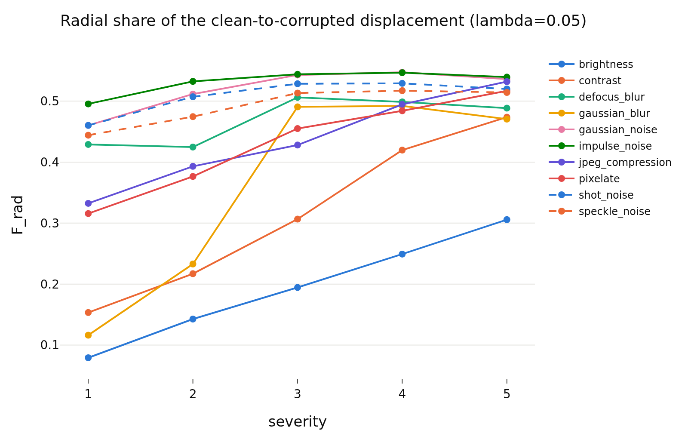
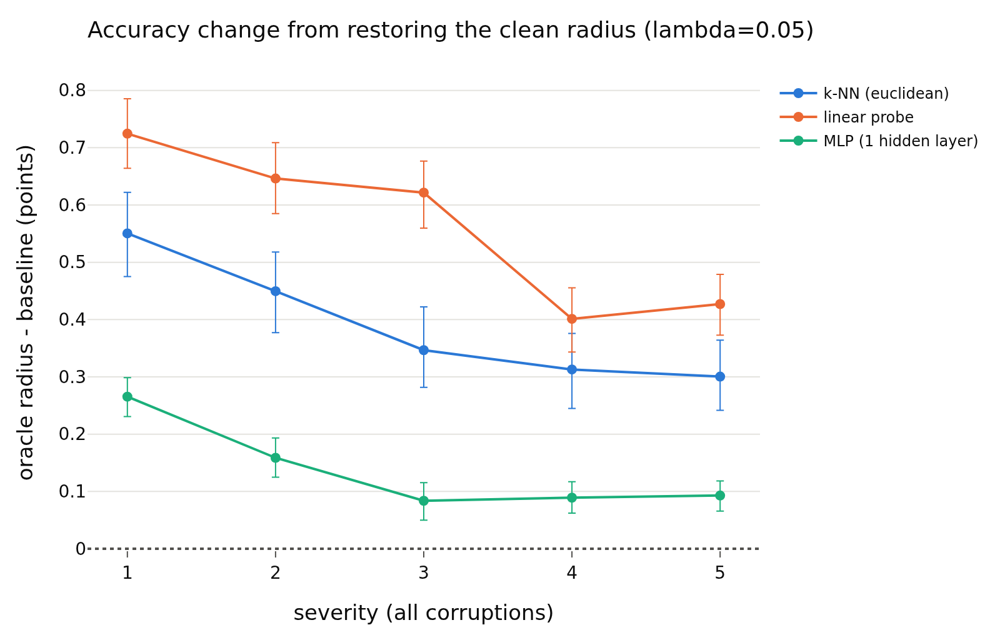

# radius_view_signal, lambda = 0.05
- **Branch / version:** `radius-view-signal` @ `6ff28d6` (code; notes committed after)
- **Run datetime (UTC):** 2026-10-26T04:01Z to 05:20Z (units and aggregation, see commands)
- **Command(s):**
  Per-run units (CPU, 8 CPUs, 64 GB, about 15 to 20 min each; jobs 2248755 to 2248758, 2248941, 2248943 to 2248945 and 2248964, 2026-10-26T04:01Z to 04:46Z; checkout of this branch at `6ff28d6`, `PYTHONPATH=<repo>/src`, `.env` with `LEJEPA_NORM_NOTES_DIR` pointing at this checkout's `research_notes/`):
  `sbatch --export=ALL slurm/view_signal.sbatch configs/base.yaml radius_marginal radius_marginal_lam<lambda>_s<seed>` for lambda in 0.02, 0.05, 0.1 and seed in 0, 1, 2 (writes `<runs_dir>/<run>/view_signal.npz`).
  Aggregation (this note and the three per-lambda notes; job 2248965, 8 CPUs, 32 GB, 33 min, finished about 2026-10-26T05:20Z):
  `python apps/analyze.py --config configs/base.yaml --view-signal radius_marginal --note radius_view_signal/view_signal.md`
  History: a first pass of the units (jobs 2248076, 2248257 to 2248260, 2248336 to 2248338, 2248365, 2248547 at commit `de18063`, aggregation job 2248628) lacked the post hoc additions marked below; they were added after seeing it and everything was recomputed. The numbers of the pre-registered comparisons were identical in both passes (all steps are deterministic).
- **Datasets:** STL-10 ([canonical](https://cs.stanford.edu/~acoates/stl10/), [HF `tanganke/stl10`](https://huggingface.co/datasets/tanganke/stl10); the canonical archive was used, HF is for reference) `train` (clean labeled bank) and `test` (clean twins); STL-10-C built locally from STL-10 `test` (10 corruptions x 5 severities, 400k images; no HF mirror).
- **Backbone:** ResNet-18 from scratch ([HF architecture reference](https://huggingface.co/timm/resnet18.a1_in1k), weights not used); `last.pt` (epoch 200) of `radius_marginal_lam{0.02,0.05,0.1}_s{0,1,2}` (Variant A, trained on A100s in earlier work; this study is CPU-only, no GPU was used).
- **Scope:** h is not analyzed; LeJEPA's product is z. All results are z-space.
- **Margins (fixed before the results):** 0.5 accuracy points; 0.01 Spearman. Pre-registration: `preregistration.md` (committed before any analysis code was run).

## Question

Is there a usable signal in how the radius moves under corruption, and in the per-view radius? Parts A to D of `preregistration.md` (geometry, oracle radius, severity from the radius residual, radius-weighted multi-view aggregation), at this lambda only, three training seeds. The cross-lambda summary, the prediction scorecard and the interpretation are in `view_signal.md`.

## Setup (deviations from the base config)

No training. No deviation from `configs/base.yaml` (k = 20, 1000 bootstrap replicates). Post hoc additions (after the first pass, not in the pre-registration, labeled "post hoc" wherever they appear): the radius-change share and the direction cosine in part A, the `random single view`, `highest-residual view` and `lowest-residual view` schemes and their contrasts in part D, and the bank-median-radius `scaled constant` condition in part B was pre-registered. Retrieval is not run in part D (deviation from the original idea list).

## Results

<!-- BEGIN GENERATED: analyze.view_inputs -->
### Inputs

Runs aggregated: `radius_marginal_lam0.05_s0`, `radius_marginal_lam0.05_s1`, `radius_marginal_lam0.05_s2`.

Unit files missing for this lambda:

None.
<!-- END GENERATED: analyze.view_inputs -->

<!-- BEGIN GENERATED: analyze.view_geometry -->
### A. Radial vs tangential share of the displacement

Clean twin -> corrupted image. `F_rad = sum a^2 / sum (a^2 + t^2)` with `a = <z_x - z_c, u_c>` (radial, along the clean direction) and `t` the orthogonal remainder; ratio of sums over images and the level's cells (so strong severities weigh more), seed mean, 95% bootstrap interval. A displacement in a random direction has `F_rad` about 1/256. The null row is the displacement from a clean image to a different clean image.

| lambda | level | radial share F_rad | 95% CI | median r_x / r_c | radius-change share (post hoc) | 95% CI (radius change) | median cos(u_x, u_c) (post hoc) |
|---|---|---|---|---|---|---|---|
| 0.05 | brightness | 0.2536 | [0.2506, 0.2565] | 0.979 | 0.0401 | [0.0391, 0.0411] | 0.937 |
| 0.05 | contrast | 0.3930 | [0.3915, 0.3945] | 0.962 | 0.0264 | [0.0259, 0.0269] | 0.625 |
| 0.05 | defocus_blur | 0.4833 | [0.4817, 0.4850] | 0.913 | 0.0415 | [0.0408, 0.0421] | 0.260 |
| 0.05 | gaussian_blur | 0.4687 | [0.4670, 0.4703] | 0.965 | 0.0349 | [0.0344, 0.0354] | 0.442 |
| 0.05 | gaussian_noise | 0.5238 | [0.5223, 0.5255] | 0.924 | 0.0287 | [0.0282, 0.0292] | 0.074 |
| 0.05 | impulse_noise | 0.5340 | [0.5325, 0.5358] | 0.908 | 0.0322 | [0.0317, 0.0328] | 0.075 |
| 0.05 | jpeg_compression | 0.4657 | [0.4638, 0.4675] | 0.838 | 0.0931 | [0.0920, 0.0943] | 0.756 |
| 0.05 | pixelate | 0.4657 | [0.4641, 0.4674] | 0.899 | 0.0457 | [0.0450, 0.0464] | 0.554 |
| 0.05 | shot_noise | 0.5126 | [0.5111, 0.5143] | 0.940 | 0.0284 | [0.0279, 0.0289] | 0.081 |
| 0.05 | speckle_noise | 0.4989 | [0.4973, 0.5008] | 0.931 | 0.0327 | [0.0321, 0.0333] | 0.175 |
| 0.05 | severity 1 (all corruptions) | 0.4329 | [0.4311, 0.4349] | 0.940 | 0.0508 | [0.0501, 0.0515] | 0.789 |
| 0.05 | severity 2 (all corruptions) | 0.4642 | [0.4626, 0.4660] | 0.923 | 0.0457 | [0.0451, 0.0463] | 0.661 |
| 0.05 | severity 3 (all corruptions) | 0.4949 | [0.4935, 0.4964] | 0.913 | 0.0394 | [0.0388, 0.0399] | 0.294 |
| 0.05 | severity 4 (all corruptions) | 0.5016 | [0.5003, 0.5029] | 0.931 | 0.0314 | [0.0309, 0.0319] | 0.131 |
| 0.05 | severity 5 (all corruptions) | 0.5020 | [0.5008, 0.5033] | 0.951 | 0.0279 | [0.0275, 0.0283] | 0.062 |
| 0.05 | all corruptions | 0.4877 | [0.4864, 0.4892] | 0.931 | 0.0361 | [0.0356, 0.0366] | 0.342 |
| 0.05 | null: clean image -> other clean image | 0.5072 | [0.5056, 0.5089] |  | 0.0314 | [0.0309, 0.0320] | -0.033 |
<!-- END GENERATED: analyze.view_geometry -->

<!-- BEGIN GENERATED: analyze.view_geometry_cells -->
### A. Radial share per cell

| lambda | corruption | severity | radial share F_rad | median r_x / r_c | radius-change share (post hoc) | median cos(u_x, u_c) (post hoc) |
|---|---|---|---|---|---|---|
| 0.05 | brightness | 1 | 0.0793 | 0.997 | 0.0369 | 0.993 |
| 0.05 | brightness | 2 | 0.1427 | 0.987 | 0.0384 | 0.971 |
| 0.05 | brightness | 3 | 0.1945 | 0.972 | 0.0386 | 0.929 |
| 0.05 | brightness | 4 | 0.2492 | 0.952 | 0.0396 | 0.854 |
| 0.05 | brightness | 5 | 0.3056 | 0.932 | 0.0413 | 0.750 |
| 0.05 | contrast | 1 | 0.1534 | 0.974 | 0.0268 | 0.914 |
| 0.05 | contrast | 2 | 0.2170 | 0.958 | 0.0285 | 0.826 |
| 0.05 | contrast | 3 | 0.3065 | 0.940 | 0.0305 | 0.637 |
| 0.05 | contrast | 4 | 0.4196 | 0.952 | 0.0290 | 0.272 |
| 0.05 | contrast | 5 | 0.4736 | 0.988 | 0.0223 | 0.070 |
| 0.05 | defocus_blur | 1 | 0.4289 | 0.891 | 0.0649 | 0.717 |
| 0.05 | defocus_blur | 2 | 0.4246 | 0.878 | 0.0706 | 0.710 |
| 0.05 | defocus_blur | 3 | 0.5060 | 0.884 | 0.0456 | 0.184 |
| 0.05 | defocus_blur | 4 | 0.4986 | 0.958 | 0.0321 | 0.070 |
| 0.05 | defocus_blur | 5 | 0.4884 | 1.000 | 0.0299 | 0.042 |
| 0.05 | gaussian_blur | 1 | 0.1163 | 0.978 | 0.0576 | 0.973 |
| 0.05 | gaussian_blur | 2 | 0.2329 | 0.940 | 0.0683 | 0.921 |
| 0.05 | gaussian_blur | 3 | 0.4904 | 0.872 | 0.0531 | 0.283 |
| 0.05 | gaussian_blur | 4 | 0.4921 | 0.979 | 0.0285 | 0.053 |
| 0.05 | gaussian_blur | 5 | 0.4704 | 1.067 | 0.0256 | 0.009 |
| 0.05 | gaussian_noise | 1 | 0.4601 | 0.910 | 0.0396 | 0.318 |
| 0.05 | gaussian_noise | 2 | 0.5115 | 0.906 | 0.0338 | 0.147 |
| 0.05 | gaussian_noise | 3 | 0.5427 | 0.907 | 0.0301 | 0.048 |
| 0.05 | gaussian_noise | 4 | 0.5472 | 0.931 | 0.0249 | 0.000 |
| 0.05 | gaussian_noise | 5 | 0.5360 | 0.970 | 0.0202 | -0.020 |
| 0.05 | impulse_noise | 1 | 0.4953 | 0.861 | 0.0518 | 0.326 |
| 0.05 | impulse_noise | 2 | 0.5322 | 0.889 | 0.0371 | 0.122 |
| 0.05 | impulse_noise | 3 | 0.5438 | 0.902 | 0.0329 | 0.057 |
| 0.05 | impulse_noise | 4 | 0.5465 | 0.932 | 0.0261 | 0.002 |
| 0.05 | impulse_noise | 5 | 0.5392 | 0.961 | 0.0216 | -0.017 |
| 0.05 | jpeg_compression | 1 | 0.3323 | 0.880 | 0.1044 | 0.873 |
| 0.05 | jpeg_compression | 2 | 0.3930 | 0.850 | 0.1091 | 0.815 |
| 0.05 | jpeg_compression | 3 | 0.4279 | 0.832 | 0.1083 | 0.771 |
| 0.05 | jpeg_compression | 4 | 0.4945 | 0.806 | 0.0944 | 0.616 |
| 0.05 | jpeg_compression | 5 | 0.5319 | 0.805 | 0.0750 | 0.412 |
| 0.05 | pixelate | 1 | 0.3156 | 0.911 | 0.0777 | 0.877 |
| 0.05 | pixelate | 2 | 0.3764 | 0.891 | 0.0732 | 0.782 |
| 0.05 | pixelate | 3 | 0.4549 | 0.907 | 0.0430 | 0.333 |
| 0.05 | pixelate | 4 | 0.4840 | 0.904 | 0.0389 | 0.180 |
| 0.05 | pixelate | 5 | 0.5167 | 0.880 | 0.0400 | 0.126 |
| 0.05 | shot_noise | 1 | 0.4601 | 0.904 | 0.0429 | 0.352 |
| 0.05 | shot_noise | 2 | 0.5070 | 0.912 | 0.0364 | 0.156 |
| 0.05 | shot_noise | 3 | 0.5283 | 0.928 | 0.0292 | 0.059 |
| 0.05 | shot_noise | 4 | 0.5290 | 0.964 | 0.0217 | -0.000 |
| 0.05 | shot_noise | 5 | 0.5197 | 0.996 | 0.0193 | -0.015 |
| 0.05 | speckle_noise | 1 | 0.4440 | 0.905 | 0.0475 | 0.504 |
| 0.05 | speckle_noise | 2 | 0.4744 | 0.903 | 0.0443 | 0.340 |
| 0.05 | speckle_noise | 3 | 0.5131 | 0.927 | 0.0332 | 0.120 |
| 0.05 | speckle_noise | 4 | 0.5170 | 0.949 | 0.0271 | 0.063 |
| 0.05 | speckle_noise | 5 | 0.5141 | 0.975 | 0.0222 | 0.025 |
<!-- END GENERATED: analyze.view_geometry_cells -->

<!-- BEGIN GENERATED: analyze.view_oracle -->
### B. Oracle radius: accuracy of frozen readers

Differences are in accuracy points (condition minus reference on the same images), averaged over training seeds; intervals are paired bootstrap percentile intervals (1000 replicates, test images resampled within each seed, the same resample for every comparison of a seed). Verdict, with the equivalence margin set to ±0.5 points before looking at results: `equivalent` if the 90% interval lies inside the margin, `different` if not equivalent and the 95% interval excludes 0, otherwise `inconclusive`. Readers are fitted on the clean STL-10 train bank only.

| lambda | level | reader | contrast | accuracy | reference accuracy | difference (points) | 90% CI | 95% CI | verdict |
|---|---|---|---|---|---|---|---|---|---|
| 0.05 | brightness | k-NN (euclidean) | oracle radius - baseline | 0.7330 | 0.7301 | +0.29 | [+0.22, +0.35] | [+0.21, +0.37] | equivalent |
| 0.05 | brightness | k-NN (euclidean) | scaled constant - baseline | 0.7349 | 0.7301 | +0.48 | [+0.38, +0.57] | [+0.36, +0.59] | different |
| 0.05 | brightness | k-NN (euclidean) | oracle direction - clean twin | 0.7875 | 0.7870 | +0.04 | [-0.06, +0.14] | [-0.07, +0.16] | equivalent |
| 0.05 | brightness | k-NN (euclidean) | baseline - clean twin (total corruption loss) | 0.7301 | 0.7870 | -5.69 | [-6.00, -5.38] | [-6.05, -5.33] | different |
| 0.05 | contrast | k-NN (euclidean) | oracle radius - baseline | 0.5480 | 0.5460 | +0.20 | [+0.11, +0.29] | [+0.09, +0.31] | equivalent |
| 0.05 | contrast | k-NN (euclidean) | scaled constant - baseline | 0.5496 | 0.5460 | +0.36 | [+0.27, +0.45] | [+0.25, +0.46] | equivalent |
| 0.05 | contrast | k-NN (euclidean) | oracle direction - clean twin | 0.7879 | 0.7870 | +0.08 | [-0.03, +0.20] | [-0.06, +0.23] | equivalent |
| 0.05 | contrast | k-NN (euclidean) | baseline - clean twin (total corruption loss) | 0.5460 | 0.7870 | -24.10 | [-24.48, -23.71] | [-24.57, -23.64] | different |
| 0.05 | defocus_blur | k-NN (euclidean) | oracle radius - baseline | 0.2929 | 0.2890 | +0.39 | [+0.32, +0.46] | [+0.31, +0.47] | equivalent |
| 0.05 | defocus_blur | k-NN (euclidean) | scaled constant - baseline | 0.2905 | 0.2890 | +0.16 | [+0.09, +0.22] | [+0.07, +0.24] | equivalent |
| 0.05 | defocus_blur | k-NN (euclidean) | oracle direction - clean twin | 0.7882 | 0.7870 | +0.12 | [-0.02, +0.24] | [-0.04, +0.27] | equivalent |
| 0.05 | defocus_blur | k-NN (euclidean) | baseline - clean twin (total corruption loss) | 0.2890 | 0.7870 | -49.81 | [-50.27, -49.36] | [-50.35, -49.28] | different |
| 0.05 | gaussian_blur | k-NN (euclidean) | oracle radius - baseline | 0.3889 | 0.3868 | +0.22 | [+0.16, +0.27] | [+0.15, +0.28] | equivalent |
| 0.05 | gaussian_blur | k-NN (euclidean) | scaled constant - baseline | 0.3881 | 0.3868 | +0.13 | [+0.06, +0.19] | [+0.05, +0.21] | equivalent |
| 0.05 | gaussian_blur | k-NN (euclidean) | oracle direction - clean twin | 0.7876 | 0.7870 | +0.05 | [-0.07, +0.16] | [-0.09, +0.18] | equivalent |
| 0.05 | gaussian_blur | k-NN (euclidean) | baseline - clean twin (total corruption loss) | 0.3868 | 0.7870 | -40.03 | [-40.42, -39.66] | [-40.47, -39.59] | different |
| 0.05 | gaussian_noise | k-NN (euclidean) | oracle radius - baseline | 0.1734 | 0.1715 | +0.19 | [+0.10, +0.28] | [+0.09, +0.30] | equivalent |
| 0.05 | gaussian_noise | k-NN (euclidean) | scaled constant - baseline | 0.1714 | 0.1715 | -0.00 | [-0.08, +0.07] | [-0.09, +0.09] | equivalent |
| 0.05 | gaussian_noise | k-NN (euclidean) | oracle direction - clean twin | 0.7877 | 0.7870 | +0.06 | [-0.08, +0.21] | [-0.11, +0.23] | equivalent |
| 0.05 | gaussian_noise | k-NN (euclidean) | baseline - clean twin (total corruption loss) | 0.1715 | 0.7870 | -61.56 | [-62.05, -61.03] | [-62.14, -60.94] | different |
| 0.05 | impulse_noise | k-NN (euclidean) | oracle radius - baseline | 0.1713 | 0.1683 | +0.30 | [+0.21, +0.38] | [+0.19, +0.39] | equivalent |
| 0.05 | impulse_noise | k-NN (euclidean) | scaled constant - baseline | 0.1690 | 0.1683 | +0.07 | [-0.01, +0.14] | [-0.03, +0.16] | equivalent |
| 0.05 | impulse_noise | k-NN (euclidean) | oracle direction - clean twin | 0.7879 | 0.7870 | +0.08 | [-0.06, +0.22] | [-0.09, +0.23] | equivalent |
| 0.05 | impulse_noise | k-NN (euclidean) | baseline - clean twin (total corruption loss) | 0.1683 | 0.7870 | -61.87 | [-62.35, -61.36] | [-62.48, -61.26] | different |
| 0.05 | jpeg_compression | k-NN (euclidean) | oracle radius - baseline | 0.5614 | 0.5515 | +0.99 | [+0.88, +1.10] | [+0.85, +1.11] | different |
| 0.05 | jpeg_compression | k-NN (euclidean) | scaled constant - baseline | 0.5614 | 0.5515 | +0.99 | [+0.87, +1.10] | [+0.84, +1.12] | different |
| 0.05 | jpeg_compression | k-NN (euclidean) | oracle direction - clean twin | 0.7864 | 0.7870 | -0.06 | [-0.23, +0.10] | [-0.26, +0.13] | equivalent |
| 0.05 | jpeg_compression | k-NN (euclidean) | baseline - clean twin (total corruption loss) | 0.5515 | 0.7870 | -23.55 | [-23.95, -23.14] | [-24.00, -23.08] | different |
| 0.05 | pixelate | k-NN (euclidean) | oracle radius - baseline | 0.4038 | 0.3972 | +0.67 | [+0.58, +0.75] | [+0.57, +0.77] | different |
| 0.05 | pixelate | k-NN (euclidean) | scaled constant - baseline | 0.4045 | 0.3972 | +0.74 | [+0.65, +0.82] | [+0.64, +0.84] | different |
| 0.05 | pixelate | k-NN (euclidean) | oracle direction - clean twin | 0.7868 | 0.7870 | -0.02 | [-0.16, +0.11] | [-0.19, +0.13] | equivalent |
| 0.05 | pixelate | k-NN (euclidean) | baseline - clean twin (total corruption loss) | 0.3972 | 0.7870 | -38.99 | [-39.42, -38.55] | [-39.50, -38.45] | different |
| 0.05 | shot_noise | k-NN (euclidean) | oracle radius - baseline | 0.1827 | 0.1788 | +0.39 | [+0.30, +0.47] | [+0.29, +0.49] | equivalent |
| 0.05 | shot_noise | k-NN (euclidean) | scaled constant - baseline | 0.1803 | 0.1788 | +0.15 | [+0.07, +0.22] | [+0.05, +0.23] | equivalent |
| 0.05 | shot_noise | k-NN (euclidean) | oracle direction - clean twin | 0.7875 | 0.7870 | +0.05 | [-0.09, +0.19] | [-0.13, +0.22] | equivalent |
| 0.05 | shot_noise | k-NN (euclidean) | baseline - clean twin (total corruption loss) | 0.1788 | 0.7870 | -60.82 | [-61.30, -60.33] | [-61.40, -60.22] | different |
| 0.05 | speckle_noise | k-NN (euclidean) | oracle radius - baseline | 0.2610 | 0.2580 | +0.29 | [+0.19, +0.38] | [+0.18, +0.40] | equivalent |
| 0.05 | speckle_noise | k-NN (euclidean) | scaled constant - baseline | 0.2607 | 0.2580 | +0.26 | [+0.18, +0.34] | [+0.17, +0.36] | equivalent |
| 0.05 | speckle_noise | k-NN (euclidean) | oracle direction - clean twin | 0.7873 | 0.7870 | +0.03 | [-0.11, +0.17] | [-0.14, +0.19] | equivalent |
| 0.05 | speckle_noise | k-NN (euclidean) | baseline - clean twin (total corruption loss) | 0.2580 | 0.7870 | -52.90 | [-53.38, -52.40] | [-53.47, -52.30] | different |
| 0.05 | severity 1 (all corruptions) | k-NN (euclidean) | oracle radius - baseline | 0.5641 | 0.5586 | +0.55 | [+0.49, +0.61] | [+0.47, +0.62] | different |
| 0.05 | severity 1 (all corruptions) | k-NN (euclidean) | scaled constant - baseline | 0.5631 | 0.5586 | +0.45 | [+0.38, +0.53] | [+0.36, +0.54] | different |
| 0.05 | severity 1 (all corruptions) | k-NN (euclidean) | oracle direction - clean twin | 0.7876 | 0.7870 | +0.06 | [-0.05, +0.16] | [-0.07, +0.18] | equivalent |
| 0.05 | severity 1 (all corruptions) | k-NN (euclidean) | baseline - clean twin (total corruption loss) | 0.5586 | 0.7870 | -22.85 | [-23.16, -22.54] | [-23.22, -22.47] | different |
| 0.05 | severity 2 (all corruptions) | k-NN (euclidean) | oracle radius - baseline | 0.4885 | 0.4840 | +0.45 | [+0.39, +0.51] | [+0.38, +0.52] | different |
| 0.05 | severity 2 (all corruptions) | k-NN (euclidean) | scaled constant - baseline | 0.4880 | 0.4840 | +0.40 | [+0.34, +0.46] | [+0.32, +0.48] | equivalent |
| 0.05 | severity 2 (all corruptions) | k-NN (euclidean) | oracle direction - clean twin | 0.7874 | 0.7870 | +0.04 | [-0.08, +0.15] | [-0.10, +0.17] | equivalent |
| 0.05 | severity 2 (all corruptions) | k-NN (euclidean) | baseline - clean twin (total corruption loss) | 0.4840 | 0.7870 | -30.30 | [-30.64, -29.96] | [-30.68, -29.88] | different |
| 0.05 | severity 3 (all corruptions) | k-NN (euclidean) | oracle radius - baseline | 0.3317 | 0.3283 | +0.35 | [+0.29, +0.41] | [+0.28, +0.42] | equivalent |
| 0.05 | severity 3 (all corruptions) | k-NN (euclidean) | scaled constant - baseline | 0.3311 | 0.3283 | +0.28 | [+0.23, +0.34] | [+0.22, +0.35] | equivalent |
| 0.05 | severity 3 (all corruptions) | k-NN (euclidean) | oracle direction - clean twin | 0.7875 | 0.7870 | +0.05 | [-0.09, +0.17] | [-0.10, +0.19] | equivalent |
| 0.05 | severity 3 (all corruptions) | k-NN (euclidean) | baseline - clean twin (total corruption loss) | 0.3283 | 0.7870 | -45.88 | [-46.25, -45.49] | [-46.35, -45.37] | different |
| 0.05 | severity 4 (all corruptions) | k-NN (euclidean) | oracle radius - baseline | 0.2581 | 0.2550 | +0.31 | [+0.26, +0.37] | [+0.25, +0.38] | equivalent |
| 0.05 | severity 4 (all corruptions) | k-NN (euclidean) | scaled constant - baseline | 0.2575 | 0.2550 | +0.25 | [+0.21, +0.30] | [+0.19, +0.31] | equivalent |
| 0.05 | severity 4 (all corruptions) | k-NN (euclidean) | oracle direction - clean twin | 0.7875 | 0.7870 | +0.05 | [-0.09, +0.17] | [-0.11, +0.19] | equivalent |
| 0.05 | severity 4 (all corruptions) | k-NN (euclidean) | baseline - clean twin (total corruption loss) | 0.2550 | 0.7870 | -53.21 | [-53.63, -52.77] | [-53.68, -52.70] | different |
| 0.05 | severity 5 (all corruptions) | k-NN (euclidean) | oracle radius - baseline | 0.2158 | 0.2128 | +0.30 | [+0.25, +0.36] | [+0.24, +0.36] | equivalent |
| 0.05 | severity 5 (all corruptions) | k-NN (euclidean) | scaled constant - baseline | 0.2154 | 0.2128 | +0.27 | [+0.22, +0.31] | [+0.21, +0.32] | equivalent |
| 0.05 | severity 5 (all corruptions) | k-NN (euclidean) | oracle direction - clean twin | 0.7873 | 0.7870 | +0.02 | [-0.11, +0.15] | [-0.13, +0.18] | equivalent |
| 0.05 | severity 5 (all corruptions) | k-NN (euclidean) | baseline - clean twin (total corruption loss) | 0.2128 | 0.7870 | -57.42 | [-57.86, -56.99] | [-57.95, -56.89] | different |
| 0.05 | all corruptions | k-NN (euclidean) | oracle radius - baseline | 0.3716 | 0.3677 | +0.39 | [+0.36, +0.42] | [+0.36, +0.43] | equivalent |
| 0.05 | all corruptions | k-NN (euclidean) | scaled constant - baseline | 0.3710 | 0.3677 | +0.33 | [+0.30, +0.36] | [+0.29, +0.37] | equivalent |
| 0.05 | all corruptions | k-NN (euclidean) | oracle direction - clean twin | 0.7875 | 0.7870 | +0.04 | [-0.08, +0.15] | [-0.10, +0.18] | equivalent |
| 0.05 | all corruptions | k-NN (euclidean) | baseline - clean twin (total corruption loss) | 0.3677 | 0.7870 | -41.93 | [-42.27, -41.57] | [-42.34, -41.49] | different |
| 0.05 | brightness | linear probe | oracle radius - baseline | 0.7483 | 0.7451 | +0.32 | [+0.26, +0.37] | [+0.26, +0.38] | equivalent |
| 0.05 | brightness | linear probe | scaled constant - baseline | 0.7475 | 0.7451 | +0.24 | [+0.16, +0.33] | [+0.15, +0.35] | equivalent |
| 0.05 | brightness | linear probe | oracle direction - clean twin | 0.8154 | 0.8175 | -0.20 | [-0.28, -0.12] | [-0.30, -0.11] | equivalent |
| 0.05 | brightness | linear probe | baseline - clean twin (total corruption loss) | 0.7451 | 0.8175 | -7.23 | [-7.55, -6.92] | [-7.59, -6.87] | different |
| 0.05 | contrast | linear probe | oracle radius - baseline | 0.5529 | 0.5490 | +0.39 | [+0.33, +0.46] | [+0.32, +0.47] | equivalent |
| 0.05 | contrast | linear probe | scaled constant - baseline | 0.5511 | 0.5490 | +0.21 | [+0.14, +0.28] | [+0.13, +0.29] | equivalent |
| 0.05 | contrast | linear probe | oracle direction - clean twin | 0.8157 | 0.8175 | -0.18 | [-0.27, -0.08] | [-0.29, -0.06] | equivalent |
| 0.05 | contrast | linear probe | baseline - clean twin (total corruption loss) | 0.5490 | 0.8175 | -26.85 | [-27.25, -26.44] | [-27.35, -26.37] | different |
| 0.05 | defocus_blur | linear probe | oracle radius - baseline | 0.3098 | 0.3023 | +0.75 | [+0.69, +0.81] | [+0.68, +0.82] | different |
| 0.05 | defocus_blur | linear probe | scaled constant - baseline | 0.3064 | 0.3023 | +0.41 | [+0.35, +0.47] | [+0.34, +0.49] | equivalent |
| 0.05 | defocus_blur | linear probe | oracle direction - clean twin | 0.8143 | 0.8175 | -0.32 | [-0.43, -0.19] | [-0.46, -0.17] | equivalent |
| 0.05 | defocus_blur | linear probe | baseline - clean twin (total corruption loss) | 0.3023 | 0.8175 | -51.52 | [-51.93, -51.06] | [-52.03, -50.95] | different |
| 0.05 | gaussian_blur | linear probe | oracle radius - baseline | 0.3985 | 0.3947 | +0.38 | [+0.33, +0.43] | [+0.32, +0.44] | equivalent |
| 0.05 | gaussian_blur | linear probe | scaled constant - baseline | 0.3970 | 0.3947 | +0.23 | [+0.18, +0.29] | [+0.17, +0.30] | equivalent |
| 0.05 | gaussian_blur | linear probe | oracle direction - clean twin | 0.8151 | 0.8175 | -0.24 | [-0.33, -0.14] | [-0.35, -0.11] | equivalent |
| 0.05 | gaussian_blur | linear probe | baseline - clean twin (total corruption loss) | 0.3947 | 0.8175 | -42.27 | [-42.64, -41.91] | [-42.70, -41.84] | different |
| 0.05 | gaussian_noise | linear probe | oracle radius - baseline | 0.1909 | 0.1842 | +0.68 | [+0.60, +0.75] | [+0.59, +0.76] | different |
| 0.05 | gaussian_noise | linear probe | scaled constant - baseline | 0.1877 | 0.1842 | +0.36 | [+0.30, +0.42] | [+0.28, +0.43] | equivalent |
| 0.05 | gaussian_noise | linear probe | oracle direction - clean twin | 0.8145 | 0.8175 | -0.30 | [-0.42, -0.16] | [-0.44, -0.14] | equivalent |
| 0.05 | gaussian_noise | linear probe | baseline - clean twin (total corruption loss) | 0.1842 | 0.8175 | -63.33 | [-63.85, -62.77] | [-63.93, -62.67] | different |
| 0.05 | impulse_noise | linear probe | oracle radius - baseline | 0.1810 | 0.1750 | +0.59 | [+0.53, +0.66] | [+0.52, +0.68] | different |
| 0.05 | impulse_noise | linear probe | scaled constant - baseline | 0.1776 | 0.1750 | +0.25 | [+0.20, +0.31] | [+0.19, +0.32] | equivalent |
| 0.05 | impulse_noise | linear probe | oracle direction - clean twin | 0.8142 | 0.8175 | -0.32 | [-0.44, -0.18] | [-0.46, -0.16] | equivalent |
| 0.05 | impulse_noise | linear probe | baseline - clean twin (total corruption loss) | 0.1750 | 0.8175 | -64.24 | [-64.73, -63.71] | [-64.81, -63.62] | different |
| 0.05 | jpeg_compression | linear probe | oracle radius - baseline | 0.5337 | 0.5299 | +0.38 | [+0.30, +0.46] | [+0.28, +0.48] | equivalent |
| 0.05 | jpeg_compression | linear probe | scaled constant - baseline | 0.5311 | 0.5299 | +0.13 | [+0.04, +0.22] | [+0.02, +0.24] | equivalent |
| 0.05 | jpeg_compression | linear probe | oracle direction - clean twin | 0.8121 | 0.8175 | -0.54 | [-0.70, -0.38] | [-0.74, -0.35] | different |
| 0.05 | jpeg_compression | linear probe | baseline - clean twin (total corruption loss) | 0.5299 | 0.8175 | -28.76 | [-29.19, -28.31] | [-29.28, -28.20] | different |
| 0.05 | pixelate | linear probe | oracle radius - baseline | 0.3719 | 0.3710 | +0.09 | [+0.03, +0.15] | [+0.02, +0.16] | equivalent |
| 0.05 | pixelate | linear probe | scaled constant - baseline | 0.3688 | 0.3710 | -0.22 | [-0.28, -0.16] | [-0.28, -0.14] | equivalent |
| 0.05 | pixelate | linear probe | oracle direction - clean twin | 0.8135 | 0.8175 | -0.39 | [-0.52, -0.26] | [-0.55, -0.24] | different |
| 0.05 | pixelate | linear probe | baseline - clean twin (total corruption loss) | 0.3710 | 0.8175 | -44.65 | [-45.07, -44.18] | [-45.17, -44.11] | different |
| 0.05 | shot_noise | linear probe | oracle radius - baseline | 0.2074 | 0.1985 | +0.90 | [+0.82, +0.97] | [+0.80, +0.99] | different |
| 0.05 | shot_noise | linear probe | scaled constant - baseline | 0.2032 | 0.1985 | +0.47 | [+0.41, +0.53] | [+0.39, +0.54] | different |
| 0.05 | shot_noise | linear probe | oracle direction - clean twin | 0.8145 | 0.8175 | -0.29 | [-0.41, -0.16] | [-0.43, -0.14] | equivalent |
| 0.05 | shot_noise | linear probe | baseline - clean twin (total corruption loss) | 0.1985 | 0.8175 | -61.90 | [-62.41, -61.35] | [-62.49, -61.26] | different |
| 0.05 | speckle_noise | linear probe | oracle radius - baseline | 0.2859 | 0.2743 | +1.16 | [+1.07, +1.24] | [+1.05, +1.26] | different |
| 0.05 | speckle_noise | linear probe | scaled constant - baseline | 0.2812 | 0.2743 | +0.68 | [+0.62, +0.75] | [+0.60, +0.76] | different |
| 0.05 | speckle_noise | linear probe | oracle direction - clean twin | 0.8149 | 0.8175 | -0.26 | [-0.38, -0.13] | [-0.40, -0.11] | equivalent |
| 0.05 | speckle_noise | linear probe | baseline - clean twin (total corruption loss) | 0.2743 | 0.8175 | -54.31 | [-54.82, -53.80] | [-54.90, -53.71] | different |
| 0.05 | severity 1 (all corruptions) | linear probe | oracle radius - baseline | 0.5746 | 0.5673 | +0.72 | [+0.67, +0.77] | [+0.66, +0.79] | different |
| 0.05 | severity 1 (all corruptions) | linear probe | scaled constant - baseline | 0.5719 | 0.5673 | +0.46 | [+0.39, +0.52] | [+0.38, +0.53] | different |
| 0.05 | severity 1 (all corruptions) | linear probe | oracle direction - clean twin | 0.8152 | 0.8175 | -0.22 | [-0.31, -0.13] | [-0.33, -0.11] | equivalent |
| 0.05 | severity 1 (all corruptions) | linear probe | baseline - clean twin (total corruption loss) | 0.5673 | 0.8175 | -25.01 | [-25.33, -24.67] | [-25.40, -24.62] | different |
| 0.05 | severity 2 (all corruptions) | linear probe | oracle radius - baseline | 0.4958 | 0.4893 | +0.65 | [+0.59, +0.70] | [+0.58, +0.71] | different |
| 0.05 | severity 2 (all corruptions) | linear probe | scaled constant - baseline | 0.4928 | 0.4893 | +0.35 | [+0.30, +0.41] | [+0.29, +0.42] | equivalent |
| 0.05 | severity 2 (all corruptions) | linear probe | oracle direction - clean twin | 0.8147 | 0.8175 | -0.28 | [-0.38, -0.17] | [-0.39, -0.16] | equivalent |
| 0.05 | severity 2 (all corruptions) | linear probe | baseline - clean twin (total corruption loss) | 0.4893 | 0.8175 | -32.81 | [-33.16, -32.45] | [-33.23, -32.37] | different |
| 0.05 | severity 3 (all corruptions) | linear probe | oracle radius - baseline | 0.3413 | 0.3350 | +0.62 | [+0.57, +0.67] | [+0.56, +0.68] | different |
| 0.05 | severity 3 (all corruptions) | linear probe | scaled constant - baseline | 0.3381 | 0.3350 | +0.31 | [+0.26, +0.36] | [+0.25, +0.37] | equivalent |
| 0.05 | severity 3 (all corruptions) | linear probe | oracle direction - clean twin | 0.8140 | 0.8175 | -0.34 | [-0.45, -0.23] | [-0.47, -0.21] | equivalent |
| 0.05 | severity 3 (all corruptions) | linear probe | baseline - clean twin (total corruption loss) | 0.3350 | 0.8175 | -48.24 | [-48.62, -47.84] | [-48.69, -47.75] | different |
| 0.05 | severity 4 (all corruptions) | linear probe | oracle radius - baseline | 0.2609 | 0.2569 | +0.40 | [+0.35, +0.45] | [+0.34, +0.46] | equivalent |
| 0.05 | severity 4 (all corruptions) | linear probe | scaled constant - baseline | 0.2584 | 0.2569 | +0.15 | [+0.11, +0.18] | [+0.10, +0.19] | equivalent |
| 0.05 | severity 4 (all corruptions) | linear probe | oracle direction - clean twin | 0.8141 | 0.8175 | -0.33 | [-0.44, -0.21] | [-0.46, -0.19] | equivalent |
| 0.05 | severity 4 (all corruptions) | linear probe | baseline - clean twin (total corruption loss) | 0.2569 | 0.8175 | -56.06 | [-56.46, -55.63] | [-56.52, -55.55] | different |
| 0.05 | severity 5 (all corruptions) | linear probe | oracle radius - baseline | 0.2177 | 0.2134 | +0.43 | [+0.38, +0.47] | [+0.37, +0.48] | equivalent |
| 0.05 | severity 5 (all corruptions) | linear probe | scaled constant - baseline | 0.2146 | 0.2134 | +0.12 | [+0.09, +0.15] | [+0.08, +0.16] | equivalent |
| 0.05 | severity 5 (all corruptions) | linear probe | oracle direction - clean twin | 0.8140 | 0.8175 | -0.34 | [-0.45, -0.22] | [-0.47, -0.20] | equivalent |
| 0.05 | severity 5 (all corruptions) | linear probe | baseline - clean twin (total corruption loss) | 0.2134 | 0.8175 | -60.41 | [-60.82, -59.97] | [-60.87, -59.91] | different |
| 0.05 | all corruptions | linear probe | oracle radius - baseline | 0.3780 | 0.3724 | +0.56 | [+0.53, +0.59] | [+0.53, +0.60] | different |
| 0.05 | all corruptions | linear probe | scaled constant - baseline | 0.3752 | 0.3724 | +0.28 | [+0.25, +0.31] | [+0.24, +0.31] | equivalent |
| 0.05 | all corruptions | linear probe | oracle direction - clean twin | 0.8144 | 0.8175 | -0.30 | [-0.40, -0.20] | [-0.42, -0.18] | equivalent |
| 0.05 | all corruptions | linear probe | baseline - clean twin (total corruption loss) | 0.3724 | 0.8175 | -44.51 | [-44.85, -44.13] | [-44.93, -44.07] | different |
| 0.05 | brightness | MLP (1 hidden layer) | oracle radius - baseline | 0.7487 | 0.7474 | +0.13 | [+0.10, +0.16] | [+0.10, +0.17] | equivalent |
| 0.05 | brightness | MLP (1 hidden layer) | scaled constant - baseline | 0.7488 | 0.7474 | +0.14 | [+0.09, +0.18] | [+0.09, +0.19] | equivalent |
| 0.05 | brightness | MLP (1 hidden layer) | oracle direction - clean twin | 0.8152 | 0.8155 | -0.04 | [-0.08, +0.01] | [-0.09, +0.02] | equivalent |
| 0.05 | brightness | MLP (1 hidden layer) | baseline - clean twin (total corruption loss) | 0.7474 | 0.8155 | -6.81 | [-7.11, -6.50] | [-7.17, -6.44] | different |
| 0.05 | contrast | MLP (1 hidden layer) | oracle radius - baseline | 0.5630 | 0.5617 | +0.12 | [+0.09, +0.16] | [+0.08, +0.16] | equivalent |
| 0.05 | contrast | MLP (1 hidden layer) | scaled constant - baseline | 0.5626 | 0.5617 | +0.09 | [+0.05, +0.13] | [+0.05, +0.14] | equivalent |
| 0.05 | contrast | MLP (1 hidden layer) | oracle direction - clean twin | 0.8152 | 0.8155 | -0.04 | [-0.10, +0.02] | [-0.11, +0.03] | equivalent |
| 0.05 | contrast | MLP (1 hidden layer) | baseline - clean twin (total corruption loss) | 0.5617 | 0.8155 | -25.38 | [-25.77, -25.02] | [-25.86, -24.94] | different |
| 0.05 | defocus_blur | MLP (1 hidden layer) | oracle radius - baseline | 0.3163 | 0.3155 | +0.07 | [+0.04, +0.11] | [+0.03, +0.11] | equivalent |
| 0.05 | defocus_blur | MLP (1 hidden layer) | scaled constant - baseline | 0.3159 | 0.3155 | +0.04 | [+0.00, +0.08] | [-0.00, +0.08] | equivalent |
| 0.05 | defocus_blur | MLP (1 hidden layer) | oracle direction - clean twin | 0.8150 | 0.8155 | -0.05 | [-0.12, +0.02] | [-0.14, +0.03] | equivalent |
| 0.05 | defocus_blur | MLP (1 hidden layer) | baseline - clean twin (total corruption loss) | 0.3155 | 0.8155 | -50.00 | [-50.42, -49.59] | [-50.50, -49.50] | different |
| 0.05 | gaussian_blur | MLP (1 hidden layer) | oracle radius - baseline | 0.4027 | 0.4019 | +0.09 | [+0.06, +0.11] | [+0.06, +0.12] | equivalent |
| 0.05 | gaussian_blur | MLP (1 hidden layer) | scaled constant - baseline | 0.4028 | 0.4019 | +0.09 | [+0.06, +0.12] | [+0.05, +0.13] | equivalent |
| 0.05 | gaussian_blur | MLP (1 hidden layer) | oracle direction - clean twin | 0.8149 | 0.8155 | -0.06 | [-0.12, -0.00] | [-0.13, +0.01] | equivalent |
| 0.05 | gaussian_blur | MLP (1 hidden layer) | baseline - clean twin (total corruption loss) | 0.4019 | 0.8155 | -41.37 | [-41.73, -41.02] | [-41.80, -40.94] | different |
| 0.05 | gaussian_noise | MLP (1 hidden layer) | oracle radius - baseline | 0.1748 | 0.1740 | +0.08 | [+0.05, +0.11] | [+0.04, +0.12] | equivalent |
| 0.05 | gaussian_noise | MLP (1 hidden layer) | scaled constant - baseline | 0.1743 | 0.1740 | +0.03 | [+0.00, +0.06] | [-0.00, +0.07] | equivalent |
| 0.05 | gaussian_noise | MLP (1 hidden layer) | oracle direction - clean twin | 0.8152 | 0.8155 | -0.03 | [-0.11, +0.04] | [-0.12, +0.05] | equivalent |
| 0.05 | gaussian_noise | MLP (1 hidden layer) | baseline - clean twin (total corruption loss) | 0.1740 | 0.8155 | -64.16 | [-64.66, -63.64] | [-64.75, -63.53] | different |
| 0.05 | impulse_noise | MLP (1 hidden layer) | oracle radius - baseline | 0.1745 | 0.1735 | +0.10 | [+0.06, +0.14] | [+0.06, +0.14] | equivalent |
| 0.05 | impulse_noise | MLP (1 hidden layer) | scaled constant - baseline | 0.1740 | 0.1735 | +0.05 | [+0.01, +0.08] | [+0.00, +0.09] | equivalent |
| 0.05 | impulse_noise | MLP (1 hidden layer) | oracle direction - clean twin | 0.8153 | 0.8155 | -0.02 | [-0.10, +0.05] | [-0.12, +0.06] | equivalent |
| 0.05 | impulse_noise | MLP (1 hidden layer) | baseline - clean twin (total corruption loss) | 0.1735 | 0.8155 | -64.20 | [-64.68, -63.71] | [-64.76, -63.61] | different |
| 0.05 | jpeg_compression | MLP (1 hidden layer) | oracle radius - baseline | 0.5524 | 0.5495 | +0.29 | [+0.24, +0.34] | [+0.22, +0.35] | equivalent |
| 0.05 | jpeg_compression | MLP (1 hidden layer) | scaled constant - baseline | 0.5526 | 0.5495 | +0.31 | [+0.25, +0.37] | [+0.24, +0.38] | equivalent |
| 0.05 | jpeg_compression | MLP (1 hidden layer) | oracle direction - clean twin | 0.8150 | 0.8155 | -0.05 | [-0.14, +0.04] | [-0.17, +0.06] | equivalent |
| 0.05 | jpeg_compression | MLP (1 hidden layer) | baseline - clean twin (total corruption loss) | 0.5495 | 0.8155 | -26.60 | [-27.02, -26.18] | [-27.09, -26.10] | different |
| 0.05 | pixelate | MLP (1 hidden layer) | oracle radius - baseline | 0.3921 | 0.3906 | +0.15 | [+0.11, +0.19] | [+0.11, +0.19] | equivalent |
| 0.05 | pixelate | MLP (1 hidden layer) | scaled constant - baseline | 0.3916 | 0.3906 | +0.10 | [+0.07, +0.14] | [+0.06, +0.15] | equivalent |
| 0.05 | pixelate | MLP (1 hidden layer) | oracle direction - clean twin | 0.8155 | 0.8155 | -0.00 | [-0.08, +0.08] | [-0.09, +0.09] | equivalent |
| 0.05 | pixelate | MLP (1 hidden layer) | baseline - clean twin (total corruption loss) | 0.3906 | 0.8155 | -42.50 | [-42.94, -42.07] | [-43.02, -41.99] | different |
| 0.05 | shot_noise | MLP (1 hidden layer) | oracle radius - baseline | 0.1918 | 0.1905 | +0.13 | [+0.10, +0.17] | [+0.09, +0.18] | equivalent |
| 0.05 | shot_noise | MLP (1 hidden layer) | scaled constant - baseline | 0.1911 | 0.1905 | +0.06 | [+0.03, +0.10] | [+0.03, +0.10] | equivalent |
| 0.05 | shot_noise | MLP (1 hidden layer) | oracle direction - clean twin | 0.8153 | 0.8155 | -0.02 | [-0.10, +0.05] | [-0.11, +0.06] | equivalent |
| 0.05 | shot_noise | MLP (1 hidden layer) | baseline - clean twin (total corruption loss) | 0.1905 | 0.8155 | -62.51 | [-63.00, -61.99] | [-63.09, -61.90] | different |
| 0.05 | speckle_noise | MLP (1 hidden layer) | oracle radius - baseline | 0.2740 | 0.2719 | +0.21 | [+0.16, +0.25] | [+0.16, +0.26] | equivalent |
| 0.05 | speckle_noise | MLP (1 hidden layer) | scaled constant - baseline | 0.2731 | 0.2719 | +0.11 | [+0.08, +0.15] | [+0.07, +0.16] | equivalent |
| 0.05 | speckle_noise | MLP (1 hidden layer) | oracle direction - clean twin | 0.8153 | 0.8155 | -0.03 | [-0.10, +0.05] | [-0.12, +0.06] | equivalent |
| 0.05 | speckle_noise | MLP (1 hidden layer) | baseline - clean twin (total corruption loss) | 0.2719 | 0.8155 | -54.36 | [-54.83, -53.87] | [-54.91, -53.77] | different |
| 0.05 | severity 1 (all corruptions) | MLP (1 hidden layer) | oracle radius - baseline | 0.5821 | 0.5795 | +0.27 | [+0.24, +0.29] | [+0.23, +0.30] | equivalent |
| 0.05 | severity 1 (all corruptions) | MLP (1 hidden layer) | scaled constant - baseline | 0.5813 | 0.5795 | +0.18 | [+0.15, +0.22] | [+0.14, +0.22] | equivalent |
| 0.05 | severity 1 (all corruptions) | MLP (1 hidden layer) | oracle direction - clean twin | 0.8157 | 0.8155 | +0.01 | [-0.04, +0.06] | [-0.05, +0.07] | equivalent |
| 0.05 | severity 1 (all corruptions) | MLP (1 hidden layer) | baseline - clean twin (total corruption loss) | 0.5795 | 0.8155 | -23.61 | [-23.91, -23.29] | [-23.96, -23.22] | different |
| 0.05 | severity 2 (all corruptions) | MLP (1 hidden layer) | oracle radius - baseline | 0.4984 | 0.4968 | +0.16 | [+0.13, +0.19] | [+0.12, +0.19] | equivalent |
| 0.05 | severity 2 (all corruptions) | MLP (1 hidden layer) | scaled constant - baseline | 0.4979 | 0.4968 | +0.11 | [+0.08, +0.15] | [+0.08, +0.15] | equivalent |
| 0.05 | severity 2 (all corruptions) | MLP (1 hidden layer) | oracle direction - clean twin | 0.8155 | 0.8155 | -0.00 | [-0.06, +0.06] | [-0.08, +0.06] | equivalent |
| 0.05 | severity 2 (all corruptions) | MLP (1 hidden layer) | baseline - clean twin (total corruption loss) | 0.4968 | 0.8155 | -31.88 | [-32.22, -31.55] | [-32.28, -31.48] | different |
| 0.05 | severity 3 (all corruptions) | MLP (1 hidden layer) | oracle radius - baseline | 0.3421 | 0.3413 | +0.08 | [+0.06, +0.11] | [+0.05, +0.12] | equivalent |
| 0.05 | severity 3 (all corruptions) | MLP (1 hidden layer) | scaled constant - baseline | 0.3419 | 0.3413 | +0.06 | [+0.03, +0.09] | [+0.03, +0.09] | equivalent |
| 0.05 | severity 3 (all corruptions) | MLP (1 hidden layer) | oracle direction - clean twin | 0.8152 | 0.8155 | -0.03 | [-0.10, +0.03] | [-0.11, +0.04] | equivalent |
| 0.05 | severity 3 (all corruptions) | MLP (1 hidden layer) | baseline - clean twin (total corruption loss) | 0.3413 | 0.8155 | -47.43 | [-47.80, -47.05] | [-47.89, -46.96] | different |
| 0.05 | severity 4 (all corruptions) | MLP (1 hidden layer) | oracle radius - baseline | 0.2583 | 0.2574 | +0.09 | [+0.07, +0.11] | [+0.06, +0.12] | equivalent |
| 0.05 | severity 4 (all corruptions) | MLP (1 hidden layer) | scaled constant - baseline | 0.2582 | 0.2574 | +0.08 | [+0.06, +0.10] | [+0.05, +0.10] | equivalent |
| 0.05 | severity 4 (all corruptions) | MLP (1 hidden layer) | oracle direction - clean twin | 0.8148 | 0.8155 | -0.07 | [-0.14, -0.00] | [-0.15, +0.01] | equivalent |
| 0.05 | severity 4 (all corruptions) | MLP (1 hidden layer) | baseline - clean twin (total corruption loss) | 0.2574 | 0.8155 | -55.81 | [-56.22, -55.43] | [-56.28, -55.32] | different |
| 0.05 | severity 5 (all corruptions) | MLP (1 hidden layer) | oracle radius - baseline | 0.2143 | 0.2133 | +0.09 | [+0.07, +0.11] | [+0.07, +0.12] | equivalent |
| 0.05 | severity 5 (all corruptions) | MLP (1 hidden layer) | scaled constant - baseline | 0.2141 | 0.2133 | +0.08 | [+0.06, +0.10] | [+0.06, +0.10] | equivalent |
| 0.05 | severity 5 (all corruptions) | MLP (1 hidden layer) | oracle direction - clean twin | 0.8148 | 0.8155 | -0.08 | [-0.15, -0.01] | [-0.16, +0.00] | equivalent |
| 0.05 | severity 5 (all corruptions) | MLP (1 hidden layer) | baseline - clean twin (total corruption loss) | 0.2133 | 0.8155 | -60.22 | [-60.63, -59.84] | [-60.70, -59.74] | different |
| 0.05 | all corruptions | MLP (1 hidden layer) | oracle radius - baseline | 0.3790 | 0.3777 | +0.14 | [+0.12, +0.15] | [+0.12, +0.15] | equivalent |
| 0.05 | all corruptions | MLP (1 hidden layer) | scaled constant - baseline | 0.3787 | 0.3777 | +0.10 | [+0.09, +0.12] | [+0.09, +0.12] | equivalent |
| 0.05 | all corruptions | MLP (1 hidden layer) | oracle direction - clean twin | 0.8152 | 0.8155 | -0.03 | [-0.09, +0.03] | [-0.11, +0.03] | equivalent |
| 0.05 | all corruptions | MLP (1 hidden layer) | baseline - clean twin (total corruption loss) | 0.3777 | 0.8155 | -43.79 | [-44.13, -43.45] | [-44.20, -43.36] | different |
<!-- END GENERATED: analyze.view_oracle -->

<!-- BEGIN GENERATED: analyze.view_recovery -->
### B. Share of the corruption loss recovered by the oracle radius

`(oracle radius - baseline) / (clean twin - baseline)`, only where the mean loss exceeds 1 points; 95% bootstrap interval of the ratio of seed-mean paired differences.

| lambda | level | reader | corruption loss (points) | recovered by oracle radius | 95% CI |
|---|---|---|---|---|---|
| 0.05 | brightness | k-NN (euclidean) | 5.69 | +0.050 | [+0.037, +0.063] |
| 0.05 | contrast | k-NN (euclidean) | 24.10 | +0.008 | [+0.004, +0.013] |
| 0.05 | defocus_blur | k-NN (euclidean) | 49.81 | +0.008 | [+0.006, +0.009] |
| 0.05 | gaussian_blur | k-NN (euclidean) | 40.03 | +0.005 | [+0.004, +0.007] |
| 0.05 | gaussian_noise | k-NN (euclidean) | 61.56 | +0.003 | [+0.001, +0.005] |
| 0.05 | impulse_noise | k-NN (euclidean) | 61.87 | +0.005 | [+0.003, +0.006] |
| 0.05 | jpeg_compression | k-NN (euclidean) | 23.55 | +0.042 | [+0.037, +0.047] |
| 0.05 | pixelate | k-NN (euclidean) | 38.99 | +0.017 | [+0.015, +0.020] |
| 0.05 | shot_noise | k-NN (euclidean) | 60.82 | +0.006 | [+0.005, +0.008] |
| 0.05 | speckle_noise | k-NN (euclidean) | 52.90 | +0.006 | [+0.004, +0.008] |
| 0.05 | all corruptions | k-NN (euclidean) | 41.93 | +0.009 | [+0.009, +0.010] |
| 0.05 | brightness | linear probe | 7.23 | +0.044 | [+0.035, +0.052] |
| 0.05 | contrast | linear probe | 26.85 | +0.015 | [+0.012, +0.018] |
| 0.05 | defocus_blur | linear probe | 51.52 | +0.015 | [+0.013, +0.016] |
| 0.05 | gaussian_blur | linear probe | 42.27 | +0.009 | [+0.008, +0.010] |
| 0.05 | gaussian_noise | linear probe | 63.33 | +0.011 | [+0.009, +0.012] |
| 0.05 | impulse_noise | linear probe | 64.24 | +0.009 | [+0.008, +0.011] |
| 0.05 | jpeg_compression | linear probe | 28.76 | +0.013 | [+0.010, +0.016] |
| 0.05 | pixelate | linear probe | 44.65 | +0.002 | [+0.000, +0.004] |
| 0.05 | shot_noise | linear probe | 61.90 | +0.015 | [+0.013, +0.016] |
| 0.05 | speckle_noise | linear probe | 54.31 | +0.021 | [+0.019, +0.023] |
| 0.05 | all corruptions | linear probe | 44.51 | +0.013 | [+0.012, +0.013] |
| 0.05 | brightness | MLP (1 hidden layer) | 6.81 | +0.019 | [+0.014, +0.024] |
| 0.05 | contrast | MLP (1 hidden layer) | 25.38 | +0.005 | [+0.003, +0.007] |
| 0.05 | defocus_blur | MLP (1 hidden layer) | 50.00 | +0.001 | [+0.001, +0.002] |
| 0.05 | gaussian_blur | MLP (1 hidden layer) | 41.37 | +0.002 | [+0.001, +0.003] |
| 0.05 | gaussian_noise | MLP (1 hidden layer) | 64.16 | +0.001 | [+0.001, +0.002] |
| 0.05 | impulse_noise | MLP (1 hidden layer) | 64.20 | +0.002 | [+0.001, +0.002] |
| 0.05 | jpeg_compression | MLP (1 hidden layer) | 26.60 | +0.011 | [+0.009, +0.013] |
| 0.05 | pixelate | MLP (1 hidden layer) | 42.50 | +0.004 | [+0.003, +0.004] |
| 0.05 | shot_noise | MLP (1 hidden layer) | 62.51 | +0.002 | [+0.001, +0.003] |
| 0.05 | speckle_noise | MLP (1 hidden layer) | 54.36 | +0.004 | [+0.003, +0.005] |
| 0.05 | all corruptions | MLP (1 hidden layer) | 43.79 | +0.003 | [+0.003, +0.003] |
<!-- END GENERATED: analyze.view_recovery -->

<!-- BEGIN GENERATED: analyze.view_severity -->
### C. Corruption severity from the radius residual

Per corruption, 6 x 8000 rows (clean twins = severity 0). `res = log r - f(u)` with the clean-fitted direction -> log-radius map. Spearman values: seed mean [95% bootstrap interval, images resampled with their 6 rows]. Held-out predictions: ridge (RidgeCV) on the standardized direction, on `[res, |res|, log r]` and on both, 5 folds grouped by image. Verdict on `direction + radius - direction` with the margin 0.01 Spearman fixed in advance: `does not add` if the 90% interval is inside the margin, `adds` if the lower 95% bound exceeds it, `worse` if the upper 95% bound is below minus the margin.

| lambda | corruption | Spearman(res, severity), signed | held-out Spearman: direction | held-out Spearman: radius | held-out Spearman: direction + radius | direction + radius - direction | verdict |
|---|---|---|---|---|---|---|---|
| 0.05 | brightness | -0.093 [-0.098, -0.087] | +0.731 [+0.728, +0.735] | +0.180 [+0.176, +0.184] | +0.733 [+0.730, +0.736] | +0.002 [+0.001, +0.002] | does not add |
| 0.05 | contrast | -0.333 [-0.338, -0.327] | +0.917 [+0.916, +0.918] | +0.352 [+0.347, +0.357] | +0.917 [+0.916, +0.918] | +0.000 [+0.000, +0.000] | does not add |
| 0.05 | defocus_blur | -0.497 [-0.501, -0.492] | +0.924 [+0.923, +0.924] | +0.561 [+0.556, +0.565] | +0.925 [+0.925, +0.926] | +0.002 [+0.002, +0.002] | does not add |
| 0.05 | gaussian_blur | -0.672 [-0.676, -0.669] | +0.923 [+0.923, +0.924] | +0.710 [+0.707, +0.713] | +0.928 [+0.927, +0.928] | +0.004 [+0.004, +0.005] | does not add |
| 0.05 | gaussian_noise | -0.031 [-0.035, -0.026] | +0.973 [+0.973, +0.973] | +0.296 [+0.291, +0.301] | +0.973 [+0.973, +0.974] | +0.000 [+0.000, +0.000] | does not add |
| 0.05 | impulse_noise | -0.067 [-0.072, -0.062] | +0.975 [+0.974, +0.975] | +0.277 [+0.272, +0.282] | +0.975 [+0.975, +0.975] | +0.000 [+0.000, +0.000] | does not add |
| 0.05 | jpeg_compression | -0.234 [-0.239, -0.229] | +0.788 [+0.786, +0.791] | +0.364 [+0.360, +0.368] | +0.792 [+0.790, +0.795] | +0.004 [+0.004, +0.005] | does not add |
| 0.05 | pixelate | -0.346 [-0.351, -0.341] | +0.918 [+0.917, +0.919] | +0.382 [+0.378, +0.386] | +0.918 [+0.917, +0.919] | +0.000 [+0.000, +0.000] | does not add |
| 0.05 | shot_noise | +0.092 [+0.087, +0.097] | +0.973 [+0.973, +0.974] | +0.278 [+0.273, +0.284] | +0.974 [+0.973, +0.974] | +0.000 [+0.000, +0.000] | does not add |
| 0.05 | speckle_noise | +0.083 [+0.078, +0.089] | +0.963 [+0.962, +0.963] | +0.183 [+0.177, +0.189] | +0.963 [+0.963, +0.964] | +0.000 [+0.000, +0.000] | does not add |
| 0.05 | mean over corruptions | -0.210 | +0.909 | +0.358 | +0.910 | +0.001 |  |
<!-- END GENERATED: analyze.view_severity -->

<!-- BEGIN GENERATED: analyze.view_aggregation -->
### D. Radius-weighted multi-view aggregation

Image embedding = unit vector of the weighted sum of the K = 8 augmented view directions (scheme weights in the pre-registration), scaled to the bank-median radius; readers fitted on the bank directions at that scale. Differences are in accuracy points (condition minus reference on the same images), averaged over training seeds; intervals are paired bootstrap percentile intervals (1000 replicates, test images resampled within each seed, the same resample for every comparison of a seed). Verdict, with the equivalence margin set to ±0.5 points before looking at results: `equivalent` if the 90% interval lies inside the margin, `different` if not equivalent and the 95% interval excludes 0, otherwise `inconclusive`. Readers are fitted on the clean STL-10 train bank only.

| lambda | level | reader | contrast | accuracy | reference accuracy | difference (points) | 90% CI | 95% CI | verdict |
|---|---|---|---|---|---|---|---|---|---|
| 0.05 | brightness | k-NN (euclidean) | radius-weighted - mean | 0.7253 | 0.7254 | -0.01 | [-0.05, +0.03] | [-0.06, +0.04] | equivalent |
| 0.05 | brightness | k-NN (euclidean) | inverse-radius-weighted - mean | 0.7253 | 0.7254 | -0.01 | [-0.06, +0.03] | [-0.06, +0.04] | equivalent |
| 0.05 | brightness | k-NN (euclidean) | residual-weighted - mean | 0.7229 | 0.7254 | -0.26 | [-0.36, -0.15] | [-0.39, -0.13] | equivalent |
| 0.05 | brightness | k-NN (euclidean) | top-radius view - mean | 0.7071 | 0.7254 | -1.83 | [-1.99, -1.66] | [-2.02, -1.63] | different |
| 0.05 | brightness | k-NN (euclidean) | bottom-radius view - mean | 0.6542 | 0.7254 | -7.13 | [-7.35, -6.90] | [-7.39, -6.87] | different |
| 0.05 | brightness | k-NN (euclidean) | center view only (context) - mean | 0.7335 | 0.7254 | +0.81 | [+0.62, +0.99] | [+0.59, +1.03] | different |
| 0.05 | brightness | k-NN (euclidean) | random single view (post hoc context) - mean | 0.6935 | 0.7254 | -3.19 | [-3.35, -3.03] | [-3.39, -3.00] | different |
| 0.05 | brightness | k-NN (euclidean) | highest-residual view (post hoc) - mean | 0.7009 | 0.7254 | -2.45 | [-2.64, -2.28] | [-2.68, -2.26] | different |
| 0.05 | brightness | k-NN (euclidean) | lowest-residual view (post hoc) - mean | 0.6650 | 0.7254 | -6.04 | [-6.26, -5.83] | [-6.30, -5.79] | different |
| 0.05 | brightness | k-NN (euclidean) | top-radius view - bottom-radius view | 0.7071 | 0.6542 | +5.30 | [+5.07, +5.53] | [+5.03, +5.57] | different |
| 0.05 | brightness | k-NN (euclidean) | top-radius view - random single view (post hoc) | 0.7071 | 0.6935 | +1.36 | [+1.18, +1.53] | [+1.15, +1.57] | different |
| 0.05 | brightness | k-NN (euclidean) | bottom-radius view - random single view (post hoc) | 0.6542 | 0.6935 | -3.93 | [-4.14, -3.74] | [-4.19, -3.71] | different |
| 0.05 | brightness | k-NN (euclidean) | highest-residual view - lowest-residual view (post hoc) | 0.7009 | 0.6650 | +3.59 | [+3.33, +3.83] | [+3.30, +3.87] | different |
| 0.05 | brightness | k-NN (euclidean) | highest-residual view - random single view (post hoc) | 0.7009 | 0.6935 | +0.74 | [+0.55, +0.91] | [+0.52, +0.95] | different |
| 0.05 | brightness | k-NN (euclidean) | lowest-residual view - random single view (post hoc) | 0.6650 | 0.6935 | -2.85 | [-3.07, -2.65] | [-3.10, -2.62] | different |
| 0.05 | contrast | k-NN (euclidean) | radius-weighted - mean | 0.5284 | 0.5291 | -0.06 | [-0.11, -0.02] | [-0.12, -0.01] | equivalent |
| 0.05 | contrast | k-NN (euclidean) | inverse-radius-weighted - mean | 0.5295 | 0.5291 | +0.04 | [-0.01, +0.08] | [-0.02, +0.09] | equivalent |
| 0.05 | contrast | k-NN (euclidean) | residual-weighted - mean | 0.5286 | 0.5291 | -0.05 | [-0.17, +0.06] | [-0.19, +0.08] | equivalent |
| 0.05 | contrast | k-NN (euclidean) | top-radius view - mean | 0.5041 | 0.5291 | -2.49 | [-2.67, -2.33] | [-2.70, -2.31] | different |
| 0.05 | contrast | k-NN (euclidean) | bottom-radius view - mean | 0.4831 | 0.5291 | -4.60 | [-4.81, -4.41] | [-4.86, -4.38] | different |
| 0.05 | contrast | k-NN (euclidean) | center view only (context) - mean | 0.5529 | 0.5291 | +2.38 | [+2.22, +2.55] | [+2.19, +2.58] | different |
| 0.05 | contrast | k-NN (euclidean) | random single view (post hoc context) - mean | 0.5057 | 0.5291 | -2.34 | [-2.52, -2.19] | [-2.55, -2.15] | different |
| 0.05 | contrast | k-NN (euclidean) | highest-residual view (post hoc) - mean | 0.5140 | 0.5291 | -1.51 | [-1.68, -1.35] | [-1.72, -1.31] | different |
| 0.05 | contrast | k-NN (euclidean) | lowest-residual view (post hoc) - mean | 0.4766 | 0.5291 | -5.25 | [-5.45, -5.06] | [-5.49, -5.02] | different |
| 0.05 | contrast | k-NN (euclidean) | top-radius view - bottom-radius view | 0.5041 | 0.4831 | +2.11 | [+1.87, +2.34] | [+1.83, +2.38] | different |
| 0.05 | contrast | k-NN (euclidean) | top-radius view - random single view (post hoc) | 0.5041 | 0.5057 | -0.15 | [-0.34, +0.04] | [-0.38, +0.07] | equivalent |
| 0.05 | contrast | k-NN (euclidean) | bottom-radius view - random single view (post hoc) | 0.4831 | 0.5057 | -2.26 | [-2.45, -2.05] | [-2.51, -2.01] | different |
| 0.05 | contrast | k-NN (euclidean) | highest-residual view - lowest-residual view (post hoc) | 0.5140 | 0.4766 | +3.74 | [+3.52, +3.97] | [+3.47, +4.01] | different |
| 0.05 | contrast | k-NN (euclidean) | highest-residual view - random single view (post hoc) | 0.5140 | 0.5057 | +0.83 | [+0.64, +1.02] | [+0.62, +1.05] | different |
| 0.05 | contrast | k-NN (euclidean) | lowest-residual view - random single view (post hoc) | 0.4766 | 0.5057 | -2.91 | [-3.10, -2.69] | [-3.14, -2.67] | different |
| 0.05 | defocus_blur | k-NN (euclidean) | radius-weighted - mean | 0.2250 | 0.2239 | +0.11 | [+0.07, +0.14] | [+0.06, +0.15] | equivalent |
| 0.05 | defocus_blur | k-NN (euclidean) | inverse-radius-weighted - mean | 0.2224 | 0.2239 | -0.16 | [-0.19, -0.12] | [-0.20, -0.11] | equivalent |
| 0.05 | defocus_blur | k-NN (euclidean) | residual-weighted - mean | 0.2434 | 0.2239 | +1.95 | [+1.85, +2.05] | [+1.83, +2.07] | different |
| 0.05 | defocus_blur | k-NN (euclidean) | top-radius view - mean | 0.2332 | 0.2239 | +0.93 | [+0.82, +1.05] | [+0.80, +1.08] | different |
| 0.05 | defocus_blur | k-NN (euclidean) | bottom-radius view - mean | 0.2112 | 0.2239 | -1.27 | [-1.44, -1.12] | [-1.47, -1.08] | different |
| 0.05 | defocus_blur | k-NN (euclidean) | center view only (context) - mean | 0.2922 | 0.2239 | +6.82 | [+6.66, +6.98] | [+6.64, +7.03] | different |
| 0.05 | defocus_blur | k-NN (euclidean) | random single view (post hoc context) - mean | 0.2199 | 0.2239 | -0.40 | [-0.54, -0.26] | [-0.56, -0.24] | different |
| 0.05 | defocus_blur | k-NN (euclidean) | highest-residual view (post hoc) - mean | 0.2520 | 0.2239 | +2.81 | [+2.65, +2.96] | [+2.62, +2.99] | different |
| 0.05 | defocus_blur | k-NN (euclidean) | lowest-residual view (post hoc) - mean | 0.1909 | 0.2239 | -3.30 | [-3.46, -3.15] | [-3.49, -3.12] | different |
| 0.05 | defocus_blur | k-NN (euclidean) | top-radius view - bottom-radius view | 0.2332 | 0.2112 | +2.20 | [+2.02, +2.40] | [+1.99, +2.45] | different |
| 0.05 | defocus_blur | k-NN (euclidean) | top-radius view - random single view (post hoc) | 0.2332 | 0.2199 | +1.34 | [+1.19, +1.49] | [+1.16, +1.52] | different |
| 0.05 | defocus_blur | k-NN (euclidean) | bottom-radius view - random single view (post hoc) | 0.2112 | 0.2199 | -0.87 | [-1.05, -0.70] | [-1.07, -0.67] | different |
| 0.05 | defocus_blur | k-NN (euclidean) | highest-residual view - lowest-residual view (post hoc) | 0.2520 | 0.1909 | +6.11 | [+5.92, +6.32] | [+5.87, +6.36] | different |
| 0.05 | defocus_blur | k-NN (euclidean) | highest-residual view - random single view (post hoc) | 0.2520 | 0.2199 | +3.21 | [+3.04, +3.38] | [+3.01, +3.41] | different |
| 0.05 | defocus_blur | k-NN (euclidean) | lowest-residual view - random single view (post hoc) | 0.1909 | 0.2199 | -2.90 | [-3.07, -2.73] | [-3.10, -2.71] | different |
| 0.05 | gaussian_blur | k-NN (euclidean) | radius-weighted - mean | 0.3054 | 0.3045 | +0.09 | [+0.05, +0.12] | [+0.05, +0.13] | equivalent |
| 0.05 | gaussian_blur | k-NN (euclidean) | inverse-radius-weighted - mean | 0.3034 | 0.3045 | -0.11 | [-0.15, -0.08] | [-0.16, -0.07] | equivalent |
| 0.05 | gaussian_blur | k-NN (euclidean) | residual-weighted - mean | 0.3186 | 0.3045 | +1.41 | [+1.32, +1.50] | [+1.30, +1.52] | different |
| 0.05 | gaussian_blur | k-NN (euclidean) | top-radius view - mean | 0.3073 | 0.3045 | +0.28 | [+0.16, +0.38] | [+0.13, +0.40] | equivalent |
| 0.05 | gaussian_blur | k-NN (euclidean) | bottom-radius view - mean | 0.2796 | 0.3045 | -2.49 | [-2.64, -2.34] | [-2.66, -2.32] | different |
| 0.05 | gaussian_blur | k-NN (euclidean) | center view only (context) - mean | 0.3875 | 0.3045 | +8.30 | [+8.16, +8.44] | [+8.13, +8.47] | different |
| 0.05 | gaussian_blur | k-NN (euclidean) | random single view (post hoc context) - mean | 0.2948 | 0.3045 | -0.97 | [-1.10, -0.85] | [-1.12, -0.82] | different |
| 0.05 | gaussian_blur | k-NN (euclidean) | highest-residual view (post hoc) - mean | 0.3229 | 0.3045 | +1.84 | [+1.72, +1.98] | [+1.70, +2.00] | different |
| 0.05 | gaussian_blur | k-NN (euclidean) | lowest-residual view (post hoc) - mean | 0.2674 | 0.3045 | -3.71 | [-3.86, -3.58] | [-3.88, -3.55] | different |
| 0.05 | gaussian_blur | k-NN (euclidean) | top-radius view - bottom-radius view | 0.3073 | 0.2796 | +2.77 | [+2.59, +2.94] | [+2.56, +2.98] | different |
| 0.05 | gaussian_blur | k-NN (euclidean) | top-radius view - random single view (post hoc) | 0.3073 | 0.2948 | +1.25 | [+1.11, +1.39] | [+1.08, +1.42] | different |
| 0.05 | gaussian_blur | k-NN (euclidean) | bottom-radius view - random single view (post hoc) | 0.2796 | 0.2948 | -1.52 | [-1.68, -1.36] | [-1.71, -1.33] | different |
| 0.05 | gaussian_blur | k-NN (euclidean) | highest-residual view - lowest-residual view (post hoc) | 0.3229 | 0.2674 | +5.56 | [+5.39, +5.73] | [+5.35, +5.78] | different |
| 0.05 | gaussian_blur | k-NN (euclidean) | highest-residual view - random single view (post hoc) | 0.3229 | 0.2948 | +2.82 | [+2.68, +2.97] | [+2.65, +3.00] | different |
| 0.05 | gaussian_blur | k-NN (euclidean) | lowest-residual view - random single view (post hoc) | 0.2674 | 0.2948 | -2.74 | [-2.89, -2.59] | [-2.92, -2.55] | different |
| 0.05 | gaussian_noise | k-NN (euclidean) | radius-weighted - mean | 0.1928 | 0.1924 | +0.03 | [-0.02, +0.09] | [-0.04, +0.10] | equivalent |
| 0.05 | gaussian_noise | k-NN (euclidean) | inverse-radius-weighted - mean | 0.1922 | 0.1924 | -0.02 | [-0.08, +0.04] | [-0.09, +0.05] | equivalent |
| 0.05 | gaussian_noise | k-NN (euclidean) | residual-weighted - mean | 0.1912 | 0.1924 | -0.12 | [-0.25, +0.02] | [-0.28, +0.05] | equivalent |
| 0.05 | gaussian_noise | k-NN (euclidean) | top-radius view - mean | 0.1898 | 0.1924 | -0.26 | [-0.47, -0.06] | [-0.52, -0.02] | equivalent |
| 0.05 | gaussian_noise | k-NN (euclidean) | bottom-radius view - mean | 0.1958 | 0.1924 | +0.33 | [+0.13, +0.54] | [+0.11, +0.57] | different |
| 0.05 | gaussian_noise | k-NN (euclidean) | center view only (context) - mean | 0.1733 | 0.1924 | -1.91 | [-2.08, -1.75] | [-2.10, -1.71] | different |
| 0.05 | gaussian_noise | k-NN (euclidean) | random single view (post hoc context) - mean | 0.1880 | 0.1924 | -0.44 | [-0.60, -0.26] | [-0.64, -0.24] | different |
| 0.05 | gaussian_noise | k-NN (euclidean) | highest-residual view (post hoc) - mean | 0.1857 | 0.1924 | -0.67 | [-0.84, -0.51] | [-0.87, -0.47] | different |
| 0.05 | gaussian_noise | k-NN (euclidean) | lowest-residual view (post hoc) - mean | 0.1914 | 0.1924 | -0.10 | [-0.31, +0.11] | [-0.34, +0.14] | equivalent |
| 0.05 | gaussian_noise | k-NN (euclidean) | top-radius view - bottom-radius view | 0.1898 | 0.1958 | -0.60 | [-0.85, -0.34] | [-0.90, -0.28] | different |
| 0.05 | gaussian_noise | k-NN (euclidean) | top-radius view - random single view (post hoc) | 0.1898 | 0.1880 | +0.18 | [-0.02, +0.38] | [-0.06, +0.41] | equivalent |
| 0.05 | gaussian_noise | k-NN (euclidean) | bottom-radius view - random single view (post hoc) | 0.1958 | 0.1880 | +0.78 | [+0.57, +0.98] | [+0.53, +1.02] | different |
| 0.05 | gaussian_noise | k-NN (euclidean) | highest-residual view - lowest-residual view (post hoc) | 0.1857 | 0.1914 | -0.57 | [-0.81, -0.34] | [-0.85, -0.28] | different |
| 0.05 | gaussian_noise | k-NN (euclidean) | highest-residual view - random single view (post hoc) | 0.1857 | 0.1880 | -0.23 | [-0.42, -0.05] | [-0.46, -0.02] | equivalent |
| 0.05 | gaussian_noise | k-NN (euclidean) | lowest-residual view - random single view (post hoc) | 0.1914 | 0.1880 | +0.34 | [+0.13, +0.54] | [+0.08, +0.58] | different |
| 0.05 | impulse_noise | k-NN (euclidean) | radius-weighted - mean | 0.2110 | 0.2118 | -0.07 | [-0.13, -0.01] | [-0.15, -0.01] | equivalent |
| 0.05 | impulse_noise | k-NN (euclidean) | inverse-radius-weighted - mean | 0.2119 | 0.2118 | +0.01 | [-0.05, +0.07] | [-0.06, +0.09] | equivalent |
| 0.05 | impulse_noise | k-NN (euclidean) | residual-weighted - mean | 0.2008 | 0.2118 | -1.09 | [-1.22, -0.95] | [-1.24, -0.92] | different |
| 0.05 | impulse_noise | k-NN (euclidean) | top-radius view - mean | 0.2045 | 0.2118 | -0.73 | [-0.96, -0.51] | [-0.99, -0.47] | different |
| 0.05 | impulse_noise | k-NN (euclidean) | bottom-radius view - mean | 0.2011 | 0.2118 | -1.07 | [-1.27, -0.86] | [-1.33, -0.83] | different |
| 0.05 | impulse_noise | k-NN (euclidean) | center view only (context) - mean | 0.1680 | 0.2118 | -4.38 | [-4.57, -4.19] | [-4.60, -4.15] | different |
| 0.05 | impulse_noise | k-NN (euclidean) | random single view (post hoc context) - mean | 0.1992 | 0.2118 | -1.26 | [-1.44, -1.07] | [-1.47, -1.03] | different |
| 0.05 | impulse_noise | k-NN (euclidean) | highest-residual view (post hoc) - mean | 0.1908 | 0.2118 | -2.09 | [-2.28, -1.92] | [-2.31, -1.88] | different |
| 0.05 | impulse_noise | k-NN (euclidean) | lowest-residual view (post hoc) - mean | 0.2109 | 0.2118 | -0.08 | [-0.32, +0.15] | [-0.36, +0.20] | equivalent |
| 0.05 | impulse_noise | k-NN (euclidean) | top-radius view - bottom-radius view | 0.2045 | 0.2011 | +0.34 | [+0.08, +0.60] | [+0.04, +0.64] | different |
| 0.05 | impulse_noise | k-NN (euclidean) | top-radius view - random single view (post hoc) | 0.2045 | 0.1992 | +0.53 | [+0.33, +0.73] | [+0.29, +0.78] | different |
| 0.05 | impulse_noise | k-NN (euclidean) | bottom-radius view - random single view (post hoc) | 0.2011 | 0.1992 | +0.19 | [+0.00, +0.39] | [-0.03, +0.43] | equivalent |
| 0.05 | impulse_noise | k-NN (euclidean) | highest-residual view - lowest-residual view (post hoc) | 0.1908 | 0.2109 | -2.01 | [-2.27, -1.77] | [-2.32, -1.73] | different |
| 0.05 | impulse_noise | k-NN (euclidean) | highest-residual view - random single view (post hoc) | 0.1908 | 0.1992 | -0.83 | [-1.02, -0.66] | [-1.05, -0.61] | different |
| 0.05 | impulse_noise | k-NN (euclidean) | lowest-residual view - random single view (post hoc) | 0.2109 | 0.1992 | +1.18 | [+0.97, +1.40] | [+0.94, +1.43] | different |
| 0.05 | jpeg_compression | k-NN (euclidean) | radius-weighted - mean | 0.6176 | 0.6165 | +0.10 | [+0.04, +0.16] | [+0.02, +0.18] | equivalent |
| 0.05 | jpeg_compression | k-NN (euclidean) | inverse-radius-weighted - mean | 0.6147 | 0.6165 | -0.19 | [-0.25, -0.13] | [-0.26, -0.12] | equivalent |
| 0.05 | jpeg_compression | k-NN (euclidean) | residual-weighted - mean | 0.6044 | 0.6165 | -1.21 | [-1.36, -1.07] | [-1.40, -1.04] | different |
| 0.05 | jpeg_compression | k-NN (euclidean) | top-radius view - mean | 0.5819 | 0.6165 | -3.46 | [-3.68, -3.25] | [-3.71, -3.22] | different |
| 0.05 | jpeg_compression | k-NN (euclidean) | bottom-radius view - mean | 0.4977 | 0.6165 | -11.88 | [-12.15, -11.62] | [-12.20, -11.56] | different |
| 0.05 | jpeg_compression | k-NN (euclidean) | center view only (context) - mean | 0.5690 | 0.6165 | -4.76 | [-4.97, -4.54] | [-5.02, -4.51] | different |
| 0.05 | jpeg_compression | k-NN (euclidean) | random single view (post hoc context) - mean | 0.5540 | 0.6165 | -6.26 | [-6.46, -6.06] | [-6.49, -6.02] | different |
| 0.05 | jpeg_compression | k-NN (euclidean) | highest-residual view (post hoc) - mean | 0.5346 | 0.6165 | -8.19 | [-8.42, -7.98] | [-8.46, -7.95] | different |
| 0.05 | jpeg_compression | k-NN (euclidean) | lowest-residual view (post hoc) - mean | 0.5362 | 0.6165 | -8.03 | [-8.28, -7.79] | [-8.32, -7.74] | different |
| 0.05 | jpeg_compression | k-NN (euclidean) | top-radius view - bottom-radius view | 0.5819 | 0.4977 | +8.42 | [+8.13, +8.73] | [+8.08, +8.80] | different |
| 0.05 | jpeg_compression | k-NN (euclidean) | top-radius view - random single view (post hoc) | 0.5819 | 0.5540 | +2.79 | [+2.58, +3.01] | [+2.54, +3.06] | different |
| 0.05 | jpeg_compression | k-NN (euclidean) | bottom-radius view - random single view (post hoc) | 0.4977 | 0.5540 | -5.63 | [-5.89, -5.40] | [-5.94, -5.35] | different |
| 0.05 | jpeg_compression | k-NN (euclidean) | highest-residual view - lowest-residual view (post hoc) | 0.5346 | 0.5362 | -0.16 | [-0.44, +0.12] | [-0.49, +0.17] | equivalent |
| 0.05 | jpeg_compression | k-NN (euclidean) | highest-residual view - random single view (post hoc) | 0.5346 | 0.5540 | -1.94 | [-2.17, -1.72] | [-2.22, -1.67] | different |
| 0.05 | jpeg_compression | k-NN (euclidean) | lowest-residual view - random single view (post hoc) | 0.5362 | 0.5540 | -1.77 | [-2.01, -1.53] | [-2.04, -1.50] | different |
| 0.05 | pixelate | k-NN (euclidean) | radius-weighted - mean | 0.4402 | 0.4309 | +0.92 | [+0.85, +0.99] | [+0.84, +1.00] | different |
| 0.05 | pixelate | k-NN (euclidean) | inverse-radius-weighted - mean | 0.4216 | 0.4309 | -0.94 | [-1.01, -0.87] | [-1.02, -0.86] | different |
| 0.05 | pixelate | k-NN (euclidean) | residual-weighted - mean | 0.4773 | 0.4309 | +4.64 | [+4.45, +4.84] | [+4.41, +4.88] | different |
| 0.05 | pixelate | k-NN (euclidean) | top-radius view - mean | 0.5062 | 0.4309 | +7.53 | [+7.30, +7.76] | [+7.25, +7.80] | different |
| 0.05 | pixelate | k-NN (euclidean) | bottom-radius view - mean | 0.3690 | 0.4309 | -6.19 | [-6.46, -5.93] | [-6.52, -5.89] | different |
| 0.05 | pixelate | k-NN (euclidean) | center view only (context) - mean | 0.4161 | 0.4309 | -1.48 | [-1.67, -1.31] | [-1.70, -1.28] | different |
| 0.05 | pixelate | k-NN (euclidean) | random single view (post hoc context) - mean | 0.4089 | 0.4309 | -2.20 | [-2.41, -1.99] | [-2.45, -1.95] | different |
| 0.05 | pixelate | k-NN (euclidean) | highest-residual view (post hoc) - mean | 0.4581 | 0.4309 | +2.72 | [+2.45, +2.99] | [+2.40, +3.03] | different |
| 0.05 | pixelate | k-NN (euclidean) | lowest-residual view (post hoc) - mean | 0.3918 | 0.4309 | -3.91 | [-4.16, -3.66] | [-4.19, -3.61] | different |
| 0.05 | pixelate | k-NN (euclidean) | top-radius view - bottom-radius view | 0.5062 | 0.3690 | +13.72 | [+13.36, +14.07] | [+13.31, +14.15] | different |
| 0.05 | pixelate | k-NN (euclidean) | top-radius view - random single view (post hoc) | 0.5062 | 0.4089 | +9.73 | [+9.47, +10.00] | [+9.43, +10.04] | different |
| 0.05 | pixelate | k-NN (euclidean) | bottom-radius view - random single view (post hoc) | 0.3690 | 0.4089 | -3.99 | [-4.24, -3.75] | [-4.30, -3.70] | different |
| 0.05 | pixelate | k-NN (euclidean) | highest-residual view - lowest-residual view (post hoc) | 0.4581 | 0.3918 | +6.63 | [+6.28, +6.98] | [+6.21, +7.06] | different |
| 0.05 | pixelate | k-NN (euclidean) | highest-residual view - random single view (post hoc) | 0.4581 | 0.4089 | +4.92 | [+4.64, +5.19] | [+4.60, +5.23] | different |
| 0.05 | pixelate | k-NN (euclidean) | lowest-residual view - random single view (post hoc) | 0.3918 | 0.4089 | -1.71 | [-1.96, -1.47] | [-2.00, -1.42] | different |
| 0.05 | shot_noise | k-NN (euclidean) | radius-weighted - mean | 0.1969 | 0.1966 | +0.03 | [-0.02, +0.10] | [-0.03, +0.11] | equivalent |
| 0.05 | shot_noise | k-NN (euclidean) | inverse-radius-weighted - mean | 0.1968 | 0.1966 | +0.03 | [-0.03, +0.08] | [-0.04, +0.10] | equivalent |
| 0.05 | shot_noise | k-NN (euclidean) | residual-weighted - mean | 0.1924 | 0.1966 | -0.42 | [-0.55, -0.29] | [-0.58, -0.27] | different |
| 0.05 | shot_noise | k-NN (euclidean) | top-radius view - mean | 0.1896 | 0.1966 | -0.69 | [-0.90, -0.47] | [-0.94, -0.43] | different |
| 0.05 | shot_noise | k-NN (euclidean) | bottom-radius view - mean | 0.2058 | 0.1966 | +0.93 | [+0.73, +1.13] | [+0.69, +1.16] | different |
| 0.05 | shot_noise | k-NN (euclidean) | center view only (context) - mean | 0.1835 | 0.1966 | -1.30 | [-1.48, -1.13] | [-1.52, -1.09] | different |
| 0.05 | shot_noise | k-NN (euclidean) | random single view (post hoc context) - mean | 0.1900 | 0.1966 | -0.65 | [-0.83, -0.48] | [-0.85, -0.46] | different |
| 0.05 | shot_noise | k-NN (euclidean) | highest-residual view (post hoc) - mean | 0.1853 | 0.1966 | -1.12 | [-1.29, -0.95] | [-1.31, -0.93] | different |
| 0.05 | shot_noise | k-NN (euclidean) | lowest-residual view (post hoc) - mean | 0.2025 | 0.1966 | +0.60 | [+0.39, +0.82] | [+0.37, +0.86] | different |
| 0.05 | shot_noise | k-NN (euclidean) | top-radius view - bottom-radius view | 0.1896 | 0.2058 | -1.62 | [-1.88, -1.35] | [-1.93, -1.30] | different |
| 0.05 | shot_noise | k-NN (euclidean) | top-radius view - random single view (post hoc) | 0.1896 | 0.1900 | -0.04 | [-0.25, +0.18] | [-0.27, +0.20] | equivalent |
| 0.05 | shot_noise | k-NN (euclidean) | bottom-radius view - random single view (post hoc) | 0.2058 | 0.1900 | +1.58 | [+1.38, +1.79] | [+1.33, +1.83] | different |
| 0.05 | shot_noise | k-NN (euclidean) | highest-residual view - lowest-residual view (post hoc) | 0.1853 | 0.2025 | -1.72 | [-1.97, -1.48] | [-2.03, -1.44] | different |
| 0.05 | shot_noise | k-NN (euclidean) | highest-residual view - random single view (post hoc) | 0.1853 | 0.1900 | -0.47 | [-0.65, -0.28] | [-0.69, -0.24] | different |
| 0.05 | shot_noise | k-NN (euclidean) | lowest-residual view - random single view (post hoc) | 0.2025 | 0.1900 | +1.25 | [+1.05, +1.48] | [+1.01, +1.52] | different |
| 0.05 | speckle_noise | k-NN (euclidean) | radius-weighted - mean | 0.2823 | 0.2820 | +0.02 | [-0.03, +0.08] | [-0.04, +0.09] | equivalent |
| 0.05 | speckle_noise | k-NN (euclidean) | inverse-radius-weighted - mean | 0.2825 | 0.2820 | +0.04 | [-0.02, +0.10] | [-0.03, +0.11] | equivalent |
| 0.05 | speckle_noise | k-NN (euclidean) | residual-weighted - mean | 0.2759 | 0.2820 | -0.61 | [-0.74, -0.48] | [-0.76, -0.45] | different |
| 0.05 | speckle_noise | k-NN (euclidean) | top-radius view - mean | 0.2674 | 0.2820 | -1.47 | [-1.68, -1.24] | [-1.72, -1.21] | different |
| 0.05 | speckle_noise | k-NN (euclidean) | bottom-radius view - mean | 0.2769 | 0.2820 | -0.52 | [-0.73, -0.30] | [-0.76, -0.26] | different |
| 0.05 | speckle_noise | k-NN (euclidean) | center view only (context) - mean | 0.2656 | 0.2820 | -1.64 | [-1.82, -1.45] | [-1.85, -1.43] | different |
| 0.05 | speckle_noise | k-NN (euclidean) | random single view (post hoc context) - mean | 0.2683 | 0.2820 | -1.37 | [-1.55, -1.17] | [-1.59, -1.14] | different |
| 0.05 | speckle_noise | k-NN (euclidean) | highest-residual view (post hoc) - mean | 0.2614 | 0.2820 | -2.06 | [-2.25, -1.88] | [-2.29, -1.85] | different |
| 0.05 | speckle_noise | k-NN (euclidean) | lowest-residual view (post hoc) - mean | 0.2752 | 0.2820 | -0.69 | [-0.92, -0.46] | [-0.96, -0.43] | different |
| 0.05 | speckle_noise | k-NN (euclidean) | top-radius view - bottom-radius view | 0.2674 | 0.2769 | -0.95 | [-1.24, -0.68] | [-1.28, -0.63] | different |
| 0.05 | speckle_noise | k-NN (euclidean) | top-radius view - random single view (post hoc) | 0.2674 | 0.2683 | -0.10 | [-0.31, +0.12] | [-0.37, +0.16] | equivalent |
| 0.05 | speckle_noise | k-NN (euclidean) | bottom-radius view - random single view (post hoc) | 0.2769 | 0.2683 | +0.85 | [+0.63, +1.07] | [+0.58, +1.11] | different |
| 0.05 | speckle_noise | k-NN (euclidean) | highest-residual view - lowest-residual view (post hoc) | 0.2614 | 0.2752 | -1.38 | [-1.65, -1.09] | [-1.69, -1.06] | different |
| 0.05 | speckle_noise | k-NN (euclidean) | highest-residual view - random single view (post hoc) | 0.2614 | 0.2683 | -0.69 | [-0.91, -0.49] | [-0.94, -0.45] | different |
| 0.05 | speckle_noise | k-NN (euclidean) | lowest-residual view - random single view (post hoc) | 0.2752 | 0.2683 | +0.68 | [+0.46, +0.90] | [+0.41, +0.94] | different |
| 0.05 | severity 1 (all corruptions) | k-NN (euclidean) | radius-weighted - mean | 0.5891 | 0.5876 | +0.15 | [+0.11, +0.19] | [+0.10, +0.19] | equivalent |
| 0.05 | severity 1 (all corruptions) | k-NN (euclidean) | inverse-radius-weighted - mean | 0.5858 | 0.5876 | -0.18 | [-0.22, -0.15] | [-0.23, -0.14] | equivalent |
| 0.05 | severity 1 (all corruptions) | k-NN (euclidean) | residual-weighted - mean | 0.5917 | 0.5876 | +0.41 | [+0.31, +0.51] | [+0.29, +0.53] | different |
| 0.05 | severity 1 (all corruptions) | k-NN (euclidean) | top-radius view - mean | 0.5773 | 0.5876 | -1.03 | [-1.17, -0.90] | [-1.20, -0.87] | different |
| 0.05 | severity 1 (all corruptions) | k-NN (euclidean) | bottom-radius view - mean | 0.5148 | 0.5876 | -7.28 | [-7.45, -7.12] | [-7.48, -7.09] | different |
| 0.05 | severity 1 (all corruptions) | k-NN (euclidean) | center view only (context) - mean | 0.5648 | 0.5876 | -2.28 | [-2.42, -2.15] | [-2.44, -2.12] | different |
| 0.05 | severity 1 (all corruptions) | k-NN (euclidean) | random single view (post hoc context) - mean | 0.5463 | 0.5876 | -4.14 | [-4.27, -4.01] | [-4.29, -3.98] | different |
| 0.05 | severity 1 (all corruptions) | k-NN (euclidean) | highest-residual view (post hoc) - mean | 0.5658 | 0.5876 | -2.18 | [-2.33, -2.05] | [-2.36, -2.02] | different |
| 0.05 | severity 1 (all corruptions) | k-NN (euclidean) | lowest-residual view (post hoc) - mean | 0.5173 | 0.5876 | -7.03 | [-7.20, -6.87] | [-7.23, -6.84] | different |
| 0.05 | severity 1 (all corruptions) | k-NN (euclidean) | top-radius view - bottom-radius view | 0.5773 | 0.5148 | +6.25 | [+6.05, +6.44] | [+6.02, +6.47] | different |
| 0.05 | severity 1 (all corruptions) | k-NN (euclidean) | top-radius view - random single view (post hoc) | 0.5773 | 0.5463 | +3.11 | [+2.96, +3.25] | [+2.94, +3.28] | different |
| 0.05 | severity 1 (all corruptions) | k-NN (euclidean) | bottom-radius view - random single view (post hoc) | 0.5148 | 0.5463 | -3.14 | [-3.31, -2.98] | [-3.33, -2.95] | different |
| 0.05 | severity 1 (all corruptions) | k-NN (euclidean) | highest-residual view - lowest-residual view (post hoc) | 0.5658 | 0.5173 | +4.85 | [+4.65, +5.05] | [+4.61, +5.08] | different |
| 0.05 | severity 1 (all corruptions) | k-NN (euclidean) | highest-residual view - random single view (post hoc) | 0.5658 | 0.5463 | +1.95 | [+1.79, +2.11] | [+1.77, +2.13] | different |
| 0.05 | severity 1 (all corruptions) | k-NN (euclidean) | lowest-residual view - random single view (post hoc) | 0.5173 | 0.5463 | -2.89 | [-3.07, -2.72] | [-3.09, -2.69] | different |
| 0.05 | severity 2 (all corruptions) | k-NN (euclidean) | radius-weighted - mean | 0.4550 | 0.4531 | +0.20 | [+0.16, +0.24] | [+0.15, +0.25] | equivalent |
| 0.05 | severity 2 (all corruptions) | k-NN (euclidean) | inverse-radius-weighted - mean | 0.4504 | 0.4531 | -0.27 | [-0.31, -0.23] | [-0.32, -0.22] | equivalent |
| 0.05 | severity 2 (all corruptions) | k-NN (euclidean) | residual-weighted - mean | 0.4617 | 0.4531 | +0.87 | [+0.77, +0.97] | [+0.75, +0.99] | different |
| 0.05 | severity 2 (all corruptions) | k-NN (euclidean) | top-radius view - mean | 0.4492 | 0.4531 | -0.38 | [-0.53, -0.24] | [-0.56, -0.21] | different |
| 0.05 | severity 2 (all corruptions) | k-NN (euclidean) | bottom-radius view - mean | 0.4018 | 0.4531 | -5.13 | [-5.30, -4.97] | [-5.32, -4.94] | different |
| 0.05 | severity 2 (all corruptions) | k-NN (euclidean) | center view only (context) - mean | 0.4899 | 0.4531 | +3.68 | [+3.53, +3.83] | [+3.50, +3.85] | different |
| 0.05 | severity 2 (all corruptions) | k-NN (euclidean) | random single view (post hoc context) - mean | 0.4252 | 0.4531 | -2.79 | [-2.93, -2.66] | [-2.95, -2.63] | different |
| 0.05 | severity 2 (all corruptions) | k-NN (euclidean) | highest-residual view (post hoc) - mean | 0.4451 | 0.4531 | -0.79 | [-0.93, -0.64] | [-0.95, -0.62] | different |
| 0.05 | severity 2 (all corruptions) | k-NN (euclidean) | lowest-residual view (post hoc) - mean | 0.4040 | 0.4531 | -4.91 | [-5.06, -4.75] | [-5.09, -4.72] | different |
| 0.05 | severity 2 (all corruptions) | k-NN (euclidean) | top-radius view - bottom-radius view | 0.4492 | 0.4018 | +4.75 | [+4.56, +4.95] | [+4.52, +4.98] | different |
| 0.05 | severity 2 (all corruptions) | k-NN (euclidean) | top-radius view - random single view (post hoc) | 0.4492 | 0.4252 | +2.41 | [+2.26, +2.56] | [+2.22, +2.59] | different |
| 0.05 | severity 2 (all corruptions) | k-NN (euclidean) | bottom-radius view - random single view (post hoc) | 0.4018 | 0.4252 | -2.34 | [-2.50, -2.19] | [-2.53, -2.16] | different |
| 0.05 | severity 2 (all corruptions) | k-NN (euclidean) | highest-residual view - lowest-residual view (post hoc) | 0.4451 | 0.4040 | +4.11 | [+3.93, +4.31] | [+3.90, +4.34] | different |
| 0.05 | severity 2 (all corruptions) | k-NN (euclidean) | highest-residual view - random single view (post hoc) | 0.4451 | 0.4252 | +2.00 | [+1.84, +2.15] | [+1.82, +2.18] | different |
| 0.05 | severity 2 (all corruptions) | k-NN (euclidean) | lowest-residual view - random single view (post hoc) | 0.4040 | 0.4252 | -2.12 | [-2.28, -1.95] | [-2.30, -1.93] | different |
| 0.05 | severity 3 (all corruptions) | k-NN (euclidean) | radius-weighted - mean | 0.3313 | 0.3302 | +0.12 | [+0.08, +0.15] | [+0.08, +0.16] | equivalent |
| 0.05 | severity 3 (all corruptions) | k-NN (euclidean) | inverse-radius-weighted - mean | 0.3291 | 0.3302 | -0.11 | [-0.15, -0.07] | [-0.15, -0.07] | equivalent |
| 0.05 | severity 3 (all corruptions) | k-NN (euclidean) | residual-weighted - mean | 0.3348 | 0.3302 | +0.46 | [+0.37, +0.55] | [+0.36, +0.56] | different |
| 0.05 | severity 3 (all corruptions) | k-NN (euclidean) | top-radius view - mean | 0.3311 | 0.3302 | +0.09 | [-0.02, +0.23] | [-0.04, +0.25] | equivalent |
| 0.05 | severity 3 (all corruptions) | k-NN (euclidean) | bottom-radius view - mean | 0.3103 | 0.3302 | -1.98 | [-2.13, -1.84] | [-2.15, -1.81] | different |
| 0.05 | severity 3 (all corruptions) | k-NN (euclidean) | center view only (context) - mean | 0.3348 | 0.3302 | +0.47 | [+0.34, +0.59] | [+0.32, +0.62] | different |
| 0.05 | severity 3 (all corruptions) | k-NN (euclidean) | random single view (post hoc context) - mean | 0.3193 | 0.3302 | -1.09 | [-1.20, -0.97] | [-1.23, -0.95] | different |
| 0.05 | severity 3 (all corruptions) | k-NN (euclidean) | highest-residual view (post hoc) - mean | 0.3243 | 0.3302 | -0.59 | [-0.70, -0.46] | [-0.72, -0.44] | different |
| 0.05 | severity 3 (all corruptions) | k-NN (euclidean) | lowest-residual view (post hoc) - mean | 0.3143 | 0.3302 | -1.58 | [-1.72, -1.44] | [-1.76, -1.41] | different |
| 0.05 | severity 3 (all corruptions) | k-NN (euclidean) | top-radius view - bottom-radius view | 0.3311 | 0.3103 | +2.08 | [+1.91, +2.26] | [+1.88, +2.29] | different |
| 0.05 | severity 3 (all corruptions) | k-NN (euclidean) | top-radius view - random single view (post hoc) | 0.3311 | 0.3193 | +1.18 | [+1.06, +1.32] | [+1.04, +1.35] | different |
| 0.05 | severity 3 (all corruptions) | k-NN (euclidean) | bottom-radius view - random single view (post hoc) | 0.3103 | 0.3193 | -0.89 | [-1.04, -0.75] | [-1.07, -0.73] | different |
| 0.05 | severity 3 (all corruptions) | k-NN (euclidean) | highest-residual view - lowest-residual view (post hoc) | 0.3243 | 0.3143 | +0.99 | [+0.83, +1.17] | [+0.80, +1.20] | different |
| 0.05 | severity 3 (all corruptions) | k-NN (euclidean) | highest-residual view - random single view (post hoc) | 0.3243 | 0.3193 | +0.50 | [+0.37, +0.63] | [+0.36, +0.66] | different |
| 0.05 | severity 3 (all corruptions) | k-NN (euclidean) | lowest-residual view - random single view (post hoc) | 0.3143 | 0.3193 | -0.49 | [-0.64, -0.36] | [-0.66, -0.33] | different |
| 0.05 | severity 4 (all corruptions) | k-NN (euclidean) | radius-weighted - mean | 0.2639 | 0.2632 | +0.08 | [+0.04, +0.12] | [+0.04, +0.12] | equivalent |
| 0.05 | severity 4 (all corruptions) | k-NN (euclidean) | inverse-radius-weighted - mean | 0.2624 | 0.2632 | -0.08 | [-0.11, -0.04] | [-0.12, -0.04] | equivalent |
| 0.05 | severity 4 (all corruptions) | k-NN (euclidean) | residual-weighted - mean | 0.2650 | 0.2632 | +0.19 | [+0.11, +0.27] | [+0.10, +0.29] | equivalent |
| 0.05 | severity 4 (all corruptions) | k-NN (euclidean) | top-radius view - mean | 0.2642 | 0.2632 | +0.11 | [-0.02, +0.22] | [-0.03, +0.24] | equivalent |
| 0.05 | severity 4 (all corruptions) | k-NN (euclidean) | bottom-radius view - mean | 0.2502 | 0.2632 | -1.29 | [-1.43, -1.16] | [-1.45, -1.12] | different |
| 0.05 | severity 4 (all corruptions) | k-NN (euclidean) | center view only (context) - mean | 0.2621 | 0.2632 | -0.10 | [-0.21, -0.00] | [-0.23, +0.02] | equivalent |
| 0.05 | severity 4 (all corruptions) | k-NN (euclidean) | random single view (post hoc context) - mean | 0.2551 | 0.2632 | -0.80 | [-0.91, -0.69] | [-0.94, -0.67] | different |
| 0.05 | severity 4 (all corruptions) | k-NN (euclidean) | highest-residual view (post hoc) - mean | 0.2544 | 0.2632 | -0.87 | [-0.99, -0.76] | [-1.02, -0.74] | different |
| 0.05 | severity 4 (all corruptions) | k-NN (euclidean) | lowest-residual view (post hoc) - mean | 0.2543 | 0.2632 | -0.89 | [-1.02, -0.75] | [-1.05, -0.73] | different |
| 0.05 | severity 4 (all corruptions) | k-NN (euclidean) | top-radius view - bottom-radius view | 0.2642 | 0.2502 | +1.40 | [+1.25, +1.55] | [+1.23, +1.59] | different |
| 0.05 | severity 4 (all corruptions) | k-NN (euclidean) | top-radius view - random single view (post hoc) | 0.2642 | 0.2551 | +0.91 | [+0.79, +1.03] | [+0.76, +1.05] | different |
| 0.05 | severity 4 (all corruptions) | k-NN (euclidean) | bottom-radius view - random single view (post hoc) | 0.2502 | 0.2551 | -0.49 | [-0.62, -0.36] | [-0.64, -0.34] | different |
| 0.05 | severity 4 (all corruptions) | k-NN (euclidean) | highest-residual view - lowest-residual view (post hoc) | 0.2544 | 0.2543 | +0.02 | [-0.13, +0.17] | [-0.16, +0.20] | equivalent |
| 0.05 | severity 4 (all corruptions) | k-NN (euclidean) | highest-residual view - random single view (post hoc) | 0.2544 | 0.2551 | -0.07 | [-0.19, +0.05] | [-0.22, +0.07] | equivalent |
| 0.05 | severity 4 (all corruptions) | k-NN (euclidean) | lowest-residual view - random single view (post hoc) | 0.2543 | 0.2551 | -0.08 | [-0.21, +0.05] | [-0.23, +0.07] | equivalent |
| 0.05 | severity 5 (all corruptions) | k-NN (euclidean) | radius-weighted - mean | 0.2230 | 0.2226 | +0.04 | [+0.00, +0.07] | [-0.00, +0.08] | equivalent |
| 0.05 | severity 5 (all corruptions) | k-NN (euclidean) | inverse-radius-weighted - mean | 0.2224 | 0.2226 | -0.02 | [-0.05, +0.02] | [-0.06, +0.03] | equivalent |
| 0.05 | severity 5 (all corruptions) | k-NN (euclidean) | residual-weighted - mean | 0.2245 | 0.2226 | +0.19 | [+0.11, +0.26] | [+0.10, +0.27] | equivalent |
| 0.05 | severity 5 (all corruptions) | k-NN (euclidean) | top-radius view - mean | 0.2237 | 0.2226 | +0.11 | [+0.00, +0.22] | [-0.02, +0.24] | equivalent |
| 0.05 | severity 5 (all corruptions) | k-NN (euclidean) | bottom-radius view - mean | 0.2100 | 0.2226 | -1.26 | [-1.39, -1.13] | [-1.42, -1.10] | different |
| 0.05 | severity 5 (all corruptions) | k-NN (euclidean) | center view only (context) - mean | 0.2192 | 0.2226 | -0.34 | [-0.43, -0.24] | [-0.46, -0.22] | equivalent |
| 0.05 | severity 5 (all corruptions) | k-NN (euclidean) | random single view (post hoc context) - mean | 0.2153 | 0.2226 | -0.73 | [-0.84, -0.61] | [-0.86, -0.59] | different |
| 0.05 | severity 5 (all corruptions) | k-NN (euclidean) | highest-residual view (post hoc) - mean | 0.2133 | 0.2226 | -0.93 | [-1.04, -0.83] | [-1.05, -0.81] | different |
| 0.05 | severity 5 (all corruptions) | k-NN (euclidean) | lowest-residual view (post hoc) - mean | 0.2140 | 0.2226 | -0.86 | [-0.99, -0.72] | [-1.01, -0.68] | different |
| 0.05 | severity 5 (all corruptions) | k-NN (euclidean) | top-radius view - bottom-radius view | 0.2237 | 0.2100 | +1.37 | [+1.23, +1.51] | [+1.21, +1.56] | different |
| 0.05 | severity 5 (all corruptions) | k-NN (euclidean) | top-radius view - random single view (post hoc) | 0.2237 | 0.2153 | +0.84 | [+0.73, +0.95] | [+0.70, +0.96] | different |
| 0.05 | severity 5 (all corruptions) | k-NN (euclidean) | bottom-radius view - random single view (post hoc) | 0.2100 | 0.2153 | -0.54 | [-0.66, -0.41] | [-0.69, -0.39] | different |
| 0.05 | severity 5 (all corruptions) | k-NN (euclidean) | highest-residual view - lowest-residual view (post hoc) | 0.2133 | 0.2140 | -0.08 | [-0.23, +0.07] | [-0.26, +0.10] | equivalent |
| 0.05 | severity 5 (all corruptions) | k-NN (euclidean) | highest-residual view - random single view (post hoc) | 0.2133 | 0.2153 | -0.21 | [-0.32, -0.09] | [-0.35, -0.08] | equivalent |
| 0.05 | severity 5 (all corruptions) | k-NN (euclidean) | lowest-residual view - random single view (post hoc) | 0.2140 | 0.2153 | -0.13 | [-0.25, -0.00] | [-0.27, +0.02] | equivalent |
| 0.05 | all corruptions | k-NN (euclidean) | radius-weighted - mean | 0.3725 | 0.3713 | +0.12 | [+0.10, +0.13] | [+0.10, +0.14] | equivalent |
| 0.05 | all corruptions | k-NN (euclidean) | inverse-radius-weighted - mean | 0.3700 | 0.3713 | -0.13 | [-0.15, -0.11] | [-0.15, -0.11] | equivalent |
| 0.05 | all corruptions | k-NN (euclidean) | residual-weighted - mean | 0.3755 | 0.3713 | +0.42 | [+0.38, +0.47] | [+0.37, +0.48] | equivalent |
| 0.05 | all corruptions | k-NN (euclidean) | top-radius view - mean | 0.3691 | 0.3713 | -0.22 | [-0.30, -0.14] | [-0.31, -0.13] | equivalent |
| 0.05 | all corruptions | k-NN (euclidean) | bottom-radius view - mean | 0.3374 | 0.3713 | -3.39 | [-3.47, -3.31] | [-3.49, -3.29] | different |
| 0.05 | all corruptions | k-NN (euclidean) | center view only (context) - mean | 0.3742 | 0.3713 | +0.28 | [+0.22, +0.35] | [+0.21, +0.36] | equivalent |
| 0.05 | all corruptions | k-NN (euclidean) | random single view (post hoc context) - mean | 0.3522 | 0.3713 | -1.91 | [-1.97, -1.85] | [-1.98, -1.84] | different |
| 0.05 | all corruptions | k-NN (euclidean) | highest-residual view (post hoc) - mean | 0.3606 | 0.3713 | -1.07 | [-1.14, -1.01] | [-1.15, -0.99] | different |
| 0.05 | all corruptions | k-NN (euclidean) | lowest-residual view (post hoc) - mean | 0.3408 | 0.3713 | -3.05 | [-3.14, -2.97] | [-3.16, -2.96] | different |
| 0.05 | all corruptions | k-NN (euclidean) | top-radius view - bottom-radius view | 0.3691 | 0.3374 | +3.17 | [+3.07, +3.28] | [+3.04, +3.31] | different |
| 0.05 | all corruptions | k-NN (euclidean) | top-radius view - random single view (post hoc) | 0.3691 | 0.3522 | +1.69 | [+1.62, +1.77] | [+1.60, +1.78] | different |
| 0.05 | all corruptions | k-NN (euclidean) | bottom-radius view - random single view (post hoc) | 0.3374 | 0.3522 | -1.48 | [-1.56, -1.41] | [-1.57, -1.39] | different |
| 0.05 | all corruptions | k-NN (euclidean) | highest-residual view - lowest-residual view (post hoc) | 0.3606 | 0.3408 | +1.98 | [+1.88, +2.09] | [+1.86, +2.10] | different |
| 0.05 | all corruptions | k-NN (euclidean) | highest-residual view - random single view (post hoc) | 0.3606 | 0.3522 | +0.84 | [+0.77, +0.91] | [+0.75, +0.91] | different |
| 0.05 | all corruptions | k-NN (euclidean) | lowest-residual view - random single view (post hoc) | 0.3408 | 0.3522 | -1.14 | [-1.22, -1.06] | [-1.23, -1.05] | different |
| 0.05 | clean test (no corruption) | k-NN (euclidean) | radius-weighted - mean | 0.7920 | 0.7921 | -0.00 | [-0.07, +0.06] | [-0.09, +0.08] | equivalent |
| 0.05 | clean test (no corruption) | k-NN (euclidean) | inverse-radius-weighted - mean | 0.7924 | 0.7921 | +0.03 | [-0.05, +0.11] | [-0.07, +0.12] | equivalent |
| 0.05 | clean test (no corruption) | k-NN (euclidean) | residual-weighted - mean | 0.7929 | 0.7921 | +0.08 | [-0.09, +0.27] | [-0.13, +0.29] | equivalent |
| 0.05 | clean test (no corruption) | k-NN (euclidean) | top-radius view - mean | 0.7806 | 0.7921 | -1.15 | [-1.42, -0.85] | [-1.48, -0.80] | different |
| 0.05 | clean test (no corruption) | k-NN (euclidean) | bottom-radius view - mean | 0.7497 | 0.7921 | -4.24 | [-4.59, -3.87] | [-4.65, -3.79] | different |
| 0.05 | clean test (no corruption) | k-NN (euclidean) | center view only (context) - mean | 0.7836 | 0.7921 | -0.85 | [-1.11, -0.59] | [-1.15, -0.54] | different |
| 0.05 | clean test (no corruption) | k-NN (euclidean) | random single view (post hoc context) - mean | 0.7733 | 0.7921 | -1.87 | [-2.18, -1.60] | [-2.24, -1.55] | different |
| 0.05 | clean test (no corruption) | k-NN (euclidean) | highest-residual view (post hoc) - mean | 0.7778 | 0.7921 | -1.43 | [-1.72, -1.14] | [-1.78, -1.07] | different |
| 0.05 | clean test (no corruption) | k-NN (euclidean) | lowest-residual view (post hoc) - mean | 0.7511 | 0.7921 | -4.10 | [-4.44, -3.75] | [-4.50, -3.68] | different |
| 0.05 | clean test (no corruption) | k-NN (euclidean) | top-radius view - bottom-radius view | 0.7806 | 0.7497 | +3.09 | [+2.68, +3.52] | [+2.59, +3.57] | different |
| 0.05 | clean test (no corruption) | k-NN (euclidean) | top-radius view - random single view (post hoc) | 0.7806 | 0.7733 | +0.72 | [+0.40, +1.04] | [+0.34, +1.10] | different |
| 0.05 | clean test (no corruption) | k-NN (euclidean) | bottom-radius view - random single view (post hoc) | 0.7497 | 0.7733 | -2.37 | [-2.73, -1.98] | [-2.80, -1.90] | different |
| 0.05 | clean test (no corruption) | k-NN (euclidean) | highest-residual view - lowest-residual view (post hoc) | 0.7778 | 0.7511 | +2.67 | [+2.28, +3.08] | [+2.19, +3.15] | different |
| 0.05 | clean test (no corruption) | k-NN (euclidean) | highest-residual view - random single view (post hoc) | 0.7778 | 0.7733 | +0.45 | [+0.11, +0.77] | [+0.02, +0.85] | different |
| 0.05 | clean test (no corruption) | k-NN (euclidean) | lowest-residual view - random single view (post hoc) | 0.7511 | 0.7733 | -2.22 | [-2.60, -1.86] | [-2.66, -1.78] | different |
| 0.05 | brightness | linear probe | radius-weighted - mean | 0.7368 | 0.7351 | +0.17 | [+0.13, +0.20] | [+0.12, +0.21] | equivalent |
| 0.05 | brightness | linear probe | inverse-radius-weighted - mean | 0.7331 | 0.7351 | -0.20 | [-0.24, -0.16] | [-0.24, -0.16] | equivalent |
| 0.05 | brightness | linear probe | residual-weighted - mean | 0.7322 | 0.7351 | -0.30 | [-0.40, -0.19] | [-0.41, -0.19] | equivalent |
| 0.05 | brightness | linear probe | top-radius view - mean | 0.7258 | 0.7351 | -0.93 | [-1.11, -0.73] | [-1.14, -0.70] | different |
| 0.05 | brightness | linear probe | bottom-radius view - mean | 0.6422 | 0.7351 | -9.30 | [-9.52, -9.07] | [-9.56, -9.03] | different |
| 0.05 | brightness | linear probe | center view only (context) - mean | 0.7470 | 0.7351 | +1.19 | [+0.99, +1.39] | [+0.97, +1.43] | different |
| 0.05 | brightness | linear probe | random single view (post hoc context) - mean | 0.6985 | 0.7351 | -3.66 | [-3.84, -3.49] | [-3.87, -3.46] | different |
| 0.05 | brightness | linear probe | highest-residual view (post hoc) - mean | 0.7013 | 0.7351 | -3.38 | [-3.56, -3.21] | [-3.59, -3.17] | different |
| 0.05 | brightness | linear probe | lowest-residual view (post hoc) - mean | 0.6711 | 0.7351 | -6.41 | [-6.63, -6.20] | [-6.66, -6.17] | different |
| 0.05 | brightness | linear probe | top-radius view - bottom-radius view | 0.7258 | 0.6422 | +8.36 | [+8.11, +8.64] | [+8.06, +8.70] | different |
| 0.05 | brightness | linear probe | top-radius view - random single view (post hoc) | 0.7258 | 0.6985 | +2.73 | [+2.54, +2.93] | [+2.51, +2.96] | different |
| 0.05 | brightness | linear probe | bottom-radius view - random single view (post hoc) | 0.6422 | 0.6985 | -5.63 | [-5.85, -5.43] | [-5.90, -5.38] | different |
| 0.05 | brightness | linear probe | highest-residual view - lowest-residual view (post hoc) | 0.7013 | 0.6711 | +3.03 | [+2.77, +3.28] | [+2.73, +3.33] | different |
| 0.05 | brightness | linear probe | highest-residual view - random single view (post hoc) | 0.7013 | 0.6985 | +0.28 | [+0.08, +0.47] | [+0.05, +0.50] | equivalent |
| 0.05 | brightness | linear probe | lowest-residual view - random single view (post hoc) | 0.6711 | 0.6985 | -2.75 | [-2.96, -2.54] | [-3.02, -2.50] | different |
| 0.05 | contrast | linear probe | radius-weighted - mean | 0.5335 | 0.5331 | +0.03 | [-0.00, +0.06] | [-0.01, +0.07] | equivalent |
| 0.05 | contrast | linear probe | inverse-radius-weighted - mean | 0.5328 | 0.5331 | -0.03 | [-0.07, +0.00] | [-0.07, +0.01] | equivalent |
| 0.05 | contrast | linear probe | residual-weighted - mean | 0.5327 | 0.5331 | -0.04 | [-0.14, +0.06] | [-0.17, +0.08] | equivalent |
| 0.05 | contrast | linear probe | top-radius view - mean | 0.5138 | 0.5331 | -1.93 | [-2.12, -1.74] | [-2.17, -1.71] | different |
| 0.05 | contrast | linear probe | bottom-radius view - mean | 0.4723 | 0.5331 | -6.09 | [-6.29, -5.89] | [-6.34, -5.85] | different |
| 0.05 | contrast | linear probe | center view only (context) - mean | 0.5521 | 0.5331 | +1.90 | [+1.72, +2.08] | [+1.68, +2.11] | different |
| 0.05 | contrast | linear probe | random single view (post hoc context) - mean | 0.5048 | 0.5331 | -2.84 | [-3.00, -2.67] | [-3.03, -2.63] | different |
| 0.05 | contrast | linear probe | highest-residual view (post hoc) - mean | 0.5121 | 0.5331 | -2.10 | [-2.27, -1.93] | [-2.31, -1.90] | different |
| 0.05 | contrast | linear probe | lowest-residual view (post hoc) - mean | 0.4775 | 0.5331 | -5.57 | [-5.77, -5.35] | [-5.80, -5.32] | different |
| 0.05 | contrast | linear probe | top-radius view - bottom-radius view | 0.5138 | 0.4723 | +4.15 | [+3.89, +4.44] | [+3.84, +4.48] | different |
| 0.05 | contrast | linear probe | top-radius view - random single view (post hoc) | 0.5138 | 0.5048 | +0.90 | [+0.70, +1.09] | [+0.67, +1.13] | different |
| 0.05 | contrast | linear probe | bottom-radius view - random single view (post hoc) | 0.4723 | 0.5048 | -3.25 | [-3.48, -3.04] | [-3.51, -2.99] | different |
| 0.05 | contrast | linear probe | highest-residual view - lowest-residual view (post hoc) | 0.5121 | 0.4775 | +3.47 | [+3.23, +3.71] | [+3.18, +3.76] | different |
| 0.05 | contrast | linear probe | highest-residual view - random single view (post hoc) | 0.5121 | 0.5048 | +0.74 | [+0.55, +0.93] | [+0.52, +0.97] | different |
| 0.05 | contrast | linear probe | lowest-residual view - random single view (post hoc) | 0.4775 | 0.5048 | -2.73 | [-2.95, -2.51] | [-2.98, -2.46] | different |
| 0.05 | defocus_blur | linear probe | radius-weighted - mean | 0.2416 | 0.2408 | +0.08 | [+0.04, +0.12] | [+0.03, +0.12] | equivalent |
| 0.05 | defocus_blur | linear probe | inverse-radius-weighted - mean | 0.2399 | 0.2408 | -0.09 | [-0.13, -0.05] | [-0.13, -0.04] | equivalent |
| 0.05 | defocus_blur | linear probe | residual-weighted - mean | 0.2604 | 0.2408 | +1.96 | [+1.86, +2.06] | [+1.84, +2.09] | different |
| 0.05 | defocus_blur | linear probe | top-radius view - mean | 0.2399 | 0.2408 | -0.09 | [-0.24, +0.07] | [-0.28, +0.11] | equivalent |
| 0.05 | defocus_blur | linear probe | bottom-radius view - mean | 0.2313 | 0.2408 | -0.95 | [-1.13, -0.79] | [-1.16, -0.76] | different |
| 0.05 | defocus_blur | linear probe | center view only (context) - mean | 0.3113 | 0.2408 | +7.06 | [+6.89, +7.24] | [+6.87, +7.27] | different |
| 0.05 | defocus_blur | linear probe | random single view (post hoc context) - mean | 0.2338 | 0.2408 | -0.70 | [-0.85, -0.55] | [-0.88, -0.52] | different |
| 0.05 | defocus_blur | linear probe | highest-residual view (post hoc) - mean | 0.2669 | 0.2408 | +2.61 | [+2.45, +2.77] | [+2.42, +2.80] | different |
| 0.05 | defocus_blur | linear probe | lowest-residual view (post hoc) - mean | 0.2003 | 0.2408 | -4.05 | [-4.22, -3.90] | [-4.26, -3.86] | different |
| 0.05 | defocus_blur | linear probe | top-radius view - bottom-radius view | 0.2399 | 0.2313 | +0.86 | [+0.65, +1.09] | [+0.61, +1.12] | different |
| 0.05 | defocus_blur | linear probe | top-radius view - random single view (post hoc) | 0.2399 | 0.2338 | +0.61 | [+0.45, +0.79] | [+0.42, +0.82] | different |
| 0.05 | defocus_blur | linear probe | bottom-radius view - random single view (post hoc) | 0.2313 | 0.2338 | -0.25 | [-0.45, -0.07] | [-0.48, -0.05] | equivalent |
| 0.05 | defocus_blur | linear probe | highest-residual view - lowest-residual view (post hoc) | 0.2669 | 0.2003 | +6.66 | [+6.47, +6.88] | [+6.43, +6.92] | different |
| 0.05 | defocus_blur | linear probe | highest-residual view - random single view (post hoc) | 0.2669 | 0.2338 | +3.31 | [+3.14, +3.49] | [+3.11, +3.51] | different |
| 0.05 | defocus_blur | linear probe | lowest-residual view - random single view (post hoc) | 0.2003 | 0.2338 | -3.35 | [-3.53, -3.19] | [-3.57, -3.15] | different |
| 0.05 | gaussian_blur | linear probe | radius-weighted - mean | 0.3198 | 0.3188 | +0.10 | [+0.07, +0.14] | [+0.06, +0.14] | equivalent |
| 0.05 | gaussian_blur | linear probe | inverse-radius-weighted - mean | 0.3179 | 0.3188 | -0.09 | [-0.13, -0.06] | [-0.14, -0.05] | equivalent |
| 0.05 | gaussian_blur | linear probe | residual-weighted - mean | 0.3339 | 0.3188 | +1.51 | [+1.42, +1.60] | [+1.41, +1.62] | different |
| 0.05 | gaussian_blur | linear probe | top-radius view - mean | 0.3159 | 0.3188 | -0.29 | [-0.42, -0.16] | [-0.44, -0.14] | equivalent |
| 0.05 | gaussian_blur | linear probe | bottom-radius view - mean | 0.2956 | 0.3188 | -2.32 | [-2.48, -2.17] | [-2.52, -2.14] | different |
| 0.05 | gaussian_blur | linear probe | center view only (context) - mean | 0.3995 | 0.3188 | +8.07 | [+7.93, +8.22] | [+7.90, +8.24] | different |
| 0.05 | gaussian_blur | linear probe | random single view (post hoc context) - mean | 0.3072 | 0.3188 | -1.16 | [-1.30, -1.02] | [-1.32, -0.99] | different |
| 0.05 | gaussian_blur | linear probe | highest-residual view (post hoc) - mean | 0.3370 | 0.3188 | +1.81 | [+1.68, +1.95] | [+1.66, +1.97] | different |
| 0.05 | gaussian_blur | linear probe | lowest-residual view (post hoc) - mean | 0.2765 | 0.3188 | -4.23 | [-4.38, -4.09] | [-4.41, -4.06] | different |
| 0.05 | gaussian_blur | linear probe | top-radius view - bottom-radius view | 0.3159 | 0.2956 | +2.03 | [+1.84, +2.23] | [+1.82, +2.29] | different |
| 0.05 | gaussian_blur | linear probe | top-radius view - random single view (post hoc) | 0.3159 | 0.3072 | +0.87 | [+0.72, +1.01] | [+0.70, +1.04] | different |
| 0.05 | gaussian_blur | linear probe | bottom-radius view - random single view (post hoc) | 0.2956 | 0.3072 | -1.16 | [-1.33, -1.01] | [-1.36, -0.97] | different |
| 0.05 | gaussian_blur | linear probe | highest-residual view - lowest-residual view (post hoc) | 0.3370 | 0.2765 | +6.05 | [+5.87, +6.23] | [+5.82, +6.26] | different |
| 0.05 | gaussian_blur | linear probe | highest-residual view - random single view (post hoc) | 0.3370 | 0.3072 | +2.97 | [+2.82, +3.12] | [+2.79, +3.16] | different |
| 0.05 | gaussian_blur | linear probe | lowest-residual view - random single view (post hoc) | 0.2765 | 0.3072 | -3.07 | [-3.23, -2.91] | [-3.26, -2.88] | different |
| 0.05 | gaussian_noise | linear probe | radius-weighted - mean | 0.2058 | 0.2054 | +0.04 | [+0.00, +0.08] | [-0.01, +0.09] | equivalent |
| 0.05 | gaussian_noise | linear probe | inverse-radius-weighted - mean | 0.2056 | 0.2054 | +0.02 | [-0.02, +0.06] | [-0.03, +0.06] | equivalent |
| 0.05 | gaussian_noise | linear probe | residual-weighted - mean | 0.2078 | 0.2054 | +0.24 | [+0.11, +0.38] | [+0.08, +0.41] | equivalent |
| 0.05 | gaussian_noise | linear probe | top-radius view - mean | 0.2155 | 0.2054 | +1.01 | [+0.78, +1.24] | [+0.74, +1.27] | different |
| 0.05 | gaussian_noise | linear probe | bottom-radius view - mean | 0.1996 | 0.2054 | -0.58 | [-0.76, -0.39] | [-0.80, -0.37] | different |
| 0.05 | gaussian_noise | linear probe | center view only (context) - mean | 0.1857 | 0.2054 | -1.97 | [-2.16, -1.79] | [-2.19, -1.77] | different |
| 0.05 | gaussian_noise | linear probe | random single view (post hoc context) - mean | 0.1952 | 0.2054 | -1.02 | [-1.18, -0.86] | [-1.21, -0.82] | different |
| 0.05 | gaussian_noise | linear probe | highest-residual view (post hoc) - mean | 0.2016 | 0.2054 | -0.38 | [-0.58, -0.17] | [-0.63, -0.12] | different |
| 0.05 | gaussian_noise | linear probe | lowest-residual view (post hoc) - mean | 0.1936 | 0.2054 | -1.18 | [-1.37, -0.98] | [-1.40, -0.96] | different |
| 0.05 | gaussian_noise | linear probe | top-radius view - bottom-radius view | 0.2155 | 0.1996 | +1.59 | [+1.33, +1.85] | [+1.27, +1.90] | different |
| 0.05 | gaussian_noise | linear probe | top-radius view - random single view (post hoc) | 0.2155 | 0.1952 | +2.03 | [+1.82, +2.24] | [+1.77, +2.29] | different |
| 0.05 | gaussian_noise | linear probe | bottom-radius view - random single view (post hoc) | 0.1996 | 0.1952 | +0.44 | [+0.25, +0.63] | [+0.22, +0.66] | different |
| 0.05 | gaussian_noise | linear probe | highest-residual view - lowest-residual view (post hoc) | 0.2016 | 0.1936 | +0.80 | [+0.53, +1.05] | [+0.48, +1.11] | different |
| 0.05 | gaussian_noise | linear probe | highest-residual view - random single view (post hoc) | 0.2016 | 0.1952 | +0.64 | [+0.43, +0.84] | [+0.39, +0.89] | different |
| 0.05 | gaussian_noise | linear probe | lowest-residual view - random single view (post hoc) | 0.1936 | 0.1952 | -0.16 | [-0.34, +0.04] | [-0.37, +0.06] | equivalent |
| 0.05 | impulse_noise | linear probe | radius-weighted - mean | 0.2164 | 0.2155 | +0.09 | [+0.05, +0.14] | [+0.04, +0.15] | equivalent |
| 0.05 | impulse_noise | linear probe | inverse-radius-weighted - mean | 0.2148 | 0.2155 | -0.06 | [-0.10, -0.02] | [-0.11, -0.01] | equivalent |
| 0.05 | impulse_noise | linear probe | residual-weighted - mean | 0.2074 | 0.2155 | -0.81 | [-0.94, -0.68] | [-0.97, -0.66] | different |
| 0.05 | impulse_noise | linear probe | top-radius view - mean | 0.2315 | 0.2155 | +1.60 | [+1.36, +1.85] | [+1.31, +1.89] | different |
| 0.05 | impulse_noise | linear probe | bottom-radius view - mean | 0.1976 | 0.2155 | -1.78 | [-1.96, -1.59] | [-2.00, -1.55] | different |
| 0.05 | impulse_noise | linear probe | center view only (context) - mean | 0.1773 | 0.2155 | -3.81 | [-3.99, -3.65] | [-4.02, -3.62] | different |
| 0.05 | impulse_noise | linear probe | random single view (post hoc context) - mean | 0.2028 | 0.2155 | -1.27 | [-1.44, -1.09] | [-1.47, -1.06] | different |
| 0.05 | impulse_noise | linear probe | highest-residual view (post hoc) - mean | 0.2004 | 0.2155 | -1.51 | [-1.71, -1.31] | [-1.75, -1.28] | different |
| 0.05 | impulse_noise | linear probe | lowest-residual view (post hoc) - mean | 0.2101 | 0.2155 | -0.53 | [-0.73, -0.33] | [-0.77, -0.28] | different |
| 0.05 | impulse_noise | linear probe | top-radius view - bottom-radius view | 0.2315 | 0.1976 | +3.38 | [+3.10, +3.66] | [+3.05, +3.71] | different |
| 0.05 | impulse_noise | linear probe | top-radius view - random single view (post hoc) | 0.2315 | 0.2028 | +2.87 | [+2.62, +3.11] | [+2.59, +3.14] | different |
| 0.05 | impulse_noise | linear probe | bottom-radius view - random single view (post hoc) | 0.1976 | 0.2028 | -0.51 | [-0.69, -0.32] | [-0.73, -0.27] | different |
| 0.05 | impulse_noise | linear probe | highest-residual view - lowest-residual view (post hoc) | 0.2004 | 0.2101 | -0.98 | [-1.22, -0.71] | [-1.26, -0.67] | different |
| 0.05 | impulse_noise | linear probe | highest-residual view - random single view (post hoc) | 0.2004 | 0.2028 | -0.24 | [-0.43, -0.05] | [-0.46, -0.00] | equivalent |
| 0.05 | impulse_noise | linear probe | lowest-residual view - random single view (post hoc) | 0.2101 | 0.2028 | +0.74 | [+0.52, +0.94] | [+0.48, +0.97] | different |
| 0.05 | jpeg_compression | linear probe | radius-weighted - mean | 0.5633 | 0.5565 | +0.68 | [+0.62, +0.73] | [+0.61, +0.75] | different |
| 0.05 | jpeg_compression | linear probe | inverse-radius-weighted - mean | 0.5487 | 0.5565 | -0.78 | [-0.83, -0.72] | [-0.85, -0.70] | different |
| 0.05 | jpeg_compression | linear probe | residual-weighted - mean | 0.5631 | 0.5565 | +0.66 | [+0.52, +0.82] | [+0.49, +0.85] | different |
| 0.05 | jpeg_compression | linear probe | top-radius view - mean | 0.5897 | 0.5565 | +3.32 | [+3.10, +3.58] | [+3.06, +3.61] | different |
| 0.05 | jpeg_compression | linear probe | bottom-radius view - mean | 0.4272 | 0.5565 | -12.93 | [-13.16, -12.68] | [-13.20, -12.63] | different |
| 0.05 | jpeg_compression | linear probe | center view only (context) - mean | 0.5325 | 0.5565 | -2.40 | [-2.63, -2.17] | [-2.68, -2.13] | different |
| 0.05 | jpeg_compression | linear probe | random single view (post hoc context) - mean | 0.5277 | 0.5565 | -2.88 | [-3.08, -2.68] | [-3.11, -2.63] | different |
| 0.05 | jpeg_compression | linear probe | highest-residual view (post hoc) - mean | 0.5141 | 0.5565 | -4.25 | [-4.47, -4.01] | [-4.51, -3.95] | different |
| 0.05 | jpeg_compression | linear probe | lowest-residual view (post hoc) - mean | 0.4934 | 0.5565 | -6.31 | [-6.54, -6.05] | [-6.58, -6.00] | different |
| 0.05 | jpeg_compression | linear probe | top-radius view - bottom-radius view | 0.5897 | 0.4272 | +16.25 | [+15.94, +16.57] | [+15.88, +16.64] | different |
| 0.05 | jpeg_compression | linear probe | top-radius view - random single view (post hoc) | 0.5897 | 0.5277 | +6.20 | [+5.97, +6.45] | [+5.93, +6.50] | different |
| 0.05 | jpeg_compression | linear probe | bottom-radius view - random single view (post hoc) | 0.4272 | 0.5277 | -10.05 | [-10.29, -9.80] | [-10.34, -9.75] | different |
| 0.05 | jpeg_compression | linear probe | highest-residual view - lowest-residual view (post hoc) | 0.5141 | 0.4934 | +2.06 | [+1.76, +2.38] | [+1.70, +2.43] | different |
| 0.05 | jpeg_compression | linear probe | highest-residual view - random single view (post hoc) | 0.5141 | 0.5277 | -1.37 | [-1.59, -1.15] | [-1.65, -1.09] | different |
| 0.05 | jpeg_compression | linear probe | lowest-residual view - random single view (post hoc) | 0.4934 | 0.5277 | -3.43 | [-3.67, -3.18] | [-3.72, -3.13] | different |
| 0.05 | pixelate | linear probe | radius-weighted - mean | 0.3794 | 0.3684 | +1.11 | [+1.04, +1.17] | [+1.03, +1.19] | different |
| 0.05 | pixelate | linear probe | inverse-radius-weighted - mean | 0.3587 | 0.3684 | -0.97 | [-1.03, -0.91] | [-1.05, -0.90] | different |
| 0.05 | pixelate | linear probe | residual-weighted - mean | 0.4337 | 0.3684 | +6.53 | [+6.34, +6.73] | [+6.32, +6.77] | different |
| 0.05 | pixelate | linear probe | top-radius view - mean | 0.4959 | 0.3684 | +12.75 | [+12.48, +13.04] | [+12.42, +13.09] | different |
| 0.05 | pixelate | linear probe | bottom-radius view - mean | 0.3242 | 0.3684 | -4.42 | [-4.67, -4.17] | [-4.71, -4.13] | different |
| 0.05 | pixelate | linear probe | center view only (context) - mean | 0.3710 | 0.3684 | +0.26 | [+0.07, +0.45] | [+0.02, +0.48] | equivalent |
| 0.05 | pixelate | linear probe | random single view (post hoc context) - mean | 0.3796 | 0.3684 | +1.12 | [+0.91, +1.33] | [+0.87, +1.37] | different |
| 0.05 | pixelate | linear probe | highest-residual view (post hoc) - mean | 0.4486 | 0.3684 | +8.02 | [+7.76, +8.29] | [+7.71, +8.34] | different |
| 0.05 | pixelate | linear probe | lowest-residual view (post hoc) - mean | 0.3426 | 0.3684 | -2.57 | [-2.82, -2.33] | [-2.87, -2.30] | different |
| 0.05 | pixelate | linear probe | top-radius view - bottom-radius view | 0.4959 | 0.3242 | +17.17 | [+16.79, +17.53] | [+16.72, +17.60] | different |
| 0.05 | pixelate | linear probe | top-radius view - random single view (post hoc) | 0.4959 | 0.3796 | +11.63 | [+11.36, +11.89] | [+11.30, +11.95] | different |
| 0.05 | pixelate | linear probe | bottom-radius view - random single view (post hoc) | 0.3242 | 0.3796 | -5.54 | [-5.80, -5.28] | [-5.85, -5.23] | different |
| 0.05 | pixelate | linear probe | highest-residual view - lowest-residual view (post hoc) | 0.4486 | 0.3426 | +10.60 | [+10.26, +10.93] | [+10.19, +11.01] | different |
| 0.05 | pixelate | linear probe | highest-residual view - random single view (post hoc) | 0.4486 | 0.3796 | +6.90 | [+6.64, +7.16] | [+6.58, +7.22] | different |
| 0.05 | pixelate | linear probe | lowest-residual view - random single view (post hoc) | 0.3426 | 0.3796 | -3.70 | [-3.92, -3.46] | [-3.98, -3.41] | different |
| 0.05 | shot_noise | linear probe | radius-weighted - mean | 0.2181 | 0.2178 | +0.03 | [-0.01, +0.07] | [-0.02, +0.08] | equivalent |
| 0.05 | shot_noise | linear probe | inverse-radius-weighted - mean | 0.2177 | 0.2178 | -0.01 | [-0.05, +0.03] | [-0.06, +0.03] | equivalent |
| 0.05 | shot_noise | linear probe | residual-weighted - mean | 0.2131 | 0.2178 | -0.47 | [-0.62, -0.33] | [-0.65, -0.30] | different |
| 0.05 | shot_noise | linear probe | top-radius view - mean | 0.2245 | 0.2178 | +0.67 | [+0.44, +0.90] | [+0.40, +0.95] | different |
| 0.05 | shot_noise | linear probe | bottom-radius view - mean | 0.2098 | 0.2178 | -0.80 | [-0.99, -0.62] | [-1.02, -0.57] | different |
| 0.05 | shot_noise | linear probe | center view only (context) - mean | 0.2012 | 0.2178 | -1.66 | [-1.86, -1.48] | [-1.90, -1.46] | different |
| 0.05 | shot_noise | linear probe | random single view (post hoc context) - mean | 0.2023 | 0.2178 | -1.54 | [-1.73, -1.37] | [-1.76, -1.34] | different |
| 0.05 | shot_noise | linear probe | highest-residual view (post hoc) - mean | 0.2046 | 0.2178 | -1.31 | [-1.52, -1.11] | [-1.56, -1.07] | different |
| 0.05 | shot_noise | linear probe | lowest-residual view (post hoc) - mean | 0.2086 | 0.2178 | -0.92 | [-1.11, -0.73] | [-1.15, -0.69] | different |
| 0.05 | shot_noise | linear probe | top-radius view - bottom-radius view | 0.2245 | 0.2098 | +1.47 | [+1.21, +1.76] | [+1.16, +1.82] | different |
| 0.05 | shot_noise | linear probe | top-radius view - random single view (post hoc) | 0.2245 | 0.2023 | +2.22 | [+2.00, +2.45] | [+1.96, +2.49] | different |
| 0.05 | shot_noise | linear probe | bottom-radius view - random single view (post hoc) | 0.2098 | 0.2023 | +0.75 | [+0.54, +0.94] | [+0.50, +0.98] | different |
| 0.05 | shot_noise | linear probe | highest-residual view - lowest-residual view (post hoc) | 0.2046 | 0.2086 | -0.40 | [-0.63, -0.14] | [-0.71, -0.08] | different |
| 0.05 | shot_noise | linear probe | highest-residual view - random single view (post hoc) | 0.2046 | 0.2023 | +0.23 | [+0.03, +0.43] | [+0.00, +0.47] | equivalent |
| 0.05 | shot_noise | linear probe | lowest-residual view - random single view (post hoc) | 0.2086 | 0.2023 | +0.63 | [+0.42, +0.81] | [+0.39, +0.86] | different |
| 0.05 | speckle_noise | linear probe | radius-weighted - mean | 0.3050 | 0.3046 | +0.04 | [-0.01, +0.09] | [-0.01, +0.10] | equivalent |
| 0.05 | speckle_noise | linear probe | inverse-radius-weighted - mean | 0.3043 | 0.3046 | -0.03 | [-0.07, +0.01] | [-0.08, +0.02] | equivalent |
| 0.05 | speckle_noise | linear probe | residual-weighted - mean | 0.2963 | 0.3046 | -0.82 | [-0.96, -0.68] | [-0.99, -0.66] | different |
| 0.05 | speckle_noise | linear probe | top-radius view - mean | 0.3031 | 0.3046 | -0.15 | [-0.45, +0.13] | [-0.48, +0.17] | equivalent |
| 0.05 | speckle_noise | linear probe | bottom-radius view - mean | 0.2818 | 0.3046 | -2.27 | [-2.49, -2.05] | [-2.53, -2.00] | different |
| 0.05 | speckle_noise | linear probe | center view only (context) - mean | 0.2795 | 0.3046 | -2.51 | [-2.72, -2.30] | [-2.76, -2.26] | different |
| 0.05 | speckle_noise | linear probe | random single view (post hoc context) - mean | 0.2817 | 0.3046 | -2.29 | [-2.49, -2.11] | [-2.53, -2.07] | different |
| 0.05 | speckle_noise | linear probe | highest-residual view (post hoc) - mean | 0.2782 | 0.3046 | -2.63 | [-2.84, -2.42] | [-2.88, -2.39] | different |
| 0.05 | speckle_noise | linear probe | lowest-residual view (post hoc) - mean | 0.2848 | 0.3046 | -1.97 | [-2.20, -1.75] | [-2.25, -1.71] | different |
| 0.05 | speckle_noise | linear probe | top-radius view - bottom-radius view | 0.3031 | 0.2818 | +2.13 | [+1.79, +2.46] | [+1.72, +2.52] | different |
| 0.05 | speckle_noise | linear probe | top-radius view - random single view (post hoc) | 0.3031 | 0.2817 | +2.14 | [+1.90, +2.40] | [+1.86, +2.44] | different |
| 0.05 | speckle_noise | linear probe | bottom-radius view - random single view (post hoc) | 0.2818 | 0.2817 | +0.02 | [-0.20, +0.27] | [-0.25, +0.32] | equivalent |
| 0.05 | speckle_noise | linear probe | highest-residual view - lowest-residual view (post hoc) | 0.2782 | 0.2848 | -0.66 | [-0.94, -0.37] | [-0.98, -0.30] | different |
| 0.05 | speckle_noise | linear probe | highest-residual view - random single view (post hoc) | 0.2782 | 0.2817 | -0.34 | [-0.55, -0.12] | [-0.59, -0.08] | different |
| 0.05 | speckle_noise | linear probe | lowest-residual view - random single view (post hoc) | 0.2848 | 0.2817 | +0.32 | [+0.10, +0.56] | [+0.05, +0.60] | different |
| 0.05 | severity 1 (all corruptions) | linear probe | radius-weighted - mean | 0.5936 | 0.5897 | +0.39 | [+0.35, +0.42] | [+0.35, +0.43] | equivalent |
| 0.05 | severity 1 (all corruptions) | linear probe | inverse-radius-weighted - mean | 0.5858 | 0.5897 | -0.39 | [-0.42, -0.35] | [-0.43, -0.35] | equivalent |
| 0.05 | severity 1 (all corruptions) | linear probe | residual-weighted - mean | 0.5975 | 0.5897 | +0.79 | [+0.70, +0.87] | [+0.68, +0.89] | different |
| 0.05 | severity 1 (all corruptions) | linear probe | top-radius view - mean | 0.5955 | 0.5897 | +0.58 | [+0.41, +0.74] | [+0.37, +0.78] | different |
| 0.05 | severity 1 (all corruptions) | linear probe | bottom-radius view - mean | 0.4998 | 0.5897 | -8.98 | [-9.15, -8.83] | [-9.18, -8.79] | different |
| 0.05 | severity 1 (all corruptions) | linear probe | center view only (context) - mean | 0.5729 | 0.5897 | -1.67 | [-1.81, -1.54] | [-1.85, -1.51] | different |
| 0.05 | severity 1 (all corruptions) | linear probe | random single view (post hoc context) - mean | 0.5506 | 0.5897 | -3.91 | [-4.04, -3.77] | [-4.06, -3.74] | different |
| 0.05 | severity 1 (all corruptions) | linear probe | highest-residual view (post hoc) - mean | 0.5712 | 0.5897 | -1.85 | [-1.99, -1.71] | [-2.01, -1.68] | different |
| 0.05 | severity 1 (all corruptions) | linear probe | lowest-residual view (post hoc) - mean | 0.5149 | 0.5897 | -7.48 | [-7.64, -7.30] | [-7.68, -7.28] | different |
| 0.05 | severity 1 (all corruptions) | linear probe | top-radius view - bottom-radius view | 0.5955 | 0.4998 | +9.56 | [+9.34, +9.78] | [+9.30, +9.83] | different |
| 0.05 | severity 1 (all corruptions) | linear probe | top-radius view - random single view (post hoc) | 0.5955 | 0.5506 | +4.48 | [+4.32, +4.65] | [+4.29, +4.68] | different |
| 0.05 | severity 1 (all corruptions) | linear probe | bottom-radius view - random single view (post hoc) | 0.4998 | 0.5506 | -5.08 | [-5.25, -4.91] | [-5.28, -4.87] | different |
| 0.05 | severity 1 (all corruptions) | linear probe | highest-residual view - lowest-residual view (post hoc) | 0.5712 | 0.5149 | +5.62 | [+5.44, +5.82] | [+5.39, +5.86] | different |
| 0.05 | severity 1 (all corruptions) | linear probe | highest-residual view - random single view (post hoc) | 0.5712 | 0.5506 | +2.06 | [+1.90, +2.21] | [+1.87, +2.23] | different |
| 0.05 | severity 1 (all corruptions) | linear probe | lowest-residual view - random single view (post hoc) | 0.5149 | 0.5506 | -3.57 | [-3.74, -3.40] | [-3.77, -3.36] | different |
| 0.05 | severity 2 (all corruptions) | linear probe | radius-weighted - mean | 0.4562 | 0.4526 | +0.36 | [+0.33, +0.40] | [+0.32, +0.41] | equivalent |
| 0.05 | severity 2 (all corruptions) | linear probe | inverse-radius-weighted - mean | 0.4489 | 0.4526 | -0.37 | [-0.41, -0.33] | [-0.41, -0.32] | equivalent |
| 0.05 | severity 2 (all corruptions) | linear probe | residual-weighted - mean | 0.4682 | 0.4526 | +1.56 | [+1.46, +1.66] | [+1.44, +1.68] | different |
| 0.05 | severity 2 (all corruptions) | linear probe | top-radius view - mean | 0.4673 | 0.4526 | +1.48 | [+1.30, +1.65] | [+1.27, +1.68] | different |
| 0.05 | severity 2 (all corruptions) | linear probe | bottom-radius view - mean | 0.3950 | 0.4526 | -5.76 | [-5.93, -5.59] | [-5.95, -5.55] | different |
| 0.05 | severity 2 (all corruptions) | linear probe | center view only (context) - mean | 0.4933 | 0.4526 | +4.08 | [+3.94, +4.23] | [+3.91, +4.25] | different |
| 0.05 | severity 2 (all corruptions) | linear probe | random single view (post hoc context) - mean | 0.4293 | 0.4526 | -2.32 | [-2.47, -2.19] | [-2.50, -2.15] | different |
| 0.05 | severity 2 (all corruptions) | linear probe | highest-residual view (post hoc) - mean | 0.4552 | 0.4526 | +0.26 | [+0.11, +0.42] | [+0.09, +0.44] | equivalent |
| 0.05 | severity 2 (all corruptions) | linear probe | lowest-residual view (post hoc) - mean | 0.3989 | 0.4526 | -5.36 | [-5.53, -5.20] | [-5.56, -5.17] | different |
| 0.05 | severity 2 (all corruptions) | linear probe | top-radius view - bottom-radius view | 0.4673 | 0.3950 | +7.23 | [+7.00, +7.47] | [+6.95, +7.52] | different |
| 0.05 | severity 2 (all corruptions) | linear probe | top-radius view - random single view (post hoc) | 0.4673 | 0.4293 | +3.80 | [+3.64, +3.97] | [+3.61, +4.00] | different |
| 0.05 | severity 2 (all corruptions) | linear probe | bottom-radius view - random single view (post hoc) | 0.3950 | 0.4293 | -3.43 | [-3.60, -3.25] | [-3.63, -3.22] | different |
| 0.05 | severity 2 (all corruptions) | linear probe | highest-residual view - lowest-residual view (post hoc) | 0.4552 | 0.3989 | +5.63 | [+5.44, +5.83] | [+5.38, +5.86] | different |
| 0.05 | severity 2 (all corruptions) | linear probe | highest-residual view - random single view (post hoc) | 0.4552 | 0.4293 | +2.59 | [+2.44, +2.75] | [+2.40, +2.77] | different |
| 0.05 | severity 2 (all corruptions) | linear probe | lowest-residual view - random single view (post hoc) | 0.3989 | 0.4293 | -3.04 | [-3.20, -2.87] | [-3.23, -2.84] | different |
| 0.05 | severity 3 (all corruptions) | linear probe | radius-weighted - mean | 0.3308 | 0.3289 | +0.18 | [+0.15, +0.21] | [+0.15, +0.22] | equivalent |
| 0.05 | severity 3 (all corruptions) | linear probe | inverse-radius-weighted - mean | 0.3273 | 0.3289 | -0.16 | [-0.20, -0.13] | [-0.20, -0.13] | equivalent |
| 0.05 | severity 3 (all corruptions) | linear probe | residual-weighted - mean | 0.3382 | 0.3289 | +0.93 | [+0.84, +1.02] | [+0.83, +1.04] | different |
| 0.05 | severity 3 (all corruptions) | linear probe | top-radius view - mean | 0.3478 | 0.3289 | +1.88 | [+1.74, +2.03] | [+1.71, +2.06] | different |
| 0.05 | severity 3 (all corruptions) | linear probe | bottom-radius view - mean | 0.3036 | 0.3289 | -2.54 | [-2.68, -2.40] | [-2.70, -2.37] | different |
| 0.05 | severity 3 (all corruptions) | linear probe | center view only (context) - mean | 0.3392 | 0.3289 | +1.03 | [+0.90, +1.16] | [+0.87, +1.19] | different |
| 0.05 | severity 3 (all corruptions) | linear probe | random single view (post hoc context) - mean | 0.3186 | 0.3289 | -1.03 | [-1.15, -0.91] | [-1.16, -0.89] | different |
| 0.05 | severity 3 (all corruptions) | linear probe | highest-residual view (post hoc) - mean | 0.3325 | 0.3289 | +0.36 | [+0.22, +0.49] | [+0.20, +0.52] | equivalent |
| 0.05 | severity 3 (all corruptions) | linear probe | lowest-residual view (post hoc) - mean | 0.3079 | 0.3289 | -2.10 | [-2.23, -1.97] | [-2.26, -1.96] | different |
| 0.05 | severity 3 (all corruptions) | linear probe | top-radius view - bottom-radius view | 0.3478 | 0.3036 | +4.42 | [+4.23, +4.61] | [+4.21, +4.66] | different |
| 0.05 | severity 3 (all corruptions) | linear probe | top-radius view - random single view (post hoc) | 0.3478 | 0.3186 | +2.91 | [+2.78, +3.06] | [+2.75, +3.09] | different |
| 0.05 | severity 3 (all corruptions) | linear probe | bottom-radius view - random single view (post hoc) | 0.3036 | 0.3186 | -1.51 | [-1.65, -1.36] | [-1.68, -1.33] | different |
| 0.05 | severity 3 (all corruptions) | linear probe | highest-residual view - lowest-residual view (post hoc) | 0.3325 | 0.3079 | +2.46 | [+2.29, +2.63] | [+2.26, +2.66] | different |
| 0.05 | severity 3 (all corruptions) | linear probe | highest-residual view - random single view (post hoc) | 0.3325 | 0.3186 | +1.39 | [+1.25, +1.53] | [+1.22, +1.55] | different |
| 0.05 | severity 3 (all corruptions) | linear probe | lowest-residual view - random single view (post hoc) | 0.3079 | 0.3186 | -1.07 | [-1.21, -0.93] | [-1.23, -0.91] | different |
| 0.05 | severity 4 (all corruptions) | linear probe | radius-weighted - mean | 0.2611 | 0.2598 | +0.12 | [+0.10, +0.15] | [+0.09, +0.16] | equivalent |
| 0.05 | severity 4 (all corruptions) | linear probe | inverse-radius-weighted - mean | 0.2588 | 0.2598 | -0.10 | [-0.13, -0.07] | [-0.13, -0.07] | equivalent |
| 0.05 | severity 4 (all corruptions) | linear probe | residual-weighted - mean | 0.2647 | 0.2598 | +0.49 | [+0.40, +0.57] | [+0.39, +0.58] | different |
| 0.05 | severity 4 (all corruptions) | linear probe | top-radius view - mean | 0.2798 | 0.2598 | +1.99 | [+1.87, +2.13] | [+1.83, +2.16] | different |
| 0.05 | severity 4 (all corruptions) | linear probe | bottom-radius view - mean | 0.2405 | 0.2598 | -1.94 | [-2.06, -1.82] | [-2.08, -1.79] | different |
| 0.05 | severity 4 (all corruptions) | linear probe | center view only (context) - mean | 0.2586 | 0.2598 | -0.12 | [-0.24, -0.01] | [-0.26, +0.01] | equivalent |
| 0.05 | severity 4 (all corruptions) | linear probe | random single view (post hoc context) - mean | 0.2534 | 0.2598 | -0.64 | [-0.76, -0.53] | [-0.77, -0.51] | different |
| 0.05 | severity 4 (all corruptions) | linear probe | highest-residual view (post hoc) - mean | 0.2584 | 0.2598 | -0.15 | [-0.28, -0.02] | [-0.30, +0.00] | equivalent |
| 0.05 | severity 4 (all corruptions) | linear probe | lowest-residual view (post hoc) - mean | 0.2483 | 0.2598 | -1.16 | [-1.28, -1.03] | [-1.31, -1.01] | different |
| 0.05 | severity 4 (all corruptions) | linear probe | top-radius view - bottom-radius view | 0.2798 | 0.2405 | +3.93 | [+3.76, +4.11] | [+3.74, +4.14] | different |
| 0.05 | severity 4 (all corruptions) | linear probe | top-radius view - random single view (post hoc) | 0.2798 | 0.2534 | +2.64 | [+2.50, +2.78] | [+2.47, +2.81] | different |
| 0.05 | severity 4 (all corruptions) | linear probe | bottom-radius view - random single view (post hoc) | 0.2405 | 0.2534 | -1.29 | [-1.42, -1.17] | [-1.45, -1.15] | different |
| 0.05 | severity 4 (all corruptions) | linear probe | highest-residual view - lowest-residual view (post hoc) | 0.2584 | 0.2483 | +1.01 | [+0.83, +1.16] | [+0.80, +1.20] | different |
| 0.05 | severity 4 (all corruptions) | linear probe | highest-residual view - random single view (post hoc) | 0.2584 | 0.2534 | +0.50 | [+0.35, +0.62] | [+0.33, +0.65] | different |
| 0.05 | severity 4 (all corruptions) | linear probe | lowest-residual view - random single view (post hoc) | 0.2483 | 0.2534 | -0.51 | [-0.64, -0.38] | [-0.67, -0.34] | different |
| 0.05 | severity 5 (all corruptions) | linear probe | radius-weighted - mean | 0.2182 | 0.2170 | +0.13 | [+0.10, +0.15] | [+0.10, +0.15] | equivalent |
| 0.05 | severity 5 (all corruptions) | linear probe | inverse-radius-weighted - mean | 0.2159 | 0.2170 | -0.11 | [-0.13, -0.08] | [-0.14, -0.07] | equivalent |
| 0.05 | severity 5 (all corruptions) | linear probe | residual-weighted - mean | 0.2216 | 0.2170 | +0.47 | [+0.39, +0.55] | [+0.37, +0.56] | different |
| 0.05 | severity 5 (all corruptions) | linear probe | top-radius view - mean | 0.2374 | 0.2170 | +2.05 | [+1.92, +2.19] | [+1.90, +2.21] | different |
| 0.05 | severity 5 (all corruptions) | linear probe | bottom-radius view - mean | 0.2019 | 0.2170 | -1.51 | [-1.62, -1.38] | [-1.64, -1.37] | different |
| 0.05 | severity 5 (all corruptions) | linear probe | center view only (context) - mean | 0.2145 | 0.2170 | -0.25 | [-0.35, -0.14] | [-0.37, -0.12] | equivalent |
| 0.05 | severity 5 (all corruptions) | linear probe | random single view (post hoc context) - mean | 0.2148 | 0.2170 | -0.21 | [-0.32, -0.10] | [-0.34, -0.08] | equivalent |
| 0.05 | severity 5 (all corruptions) | linear probe | highest-residual view (post hoc) - mean | 0.2152 | 0.2170 | -0.18 | [-0.31, -0.05] | [-0.33, -0.03] | equivalent |
| 0.05 | severity 5 (all corruptions) | linear probe | lowest-residual view (post hoc) - mean | 0.2093 | 0.2170 | -0.77 | [-0.88, -0.66] | [-0.91, -0.63] | different |
| 0.05 | severity 5 (all corruptions) | linear probe | top-radius view - bottom-radius view | 0.2374 | 0.2019 | +3.55 | [+3.40, +3.71] | [+3.38, +3.74] | different |
| 0.05 | severity 5 (all corruptions) | linear probe | top-radius view - random single view (post hoc) | 0.2374 | 0.2148 | +2.26 | [+2.13, +2.40] | [+2.11, +2.43] | different |
| 0.05 | severity 5 (all corruptions) | linear probe | bottom-radius view - random single view (post hoc) | 0.2019 | 0.2148 | -1.29 | [-1.41, -1.17] | [-1.43, -1.15] | different |
| 0.05 | severity 5 (all corruptions) | linear probe | highest-residual view - lowest-residual view (post hoc) | 0.2152 | 0.2093 | +0.59 | [+0.44, +0.73] | [+0.41, +0.77] | different |
| 0.05 | severity 5 (all corruptions) | linear probe | highest-residual view - random single view (post hoc) | 0.2152 | 0.2148 | +0.03 | [-0.10, +0.16] | [-0.11, +0.18] | equivalent |
| 0.05 | severity 5 (all corruptions) | linear probe | lowest-residual view - random single view (post hoc) | 0.2093 | 0.2148 | -0.56 | [-0.68, -0.44] | [-0.69, -0.42] | different |
| 0.05 | all corruptions | linear probe | radius-weighted - mean | 0.3720 | 0.3696 | +0.24 | [+0.22, +0.25] | [+0.22, +0.25] | equivalent |
| 0.05 | all corruptions | linear probe | inverse-radius-weighted - mean | 0.3673 | 0.3696 | -0.22 | [-0.24, -0.21] | [-0.24, -0.21] | equivalent |
| 0.05 | all corruptions | linear probe | residual-weighted - mean | 0.3781 | 0.3696 | +0.85 | [+0.80, +0.90] | [+0.79, +0.90] | different |
| 0.05 | all corruptions | linear probe | top-radius view - mean | 0.3856 | 0.3696 | +1.60 | [+1.50, +1.70] | [+1.48, +1.73] | different |
| 0.05 | all corruptions | linear probe | bottom-radius view - mean | 0.3282 | 0.3696 | -4.14 | [-4.22, -4.06] | [-4.24, -4.05] | different |
| 0.05 | all corruptions | linear probe | center view only (context) - mean | 0.3757 | 0.3696 | +0.61 | [+0.53, +0.69] | [+0.52, +0.70] | different |
| 0.05 | all corruptions | linear probe | random single view (post hoc context) - mean | 0.3534 | 0.3696 | -1.62 | [-1.68, -1.56] | [-1.70, -1.55] | different |
| 0.05 | all corruptions | linear probe | highest-residual view (post hoc) - mean | 0.3665 | 0.3696 | -0.31 | [-0.39, -0.23] | [-0.40, -0.21] | equivalent |
| 0.05 | all corruptions | linear probe | lowest-residual view (post hoc) - mean | 0.3359 | 0.3696 | -3.37 | [-3.45, -3.29] | [-3.47, -3.28] | different |
| 0.05 | all corruptions | linear probe | top-radius view - bottom-radius view | 0.3856 | 0.3282 | +5.74 | [+5.60, +5.89] | [+5.58, +5.91] | different |
| 0.05 | all corruptions | linear probe | top-radius view - random single view (post hoc) | 0.3856 | 0.3534 | +3.22 | [+3.13, +3.31] | [+3.11, +3.33] | different |
| 0.05 | all corruptions | linear probe | bottom-radius view - random single view (post hoc) | 0.3282 | 0.3534 | -2.52 | [-2.61, -2.44] | [-2.62, -2.42] | different |
| 0.05 | all corruptions | linear probe | highest-residual view - lowest-residual view (post hoc) | 0.3665 | 0.3359 | +3.06 | [+2.95, +3.17] | [+2.93, +3.19] | different |
| 0.05 | all corruptions | linear probe | highest-residual view - random single view (post hoc) | 0.3665 | 0.3534 | +1.31 | [+1.24, +1.39] | [+1.22, +1.40] | different |
| 0.05 | all corruptions | linear probe | lowest-residual view - random single view (post hoc) | 0.3359 | 0.3534 | -1.75 | [-1.82, -1.67] | [-1.84, -1.66] | different |
| 0.05 | clean test (no corruption) | linear probe | radius-weighted - mean | 0.8258 | 0.8258 | +0.00 | [-0.05, +0.06] | [-0.06, +0.07] | equivalent |
| 0.05 | clean test (no corruption) | linear probe | inverse-radius-weighted - mean | 0.8256 | 0.8258 | -0.02 | [-0.08, +0.04] | [-0.09, +0.05] | equivalent |
| 0.05 | clean test (no corruption) | linear probe | residual-weighted - mean | 0.8235 | 0.8258 | -0.23 | [-0.41, -0.07] | [-0.44, -0.03] | equivalent |
| 0.05 | clean test (no corruption) | linear probe | top-radius view - mean | 0.8080 | 0.8258 | -1.78 | [-2.09, -1.49] | [-2.13, -1.43] | different |
| 0.05 | clean test (no corruption) | linear probe | bottom-radius view - mean | 0.7654 | 0.8258 | -6.04 | [-6.40, -5.68] | [-6.49, -5.61] | different |
| 0.05 | clean test (no corruption) | linear probe | center view only (context) - mean | 0.8169 | 0.8258 | -0.89 | [-1.15, -0.63] | [-1.20, -0.59] | different |
| 0.05 | clean test (no corruption) | linear probe | random single view (post hoc context) - mean | 0.8015 | 0.8258 | -2.43 | [-2.72, -2.14] | [-2.77, -2.08] | different |
| 0.05 | clean test (no corruption) | linear probe | highest-residual view (post hoc) - mean | 0.8044 | 0.8258 | -2.14 | [-2.45, -1.86] | [-2.51, -1.80] | different |
| 0.05 | clean test (no corruption) | linear probe | lowest-residual view (post hoc) - mean | 0.7730 | 0.8258 | -5.28 | [-5.62, -4.94] | [-5.70, -4.85] | different |
| 0.05 | clean test (no corruption) | linear probe | top-radius view - bottom-radius view | 0.8080 | 0.7654 | +4.26 | [+3.81, +4.69] | [+3.72, +4.79] | different |
| 0.05 | clean test (no corruption) | linear probe | top-radius view - random single view (post hoc) | 0.8080 | 0.8015 | +0.65 | [+0.31, +0.99] | [+0.25, +1.04] | different |
| 0.05 | clean test (no corruption) | linear probe | bottom-radius view - random single view (post hoc) | 0.7654 | 0.8015 | -3.61 | [-4.00, -3.24] | [-4.07, -3.17] | different |
| 0.05 | clean test (no corruption) | linear probe | highest-residual view - lowest-residual view (post hoc) | 0.8044 | 0.7730 | +3.14 | [+2.72, +3.54] | [+2.62, +3.60] | different |
| 0.05 | clean test (no corruption) | linear probe | highest-residual view - random single view (post hoc) | 0.8044 | 0.8015 | +0.29 | [-0.05, +0.60] | [-0.11, +0.66] | inconclusive |
| 0.05 | clean test (no corruption) | linear probe | lowest-residual view - random single view (post hoc) | 0.7730 | 0.8015 | -2.85 | [-3.24, -2.51] | [-3.29, -2.44] | different |
| 0.05 | brightness | MLP (1 hidden layer) | radius-weighted - mean | 0.7387 | 0.7376 | +0.11 | [+0.07, +0.14] | [+0.07, +0.15] | equivalent |
| 0.05 | brightness | MLP (1 hidden layer) | inverse-radius-weighted - mean | 0.7364 | 0.7376 | -0.12 | [-0.16, -0.09] | [-0.17, -0.08] | equivalent |
| 0.05 | brightness | MLP (1 hidden layer) | residual-weighted - mean | 0.7346 | 0.7376 | -0.31 | [-0.40, -0.21] | [-0.43, -0.19] | equivalent |
| 0.05 | brightness | MLP (1 hidden layer) | top-radius view - mean | 0.7229 | 0.7376 | -1.47 | [-1.64, -1.29] | [-1.68, -1.26] | different |
| 0.05 | brightness | MLP (1 hidden layer) | bottom-radius view - mean | 0.6510 | 0.7376 | -8.67 | [-8.89, -8.45] | [-8.92, -8.41] | different |
| 0.05 | brightness | MLP (1 hidden layer) | center view only (context) - mean | 0.7465 | 0.7376 | +0.89 | [+0.71, +1.09] | [+0.66, +1.12] | different |
| 0.05 | brightness | MLP (1 hidden layer) | random single view (post hoc context) - mean | 0.7021 | 0.7376 | -3.55 | [-3.72, -3.39] | [-3.75, -3.35] | different |
| 0.05 | brightness | MLP (1 hidden layer) | highest-residual view (post hoc) - mean | 0.7044 | 0.7376 | -3.32 | [-3.50, -3.15] | [-3.53, -3.11] | different |
| 0.05 | brightness | MLP (1 hidden layer) | lowest-residual view (post hoc) - mean | 0.6749 | 0.7376 | -6.27 | [-6.49, -6.05] | [-6.53, -6.01] | different |
| 0.05 | brightness | MLP (1 hidden layer) | top-radius view - bottom-radius view | 0.7229 | 0.6510 | +7.19 | [+6.94, +7.46] | [+6.88, +7.51] | different |
| 0.05 | brightness | MLP (1 hidden layer) | top-radius view - random single view (post hoc) | 0.7229 | 0.7021 | +2.08 | [+1.90, +2.27] | [+1.86, +2.30] | different |
| 0.05 | brightness | MLP (1 hidden layer) | bottom-radius view - random single view (post hoc) | 0.6510 | 0.7021 | -5.11 | [-5.34, -4.91] | [-5.38, -4.88] | different |
| 0.05 | brightness | MLP (1 hidden layer) | highest-residual view - lowest-residual view (post hoc) | 0.7044 | 0.6749 | +2.95 | [+2.68, +3.21] | [+2.64, +3.26] | different |
| 0.05 | brightness | MLP (1 hidden layer) | highest-residual view - random single view (post hoc) | 0.7044 | 0.7021 | +0.23 | [+0.04, +0.41] | [-0.00, +0.45] | equivalent |
| 0.05 | brightness | MLP (1 hidden layer) | lowest-residual view - random single view (post hoc) | 0.6749 | 0.7021 | -2.72 | [-2.95, -2.50] | [-2.98, -2.46] | different |
| 0.05 | contrast | MLP (1 hidden layer) | radius-weighted - mean | 0.5375 | 0.5372 | +0.03 | [+0.00, +0.07] | [-0.00, +0.07] | equivalent |
| 0.05 | contrast | MLP (1 hidden layer) | inverse-radius-weighted - mean | 0.5368 | 0.5372 | -0.04 | [-0.07, -0.01] | [-0.08, -0.00] | equivalent |
| 0.05 | contrast | MLP (1 hidden layer) | residual-weighted - mean | 0.5377 | 0.5372 | +0.05 | [-0.04, +0.15] | [-0.07, +0.16] | equivalent |
| 0.05 | contrast | MLP (1 hidden layer) | top-radius view - mean | 0.5122 | 0.5372 | -2.50 | [-2.67, -2.33] | [-2.71, -2.29] | different |
| 0.05 | contrast | MLP (1 hidden layer) | bottom-radius view - mean | 0.4777 | 0.5372 | -5.95 | [-6.15, -5.76] | [-6.18, -5.72] | different |
| 0.05 | contrast | MLP (1 hidden layer) | center view only (context) - mean | 0.5597 | 0.5372 | +2.25 | [+2.10, +2.41] | [+2.07, +2.45] | different |
| 0.05 | contrast | MLP (1 hidden layer) | random single view (post hoc context) - mean | 0.5103 | 0.5372 | -2.69 | [-2.84, -2.53] | [-2.86, -2.50] | different |
| 0.05 | contrast | MLP (1 hidden layer) | highest-residual view (post hoc) - mean | 0.5168 | 0.5372 | -2.04 | [-2.20, -1.88] | [-2.24, -1.86] | different |
| 0.05 | contrast | MLP (1 hidden layer) | lowest-residual view (post hoc) - mean | 0.4780 | 0.5372 | -5.92 | [-6.11, -5.72] | [-6.15, -5.69] | different |
| 0.05 | contrast | MLP (1 hidden layer) | top-radius view - bottom-radius view | 0.5122 | 0.4777 | +3.45 | [+3.22, +3.69] | [+3.18, +3.74] | different |
| 0.05 | contrast | MLP (1 hidden layer) | top-radius view - random single view (post hoc) | 0.5122 | 0.5103 | +0.19 | [+0.02, +0.37] | [-0.03, +0.41] | equivalent |
| 0.05 | contrast | MLP (1 hidden layer) | bottom-radius view - random single view (post hoc) | 0.4777 | 0.5103 | -3.26 | [-3.47, -3.06] | [-3.50, -3.02] | different |
| 0.05 | contrast | MLP (1 hidden layer) | highest-residual view - lowest-residual view (post hoc) | 0.5168 | 0.4780 | +3.88 | [+3.66, +4.11] | [+3.60, +4.16] | different |
| 0.05 | contrast | MLP (1 hidden layer) | highest-residual view - random single view (post hoc) | 0.5168 | 0.5103 | +0.66 | [+0.47, +0.84] | [+0.43, +0.87] | different |
| 0.05 | contrast | MLP (1 hidden layer) | lowest-residual view - random single view (post hoc) | 0.4780 | 0.5103 | -3.23 | [-3.42, -3.02] | [-3.46, -2.98] | different |
| 0.05 | defocus_blur | MLP (1 hidden layer) | radius-weighted - mean | 0.2455 | 0.2439 | +0.15 | [+0.12, +0.19] | [+0.11, +0.20] | equivalent |
| 0.05 | defocus_blur | MLP (1 hidden layer) | inverse-radius-weighted - mean | 0.2421 | 0.2439 | -0.18 | [-0.22, -0.15] | [-0.23, -0.14] | equivalent |
| 0.05 | defocus_blur | MLP (1 hidden layer) | residual-weighted - mean | 0.2612 | 0.2439 | +1.73 | [+1.64, +1.83] | [+1.61, +1.84] | different |
| 0.05 | defocus_blur | MLP (1 hidden layer) | top-radius view - mean | 0.2419 | 0.2439 | -0.20 | [-0.35, -0.05] | [-0.38, -0.02] | equivalent |
| 0.05 | defocus_blur | MLP (1 hidden layer) | bottom-radius view - mean | 0.2277 | 0.2439 | -1.62 | [-1.78, -1.46] | [-1.82, -1.43] | different |
| 0.05 | defocus_blur | MLP (1 hidden layer) | center view only (context) - mean | 0.3164 | 0.2439 | +7.24 | [+7.08, +7.41] | [+7.05, +7.44] | different |
| 0.05 | defocus_blur | MLP (1 hidden layer) | random single view (post hoc context) - mean | 0.2354 | 0.2439 | -0.85 | [-0.99, -0.71] | [-1.02, -0.68] | different |
| 0.05 | defocus_blur | MLP (1 hidden layer) | highest-residual view (post hoc) - mean | 0.2667 | 0.2439 | +2.27 | [+2.13, +2.43] | [+2.10, +2.45] | different |
| 0.05 | defocus_blur | MLP (1 hidden layer) | lowest-residual view (post hoc) - mean | 0.2039 | 0.2439 | -4.00 | [-4.17, -3.85] | [-4.21, -3.82] | different |
| 0.05 | defocus_blur | MLP (1 hidden layer) | top-radius view - bottom-radius view | 0.2419 | 0.2277 | +1.42 | [+1.20, +1.65] | [+1.17, +1.70] | different |
| 0.05 | defocus_blur | MLP (1 hidden layer) | top-radius view - random single view (post hoc) | 0.2419 | 0.2354 | +0.65 | [+0.48, +0.82] | [+0.45, +0.85] | different |
| 0.05 | defocus_blur | MLP (1 hidden layer) | bottom-radius view - random single view (post hoc) | 0.2277 | 0.2354 | -0.77 | [-0.96, -0.59] | [-0.99, -0.56] | different |
| 0.05 | defocus_blur | MLP (1 hidden layer) | highest-residual view - lowest-residual view (post hoc) | 0.2667 | 0.2039 | +6.28 | [+6.09, +6.48] | [+6.04, +6.52] | different |
| 0.05 | defocus_blur | MLP (1 hidden layer) | highest-residual view - random single view (post hoc) | 0.2667 | 0.2354 | +3.12 | [+2.96, +3.30] | [+2.93, +3.32] | different |
| 0.05 | defocus_blur | MLP (1 hidden layer) | lowest-residual view - random single view (post hoc) | 0.2039 | 0.2354 | -3.16 | [-3.33, -2.99] | [-3.36, -2.95] | different |
| 0.05 | gaussian_blur | MLP (1 hidden layer) | radius-weighted - mean | 0.3198 | 0.3188 | +0.10 | [+0.06, +0.13] | [+0.06, +0.14] | equivalent |
| 0.05 | gaussian_blur | MLP (1 hidden layer) | inverse-radius-weighted - mean | 0.3174 | 0.3188 | -0.15 | [-0.18, -0.11] | [-0.19, -0.11] | equivalent |
| 0.05 | gaussian_blur | MLP (1 hidden layer) | residual-weighted - mean | 0.3318 | 0.3188 | +1.30 | [+1.20, +1.39] | [+1.19, +1.40] | different |
| 0.05 | gaussian_blur | MLP (1 hidden layer) | top-radius view - mean | 0.3153 | 0.3188 | -0.35 | [-0.48, -0.22] | [-0.51, -0.20] | equivalent |
| 0.05 | gaussian_blur | MLP (1 hidden layer) | bottom-radius view - mean | 0.2915 | 0.3188 | -2.73 | [-2.89, -2.58] | [-2.93, -2.54] | different |
| 0.05 | gaussian_blur | MLP (1 hidden layer) | center view only (context) - mean | 0.4030 | 0.3188 | +8.42 | [+8.27, +8.57] | [+8.24, +8.59] | different |
| 0.05 | gaussian_blur | MLP (1 hidden layer) | random single view (post hoc context) - mean | 0.3066 | 0.3188 | -1.22 | [-1.36, -1.09] | [-1.39, -1.06] | different |
| 0.05 | gaussian_blur | MLP (1 hidden layer) | highest-residual view (post hoc) - mean | 0.3339 | 0.3188 | +1.50 | [+1.37, +1.64] | [+1.34, +1.65] | different |
| 0.05 | gaussian_blur | MLP (1 hidden layer) | lowest-residual view (post hoc) - mean | 0.2761 | 0.3188 | -4.28 | [-4.43, -4.14] | [-4.46, -4.11] | different |
| 0.05 | gaussian_blur | MLP (1 hidden layer) | top-radius view - bottom-radius view | 0.3153 | 0.2915 | +2.38 | [+2.17, +2.57] | [+2.13, +2.62] | different |
| 0.05 | gaussian_blur | MLP (1 hidden layer) | top-radius view - random single view (post hoc) | 0.3153 | 0.3066 | +0.87 | [+0.72, +1.02] | [+0.69, +1.06] | different |
| 0.05 | gaussian_blur | MLP (1 hidden layer) | bottom-radius view - random single view (post hoc) | 0.2915 | 0.3066 | -1.51 | [-1.69, -1.34] | [-1.73, -1.31] | different |
| 0.05 | gaussian_blur | MLP (1 hidden layer) | highest-residual view - lowest-residual view (post hoc) | 0.3339 | 0.2761 | +5.78 | [+5.60, +5.95] | [+5.56, +5.99] | different |
| 0.05 | gaussian_blur | MLP (1 hidden layer) | highest-residual view - random single view (post hoc) | 0.3339 | 0.3066 | +2.73 | [+2.57, +2.87] | [+2.55, +2.89] | different |
| 0.05 | gaussian_blur | MLP (1 hidden layer) | lowest-residual view - random single view (post hoc) | 0.2761 | 0.3066 | -3.05 | [-3.22, -2.89] | [-3.25, -2.87] | different |
| 0.05 | gaussian_noise | MLP (1 hidden layer) | radius-weighted - mean | 0.1932 | 0.1929 | +0.03 | [-0.00, +0.07] | [-0.01, +0.07] | equivalent |
| 0.05 | gaussian_noise | MLP (1 hidden layer) | inverse-radius-weighted - mean | 0.1928 | 0.1929 | -0.00 | [-0.04, +0.03] | [-0.05, +0.04] | equivalent |
| 0.05 | gaussian_noise | MLP (1 hidden layer) | residual-weighted - mean | 0.1957 | 0.1929 | +0.28 | [+0.16, +0.41] | [+0.14, +0.42] | equivalent |
| 0.05 | gaussian_noise | MLP (1 hidden layer) | top-radius view - mean | 0.1919 | 0.1929 | -0.10 | [-0.30, +0.10] | [-0.35, +0.14] | equivalent |
| 0.05 | gaussian_noise | MLP (1 hidden layer) | bottom-radius view - mean | 0.1986 | 0.1929 | +0.58 | [+0.42, +0.75] | [+0.40, +0.79] | different |
| 0.05 | gaussian_noise | MLP (1 hidden layer) | center view only (context) - mean | 0.1803 | 0.1929 | -1.26 | [-1.42, -1.12] | [-1.45, -1.09] | different |
| 0.05 | gaussian_noise | MLP (1 hidden layer) | random single view (post hoc context) - mean | 0.1863 | 0.1929 | -0.66 | [-0.80, -0.49] | [-0.85, -0.47] | different |
| 0.05 | gaussian_noise | MLP (1 hidden layer) | highest-residual view (post hoc) - mean | 0.1872 | 0.1929 | -0.57 | [-0.76, -0.37] | [-0.80, -0.33] | different |
| 0.05 | gaussian_noise | MLP (1 hidden layer) | lowest-residual view (post hoc) - mean | 0.1903 | 0.1929 | -0.26 | [-0.43, -0.09] | [-0.46, -0.05] | equivalent |
| 0.05 | gaussian_noise | MLP (1 hidden layer) | top-radius view - bottom-radius view | 0.1919 | 0.1986 | -0.68 | [-0.92, -0.43] | [-0.95, -0.37] | different |
| 0.05 | gaussian_noise | MLP (1 hidden layer) | top-radius view - random single view (post hoc) | 0.1919 | 0.1863 | +0.55 | [+0.37, +0.74] | [+0.32, +0.77] | different |
| 0.05 | gaussian_noise | MLP (1 hidden layer) | bottom-radius view - random single view (post hoc) | 0.1986 | 0.1863 | +1.23 | [+1.05, +1.41] | [+1.01, +1.46] | different |
| 0.05 | gaussian_noise | MLP (1 hidden layer) | highest-residual view - lowest-residual view (post hoc) | 0.1872 | 0.1903 | -0.31 | [-0.55, -0.08] | [-0.58, -0.03] | different |
| 0.05 | gaussian_noise | MLP (1 hidden layer) | highest-residual view - random single view (post hoc) | 0.1872 | 0.1863 | +0.09 | [-0.10, +0.28] | [-0.14, +0.30] | equivalent |
| 0.05 | gaussian_noise | MLP (1 hidden layer) | lowest-residual view - random single view (post hoc) | 0.1903 | 0.1863 | +0.40 | [+0.21, +0.58] | [+0.18, +0.61] | different |
| 0.05 | impulse_noise | MLP (1 hidden layer) | radius-weighted - mean | 0.2197 | 0.2189 | +0.09 | [+0.04, +0.12] | [+0.04, +0.13] | equivalent |
| 0.05 | impulse_noise | MLP (1 hidden layer) | inverse-radius-weighted - mean | 0.2180 | 0.2189 | -0.08 | [-0.12, -0.05] | [-0.13, -0.04] | equivalent |
| 0.05 | impulse_noise | MLP (1 hidden layer) | residual-weighted - mean | 0.2123 | 0.2189 | -0.65 | [-0.80, -0.52] | [-0.84, -0.49] | different |
| 0.05 | impulse_noise | MLP (1 hidden layer) | top-radius view - mean | 0.2105 | 0.2189 | -0.84 | [-1.06, -0.62] | [-1.10, -0.57] | different |
| 0.05 | impulse_noise | MLP (1 hidden layer) | bottom-radius view - mean | 0.2036 | 0.2189 | -1.53 | [-1.71, -1.35] | [-1.74, -1.32] | different |
| 0.05 | impulse_noise | MLP (1 hidden layer) | center view only (context) - mean | 0.1790 | 0.2189 | -3.98 | [-4.15, -3.82] | [-4.18, -3.79] | different |
| 0.05 | impulse_noise | MLP (1 hidden layer) | random single view (post hoc context) - mean | 0.2021 | 0.2189 | -1.68 | [-1.84, -1.51] | [-1.87, -1.48] | different |
| 0.05 | impulse_noise | MLP (1 hidden layer) | highest-residual view (post hoc) - mean | 0.1967 | 0.2189 | -2.22 | [-2.43, -2.01] | [-2.47, -1.99] | different |
| 0.05 | impulse_noise | MLP (1 hidden layer) | lowest-residual view (post hoc) - mean | 0.2073 | 0.2189 | -1.16 | [-1.33, -0.98] | [-1.36, -0.93] | different |
| 0.05 | impulse_noise | MLP (1 hidden layer) | top-radius view - bottom-radius view | 0.2105 | 0.2036 | +0.69 | [+0.46, +0.94] | [+0.42, +0.98] | different |
| 0.05 | impulse_noise | MLP (1 hidden layer) | top-radius view - random single view (post hoc) | 0.2105 | 0.2021 | +0.84 | [+0.64, +1.04] | [+0.60, +1.08] | different |
| 0.05 | impulse_noise | MLP (1 hidden layer) | bottom-radius view - random single view (post hoc) | 0.2036 | 0.2021 | +0.14 | [-0.04, +0.33] | [-0.08, +0.37] | equivalent |
| 0.05 | impulse_noise | MLP (1 hidden layer) | highest-residual view - lowest-residual view (post hoc) | 0.1967 | 0.2073 | -1.06 | [-1.29, -0.82] | [-1.34, -0.78] | different |
| 0.05 | impulse_noise | MLP (1 hidden layer) | highest-residual view - random single view (post hoc) | 0.1967 | 0.2021 | -0.54 | [-0.72, -0.36] | [-0.75, -0.33] | different |
| 0.05 | impulse_noise | MLP (1 hidden layer) | lowest-residual view - random single view (post hoc) | 0.2073 | 0.2021 | +0.52 | [+0.33, +0.71] | [+0.28, +0.76] | different |
| 0.05 | jpeg_compression | MLP (1 hidden layer) | radius-weighted - mean | 0.5964 | 0.5922 | +0.42 | [+0.36, +0.48] | [+0.35, +0.49] | equivalent |
| 0.05 | jpeg_compression | MLP (1 hidden layer) | inverse-radius-weighted - mean | 0.5872 | 0.5922 | -0.50 | [-0.56, -0.45] | [-0.57, -0.43] | different |
| 0.05 | jpeg_compression | MLP (1 hidden layer) | residual-weighted - mean | 0.5856 | 0.5922 | -0.67 | [-0.81, -0.52] | [-0.83, -0.49] | different |
| 0.05 | jpeg_compression | MLP (1 hidden layer) | top-radius view - mean | 0.5920 | 0.5922 | -0.02 | [-0.24, +0.23] | [-0.29, +0.27] | equivalent |
| 0.05 | jpeg_compression | MLP (1 hidden layer) | bottom-radius view - mean | 0.4668 | 0.5922 | -12.54 | [-12.79, -12.30] | [-12.84, -12.24] | different |
| 0.05 | jpeg_compression | MLP (1 hidden layer) | center view only (context) - mean | 0.5531 | 0.5922 | -3.91 | [-4.11, -3.67] | [-4.16, -3.63] | different |
| 0.05 | jpeg_compression | MLP (1 hidden layer) | random single view (post hoc context) - mean | 0.5447 | 0.5922 | -4.75 | [-4.95, -4.54] | [-4.99, -4.50] | different |
| 0.05 | jpeg_compression | MLP (1 hidden layer) | highest-residual view (post hoc) - mean | 0.5224 | 0.5922 | -6.98 | [-7.20, -6.75] | [-7.24, -6.71] | different |
| 0.05 | jpeg_compression | MLP (1 hidden layer) | lowest-residual view (post hoc) - mean | 0.5273 | 0.5922 | -6.49 | [-6.72, -6.25] | [-6.77, -6.21] | different |
| 0.05 | jpeg_compression | MLP (1 hidden layer) | top-radius view - bottom-radius view | 0.5920 | 0.4668 | +12.52 | [+12.21, +12.85] | [+12.17, +12.91] | different |
| 0.05 | jpeg_compression | MLP (1 hidden layer) | top-radius view - random single view (post hoc) | 0.5920 | 0.5447 | +4.73 | [+4.51, +4.97] | [+4.47, +5.02] | different |
| 0.05 | jpeg_compression | MLP (1 hidden layer) | bottom-radius view - random single view (post hoc) | 0.4668 | 0.5447 | -7.80 | [-8.03, -7.54] | [-8.08, -7.50] | different |
| 0.05 | jpeg_compression | MLP (1 hidden layer) | highest-residual view - lowest-residual view (post hoc) | 0.5224 | 0.5273 | -0.48 | [-0.76, -0.19] | [-0.82, -0.13] | different |
| 0.05 | jpeg_compression | MLP (1 hidden layer) | highest-residual view - random single view (post hoc) | 0.5224 | 0.5447 | -2.23 | [-2.46, -1.99] | [-2.50, -1.95] | different |
| 0.05 | jpeg_compression | MLP (1 hidden layer) | lowest-residual view - random single view (post hoc) | 0.5273 | 0.5447 | -1.74 | [-1.98, -1.51] | [-2.01, -1.46] | different |
| 0.05 | pixelate | MLP (1 hidden layer) | radius-weighted - mean | 0.4168 | 0.4069 | +0.99 | [+0.93, +1.05] | [+0.92, +1.07] | different |
| 0.05 | pixelate | MLP (1 hidden layer) | inverse-radius-weighted - mean | 0.3969 | 0.4069 | -1.00 | [-1.06, -0.93] | [-1.07, -0.92] | different |
| 0.05 | pixelate | MLP (1 hidden layer) | residual-weighted - mean | 0.4582 | 0.4069 | +5.13 | [+4.95, +5.31] | [+4.92, +5.35] | different |
| 0.05 | pixelate | MLP (1 hidden layer) | top-radius view - mean | 0.5031 | 0.4069 | +9.62 | [+9.37, +9.87] | [+9.32, +9.92] | different |
| 0.05 | pixelate | MLP (1 hidden layer) | bottom-radius view - mean | 0.3508 | 0.4069 | -5.61 | [-5.85, -5.35] | [-5.90, -5.30] | different |
| 0.05 | pixelate | MLP (1 hidden layer) | center view only (context) - mean | 0.3908 | 0.4069 | -1.60 | [-1.79, -1.42] | [-1.81, -1.39] | different |
| 0.05 | pixelate | MLP (1 hidden layer) | random single view (post hoc context) - mean | 0.3945 | 0.4069 | -1.24 | [-1.44, -1.03] | [-1.47, -1.00] | different |
| 0.05 | pixelate | MLP (1 hidden layer) | highest-residual view (post hoc) - mean | 0.4520 | 0.4069 | +4.51 | [+4.25, +4.76] | [+4.20, +4.81] | different |
| 0.05 | pixelate | MLP (1 hidden layer) | lowest-residual view (post hoc) - mean | 0.3659 | 0.4069 | -4.10 | [-4.34, -3.84] | [-4.37, -3.81] | different |
| 0.05 | pixelate | MLP (1 hidden layer) | top-radius view - bottom-radius view | 0.5031 | 0.3508 | +15.23 | [+14.89, +15.60] | [+14.80, +15.66] | different |
| 0.05 | pixelate | MLP (1 hidden layer) | top-radius view - random single view (post hoc) | 0.5031 | 0.3945 | +10.87 | [+10.60, +11.13] | [+10.56, +11.19] | different |
| 0.05 | pixelate | MLP (1 hidden layer) | bottom-radius view - random single view (post hoc) | 0.3508 | 0.3945 | -4.37 | [-4.63, -4.12] | [-4.68, -4.07] | different |
| 0.05 | pixelate | MLP (1 hidden layer) | highest-residual view - lowest-residual view (post hoc) | 0.4520 | 0.3659 | +8.61 | [+8.27, +8.96] | [+8.21, +9.06] | different |
| 0.05 | pixelate | MLP (1 hidden layer) | highest-residual view - random single view (post hoc) | 0.4520 | 0.3945 | +5.75 | [+5.49, +6.01] | [+5.46, +6.05] | different |
| 0.05 | pixelate | MLP (1 hidden layer) | lowest-residual view - random single view (post hoc) | 0.3659 | 0.3945 | -2.86 | [-3.09, -2.63] | [-3.13, -2.58] | different |
| 0.05 | shot_noise | MLP (1 hidden layer) | radius-weighted - mean | 0.2066 | 0.2062 | +0.03 | [-0.01, +0.07] | [-0.02, +0.08] | equivalent |
| 0.05 | shot_noise | MLP (1 hidden layer) | inverse-radius-weighted - mean | 0.2059 | 0.2062 | -0.04 | [-0.07, +0.00] | [-0.08, +0.01] | equivalent |
| 0.05 | shot_noise | MLP (1 hidden layer) | residual-weighted - mean | 0.2021 | 0.2062 | -0.41 | [-0.54, -0.29] | [-0.56, -0.27] | different |
| 0.05 | shot_noise | MLP (1 hidden layer) | top-radius view - mean | 0.1990 | 0.2062 | -0.73 | [-0.94, -0.52] | [-0.98, -0.47] | different |
| 0.05 | shot_noise | MLP (1 hidden layer) | bottom-radius view - mean | 0.2082 | 0.2062 | +0.19 | [+0.02, +0.38] | [-0.03, +0.43] | equivalent |
| 0.05 | shot_noise | MLP (1 hidden layer) | center view only (context) - mean | 0.1950 | 0.2062 | -1.12 | [-1.29, -0.96] | [-1.32, -0.93] | different |
| 0.05 | shot_noise | MLP (1 hidden layer) | random single view (post hoc context) - mean | 0.1941 | 0.2062 | -1.21 | [-1.37, -1.03] | [-1.41, -1.01] | different |
| 0.05 | shot_noise | MLP (1 hidden layer) | highest-residual view (post hoc) - mean | 0.1902 | 0.2062 | -1.60 | [-1.79, -1.40] | [-1.82, -1.36] | different |
| 0.05 | shot_noise | MLP (1 hidden layer) | lowest-residual view (post hoc) - mean | 0.2038 | 0.2062 | -0.24 | [-0.41, -0.05] | [-0.44, -0.02] | equivalent |
| 0.05 | shot_noise | MLP (1 hidden layer) | top-radius view - bottom-radius view | 0.1990 | 0.2082 | -0.92 | [-1.17, -0.67] | [-1.21, -0.63] | different |
| 0.05 | shot_noise | MLP (1 hidden layer) | top-radius view - random single view (post hoc) | 0.1990 | 0.1941 | +0.48 | [+0.29, +0.69] | [+0.24, +0.72] | different |
| 0.05 | shot_noise | MLP (1 hidden layer) | bottom-radius view - random single view (post hoc) | 0.2082 | 0.1941 | +1.40 | [+1.22, +1.60] | [+1.19, +1.63] | different |
| 0.05 | shot_noise | MLP (1 hidden layer) | highest-residual view - lowest-residual view (post hoc) | 0.1902 | 0.2038 | -1.37 | [-1.60, -1.14] | [-1.64, -1.09] | different |
| 0.05 | shot_noise | MLP (1 hidden layer) | highest-residual view - random single view (post hoc) | 0.1902 | 0.1941 | -0.39 | [-0.58, -0.21] | [-0.62, -0.17] | different |
| 0.05 | shot_noise | MLP (1 hidden layer) | lowest-residual view - random single view (post hoc) | 0.2038 | 0.1941 | +0.97 | [+0.78, +1.16] | [+0.74, +1.21] | different |
| 0.05 | speckle_noise | MLP (1 hidden layer) | radius-weighted - mean | 0.2935 | 0.2932 | +0.03 | [-0.01, +0.07] | [-0.02, +0.08] | equivalent |
| 0.05 | speckle_noise | MLP (1 hidden layer) | inverse-radius-weighted - mean | 0.2934 | 0.2932 | +0.02 | [-0.03, +0.06] | [-0.03, +0.06] | equivalent |
| 0.05 | speckle_noise | MLP (1 hidden layer) | residual-weighted - mean | 0.2847 | 0.2932 | -0.86 | [-0.99, -0.74] | [-1.01, -0.72] | different |
| 0.05 | speckle_noise | MLP (1 hidden layer) | top-radius view - mean | 0.2758 | 0.2932 | -1.75 | [-1.95, -1.54] | [-2.01, -1.50] | different |
| 0.05 | speckle_noise | MLP (1 hidden layer) | bottom-radius view - mean | 0.2804 | 0.2932 | -1.29 | [-1.49, -1.08] | [-1.53, -1.05] | different |
| 0.05 | speckle_noise | MLP (1 hidden layer) | center view only (context) - mean | 0.2759 | 0.2932 | -1.74 | [-1.93, -1.56] | [-1.97, -1.52] | different |
| 0.05 | speckle_noise | MLP (1 hidden layer) | random single view (post hoc context) - mean | 0.2724 | 0.2932 | -2.09 | [-2.27, -1.90] | [-2.31, -1.87] | different |
| 0.05 | speckle_noise | MLP (1 hidden layer) | highest-residual view (post hoc) - mean | 0.2626 | 0.2932 | -3.07 | [-3.26, -2.88] | [-3.28, -2.83] | different |
| 0.05 | speckle_noise | MLP (1 hidden layer) | lowest-residual view (post hoc) - mean | 0.2808 | 0.2932 | -1.24 | [-1.44, -1.04] | [-1.48, -1.00] | different |
| 0.05 | speckle_noise | MLP (1 hidden layer) | top-radius view - bottom-radius view | 0.2758 | 0.2804 | -0.46 | [-0.74, -0.17] | [-0.79, -0.12] | different |
| 0.05 | speckle_noise | MLP (1 hidden layer) | top-radius view - random single view (post hoc) | 0.2758 | 0.2724 | +0.34 | [+0.12, +0.55] | [+0.09, +0.59] | different |
| 0.05 | speckle_noise | MLP (1 hidden layer) | bottom-radius view - random single view (post hoc) | 0.2804 | 0.2724 | +0.80 | [+0.59, +1.02] | [+0.53, +1.08] | different |
| 0.05 | speckle_noise | MLP (1 hidden layer) | highest-residual view - lowest-residual view (post hoc) | 0.2626 | 0.2808 | -1.83 | [-2.08, -1.57] | [-2.13, -1.51] | different |
| 0.05 | speckle_noise | MLP (1 hidden layer) | highest-residual view - random single view (post hoc) | 0.2626 | 0.2724 | -0.98 | [-1.18, -0.78] | [-1.22, -0.73] | different |
| 0.05 | speckle_noise | MLP (1 hidden layer) | lowest-residual view - random single view (post hoc) | 0.2808 | 0.2724 | +0.85 | [+0.63, +1.09] | [+0.60, +1.13] | different |
| 0.05 | severity 1 (all corruptions) | MLP (1 hidden layer) | radius-weighted - mean | 0.6068 | 0.6040 | +0.28 | [+0.24, +0.31] | [+0.24, +0.31] | equivalent |
| 0.05 | severity 1 (all corruptions) | MLP (1 hidden layer) | inverse-radius-weighted - mean | 0.6010 | 0.6040 | -0.31 | [-0.34, -0.27] | [-0.35, -0.27] | equivalent |
| 0.05 | severity 1 (all corruptions) | MLP (1 hidden layer) | residual-weighted - mean | 0.6057 | 0.6040 | +0.17 | [+0.07, +0.26] | [+0.06, +0.28] | equivalent |
| 0.05 | severity 1 (all corruptions) | MLP (1 hidden layer) | top-radius view - mean | 0.5935 | 0.6040 | -1.06 | [-1.21, -0.90] | [-1.24, -0.88] | different |
| 0.05 | severity 1 (all corruptions) | MLP (1 hidden layer) | bottom-radius view - mean | 0.5151 | 0.6040 | -8.89 | [-9.06, -8.73] | [-9.09, -8.68] | different |
| 0.05 | severity 1 (all corruptions) | MLP (1 hidden layer) | center view only (context) - mean | 0.5867 | 0.6040 | -1.74 | [-1.88, -1.60] | [-1.91, -1.58] | different |
| 0.05 | severity 1 (all corruptions) | MLP (1 hidden layer) | random single view (post hoc context) - mean | 0.5584 | 0.6040 | -4.57 | [-4.72, -4.43] | [-4.74, -4.41] | different |
| 0.05 | severity 1 (all corruptions) | MLP (1 hidden layer) | highest-residual view (post hoc) - mean | 0.5751 | 0.6040 | -2.90 | [-3.04, -2.76] | [-3.06, -2.73] | different |
| 0.05 | severity 1 (all corruptions) | MLP (1 hidden layer) | lowest-residual view (post hoc) - mean | 0.5259 | 0.6040 | -7.81 | [-7.98, -7.64] | [-8.01, -7.61] | different |
| 0.05 | severity 1 (all corruptions) | MLP (1 hidden layer) | top-radius view - bottom-radius view | 0.5935 | 0.5151 | +7.83 | [+7.62, +8.05] | [+7.59, +8.07] | different |
| 0.05 | severity 1 (all corruptions) | MLP (1 hidden layer) | top-radius view - random single view (post hoc) | 0.5935 | 0.5584 | +3.51 | [+3.35, +3.67] | [+3.32, +3.71] | different |
| 0.05 | severity 1 (all corruptions) | MLP (1 hidden layer) | bottom-radius view - random single view (post hoc) | 0.5151 | 0.5584 | -4.32 | [-4.49, -4.15] | [-4.52, -4.11] | different |
| 0.05 | severity 1 (all corruptions) | MLP (1 hidden layer) | highest-residual view - lowest-residual view (post hoc) | 0.5751 | 0.5259 | +4.91 | [+4.72, +5.10] | [+4.69, +5.14] | different |
| 0.05 | severity 1 (all corruptions) | MLP (1 hidden layer) | highest-residual view - random single view (post hoc) | 0.5751 | 0.5584 | +1.67 | [+1.52, +1.83] | [+1.50, +1.85] | different |
| 0.05 | severity 1 (all corruptions) | MLP (1 hidden layer) | lowest-residual view - random single view (post hoc) | 0.5259 | 0.5584 | -3.24 | [-3.41, -3.07] | [-3.45, -3.03] | different |
| 0.05 | severity 2 (all corruptions) | MLP (1 hidden layer) | radius-weighted - mean | 0.4708 | 0.4676 | +0.31 | [+0.28, +0.35] | [+0.27, +0.36] | equivalent |
| 0.05 | severity 2 (all corruptions) | MLP (1 hidden layer) | inverse-radius-weighted - mean | 0.4641 | 0.4676 | -0.35 | [-0.39, -0.32] | [-0.40, -0.31] | equivalent |
| 0.05 | severity 2 (all corruptions) | MLP (1 hidden layer) | residual-weighted - mean | 0.4768 | 0.4676 | +0.92 | [+0.83, +1.02] | [+0.80, +1.04] | different |
| 0.05 | severity 2 (all corruptions) | MLP (1 hidden layer) | top-radius view - mean | 0.4610 | 0.4676 | -0.66 | [-0.83, -0.50] | [-0.85, -0.47] | different |
| 0.05 | severity 2 (all corruptions) | MLP (1 hidden layer) | bottom-radius view - mean | 0.4070 | 0.4676 | -6.06 | [-6.23, -5.90] | [-6.27, -5.87] | different |
| 0.05 | severity 2 (all corruptions) | MLP (1 hidden layer) | center view only (context) - mean | 0.5015 | 0.4676 | +3.39 | [+3.24, +3.54] | [+3.22, +3.57] | different |
| 0.05 | severity 2 (all corruptions) | MLP (1 hidden layer) | random single view (post hoc context) - mean | 0.4359 | 0.4676 | -3.17 | [-3.32, -3.03] | [-3.35, -3.01] | different |
| 0.05 | severity 2 (all corruptions) | MLP (1 hidden layer) | highest-residual view (post hoc) - mean | 0.4552 | 0.4676 | -1.24 | [-1.39, -1.09] | [-1.41, -1.06] | different |
| 0.05 | severity 2 (all corruptions) | MLP (1 hidden layer) | lowest-residual view (post hoc) - mean | 0.4093 | 0.4676 | -5.83 | [-5.99, -5.66] | [-6.02, -5.62] | different |
| 0.05 | severity 2 (all corruptions) | MLP (1 hidden layer) | top-radius view - bottom-radius view | 0.4610 | 0.4070 | +5.40 | [+5.19, +5.63] | [+5.15, +5.66] | different |
| 0.05 | severity 2 (all corruptions) | MLP (1 hidden layer) | top-radius view - random single view (post hoc) | 0.4610 | 0.4359 | +2.51 | [+2.35, +2.67] | [+2.33, +2.71] | different |
| 0.05 | severity 2 (all corruptions) | MLP (1 hidden layer) | bottom-radius view - random single view (post hoc) | 0.4070 | 0.4359 | -2.89 | [-3.07, -2.72] | [-3.10, -2.69] | different |
| 0.05 | severity 2 (all corruptions) | MLP (1 hidden layer) | highest-residual view - lowest-residual view (post hoc) | 0.4552 | 0.4093 | +4.59 | [+4.39, +4.78] | [+4.34, +4.82] | different |
| 0.05 | severity 2 (all corruptions) | MLP (1 hidden layer) | highest-residual view - random single view (post hoc) | 0.4552 | 0.4359 | +1.93 | [+1.78, +2.09] | [+1.76, +2.12] | different |
| 0.05 | severity 2 (all corruptions) | MLP (1 hidden layer) | lowest-residual view - random single view (post hoc) | 0.4093 | 0.4359 | -2.66 | [-2.81, -2.48] | [-2.84, -2.45] | different |
| 0.05 | severity 3 (all corruptions) | MLP (1 hidden layer) | radius-weighted - mean | 0.3310 | 0.3294 | +0.15 | [+0.13, +0.18] | [+0.12, +0.19] | equivalent |
| 0.05 | severity 3 (all corruptions) | MLP (1 hidden layer) | inverse-radius-weighted - mean | 0.3280 | 0.3294 | -0.14 | [-0.17, -0.11] | [-0.18, -0.11] | equivalent |
| 0.05 | severity 3 (all corruptions) | MLP (1 hidden layer) | residual-weighted - mean | 0.3369 | 0.3294 | +0.74 | [+0.66, +0.83] | [+0.65, +0.84] | different |
| 0.05 | severity 3 (all corruptions) | MLP (1 hidden layer) | top-radius view - mean | 0.3355 | 0.3294 | +0.60 | [+0.47, +0.74] | [+0.44, +0.77] | different |
| 0.05 | severity 3 (all corruptions) | MLP (1 hidden layer) | bottom-radius view - mean | 0.3120 | 0.3294 | -1.74 | [-1.87, -1.59] | [-1.90, -1.57] | different |
| 0.05 | severity 3 (all corruptions) | MLP (1 hidden layer) | center view only (context) - mean | 0.3424 | 0.3294 | +1.29 | [+1.18, +1.42] | [+1.16, +1.44] | different |
| 0.05 | severity 3 (all corruptions) | MLP (1 hidden layer) | random single view (post hoc context) - mean | 0.3187 | 0.3294 | -1.07 | [-1.18, -0.95] | [-1.21, -0.93] | different |
| 0.05 | severity 3 (all corruptions) | MLP (1 hidden layer) | highest-residual view (post hoc) - mean | 0.3280 | 0.3294 | -0.14 | [-0.26, -0.01] | [-0.29, +0.02] | equivalent |
| 0.05 | severity 3 (all corruptions) | MLP (1 hidden layer) | lowest-residual view (post hoc) - mean | 0.3123 | 0.3294 | -1.71 | [-1.83, -1.57] | [-1.86, -1.55] | different |
| 0.05 | severity 3 (all corruptions) | MLP (1 hidden layer) | top-radius view - bottom-radius view | 0.3355 | 0.3120 | +2.35 | [+2.17, +2.53] | [+2.13, +2.57] | different |
| 0.05 | severity 3 (all corruptions) | MLP (1 hidden layer) | top-radius view - random single view (post hoc) | 0.3355 | 0.3187 | +1.67 | [+1.53, +1.81] | [+1.51, +1.83] | different |
| 0.05 | severity 3 (all corruptions) | MLP (1 hidden layer) | bottom-radius view - random single view (post hoc) | 0.3120 | 0.3187 | -0.67 | [-0.82, -0.52] | [-0.85, -0.50] | different |
| 0.05 | severity 3 (all corruptions) | MLP (1 hidden layer) | highest-residual view - lowest-residual view (post hoc) | 0.3280 | 0.3123 | +1.57 | [+1.41, +1.73] | [+1.38, +1.76] | different |
| 0.05 | severity 3 (all corruptions) | MLP (1 hidden layer) | highest-residual view - random single view (post hoc) | 0.3280 | 0.3187 | +0.93 | [+0.80, +1.06] | [+0.78, +1.09] | different |
| 0.05 | severity 3 (all corruptions) | MLP (1 hidden layer) | lowest-residual view - random single view (post hoc) | 0.3123 | 0.3187 | -0.64 | [-0.77, -0.50] | [-0.80, -0.47] | different |
| 0.05 | severity 4 (all corruptions) | MLP (1 hidden layer) | radius-weighted - mean | 0.2582 | 0.2569 | +0.14 | [+0.11, +0.16] | [+0.11, +0.17] | equivalent |
| 0.05 | severity 4 (all corruptions) | MLP (1 hidden layer) | inverse-radius-weighted - mean | 0.2556 | 0.2569 | -0.12 | [-0.15, -0.10] | [-0.15, -0.09] | equivalent |
| 0.05 | severity 4 (all corruptions) | MLP (1 hidden layer) | residual-weighted - mean | 0.2620 | 0.2569 | +0.52 | [+0.44, +0.59] | [+0.43, +0.60] | different |
| 0.05 | severity 4 (all corruptions) | MLP (1 hidden layer) | top-radius view - mean | 0.2667 | 0.2569 | +0.99 | [+0.86, +1.12] | [+0.85, +1.14] | different |
| 0.05 | severity 4 (all corruptions) | MLP (1 hidden layer) | bottom-radius view - mean | 0.2426 | 0.2569 | -1.43 | [-1.55, -1.32] | [-1.58, -1.29] | different |
| 0.05 | severity 4 (all corruptions) | MLP (1 hidden layer) | center view only (context) - mean | 0.2568 | 0.2569 | -0.00 | [-0.09, +0.09] | [-0.10, +0.11] | equivalent |
| 0.05 | severity 4 (all corruptions) | MLP (1 hidden layer) | random single view (post hoc context) - mean | 0.2501 | 0.2569 | -0.67 | [-0.78, -0.57] | [-0.80, -0.54] | different |
| 0.05 | severity 4 (all corruptions) | MLP (1 hidden layer) | highest-residual view (post hoc) - mean | 0.2506 | 0.2569 | -0.63 | [-0.74, -0.52] | [-0.76, -0.49] | different |
| 0.05 | severity 4 (all corruptions) | MLP (1 hidden layer) | lowest-residual view (post hoc) - mean | 0.2488 | 0.2569 | -0.81 | [-0.93, -0.69] | [-0.95, -0.68] | different |
| 0.05 | severity 4 (all corruptions) | MLP (1 hidden layer) | top-radius view - bottom-radius view | 0.2667 | 0.2426 | +2.42 | [+2.26, +2.57] | [+2.23, +2.61] | different |
| 0.05 | severity 4 (all corruptions) | MLP (1 hidden layer) | top-radius view - random single view (post hoc) | 0.2667 | 0.2501 | +1.66 | [+1.54, +1.78] | [+1.52, +1.80] | different |
| 0.05 | severity 4 (all corruptions) | MLP (1 hidden layer) | bottom-radius view - random single view (post hoc) | 0.2426 | 0.2501 | -0.76 | [-0.89, -0.64] | [-0.91, -0.61] | different |
| 0.05 | severity 4 (all corruptions) | MLP (1 hidden layer) | highest-residual view - lowest-residual view (post hoc) | 0.2506 | 0.2488 | +0.18 | [+0.03, +0.32] | [+0.01, +0.36] | equivalent |
| 0.05 | severity 4 (all corruptions) | MLP (1 hidden layer) | highest-residual view - random single view (post hoc) | 0.2506 | 0.2501 | +0.04 | [-0.08, +0.16] | [-0.11, +0.18] | equivalent |
| 0.05 | severity 4 (all corruptions) | MLP (1 hidden layer) | lowest-residual view - random single view (post hoc) | 0.2488 | 0.2501 | -0.14 | [-0.25, -0.01] | [-0.27, +0.00] | equivalent |
| 0.05 | severity 5 (all corruptions) | MLP (1 hidden layer) | radius-weighted - mean | 0.2170 | 0.2160 | +0.10 | [+0.08, +0.13] | [+0.07, +0.13] | equivalent |
| 0.05 | severity 5 (all corruptions) | MLP (1 hidden layer) | inverse-radius-weighted - mean | 0.2147 | 0.2160 | -0.12 | [-0.15, -0.10] | [-0.15, -0.10] | equivalent |
| 0.05 | severity 5 (all corruptions) | MLP (1 hidden layer) | residual-weighted - mean | 0.2205 | 0.2160 | +0.45 | [+0.37, +0.53] | [+0.36, +0.54] | different |
| 0.05 | severity 5 (all corruptions) | MLP (1 hidden layer) | top-radius view - mean | 0.2256 | 0.2160 | +0.96 | [+0.83, +1.10] | [+0.81, +1.12] | different |
| 0.05 | severity 5 (all corruptions) | MLP (1 hidden layer) | bottom-radius view - mean | 0.2014 | 0.2160 | -1.46 | [-1.56, -1.35] | [-1.58, -1.33] | different |
| 0.05 | severity 5 (all corruptions) | MLP (1 hidden layer) | center view only (context) - mean | 0.2125 | 0.2160 | -0.35 | [-0.43, -0.26] | [-0.45, -0.25] | equivalent |
| 0.05 | severity 5 (all corruptions) | MLP (1 hidden layer) | random single view (post hoc context) - mean | 0.2111 | 0.2160 | -0.49 | [-0.58, -0.39] | [-0.60, -0.37] | different |
| 0.05 | severity 5 (all corruptions) | MLP (1 hidden layer) | highest-residual view (post hoc) - mean | 0.2075 | 0.2160 | -0.85 | [-0.97, -0.73] | [-0.99, -0.71] | different |
| 0.05 | severity 5 (all corruptions) | MLP (1 hidden layer) | lowest-residual view (post hoc) - mean | 0.2077 | 0.2160 | -0.82 | [-0.93, -0.71] | [-0.95, -0.70] | different |
| 0.05 | severity 5 (all corruptions) | MLP (1 hidden layer) | top-radius view - bottom-radius view | 0.2256 | 0.2014 | +2.42 | [+2.27, +2.58] | [+2.24, +2.60] | different |
| 0.05 | severity 5 (all corruptions) | MLP (1 hidden layer) | top-radius view - random single view (post hoc) | 0.2256 | 0.2111 | +1.45 | [+1.33, +1.58] | [+1.30, +1.60] | different |
| 0.05 | severity 5 (all corruptions) | MLP (1 hidden layer) | bottom-radius view - random single view (post hoc) | 0.2014 | 0.2111 | -0.97 | [-1.09, -0.85] | [-1.11, -0.83] | different |
| 0.05 | severity 5 (all corruptions) | MLP (1 hidden layer) | highest-residual view - lowest-residual view (post hoc) | 0.2075 | 0.2077 | -0.02 | [-0.16, +0.12] | [-0.20, +0.14] | equivalent |
| 0.05 | severity 5 (all corruptions) | MLP (1 hidden layer) | highest-residual view - random single view (post hoc) | 0.2075 | 0.2111 | -0.36 | [-0.47, -0.24] | [-0.49, -0.22] | equivalent |
| 0.05 | severity 5 (all corruptions) | MLP (1 hidden layer) | lowest-residual view - random single view (post hoc) | 0.2077 | 0.2111 | -0.34 | [-0.44, -0.23] | [-0.46, -0.20] | equivalent |
| 0.05 | all corruptions | MLP (1 hidden layer) | radius-weighted - mean | 0.3768 | 0.3748 | +0.20 | [+0.18, +0.21] | [+0.18, +0.21] | equivalent |
| 0.05 | all corruptions | MLP (1 hidden layer) | inverse-radius-weighted - mean | 0.3727 | 0.3748 | -0.21 | [-0.22, -0.20] | [-0.23, -0.19] | equivalent |
| 0.05 | all corruptions | MLP (1 hidden layer) | residual-weighted - mean | 0.3804 | 0.3748 | +0.56 | [+0.51, +0.61] | [+0.50, +0.62] | different |
| 0.05 | all corruptions | MLP (1 hidden layer) | top-radius view - mean | 0.3765 | 0.3748 | +0.17 | [+0.08, +0.26] | [+0.06, +0.28] | equivalent |
| 0.05 | all corruptions | MLP (1 hidden layer) | bottom-radius view - mean | 0.3356 | 0.3748 | -3.92 | [-4.00, -3.84] | [-4.01, -3.82] | different |
| 0.05 | all corruptions | MLP (1 hidden layer) | center view only (context) - mean | 0.3800 | 0.3748 | +0.52 | [+0.45, +0.59] | [+0.43, +0.60] | different |
| 0.05 | all corruptions | MLP (1 hidden layer) | random single view (post hoc context) - mean | 0.3549 | 0.3748 | -1.99 | [-2.06, -1.93] | [-2.07, -1.92] | different |
| 0.05 | all corruptions | MLP (1 hidden layer) | highest-residual view (post hoc) - mean | 0.3633 | 0.3748 | -1.15 | [-1.23, -1.07] | [-1.24, -1.06] | different |
| 0.05 | all corruptions | MLP (1 hidden layer) | lowest-residual view (post hoc) - mean | 0.3408 | 0.3748 | -3.40 | [-3.47, -3.32] | [-3.48, -3.30] | different |
| 0.05 | all corruptions | MLP (1 hidden layer) | top-radius view - bottom-radius view | 0.3765 | 0.3356 | +4.08 | [+3.96, +4.21] | [+3.94, +4.23] | different |
| 0.05 | all corruptions | MLP (1 hidden layer) | top-radius view - random single view (post hoc) | 0.3765 | 0.3549 | +2.16 | [+2.08, +2.24] | [+2.06, +2.26] | different |
| 0.05 | all corruptions | MLP (1 hidden layer) | bottom-radius view - random single view (post hoc) | 0.3356 | 0.3549 | -1.92 | [-2.01, -1.84] | [-2.02, -1.83] | different |
| 0.05 | all corruptions | MLP (1 hidden layer) | highest-residual view - lowest-residual view (post hoc) | 0.3633 | 0.3408 | +2.25 | [+2.14, +2.35] | [+2.12, +2.37] | different |
| 0.05 | all corruptions | MLP (1 hidden layer) | highest-residual view - random single view (post hoc) | 0.3633 | 0.3549 | +0.84 | [+0.77, +0.92] | [+0.76, +0.93] | different |
| 0.05 | all corruptions | MLP (1 hidden layer) | lowest-residual view - random single view (post hoc) | 0.3408 | 0.3549 | -1.40 | [-1.47, -1.32] | [-1.49, -1.31] | different |
| 0.05 | clean test (no corruption) | MLP (1 hidden layer) | radius-weighted - mean | 0.8254 | 0.8250 | +0.04 | [-0.01, +0.09] | [-0.03, +0.10] | equivalent |
| 0.05 | clean test (no corruption) | MLP (1 hidden layer) | inverse-radius-weighted - mean | 0.8247 | 0.8250 | -0.03 | [-0.10, +0.03] | [-0.12, +0.05] | equivalent |
| 0.05 | clean test (no corruption) | MLP (1 hidden layer) | residual-weighted - mean | 0.8230 | 0.8250 | -0.20 | [-0.35, -0.04] | [-0.39, -0.01] | equivalent |
| 0.05 | clean test (no corruption) | MLP (1 hidden layer) | top-radius view - mean | 0.8070 | 0.8250 | -1.80 | [-2.11, -1.51] | [-2.17, -1.45] | different |
| 0.05 | clean test (no corruption) | MLP (1 hidden layer) | bottom-radius view - mean | 0.7671 | 0.8250 | -5.79 | [-6.17, -5.45] | [-6.23, -5.38] | different |
| 0.05 | clean test (no corruption) | MLP (1 hidden layer) | center view only (context) - mean | 0.8145 | 0.8250 | -1.05 | [-1.32, -0.78] | [-1.37, -0.72] | different |
| 0.05 | clean test (no corruption) | MLP (1 hidden layer) | random single view (post hoc context) - mean | 0.8030 | 0.8250 | -2.20 | [-2.50, -1.93] | [-2.55, -1.88] | different |
| 0.05 | clean test (no corruption) | MLP (1 hidden layer) | highest-residual view (post hoc) - mean | 0.8028 | 0.8250 | -2.22 | [-2.51, -1.94] | [-2.58, -1.89] | different |
| 0.05 | clean test (no corruption) | MLP (1 hidden layer) | lowest-residual view (post hoc) - mean | 0.7759 | 0.8250 | -4.91 | [-5.26, -4.58] | [-5.36, -4.52] | different |
| 0.05 | clean test (no corruption) | MLP (1 hidden layer) | top-radius view - bottom-radius view | 0.8070 | 0.7671 | +3.99 | [+3.55, +4.43] | [+3.45, +4.51] | different |
| 0.05 | clean test (no corruption) | MLP (1 hidden layer) | top-radius view - random single view (post hoc) | 0.8070 | 0.8030 | +0.40 | [+0.05, +0.75] | [-0.02, +0.83] | inconclusive |
| 0.05 | clean test (no corruption) | MLP (1 hidden layer) | bottom-radius view - random single view (post hoc) | 0.7671 | 0.8030 | -3.59 | [-3.98, -3.21] | [-4.07, -3.14] | different |
| 0.05 | clean test (no corruption) | MLP (1 hidden layer) | highest-residual view - lowest-residual view (post hoc) | 0.8028 | 0.7759 | +2.69 | [+2.29, +3.12] | [+2.20, +3.16] | different |
| 0.05 | clean test (no corruption) | MLP (1 hidden layer) | highest-residual view - random single view (post hoc) | 0.8028 | 0.8030 | -0.01 | [-0.34, +0.32] | [-0.40, +0.38] | equivalent |
| 0.05 | clean test (no corruption) | MLP (1 hidden layer) | lowest-residual view - random single view (post hoc) | 0.7759 | 0.8030 | -2.70 | [-3.08, -2.32] | [-3.15, -2.23] | different |
<!-- END GENERATED: analyze.view_aggregation -->

<!-- BEGIN GENERATED: analyze.view_effective -->
### D. Mean effective number of views per scheme

`1 / sum p^2` with `p` the weights normalized to sum 1 (8 = uniform, 1 = a single view); shows how strong each weighting is.

| lambda | mean of directions | radius-weighted | inverse-radius-weighted | residual-weighted | top-radius view | bottom-radius view | center view only (context) | random single view (post hoc context) | highest-residual view (post hoc) | lowest-residual view (post hoc) |
|---|---|---|---|---|---|---|---|---|---|---|
| 0.05 | 8.00 | 7.94 | 7.94 | 5.22 | 1.00 | 1.00 | 1.00 | 1.00 | 1.00 | 1.00 |
<!-- END GENERATED: analyze.view_effective -->

<!-- BEGIN GENERATED: analyze.view_accuracy -->
### Mean accuracies (seed means)

| lambda | reader | baseline: clean test (no corruption) | baseline: all corruptions | oracle radius (clean twin's radius): all corruptions | oracle direction (clean twin's direction): all corruptions | scaled constant (bank median radius): all corruptions | mean of directions: clean test (no corruption) | mean of directions: all corruptions | radius-weighted: clean test (no corruption) | radius-weighted: all corruptions | inverse-radius-weighted: clean test (no corruption) | inverse-radius-weighted: all corruptions | residual-weighted: clean test (no corruption) | residual-weighted: all corruptions | top-radius view: clean test (no corruption) | top-radius view: all corruptions | bottom-radius view: clean test (no corruption) | bottom-radius view: all corruptions | center view only (context): clean test (no corruption) | center view only (context): all corruptions | random single view (post hoc context): clean test (no corruption) | random single view (post hoc context): all corruptions | highest-residual view (post hoc): clean test (no corruption) | highest-residual view (post hoc): all corruptions | lowest-residual view (post hoc): clean test (no corruption) | lowest-residual view (post hoc): all corruptions |
|---|---|---|---|---|---|---|---|---|---|---|---|---|---|---|---|---|---|---|---|---|---|---|---|---|---|---|
| 0.05 | k-NN (euclidean) | 0.7870 | 0.3677 | 0.3716 | 0.7875 | 0.3710 | 0.7921 | 0.3713 | 0.7920 | 0.3725 | 0.7924 | 0.3700 | 0.7929 | 0.3755 | 0.7806 | 0.3691 | 0.7497 | 0.3374 | 0.7836 | 0.3742 | 0.7733 | 0.3522 | 0.7778 | 0.3606 | 0.7511 | 0.3408 |
| 0.05 | linear probe | 0.8175 | 0.3724 | 0.3780 | 0.8144 | 0.3752 | 0.8258 | 0.3696 | 0.8258 | 0.3720 | 0.8256 | 0.3673 | 0.8235 | 0.3781 | 0.8080 | 0.3856 | 0.7654 | 0.3282 | 0.8169 | 0.3757 | 0.8015 | 0.3534 | 0.8044 | 0.3665 | 0.7730 | 0.3359 |
| 0.05 | MLP (1 hidden layer) | 0.8155 | 0.3777 | 0.3790 | 0.8152 | 0.3787 | 0.8250 | 0.3748 | 0.8254 | 0.3768 | 0.8247 | 0.3727 | 0.8230 | 0.3804 | 0.8070 | 0.3765 | 0.7671 | 0.3356 | 0.8145 | 0.3800 | 0.8030 | 0.3549 | 0.8028 | 0.3633 | 0.7759 | 0.3408 |
<!-- END GENERATED: analyze.view_accuracy -->

<!-- BEGIN GENERATED: analyze.view_figures -->
### Figures

<!-- END GENERATED: analyze.view_figures -->

## Interpretation

## Next steps
