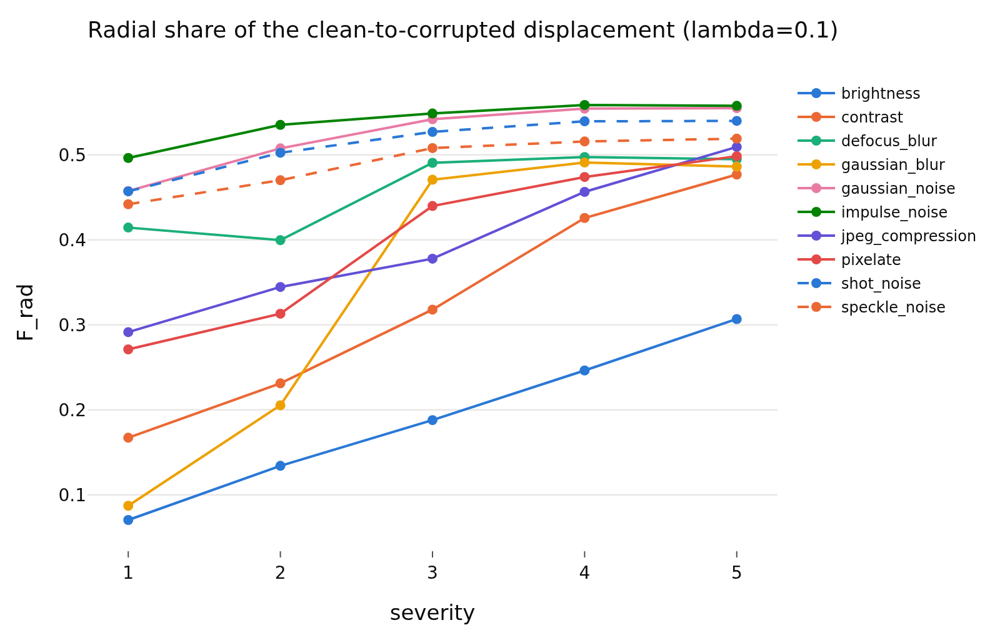
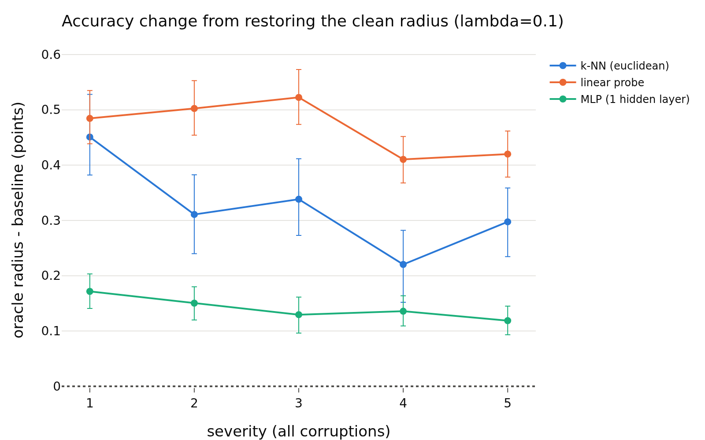

# radius_view_signal, lambda = 0.1
- **Branch / version:** `radius-view-signal` @ `6ff28d6` (code; notes committed after)
- **Run datetime (UTC):** 2026-10-26T04:01Z to 05:20Z (units and aggregation, see commands)
- **Command(s):**
  Per-run units (CPU, 8 CPUs, 64 GB, about 15 to 20 min each; jobs 2248755 to 2248758, 2248941, 2248943 to 2248945 and 2248964, 2026-10-26T04:01Z to 04:46Z; checkout of this branch at `6ff28d6`, `PYTHONPATH=<repo>/src`, `.env` with `LEJEPA_NORM_NOTES_DIR` pointing at this checkout's `research_notes/`):
  `sbatch --export=ALL slurm/view_signal.sbatch configs/base.yaml radius_marginal radius_marginal_lam<lambda>_s<seed>` for lambda in 0.02, 0.05, 0.1 and seed in 0, 1, 2 (writes `<runs_dir>/<run>/view_signal.npz`).
  Aggregation (this note and the three per-lambda notes; job 2248965, 8 CPUs, 32 GB, 33 min, finished about 2026-10-26T05:20Z):
  `python apps/analyze.py --config configs/base.yaml --view-signal radius_marginal --note radius_view_signal/view_signal.md`
  History: a first pass of the units (jobs 2248076, 2248257 to 2248260, 2248336 to 2248338, 2248365, 2248547 at commit `de18063`, aggregation job 2248628) lacked the post hoc additions marked below; they were added after seeing it and everything was recomputed. The numbers of the pre-registered comparisons were identical in both passes (all steps are deterministic).
- **Datasets:** STL-10 ([canonical](https://cs.stanford.edu/~acoates/stl10/), [HF `tanganke/stl10`](https://huggingface.co/datasets/tanganke/stl10); the canonical archive was used, HF is for reference) `train` (clean labeled bank) and `test` (clean twins); STL-10-C built locally from STL-10 `test` (10 corruptions x 5 severities, 400k images; no HF mirror).
- **Backbone:** ResNet-18 from scratch ([HF architecture reference](https://huggingface.co/timm/resnet18.a1_in1k), weights not used); `last.pt` (epoch 200) of `radius_marginal_lam{0.02,0.05,0.1}_s{0,1,2}` (Variant A, trained on A100s in earlier work; this study is CPU-only, no GPU was used).
- **Scope:** h is not analyzed; LeJEPA's product is z. All results are z-space.
- **Margins (fixed before the results):** 0.5 accuracy points; 0.01 Spearman. Pre-registration: `preregistration.md` (committed before any analysis code was run).

## Question

Is there a usable signal in how the radius moves under corruption, and in the per-view radius? Parts A to D of `preregistration.md` (geometry, oracle radius, severity from the radius residual, radius-weighted multi-view aggregation), at this lambda only, three training seeds. The cross-lambda summary, the prediction scorecard and the interpretation are in `view_signal.md`.

## Setup (deviations from the base config)

No training. No deviation from `configs/base.yaml` (k = 20, 1000 bootstrap replicates). Post hoc additions (after the first pass, not in the pre-registration, labeled "post hoc" wherever they appear): the radius-change share and the direction cosine in part A, the `random single view`, `highest-residual view` and `lowest-residual view` schemes and their contrasts in part D, and the bank-median-radius `scaled constant` condition in part B was pre-registered. Retrieval is not run in part D (deviation from the original idea list).

## Results

<!-- BEGIN GENERATED: analyze.view_inputs -->
### Inputs

Runs aggregated: `radius_marginal_lam0.1_s0`, `radius_marginal_lam0.1_s1`, `radius_marginal_lam0.1_s2`.

Unit files missing for this lambda:

None.
<!-- END GENERATED: analyze.view_inputs -->

<!-- BEGIN GENERATED: analyze.view_geometry -->
### A. Radial vs tangential share of the displacement

Clean twin -> corrupted image. `F_rad = sum a^2 / sum (a^2 + t^2)` with `a = <z_x - z_c, u_c>` (radial, along the clean direction) and `t` the orthogonal remainder; ratio of sums over images and the level's cells (so strong severities weigh more), seed mean, 95% bootstrap interval. A displacement in a random direction has `F_rad` about 1/256. The null row is the displacement from a clean image to a different clean image.

| lambda | level | radial share F_rad | 95% CI | median r_x / r_c | radius-change share (post hoc) | 95% CI (radius change) | median cos(u_x, u_c) (post hoc) |
|---|---|---|---|---|---|---|---|
| 0.1 | brightness | 0.2507 | [0.2482, 0.2529] | 0.980 | 0.0277 | [0.0271, 0.0282] | 0.919 |
| 0.1 | contrast | 0.3914 | [0.3902, 0.3926] | 0.970 | 0.0190 | [0.0187, 0.0193] | 0.535 |
| 0.1 | defocus_blur | 0.4755 | [0.4741, 0.4768] | 0.920 | 0.0317 | [0.0312, 0.0322] | 0.237 |
| 0.1 | gaussian_blur | 0.4660 | [0.4645, 0.4673] | 0.967 | 0.0261 | [0.0257, 0.0265] | 0.418 |
| 0.1 | gaussian_noise | 0.5266 | [0.5252, 0.5280] | 0.907 | 0.0238 | [0.0234, 0.0242] | 0.055 |
| 0.1 | impulse_noise | 0.5418 | [0.5404, 0.5432] | 0.885 | 0.0278 | [0.0273, 0.0283] | 0.057 |
| 0.1 | jpeg_compression | 0.4199 | [0.4182, 0.4215] | 0.866 | 0.0610 | [0.0602, 0.0619] | 0.684 |
| 0.1 | pixelate | 0.4470 | [0.4454, 0.4487] | 0.913 | 0.0356 | [0.0350, 0.0362] | 0.590 |
| 0.1 | shot_noise | 0.5167 | [0.5152, 0.5181] | 0.921 | 0.0239 | [0.0235, 0.0244] | 0.060 |
| 0.1 | speckle_noise | 0.4964 | [0.4947, 0.4980] | 0.926 | 0.0259 | [0.0255, 0.0264] | 0.121 |
| 0.1 | severity 1 (all corruptions) | 0.4230 | [0.4213, 0.4247] | 0.951 | 0.0352 | [0.0347, 0.0357] | 0.729 |
| 0.1 | severity 2 (all corruptions) | 0.4516 | [0.4501, 0.4531] | 0.933 | 0.0330 | [0.0325, 0.0335] | 0.612 |
| 0.1 | severity 3 (all corruptions) | 0.4846 | [0.4833, 0.4859] | 0.918 | 0.0300 | [0.0295, 0.0305] | 0.254 |
| 0.1 | severity 4 (all corruptions) | 0.5003 | [0.4991, 0.5015] | 0.922 | 0.0257 | [0.0253, 0.0261] | 0.113 |
| 0.1 | severity 5 (all corruptions) | 0.5079 | [0.5067, 0.5090] | 0.927 | 0.0237 | [0.0233, 0.0241] | 0.061 |
| 0.1 | all corruptions | 0.4827 | [0.4813, 0.4839] | 0.931 | 0.0283 | [0.0279, 0.0287] | 0.287 |
| 0.1 | null: clean image -> other clean image | 0.5035 | [0.5020, 0.5051] |  | 0.0234 | [0.0230, 0.0239] | -0.022 |
<!-- END GENERATED: analyze.view_geometry -->

<!-- BEGIN GENERATED: analyze.view_geometry_cells -->
### A. Radial share per cell

| lambda | corruption | severity | radial share F_rad | median r_x / r_c | radius-change share (post hoc) | median cos(u_x, u_c) (post hoc) |
|---|---|---|---|---|---|---|
| 0.1 | brightness | 1 | 0.0704 | 0.997 | 0.0249 | 0.991 |
| 0.1 | brightness | 2 | 0.1341 | 0.988 | 0.0260 | 0.963 |
| 0.1 | brightness | 3 | 0.1879 | 0.974 | 0.0266 | 0.911 |
| 0.1 | brightness | 4 | 0.2463 | 0.955 | 0.0276 | 0.819 |
| 0.1 | brightness | 5 | 0.3068 | 0.936 | 0.0286 | 0.695 |
| 0.1 | contrast | 1 | 0.1672 | 0.977 | 0.0177 | 0.876 |
| 0.1 | contrast | 2 | 0.2312 | 0.964 | 0.0190 | 0.765 |
| 0.1 | contrast | 3 | 0.3179 | 0.951 | 0.0202 | 0.554 |
| 0.1 | contrast | 4 | 0.4257 | 0.968 | 0.0202 | 0.210 |
| 0.1 | contrast | 5 | 0.4768 | 0.990 | 0.0177 | 0.050 |
| 0.1 | defocus_blur | 1 | 0.4144 | 0.904 | 0.0444 | 0.649 |
| 0.1 | defocus_blur | 2 | 0.3996 | 0.901 | 0.0477 | 0.681 |
| 0.1 | defocus_blur | 3 | 0.4906 | 0.898 | 0.0339 | 0.177 |
| 0.1 | defocus_blur | 4 | 0.4974 | 0.947 | 0.0263 | 0.070 |
| 0.1 | defocus_blur | 5 | 0.4948 | 0.973 | 0.0243 | 0.042 |
| 0.1 | gaussian_blur | 1 | 0.0871 | 0.985 | 0.0351 | 0.970 |
| 0.1 | gaussian_blur | 2 | 0.2054 | 0.953 | 0.0436 | 0.908 |
| 0.1 | gaussian_blur | 3 | 0.4707 | 0.890 | 0.0381 | 0.280 |
| 0.1 | gaussian_blur | 4 | 0.4909 | 0.967 | 0.0226 | 0.053 |
| 0.1 | gaussian_blur | 5 | 0.4861 | 1.017 | 0.0192 | 0.012 |
| 0.1 | gaussian_noise | 1 | 0.4574 | 0.918 | 0.0277 | 0.233 |
| 0.1 | gaussian_noise | 2 | 0.5076 | 0.909 | 0.0257 | 0.102 |
| 0.1 | gaussian_noise | 3 | 0.5418 | 0.897 | 0.0248 | 0.037 |
| 0.1 | gaussian_noise | 4 | 0.5544 | 0.899 | 0.0224 | 0.007 |
| 0.1 | gaussian_noise | 5 | 0.5549 | 0.911 | 0.0196 | -0.007 |
| 0.1 | impulse_noise | 1 | 0.4963 | 0.866 | 0.0373 | 0.248 |
| 0.1 | impulse_noise | 2 | 0.5352 | 0.879 | 0.0299 | 0.086 |
| 0.1 | impulse_noise | 3 | 0.5486 | 0.884 | 0.0280 | 0.043 |
| 0.1 | impulse_noise | 4 | 0.5586 | 0.891 | 0.0249 | 0.009 |
| 0.1 | impulse_noise | 5 | 0.5576 | 0.904 | 0.0218 | -0.004 |
| 0.1 | jpeg_compression | 1 | 0.2914 | 0.908 | 0.0513 | 0.810 |
| 0.1 | jpeg_compression | 2 | 0.3445 | 0.885 | 0.0580 | 0.750 |
| 0.1 | jpeg_compression | 3 | 0.3778 | 0.869 | 0.0615 | 0.707 |
| 0.1 | jpeg_compression | 4 | 0.4564 | 0.832 | 0.0667 | 0.576 |
| 0.1 | jpeg_compression | 5 | 0.5092 | 0.815 | 0.0623 | 0.413 |
| 0.1 | pixelate | 1 | 0.2711 | 0.931 | 0.0536 | 0.882 |
| 0.1 | pixelate | 2 | 0.3131 | 0.917 | 0.0545 | 0.827 |
| 0.1 | pixelate | 3 | 0.4398 | 0.911 | 0.0351 | 0.361 |
| 0.1 | pixelate | 4 | 0.4739 | 0.906 | 0.0305 | 0.201 |
| 0.1 | pixelate | 5 | 0.4984 | 0.888 | 0.0321 | 0.164 |
| 0.1 | shot_noise | 1 | 0.4570 | 0.912 | 0.0320 | 0.258 |
| 0.1 | shot_noise | 2 | 0.5024 | 0.914 | 0.0285 | 0.105 |
| 0.1 | shot_noise | 3 | 0.5269 | 0.916 | 0.0245 | 0.042 |
| 0.1 | shot_noise | 4 | 0.5394 | 0.925 | 0.0198 | 0.008 |
| 0.1 | shot_noise | 5 | 0.5399 | 0.932 | 0.0177 | -0.001 |
| 0.1 | speckle_noise | 1 | 0.4419 | 0.910 | 0.0350 | 0.406 |
| 0.1 | speckle_noise | 2 | 0.4701 | 0.909 | 0.0332 | 0.253 |
| 0.1 | speckle_noise | 3 | 0.5079 | 0.924 | 0.0261 | 0.079 |
| 0.1 | speckle_noise | 4 | 0.5157 | 0.936 | 0.0221 | 0.044 |
| 0.1 | speckle_noise | 5 | 0.5190 | 0.949 | 0.0188 | 0.020 |
<!-- END GENERATED: analyze.view_geometry_cells -->

<!-- BEGIN GENERATED: analyze.view_oracle -->
### B. Oracle radius: accuracy of frozen readers

Differences are in accuracy points (condition minus reference on the same images), averaged over training seeds; intervals are paired bootstrap percentile intervals (1000 replicates, test images resampled within each seed, the same resample for every comparison of a seed). Verdict, with the equivalence margin set to ±0.5 points before looking at results: `equivalent` if the 90% interval lies inside the margin, `different` if not equivalent and the 95% interval excludes 0, otherwise `inconclusive`. Readers are fitted on the clean STL-10 train bank only.

| lambda | level | reader | contrast | accuracy | reference accuracy | difference (points) | 90% CI | 95% CI | verdict |
|---|---|---|---|---|---|---|---|---|---|
| 0.1 | brightness | k-NN (euclidean) | oracle radius - baseline | 0.7318 | 0.7297 | +0.21 | [+0.15, +0.26] | [+0.14, +0.28] | equivalent |
| 0.1 | brightness | k-NN (euclidean) | scaled constant - baseline | 0.7326 | 0.7297 | +0.28 | [+0.19, +0.37] | [+0.17, +0.38] | equivalent |
| 0.1 | brightness | k-NN (euclidean) | oracle direction - clean twin | 0.7880 | 0.7886 | -0.07 | [-0.16, +0.02] | [-0.18, +0.04] | equivalent |
| 0.1 | brightness | k-NN (euclidean) | baseline - clean twin (total corruption loss) | 0.7297 | 0.7886 | -5.89 | [-6.19, -5.59] | [-6.23, -5.53] | different |
| 0.1 | contrast | k-NN (euclidean) | oracle radius - baseline | 0.5343 | 0.5337 | +0.06 | [-0.03, +0.15] | [-0.04, +0.16] | equivalent |
| 0.1 | contrast | k-NN (euclidean) | scaled constant - baseline | 0.5355 | 0.5337 | +0.18 | [+0.08, +0.26] | [+0.07, +0.27] | equivalent |
| 0.1 | contrast | k-NN (euclidean) | oracle direction - clean twin | 0.7896 | 0.7886 | +0.10 | [-0.01, +0.20] | [-0.03, +0.22] | equivalent |
| 0.1 | contrast | k-NN (euclidean) | baseline - clean twin (total corruption loss) | 0.5337 | 0.7886 | -25.49 | [-25.89, -25.07] | [-25.95, -25.01] | different |
| 0.1 | defocus_blur | k-NN (euclidean) | oracle radius - baseline | 0.2907 | 0.2868 | +0.39 | [+0.33, +0.46] | [+0.31, +0.47] | equivalent |
| 0.1 | defocus_blur | k-NN (euclidean) | scaled constant - baseline | 0.2885 | 0.2868 | +0.16 | [+0.10, +0.23] | [+0.08, +0.24] | equivalent |
| 0.1 | defocus_blur | k-NN (euclidean) | oracle direction - clean twin | 0.7896 | 0.7886 | +0.10 | [-0.02, +0.22] | [-0.05, +0.24] | equivalent |
| 0.1 | defocus_blur | k-NN (euclidean) | baseline - clean twin (total corruption loss) | 0.2868 | 0.7886 | -50.18 | [-50.65, -49.75] | [-50.74, -49.65] | different |
| 0.1 | gaussian_blur | k-NN (euclidean) | oracle radius - baseline | 0.3939 | 0.3916 | +0.23 | [+0.18, +0.28] | [+0.17, +0.29] | equivalent |
| 0.1 | gaussian_blur | k-NN (euclidean) | scaled constant - baseline | 0.3926 | 0.3916 | +0.10 | [+0.05, +0.16] | [+0.04, +0.17] | equivalent |
| 0.1 | gaussian_blur | k-NN (euclidean) | oracle direction - clean twin | 0.7892 | 0.7886 | +0.05 | [-0.05, +0.16] | [-0.07, +0.17] | equivalent |
| 0.1 | gaussian_blur | k-NN (euclidean) | baseline - clean twin (total corruption loss) | 0.3916 | 0.7886 | -39.70 | [-40.07, -39.35] | [-40.13, -39.29] | different |
| 0.1 | gaussian_noise | k-NN (euclidean) | oracle radius - baseline | 0.1617 | 0.1596 | +0.22 | [+0.13, +0.31] | [+0.11, +0.33] | equivalent |
| 0.1 | gaussian_noise | k-NN (euclidean) | scaled constant - baseline | 0.1598 | 0.1596 | +0.02 | [-0.07, +0.10] | [-0.08, +0.12] | equivalent |
| 0.1 | gaussian_noise | k-NN (euclidean) | oracle direction - clean twin | 0.7901 | 0.7886 | +0.14 | [+0.02, +0.27] | [-0.01, +0.30] | equivalent |
| 0.1 | gaussian_noise | k-NN (euclidean) | baseline - clean twin (total corruption loss) | 0.1596 | 0.7886 | -62.90 | [-63.42, -62.41] | [-63.52, -62.30] | different |
| 0.1 | impulse_noise | k-NN (euclidean) | oracle radius - baseline | 0.1684 | 0.1652 | +0.32 | [+0.24, +0.42] | [+0.22, +0.43] | equivalent |
| 0.1 | impulse_noise | k-NN (euclidean) | scaled constant - baseline | 0.1658 | 0.1652 | +0.06 | [-0.03, +0.16] | [-0.04, +0.18] | equivalent |
| 0.1 | impulse_noise | k-NN (euclidean) | oracle direction - clean twin | 0.7901 | 0.7886 | +0.14 | [+0.01, +0.27] | [-0.02, +0.30] | equivalent |
| 0.1 | impulse_noise | k-NN (euclidean) | baseline - clean twin (total corruption loss) | 0.1652 | 0.7886 | -62.34 | [-62.86, -61.85] | [-62.97, -61.75] | different |
| 0.1 | jpeg_compression | k-NN (euclidean) | oracle radius - baseline | 0.5749 | 0.5689 | +0.60 | [+0.51, +0.70] | [+0.48, +0.72] | different |
| 0.1 | jpeg_compression | k-NN (euclidean) | scaled constant - baseline | 0.5752 | 0.5689 | +0.63 | [+0.52, +0.74] | [+0.50, +0.76] | different |
| 0.1 | jpeg_compression | k-NN (euclidean) | oracle direction - clean twin | 0.7887 | 0.7886 | +0.01 | [-0.14, +0.15] | [-0.17, +0.17] | equivalent |
| 0.1 | jpeg_compression | k-NN (euclidean) | baseline - clean twin (total corruption loss) | 0.5689 | 0.7886 | -21.97 | [-22.42, -21.52] | [-22.49, -21.42] | different |
| 0.1 | pixelate | k-NN (euclidean) | oracle radius - baseline | 0.4219 | 0.4166 | +0.53 | [+0.46, +0.60] | [+0.45, +0.62] | different |
| 0.1 | pixelate | k-NN (euclidean) | scaled constant - baseline | 0.4220 | 0.4166 | +0.54 | [+0.47, +0.63] | [+0.45, +0.64] | different |
| 0.1 | pixelate | k-NN (euclidean) | oracle direction - clean twin | 0.7891 | 0.7886 | +0.05 | [-0.07, +0.17] | [-0.10, +0.20] | equivalent |
| 0.1 | pixelate | k-NN (euclidean) | baseline - clean twin (total corruption loss) | 0.4166 | 0.7886 | -37.20 | [-37.66, -36.76] | [-37.73, -36.67] | different |
| 0.1 | shot_noise | k-NN (euclidean) | oracle radius - baseline | 0.1712 | 0.1688 | +0.25 | [+0.16, +0.34] | [+0.14, +0.35] | equivalent |
| 0.1 | shot_noise | k-NN (euclidean) | scaled constant - baseline | 0.1705 | 0.1688 | +0.18 | [+0.09, +0.26] | [+0.07, +0.27] | equivalent |
| 0.1 | shot_noise | k-NN (euclidean) | oracle direction - clean twin | 0.7904 | 0.7886 | +0.18 | [+0.05, +0.31] | [+0.02, +0.33] | equivalent |
| 0.1 | shot_noise | k-NN (euclidean) | baseline - clean twin (total corruption loss) | 0.1688 | 0.7886 | -61.99 | [-62.51, -61.49] | [-62.59, -61.42] | different |
| 0.1 | speckle_noise | k-NN (euclidean) | oracle radius - baseline | 0.2459 | 0.2416 | +0.43 | [+0.34, +0.53] | [+0.32, +0.55] | different |
| 0.1 | speckle_noise | k-NN (euclidean) | scaled constant - baseline | 0.2443 | 0.2416 | +0.27 | [+0.18, +0.37] | [+0.16, +0.39] | equivalent |
| 0.1 | speckle_noise | k-NN (euclidean) | oracle direction - clean twin | 0.7899 | 0.7886 | +0.13 | [+0.00, +0.25] | [-0.02, +0.27] | equivalent |
| 0.1 | speckle_noise | k-NN (euclidean) | baseline - clean twin (total corruption loss) | 0.2416 | 0.7886 | -54.71 | [-55.19, -54.23] | [-55.31, -54.14] | different |
| 0.1 | severity 1 (all corruptions) | k-NN (euclidean) | oracle radius - baseline | 0.5501 | 0.5456 | +0.45 | [+0.39, +0.52] | [+0.38, +0.53] | different |
| 0.1 | severity 1 (all corruptions) | k-NN (euclidean) | scaled constant - baseline | 0.5485 | 0.5456 | +0.29 | [+0.23, +0.36] | [+0.22, +0.37] | equivalent |
| 0.1 | severity 1 (all corruptions) | k-NN (euclidean) | oracle direction - clean twin | 0.7889 | 0.7886 | +0.03 | [-0.06, +0.12] | [-0.08, +0.14] | equivalent |
| 0.1 | severity 1 (all corruptions) | k-NN (euclidean) | baseline - clean twin (total corruption loss) | 0.5456 | 0.7886 | -24.30 | [-24.62, -23.99] | [-24.67, -23.92] | different |
| 0.1 | severity 2 (all corruptions) | k-NN (euclidean) | oracle radius - baseline | 0.4854 | 0.4823 | +0.31 | [+0.25, +0.37] | [+0.24, +0.38] | equivalent |
| 0.1 | severity 2 (all corruptions) | k-NN (euclidean) | scaled constant - baseline | 0.4847 | 0.4823 | +0.24 | [+0.18, +0.31] | [+0.16, +0.32] | equivalent |
| 0.1 | severity 2 (all corruptions) | k-NN (euclidean) | oracle direction - clean twin | 0.7888 | 0.7886 | +0.02 | [-0.08, +0.12] | [-0.10, +0.13] | equivalent |
| 0.1 | severity 2 (all corruptions) | k-NN (euclidean) | baseline - clean twin (total corruption loss) | 0.4823 | 0.7886 | -30.64 | [-30.96, -30.29] | [-31.04, -30.24] | different |
| 0.1 | severity 3 (all corruptions) | k-NN (euclidean) | oracle radius - baseline | 0.3351 | 0.3317 | +0.34 | [+0.28, +0.40] | [+0.27, +0.41] | equivalent |
| 0.1 | severity 3 (all corruptions) | k-NN (euclidean) | scaled constant - baseline | 0.3338 | 0.3317 | +0.21 | [+0.15, +0.27] | [+0.13, +0.28] | equivalent |
| 0.1 | severity 3 (all corruptions) | k-NN (euclidean) | oracle direction - clean twin | 0.7900 | 0.7886 | +0.14 | [+0.03, +0.24] | [+0.00, +0.27] | equivalent |
| 0.1 | severity 3 (all corruptions) | k-NN (euclidean) | baseline - clean twin (total corruption loss) | 0.3317 | 0.7886 | -45.70 | [-46.11, -45.31] | [-46.18, -45.25] | different |
| 0.1 | severity 4 (all corruptions) | k-NN (euclidean) | oracle radius - baseline | 0.2580 | 0.2558 | +0.22 | [+0.16, +0.27] | [+0.15, +0.28] | equivalent |
| 0.1 | severity 4 (all corruptions) | k-NN (euclidean) | scaled constant - baseline | 0.2578 | 0.2558 | +0.20 | [+0.15, +0.26] | [+0.13, +0.27] | equivalent |
| 0.1 | severity 4 (all corruptions) | k-NN (euclidean) | oracle direction - clean twin | 0.7897 | 0.7886 | +0.11 | [-0.01, +0.22] | [-0.03, +0.23] | equivalent |
| 0.1 | severity 4 (all corruptions) | k-NN (euclidean) | baseline - clean twin (total corruption loss) | 0.2558 | 0.7886 | -53.29 | [-53.74, -52.88] | [-53.80, -52.80] | different |
| 0.1 | severity 5 (all corruptions) | k-NN (euclidean) | oracle radius - baseline | 0.2189 | 0.2159 | +0.30 | [+0.25, +0.35] | [+0.23, +0.36] | equivalent |
| 0.1 | severity 5 (all corruptions) | k-NN (euclidean) | scaled constant - baseline | 0.2185 | 0.2159 | +0.26 | [+0.21, +0.31] | [+0.21, +0.33] | equivalent |
| 0.1 | severity 5 (all corruptions) | k-NN (euclidean) | oracle direction - clean twin | 0.7899 | 0.7886 | +0.13 | [+0.01, +0.24] | [-0.02, +0.26] | equivalent |
| 0.1 | severity 5 (all corruptions) | k-NN (euclidean) | baseline - clean twin (total corruption loss) | 0.2159 | 0.7886 | -57.27 | [-57.74, -56.86] | [-57.82, -56.75] | different |
| 0.1 | all corruptions | k-NN (euclidean) | oracle radius - baseline | 0.3695 | 0.3663 | +0.32 | [+0.30, +0.35] | [+0.29, +0.36] | equivalent |
| 0.1 | all corruptions | k-NN (euclidean) | scaled constant - baseline | 0.3687 | 0.3663 | +0.24 | [+0.21, +0.28] | [+0.21, +0.28] | equivalent |
| 0.1 | all corruptions | k-NN (euclidean) | oracle direction - clean twin | 0.7895 | 0.7886 | +0.08 | [-0.02, +0.18] | [-0.04, +0.20] | equivalent |
| 0.1 | all corruptions | k-NN (euclidean) | baseline - clean twin (total corruption loss) | 0.3663 | 0.7886 | -42.24 | [-42.62, -41.88] | [-42.68, -41.83] | different |
| 0.1 | brightness | linear probe | oracle radius - baseline | 0.7435 | 0.7410 | +0.25 | [+0.20, +0.29] | [+0.20, +0.30] | equivalent |
| 0.1 | brightness | linear probe | scaled constant - baseline | 0.7433 | 0.7410 | +0.22 | [+0.15, +0.30] | [+0.14, +0.31] | equivalent |
| 0.1 | brightness | linear probe | oracle direction - clean twin | 0.8112 | 0.8121 | -0.09 | [-0.16, -0.03] | [-0.17, -0.01] | equivalent |
| 0.1 | brightness | linear probe | baseline - clean twin (total corruption loss) | 0.7410 | 0.8121 | -7.11 | [-7.42, -6.78] | [-7.47, -6.73] | different |
| 0.1 | contrast | linear probe | oracle radius - baseline | 0.5338 | 0.5310 | +0.28 | [+0.23, +0.33] | [+0.22, +0.34] | equivalent |
| 0.1 | contrast | linear probe | scaled constant - baseline | 0.5329 | 0.5310 | +0.19 | [+0.13, +0.24] | [+0.12, +0.25] | equivalent |
| 0.1 | contrast | linear probe | oracle direction - clean twin | 0.8110 | 0.8121 | -0.11 | [-0.20, -0.03] | [-0.21, -0.01] | equivalent |
| 0.1 | contrast | linear probe | baseline - clean twin (total corruption loss) | 0.5310 | 0.8121 | -28.11 | [-28.54, -27.66] | [-28.61, -27.61] | different |
| 0.1 | defocus_blur | linear probe | oracle radius - baseline | 0.3190 | 0.3117 | +0.73 | [+0.67, +0.78] | [+0.66, +0.79] | different |
| 0.1 | defocus_blur | linear probe | scaled constant - baseline | 0.3166 | 0.3117 | +0.49 | [+0.44, +0.55] | [+0.43, +0.56] | different |
| 0.1 | defocus_blur | linear probe | oracle direction - clean twin | 0.8102 | 0.8121 | -0.19 | [-0.29, -0.09] | [-0.31, -0.07] | equivalent |
| 0.1 | defocus_blur | linear probe | baseline - clean twin (total corruption loss) | 0.3117 | 0.8121 | -50.04 | [-50.49, -49.62] | [-50.59, -49.56] | different |
| 0.1 | gaussian_blur | linear probe | oracle radius - baseline | 0.4064 | 0.4035 | +0.29 | [+0.25, +0.33] | [+0.24, +0.33] | equivalent |
| 0.1 | gaussian_blur | linear probe | scaled constant - baseline | 0.4055 | 0.4035 | +0.20 | [+0.15, +0.25] | [+0.14, +0.26] | equivalent |
| 0.1 | gaussian_blur | linear probe | oracle direction - clean twin | 0.8108 | 0.8121 | -0.13 | [-0.21, -0.05] | [-0.22, -0.04] | equivalent |
| 0.1 | gaussian_blur | linear probe | baseline - clean twin (total corruption loss) | 0.4035 | 0.8121 | -40.86 | [-41.21, -40.52] | [-41.26, -40.47] | different |
| 0.1 | gaussian_noise | linear probe | oracle radius - baseline | 0.1843 | 0.1774 | +0.69 | [+0.63, +0.75] | [+0.62, +0.76] | different |
| 0.1 | gaussian_noise | linear probe | scaled constant - baseline | 0.1808 | 0.1774 | +0.34 | [+0.29, +0.39] | [+0.28, +0.40] | equivalent |
| 0.1 | gaussian_noise | linear probe | oracle direction - clean twin | 0.8093 | 0.8121 | -0.28 | [-0.39, -0.16] | [-0.42, -0.15] | equivalent |
| 0.1 | gaussian_noise | linear probe | baseline - clean twin (total corruption loss) | 0.1774 | 0.8121 | -63.47 | [-63.96, -62.96] | [-64.02, -62.85] | different |
| 0.1 | impulse_noise | linear probe | oracle radius - baseline | 0.1759 | 0.1711 | +0.48 | [+0.42, +0.53] | [+0.41, +0.54] | different |
| 0.1 | impulse_noise | linear probe | scaled constant - baseline | 0.1737 | 0.1711 | +0.26 | [+0.21, +0.30] | [+0.20, +0.31] | equivalent |
| 0.1 | impulse_noise | linear probe | oracle direction - clean twin | 0.8092 | 0.8121 | -0.29 | [-0.41, -0.18] | [-0.43, -0.16] | equivalent |
| 0.1 | impulse_noise | linear probe | baseline - clean twin (total corruption loss) | 0.1711 | 0.8121 | -64.10 | [-64.59, -63.59] | [-64.69, -63.45] | different |
| 0.1 | jpeg_compression | linear probe | oracle radius - baseline | 0.5551 | 0.5525 | +0.26 | [+0.19, +0.34] | [+0.18, +0.35] | equivalent |
| 0.1 | jpeg_compression | linear probe | scaled constant - baseline | 0.5528 | 0.5525 | +0.04 | [-0.04, +0.12] | [-0.06, +0.14] | equivalent |
| 0.1 | jpeg_compression | linear probe | oracle direction - clean twin | 0.8095 | 0.8121 | -0.26 | [-0.38, -0.14] | [-0.40, -0.11] | equivalent |
| 0.1 | jpeg_compression | linear probe | baseline - clean twin (total corruption loss) | 0.5525 | 0.8121 | -25.97 | [-26.41, -25.50] | [-26.51, -25.37] | different |
| 0.1 | pixelate | linear probe | oracle radius - baseline | 0.3931 | 0.3927 | +0.04 | [-0.00, +0.09] | [-0.01, +0.10] | equivalent |
| 0.1 | pixelate | linear probe | scaled constant - baseline | 0.3902 | 0.3927 | -0.25 | [-0.30, -0.19] | [-0.31, -0.18] | equivalent |
| 0.1 | pixelate | linear probe | oracle direction - clean twin | 0.8104 | 0.8121 | -0.18 | [-0.28, -0.07] | [-0.30, -0.05] | equivalent |
| 0.1 | pixelate | linear probe | baseline - clean twin (total corruption loss) | 0.3927 | 0.8121 | -41.94 | [-42.42, -41.43] | [-42.50, -41.36] | different |
| 0.1 | shot_noise | linear probe | oracle radius - baseline | 0.2046 | 0.1965 | +0.82 | [+0.75, +0.88] | [+0.74, +0.90] | different |
| 0.1 | shot_noise | linear probe | scaled constant - baseline | 0.2012 | 0.1965 | +0.48 | [+0.43, +0.53] | [+0.41, +0.54] | different |
| 0.1 | shot_noise | linear probe | oracle direction - clean twin | 0.8092 | 0.8121 | -0.30 | [-0.41, -0.18] | [-0.43, -0.17] | equivalent |
| 0.1 | shot_noise | linear probe | baseline - clean twin (total corruption loss) | 0.1965 | 0.8121 | -61.57 | [-62.06, -61.08] | [-62.13, -60.98] | different |
| 0.1 | speckle_noise | linear probe | oracle radius - baseline | 0.2731 | 0.2646 | +0.85 | [+0.79, +0.92] | [+0.77, +0.93] | different |
| 0.1 | speckle_noise | linear probe | scaled constant - baseline | 0.2703 | 0.2646 | +0.57 | [+0.51, +0.63] | [+0.50, +0.64] | different |
| 0.1 | speckle_noise | linear probe | oracle direction - clean twin | 0.8095 | 0.8121 | -0.26 | [-0.37, -0.15] | [-0.39, -0.13] | equivalent |
| 0.1 | speckle_noise | linear probe | baseline - clean twin (total corruption loss) | 0.2646 | 0.8121 | -54.75 | [-55.24, -54.25] | [-55.35, -54.16] | different |
| 0.1 | severity 1 (all corruptions) | linear probe | oracle radius - baseline | 0.5589 | 0.5541 | +0.48 | [+0.45, +0.53] | [+0.44, +0.54] | different |
| 0.1 | severity 1 (all corruptions) | linear probe | scaled constant - baseline | 0.5570 | 0.5541 | +0.30 | [+0.25, +0.34] | [+0.24, +0.35] | equivalent |
| 0.1 | severity 1 (all corruptions) | linear probe | oracle direction - clean twin | 0.8107 | 0.8121 | -0.14 | [-0.21, -0.07] | [-0.22, -0.05] | equivalent |
| 0.1 | severity 1 (all corruptions) | linear probe | baseline - clean twin (total corruption loss) | 0.5541 | 0.8121 | -25.81 | [-26.14, -25.47] | [-26.21, -25.43] | different |
| 0.1 | severity 2 (all corruptions) | linear probe | oracle radius - baseline | 0.4963 | 0.4913 | +0.50 | [+0.46, +0.55] | [+0.45, +0.55] | different |
| 0.1 | severity 2 (all corruptions) | linear probe | scaled constant - baseline | 0.4942 | 0.4913 | +0.29 | [+0.25, +0.34] | [+0.24, +0.35] | equivalent |
| 0.1 | severity 2 (all corruptions) | linear probe | oracle direction - clean twin | 0.8103 | 0.8121 | -0.18 | [-0.26, -0.11] | [-0.28, -0.09] | equivalent |
| 0.1 | severity 2 (all corruptions) | linear probe | baseline - clean twin (total corruption loss) | 0.4913 | 0.8121 | -32.08 | [-32.41, -31.73] | [-32.50, -31.67] | different |
| 0.1 | severity 3 (all corruptions) | linear probe | oracle radius - baseline | 0.3515 | 0.3463 | +0.52 | [+0.48, +0.57] | [+0.47, +0.57] | different |
| 0.1 | severity 3 (all corruptions) | linear probe | scaled constant - baseline | 0.3493 | 0.3463 | +0.30 | [+0.26, +0.34] | [+0.26, +0.35] | equivalent |
| 0.1 | severity 3 (all corruptions) | linear probe | oracle direction - clean twin | 0.8099 | 0.8121 | -0.23 | [-0.32, -0.13] | [-0.34, -0.11] | equivalent |
| 0.1 | severity 3 (all corruptions) | linear probe | baseline - clean twin (total corruption loss) | 0.3463 | 0.8121 | -46.59 | [-46.97, -46.20] | [-47.04, -46.11] | different |
| 0.1 | severity 4 (all corruptions) | linear probe | oracle radius - baseline | 0.2664 | 0.2623 | +0.41 | [+0.38, +0.45] | [+0.37, +0.45] | equivalent |
| 0.1 | severity 4 (all corruptions) | linear probe | scaled constant - baseline | 0.2641 | 0.2623 | +0.18 | [+0.15, +0.21] | [+0.14, +0.22] | equivalent |
| 0.1 | severity 4 (all corruptions) | linear probe | oracle direction - clean twin | 0.8097 | 0.8121 | -0.24 | [-0.34, -0.14] | [-0.36, -0.12] | equivalent |
| 0.1 | severity 4 (all corruptions) | linear probe | baseline - clean twin (total corruption loss) | 0.2623 | 0.8121 | -54.98 | [-55.39, -54.58] | [-55.49, -54.50] | different |
| 0.1 | severity 5 (all corruptions) | linear probe | oracle radius - baseline | 0.2213 | 0.2171 | +0.42 | [+0.39, +0.46] | [+0.38, +0.46] | equivalent |
| 0.1 | severity 5 (all corruptions) | linear probe | scaled constant - baseline | 0.2190 | 0.2171 | +0.19 | [+0.16, +0.22] | [+0.16, +0.23] | equivalent |
| 0.1 | severity 5 (all corruptions) | linear probe | oracle direction - clean twin | 0.8096 | 0.8121 | -0.25 | [-0.35, -0.15] | [-0.37, -0.14] | equivalent |
| 0.1 | severity 5 (all corruptions) | linear probe | baseline - clean twin (total corruption loss) | 0.2171 | 0.8121 | -59.50 | [-59.94, -59.08] | [-60.03, -58.98] | different |
| 0.1 | all corruptions | linear probe | oracle radius - baseline | 0.3789 | 0.3742 | +0.47 | [+0.45, +0.49] | [+0.44, +0.50] | equivalent |
| 0.1 | all corruptions | linear probe | scaled constant - baseline | 0.3767 | 0.3742 | +0.25 | [+0.23, +0.27] | [+0.23, +0.28] | equivalent |
| 0.1 | all corruptions | linear probe | oracle direction - clean twin | 0.8100 | 0.8121 | -0.21 | [-0.30, -0.12] | [-0.31, -0.11] | equivalent |
| 0.1 | all corruptions | linear probe | baseline - clean twin (total corruption loss) | 0.3742 | 0.8121 | -43.79 | [-44.14, -43.42] | [-44.22, -43.36] | different |
| 0.1 | brightness | MLP (1 hidden layer) | oracle radius - baseline | 0.7481 | 0.7474 | +0.07 | [+0.05, +0.09] | [+0.04, +0.09] | equivalent |
| 0.1 | brightness | MLP (1 hidden layer) | scaled constant - baseline | 0.7482 | 0.7474 | +0.08 | [+0.04, +0.11] | [+0.04, +0.12] | equivalent |
| 0.1 | brightness | MLP (1 hidden layer) | oracle direction - clean twin | 0.8174 | 0.8175 | -0.01 | [-0.05, +0.03] | [-0.06, +0.03] | equivalent |
| 0.1 | brightness | MLP (1 hidden layer) | baseline - clean twin (total corruption loss) | 0.7474 | 0.8175 | -7.01 | [-7.31, -6.72] | [-7.37, -6.67] | different |
| 0.1 | contrast | MLP (1 hidden layer) | oracle radius - baseline | 0.5495 | 0.5488 | +0.07 | [+0.04, +0.10] | [+0.03, +0.10] | equivalent |
| 0.1 | contrast | MLP (1 hidden layer) | scaled constant - baseline | 0.5492 | 0.5488 | +0.03 | [+0.00, +0.06] | [-0.00, +0.07] | equivalent |
| 0.1 | contrast | MLP (1 hidden layer) | oracle direction - clean twin | 0.8174 | 0.8175 | -0.01 | [-0.05, +0.03] | [-0.06, +0.04] | equivalent |
| 0.1 | contrast | MLP (1 hidden layer) | baseline - clean twin (total corruption loss) | 0.5488 | 0.8175 | -26.87 | [-27.25, -26.47] | [-27.33, -26.38] | different |
| 0.1 | defocus_blur | MLP (1 hidden layer) | oracle radius - baseline | 0.3135 | 0.3129 | +0.06 | [+0.04, +0.10] | [+0.03, +0.10] | equivalent |
| 0.1 | defocus_blur | MLP (1 hidden layer) | scaled constant - baseline | 0.3129 | 0.3129 | +0.00 | [-0.03, +0.03] | [-0.04, +0.04] | equivalent |
| 0.1 | defocus_blur | MLP (1 hidden layer) | oracle direction - clean twin | 0.8174 | 0.8175 | -0.01 | [-0.06, +0.04] | [-0.07, +0.05] | equivalent |
| 0.1 | defocus_blur | MLP (1 hidden layer) | baseline - clean twin (total corruption loss) | 0.3129 | 0.8175 | -50.46 | [-50.91, -50.04] | [-50.98, -49.96] | different |
| 0.1 | gaussian_blur | MLP (1 hidden layer) | oracle radius - baseline | 0.4070 | 0.4067 | +0.03 | [+0.00, +0.05] | [+0.00, +0.05] | equivalent |
| 0.1 | gaussian_blur | MLP (1 hidden layer) | scaled constant - baseline | 0.4068 | 0.4067 | +0.01 | [-0.02, +0.03] | [-0.02, +0.04] | equivalent |
| 0.1 | gaussian_blur | MLP (1 hidden layer) | oracle direction - clean twin | 0.8174 | 0.8175 | -0.02 | [-0.06, +0.03] | [-0.07, +0.03] | equivalent |
| 0.1 | gaussian_blur | MLP (1 hidden layer) | baseline - clean twin (total corruption loss) | 0.4067 | 0.8175 | -41.08 | [-41.45, -40.75] | [-41.51, -40.69] | different |
| 0.1 | gaussian_noise | MLP (1 hidden layer) | oracle radius - baseline | 0.1826 | 0.1804 | +0.21 | [+0.17, +0.25] | [+0.16, +0.26] | equivalent |
| 0.1 | gaussian_noise | MLP (1 hidden layer) | scaled constant - baseline | 0.1815 | 0.1804 | +0.11 | [+0.07, +0.15] | [+0.06, +0.15] | equivalent |
| 0.1 | gaussian_noise | MLP (1 hidden layer) | oracle direction - clean twin | 0.8172 | 0.8175 | -0.03 | [-0.09, +0.02] | [-0.10, +0.04] | equivalent |
| 0.1 | gaussian_noise | MLP (1 hidden layer) | baseline - clean twin (total corruption loss) | 0.1804 | 0.8175 | -63.71 | [-64.19, -63.25] | [-64.27, -63.17] | different |
| 0.1 | impulse_noise | MLP (1 hidden layer) | oracle radius - baseline | 0.1762 | 0.1744 | +0.18 | [+0.13, +0.22] | [+0.13, +0.23] | equivalent |
| 0.1 | impulse_noise | MLP (1 hidden layer) | scaled constant - baseline | 0.1756 | 0.1744 | +0.11 | [+0.07, +0.15] | [+0.07, +0.16] | equivalent |
| 0.1 | impulse_noise | MLP (1 hidden layer) | oracle direction - clean twin | 0.8172 | 0.8175 | -0.03 | [-0.08, +0.03] | [-0.09, +0.04] | equivalent |
| 0.1 | impulse_noise | MLP (1 hidden layer) | baseline - clean twin (total corruption loss) | 0.1744 | 0.8175 | -64.31 | [-64.80, -63.84] | [-64.88, -63.73] | different |
| 0.1 | jpeg_compression | MLP (1 hidden layer) | oracle radius - baseline | 0.5772 | 0.5753 | +0.19 | [+0.15, +0.23] | [+0.14, +0.24] | equivalent |
| 0.1 | jpeg_compression | MLP (1 hidden layer) | scaled constant - baseline | 0.5771 | 0.5753 | +0.18 | [+0.14, +0.22] | [+0.13, +0.23] | equivalent |
| 0.1 | jpeg_compression | MLP (1 hidden layer) | oracle direction - clean twin | 0.8178 | 0.8175 | +0.03 | [-0.03, +0.09] | [-0.04, +0.10] | equivalent |
| 0.1 | jpeg_compression | MLP (1 hidden layer) | baseline - clean twin (total corruption loss) | 0.5753 | 0.8175 | -24.23 | [-24.63, -23.76] | [-24.73, -23.69] | different |
| 0.1 | pixelate | MLP (1 hidden layer) | oracle radius - baseline | 0.4112 | 0.4097 | +0.15 | [+0.13, +0.18] | [+0.12, +0.19] | equivalent |
| 0.1 | pixelate | MLP (1 hidden layer) | scaled constant - baseline | 0.4107 | 0.4097 | +0.10 | [+0.07, +0.13] | [+0.06, +0.14] | equivalent |
| 0.1 | pixelate | MLP (1 hidden layer) | oracle direction - clean twin | 0.8174 | 0.8175 | -0.01 | [-0.06, +0.05] | [-0.07, +0.06] | equivalent |
| 0.1 | pixelate | MLP (1 hidden layer) | baseline - clean twin (total corruption loss) | 0.4097 | 0.8175 | -40.79 | [-41.20, -40.31] | [-41.27, -40.24] | different |
| 0.1 | shot_noise | MLP (1 hidden layer) | oracle radius - baseline | 0.1999 | 0.1981 | +0.18 | [+0.14, +0.23] | [+0.13, +0.23] | equivalent |
| 0.1 | shot_noise | MLP (1 hidden layer) | scaled constant - baseline | 0.1988 | 0.1981 | +0.07 | [+0.03, +0.11] | [+0.02, +0.12] | equivalent |
| 0.1 | shot_noise | MLP (1 hidden layer) | oracle direction - clean twin | 0.8170 | 0.8175 | -0.05 | [-0.11, +0.01] | [-0.11, +0.02] | equivalent |
| 0.1 | shot_noise | MLP (1 hidden layer) | baseline - clean twin (total corruption loss) | 0.1981 | 0.8175 | -61.95 | [-62.42, -61.47] | [-62.50, -61.37] | different |
| 0.1 | speckle_noise | MLP (1 hidden layer) | oracle radius - baseline | 0.2768 | 0.2741 | +0.27 | [+0.22, +0.31] | [+0.21, +0.32] | equivalent |
| 0.1 | speckle_noise | MLP (1 hidden layer) | scaled constant - baseline | 0.2761 | 0.2741 | +0.20 | [+0.16, +0.24] | [+0.15, +0.25] | equivalent |
| 0.1 | speckle_noise | MLP (1 hidden layer) | oracle direction - clean twin | 0.8172 | 0.8175 | -0.03 | [-0.09, +0.02] | [-0.10, +0.03] | equivalent |
| 0.1 | speckle_noise | MLP (1 hidden layer) | baseline - clean twin (total corruption loss) | 0.2741 | 0.8175 | -54.34 | [-54.82, -53.85] | [-54.88, -53.77] | different |
| 0.1 | severity 1 (all corruptions) | MLP (1 hidden layer) | oracle radius - baseline | 0.5789 | 0.5772 | +0.17 | [+0.15, +0.20] | [+0.14, +0.20] | equivalent |
| 0.1 | severity 1 (all corruptions) | MLP (1 hidden layer) | scaled constant - baseline | 0.5783 | 0.5772 | +0.12 | [+0.09, +0.15] | [+0.08, +0.15] | equivalent |
| 0.1 | severity 1 (all corruptions) | MLP (1 hidden layer) | oracle direction - clean twin | 0.8175 | 0.8175 | -0.00 | [-0.04, +0.04] | [-0.05, +0.05] | equivalent |
| 0.1 | severity 1 (all corruptions) | MLP (1 hidden layer) | baseline - clean twin (total corruption loss) | 0.5772 | 0.8175 | -24.04 | [-24.34, -23.72] | [-24.40, -23.65] | different |
| 0.1 | severity 2 (all corruptions) | MLP (1 hidden layer) | oracle radius - baseline | 0.5074 | 0.5059 | +0.15 | [+0.13, +0.18] | [+0.12, +0.18] | equivalent |
| 0.1 | severity 2 (all corruptions) | MLP (1 hidden layer) | scaled constant - baseline | 0.5068 | 0.5059 | +0.08 | [+0.06, +0.11] | [+0.05, +0.11] | equivalent |
| 0.1 | severity 2 (all corruptions) | MLP (1 hidden layer) | oracle direction - clean twin | 0.8175 | 0.8175 | -0.01 | [-0.05, +0.04] | [-0.06, +0.04] | equivalent |
| 0.1 | severity 2 (all corruptions) | MLP (1 hidden layer) | baseline - clean twin (total corruption loss) | 0.5059 | 0.8175 | -31.16 | [-31.49, -30.82] | [-31.53, -30.76] | different |
| 0.1 | severity 3 (all corruptions) | MLP (1 hidden layer) | oracle radius - baseline | 0.3496 | 0.3483 | +0.13 | [+0.10, +0.16] | [+0.10, +0.16] | equivalent |
| 0.1 | severity 3 (all corruptions) | MLP (1 hidden layer) | scaled constant - baseline | 0.3489 | 0.3483 | +0.05 | [+0.03, +0.08] | [+0.03, +0.08] | equivalent |
| 0.1 | severity 3 (all corruptions) | MLP (1 hidden layer) | oracle direction - clean twin | 0.8174 | 0.8175 | -0.02 | [-0.06, +0.03] | [-0.07, +0.04] | equivalent |
| 0.1 | severity 3 (all corruptions) | MLP (1 hidden layer) | baseline - clean twin (total corruption loss) | 0.3483 | 0.8175 | -46.92 | [-47.30, -46.55] | [-47.38, -46.49] | different |
| 0.1 | severity 4 (all corruptions) | MLP (1 hidden layer) | oracle radius - baseline | 0.2655 | 0.2642 | +0.14 | [+0.11, +0.16] | [+0.11, +0.16] | equivalent |
| 0.1 | severity 4 (all corruptions) | MLP (1 hidden layer) | scaled constant - baseline | 0.2649 | 0.2642 | +0.07 | [+0.05, +0.10] | [+0.05, +0.10] | equivalent |
| 0.1 | severity 4 (all corruptions) | MLP (1 hidden layer) | oracle direction - clean twin | 0.8172 | 0.8175 | -0.03 | [-0.08, +0.02] | [-0.09, +0.03] | equivalent |
| 0.1 | severity 4 (all corruptions) | MLP (1 hidden layer) | baseline - clean twin (total corruption loss) | 0.2642 | 0.8175 | -55.34 | [-55.73, -54.95] | [-55.80, -54.83] | different |
| 0.1 | severity 5 (all corruptions) | MLP (1 hidden layer) | oracle radius - baseline | 0.2195 | 0.2183 | +0.12 | [+0.10, +0.14] | [+0.09, +0.14] | equivalent |
| 0.1 | severity 5 (all corruptions) | MLP (1 hidden layer) | scaled constant - baseline | 0.2194 | 0.2183 | +0.11 | [+0.09, +0.13] | [+0.09, +0.14] | equivalent |
| 0.1 | severity 5 (all corruptions) | MLP (1 hidden layer) | oracle direction - clean twin | 0.8172 | 0.8175 | -0.03 | [-0.08, +0.01] | [-0.09, +0.02] | equivalent |
| 0.1 | severity 5 (all corruptions) | MLP (1 hidden layer) | baseline - clean twin (total corruption loss) | 0.2183 | 0.8175 | -59.92 | [-60.35, -59.51] | [-60.42, -59.43] | different |
| 0.1 | all corruptions | MLP (1 hidden layer) | oracle radius - baseline | 0.3842 | 0.3828 | +0.14 | [+0.13, +0.15] | [+0.13, +0.16] | equivalent |
| 0.1 | all corruptions | MLP (1 hidden layer) | scaled constant - baseline | 0.3837 | 0.3828 | +0.09 | [+0.08, +0.10] | [+0.07, +0.10] | equivalent |
| 0.1 | all corruptions | MLP (1 hidden layer) | oracle direction - clean twin | 0.8174 | 0.8175 | -0.02 | [-0.06, +0.03] | [-0.07, +0.03] | equivalent |
| 0.1 | all corruptions | MLP (1 hidden layer) | baseline - clean twin (total corruption loss) | 0.3828 | 0.8175 | -43.48 | [-43.82, -43.14] | [-43.87, -43.06] | different |
<!-- END GENERATED: analyze.view_oracle -->

<!-- BEGIN GENERATED: analyze.view_recovery -->
### B. Share of the corruption loss recovered by the oracle radius

`(oracle radius - baseline) / (clean twin - baseline)`, only where the mean loss exceeds 1 points; 95% bootstrap interval of the ratio of seed-mean paired differences.

| lambda | level | reader | corruption loss (points) | recovered by oracle radius | 95% CI |
|---|---|---|---|---|---|
| 0.1 | brightness | k-NN (euclidean) | 5.89 | +0.035 | [+0.022, +0.048] |
| 0.1 | contrast | k-NN (euclidean) | 25.49 | +0.002 | [-0.002, +0.007] |
| 0.1 | defocus_blur | k-NN (euclidean) | 50.18 | +0.008 | [+0.006, +0.009] |
| 0.1 | gaussian_blur | k-NN (euclidean) | 39.70 | +0.006 | [+0.004, +0.007] |
| 0.1 | gaussian_noise | k-NN (euclidean) | 62.90 | +0.003 | [+0.002, +0.005] |
| 0.1 | impulse_noise | k-NN (euclidean) | 62.34 | +0.005 | [+0.004, +0.007] |
| 0.1 | jpeg_compression | k-NN (euclidean) | 21.97 | +0.027 | [+0.022, +0.033] |
| 0.1 | pixelate | k-NN (euclidean) | 37.20 | +0.014 | [+0.012, +0.017] |
| 0.1 | shot_noise | k-NN (euclidean) | 61.99 | +0.004 | [+0.002, +0.006] |
| 0.1 | speckle_noise | k-NN (euclidean) | 54.70 | +0.008 | [+0.006, +0.010] |
| 0.1 | all corruptions | k-NN (euclidean) | 42.24 | +0.008 | [+0.007, +0.008] |
| 0.1 | brightness | linear probe | 7.11 | +0.035 | [+0.027, +0.042] |
| 0.1 | contrast | linear probe | 28.11 | +0.010 | [+0.008, +0.012] |
| 0.1 | defocus_blur | linear probe | 50.04 | +0.015 | [+0.013, +0.016] |
| 0.1 | gaussian_blur | linear probe | 40.86 | +0.007 | [+0.006, +0.008] |
| 0.1 | gaussian_noise | linear probe | 63.47 | +0.011 | [+0.010, +0.012] |
| 0.1 | impulse_noise | linear probe | 64.10 | +0.007 | [+0.007, +0.008] |
| 0.1 | jpeg_compression | linear probe | 25.97 | +0.010 | [+0.007, +0.013] |
| 0.1 | pixelate | linear probe | 41.94 | +0.001 | [-0.000, +0.002] |
| 0.1 | shot_noise | linear probe | 61.57 | +0.013 | [+0.012, +0.015] |
| 0.1 | speckle_noise | linear probe | 54.75 | +0.016 | [+0.014, +0.017] |
| 0.1 | all corruptions | linear probe | 43.79 | +0.011 | [+0.010, +0.011] |
| 0.1 | brightness | MLP (1 hidden layer) | 7.01 | +0.010 | [+0.006, +0.013] |
| 0.1 | contrast | MLP (1 hidden layer) | 26.87 | +0.003 | [+0.001, +0.004] |
| 0.1 | defocus_blur | MLP (1 hidden layer) | 50.46 | +0.001 | [+0.001, +0.002] |
| 0.1 | gaussian_blur | MLP (1 hidden layer) | 41.08 | +0.001 | [+0.000, +0.001] |
| 0.1 | gaussian_noise | MLP (1 hidden layer) | 63.71 | +0.003 | [+0.003, +0.004] |
| 0.1 | impulse_noise | MLP (1 hidden layer) | 64.31 | +0.003 | [+0.002, +0.003] |
| 0.1 | jpeg_compression | MLP (1 hidden layer) | 24.23 | +0.008 | [+0.006, +0.010] |
| 0.1 | pixelate | MLP (1 hidden layer) | 40.79 | +0.004 | [+0.003, +0.005] |
| 0.1 | shot_noise | MLP (1 hidden layer) | 61.95 | +0.003 | [+0.002, +0.004] |
| 0.1 | speckle_noise | MLP (1 hidden layer) | 54.34 | +0.005 | [+0.004, +0.006] |
| 0.1 | all corruptions | MLP (1 hidden layer) | 43.48 | +0.003 | [+0.003, +0.004] |
<!-- END GENERATED: analyze.view_recovery -->

<!-- BEGIN GENERATED: analyze.view_severity -->
### C. Corruption severity from the radius residual

Per corruption, 6 x 8000 rows (clean twins = severity 0). `res = log r - f(u)` with the clean-fitted direction -> log-radius map. Spearman values: seed mean [95% bootstrap interval, images resampled with their 6 rows]. Held-out predictions: ridge (RidgeCV) on the standardized direction, on `[res, |res|, log r]` and on both, 5 folds grouped by image. Verdict on `direction + radius - direction` with the margin 0.01 Spearman fixed in advance: `does not add` if the 90% interval is inside the margin, `adds` if the lower 95% bound exceeds it, `worse` if the upper 95% bound is below minus the margin.

| lambda | corruption | Spearman(res, severity), signed | held-out Spearman: direction | held-out Spearman: radius | held-out Spearman: direction + radius | direction + radius - direction | verdict |
|---|---|---|---|---|---|---|---|
| 0.1 | brightness | -0.163 [-0.168, -0.158] | +0.746 [+0.743, +0.749] | +0.210 [+0.206, +0.214] | +0.749 [+0.746, +0.752] | +0.003 [+0.002, +0.004] | does not add |
| 0.1 | contrast | -0.397 [-0.402, -0.391] | +0.920 [+0.919, +0.921] | +0.405 [+0.400, +0.410] | +0.920 [+0.919, +0.921] | +0.000 [+0.000, +0.000] | does not add |
| 0.1 | defocus_blur | -0.462 [-0.466, -0.457] | +0.918 [+0.917, +0.919] | +0.507 [+0.503, +0.512] | +0.920 [+0.919, +0.921] | +0.002 [+0.002, +0.002] | does not add |
| 0.1 | gaussian_blur | -0.597 [-0.601, -0.594] | +0.918 [+0.917, +0.918] | +0.624 [+0.621, +0.628] | +0.924 [+0.923, +0.924] | +0.006 [+0.006, +0.006] | does not add |
| 0.1 | gaussian_noise | -0.561 [-0.564, -0.558] | +0.971 [+0.971, +0.971] | +0.576 [+0.573, +0.580] | +0.971 [+0.971, +0.971] | +0.000 [+0.000, +0.000] | does not add |
| 0.1 | impulse_noise | -0.596 [-0.599, -0.593] | +0.975 [+0.975, +0.975] | +0.608 [+0.606, +0.611] | +0.975 [+0.975, +0.975] | +0.000 [+0.000, +0.000] | does not add |
| 0.1 | jpeg_compression | -0.384 [-0.388, -0.380] | +0.779 [+0.776, +0.782] | +0.443 [+0.440, +0.447] | +0.785 [+0.782, +0.787] | +0.006 [+0.005, +0.006] | does not add |
| 0.1 | pixelate | -0.364 [-0.368, -0.359] | +0.897 [+0.896, +0.898] | +0.382 [+0.377, +0.387] | +0.898 [+0.897, +0.899] | +0.001 [+0.001, +0.001] | does not add |
| 0.1 | shot_noise | -0.460 [-0.464, -0.456] | +0.972 [+0.972, +0.973] | +0.479 [+0.475, +0.483] | +0.973 [+0.972, +0.973] | +0.000 [+0.000, +0.000] | does not add |
| 0.1 | speckle_noise | -0.330 [-0.334, -0.325] | +0.964 [+0.963, +0.964] | +0.334 [+0.330, +0.339] | +0.964 [+0.964, +0.965] | +0.000 [+0.000, +0.000] | does not add |
| 0.1 | mean over corruptions | -0.431 | +0.906 | +0.457 | +0.908 | +0.002 |  |
<!-- END GENERATED: analyze.view_severity -->

<!-- BEGIN GENERATED: analyze.view_aggregation -->
### D. Radius-weighted multi-view aggregation

Image embedding = unit vector of the weighted sum of the K = 8 augmented view directions (scheme weights in the pre-registration), scaled to the bank-median radius; readers fitted on the bank directions at that scale. Differences are in accuracy points (condition minus reference on the same images), averaged over training seeds; intervals are paired bootstrap percentile intervals (1000 replicates, test images resampled within each seed, the same resample for every comparison of a seed). Verdict, with the equivalence margin set to ±0.5 points before looking at results: `equivalent` if the 90% interval lies inside the margin, `different` if not equivalent and the 95% interval excludes 0, otherwise `inconclusive`. Readers are fitted on the clean STL-10 train bank only.

| lambda | level | reader | contrast | accuracy | reference accuracy | difference (points) | 90% CI | 95% CI | verdict |
|---|---|---|---|---|---|---|---|---|---|
| 0.1 | brightness | k-NN (euclidean) | radius-weighted - mean | 0.7249 | 0.7249 | +0.00 | [-0.04, +0.04] | [-0.05, +0.05] | equivalent |
| 0.1 | brightness | k-NN (euclidean) | inverse-radius-weighted - mean | 0.7248 | 0.7249 | -0.00 | [-0.04, +0.04] | [-0.05, +0.04] | equivalent |
| 0.1 | brightness | k-NN (euclidean) | residual-weighted - mean | 0.7182 | 0.7249 | -0.66 | [-0.77, -0.55] | [-0.79, -0.53] | different |
| 0.1 | brightness | k-NN (euclidean) | top-radius view - mean | 0.7030 | 0.7249 | -2.19 | [-2.34, -2.02] | [-2.38, -1.98] | different |
| 0.1 | brightness | k-NN (euclidean) | bottom-radius view - mean | 0.6554 | 0.7249 | -6.95 | [-7.16, -6.71] | [-7.20, -6.66] | different |
| 0.1 | brightness | k-NN (euclidean) | center view only (context) - mean | 0.7315 | 0.7249 | +0.66 | [+0.48, +0.85] | [+0.44, +0.89] | different |
| 0.1 | brightness | k-NN (euclidean) | random single view (post hoc context) - mean | 0.6919 | 0.7249 | -3.30 | [-3.46, -3.13] | [-3.48, -3.10] | different |
| 0.1 | brightness | k-NN (euclidean) | highest-residual view (post hoc) - mean | 0.6943 | 0.7249 | -3.06 | [-3.22, -2.89] | [-3.25, -2.86] | different |
| 0.1 | brightness | k-NN (euclidean) | lowest-residual view (post hoc) - mean | 0.6681 | 0.7249 | -5.68 | [-5.91, -5.46] | [-5.95, -5.42] | different |
| 0.1 | brightness | k-NN (euclidean) | top-radius view - bottom-radius view | 0.7030 | 0.6554 | +4.76 | [+4.50, +4.98] | [+4.44, +5.02] | different |
| 0.1 | brightness | k-NN (euclidean) | top-radius view - random single view (post hoc) | 0.7030 | 0.6919 | +1.11 | [+0.93, +1.28] | [+0.90, +1.33] | different |
| 0.1 | brightness | k-NN (euclidean) | bottom-radius view - random single view (post hoc) | 0.6554 | 0.6919 | -3.65 | [-3.86, -3.43] | [-3.90, -3.39] | different |
| 0.1 | brightness | k-NN (euclidean) | highest-residual view - lowest-residual view (post hoc) | 0.6943 | 0.6681 | +2.62 | [+2.37, +2.88] | [+2.33, +2.94] | different |
| 0.1 | brightness | k-NN (euclidean) | highest-residual view - random single view (post hoc) | 0.6943 | 0.6919 | +0.24 | [+0.06, +0.42] | [+0.03, +0.46] | equivalent |
| 0.1 | brightness | k-NN (euclidean) | lowest-residual view - random single view (post hoc) | 0.6681 | 0.6919 | -2.38 | [-2.59, -2.16] | [-2.63, -2.13] | different |
| 0.1 | contrast | k-NN (euclidean) | radius-weighted - mean | 0.5126 | 0.5129 | -0.03 | [-0.07, +0.02] | [-0.08, +0.02] | equivalent |
| 0.1 | contrast | k-NN (euclidean) | inverse-radius-weighted - mean | 0.5131 | 0.5129 | +0.02 | [-0.02, +0.06] | [-0.03, +0.07] | equivalent |
| 0.1 | contrast | k-NN (euclidean) | residual-weighted - mean | 0.5109 | 0.5129 | -0.20 | [-0.32, -0.09] | [-0.35, -0.07] | equivalent |
| 0.1 | contrast | k-NN (euclidean) | top-radius view - mean | 0.4875 | 0.5129 | -2.54 | [-2.72, -2.37] | [-2.75, -2.33] | different |
| 0.1 | contrast | k-NN (euclidean) | bottom-radius view - mean | 0.4673 | 0.5129 | -4.56 | [-4.77, -4.37] | [-4.81, -4.33] | different |
| 0.1 | contrast | k-NN (euclidean) | center view only (context) - mean | 0.5354 | 0.5129 | +2.25 | [+2.07, +2.41] | [+2.04, +2.45] | different |
| 0.1 | contrast | k-NN (euclidean) | random single view (post hoc context) - mean | 0.4899 | 0.5129 | -2.30 | [-2.48, -2.13] | [-2.50, -2.11] | different |
| 0.1 | contrast | k-NN (euclidean) | highest-residual view (post hoc) - mean | 0.4957 | 0.5129 | -1.72 | [-1.89, -1.56] | [-1.92, -1.52] | different |
| 0.1 | contrast | k-NN (euclidean) | lowest-residual view (post hoc) - mean | 0.4619 | 0.5129 | -5.10 | [-5.31, -4.89] | [-5.36, -4.85] | different |
| 0.1 | contrast | k-NN (euclidean) | top-radius view - bottom-radius view | 0.4875 | 0.4673 | +2.03 | [+1.79, +2.28] | [+1.74, +2.32] | different |
| 0.1 | contrast | k-NN (euclidean) | top-radius view - random single view (post hoc) | 0.4875 | 0.4899 | -0.24 | [-0.44, -0.05] | [-0.47, +0.00] | equivalent |
| 0.1 | contrast | k-NN (euclidean) | bottom-radius view - random single view (post hoc) | 0.4673 | 0.4899 | -2.27 | [-2.47, -2.07] | [-2.50, -2.03] | different |
| 0.1 | contrast | k-NN (euclidean) | highest-residual view - lowest-residual view (post hoc) | 0.4957 | 0.4619 | +3.38 | [+3.14, +3.60] | [+3.08, +3.65] | different |
| 0.1 | contrast | k-NN (euclidean) | highest-residual view - random single view (post hoc) | 0.4957 | 0.4899 | +0.58 | [+0.39, +0.76] | [+0.36, +0.79] | different |
| 0.1 | contrast | k-NN (euclidean) | lowest-residual view - random single view (post hoc) | 0.4619 | 0.4899 | -2.80 | [-3.01, -2.59] | [-3.05, -2.53] | different |
| 0.1 | defocus_blur | k-NN (euclidean) | radius-weighted - mean | 0.2290 | 0.2274 | +0.15 | [+0.12, +0.19] | [+0.11, +0.19] | equivalent |
| 0.1 | defocus_blur | k-NN (euclidean) | inverse-radius-weighted - mean | 0.2262 | 0.2274 | -0.12 | [-0.16, -0.09] | [-0.16, -0.08] | equivalent |
| 0.1 | defocus_blur | k-NN (euclidean) | residual-weighted - mean | 0.2418 | 0.2274 | +1.44 | [+1.34, +1.55] | [+1.33, +1.56] | different |
| 0.1 | defocus_blur | k-NN (euclidean) | top-radius view - mean | 0.2410 | 0.2274 | +1.36 | [+1.22, +1.48] | [+1.19, +1.51] | different |
| 0.1 | defocus_blur | k-NN (euclidean) | bottom-radius view - mean | 0.2113 | 0.2274 | -1.62 | [-1.79, -1.45] | [-1.82, -1.42] | different |
| 0.1 | defocus_blur | k-NN (euclidean) | center view only (context) - mean | 0.2919 | 0.2274 | +6.44 | [+6.27, +6.61] | [+6.23, +6.63] | different |
| 0.1 | defocus_blur | k-NN (euclidean) | random single view (post hoc context) - mean | 0.2242 | 0.2274 | -0.32 | [-0.46, -0.19] | [-0.49, -0.16] | equivalent |
| 0.1 | defocus_blur | k-NN (euclidean) | highest-residual view (post hoc) - mean | 0.2449 | 0.2274 | +1.75 | [+1.60, +1.88] | [+1.57, +1.91] | different |
| 0.1 | defocus_blur | k-NN (euclidean) | lowest-residual view (post hoc) - mean | 0.2004 | 0.2274 | -2.70 | [-2.87, -2.55] | [-2.89, -2.50] | different |
| 0.1 | defocus_blur | k-NN (euclidean) | top-radius view - bottom-radius view | 0.2410 | 0.2113 | +2.97 | [+2.76, +3.18] | [+2.72, +3.22] | different |
| 0.1 | defocus_blur | k-NN (euclidean) | top-radius view - random single view (post hoc) | 0.2410 | 0.2242 | +1.68 | [+1.53, +1.83] | [+1.50, +1.86] | different |
| 0.1 | defocus_blur | k-NN (euclidean) | bottom-radius view - random single view (post hoc) | 0.2113 | 0.2242 | -1.29 | [-1.46, -1.11] | [-1.48, -1.07] | different |
| 0.1 | defocus_blur | k-NN (euclidean) | highest-residual view - lowest-residual view (post hoc) | 0.2449 | 0.2004 | +4.45 | [+4.24, +4.65] | [+4.21, +4.69] | different |
| 0.1 | defocus_blur | k-NN (euclidean) | highest-residual view - random single view (post hoc) | 0.2449 | 0.2242 | +2.07 | [+1.92, +2.24] | [+1.88, +2.27] | different |
| 0.1 | defocus_blur | k-NN (euclidean) | lowest-residual view - random single view (post hoc) | 0.2004 | 0.2242 | -2.38 | [-2.55, -2.22] | [-2.58, -2.18] | different |
| 0.1 | gaussian_blur | k-NN (euclidean) | radius-weighted - mean | 0.3089 | 0.3082 | +0.07 | [+0.04, +0.11] | [+0.04, +0.11] | equivalent |
| 0.1 | gaussian_blur | k-NN (euclidean) | inverse-radius-weighted - mean | 0.3070 | 0.3082 | -0.11 | [-0.15, -0.08] | [-0.15, -0.07] | equivalent |
| 0.1 | gaussian_blur | k-NN (euclidean) | residual-weighted - mean | 0.3167 | 0.3082 | +0.85 | [+0.75, +0.93] | [+0.74, +0.95] | different |
| 0.1 | gaussian_blur | k-NN (euclidean) | top-radius view - mean | 0.3124 | 0.3082 | +0.42 | [+0.30, +0.54] | [+0.28, +0.55] | different |
| 0.1 | gaussian_blur | k-NN (euclidean) | bottom-radius view - mean | 0.2777 | 0.3082 | -3.05 | [-3.20, -2.90] | [-3.23, -2.87] | different |
| 0.1 | gaussian_blur | k-NN (euclidean) | center view only (context) - mean | 0.3933 | 0.3082 | +8.52 | [+8.38, +8.67] | [+8.35, +8.70] | different |
| 0.1 | gaussian_blur | k-NN (euclidean) | random single view (post hoc context) - mean | 0.2974 | 0.3082 | -1.08 | [-1.20, -0.96] | [-1.23, -0.94] | different |
| 0.1 | gaussian_blur | k-NN (euclidean) | highest-residual view (post hoc) - mean | 0.3162 | 0.3082 | +0.80 | [+0.67, +0.92] | [+0.64, +0.95] | different |
| 0.1 | gaussian_blur | k-NN (euclidean) | lowest-residual view (post hoc) - mean | 0.2746 | 0.3082 | -3.35 | [-3.49, -3.21] | [-3.52, -3.19] | different |
| 0.1 | gaussian_blur | k-NN (euclidean) | top-radius view - bottom-radius view | 0.3124 | 0.2777 | +3.47 | [+3.29, +3.65] | [+3.26, +3.69] | different |
| 0.1 | gaussian_blur | k-NN (euclidean) | top-radius view - random single view (post hoc) | 0.3124 | 0.2974 | +1.50 | [+1.35, +1.64] | [+1.33, +1.66] | different |
| 0.1 | gaussian_blur | k-NN (euclidean) | bottom-radius view - random single view (post hoc) | 0.2777 | 0.2974 | -1.97 | [-2.13, -1.81] | [-2.16, -1.78] | different |
| 0.1 | gaussian_blur | k-NN (euclidean) | highest-residual view - lowest-residual view (post hoc) | 0.3162 | 0.2746 | +4.15 | [+3.98, +4.33] | [+3.95, +4.35] | different |
| 0.1 | gaussian_blur | k-NN (euclidean) | highest-residual view - random single view (post hoc) | 0.3162 | 0.2974 | +1.88 | [+1.73, +2.01] | [+1.70, +2.04] | different |
| 0.1 | gaussian_blur | k-NN (euclidean) | lowest-residual view - random single view (post hoc) | 0.2746 | 0.2974 | -2.27 | [-2.43, -2.12] | [-2.47, -2.10] | different |
| 0.1 | gaussian_noise | k-NN (euclidean) | radius-weighted - mean | 0.1826 | 0.1828 | -0.01 | [-0.08, +0.05] | [-0.09, +0.06] | equivalent |
| 0.1 | gaussian_noise | k-NN (euclidean) | inverse-radius-weighted - mean | 0.1828 | 0.1828 | +0.00 | [-0.06, +0.07] | [-0.07, +0.08] | equivalent |
| 0.1 | gaussian_noise | k-NN (euclidean) | residual-weighted - mean | 0.1822 | 0.1828 | -0.05 | [-0.19, +0.09] | [-0.22, +0.11] | equivalent |
| 0.1 | gaussian_noise | k-NN (euclidean) | top-radius view - mean | 0.1735 | 0.1828 | -0.93 | [-1.12, -0.74] | [-1.16, -0.71] | different |
| 0.1 | gaussian_noise | k-NN (euclidean) | bottom-radius view - mean | 0.1926 | 0.1828 | +0.98 | [+0.78, +1.19] | [+0.74, +1.25] | different |
| 0.1 | gaussian_noise | k-NN (euclidean) | center view only (context) - mean | 0.1629 | 0.1828 | -1.98 | [-2.18, -1.80] | [-2.21, -1.75] | different |
| 0.1 | gaussian_noise | k-NN (euclidean) | random single view (post hoc context) - mean | 0.1765 | 0.1828 | -0.63 | [-0.80, -0.45] | [-0.84, -0.42] | different |
| 0.1 | gaussian_noise | k-NN (euclidean) | highest-residual view (post hoc) - mean | 0.1760 | 0.1828 | -0.68 | [-0.86, -0.50] | [-0.90, -0.47] | different |
| 0.1 | gaussian_noise | k-NN (euclidean) | lowest-residual view (post hoc) - mean | 0.1854 | 0.1828 | +0.27 | [+0.07, +0.45] | [+0.02, +0.49] | equivalent |
| 0.1 | gaussian_noise | k-NN (euclidean) | top-radius view - bottom-radius view | 0.1735 | 0.1926 | -1.91 | [-2.16, -1.67] | [-2.20, -1.62] | different |
| 0.1 | gaussian_noise | k-NN (euclidean) | top-radius view - random single view (post hoc) | 0.1735 | 0.1765 | -0.30 | [-0.49, -0.10] | [-0.53, -0.06] | equivalent |
| 0.1 | gaussian_noise | k-NN (euclidean) | bottom-radius view - random single view (post hoc) | 0.1926 | 0.1765 | +1.61 | [+1.41, +1.81] | [+1.36, +1.85] | different |
| 0.1 | gaussian_noise | k-NN (euclidean) | highest-residual view - lowest-residual view (post hoc) | 0.1760 | 0.1854 | -0.94 | [-1.18, -0.70] | [-1.21, -0.65] | different |
| 0.1 | gaussian_noise | k-NN (euclidean) | highest-residual view - random single view (post hoc) | 0.1760 | 0.1765 | -0.05 | [-0.24, +0.14] | [-0.30, +0.17] | equivalent |
| 0.1 | gaussian_noise | k-NN (euclidean) | lowest-residual view - random single view (post hoc) | 0.1854 | 0.1765 | +0.90 | [+0.70, +1.08] | [+0.66, +1.11] | different |
| 0.1 | impulse_noise | k-NN (euclidean) | radius-weighted - mean | 0.2052 | 0.2052 | +0.01 | [-0.06, +0.06] | [-0.07, +0.08] | equivalent |
| 0.1 | impulse_noise | k-NN (euclidean) | inverse-radius-weighted - mean | 0.2051 | 0.2052 | -0.00 | [-0.07, +0.06] | [-0.08, +0.07] | equivalent |
| 0.1 | impulse_noise | k-NN (euclidean) | residual-weighted - mean | 0.1974 | 0.2052 | -0.78 | [-0.93, -0.65] | [-0.95, -0.62] | different |
| 0.1 | impulse_noise | k-NN (euclidean) | top-radius view - mean | 0.1989 | 0.2052 | -0.63 | [-0.83, -0.44] | [-0.87, -0.41] | different |
| 0.1 | impulse_noise | k-NN (euclidean) | bottom-radius view - mean | 0.1977 | 0.2052 | -0.75 | [-0.93, -0.56] | [-0.97, -0.54] | different |
| 0.1 | impulse_noise | k-NN (euclidean) | center view only (context) - mean | 0.1628 | 0.2052 | -4.24 | [-4.42, -4.06] | [-4.44, -4.02] | different |
| 0.1 | impulse_noise | k-NN (euclidean) | random single view (post hoc context) - mean | 0.1927 | 0.2052 | -1.25 | [-1.42, -1.08] | [-1.46, -1.05] | different |
| 0.1 | impulse_noise | k-NN (euclidean) | highest-residual view (post hoc) - mean | 0.1881 | 0.2052 | -1.71 | [-1.90, -1.54] | [-1.93, -1.51] | different |
| 0.1 | impulse_noise | k-NN (euclidean) | lowest-residual view (post hoc) - mean | 0.2030 | 0.2052 | -0.22 | [-0.42, -0.02] | [-0.46, +0.01] | equivalent |
| 0.1 | impulse_noise | k-NN (euclidean) | top-radius view - bottom-radius view | 0.1989 | 0.1977 | +0.12 | [-0.12, +0.34] | [-0.17, +0.40] | equivalent |
| 0.1 | impulse_noise | k-NN (euclidean) | top-radius view - random single view (post hoc) | 0.1989 | 0.1927 | +0.61 | [+0.41, +0.81] | [+0.37, +0.85] | different |
| 0.1 | impulse_noise | k-NN (euclidean) | bottom-radius view - random single view (post hoc) | 0.1977 | 0.1927 | +0.50 | [+0.31, +0.69] | [+0.27, +0.72] | different |
| 0.1 | impulse_noise | k-NN (euclidean) | highest-residual view - lowest-residual view (post hoc) | 0.1881 | 0.2030 | -1.49 | [-1.72, -1.28] | [-1.76, -1.23] | different |
| 0.1 | impulse_noise | k-NN (euclidean) | highest-residual view - random single view (post hoc) | 0.1881 | 0.1927 | -0.47 | [-0.66, -0.29] | [-0.70, -0.26] | different |
| 0.1 | impulse_noise | k-NN (euclidean) | lowest-residual view - random single view (post hoc) | 0.2030 | 0.1927 | +1.03 | [+0.84, +1.21] | [+0.80, +1.24] | different |
| 0.1 | jpeg_compression | k-NN (euclidean) | radius-weighted - mean | 0.6124 | 0.6122 | +0.02 | [-0.03, +0.08] | [-0.05, +0.10] | equivalent |
| 0.1 | jpeg_compression | k-NN (euclidean) | inverse-radius-weighted - mean | 0.6114 | 0.6122 | -0.08 | [-0.14, -0.02] | [-0.15, -0.01] | equivalent |
| 0.1 | jpeg_compression | k-NN (euclidean) | residual-weighted - mean | 0.5963 | 0.6122 | -1.58 | [-1.73, -1.44] | [-1.76, -1.41] | different |
| 0.1 | jpeg_compression | k-NN (euclidean) | top-radius view - mean | 0.5697 | 0.6122 | -4.25 | [-4.46, -4.04] | [-4.50, -3.98] | different |
| 0.1 | jpeg_compression | k-NN (euclidean) | bottom-radius view - mean | 0.4980 | 0.6122 | -11.41 | [-11.68, -11.17] | [-11.74, -11.11] | different |
| 0.1 | jpeg_compression | k-NN (euclidean) | center view only (context) - mean | 0.5804 | 0.6122 | -3.18 | [-3.40, -2.97] | [-3.43, -2.92] | different |
| 0.1 | jpeg_compression | k-NN (euclidean) | random single view (post hoc context) - mean | 0.5473 | 0.6122 | -6.48 | [-6.68, -6.29] | [-6.74, -6.25] | different |
| 0.1 | jpeg_compression | k-NN (euclidean) | highest-residual view (post hoc) - mean | 0.5210 | 0.6122 | -9.12 | [-9.36, -8.89] | [-9.41, -8.86] | different |
| 0.1 | jpeg_compression | k-NN (euclidean) | lowest-residual view (post hoc) - mean | 0.5391 | 0.6122 | -7.31 | [-7.58, -7.05] | [-7.63, -7.01] | different |
| 0.1 | jpeg_compression | k-NN (euclidean) | top-radius view - bottom-radius view | 0.5697 | 0.4980 | +7.16 | [+6.88, +7.47] | [+6.83, +7.53] | different |
| 0.1 | jpeg_compression | k-NN (euclidean) | top-radius view - random single view (post hoc) | 0.5697 | 0.5473 | +2.23 | [+2.02, +2.45] | [+1.97, +2.49] | different |
| 0.1 | jpeg_compression | k-NN (euclidean) | bottom-radius view - random single view (post hoc) | 0.4980 | 0.5473 | -4.93 | [-5.17, -4.69] | [-5.22, -4.65] | different |
| 0.1 | jpeg_compression | k-NN (euclidean) | highest-residual view - lowest-residual view (post hoc) | 0.5210 | 0.5391 | -1.81 | [-2.09, -1.51] | [-2.17, -1.46] | different |
| 0.1 | jpeg_compression | k-NN (euclidean) | highest-residual view - random single view (post hoc) | 0.5210 | 0.5473 | -2.64 | [-2.86, -2.41] | [-2.90, -2.36] | different |
| 0.1 | jpeg_compression | k-NN (euclidean) | lowest-residual view - random single view (post hoc) | 0.5391 | 0.5473 | -0.82 | [-1.07, -0.58] | [-1.12, -0.52] | different |
| 0.1 | pixelate | k-NN (euclidean) | radius-weighted - mean | 0.4420 | 0.4344 | +0.76 | [+0.70, +0.82] | [+0.69, +0.83] | different |
| 0.1 | pixelate | k-NN (euclidean) | inverse-radius-weighted - mean | 0.4264 | 0.4344 | -0.80 | [-0.86, -0.74] | [-0.87, -0.73] | different |
| 0.1 | pixelate | k-NN (euclidean) | residual-weighted - mean | 0.4667 | 0.4344 | +3.23 | [+3.06, +3.41] | [+3.03, +3.44] | different |
| 0.1 | pixelate | k-NN (euclidean) | top-radius view - mean | 0.5055 | 0.4344 | +7.11 | [+6.89, +7.34] | [+6.85, +7.37] | different |
| 0.1 | pixelate | k-NN (euclidean) | bottom-radius view - mean | 0.3728 | 0.4344 | -6.16 | [-6.44, -5.89] | [-6.50, -5.83] | different |
| 0.1 | pixelate | k-NN (euclidean) | center view only (context) - mean | 0.4342 | 0.4344 | -0.02 | [-0.19, +0.16] | [-0.22, +0.19] | equivalent |
| 0.1 | pixelate | k-NN (euclidean) | random single view (post hoc context) - mean | 0.4131 | 0.4344 | -2.13 | [-2.33, -1.93] | [-2.37, -1.90] | different |
| 0.1 | pixelate | k-NN (euclidean) | highest-residual view (post hoc) - mean | 0.4585 | 0.4344 | +2.41 | [+2.15, +2.67] | [+2.09, +2.71] | different |
| 0.1 | pixelate | k-NN (euclidean) | lowest-residual view (post hoc) - mean | 0.4036 | 0.4344 | -3.08 | [-3.33, -2.82] | [-3.39, -2.77] | different |
| 0.1 | pixelate | k-NN (euclidean) | top-radius view - bottom-radius view | 0.5055 | 0.3728 | +13.27 | [+12.93, +13.64] | [+12.85, +13.73] | different |
| 0.1 | pixelate | k-NN (euclidean) | top-radius view - random single view (post hoc) | 0.5055 | 0.4131 | +9.24 | [+9.00, +9.51] | [+8.95, +9.56] | different |
| 0.1 | pixelate | k-NN (euclidean) | bottom-radius view - random single view (post hoc) | 0.3728 | 0.4131 | -4.03 | [-4.29, -3.77] | [-4.34, -3.72] | different |
| 0.1 | pixelate | k-NN (euclidean) | highest-residual view - lowest-residual view (post hoc) | 0.4585 | 0.4036 | +5.49 | [+5.13, +5.82] | [+5.07, +5.87] | different |
| 0.1 | pixelate | k-NN (euclidean) | highest-residual view - random single view (post hoc) | 0.4585 | 0.4131 | +4.54 | [+4.29, +4.79] | [+4.24, +4.84] | different |
| 0.1 | pixelate | k-NN (euclidean) | lowest-residual view - random single view (post hoc) | 0.4036 | 0.4131 | -0.95 | [-1.19, -0.70] | [-1.25, -0.66] | different |
| 0.1 | shot_noise | k-NN (euclidean) | radius-weighted - mean | 0.1859 | 0.1864 | -0.05 | [-0.11, +0.01] | [-0.12, +0.03] | equivalent |
| 0.1 | shot_noise | k-NN (euclidean) | inverse-radius-weighted - mean | 0.1868 | 0.1864 | +0.04 | [-0.02, +0.10] | [-0.03, +0.11] | equivalent |
| 0.1 | shot_noise | k-NN (euclidean) | residual-weighted - mean | 0.1831 | 0.1864 | -0.33 | [-0.47, -0.20] | [-0.49, -0.18] | equivalent |
| 0.1 | shot_noise | k-NN (euclidean) | top-radius view - mean | 0.1709 | 0.1864 | -1.55 | [-1.73, -1.38] | [-1.77, -1.34] | different |
| 0.1 | shot_noise | k-NN (euclidean) | bottom-radius view - mean | 0.2013 | 0.1864 | +1.48 | [+1.29, +1.67] | [+1.26, +1.71] | different |
| 0.1 | shot_noise | k-NN (euclidean) | center view only (context) - mean | 0.1735 | 0.1864 | -1.29 | [-1.48, -1.12] | [-1.51, -1.09] | different |
| 0.1 | shot_noise | k-NN (euclidean) | random single view (post hoc context) - mean | 0.1783 | 0.1864 | -0.81 | [-0.98, -0.64] | [-1.01, -0.61] | different |
| 0.1 | shot_noise | k-NN (euclidean) | highest-residual view (post hoc) - mean | 0.1757 | 0.1864 | -1.08 | [-1.26, -0.90] | [-1.28, -0.86] | different |
| 0.1 | shot_noise | k-NN (euclidean) | lowest-residual view (post hoc) - mean | 0.1920 | 0.1864 | +0.56 | [+0.36, +0.74] | [+0.32, +0.77] | different |
| 0.1 | shot_noise | k-NN (euclidean) | top-radius view - bottom-radius view | 0.1709 | 0.2013 | -3.03 | [-3.26, -2.80] | [-3.30, -2.77] | different |
| 0.1 | shot_noise | k-NN (euclidean) | top-radius view - random single view (post hoc) | 0.1709 | 0.1783 | -0.74 | [-0.92, -0.57] | [-0.96, -0.54] | different |
| 0.1 | shot_noise | k-NN (euclidean) | bottom-radius view - random single view (post hoc) | 0.2013 | 0.1783 | +2.30 | [+2.09, +2.48] | [+2.07, +2.51] | different |
| 0.1 | shot_noise | k-NN (euclidean) | highest-residual view - lowest-residual view (post hoc) | 0.1757 | 0.1920 | -1.63 | [-1.87, -1.40] | [-1.93, -1.36] | different |
| 0.1 | shot_noise | k-NN (euclidean) | highest-residual view - random single view (post hoc) | 0.1757 | 0.1783 | -0.27 | [-0.46, -0.09] | [-0.49, -0.04] | equivalent |
| 0.1 | shot_noise | k-NN (euclidean) | lowest-residual view - random single view (post hoc) | 0.1920 | 0.1783 | +1.37 | [+1.16, +1.56] | [+1.13, +1.61] | different |
| 0.1 | speckle_noise | k-NN (euclidean) | radius-weighted - mean | 0.2681 | 0.2690 | -0.09 | [-0.15, -0.03] | [-0.16, -0.02] | equivalent |
| 0.1 | speckle_noise | k-NN (euclidean) | inverse-radius-weighted - mean | 0.2699 | 0.2690 | +0.09 | [+0.03, +0.15] | [+0.01, +0.16] | equivalent |
| 0.1 | speckle_noise | k-NN (euclidean) | residual-weighted - mean | 0.2619 | 0.2690 | -0.71 | [-0.85, -0.57] | [-0.88, -0.53] | different |
| 0.1 | speckle_noise | k-NN (euclidean) | top-radius view - mean | 0.2437 | 0.2690 | -2.54 | [-2.73, -2.33] | [-2.77, -2.29] | different |
| 0.1 | speckle_noise | k-NN (euclidean) | bottom-radius view - mean | 0.2724 | 0.2690 | +0.33 | [+0.10, +0.56] | [+0.07, +0.62] | different |
| 0.1 | speckle_noise | k-NN (euclidean) | center view only (context) - mean | 0.2502 | 0.2690 | -1.88 | [-2.08, -1.70] | [-2.11, -1.66] | different |
| 0.1 | speckle_noise | k-NN (euclidean) | random single view (post hoc context) - mean | 0.2520 | 0.2690 | -1.70 | [-1.89, -1.51] | [-1.92, -1.48] | different |
| 0.1 | speckle_noise | k-NN (euclidean) | highest-residual view (post hoc) - mean | 0.2503 | 0.2690 | -1.88 | [-2.07, -1.68] | [-2.11, -1.65] | different |
| 0.1 | speckle_noise | k-NN (euclidean) | lowest-residual view (post hoc) - mean | 0.2620 | 0.2690 | -0.70 | [-0.92, -0.47] | [-0.95, -0.44] | different |
| 0.1 | speckle_noise | k-NN (euclidean) | top-radius view - bottom-radius view | 0.2437 | 0.2724 | -2.87 | [-3.14, -2.59] | [-3.20, -2.55] | different |
| 0.1 | speckle_noise | k-NN (euclidean) | top-radius view - random single view (post hoc) | 0.2437 | 0.2520 | -0.83 | [-1.05, -0.61] | [-1.10, -0.58] | different |
| 0.1 | speckle_noise | k-NN (euclidean) | bottom-radius view - random single view (post hoc) | 0.2724 | 0.2520 | +2.04 | [+1.82, +2.26] | [+1.77, +2.30] | different |
| 0.1 | speckle_noise | k-NN (euclidean) | highest-residual view - lowest-residual view (post hoc) | 0.2503 | 0.2620 | -1.18 | [-1.41, -0.92] | [-1.46, -0.87] | different |
| 0.1 | speckle_noise | k-NN (euclidean) | highest-residual view - random single view (post hoc) | 0.2503 | 0.2520 | -0.17 | [-0.38, +0.04] | [-0.41, +0.08] | equivalent |
| 0.1 | speckle_noise | k-NN (euclidean) | lowest-residual view - random single view (post hoc) | 0.2620 | 0.2520 | +1.01 | [+0.79, +1.22] | [+0.75, +1.27] | different |
| 0.1 | severity 1 (all corruptions) | k-NN (euclidean) | radius-weighted - mean | 0.5802 | 0.5800 | +0.03 | [-0.01, +0.06] | [-0.02, +0.07] | equivalent |
| 0.1 | severity 1 (all corruptions) | k-NN (euclidean) | inverse-radius-weighted - mean | 0.5794 | 0.5800 | -0.06 | [-0.10, -0.02] | [-0.11, -0.02] | equivalent |
| 0.1 | severity 1 (all corruptions) | k-NN (euclidean) | residual-weighted - mean | 0.5773 | 0.5800 | -0.26 | [-0.36, -0.16] | [-0.38, -0.15] | equivalent |
| 0.1 | severity 1 (all corruptions) | k-NN (euclidean) | top-radius view - mean | 0.5627 | 0.5800 | -1.73 | [-1.86, -1.58] | [-1.90, -1.55] | different |
| 0.1 | severity 1 (all corruptions) | k-NN (euclidean) | bottom-radius view - mean | 0.5134 | 0.5800 | -6.66 | [-6.83, -6.49] | [-6.87, -6.45] | different |
| 0.1 | severity 1 (all corruptions) | k-NN (euclidean) | center view only (context) - mean | 0.5517 | 0.5800 | -2.83 | [-2.98, -2.69] | [-3.00, -2.66] | different |
| 0.1 | severity 1 (all corruptions) | k-NN (euclidean) | random single view (post hoc context) - mean | 0.5381 | 0.5800 | -4.18 | [-4.33, -4.05] | [-4.35, -4.03] | different |
| 0.1 | severity 1 (all corruptions) | k-NN (euclidean) | highest-residual view (post hoc) - mean | 0.5532 | 0.5800 | -2.68 | [-2.81, -2.54] | [-2.84, -2.51] | different |
| 0.1 | severity 1 (all corruptions) | k-NN (euclidean) | lowest-residual view (post hoc) - mean | 0.5193 | 0.5800 | -6.06 | [-6.23, -5.90] | [-6.27, -5.87] | different |
| 0.1 | severity 1 (all corruptions) | k-NN (euclidean) | top-radius view - bottom-radius view | 0.5627 | 0.5134 | +4.93 | [+4.72, +5.14] | [+4.69, +5.18] | different |
| 0.1 | severity 1 (all corruptions) | k-NN (euclidean) | top-radius view - random single view (post hoc) | 0.5627 | 0.5381 | +2.46 | [+2.31, +2.61] | [+2.29, +2.64] | different |
| 0.1 | severity 1 (all corruptions) | k-NN (euclidean) | bottom-radius view - random single view (post hoc) | 0.5134 | 0.5381 | -2.47 | [-2.65, -2.29] | [-2.67, -2.26] | different |
| 0.1 | severity 1 (all corruptions) | k-NN (euclidean) | highest-residual view - lowest-residual view (post hoc) | 0.5532 | 0.5193 | +3.39 | [+3.19, +3.59] | [+3.14, +3.62] | different |
| 0.1 | severity 1 (all corruptions) | k-NN (euclidean) | highest-residual view - random single view (post hoc) | 0.5532 | 0.5381 | +1.51 | [+1.34, +1.65] | [+1.32, +1.69] | different |
| 0.1 | severity 1 (all corruptions) | k-NN (euclidean) | lowest-residual view - random single view (post hoc) | 0.5193 | 0.5381 | -1.88 | [-2.05, -1.72] | [-2.08, -1.69] | different |
| 0.1 | severity 2 (all corruptions) | k-NN (euclidean) | radius-weighted - mean | 0.4474 | 0.4462 | +0.12 | [+0.08, +0.17] | [+0.08, +0.17] | equivalent |
| 0.1 | severity 2 (all corruptions) | k-NN (euclidean) | inverse-radius-weighted - mean | 0.4442 | 0.4462 | -0.19 | [-0.24, -0.15] | [-0.24, -0.14] | equivalent |
| 0.1 | severity 2 (all corruptions) | k-NN (euclidean) | residual-weighted - mean | 0.4511 | 0.4462 | +0.50 | [+0.40, +0.60] | [+0.38, +0.61] | different |
| 0.1 | severity 2 (all corruptions) | k-NN (euclidean) | top-radius view - mean | 0.4390 | 0.4462 | -0.71 | [-0.85, -0.57] | [-0.88, -0.54] | different |
| 0.1 | severity 2 (all corruptions) | k-NN (euclidean) | bottom-radius view - mean | 0.4016 | 0.4462 | -4.46 | [-4.62, -4.29] | [-4.65, -4.25] | different |
| 0.1 | severity 2 (all corruptions) | k-NN (euclidean) | center view only (context) - mean | 0.4858 | 0.4462 | +3.96 | [+3.82, +4.10] | [+3.79, +4.13] | different |
| 0.1 | severity 2 (all corruptions) | k-NN (euclidean) | random single view (post hoc context) - mean | 0.4179 | 0.4462 | -2.82 | [-2.96, -2.69] | [-2.99, -2.67] | different |
| 0.1 | severity 2 (all corruptions) | k-NN (euclidean) | highest-residual view (post hoc) - mean | 0.4340 | 0.4462 | -1.22 | [-1.36, -1.08] | [-1.39, -1.04] | different |
| 0.1 | severity 2 (all corruptions) | k-NN (euclidean) | lowest-residual view (post hoc) - mean | 0.4015 | 0.4462 | -4.47 | [-4.64, -4.31] | [-4.66, -4.28] | different |
| 0.1 | severity 2 (all corruptions) | k-NN (euclidean) | top-radius view - bottom-radius view | 0.4390 | 0.4016 | +3.75 | [+3.53, +3.95] | [+3.48, +3.99] | different |
| 0.1 | severity 2 (all corruptions) | k-NN (euclidean) | top-radius view - random single view (post hoc) | 0.4390 | 0.4179 | +2.11 | [+1.95, +2.27] | [+1.92, +2.30] | different |
| 0.1 | severity 2 (all corruptions) | k-NN (euclidean) | bottom-radius view - random single view (post hoc) | 0.4016 | 0.4179 | -1.64 | [-1.79, -1.48] | [-1.82, -1.45] | different |
| 0.1 | severity 2 (all corruptions) | k-NN (euclidean) | highest-residual view - lowest-residual view (post hoc) | 0.4340 | 0.4015 | +3.25 | [+3.07, +3.44] | [+3.02, +3.47] | different |
| 0.1 | severity 2 (all corruptions) | k-NN (euclidean) | highest-residual view - random single view (post hoc) | 0.4340 | 0.4179 | +1.61 | [+1.45, +1.76] | [+1.43, +1.79] | different |
| 0.1 | severity 2 (all corruptions) | k-NN (euclidean) | lowest-residual view - random single view (post hoc) | 0.4015 | 0.4179 | -1.64 | [-1.80, -1.50] | [-1.83, -1.46] | different |
| 0.1 | severity 3 (all corruptions) | k-NN (euclidean) | radius-weighted - mean | 0.3266 | 0.3253 | +0.14 | [+0.10, +0.17] | [+0.09, +0.18] | equivalent |
| 0.1 | severity 3 (all corruptions) | k-NN (euclidean) | inverse-radius-weighted - mean | 0.3241 | 0.3253 | -0.12 | [-0.16, -0.08] | [-0.17, -0.08] | equivalent |
| 0.1 | severity 3 (all corruptions) | k-NN (euclidean) | residual-weighted - mean | 0.3276 | 0.3253 | +0.23 | [+0.14, +0.31] | [+0.13, +0.33] | equivalent |
| 0.1 | severity 3 (all corruptions) | k-NN (euclidean) | top-radius view - mean | 0.3238 | 0.3253 | -0.15 | [-0.26, -0.03] | [-0.28, -0.00] | equivalent |
| 0.1 | severity 3 (all corruptions) | k-NN (euclidean) | bottom-radius view - mean | 0.3056 | 0.3253 | -1.97 | [-2.12, -1.84] | [-2.14, -1.82] | different |
| 0.1 | severity 3 (all corruptions) | k-NN (euclidean) | center view only (context) - mean | 0.3363 | 0.3253 | +1.10 | [+0.96, +1.22] | [+0.93, +1.24] | different |
| 0.1 | severity 3 (all corruptions) | k-NN (euclidean) | random single view (post hoc context) - mean | 0.3129 | 0.3253 | -1.24 | [-1.36, -1.13] | [-1.38, -1.11] | different |
| 0.1 | severity 3 (all corruptions) | k-NN (euclidean) | highest-residual view (post hoc) - mean | 0.3173 | 0.3253 | -0.80 | [-0.91, -0.68] | [-0.94, -0.66] | different |
| 0.1 | severity 3 (all corruptions) | k-NN (euclidean) | lowest-residual view (post hoc) - mean | 0.3096 | 0.3253 | -1.57 | [-1.71, -1.44] | [-1.74, -1.41] | different |
| 0.1 | severity 3 (all corruptions) | k-NN (euclidean) | top-radius view - bottom-radius view | 0.3238 | 0.3056 | +1.82 | [+1.67, +1.99] | [+1.64, +2.03] | different |
| 0.1 | severity 3 (all corruptions) | k-NN (euclidean) | top-radius view - random single view (post hoc) | 0.3238 | 0.3129 | +1.10 | [+0.97, +1.22] | [+0.95, +1.25] | different |
| 0.1 | severity 3 (all corruptions) | k-NN (euclidean) | bottom-radius view - random single view (post hoc) | 0.3056 | 0.3129 | -0.73 | [-0.87, -0.59] | [-0.89, -0.56] | different |
| 0.1 | severity 3 (all corruptions) | k-NN (euclidean) | highest-residual view - lowest-residual view (post hoc) | 0.3173 | 0.3096 | +0.77 | [+0.62, +0.93] | [+0.59, +0.96] | different |
| 0.1 | severity 3 (all corruptions) | k-NN (euclidean) | highest-residual view - random single view (post hoc) | 0.3173 | 0.3129 | +0.44 | [+0.32, +0.58] | [+0.29, +0.60] | different |
| 0.1 | severity 3 (all corruptions) | k-NN (euclidean) | lowest-residual view - random single view (post hoc) | 0.3096 | 0.3129 | -0.33 | [-0.46, -0.19] | [-0.49, -0.16] | equivalent |
| 0.1 | severity 4 (all corruptions) | k-NN (euclidean) | radius-weighted - mean | 0.2596 | 0.2589 | +0.06 | [+0.03, +0.10] | [+0.02, +0.11] | equivalent |
| 0.1 | severity 4 (all corruptions) | k-NN (euclidean) | inverse-radius-weighted - mean | 0.2582 | 0.2589 | -0.07 | [-0.10, -0.03] | [-0.11, -0.02] | equivalent |
| 0.1 | severity 4 (all corruptions) | k-NN (euclidean) | residual-weighted - mean | 0.2600 | 0.2589 | +0.11 | [+0.03, +0.18] | [+0.01, +0.20] | equivalent |
| 0.1 | severity 4 (all corruptions) | k-NN (euclidean) | top-radius view - mean | 0.2579 | 0.2589 | -0.10 | [-0.21, +0.01] | [-0.24, +0.03] | equivalent |
| 0.1 | severity 4 (all corruptions) | k-NN (euclidean) | bottom-radius view - mean | 0.2444 | 0.2589 | -1.45 | [-1.58, -1.33] | [-1.61, -1.30] | different |
| 0.1 | severity 4 (all corruptions) | k-NN (euclidean) | center view only (context) - mean | 0.2632 | 0.2589 | +0.43 | [+0.31, +0.53] | [+0.29, +0.56] | different |
| 0.1 | severity 4 (all corruptions) | k-NN (euclidean) | random single view (post hoc context) - mean | 0.2490 | 0.2589 | -1.00 | [-1.10, -0.89] | [-1.12, -0.87] | different |
| 0.1 | severity 4 (all corruptions) | k-NN (euclidean) | highest-residual view (post hoc) - mean | 0.2482 | 0.2589 | -1.07 | [-1.18, -0.96] | [-1.20, -0.94] | different |
| 0.1 | severity 4 (all corruptions) | k-NN (euclidean) | lowest-residual view (post hoc) - mean | 0.2493 | 0.2589 | -0.96 | [-1.08, -0.83] | [-1.11, -0.81] | different |
| 0.1 | severity 4 (all corruptions) | k-NN (euclidean) | top-radius view - bottom-radius view | 0.2579 | 0.2444 | +1.35 | [+1.21, +1.49] | [+1.18, +1.52] | different |
| 0.1 | severity 4 (all corruptions) | k-NN (euclidean) | top-radius view - random single view (post hoc) | 0.2579 | 0.2490 | +0.90 | [+0.78, +1.02] | [+0.77, +1.05] | different |
| 0.1 | severity 4 (all corruptions) | k-NN (euclidean) | bottom-radius view - random single view (post hoc) | 0.2444 | 0.2490 | -0.46 | [-0.59, -0.33] | [-0.61, -0.30] | different |
| 0.1 | severity 4 (all corruptions) | k-NN (euclidean) | highest-residual view - lowest-residual view (post hoc) | 0.2482 | 0.2493 | -0.11 | [-0.26, +0.03] | [-0.29, +0.05] | equivalent |
| 0.1 | severity 4 (all corruptions) | k-NN (euclidean) | highest-residual view - random single view (post hoc) | 0.2482 | 0.2490 | -0.07 | [-0.19, +0.03] | [-0.21, +0.05] | equivalent |
| 0.1 | severity 4 (all corruptions) | k-NN (euclidean) | lowest-residual view - random single view (post hoc) | 0.2493 | 0.2490 | +0.04 | [-0.08, +0.17] | [-0.11, +0.20] | equivalent |
| 0.1 | severity 5 (all corruptions) | k-NN (euclidean) | radius-weighted - mean | 0.2220 | 0.2213 | +0.06 | [+0.03, +0.10] | [+0.02, +0.11] | equivalent |
| 0.1 | severity 5 (all corruptions) | k-NN (euclidean) | inverse-radius-weighted - mean | 0.2209 | 0.2213 | -0.04 | [-0.08, -0.01] | [-0.09, -0.00] | equivalent |
| 0.1 | severity 5 (all corruptions) | k-NN (euclidean) | residual-weighted - mean | 0.2216 | 0.2213 | +0.03 | [-0.05, +0.11] | [-0.07, +0.13] | equivalent |
| 0.1 | severity 5 (all corruptions) | k-NN (euclidean) | top-radius view - mean | 0.2195 | 0.2213 | -0.18 | [-0.28, -0.08] | [-0.31, -0.06] | equivalent |
| 0.1 | severity 5 (all corruptions) | k-NN (euclidean) | bottom-radius view - mean | 0.2082 | 0.2213 | -1.31 | [-1.44, -1.18] | [-1.47, -1.15] | different |
| 0.1 | severity 5 (all corruptions) | k-NN (euclidean) | center view only (context) - mean | 0.2212 | 0.2213 | -0.01 | [-0.12, +0.09] | [-0.13, +0.11] | equivalent |
| 0.1 | severity 5 (all corruptions) | k-NN (euclidean) | random single view (post hoc context) - mean | 0.2138 | 0.2213 | -0.75 | [-0.86, -0.66] | [-0.88, -0.64] | different |
| 0.1 | severity 5 (all corruptions) | k-NN (euclidean) | highest-residual view (post hoc) - mean | 0.2075 | 0.2213 | -1.38 | [-1.49, -1.27] | [-1.51, -1.25] | different |
| 0.1 | severity 5 (all corruptions) | k-NN (euclidean) | lowest-residual view (post hoc) - mean | 0.2154 | 0.2213 | -0.59 | [-0.71, -0.46] | [-0.74, -0.43] | different |
| 0.1 | severity 5 (all corruptions) | k-NN (euclidean) | top-radius view - bottom-radius view | 0.2195 | 0.2082 | +1.13 | [+0.99, +1.27] | [+0.95, +1.29] | different |
| 0.1 | severity 5 (all corruptions) | k-NN (euclidean) | top-radius view - random single view (post hoc) | 0.2195 | 0.2138 | +0.57 | [+0.45, +0.68] | [+0.43, +0.70] | different |
| 0.1 | severity 5 (all corruptions) | k-NN (euclidean) | bottom-radius view - random single view (post hoc) | 0.2082 | 0.2138 | -0.56 | [-0.68, -0.43] | [-0.70, -0.40] | different |
| 0.1 | severity 5 (all corruptions) | k-NN (euclidean) | highest-residual view - lowest-residual view (post hoc) | 0.2075 | 0.2154 | -0.79 | [-0.94, -0.64] | [-0.96, -0.62] | different |
| 0.1 | severity 5 (all corruptions) | k-NN (euclidean) | highest-residual view - random single view (post hoc) | 0.2075 | 0.2138 | -0.63 | [-0.74, -0.51] | [-0.76, -0.49] | different |
| 0.1 | severity 5 (all corruptions) | k-NN (euclidean) | lowest-residual view - random single view (post hoc) | 0.2154 | 0.2138 | +0.16 | [+0.04, +0.29] | [+0.01, +0.31] | equivalent |
| 0.1 | all corruptions | k-NN (euclidean) | radius-weighted - mean | 0.3672 | 0.3663 | +0.08 | [+0.07, +0.10] | [+0.06, +0.10] | equivalent |
| 0.1 | all corruptions | k-NN (euclidean) | inverse-radius-weighted - mean | 0.3654 | 0.3663 | -0.10 | [-0.11, -0.08] | [-0.12, -0.08] | equivalent |
| 0.1 | all corruptions | k-NN (euclidean) | residual-weighted - mean | 0.3675 | 0.3663 | +0.12 | [+0.07, +0.16] | [+0.06, +0.17] | equivalent |
| 0.1 | all corruptions | k-NN (euclidean) | top-radius view - mean | 0.3606 | 0.3663 | -0.57 | [-0.65, -0.50] | [-0.66, -0.49] | different |
| 0.1 | all corruptions | k-NN (euclidean) | bottom-radius view - mean | 0.3346 | 0.3663 | -3.17 | [-3.26, -3.09] | [-3.27, -3.07] | different |
| 0.1 | all corruptions | k-NN (euclidean) | center view only (context) - mean | 0.3716 | 0.3663 | +0.53 | [+0.46, +0.60] | [+0.44, +0.61] | different |
| 0.1 | all corruptions | k-NN (euclidean) | random single view (post hoc context) - mean | 0.3463 | 0.3663 | -2.00 | [-2.06, -1.94] | [-2.08, -1.93] | different |
| 0.1 | all corruptions | k-NN (euclidean) | highest-residual view (post hoc) - mean | 0.3521 | 0.3663 | -1.43 | [-1.49, -1.37] | [-1.51, -1.36] | different |
| 0.1 | all corruptions | k-NN (euclidean) | lowest-residual view (post hoc) - mean | 0.3390 | 0.3663 | -2.73 | [-2.81, -2.65] | [-2.82, -2.63] | different |
| 0.1 | all corruptions | k-NN (euclidean) | top-radius view - bottom-radius view | 0.3606 | 0.3346 | +2.60 | [+2.49, +2.71] | [+2.46, +2.73] | different |
| 0.1 | all corruptions | k-NN (euclidean) | top-radius view - random single view (post hoc) | 0.3606 | 0.3463 | +1.43 | [+1.35, +1.50] | [+1.34, +1.52] | different |
| 0.1 | all corruptions | k-NN (euclidean) | bottom-radius view - random single view (post hoc) | 0.3346 | 0.3463 | -1.17 | [-1.25, -1.10] | [-1.26, -1.08] | different |
| 0.1 | all corruptions | k-NN (euclidean) | highest-residual view - lowest-residual view (post hoc) | 0.3521 | 0.3390 | +1.30 | [+1.20, +1.40] | [+1.18, +1.42] | different |
| 0.1 | all corruptions | k-NN (euclidean) | highest-residual view - random single view (post hoc) | 0.3521 | 0.3463 | +0.57 | [+0.50, +0.64] | [+0.49, +0.65] | different |
| 0.1 | all corruptions | k-NN (euclidean) | lowest-residual view - random single view (post hoc) | 0.3390 | 0.3463 | -0.73 | [-0.81, -0.65] | [-0.82, -0.63] | different |
| 0.1 | clean test (no corruption) | k-NN (euclidean) | radius-weighted - mean | 0.7925 | 0.7928 | -0.02 | [-0.10, +0.05] | [-0.11, +0.06] | equivalent |
| 0.1 | clean test (no corruption) | k-NN (euclidean) | inverse-radius-weighted - mean | 0.7933 | 0.7928 | +0.05 | [-0.02, +0.11] | [-0.03, +0.13] | equivalent |
| 0.1 | clean test (no corruption) | k-NN (euclidean) | residual-weighted - mean | 0.7895 | 0.7928 | -0.33 | [-0.54, -0.15] | [-0.56, -0.11] | different |
| 0.1 | clean test (no corruption) | k-NN (euclidean) | top-radius view - mean | 0.7789 | 0.7928 | -1.39 | [-1.70, -1.12] | [-1.74, -1.07] | different |
| 0.1 | clean test (no corruption) | k-NN (euclidean) | bottom-radius view - mean | 0.7495 | 0.7928 | -4.33 | [-4.70, -3.97] | [-4.76, -3.92] | different |
| 0.1 | clean test (no corruption) | k-NN (euclidean) | center view only (context) - mean | 0.7845 | 0.7928 | -0.83 | [-1.11, -0.58] | [-1.16, -0.53] | different |
| 0.1 | clean test (no corruption) | k-NN (euclidean) | random single view (post hoc context) - mean | 0.7745 | 0.7928 | -1.83 | [-2.15, -1.52] | [-2.22, -1.47] | different |
| 0.1 | clean test (no corruption) | k-NN (euclidean) | highest-residual view (post hoc) - mean | 0.7781 | 0.7928 | -1.47 | [-1.75, -1.18] | [-1.82, -1.12] | different |
| 0.1 | clean test (no corruption) | k-NN (euclidean) | lowest-residual view (post hoc) - mean | 0.7506 | 0.7928 | -4.22 | [-4.60, -3.90] | [-4.65, -3.81] | different |
| 0.1 | clean test (no corruption) | k-NN (euclidean) | top-radius view - bottom-radius view | 0.7789 | 0.7495 | +2.94 | [+2.55, +3.34] | [+2.45, +3.44] | different |
| 0.1 | clean test (no corruption) | k-NN (euclidean) | top-radius view - random single view (post hoc) | 0.7789 | 0.7745 | +0.44 | [+0.10, +0.76] | [+0.03, +0.82] | different |
| 0.1 | clean test (no corruption) | k-NN (euclidean) | bottom-radius view - random single view (post hoc) | 0.7495 | 0.7745 | -2.50 | [-2.88, -2.12] | [-2.96, -2.05] | different |
| 0.1 | clean test (no corruption) | k-NN (euclidean) | highest-residual view - lowest-residual view (post hoc) | 0.7781 | 0.7506 | +2.75 | [+2.34, +3.16] | [+2.27, +3.28] | different |
| 0.1 | clean test (no corruption) | k-NN (euclidean) | highest-residual view - random single view (post hoc) | 0.7781 | 0.7745 | +0.36 | [+0.03, +0.70] | [-0.05, +0.76] | inconclusive |
| 0.1 | clean test (no corruption) | k-NN (euclidean) | lowest-residual view - random single view (post hoc) | 0.7506 | 0.7745 | -2.39 | [-2.77, -2.01] | [-2.85, -1.95] | different |
| 0.1 | brightness | linear probe | radius-weighted - mean | 0.7305 | 0.7294 | +0.11 | [+0.08, +0.14] | [+0.07, +0.15] | equivalent |
| 0.1 | brightness | linear probe | inverse-radius-weighted - mean | 0.7281 | 0.7294 | -0.13 | [-0.16, -0.09] | [-0.17, -0.09] | equivalent |
| 0.1 | brightness | linear probe | residual-weighted - mean | 0.7223 | 0.7294 | -0.71 | [-0.82, -0.61] | [-0.83, -0.59] | different |
| 0.1 | brightness | linear probe | top-radius view - mean | 0.7173 | 0.7294 | -1.21 | [-1.40, -1.03] | [-1.44, -0.99] | different |
| 0.1 | brightness | linear probe | bottom-radius view - mean | 0.6382 | 0.7294 | -9.13 | [-9.33, -8.89] | [-9.38, -8.85] | different |
| 0.1 | brightness | linear probe | center view only (context) - mean | 0.7412 | 0.7294 | +1.18 | [+0.97, +1.39] | [+0.95, +1.43] | different |
| 0.1 | brightness | linear probe | random single view (post hoc context) - mean | 0.6915 | 0.7294 | -3.79 | [-3.97, -3.62] | [-4.01, -3.59] | different |
| 0.1 | brightness | linear probe | highest-residual view (post hoc) - mean | 0.6928 | 0.7294 | -3.66 | [-3.84, -3.47] | [-3.87, -3.44] | different |
| 0.1 | brightness | linear probe | lowest-residual view (post hoc) - mean | 0.6665 | 0.7294 | -6.30 | [-6.53, -6.07] | [-6.56, -6.02] | different |
| 0.1 | brightness | linear probe | top-radius view - bottom-radius view | 0.7173 | 0.6382 | +7.91 | [+7.62, +8.17] | [+7.56, +8.22] | different |
| 0.1 | brightness | linear probe | top-radius view - random single view (post hoc) | 0.7173 | 0.6915 | +2.58 | [+2.38, +2.77] | [+2.35, +2.81] | different |
| 0.1 | brightness | linear probe | bottom-radius view - random single view (post hoc) | 0.6382 | 0.6915 | -5.34 | [-5.55, -5.09] | [-5.59, -5.06] | different |
| 0.1 | brightness | linear probe | highest-residual view - lowest-residual view (post hoc) | 0.6928 | 0.6665 | +2.64 | [+2.37, +2.89] | [+2.32, +2.94] | different |
| 0.1 | brightness | linear probe | highest-residual view - random single view (post hoc) | 0.6928 | 0.6915 | +0.13 | [-0.06, +0.33] | [-0.10, +0.36] | equivalent |
| 0.1 | brightness | linear probe | lowest-residual view - random single view (post hoc) | 0.6665 | 0.6915 | -2.51 | [-2.73, -2.27] | [-2.77, -2.23] | different |
| 0.1 | contrast | linear probe | radius-weighted - mean | 0.5152 | 0.5150 | +0.02 | [-0.02, +0.05] | [-0.02, +0.06] | equivalent |
| 0.1 | contrast | linear probe | inverse-radius-weighted - mean | 0.5147 | 0.5150 | -0.03 | [-0.07, +0.00] | [-0.07, +0.01] | equivalent |
| 0.1 | contrast | linear probe | residual-weighted - mean | 0.5135 | 0.5150 | -0.15 | [-0.25, -0.04] | [-0.28, -0.01] | equivalent |
| 0.1 | contrast | linear probe | top-radius view - mean | 0.4876 | 0.5150 | -2.74 | [-2.91, -2.56] | [-2.94, -2.52] | different |
| 0.1 | contrast | linear probe | bottom-radius view - mean | 0.4563 | 0.5150 | -5.87 | [-6.08, -5.67] | [-6.12, -5.62] | different |
| 0.1 | contrast | linear probe | center view only (context) - mean | 0.5329 | 0.5150 | +1.79 | [+1.61, +1.96] | [+1.58, +1.99] | different |
| 0.1 | contrast | linear probe | random single view (post hoc context) - mean | 0.4866 | 0.5150 | -2.84 | [-3.02, -2.65] | [-3.05, -2.62] | different |
| 0.1 | contrast | linear probe | highest-residual view (post hoc) - mean | 0.4910 | 0.5150 | -2.40 | [-2.57, -2.21] | [-2.60, -2.17] | different |
| 0.1 | contrast | linear probe | lowest-residual view (post hoc) - mean | 0.4620 | 0.5150 | -5.30 | [-5.51, -5.09] | [-5.56, -5.06] | different |
| 0.1 | contrast | linear probe | top-radius view - bottom-radius view | 0.4876 | 0.4563 | +3.13 | [+2.89, +3.39] | [+2.83, +3.44] | different |
| 0.1 | contrast | linear probe | top-radius view - random single view (post hoc) | 0.4876 | 0.4866 | +0.10 | [-0.09, +0.29] | [-0.12, +0.32] | equivalent |
| 0.1 | contrast | linear probe | bottom-radius view - random single view (post hoc) | 0.4563 | 0.4866 | -3.03 | [-3.23, -2.82] | [-3.27, -2.80] | different |
| 0.1 | contrast | linear probe | highest-residual view - lowest-residual view (post hoc) | 0.4910 | 0.4620 | +2.91 | [+2.66, +3.17] | [+2.63, +3.21] | different |
| 0.1 | contrast | linear probe | highest-residual view - random single view (post hoc) | 0.4910 | 0.4866 | +0.45 | [+0.26, +0.65] | [+0.23, +0.69] | different |
| 0.1 | contrast | linear probe | lowest-residual view - random single view (post hoc) | 0.4620 | 0.4866 | -2.46 | [-2.67, -2.25] | [-2.73, -2.21] | different |
| 0.1 | defocus_blur | linear probe | radius-weighted - mean | 0.2589 | 0.2580 | +0.09 | [+0.06, +0.12] | [+0.05, +0.13] | equivalent |
| 0.1 | defocus_blur | linear probe | inverse-radius-weighted - mean | 0.2570 | 0.2580 | -0.10 | [-0.14, -0.07] | [-0.15, -0.06] | equivalent |
| 0.1 | defocus_blur | linear probe | residual-weighted - mean | 0.2674 | 0.2580 | +0.94 | [+0.83, +1.04] | [+0.81, +1.06] | different |
| 0.1 | defocus_blur | linear probe | top-radius view - mean | 0.2505 | 0.2580 | -0.76 | [-0.93, -0.59] | [-0.95, -0.56] | different |
| 0.1 | defocus_blur | linear probe | bottom-radius view - mean | 0.2406 | 0.2580 | -1.74 | [-1.93, -1.57] | [-1.96, -1.52] | different |
| 0.1 | defocus_blur | linear probe | center view only (context) - mean | 0.3199 | 0.2580 | +6.19 | [+6.00, +6.37] | [+5.97, +6.40] | different |
| 0.1 | defocus_blur | linear probe | random single view (post hoc context) - mean | 0.2438 | 0.2580 | -1.42 | [-1.57, -1.26] | [-1.60, -1.24] | different |
| 0.1 | defocus_blur | linear probe | highest-residual view (post hoc) - mean | 0.2632 | 0.2580 | +0.52 | [+0.35, +0.68] | [+0.33, +0.72] | different |
| 0.1 | defocus_blur | linear probe | lowest-residual view (post hoc) - mean | 0.2200 | 0.2580 | -3.80 | [-3.98, -3.62] | [-4.02, -3.59] | different |
| 0.1 | defocus_blur | linear probe | top-radius view - bottom-radius view | 0.2505 | 0.2406 | +0.98 | [+0.74, +1.23] | [+0.68, +1.27] | different |
| 0.1 | defocus_blur | linear probe | top-radius view - random single view (post hoc) | 0.2505 | 0.2438 | +0.66 | [+0.49, +0.84] | [+0.46, +0.89] | different |
| 0.1 | defocus_blur | linear probe | bottom-radius view - random single view (post hoc) | 0.2406 | 0.2438 | -0.32 | [-0.51, -0.12] | [-0.54, -0.10] | different |
| 0.1 | defocus_blur | linear probe | highest-residual view - lowest-residual view (post hoc) | 0.2632 | 0.2200 | +4.32 | [+4.11, +4.53] | [+4.06, +4.57] | different |
| 0.1 | defocus_blur | linear probe | highest-residual view - random single view (post hoc) | 0.2632 | 0.2438 | +1.94 | [+1.77, +2.11] | [+1.75, +2.15] | different |
| 0.1 | defocus_blur | linear probe | lowest-residual view - random single view (post hoc) | 0.2200 | 0.2438 | -2.38 | [-2.55, -2.20] | [-2.60, -2.16] | different |
| 0.1 | gaussian_blur | linear probe | radius-weighted - mean | 0.3265 | 0.3255 | +0.10 | [+0.06, +0.13] | [+0.06, +0.13] | equivalent |
| 0.1 | gaussian_blur | linear probe | inverse-radius-weighted - mean | 0.3245 | 0.3255 | -0.10 | [-0.13, -0.07] | [-0.14, -0.06] | equivalent |
| 0.1 | gaussian_blur | linear probe | residual-weighted - mean | 0.3329 | 0.3255 | +0.74 | [+0.65, +0.84] | [+0.64, +0.86] | different |
| 0.1 | gaussian_blur | linear probe | top-radius view - mean | 0.3207 | 0.3255 | -0.48 | [-0.62, -0.34] | [-0.65, -0.31] | different |
| 0.1 | gaussian_blur | linear probe | bottom-radius view - mean | 0.2966 | 0.3255 | -2.89 | [-3.06, -2.71] | [-3.09, -2.68] | different |
| 0.1 | gaussian_blur | linear probe | center view only (context) - mean | 0.4071 | 0.3255 | +8.16 | [+8.01, +8.32] | [+7.99, +8.35] | different |
| 0.1 | gaussian_blur | linear probe | random single view (post hoc context) - mean | 0.3098 | 0.3255 | -1.57 | [-1.71, -1.44] | [-1.75, -1.41] | different |
| 0.1 | gaussian_blur | linear probe | highest-residual view (post hoc) - mean | 0.3294 | 0.3255 | +0.39 | [+0.24, +0.53] | [+0.21, +0.56] | different |
| 0.1 | gaussian_blur | linear probe | lowest-residual view (post hoc) - mean | 0.2868 | 0.3255 | -3.87 | [-4.03, -3.71] | [-4.05, -3.69] | different |
| 0.1 | gaussian_blur | linear probe | top-radius view - bottom-radius view | 0.3207 | 0.2966 | +2.40 | [+2.17, +2.61] | [+2.14, +2.66] | different |
| 0.1 | gaussian_blur | linear probe | top-radius view - random single view (post hoc) | 0.3207 | 0.3098 | +1.09 | [+0.92, +1.24] | [+0.90, +1.28] | different |
| 0.1 | gaussian_blur | linear probe | bottom-radius view - random single view (post hoc) | 0.2966 | 0.3098 | -1.31 | [-1.49, -1.13] | [-1.51, -1.10] | different |
| 0.1 | gaussian_blur | linear probe | highest-residual view - lowest-residual view (post hoc) | 0.3294 | 0.2868 | +4.26 | [+4.06, +4.46] | [+4.02, +4.49] | different |
| 0.1 | gaussian_blur | linear probe | highest-residual view - random single view (post hoc) | 0.3294 | 0.3098 | +1.96 | [+1.80, +2.12] | [+1.78, +2.16] | different |
| 0.1 | gaussian_blur | linear probe | lowest-residual view - random single view (post hoc) | 0.2868 | 0.3098 | -2.30 | [-2.47, -2.13] | [-2.50, -2.10] | different |
| 0.1 | gaussian_noise | linear probe | radius-weighted - mean | 0.2043 | 0.2044 | -0.00 | [-0.05, +0.04] | [-0.06, +0.05] | equivalent |
| 0.1 | gaussian_noise | linear probe | inverse-radius-weighted - mean | 0.2051 | 0.2044 | +0.08 | [+0.04, +0.12] | [+0.03, +0.13] | equivalent |
| 0.1 | gaussian_noise | linear probe | residual-weighted - mean | 0.2145 | 0.2044 | +1.02 | [+0.87, +1.17] | [+0.84, +1.19] | different |
| 0.1 | gaussian_noise | linear probe | top-radius view - mean | 0.2006 | 0.2044 | -0.37 | [-0.62, -0.14] | [-0.67, -0.07] | different |
| 0.1 | gaussian_noise | linear probe | bottom-radius view - mean | 0.2043 | 0.2044 | -0.00 | [-0.21, +0.21] | [-0.25, +0.24] | equivalent |
| 0.1 | gaussian_noise | linear probe | center view only (context) - mean | 0.1826 | 0.2044 | -2.17 | [-2.41, -1.94] | [-2.46, -1.91] | different |
| 0.1 | gaussian_noise | linear probe | random single view (post hoc context) - mean | 0.1918 | 0.2044 | -1.25 | [-1.42, -1.07] | [-1.45, -1.04] | different |
| 0.1 | gaussian_noise | linear probe | highest-residual view (post hoc) - mean | 0.2092 | 0.2044 | +0.48 | [+0.29, +0.70] | [+0.23, +0.74] | different |
| 0.1 | gaussian_noise | linear probe | lowest-residual view (post hoc) - mean | 0.1951 | 0.2044 | -0.93 | [-1.11, -0.74] | [-1.15, -0.72] | different |
| 0.1 | gaussian_noise | linear probe | top-radius view - bottom-radius view | 0.2006 | 0.2043 | -0.37 | [-0.69, -0.06] | [-0.74, -0.01] | different |
| 0.1 | gaussian_noise | linear probe | top-radius view - random single view (post hoc) | 0.2006 | 0.1918 | +0.88 | [+0.66, +1.10] | [+0.61, +1.14] | different |
| 0.1 | gaussian_noise | linear probe | bottom-radius view - random single view (post hoc) | 0.2043 | 0.1918 | +1.25 | [+1.04, +1.47] | [+0.98, +1.52] | different |
| 0.1 | gaussian_noise | linear probe | highest-residual view - lowest-residual view (post hoc) | 0.2092 | 0.1951 | +1.41 | [+1.17, +1.66] | [+1.12, +1.70] | different |
| 0.1 | gaussian_noise | linear probe | highest-residual view - random single view (post hoc) | 0.2092 | 0.1918 | +1.74 | [+1.54, +1.93] | [+1.50, +1.97] | different |
| 0.1 | gaussian_noise | linear probe | lowest-residual view - random single view (post hoc) | 0.1951 | 0.1918 | +0.32 | [+0.11, +0.52] | [+0.07, +0.56] | different |
| 0.1 | impulse_noise | linear probe | radius-weighted - mean | 0.2160 | 0.2143 | +0.17 | [+0.12, +0.21] | [+0.12, +0.21] | equivalent |
| 0.1 | impulse_noise | linear probe | inverse-radius-weighted - mean | 0.2131 | 0.2143 | -0.12 | [-0.16, -0.08] | [-0.17, -0.07] | equivalent |
| 0.1 | impulse_noise | linear probe | residual-weighted - mean | 0.2230 | 0.2143 | +0.87 | [+0.73, +1.03] | [+0.70, +1.05] | different |
| 0.1 | impulse_noise | linear probe | top-radius view - mean | 0.2264 | 0.2143 | +1.21 | [+0.94, +1.45] | [+0.89, +1.50] | different |
| 0.1 | impulse_noise | linear probe | bottom-radius view - mean | 0.1961 | 0.2143 | -1.83 | [-2.01, -1.65] | [-2.03, -1.61] | different |
| 0.1 | impulse_noise | linear probe | center view only (context) - mean | 0.1744 | 0.2143 | -3.99 | [-4.21, -3.77] | [-4.26, -3.73] | different |
| 0.1 | impulse_noise | linear probe | random single view (post hoc context) - mean | 0.2003 | 0.2143 | -1.41 | [-1.59, -1.24] | [-1.62, -1.22] | different |
| 0.1 | impulse_noise | linear probe | highest-residual view (post hoc) - mean | 0.2145 | 0.2143 | +0.02 | [-0.21, +0.22] | [-0.25, +0.28] | equivalent |
| 0.1 | impulse_noise | linear probe | lowest-residual view (post hoc) - mean | 0.2039 | 0.2143 | -1.04 | [-1.23, -0.85] | [-1.26, -0.81] | different |
| 0.1 | impulse_noise | linear probe | top-radius view - bottom-radius view | 0.2264 | 0.1961 | +3.03 | [+2.73, +3.30] | [+2.66, +3.36] | different |
| 0.1 | impulse_noise | linear probe | top-radius view - random single view (post hoc) | 0.2264 | 0.2003 | +2.61 | [+2.38, +2.84] | [+2.34, +2.87] | different |
| 0.1 | impulse_noise | linear probe | bottom-radius view - random single view (post hoc) | 0.1961 | 0.2003 | -0.42 | [-0.61, -0.20] | [-0.66, -0.16] | different |
| 0.1 | impulse_noise | linear probe | highest-residual view - lowest-residual view (post hoc) | 0.2145 | 0.2039 | +1.06 | [+0.80, +1.32] | [+0.77, +1.37] | different |
| 0.1 | impulse_noise | linear probe | highest-residual view - random single view (post hoc) | 0.2145 | 0.2003 | +1.42 | [+1.23, +1.63] | [+1.19, +1.66] | different |
| 0.1 | impulse_noise | linear probe | lowest-residual view - random single view (post hoc) | 0.2039 | 0.2003 | +0.37 | [+0.18, +0.58] | [+0.15, +0.61] | different |
| 0.1 | jpeg_compression | linear probe | radius-weighted - mean | 0.5639 | 0.5584 | +0.54 | [+0.49, +0.60] | [+0.48, +0.61] | different |
| 0.1 | jpeg_compression | linear probe | inverse-radius-weighted - mean | 0.5528 | 0.5584 | -0.56 | [-0.62, -0.50] | [-0.63, -0.49] | different |
| 0.1 | jpeg_compression | linear probe | residual-weighted - mean | 0.5589 | 0.5584 | +0.04 | [-0.09, +0.18] | [-0.12, +0.21] | equivalent |
| 0.1 | jpeg_compression | linear probe | top-radius view - mean | 0.5766 | 0.5584 | +1.82 | [+1.57, +2.08] | [+1.52, +2.13] | different |
| 0.1 | jpeg_compression | linear probe | bottom-radius view - mean | 0.4292 | 0.5584 | -12.92 | [-13.20, -12.65] | [-13.25, -12.60] | different |
| 0.1 | jpeg_compression | linear probe | center view only (context) - mean | 0.5523 | 0.5584 | -0.62 | [-0.84, -0.42] | [-0.91, -0.36] | different |
| 0.1 | jpeg_compression | linear probe | random single view (post hoc context) - mean | 0.5235 | 0.5584 | -3.50 | [-3.72, -3.28] | [-3.75, -3.23] | different |
| 0.1 | jpeg_compression | linear probe | highest-residual view (post hoc) - mean | 0.5076 | 0.5584 | -5.09 | [-5.32, -4.87] | [-5.37, -4.83] | different |
| 0.1 | jpeg_compression | linear probe | lowest-residual view (post hoc) - mean | 0.4957 | 0.5584 | -6.27 | [-6.52, -6.02] | [-6.58, -5.97] | different |
| 0.1 | jpeg_compression | linear probe | top-radius view - bottom-radius view | 0.5766 | 0.4292 | +14.74 | [+14.42, +15.09] | [+14.33, +15.15] | different |
| 0.1 | jpeg_compression | linear probe | top-radius view - random single view (post hoc) | 0.5766 | 0.5235 | +5.32 | [+5.09, +5.57] | [+5.04, +5.61] | different |
| 0.1 | jpeg_compression | linear probe | bottom-radius view - random single view (post hoc) | 0.4292 | 0.5235 | -9.42 | [-9.70, -9.17] | [-9.74, -9.11] | different |
| 0.1 | jpeg_compression | linear probe | highest-residual view - lowest-residual view (post hoc) | 0.5076 | 0.4957 | +1.18 | [+0.89, +1.47] | [+0.82, +1.53] | different |
| 0.1 | jpeg_compression | linear probe | highest-residual view - random single view (post hoc) | 0.5076 | 0.5235 | -1.59 | [-1.82, -1.36] | [-1.87, -1.32] | different |
| 0.1 | jpeg_compression | linear probe | lowest-residual view - random single view (post hoc) | 0.4957 | 0.5235 | -2.77 | [-3.02, -2.52] | [-3.07, -2.47] | different |
| 0.1 | pixelate | linear probe | radius-weighted - mean | 0.3780 | 0.3688 | +0.93 | [+0.87, +0.99] | [+0.86, +1.00] | different |
| 0.1 | pixelate | linear probe | inverse-radius-weighted - mean | 0.3600 | 0.3688 | -0.88 | [-0.93, -0.82] | [-0.95, -0.81] | different |
| 0.1 | pixelate | linear probe | residual-weighted - mean | 0.4110 | 0.3688 | +4.22 | [+4.07, +4.39] | [+4.05, +4.42] | different |
| 0.1 | pixelate | linear probe | top-radius view - mean | 0.4941 | 0.3688 | +12.54 | [+12.26, +12.83] | [+12.21, +12.89] | different |
| 0.1 | pixelate | linear probe | bottom-radius view - mean | 0.3239 | 0.3688 | -4.49 | [-4.74, -4.23] | [-4.79, -4.17] | different |
| 0.1 | pixelate | linear probe | center view only (context) - mean | 0.3912 | 0.3688 | +2.24 | [+2.07, +2.42] | [+2.04, +2.45] | different |
| 0.1 | pixelate | linear probe | random single view (post hoc context) - mean | 0.3822 | 0.3688 | +1.34 | [+1.12, +1.57] | [+1.09, +1.61] | different |
| 0.1 | pixelate | linear probe | highest-residual view (post hoc) - mean | 0.4431 | 0.3688 | +7.44 | [+7.18, +7.70] | [+7.13, +7.75] | different |
| 0.1 | pixelate | linear probe | lowest-residual view (post hoc) - mean | 0.3604 | 0.3688 | -0.84 | [-1.08, -0.59] | [-1.14, -0.53] | different |
| 0.1 | pixelate | linear probe | top-radius view - bottom-radius view | 0.4941 | 0.3239 | +17.02 | [+16.65, +17.39] | [+16.58, +17.48] | different |
| 0.1 | pixelate | linear probe | top-radius view - random single view (post hoc) | 0.4941 | 0.3822 | +11.20 | [+10.93, +11.47] | [+10.86, +11.52] | different |
| 0.1 | pixelate | linear probe | bottom-radius view - random single view (post hoc) | 0.3239 | 0.3822 | -5.83 | [-6.10, -5.58] | [-6.14, -5.52] | different |
| 0.1 | pixelate | linear probe | highest-residual view - lowest-residual view (post hoc) | 0.4431 | 0.3604 | +8.28 | [+7.97, +8.60] | [+7.86, +8.63] | different |
| 0.1 | pixelate | linear probe | highest-residual view - random single view (post hoc) | 0.4431 | 0.3822 | +6.10 | [+5.86, +6.35] | [+5.81, +6.42] | different |
| 0.1 | pixelate | linear probe | lowest-residual view - random single view (post hoc) | 0.3604 | 0.3822 | -2.18 | [-2.43, -1.93] | [-2.47, -1.89] | different |
| 0.1 | shot_noise | linear probe | radius-weighted - mean | 0.2155 | 0.2167 | -0.12 | [-0.16, -0.07] | [-0.17, -0.06] | equivalent |
| 0.1 | shot_noise | linear probe | inverse-radius-weighted - mean | 0.2171 | 0.2167 | +0.04 | [+0.00, +0.09] | [-0.01, +0.09] | equivalent |
| 0.1 | shot_noise | linear probe | residual-weighted - mean | 0.2241 | 0.2167 | +0.74 | [+0.60, +0.90] | [+0.57, +0.93] | different |
| 0.1 | shot_noise | linear probe | top-radius view - mean | 0.2070 | 0.2167 | -0.97 | [-1.22, -0.72] | [-1.27, -0.69] | different |
| 0.1 | shot_noise | linear probe | bottom-radius view - mean | 0.2152 | 0.2167 | -0.15 | [-0.35, +0.07] | [-0.38, +0.11] | equivalent |
| 0.1 | shot_noise | linear probe | center view only (context) - mean | 0.2023 | 0.2167 | -1.44 | [-1.67, -1.20] | [-1.73, -1.18] | different |
| 0.1 | shot_noise | linear probe | random single view (post hoc context) - mean | 0.1996 | 0.2167 | -1.70 | [-1.87, -1.52] | [-1.90, -1.49] | different |
| 0.1 | shot_noise | linear probe | highest-residual view (post hoc) - mean | 0.2168 | 0.2167 | +0.01 | [-0.21, +0.25] | [-0.26, +0.28] | equivalent |
| 0.1 | shot_noise | linear probe | lowest-residual view (post hoc) - mean | 0.2051 | 0.2167 | -1.16 | [-1.36, -0.95] | [-1.40, -0.93] | different |
| 0.1 | shot_noise | linear probe | top-radius view - bottom-radius view | 0.2070 | 0.2152 | -0.82 | [-1.14, -0.51] | [-1.20, -0.45] | different |
| 0.1 | shot_noise | linear probe | top-radius view - random single view (post hoc) | 0.2070 | 0.1996 | +0.73 | [+0.49, +0.96] | [+0.45, +1.01] | different |
| 0.1 | shot_noise | linear probe | bottom-radius view - random single view (post hoc) | 0.2152 | 0.1996 | +1.56 | [+1.34, +1.77] | [+1.30, +1.81] | different |
| 0.1 | shot_noise | linear probe | highest-residual view - lowest-residual view (post hoc) | 0.2168 | 0.2051 | +1.17 | [+0.90, +1.45] | [+0.85, +1.50] | different |
| 0.1 | shot_noise | linear probe | highest-residual view - random single view (post hoc) | 0.2168 | 0.1996 | +1.71 | [+1.51, +1.92] | [+1.47, +1.97] | different |
| 0.1 | shot_noise | linear probe | lowest-residual view - random single view (post hoc) | 0.2051 | 0.1996 | +0.54 | [+0.33, +0.74] | [+0.30, +0.78] | different |
| 0.1 | speckle_noise | linear probe | radius-weighted - mean | 0.2934 | 0.2932 | +0.03 | [-0.02, +0.07] | [-0.03, +0.08] | equivalent |
| 0.1 | speckle_noise | linear probe | inverse-radius-weighted - mean | 0.2928 | 0.2932 | -0.04 | [-0.08, +0.01] | [-0.09, +0.01] | equivalent |
| 0.1 | speckle_noise | linear probe | residual-weighted - mean | 0.2960 | 0.2932 | +0.28 | [+0.12, +0.44] | [+0.09, +0.47] | equivalent |
| 0.1 | speckle_noise | linear probe | top-radius view - mean | 0.2790 | 0.2932 | -1.41 | [-1.68, -1.15] | [-1.71, -1.10] | different |
| 0.1 | speckle_noise | linear probe | bottom-radius view - mean | 0.2781 | 0.2932 | -1.51 | [-1.73, -1.30] | [-1.76, -1.25] | different |
| 0.1 | speckle_noise | linear probe | center view only (context) - mean | 0.2716 | 0.2932 | -2.16 | [-2.40, -1.93] | [-2.44, -1.88] | different |
| 0.1 | speckle_noise | linear probe | random single view (post hoc context) - mean | 0.2674 | 0.2932 | -2.58 | [-2.76, -2.39] | [-2.78, -2.36] | different |
| 0.1 | speckle_noise | linear probe | highest-residual view (post hoc) - mean | 0.2831 | 0.2932 | -1.01 | [-1.22, -0.77] | [-1.26, -0.73] | different |
| 0.1 | speckle_noise | linear probe | lowest-residual view (post hoc) - mean | 0.2743 | 0.2932 | -1.89 | [-2.11, -1.68] | [-2.14, -1.63] | different |
| 0.1 | speckle_noise | linear probe | top-radius view - bottom-radius view | 0.2790 | 0.2781 | +0.10 | [-0.23, +0.44] | [-0.30, +0.50] | equivalent |
| 0.1 | speckle_noise | linear probe | top-radius view - random single view (post hoc) | 0.2790 | 0.2674 | +1.17 | [+0.93, +1.41] | [+0.88, +1.46] | different |
| 0.1 | speckle_noise | linear probe | bottom-radius view - random single view (post hoc) | 0.2781 | 0.2674 | +1.07 | [+0.85, +1.29] | [+0.81, +1.34] | different |
| 0.1 | speckle_noise | linear probe | highest-residual view - lowest-residual view (post hoc) | 0.2831 | 0.2743 | +0.88 | [+0.59, +1.18] | [+0.54, +1.22] | different |
| 0.1 | speckle_noise | linear probe | highest-residual view - random single view (post hoc) | 0.2831 | 0.2674 | +1.58 | [+1.37, +1.80] | [+1.33, +1.85] | different |
| 0.1 | speckle_noise | linear probe | lowest-residual view - random single view (post hoc) | 0.2743 | 0.2674 | +0.70 | [+0.48, +0.92] | [+0.43, +0.96] | different |
| 0.1 | severity 1 (all corruptions) | linear probe | radius-weighted - mean | 0.5816 | 0.5789 | +0.27 | [+0.24, +0.30] | [+0.23, +0.31] | equivalent |
| 0.1 | severity 1 (all corruptions) | linear probe | inverse-radius-weighted - mean | 0.5758 | 0.5789 | -0.32 | [-0.35, -0.28] | [-0.36, -0.27] | equivalent |
| 0.1 | severity 1 (all corruptions) | linear probe | residual-weighted - mean | 0.5838 | 0.5789 | +0.49 | [+0.39, +0.59] | [+0.37, +0.61] | different |
| 0.1 | severity 1 (all corruptions) | linear probe | top-radius view - mean | 0.5787 | 0.5789 | -0.03 | [-0.20, +0.15] | [-0.22, +0.17] | equivalent |
| 0.1 | severity 1 (all corruptions) | linear probe | bottom-radius view - mean | 0.4945 | 0.5789 | -8.45 | [-8.61, -8.27] | [-8.65, -8.24] | different |
| 0.1 | severity 1 (all corruptions) | linear probe | center view only (context) - mean | 0.5576 | 0.5789 | -2.13 | [-2.28, -1.98] | [-2.30, -1.95] | different |
| 0.1 | severity 1 (all corruptions) | linear probe | random single view (post hoc context) - mean | 0.5392 | 0.5789 | -3.97 | [-4.11, -3.83] | [-4.14, -3.81] | different |
| 0.1 | severity 1 (all corruptions) | linear probe | highest-residual view (post hoc) - mean | 0.5617 | 0.5789 | -1.73 | [-1.87, -1.58] | [-1.90, -1.55] | different |
| 0.1 | severity 1 (all corruptions) | linear probe | lowest-residual view (post hoc) - mean | 0.5121 | 0.5789 | -6.68 | [-6.86, -6.51] | [-6.89, -6.48] | different |
| 0.1 | severity 1 (all corruptions) | linear probe | top-radius view - bottom-radius view | 0.5787 | 0.4945 | +8.42 | [+8.17, +8.65] | [+8.13, +8.68] | different |
| 0.1 | severity 1 (all corruptions) | linear probe | top-radius view - random single view (post hoc) | 0.5787 | 0.5392 | +3.95 | [+3.79, +4.11] | [+3.75, +4.14] | different |
| 0.1 | severity 1 (all corruptions) | linear probe | bottom-radius view - random single view (post hoc) | 0.4945 | 0.5392 | -4.48 | [-4.65, -4.29] | [-4.68, -4.27] | different |
| 0.1 | severity 1 (all corruptions) | linear probe | highest-residual view - lowest-residual view (post hoc) | 0.5617 | 0.5121 | +4.96 | [+4.75, +5.15] | [+4.72, +5.19] | different |
| 0.1 | severity 1 (all corruptions) | linear probe | highest-residual view - random single view (post hoc) | 0.5617 | 0.5392 | +2.25 | [+2.09, +2.39] | [+2.06, +2.43] | different |
| 0.1 | severity 1 (all corruptions) | linear probe | lowest-residual view - random single view (post hoc) | 0.5121 | 0.5392 | -2.71 | [-2.89, -2.55] | [-2.92, -2.52] | different |
| 0.1 | severity 2 (all corruptions) | linear probe | radius-weighted - mean | 0.4596 | 0.4570 | +0.26 | [+0.23, +0.29] | [+0.22, +0.30] | equivalent |
| 0.1 | severity 2 (all corruptions) | linear probe | inverse-radius-weighted - mean | 0.4544 | 0.4570 | -0.26 | [-0.29, -0.22] | [-0.30, -0.22] | equivalent |
| 0.1 | severity 2 (all corruptions) | linear probe | residual-weighted - mean | 0.4698 | 0.4570 | +1.28 | [+1.18, +1.39] | [+1.16, +1.41] | different |
| 0.1 | severity 2 (all corruptions) | linear probe | top-radius view - mean | 0.4582 | 0.4570 | +0.12 | [-0.06, +0.30] | [-0.08, +0.33] | equivalent |
| 0.1 | severity 2 (all corruptions) | linear probe | bottom-radius view - mean | 0.3953 | 0.4570 | -6.17 | [-6.34, -6.01] | [-6.37, -5.98] | different |
| 0.1 | severity 2 (all corruptions) | linear probe | center view only (context) - mean | 0.4950 | 0.4570 | +3.80 | [+3.65, +3.96] | [+3.62, +3.99] | different |
| 0.1 | severity 2 (all corruptions) | linear probe | random single view (post hoc context) - mean | 0.4260 | 0.4570 | -3.10 | [-3.24, -2.96] | [-3.26, -2.93] | different |
| 0.1 | severity 2 (all corruptions) | linear probe | highest-residual view (post hoc) - mean | 0.4533 | 0.4570 | -0.37 | [-0.53, -0.22] | [-0.55, -0.19] | different |
| 0.1 | severity 2 (all corruptions) | linear probe | lowest-residual view (post hoc) - mean | 0.4020 | 0.4570 | -5.50 | [-5.68, -5.33] | [-5.71, -5.31] | different |
| 0.1 | severity 2 (all corruptions) | linear probe | top-radius view - bottom-radius view | 0.4582 | 0.3953 | +6.29 | [+6.06, +6.53] | [+6.03, +6.57] | different |
| 0.1 | severity 2 (all corruptions) | linear probe | top-radius view - random single view (post hoc) | 0.4582 | 0.4260 | +3.22 | [+3.06, +3.40] | [+3.02, +3.43] | different |
| 0.1 | severity 2 (all corruptions) | linear probe | bottom-radius view - random single view (post hoc) | 0.3953 | 0.4260 | -3.07 | [-3.24, -2.90] | [-3.27, -2.86] | different |
| 0.1 | severity 2 (all corruptions) | linear probe | highest-residual view - lowest-residual view (post hoc) | 0.4533 | 0.4020 | +5.13 | [+4.94, +5.33] | [+4.90, +5.37] | different |
| 0.1 | severity 2 (all corruptions) | linear probe | highest-residual view - random single view (post hoc) | 0.4533 | 0.4260 | +2.73 | [+2.58, +2.89] | [+2.55, +2.93] | different |
| 0.1 | severity 2 (all corruptions) | linear probe | lowest-residual view - random single view (post hoc) | 0.4020 | 0.4260 | -2.40 | [-2.57, -2.25] | [-2.60, -2.21] | different |
| 0.1 | severity 3 (all corruptions) | linear probe | radius-weighted - mean | 0.3351 | 0.3336 | +0.14 | [+0.11, +0.17] | [+0.11, +0.18] | equivalent |
| 0.1 | severity 3 (all corruptions) | linear probe | inverse-radius-weighted - mean | 0.3322 | 0.3336 | -0.14 | [-0.17, -0.11] | [-0.18, -0.10] | equivalent |
| 0.1 | severity 3 (all corruptions) | linear probe | residual-weighted - mean | 0.3436 | 0.3336 | +1.00 | [+0.90, +1.10] | [+0.89, +1.12] | different |
| 0.1 | severity 3 (all corruptions) | linear probe | top-radius view - mean | 0.3422 | 0.3336 | +0.85 | [+0.70, +1.01] | [+0.68, +1.04] | different |
| 0.1 | severity 3 (all corruptions) | linear probe | bottom-radius view - mean | 0.3081 | 0.3336 | -2.56 | [-2.70, -2.41] | [-2.73, -2.38] | different |
| 0.1 | severity 3 (all corruptions) | linear probe | center view only (context) - mean | 0.3501 | 0.3336 | +1.65 | [+1.49, +1.80] | [+1.45, +1.83] | different |
| 0.1 | severity 3 (all corruptions) | linear probe | random single view (post hoc context) - mean | 0.3196 | 0.3336 | -1.40 | [-1.52, -1.27] | [-1.54, -1.25] | different |
| 0.1 | severity 3 (all corruptions) | linear probe | highest-residual view (post hoc) - mean | 0.3371 | 0.3336 | +0.35 | [+0.21, +0.49] | [+0.19, +0.52] | equivalent |
| 0.1 | severity 3 (all corruptions) | linear probe | lowest-residual view (post hoc) - mean | 0.3124 | 0.3336 | -2.12 | [-2.25, -1.97] | [-2.28, -1.95] | different |
| 0.1 | severity 3 (all corruptions) | linear probe | top-radius view - bottom-radius view | 0.3422 | 0.3081 | +3.41 | [+3.20, +3.62] | [+3.17, +3.65] | different |
| 0.1 | severity 3 (all corruptions) | linear probe | top-radius view - random single view (post hoc) | 0.3422 | 0.3196 | +2.25 | [+2.11, +2.41] | [+2.07, +2.45] | different |
| 0.1 | severity 3 (all corruptions) | linear probe | bottom-radius view - random single view (post hoc) | 0.3081 | 0.3196 | -1.15 | [-1.31, -1.00] | [-1.34, -0.97] | different |
| 0.1 | severity 3 (all corruptions) | linear probe | highest-residual view - lowest-residual view (post hoc) | 0.3371 | 0.3124 | +2.47 | [+2.29, +2.63] | [+2.27, +2.67] | different |
| 0.1 | severity 3 (all corruptions) | linear probe | highest-residual view - random single view (post hoc) | 0.3371 | 0.3196 | +1.75 | [+1.60, +1.89] | [+1.58, +1.91] | different |
| 0.1 | severity 3 (all corruptions) | linear probe | lowest-residual view - random single view (post hoc) | 0.3124 | 0.3196 | -0.72 | [-0.87, -0.56] | [-0.90, -0.54] | different |
| 0.1 | severity 4 (all corruptions) | linear probe | radius-weighted - mean | 0.2577 | 0.2562 | +0.15 | [+0.12, +0.17] | [+0.12, +0.18] | equivalent |
| 0.1 | severity 4 (all corruptions) | linear probe | inverse-radius-weighted - mean | 0.2551 | 0.2562 | -0.12 | [-0.14, -0.09] | [-0.15, -0.09] | equivalent |
| 0.1 | severity 4 (all corruptions) | linear probe | residual-weighted - mean | 0.2633 | 0.2562 | +0.71 | [+0.62, +0.79] | [+0.60, +0.81] | different |
| 0.1 | severity 4 (all corruptions) | linear probe | top-radius view - mean | 0.2713 | 0.2562 | +1.51 | [+1.35, +1.65] | [+1.32, +1.68] | different |
| 0.1 | severity 4 (all corruptions) | linear probe | bottom-radius view - mean | 0.2393 | 0.2562 | -1.69 | [-1.81, -1.58] | [-1.84, -1.55] | different |
| 0.1 | severity 4 (all corruptions) | linear probe | center view only (context) - mean | 0.2650 | 0.2562 | +0.87 | [+0.73, +1.01] | [+0.71, +1.04] | different |
| 0.1 | severity 4 (all corruptions) | linear probe | random single view (post hoc context) - mean | 0.2505 | 0.2562 | -0.58 | [-0.69, -0.46] | [-0.72, -0.44] | different |
| 0.1 | severity 4 (all corruptions) | linear probe | highest-residual view (post hoc) - mean | 0.2588 | 0.2562 | +0.26 | [+0.12, +0.39] | [+0.10, +0.41] | equivalent |
| 0.1 | severity 4 (all corruptions) | linear probe | lowest-residual view (post hoc) - mean | 0.2465 | 0.2562 | -0.97 | [-1.09, -0.85] | [-1.12, -0.82] | different |
| 0.1 | severity 4 (all corruptions) | linear probe | top-radius view - bottom-radius view | 0.2713 | 0.2393 | +3.20 | [+3.02, +3.38] | [+2.97, +3.42] | different |
| 0.1 | severity 4 (all corruptions) | linear probe | top-radius view - random single view (post hoc) | 0.2713 | 0.2505 | +2.08 | [+1.94, +2.22] | [+1.91, +2.25] | different |
| 0.1 | severity 4 (all corruptions) | linear probe | bottom-radius view - random single view (post hoc) | 0.2393 | 0.2505 | -1.12 | [-1.26, -0.98] | [-1.28, -0.95] | different |
| 0.1 | severity 4 (all corruptions) | linear probe | highest-residual view - lowest-residual view (post hoc) | 0.2588 | 0.2465 | +1.23 | [+1.05, +1.39] | [+1.03, +1.42] | different |
| 0.1 | severity 4 (all corruptions) | linear probe | highest-residual view - random single view (post hoc) | 0.2588 | 0.2505 | +0.84 | [+0.70, +0.97] | [+0.68, +1.00] | different |
| 0.1 | severity 4 (all corruptions) | linear probe | lowest-residual view - random single view (post hoc) | 0.2465 | 0.2505 | -0.39 | [-0.53, -0.25] | [-0.56, -0.23] | different |
| 0.1 | severity 5 (all corruptions) | linear probe | radius-weighted - mean | 0.2171 | 0.2160 | +0.10 | [+0.08, +0.13] | [+0.08, +0.13] | equivalent |
| 0.1 | severity 5 (all corruptions) | linear probe | inverse-radius-weighted - mean | 0.2152 | 0.2160 | -0.08 | [-0.11, -0.06] | [-0.11, -0.05] | equivalent |
| 0.1 | severity 5 (all corruptions) | linear probe | residual-weighted - mean | 0.2213 | 0.2160 | +0.53 | [+0.45, +0.61] | [+0.43, +0.62] | different |
| 0.1 | severity 5 (all corruptions) | linear probe | top-radius view - mean | 0.2296 | 0.2160 | +1.35 | [+1.21, +1.49] | [+1.18, +1.51] | different |
| 0.1 | severity 5 (all corruptions) | linear probe | bottom-radius view - mean | 0.2022 | 0.2160 | -1.39 | [-1.50, -1.27] | [-1.53, -1.25] | different |
| 0.1 | severity 5 (all corruptions) | linear probe | center view only (context) - mean | 0.2200 | 0.2160 | +0.40 | [+0.27, +0.54] | [+0.24, +0.56] | different |
| 0.1 | severity 5 (all corruptions) | linear probe | random single view (post hoc context) - mean | 0.2129 | 0.2160 | -0.31 | [-0.42, -0.20] | [-0.45, -0.18] | equivalent |
| 0.1 | severity 5 (all corruptions) | linear probe | highest-residual view (post hoc) - mean | 0.2145 | 0.2160 | -0.15 | [-0.27, -0.03] | [-0.29, -0.01] | equivalent |
| 0.1 | severity 5 (all corruptions) | linear probe | lowest-residual view (post hoc) - mean | 0.2118 | 0.2160 | -0.42 | [-0.54, -0.30] | [-0.56, -0.28] | different |
| 0.1 | severity 5 (all corruptions) | linear probe | top-radius view - bottom-radius view | 0.2296 | 0.2022 | +2.74 | [+2.56, +2.91] | [+2.53, +2.94] | different |
| 0.1 | severity 5 (all corruptions) | linear probe | top-radius view - random single view (post hoc) | 0.2296 | 0.2129 | +1.66 | [+1.52, +1.79] | [+1.50, +1.83] | different |
| 0.1 | severity 5 (all corruptions) | linear probe | bottom-radius view - random single view (post hoc) | 0.2022 | 0.2129 | -1.08 | [-1.19, -0.95] | [-1.22, -0.92] | different |
| 0.1 | severity 5 (all corruptions) | linear probe | highest-residual view - lowest-residual view (post hoc) | 0.2145 | 0.2118 | +0.27 | [+0.13, +0.43] | [+0.10, +0.45] | equivalent |
| 0.1 | severity 5 (all corruptions) | linear probe | highest-residual view - random single view (post hoc) | 0.2145 | 0.2129 | +0.16 | [+0.04, +0.28] | [+0.01, +0.31] | equivalent |
| 0.1 | severity 5 (all corruptions) | linear probe | lowest-residual view - random single view (post hoc) | 0.2118 | 0.2129 | -0.11 | [-0.24, +0.01] | [-0.27, +0.04] | equivalent |
| 0.1 | all corruptions | linear probe | radius-weighted - mean | 0.3702 | 0.3684 | +0.19 | [+0.17, +0.20] | [+0.17, +0.20] | equivalent |
| 0.1 | all corruptions | linear probe | inverse-radius-weighted - mean | 0.3665 | 0.3684 | -0.18 | [-0.20, -0.17] | [-0.20, -0.17] | equivalent |
| 0.1 | all corruptions | linear probe | residual-weighted - mean | 0.3764 | 0.3684 | +0.80 | [+0.75, +0.86] | [+0.74, +0.87] | different |
| 0.1 | all corruptions | linear probe | top-radius view - mean | 0.3760 | 0.3684 | +0.76 | [+0.65, +0.87] | [+0.64, +0.89] | different |
| 0.1 | all corruptions | linear probe | bottom-radius view - mean | 0.3279 | 0.3684 | -4.05 | [-4.13, -3.96] | [-4.16, -3.95] | different |
| 0.1 | all corruptions | linear probe | center view only (context) - mean | 0.3776 | 0.3684 | +0.92 | [+0.83, +1.02] | [+0.81, +1.03] | different |
| 0.1 | all corruptions | linear probe | random single view (post hoc context) - mean | 0.3496 | 0.3684 | -1.87 | [-1.93, -1.81] | [-1.95, -1.80] | different |
| 0.1 | all corruptions | linear probe | highest-residual view (post hoc) - mean | 0.3651 | 0.3684 | -0.33 | [-0.41, -0.24] | [-0.42, -0.22] | equivalent |
| 0.1 | all corruptions | linear probe | lowest-residual view (post hoc) - mean | 0.3370 | 0.3684 | -3.14 | [-3.22, -3.06] | [-3.23, -3.04] | different |
| 0.1 | all corruptions | linear probe | top-radius view - bottom-radius view | 0.3760 | 0.3279 | +4.81 | [+4.66, +4.96] | [+4.63, +4.99] | different |
| 0.1 | all corruptions | linear probe | top-radius view - random single view (post hoc) | 0.3760 | 0.3496 | +2.63 | [+2.54, +2.73] | [+2.52, +2.74] | different |
| 0.1 | all corruptions | linear probe | bottom-radius view - random single view (post hoc) | 0.3279 | 0.3496 | -2.18 | [-2.27, -2.09] | [-2.29, -2.08] | different |
| 0.1 | all corruptions | linear probe | highest-residual view - lowest-residual view (post hoc) | 0.3651 | 0.3370 | +2.81 | [+2.70, +2.92] | [+2.68, +2.95] | different |
| 0.1 | all corruptions | linear probe | highest-residual view - random single view (post hoc) | 0.3651 | 0.3496 | +1.54 | [+1.47, +1.62] | [+1.45, +1.64] | different |
| 0.1 | all corruptions | linear probe | lowest-residual view - random single view (post hoc) | 0.3370 | 0.3496 | -1.27 | [-1.35, -1.19] | [-1.37, -1.17] | different |
| 0.1 | clean test (no corruption) | linear probe | radius-weighted - mean | 0.8215 | 0.8207 | +0.08 | [+0.02, +0.15] | [+0.01, +0.15] | equivalent |
| 0.1 | clean test (no corruption) | linear probe | inverse-radius-weighted - mean | 0.8191 | 0.8207 | -0.15 | [-0.22, -0.09] | [-0.23, -0.07] | equivalent |
| 0.1 | clean test (no corruption) | linear probe | residual-weighted - mean | 0.8180 | 0.8207 | -0.27 | [-0.44, -0.09] | [-0.47, -0.06] | equivalent |
| 0.1 | clean test (no corruption) | linear probe | top-radius view - mean | 0.8029 | 0.8207 | -1.78 | [-2.07, -1.48] | [-2.13, -1.44] | different |
| 0.1 | clean test (no corruption) | linear probe | bottom-radius view - mean | 0.7532 | 0.8207 | -6.74 | [-7.10, -6.38] | [-7.17, -6.29] | different |
| 0.1 | clean test (no corruption) | linear probe | center view only (context) - mean | 0.8104 | 0.8207 | -1.03 | [-1.30, -0.74] | [-1.38, -0.70] | different |
| 0.1 | clean test (no corruption) | linear probe | random single view (post hoc context) - mean | 0.7947 | 0.8207 | -2.59 | [-2.88, -2.30] | [-2.96, -2.25] | different |
| 0.1 | clean test (no corruption) | linear probe | highest-residual view (post hoc) - mean | 0.7993 | 0.8207 | -2.14 | [-2.41, -1.86] | [-2.46, -1.80] | different |
| 0.1 | clean test (no corruption) | linear probe | lowest-residual view (post hoc) - mean | 0.7642 | 0.8207 | -5.64 | [-6.02, -5.29] | [-6.08, -5.22] | different |
| 0.1 | clean test (no corruption) | linear probe | top-radius view - bottom-radius view | 0.8029 | 0.7532 | +4.96 | [+4.54, +5.40] | [+4.43, +5.48] | different |
| 0.1 | clean test (no corruption) | linear probe | top-radius view - random single view (post hoc) | 0.8029 | 0.7947 | +0.81 | [+0.46, +1.14] | [+0.38, +1.20] | different |
| 0.1 | clean test (no corruption) | linear probe | bottom-radius view - random single view (post hoc) | 0.7532 | 0.7947 | -4.15 | [-4.53, -3.77] | [-4.61, -3.70] | different |
| 0.1 | clean test (no corruption) | linear probe | highest-residual view - lowest-residual view (post hoc) | 0.7993 | 0.7642 | +3.50 | [+3.08, +3.93] | [+3.00, +4.03] | different |
| 0.1 | clean test (no corruption) | linear probe | highest-residual view - random single view (post hoc) | 0.7993 | 0.7947 | +0.45 | [+0.12, +0.79] | [+0.08, +0.85] | different |
| 0.1 | clean test (no corruption) | linear probe | lowest-residual view - random single view (post hoc) | 0.7642 | 0.7947 | -3.05 | [-3.45, -2.68] | [-3.52, -2.58] | different |
| 0.1 | brightness | MLP (1 hidden layer) | radius-weighted - mean | 0.7410 | 0.7399 | +0.11 | [+0.07, +0.14] | [+0.07, +0.14] | equivalent |
| 0.1 | brightness | MLP (1 hidden layer) | inverse-radius-weighted - mean | 0.7392 | 0.7399 | -0.08 | [-0.11, -0.04] | [-0.12, -0.04] | equivalent |
| 0.1 | brightness | MLP (1 hidden layer) | residual-weighted - mean | 0.7325 | 0.7399 | -0.74 | [-0.84, -0.64] | [-0.86, -0.62] | different |
| 0.1 | brightness | MLP (1 hidden layer) | top-radius view - mean | 0.7194 | 0.7399 | -2.05 | [-2.23, -1.88] | [-2.26, -1.83] | different |
| 0.1 | brightness | MLP (1 hidden layer) | bottom-radius view - mean | 0.6554 | 0.7399 | -8.45 | [-8.67, -8.21] | [-8.72, -8.17] | different |
| 0.1 | brightness | MLP (1 hidden layer) | center view only (context) - mean | 0.7491 | 0.7399 | +0.92 | [+0.72, +1.12] | [+0.68, +1.15] | different |
| 0.1 | brightness | MLP (1 hidden layer) | random single view (post hoc context) - mean | 0.7001 | 0.7399 | -3.98 | [-4.15, -3.81] | [-4.18, -3.79] | different |
| 0.1 | brightness | MLP (1 hidden layer) | highest-residual view (post hoc) - mean | 0.7017 | 0.7399 | -3.82 | [-3.99, -3.64] | [-4.03, -3.61] | different |
| 0.1 | brightness | MLP (1 hidden layer) | lowest-residual view (post hoc) - mean | 0.6789 | 0.7399 | -6.10 | [-6.32, -5.85] | [-6.36, -5.79] | different |
| 0.1 | brightness | MLP (1 hidden layer) | top-radius view - bottom-radius view | 0.7194 | 0.6554 | +6.40 | [+6.12, +6.65] | [+6.07, +6.70] | different |
| 0.1 | brightness | MLP (1 hidden layer) | top-radius view - random single view (post hoc) | 0.7194 | 0.7001 | +1.93 | [+1.74, +2.11] | [+1.71, +2.15] | different |
| 0.1 | brightness | MLP (1 hidden layer) | bottom-radius view - random single view (post hoc) | 0.6554 | 0.7001 | -4.47 | [-4.68, -4.24] | [-4.73, -4.21] | different |
| 0.1 | brightness | MLP (1 hidden layer) | highest-residual view - lowest-residual view (post hoc) | 0.7017 | 0.6789 | +2.27 | [+2.01, +2.54] | [+1.96, +2.57] | different |
| 0.1 | brightness | MLP (1 hidden layer) | highest-residual view - random single view (post hoc) | 0.7017 | 0.7001 | +0.16 | [-0.02, +0.35] | [-0.05, +0.38] | equivalent |
| 0.1 | brightness | MLP (1 hidden layer) | lowest-residual view - random single view (post hoc) | 0.6789 | 0.7001 | -2.12 | [-2.34, -1.88] | [-2.39, -1.83] | different |
| 0.1 | contrast | MLP (1 hidden layer) | radius-weighted - mean | 0.5298 | 0.5296 | +0.02 | [-0.01, +0.05] | [-0.02, +0.05] | equivalent |
| 0.1 | contrast | MLP (1 hidden layer) | inverse-radius-weighted - mean | 0.5293 | 0.5296 | -0.03 | [-0.07, -0.00] | [-0.07, +0.01] | equivalent |
| 0.1 | contrast | MLP (1 hidden layer) | residual-weighted - mean | 0.5289 | 0.5296 | -0.07 | [-0.17, +0.04] | [-0.20, +0.06] | equivalent |
| 0.1 | contrast | MLP (1 hidden layer) | top-radius view - mean | 0.5004 | 0.5296 | -2.92 | [-3.10, -2.76] | [-3.12, -2.72] | different |
| 0.1 | contrast | MLP (1 hidden layer) | bottom-radius view - mean | 0.4714 | 0.5296 | -5.82 | [-6.03, -5.61] | [-6.05, -5.56] | different |
| 0.1 | contrast | MLP (1 hidden layer) | center view only (context) - mean | 0.5507 | 0.5296 | +2.11 | [+1.93, +2.27] | [+1.91, +2.31] | different |
| 0.1 | contrast | MLP (1 hidden layer) | random single view (post hoc context) - mean | 0.4991 | 0.5296 | -3.05 | [-3.22, -2.89] | [-3.26, -2.85] | different |
| 0.1 | contrast | MLP (1 hidden layer) | highest-residual view (post hoc) - mean | 0.5061 | 0.5296 | -2.36 | [-2.53, -2.17] | [-2.56, -2.13] | different |
| 0.1 | contrast | MLP (1 hidden layer) | lowest-residual view (post hoc) - mean | 0.4726 | 0.5296 | -5.70 | [-5.90, -5.49] | [-5.94, -5.45] | different |
| 0.1 | contrast | MLP (1 hidden layer) | top-radius view - bottom-radius view | 0.5004 | 0.4714 | +2.90 | [+2.66, +3.15] | [+2.62, +3.19] | different |
| 0.1 | contrast | MLP (1 hidden layer) | top-radius view - random single view (post hoc) | 0.5004 | 0.4991 | +0.13 | [-0.05, +0.32] | [-0.09, +0.37] | equivalent |
| 0.1 | contrast | MLP (1 hidden layer) | bottom-radius view - random single view (post hoc) | 0.4714 | 0.4991 | -2.76 | [-2.97, -2.57] | [-3.01, -2.52] | different |
| 0.1 | contrast | MLP (1 hidden layer) | highest-residual view - lowest-residual view (post hoc) | 0.5061 | 0.4726 | +3.34 | [+3.09, +3.60] | [+3.05, +3.64] | different |
| 0.1 | contrast | MLP (1 hidden layer) | highest-residual view - random single view (post hoc) | 0.5061 | 0.4991 | +0.70 | [+0.50, +0.90] | [+0.47, +0.92] | different |
| 0.1 | contrast | MLP (1 hidden layer) | lowest-residual view - random single view (post hoc) | 0.4726 | 0.4991 | -2.64 | [-2.87, -2.44] | [-2.90, -2.39] | different |
| 0.1 | defocus_blur | MLP (1 hidden layer) | radius-weighted - mean | 0.2516 | 0.2505 | +0.10 | [+0.07, +0.13] | [+0.06, +0.14] | equivalent |
| 0.1 | defocus_blur | MLP (1 hidden layer) | inverse-radius-weighted - mean | 0.2492 | 0.2505 | -0.14 | [-0.17, -0.10] | [-0.18, -0.10] | equivalent |
| 0.1 | defocus_blur | MLP (1 hidden layer) | residual-weighted - mean | 0.2613 | 0.2505 | +1.07 | [+0.97, +1.18] | [+0.95, +1.19] | different |
| 0.1 | defocus_blur | MLP (1 hidden layer) | top-radius view - mean | 0.2509 | 0.2505 | +0.04 | [-0.11, +0.19] | [-0.14, +0.23] | equivalent |
| 0.1 | defocus_blur | MLP (1 hidden layer) | bottom-radius view - mean | 0.2263 | 0.2505 | -2.43 | [-2.60, -2.26] | [-2.64, -2.22] | different |
| 0.1 | defocus_blur | MLP (1 hidden layer) | center view only (context) - mean | 0.3160 | 0.2505 | +6.54 | [+6.36, +6.72] | [+6.31, +6.75] | different |
| 0.1 | defocus_blur | MLP (1 hidden layer) | random single view (post hoc context) - mean | 0.2389 | 0.2505 | -1.17 | [-1.31, -1.03] | [-1.34, -1.00] | different |
| 0.1 | defocus_blur | MLP (1 hidden layer) | highest-residual view (post hoc) - mean | 0.2594 | 0.2505 | +0.88 | [+0.73, +1.03] | [+0.71, +1.05] | different |
| 0.1 | defocus_blur | MLP (1 hidden layer) | lowest-residual view (post hoc) - mean | 0.2116 | 0.2505 | -3.90 | [-4.07, -3.74] | [-4.10, -3.71] | different |
| 0.1 | defocus_blur | MLP (1 hidden layer) | top-radius view - bottom-radius view | 0.2509 | 0.2263 | +2.46 | [+2.23, +2.71] | [+2.21, +2.75] | different |
| 0.1 | defocus_blur | MLP (1 hidden layer) | top-radius view - random single view (post hoc) | 0.2509 | 0.2389 | +1.20 | [+1.05, +1.38] | [+1.02, +1.41] | different |
| 0.1 | defocus_blur | MLP (1 hidden layer) | bottom-radius view - random single view (post hoc) | 0.2263 | 0.2389 | -1.26 | [-1.44, -1.07] | [-1.48, -1.04] | different |
| 0.1 | defocus_blur | MLP (1 hidden layer) | highest-residual view - lowest-residual view (post hoc) | 0.2594 | 0.2116 | +4.78 | [+4.57, +4.98] | [+4.53, +5.03] | different |
| 0.1 | defocus_blur | MLP (1 hidden layer) | highest-residual view - random single view (post hoc) | 0.2594 | 0.2389 | +2.05 | [+1.89, +2.22] | [+1.85, +2.25] | different |
| 0.1 | defocus_blur | MLP (1 hidden layer) | lowest-residual view - random single view (post hoc) | 0.2116 | 0.2389 | -2.73 | [-2.90, -2.54] | [-2.93, -2.52] | different |
| 0.1 | gaussian_blur | MLP (1 hidden layer) | radius-weighted - mean | 0.3243 | 0.3231 | +0.12 | [+0.09, +0.15] | [+0.08, +0.15] | equivalent |
| 0.1 | gaussian_blur | MLP (1 hidden layer) | inverse-radius-weighted - mean | 0.3220 | 0.3231 | -0.11 | [-0.15, -0.08] | [-0.16, -0.08] | equivalent |
| 0.1 | gaussian_blur | MLP (1 hidden layer) | residual-weighted - mean | 0.3312 | 0.3231 | +0.81 | [+0.72, +0.90] | [+0.70, +0.91] | different |
| 0.1 | gaussian_blur | MLP (1 hidden layer) | top-radius view - mean | 0.3217 | 0.3231 | -0.15 | [-0.28, -0.02] | [-0.32, +0.01] | equivalent |
| 0.1 | gaussian_blur | MLP (1 hidden layer) | bottom-radius view - mean | 0.2897 | 0.3231 | -3.35 | [-3.51, -3.19] | [-3.54, -3.16] | different |
| 0.1 | gaussian_blur | MLP (1 hidden layer) | center view only (context) - mean | 0.4074 | 0.3231 | +8.42 | [+8.27, +8.58] | [+8.25, +8.60] | different |
| 0.1 | gaussian_blur | MLP (1 hidden layer) | random single view (post hoc context) - mean | 0.3073 | 0.3231 | -1.58 | [-1.71, -1.45] | [-1.74, -1.43] | different |
| 0.1 | gaussian_blur | MLP (1 hidden layer) | highest-residual view (post hoc) - mean | 0.3281 | 0.3231 | +0.49 | [+0.35, +0.63] | [+0.33, +0.66] | different |
| 0.1 | gaussian_blur | MLP (1 hidden layer) | lowest-residual view (post hoc) - mean | 0.2824 | 0.3231 | -4.08 | [-4.22, -3.92] | [-4.26, -3.89] | different |
| 0.1 | gaussian_blur | MLP (1 hidden layer) | top-radius view - bottom-radius view | 0.3217 | 0.2897 | +3.20 | [+3.00, +3.39] | [+2.95, +3.43] | different |
| 0.1 | gaussian_blur | MLP (1 hidden layer) | top-radius view - random single view (post hoc) | 0.3217 | 0.3073 | +1.44 | [+1.28, +1.58] | [+1.25, +1.62] | different |
| 0.1 | gaussian_blur | MLP (1 hidden layer) | bottom-radius view - random single view (post hoc) | 0.2897 | 0.3073 | -1.76 | [-1.94, -1.59] | [-1.96, -1.55] | different |
| 0.1 | gaussian_blur | MLP (1 hidden layer) | highest-residual view - lowest-residual view (post hoc) | 0.3281 | 0.2824 | +4.57 | [+4.38, +4.76] | [+4.35, +4.80] | different |
| 0.1 | gaussian_blur | MLP (1 hidden layer) | highest-residual view - random single view (post hoc) | 0.3281 | 0.3073 | +2.08 | [+1.92, +2.24] | [+1.89, +2.27] | different |
| 0.1 | gaussian_blur | MLP (1 hidden layer) | lowest-residual view - random single view (post hoc) | 0.2824 | 0.3073 | -2.49 | [-2.66, -2.33] | [-2.68, -2.29] | different |
| 0.1 | gaussian_noise | MLP (1 hidden layer) | radius-weighted - mean | 0.1984 | 0.1989 | -0.04 | [-0.09, -0.01] | [-0.09, -0.00] | equivalent |
| 0.1 | gaussian_noise | MLP (1 hidden layer) | inverse-radius-weighted - mean | 0.1990 | 0.1989 | +0.01 | [-0.03, +0.05] | [-0.04, +0.06] | equivalent |
| 0.1 | gaussian_noise | MLP (1 hidden layer) | residual-weighted - mean | 0.2022 | 0.1989 | +0.33 | [+0.18, +0.48] | [+0.15, +0.50] | equivalent |
| 0.1 | gaussian_noise | MLP (1 hidden layer) | top-radius view - mean | 0.1894 | 0.1989 | -0.95 | [-1.15, -0.73] | [-1.21, -0.68] | different |
| 0.1 | gaussian_noise | MLP (1 hidden layer) | bottom-radius view - mean | 0.2027 | 0.1989 | +0.38 | [+0.20, +0.56] | [+0.16, +0.60] | different |
| 0.1 | gaussian_noise | MLP (1 hidden layer) | center view only (context) - mean | 0.1848 | 0.1989 | -1.41 | [-1.61, -1.22] | [-1.64, -1.17] | different |
| 0.1 | gaussian_noise | MLP (1 hidden layer) | random single view (post hoc context) - mean | 0.1868 | 0.1989 | -1.21 | [-1.38, -1.04] | [-1.42, -0.99] | different |
| 0.1 | gaussian_noise | MLP (1 hidden layer) | highest-residual view (post hoc) - mean | 0.1958 | 0.1989 | -0.30 | [-0.51, -0.11] | [-0.56, -0.07] | different |
| 0.1 | gaussian_noise | MLP (1 hidden layer) | lowest-residual view (post hoc) - mean | 0.1907 | 0.1989 | -0.81 | [-1.00, -0.63] | [-1.04, -0.60] | different |
| 0.1 | gaussian_noise | MLP (1 hidden layer) | top-radius view - bottom-radius view | 0.1894 | 0.2027 | -1.33 | [-1.59, -1.05] | [-1.64, -1.00] | different |
| 0.1 | gaussian_noise | MLP (1 hidden layer) | top-radius view - random single view (post hoc) | 0.1894 | 0.1868 | +0.26 | [+0.06, +0.47] | [+0.02, +0.50] | equivalent |
| 0.1 | gaussian_noise | MLP (1 hidden layer) | bottom-radius view - random single view (post hoc) | 0.2027 | 0.1868 | +1.59 | [+1.40, +1.79] | [+1.36, +1.82] | different |
| 0.1 | gaussian_noise | MLP (1 hidden layer) | highest-residual view - lowest-residual view (post hoc) | 0.1958 | 0.1907 | +0.51 | [+0.28, +0.76] | [+0.22, +0.80] | different |
| 0.1 | gaussian_noise | MLP (1 hidden layer) | highest-residual view - random single view (post hoc) | 0.1958 | 0.1868 | +0.91 | [+0.71, +1.10] | [+0.67, +1.14] | different |
| 0.1 | gaussian_noise | MLP (1 hidden layer) | lowest-residual view - random single view (post hoc) | 0.1907 | 0.1868 | +0.39 | [+0.20, +0.57] | [+0.16, +0.60] | different |
| 0.1 | impulse_noise | MLP (1 hidden layer) | radius-weighted - mean | 0.2146 | 0.2147 | -0.01 | [-0.04, +0.03] | [-0.05, +0.04] | equivalent |
| 0.1 | impulse_noise | MLP (1 hidden layer) | inverse-radius-weighted - mean | 0.2144 | 0.2147 | -0.03 | [-0.06, +0.01] | [-0.07, +0.02] | equivalent |
| 0.1 | impulse_noise | MLP (1 hidden layer) | residual-weighted - mean | 0.2097 | 0.2147 | -0.50 | [-0.65, -0.35] | [-0.68, -0.32] | different |
| 0.1 | impulse_noise | MLP (1 hidden layer) | top-radius view - mean | 0.2076 | 0.2147 | -0.70 | [-0.92, -0.49] | [-0.96, -0.43] | different |
| 0.1 | impulse_noise | MLP (1 hidden layer) | bottom-radius view - mean | 0.2023 | 0.2147 | -1.23 | [-1.42, -1.05] | [-1.44, -1.02] | different |
| 0.1 | impulse_noise | MLP (1 hidden layer) | center view only (context) - mean | 0.1792 | 0.2147 | -3.54 | [-3.72, -3.36] | [-3.76, -3.32] | different |
| 0.1 | impulse_noise | MLP (1 hidden layer) | random single view (post hoc context) - mean | 0.2000 | 0.2147 | -1.47 | [-1.64, -1.30] | [-1.67, -1.26] | different |
| 0.1 | impulse_noise | MLP (1 hidden layer) | highest-residual view (post hoc) - mean | 0.1990 | 0.2147 | -1.57 | [-1.77, -1.38] | [-1.82, -1.35] | different |
| 0.1 | impulse_noise | MLP (1 hidden layer) | lowest-residual view (post hoc) - mean | 0.2063 | 0.2147 | -0.83 | [-1.02, -0.65] | [-1.05, -0.62] | different |
| 0.1 | impulse_noise | MLP (1 hidden layer) | top-radius view - bottom-radius view | 0.2076 | 0.2023 | +0.53 | [+0.28, +0.76] | [+0.21, +0.80] | different |
| 0.1 | impulse_noise | MLP (1 hidden layer) | top-radius view - random single view (post hoc) | 0.2076 | 0.2000 | +0.77 | [+0.55, +0.97] | [+0.51, +1.00] | different |
| 0.1 | impulse_noise | MLP (1 hidden layer) | bottom-radius view - random single view (post hoc) | 0.2023 | 0.2000 | +0.24 | [+0.05, +0.42] | [+0.01, +0.45] | equivalent |
| 0.1 | impulse_noise | MLP (1 hidden layer) | highest-residual view - lowest-residual view (post hoc) | 0.1990 | 0.2063 | -0.73 | [-0.97, -0.49] | [-1.01, -0.46] | different |
| 0.1 | impulse_noise | MLP (1 hidden layer) | highest-residual view - random single view (post hoc) | 0.1990 | 0.2000 | -0.10 | [-0.29, +0.08] | [-0.33, +0.11] | equivalent |
| 0.1 | impulse_noise | MLP (1 hidden layer) | lowest-residual view - random single view (post hoc) | 0.2063 | 0.2000 | +0.64 | [+0.45, +0.82] | [+0.41, +0.85] | different |
| 0.1 | jpeg_compression | MLP (1 hidden layer) | radius-weighted - mean | 0.6040 | 0.6014 | +0.26 | [+0.20, +0.31] | [+0.20, +0.32] | equivalent |
| 0.1 | jpeg_compression | MLP (1 hidden layer) | inverse-radius-weighted - mean | 0.5976 | 0.6014 | -0.39 | [-0.44, -0.33] | [-0.45, -0.32] | equivalent |
| 0.1 | jpeg_compression | MLP (1 hidden layer) | residual-weighted - mean | 0.5939 | 0.6014 | -0.76 | [-0.90, -0.62] | [-0.92, -0.59] | different |
| 0.1 | jpeg_compression | MLP (1 hidden layer) | top-radius view - mean | 0.5840 | 0.6014 | -1.74 | [-1.98, -1.50] | [-2.02, -1.45] | different |
| 0.1 | jpeg_compression | MLP (1 hidden layer) | bottom-radius view - mean | 0.4674 | 0.6014 | -13.40 | [-13.67, -13.14] | [-13.73, -13.09] | different |
| 0.1 | jpeg_compression | MLP (1 hidden layer) | center view only (context) - mean | 0.5798 | 0.6014 | -2.16 | [-2.39, -1.95] | [-2.42, -1.92] | different |
| 0.1 | jpeg_compression | MLP (1 hidden layer) | random single view (post hoc context) - mean | 0.5451 | 0.6014 | -5.63 | [-5.83, -5.42] | [-5.88, -5.40] | different |
| 0.1 | jpeg_compression | MLP (1 hidden layer) | highest-residual view (post hoc) - mean | 0.5235 | 0.6014 | -7.79 | [-8.02, -7.57] | [-8.07, -7.53] | different |
| 0.1 | jpeg_compression | MLP (1 hidden layer) | lowest-residual view (post hoc) - mean | 0.5251 | 0.6014 | -7.63 | [-7.88, -7.39] | [-7.93, -7.33] | different |
| 0.1 | jpeg_compression | MLP (1 hidden layer) | top-radius view - bottom-radius view | 0.5840 | 0.4674 | +11.66 | [+11.34, +11.99] | [+11.29, +12.05] | different |
| 0.1 | jpeg_compression | MLP (1 hidden layer) | top-radius view - random single view (post hoc) | 0.5840 | 0.5451 | +3.89 | [+3.66, +4.09] | [+3.61, +4.14] | different |
| 0.1 | jpeg_compression | MLP (1 hidden layer) | bottom-radius view - random single view (post hoc) | 0.4674 | 0.5451 | -7.77 | [-8.04, -7.52] | [-8.10, -7.46] | different |
| 0.1 | jpeg_compression | MLP (1 hidden layer) | highest-residual view - lowest-residual view (post hoc) | 0.5235 | 0.5251 | -0.16 | [-0.45, +0.12] | [-0.53, +0.18] | equivalent |
| 0.1 | jpeg_compression | MLP (1 hidden layer) | highest-residual view - random single view (post hoc) | 0.5235 | 0.5451 | -2.16 | [-2.39, -1.94] | [-2.43, -1.90] | different |
| 0.1 | jpeg_compression | MLP (1 hidden layer) | lowest-residual view - random single view (post hoc) | 0.5251 | 0.5451 | -2.00 | [-2.24, -1.75] | [-2.29, -1.71] | different |
| 0.1 | pixelate | MLP (1 hidden layer) | radius-weighted - mean | 0.4194 | 0.4112 | +0.83 | [+0.77, +0.89] | [+0.75, +0.90] | different |
| 0.1 | pixelate | MLP (1 hidden layer) | inverse-radius-weighted - mean | 0.4032 | 0.4112 | -0.80 | [-0.86, -0.74] | [-0.86, -0.73] | different |
| 0.1 | pixelate | MLP (1 hidden layer) | residual-weighted - mean | 0.4483 | 0.4112 | +3.71 | [+3.55, +3.87] | [+3.53, +3.90] | different |
| 0.1 | pixelate | MLP (1 hidden layer) | top-radius view - mean | 0.5027 | 0.4112 | +9.16 | [+8.91, +9.40] | [+8.86, +9.46] | different |
| 0.1 | pixelate | MLP (1 hidden layer) | bottom-radius view - mean | 0.3503 | 0.4112 | -6.08 | [-6.34, -5.82] | [-6.37, -5.78] | different |
| 0.1 | pixelate | MLP (1 hidden layer) | center view only (context) - mean | 0.4128 | 0.4112 | +0.17 | [-0.01, +0.35] | [-0.04, +0.37] | equivalent |
| 0.1 | pixelate | MLP (1 hidden layer) | random single view (post hoc context) - mean | 0.3974 | 0.4112 | -1.37 | [-1.58, -1.17] | [-1.61, -1.14] | different |
| 0.1 | pixelate | MLP (1 hidden layer) | highest-residual view (post hoc) - mean | 0.4521 | 0.4112 | +4.10 | [+3.85, +4.34] | [+3.80, +4.39] | different |
| 0.1 | pixelate | MLP (1 hidden layer) | lowest-residual view (post hoc) - mean | 0.3815 | 0.4112 | -2.97 | [-3.22, -2.72] | [-3.29, -2.68] | different |
| 0.1 | pixelate | MLP (1 hidden layer) | top-radius view - bottom-radius view | 0.5027 | 0.3503 | +15.24 | [+14.87, +15.62] | [+14.80, +15.67] | different |
| 0.1 | pixelate | MLP (1 hidden layer) | top-radius view - random single view (post hoc) | 0.5027 | 0.3974 | +10.53 | [+10.28, +10.79] | [+10.21, +10.84] | different |
| 0.1 | pixelate | MLP (1 hidden layer) | bottom-radius view - random single view (post hoc) | 0.3503 | 0.3974 | -4.71 | [-4.97, -4.45] | [-5.01, -4.39] | different |
| 0.1 | pixelate | MLP (1 hidden layer) | highest-residual view - lowest-residual view (post hoc) | 0.4521 | 0.3815 | +7.07 | [+6.74, +7.41] | [+6.67, +7.45] | different |
| 0.1 | pixelate | MLP (1 hidden layer) | highest-residual view - random single view (post hoc) | 0.4521 | 0.3974 | +5.47 | [+5.23, +5.71] | [+5.17, +5.77] | different |
| 0.1 | pixelate | MLP (1 hidden layer) | lowest-residual view - random single view (post hoc) | 0.3815 | 0.3974 | -1.60 | [-1.83, -1.35] | [-1.88, -1.31] | different |
| 0.1 | shot_noise | MLP (1 hidden layer) | radius-weighted - mean | 0.2111 | 0.2119 | -0.08 | [-0.12, -0.04] | [-0.13, -0.03] | equivalent |
| 0.1 | shot_noise | MLP (1 hidden layer) | inverse-radius-weighted - mean | 0.2131 | 0.2119 | +0.12 | [+0.08, +0.16] | [+0.07, +0.17] | equivalent |
| 0.1 | shot_noise | MLP (1 hidden layer) | residual-weighted - mean | 0.2129 | 0.2119 | +0.09 | [-0.06, +0.24] | [-0.09, +0.28] | equivalent |
| 0.1 | shot_noise | MLP (1 hidden layer) | top-radius view - mean | 0.1943 | 0.2119 | -1.77 | [-2.01, -1.54] | [-2.05, -1.50] | different |
| 0.1 | shot_noise | MLP (1 hidden layer) | bottom-radius view - mean | 0.2168 | 0.2119 | +0.49 | [+0.30, +0.69] | [+0.28, +0.75] | different |
| 0.1 | shot_noise | MLP (1 hidden layer) | center view only (context) - mean | 0.2041 | 0.2119 | -0.78 | [-1.00, -0.59] | [-1.04, -0.54] | different |
| 0.1 | shot_noise | MLP (1 hidden layer) | random single view (post hoc context) - mean | 0.1958 | 0.2119 | -1.61 | [-1.79, -1.43] | [-1.83, -1.40] | different |
| 0.1 | shot_noise | MLP (1 hidden layer) | highest-residual view (post hoc) - mean | 0.2031 | 0.2119 | -0.88 | [-1.09, -0.66] | [-1.13, -0.61] | different |
| 0.1 | shot_noise | MLP (1 hidden layer) | lowest-residual view (post hoc) - mean | 0.2030 | 0.2119 | -0.90 | [-1.10, -0.70] | [-1.13, -0.67] | different |
| 0.1 | shot_noise | MLP (1 hidden layer) | top-radius view - bottom-radius view | 0.1943 | 0.2168 | -2.26 | [-2.53, -1.98] | [-2.58, -1.93] | different |
| 0.1 | shot_noise | MLP (1 hidden layer) | top-radius view - random single view (post hoc) | 0.1943 | 0.1958 | -0.16 | [-0.37, +0.05] | [-0.41, +0.07] | equivalent |
| 0.1 | shot_noise | MLP (1 hidden layer) | bottom-radius view - random single view (post hoc) | 0.2168 | 0.1958 | +2.10 | [+1.89, +2.31] | [+1.86, +2.36] | different |
| 0.1 | shot_noise | MLP (1 hidden layer) | highest-residual view - lowest-residual view (post hoc) | 0.2031 | 0.2030 | +0.02 | [-0.26, +0.29] | [-0.32, +0.34] | equivalent |
| 0.1 | shot_noise | MLP (1 hidden layer) | highest-residual view - random single view (post hoc) | 0.2031 | 0.1958 | +0.73 | [+0.52, +0.93] | [+0.49, +0.97] | different |
| 0.1 | shot_noise | MLP (1 hidden layer) | lowest-residual view - random single view (post hoc) | 0.2030 | 0.1958 | +0.71 | [+0.50, +0.92] | [+0.45, +0.96] | different |
| 0.1 | speckle_noise | MLP (1 hidden layer) | radius-weighted - mean | 0.2956 | 0.2962 | -0.06 | [-0.10, -0.02] | [-0.11, -0.01] | equivalent |
| 0.1 | speckle_noise | MLP (1 hidden layer) | inverse-radius-weighted - mean | 0.2972 | 0.2962 | +0.10 | [+0.06, +0.14] | [+0.05, +0.15] | equivalent |
| 0.1 | speckle_noise | MLP (1 hidden layer) | residual-weighted - mean | 0.2910 | 0.2962 | -0.51 | [-0.66, -0.37] | [-0.69, -0.34] | different |
| 0.1 | speckle_noise | MLP (1 hidden layer) | top-radius view - mean | 0.2671 | 0.2962 | -2.91 | [-3.14, -2.69] | [-3.19, -2.63] | different |
| 0.1 | speckle_noise | MLP (1 hidden layer) | bottom-radius view - mean | 0.2859 | 0.2962 | -1.03 | [-1.24, -0.82] | [-1.28, -0.78] | different |
| 0.1 | speckle_noise | MLP (1 hidden layer) | center view only (context) - mean | 0.2828 | 0.2962 | -1.34 | [-1.55, -1.13] | [-1.59, -1.09] | different |
| 0.1 | speckle_noise | MLP (1 hidden layer) | random single view (post hoc context) - mean | 0.2675 | 0.2962 | -2.87 | [-3.05, -2.69] | [-3.08, -2.66] | different |
| 0.1 | speckle_noise | MLP (1 hidden layer) | highest-residual view (post hoc) - mean | 0.2739 | 0.2962 | -2.22 | [-2.43, -2.01] | [-2.48, -1.98] | different |
| 0.1 | speckle_noise | MLP (1 hidden layer) | lowest-residual view (post hoc) - mean | 0.2770 | 0.2962 | -1.92 | [-2.13, -1.68] | [-2.20, -1.65] | different |
| 0.1 | speckle_noise | MLP (1 hidden layer) | top-radius view - bottom-radius view | 0.2671 | 0.2859 | -1.88 | [-2.18, -1.58] | [-2.25, -1.54] | different |
| 0.1 | speckle_noise | MLP (1 hidden layer) | top-radius view - random single view (post hoc) | 0.2671 | 0.2675 | -0.04 | [-0.26, +0.16] | [-0.31, +0.20] | equivalent |
| 0.1 | speckle_noise | MLP (1 hidden layer) | bottom-radius view - random single view (post hoc) | 0.2859 | 0.2675 | +1.84 | [+1.62, +2.06] | [+1.58, +2.11] | different |
| 0.1 | speckle_noise | MLP (1 hidden layer) | highest-residual view - lowest-residual view (post hoc) | 0.2739 | 0.2770 | -0.31 | [-0.61, -0.03] | [-0.65, +0.04] | inconclusive |
| 0.1 | speckle_noise | MLP (1 hidden layer) | highest-residual view - random single view (post hoc) | 0.2739 | 0.2675 | +0.65 | [+0.44, +0.85] | [+0.40, +0.90] | different |
| 0.1 | speckle_noise | MLP (1 hidden layer) | lowest-residual view - random single view (post hoc) | 0.2770 | 0.2675 | +0.96 | [+0.72, +1.19] | [+0.67, +1.23] | different |
| 0.1 | severity 1 (all corruptions) | MLP (1 hidden layer) | radius-weighted - mean | 0.6038 | 0.6023 | +0.15 | [+0.12, +0.18] | [+0.11, +0.19] | equivalent |
| 0.1 | severity 1 (all corruptions) | MLP (1 hidden layer) | inverse-radius-weighted - mean | 0.6007 | 0.6023 | -0.16 | [-0.19, -0.13] | [-0.20, -0.12] | equivalent |
| 0.1 | severity 1 (all corruptions) | MLP (1 hidden layer) | residual-weighted - mean | 0.6004 | 0.6023 | -0.19 | [-0.29, -0.10] | [-0.30, -0.08] | equivalent |
| 0.1 | severity 1 (all corruptions) | MLP (1 hidden layer) | top-radius view - mean | 0.5816 | 0.6023 | -2.07 | [-2.23, -1.91] | [-2.26, -1.89] | different |
| 0.1 | severity 1 (all corruptions) | MLP (1 hidden layer) | bottom-radius view - mean | 0.5166 | 0.6023 | -8.57 | [-8.75, -8.39] | [-8.79, -8.35] | different |
| 0.1 | severity 1 (all corruptions) | MLP (1 hidden layer) | center view only (context) - mean | 0.5823 | 0.6023 | -2.01 | [-2.15, -1.87] | [-2.18, -1.84] | different |
| 0.1 | severity 1 (all corruptions) | MLP (1 hidden layer) | random single view (post hoc context) - mean | 0.5520 | 0.6023 | -5.04 | [-5.17, -4.90] | [-5.19, -4.87] | different |
| 0.1 | severity 1 (all corruptions) | MLP (1 hidden layer) | highest-residual view (post hoc) - mean | 0.5707 | 0.6023 | -3.17 | [-3.32, -3.02] | [-3.34, -2.99] | different |
| 0.1 | severity 1 (all corruptions) | MLP (1 hidden layer) | lowest-residual view (post hoc) - mean | 0.5275 | 0.6023 | -7.48 | [-7.67, -7.32] | [-7.72, -7.29] | different |
| 0.1 | severity 1 (all corruptions) | MLP (1 hidden layer) | top-radius view - bottom-radius view | 0.5816 | 0.5166 | +6.50 | [+6.28, +6.73] | [+6.23, +6.77] | different |
| 0.1 | severity 1 (all corruptions) | MLP (1 hidden layer) | top-radius view - random single view (post hoc) | 0.5816 | 0.5520 | +2.96 | [+2.81, +3.13] | [+2.77, +3.16] | different |
| 0.1 | severity 1 (all corruptions) | MLP (1 hidden layer) | bottom-radius view - random single view (post hoc) | 0.5166 | 0.5520 | -3.54 | [-3.72, -3.35] | [-3.74, -3.32] | different |
| 0.1 | severity 1 (all corruptions) | MLP (1 hidden layer) | highest-residual view - lowest-residual view (post hoc) | 0.5707 | 0.5275 | +4.32 | [+4.11, +4.54] | [+4.08, +4.57] | different |
| 0.1 | severity 1 (all corruptions) | MLP (1 hidden layer) | highest-residual view - random single view (post hoc) | 0.5707 | 0.5520 | +1.87 | [+1.72, +2.03] | [+1.69, +2.06] | different |
| 0.1 | severity 1 (all corruptions) | MLP (1 hidden layer) | lowest-residual view - random single view (post hoc) | 0.5275 | 0.5520 | -2.45 | [-2.61, -2.28] | [-2.66, -2.25] | different |
| 0.1 | severity 2 (all corruptions) | MLP (1 hidden layer) | radius-weighted - mean | 0.4737 | 0.4717 | +0.20 | [+0.16, +0.23] | [+0.16, +0.24] | equivalent |
| 0.1 | severity 2 (all corruptions) | MLP (1 hidden layer) | inverse-radius-weighted - mean | 0.4693 | 0.4717 | -0.24 | [-0.27, -0.20] | [-0.28, -0.19] | equivalent |
| 0.1 | severity 2 (all corruptions) | MLP (1 hidden layer) | residual-weighted - mean | 0.4796 | 0.4717 | +0.79 | [+0.69, +0.89] | [+0.67, +0.91] | different |
| 0.1 | severity 2 (all corruptions) | MLP (1 hidden layer) | top-radius view - mean | 0.4586 | 0.4717 | -1.31 | [-1.48, -1.14] | [-1.51, -1.11] | different |
| 0.1 | severity 2 (all corruptions) | MLP (1 hidden layer) | bottom-radius view - mean | 0.4096 | 0.4717 | -6.21 | [-6.38, -6.05] | [-6.42, -6.02] | different |
| 0.1 | severity 2 (all corruptions) | MLP (1 hidden layer) | center view only (context) - mean | 0.5093 | 0.4717 | +3.76 | [+3.60, +3.92] | [+3.57, +3.94] | different |
| 0.1 | severity 2 (all corruptions) | MLP (1 hidden layer) | random single view (post hoc context) - mean | 0.4336 | 0.4717 | -3.81 | [-3.96, -3.68] | [-3.99, -3.65] | different |
| 0.1 | severity 2 (all corruptions) | MLP (1 hidden layer) | highest-residual view (post hoc) - mean | 0.4565 | 0.4717 | -1.52 | [-1.68, -1.37] | [-1.71, -1.34] | different |
| 0.1 | severity 2 (all corruptions) | MLP (1 hidden layer) | lowest-residual view (post hoc) - mean | 0.4113 | 0.4717 | -6.04 | [-6.21, -5.88] | [-6.25, -5.85] | different |
| 0.1 | severity 2 (all corruptions) | MLP (1 hidden layer) | top-radius view - bottom-radius view | 0.4586 | 0.4096 | +4.90 | [+4.69, +5.12] | [+4.66, +5.17] | different |
| 0.1 | severity 2 (all corruptions) | MLP (1 hidden layer) | top-radius view - random single view (post hoc) | 0.4586 | 0.4336 | +2.50 | [+2.34, +2.67] | [+2.31, +2.70] | different |
| 0.1 | severity 2 (all corruptions) | MLP (1 hidden layer) | bottom-radius view - random single view (post hoc) | 0.4096 | 0.4336 | -2.40 | [-2.58, -2.23] | [-2.61, -2.19] | different |
| 0.1 | severity 2 (all corruptions) | MLP (1 hidden layer) | highest-residual view - lowest-residual view (post hoc) | 0.4565 | 0.4113 | +4.52 | [+4.33, +4.71] | [+4.29, +4.75] | different |
| 0.1 | severity 2 (all corruptions) | MLP (1 hidden layer) | highest-residual view - random single view (post hoc) | 0.4565 | 0.4336 | +2.28 | [+2.12, +2.44] | [+2.09, +2.48] | different |
| 0.1 | severity 2 (all corruptions) | MLP (1 hidden layer) | lowest-residual view - random single view (post hoc) | 0.4113 | 0.4336 | -2.23 | [-2.40, -2.07] | [-2.44, -2.04] | different |
| 0.1 | severity 3 (all corruptions) | MLP (1 hidden layer) | radius-weighted - mean | 0.3357 | 0.3344 | +0.13 | [+0.10, +0.16] | [+0.10, +0.17] | equivalent |
| 0.1 | severity 3 (all corruptions) | MLP (1 hidden layer) | inverse-radius-weighted - mean | 0.3333 | 0.3344 | -0.11 | [-0.14, -0.08] | [-0.15, -0.08] | equivalent |
| 0.1 | severity 3 (all corruptions) | MLP (1 hidden layer) | residual-weighted - mean | 0.3416 | 0.3344 | +0.71 | [+0.62, +0.80] | [+0.61, +0.82] | different |
| 0.1 | severity 3 (all corruptions) | MLP (1 hidden layer) | top-radius view - mean | 0.3370 | 0.3344 | +0.26 | [+0.12, +0.40] | [+0.10, +0.43] | equivalent |
| 0.1 | severity 3 (all corruptions) | MLP (1 hidden layer) | bottom-radius view - mean | 0.3116 | 0.3344 | -2.28 | [-2.42, -2.13] | [-2.46, -2.10] | different |
| 0.1 | severity 3 (all corruptions) | MLP (1 hidden layer) | center view only (context) - mean | 0.3517 | 0.3344 | +1.73 | [+1.59, +1.86] | [+1.57, +1.88] | different |
| 0.1 | severity 3 (all corruptions) | MLP (1 hidden layer) | random single view (post hoc context) - mean | 0.3191 | 0.3344 | -1.53 | [-1.64, -1.40] | [-1.67, -1.38] | different |
| 0.1 | severity 3 (all corruptions) | MLP (1 hidden layer) | highest-residual view (post hoc) - mean | 0.3309 | 0.3344 | -0.35 | [-0.48, -0.22] | [-0.51, -0.19] | equivalent |
| 0.1 | severity 3 (all corruptions) | MLP (1 hidden layer) | lowest-residual view (post hoc) - mean | 0.3140 | 0.3344 | -2.04 | [-2.18, -1.90] | [-2.21, -1.87] | different |
| 0.1 | severity 3 (all corruptions) | MLP (1 hidden layer) | top-radius view - bottom-radius view | 0.3370 | 0.3116 | +2.54 | [+2.35, +2.72] | [+2.32, +2.75] | different |
| 0.1 | severity 3 (all corruptions) | MLP (1 hidden layer) | top-radius view - random single view (post hoc) | 0.3370 | 0.3191 | +1.79 | [+1.64, +1.92] | [+1.62, +1.94] | different |
| 0.1 | severity 3 (all corruptions) | MLP (1 hidden layer) | bottom-radius view - random single view (post hoc) | 0.3116 | 0.3191 | -0.75 | [-0.89, -0.60] | [-0.92, -0.57] | different |
| 0.1 | severity 3 (all corruptions) | MLP (1 hidden layer) | highest-residual view - lowest-residual view (post hoc) | 0.3309 | 0.3140 | +1.69 | [+1.53, +1.86] | [+1.49, +1.89] | different |
| 0.1 | severity 3 (all corruptions) | MLP (1 hidden layer) | highest-residual view - random single view (post hoc) | 0.3309 | 0.3191 | +1.18 | [+1.04, +1.30] | [+1.01, +1.35] | different |
| 0.1 | severity 3 (all corruptions) | MLP (1 hidden layer) | lowest-residual view - random single view (post hoc) | 0.3140 | 0.3191 | -0.52 | [-0.65, -0.37] | [-0.67, -0.35] | different |
| 0.1 | severity 4 (all corruptions) | MLP (1 hidden layer) | radius-weighted - mean | 0.2621 | 0.2614 | +0.07 | [+0.04, +0.09] | [+0.04, +0.10] | equivalent |
| 0.1 | severity 4 (all corruptions) | MLP (1 hidden layer) | inverse-radius-weighted - mean | 0.2607 | 0.2614 | -0.07 | [-0.09, -0.04] | [-0.10, -0.04] | equivalent |
| 0.1 | severity 4 (all corruptions) | MLP (1 hidden layer) | residual-weighted - mean | 0.2637 | 0.2614 | +0.23 | [+0.15, +0.32] | [+0.13, +0.33] | equivalent |
| 0.1 | severity 4 (all corruptions) | MLP (1 hidden layer) | top-radius view - mean | 0.2669 | 0.2614 | +0.55 | [+0.43, +0.68] | [+0.40, +0.71] | different |
| 0.1 | severity 4 (all corruptions) | MLP (1 hidden layer) | bottom-radius view - mean | 0.2432 | 0.2614 | -1.81 | [-1.93, -1.69] | [-1.95, -1.67] | different |
| 0.1 | severity 4 (all corruptions) | MLP (1 hidden layer) | center view only (context) - mean | 0.2676 | 0.2614 | +0.62 | [+0.51, +0.73] | [+0.48, +0.76] | different |
| 0.1 | severity 4 (all corruptions) | MLP (1 hidden layer) | random single view (post hoc context) - mean | 0.2513 | 0.2614 | -1.01 | [-1.12, -0.90] | [-1.13, -0.88] | different |
| 0.1 | severity 4 (all corruptions) | MLP (1 hidden layer) | highest-residual view (post hoc) - mean | 0.2535 | 0.2614 | -0.78 | [-0.90, -0.65] | [-0.93, -0.63] | different |
| 0.1 | severity 4 (all corruptions) | MLP (1 hidden layer) | lowest-residual view (post hoc) - mean | 0.2495 | 0.2614 | -1.18 | [-1.30, -1.06] | [-1.31, -1.04] | different |
| 0.1 | severity 4 (all corruptions) | MLP (1 hidden layer) | top-radius view - bottom-radius view | 0.2669 | 0.2432 | +2.37 | [+2.20, +2.53] | [+2.17, +2.56] | different |
| 0.1 | severity 4 (all corruptions) | MLP (1 hidden layer) | top-radius view - random single view (post hoc) | 0.2669 | 0.2513 | +1.56 | [+1.43, +1.69] | [+1.41, +1.71] | different |
| 0.1 | severity 4 (all corruptions) | MLP (1 hidden layer) | bottom-radius view - random single view (post hoc) | 0.2432 | 0.2513 | -0.80 | [-0.93, -0.67] | [-0.95, -0.65] | different |
| 0.1 | severity 4 (all corruptions) | MLP (1 hidden layer) | highest-residual view - lowest-residual view (post hoc) | 0.2535 | 0.2495 | +0.40 | [+0.25, +0.55] | [+0.22, +0.58] | different |
| 0.1 | severity 4 (all corruptions) | MLP (1 hidden layer) | highest-residual view - random single view (post hoc) | 0.2535 | 0.2513 | +0.23 | [+0.10, +0.35] | [+0.09, +0.37] | equivalent |
| 0.1 | severity 4 (all corruptions) | MLP (1 hidden layer) | lowest-residual view - random single view (post hoc) | 0.2495 | 0.2513 | -0.17 | [-0.30, -0.04] | [-0.33, -0.02] | equivalent |
| 0.1 | severity 5 (all corruptions) | MLP (1 hidden layer) | radius-weighted - mean | 0.2196 | 0.2190 | +0.07 | [+0.04, +0.09] | [+0.04, +0.10] | equivalent |
| 0.1 | severity 5 (all corruptions) | MLP (1 hidden layer) | inverse-radius-weighted - mean | 0.2180 | 0.2190 | -0.09 | [-0.12, -0.07] | [-0.12, -0.06] | equivalent |
| 0.1 | severity 5 (all corruptions) | MLP (1 hidden layer) | residual-weighted - mean | 0.2207 | 0.2190 | +0.18 | [+0.09, +0.26] | [+0.07, +0.29] | equivalent |
| 0.1 | severity 5 (all corruptions) | MLP (1 hidden layer) | top-radius view - mean | 0.2246 | 0.2190 | +0.57 | [+0.44, +0.70] | [+0.43, +0.72] | different |
| 0.1 | severity 5 (all corruptions) | MLP (1 hidden layer) | bottom-radius view - mean | 0.2031 | 0.2190 | -1.58 | [-1.69, -1.46] | [-1.71, -1.45] | different |
| 0.1 | severity 5 (all corruptions) | MLP (1 hidden layer) | center view only (context) - mean | 0.2225 | 0.2190 | +0.35 | [+0.25, +0.46] | [+0.23, +0.49] | equivalent |
| 0.1 | severity 5 (all corruptions) | MLP (1 hidden layer) | random single view (post hoc context) - mean | 0.2130 | 0.2190 | -0.59 | [-0.70, -0.49] | [-0.71, -0.47] | different |
| 0.1 | severity 5 (all corruptions) | MLP (1 hidden layer) | highest-residual view (post hoc) - mean | 0.2098 | 0.2190 | -0.91 | [-1.03, -0.79] | [-1.04, -0.77] | different |
| 0.1 | severity 5 (all corruptions) | MLP (1 hidden layer) | lowest-residual view (post hoc) - mean | 0.2123 | 0.2190 | -0.66 | [-0.78, -0.54] | [-0.81, -0.52] | different |
| 0.1 | severity 5 (all corruptions) | MLP (1 hidden layer) | top-radius view - bottom-radius view | 0.2246 | 0.2031 | +2.15 | [+1.99, +2.30] | [+1.96, +2.32] | different |
| 0.1 | severity 5 (all corruptions) | MLP (1 hidden layer) | top-radius view - random single view (post hoc) | 0.2246 | 0.2130 | +1.16 | [+1.04, +1.28] | [+1.01, +1.30] | different |
| 0.1 | severity 5 (all corruptions) | MLP (1 hidden layer) | bottom-radius view - random single view (post hoc) | 0.2031 | 0.2130 | -0.99 | [-1.11, -0.87] | [-1.13, -0.85] | different |
| 0.1 | severity 5 (all corruptions) | MLP (1 hidden layer) | highest-residual view - lowest-residual view (post hoc) | 0.2098 | 0.2123 | -0.25 | [-0.41, -0.09] | [-0.43, -0.06] | equivalent |
| 0.1 | severity 5 (all corruptions) | MLP (1 hidden layer) | highest-residual view - random single view (post hoc) | 0.2098 | 0.2130 | -0.32 | [-0.44, -0.20] | [-0.46, -0.17] | equivalent |
| 0.1 | severity 5 (all corruptions) | MLP (1 hidden layer) | lowest-residual view - random single view (post hoc) | 0.2123 | 0.2130 | -0.07 | [-0.19, +0.05] | [-0.21, +0.09] | equivalent |
| 0.1 | all corruptions | MLP (1 hidden layer) | radius-weighted - mean | 0.3790 | 0.3777 | +0.12 | [+0.11, +0.14] | [+0.11, +0.14] | equivalent |
| 0.1 | all corruptions | MLP (1 hidden layer) | inverse-radius-weighted - mean | 0.3764 | 0.3777 | -0.13 | [-0.15, -0.12] | [-0.15, -0.12] | equivalent |
| 0.1 | all corruptions | MLP (1 hidden layer) | residual-weighted - mean | 0.3812 | 0.3777 | +0.34 | [+0.29, +0.40] | [+0.28, +0.40] | equivalent |
| 0.1 | all corruptions | MLP (1 hidden layer) | top-radius view - mean | 0.3738 | 0.3777 | -0.40 | [-0.49, -0.30] | [-0.51, -0.28] | equivalent |
| 0.1 | all corruptions | MLP (1 hidden layer) | bottom-radius view - mean | 0.3368 | 0.3777 | -4.09 | [-4.17, -4.01] | [-4.19, -3.99] | different |
| 0.1 | all corruptions | MLP (1 hidden layer) | center view only (context) - mean | 0.3867 | 0.3777 | +0.89 | [+0.81, +0.97] | [+0.79, +0.99] | different |
| 0.1 | all corruptions | MLP (1 hidden layer) | random single view (post hoc context) - mean | 0.3538 | 0.3777 | -2.39 | [-2.46, -2.33] | [-2.47, -2.32] | different |
| 0.1 | all corruptions | MLP (1 hidden layer) | highest-residual view (post hoc) - mean | 0.3643 | 0.3777 | -1.35 | [-1.43, -1.27] | [-1.45, -1.25] | different |
| 0.1 | all corruptions | MLP (1 hidden layer) | lowest-residual view (post hoc) - mean | 0.3429 | 0.3777 | -3.48 | [-3.56, -3.39] | [-3.58, -3.38] | different |
| 0.1 | all corruptions | MLP (1 hidden layer) | top-radius view - bottom-radius view | 0.3738 | 0.3368 | +3.69 | [+3.56, +3.82] | [+3.54, +3.85] | different |
| 0.1 | all corruptions | MLP (1 hidden layer) | top-radius view - random single view (post hoc) | 0.3738 | 0.3538 | +2.00 | [+1.91, +2.08] | [+1.89, +2.09] | different |
| 0.1 | all corruptions | MLP (1 hidden layer) | bottom-radius view - random single view (post hoc) | 0.3368 | 0.3538 | -1.70 | [-1.78, -1.62] | [-1.80, -1.60] | different |
| 0.1 | all corruptions | MLP (1 hidden layer) | highest-residual view - lowest-residual view (post hoc) | 0.3643 | 0.3429 | +2.14 | [+2.02, +2.25] | [+2.00, +2.27] | different |
| 0.1 | all corruptions | MLP (1 hidden layer) | highest-residual view - random single view (post hoc) | 0.3643 | 0.3538 | +1.05 | [+0.97, +1.12] | [+0.96, +1.14] | different |
| 0.1 | all corruptions | MLP (1 hidden layer) | lowest-residual view - random single view (post hoc) | 0.3429 | 0.3538 | -1.09 | [-1.16, -1.01] | [-1.18, -0.99] | different |
| 0.1 | clean test (no corruption) | MLP (1 hidden layer) | radius-weighted - mean | 0.8272 | 0.8267 | +0.05 | [+0.00, +0.10] | [-0.00, +0.11] | equivalent |
| 0.1 | clean test (no corruption) | MLP (1 hidden layer) | inverse-radius-weighted - mean | 0.8262 | 0.8267 | -0.05 | [-0.11, +0.01] | [-0.12, +0.02] | equivalent |
| 0.1 | clean test (no corruption) | MLP (1 hidden layer) | residual-weighted - mean | 0.8223 | 0.8267 | -0.43 | [-0.61, -0.27] | [-0.65, -0.24] | different |
| 0.1 | clean test (no corruption) | MLP (1 hidden layer) | top-radius view - mean | 0.8089 | 0.8267 | -1.78 | [-2.09, -1.48] | [-2.14, -1.43] | different |
| 0.1 | clean test (no corruption) | MLP (1 hidden layer) | bottom-radius view - mean | 0.7661 | 0.8267 | -6.05 | [-6.43, -5.68] | [-6.51, -5.60] | different |
| 0.1 | clean test (no corruption) | MLP (1 hidden layer) | center view only (context) - mean | 0.8172 | 0.8267 | -0.95 | [-1.22, -0.70] | [-1.27, -0.65] | different |
| 0.1 | clean test (no corruption) | MLP (1 hidden layer) | random single view (post hoc context) - mean | 0.8006 | 0.8267 | -2.61 | [-2.91, -2.31] | [-2.98, -2.25] | different |
| 0.1 | clean test (no corruption) | MLP (1 hidden layer) | highest-residual view (post hoc) - mean | 0.8064 | 0.8267 | -2.02 | [-2.31, -1.74] | [-2.36, -1.68] | different |
| 0.1 | clean test (no corruption) | MLP (1 hidden layer) | lowest-residual view (post hoc) - mean | 0.7738 | 0.8267 | -5.28 | [-5.63, -4.91] | [-5.72, -4.85] | different |
| 0.1 | clean test (no corruption) | MLP (1 hidden layer) | top-radius view - bottom-radius view | 0.8089 | 0.7661 | +4.27 | [+3.86, +4.70] | [+3.79, +4.75] | different |
| 0.1 | clean test (no corruption) | MLP (1 hidden layer) | top-radius view - random single view (post hoc) | 0.8089 | 0.8006 | +0.83 | [+0.50, +1.15] | [+0.45, +1.21] | different |
| 0.1 | clean test (no corruption) | MLP (1 hidden layer) | bottom-radius view - random single view (post hoc) | 0.7661 | 0.8006 | -3.45 | [-3.83, -3.07] | [-3.88, -3.00] | different |
| 0.1 | clean test (no corruption) | MLP (1 hidden layer) | highest-residual view - lowest-residual view (post hoc) | 0.8064 | 0.7738 | +3.26 | [+2.84, +3.68] | [+2.76, +3.77] | different |
| 0.1 | clean test (no corruption) | MLP (1 hidden layer) | highest-residual view - random single view (post hoc) | 0.8064 | 0.8006 | +0.58 | [+0.25, +0.93] | [+0.17, +0.98] | different |
| 0.1 | clean test (no corruption) | MLP (1 hidden layer) | lowest-residual view - random single view (post hoc) | 0.7738 | 0.8006 | -2.68 | [-3.06, -2.32] | [-3.12, -2.24] | different |
<!-- END GENERATED: analyze.view_aggregation -->

<!-- BEGIN GENERATED: analyze.view_effective -->
### D. Mean effective number of views per scheme

`1 / sum p^2` with `p` the weights normalized to sum 1 (8 = uniform, 1 = a single view); shows how strong each weighting is.

| lambda | mean of directions | radius-weighted | inverse-radius-weighted | residual-weighted | top-radius view | bottom-radius view | center view only (context) | random single view (post hoc context) | highest-residual view (post hoc) | lowest-residual view (post hoc) |
|---|---|---|---|---|---|---|---|---|---|---|
| 0.1 | 8.00 | 7.95 | 7.95 | 5.12 | 1.00 | 1.00 | 1.00 | 1.00 | 1.00 | 1.00 |
<!-- END GENERATED: analyze.view_effective -->

<!-- BEGIN GENERATED: analyze.view_accuracy -->
### Mean accuracies (seed means)

| lambda | reader | baseline: clean test (no corruption) | baseline: all corruptions | oracle radius (clean twin's radius): all corruptions | oracle direction (clean twin's direction): all corruptions | scaled constant (bank median radius): all corruptions | mean of directions: clean test (no corruption) | mean of directions: all corruptions | radius-weighted: clean test (no corruption) | radius-weighted: all corruptions | inverse-radius-weighted: clean test (no corruption) | inverse-radius-weighted: all corruptions | residual-weighted: clean test (no corruption) | residual-weighted: all corruptions | top-radius view: clean test (no corruption) | top-radius view: all corruptions | bottom-radius view: clean test (no corruption) | bottom-radius view: all corruptions | center view only (context): clean test (no corruption) | center view only (context): all corruptions | random single view (post hoc context): clean test (no corruption) | random single view (post hoc context): all corruptions | highest-residual view (post hoc): clean test (no corruption) | highest-residual view (post hoc): all corruptions | lowest-residual view (post hoc): clean test (no corruption) | lowest-residual view (post hoc): all corruptions |
|---|---|---|---|---|---|---|---|---|---|---|---|---|---|---|---|---|---|---|---|---|---|---|---|---|---|---|
| 0.1 | k-NN (euclidean) | 0.7886 | 0.3663 | 0.3695 | 0.7895 | 0.3687 | 0.7928 | 0.3663 | 0.7925 | 0.3672 | 0.7933 | 0.3654 | 0.7895 | 0.3675 | 0.7789 | 0.3606 | 0.7495 | 0.3346 | 0.7845 | 0.3716 | 0.7745 | 0.3463 | 0.7781 | 0.3521 | 0.7506 | 0.3390 |
| 0.1 | linear probe | 0.8121 | 0.3742 | 0.3789 | 0.8100 | 0.3767 | 0.8207 | 0.3684 | 0.8215 | 0.3702 | 0.8191 | 0.3665 | 0.8180 | 0.3764 | 0.8029 | 0.3760 | 0.7532 | 0.3279 | 0.8104 | 0.3776 | 0.7947 | 0.3496 | 0.7993 | 0.3651 | 0.7642 | 0.3370 |
| 0.1 | MLP (1 hidden layer) | 0.8175 | 0.3828 | 0.3842 | 0.8174 | 0.3837 | 0.8267 | 0.3777 | 0.8272 | 0.3790 | 0.8262 | 0.3764 | 0.8223 | 0.3812 | 0.8089 | 0.3738 | 0.7661 | 0.3368 | 0.8172 | 0.3867 | 0.8006 | 0.3538 | 0.8064 | 0.3643 | 0.7738 | 0.3429 |
<!-- END GENERATED: analyze.view_accuracy -->

<!-- BEGIN GENERATED: analyze.view_figures -->
### Figures

<!-- END GENERATED: analyze.view_figures -->

## Interpretation

## Next steps
