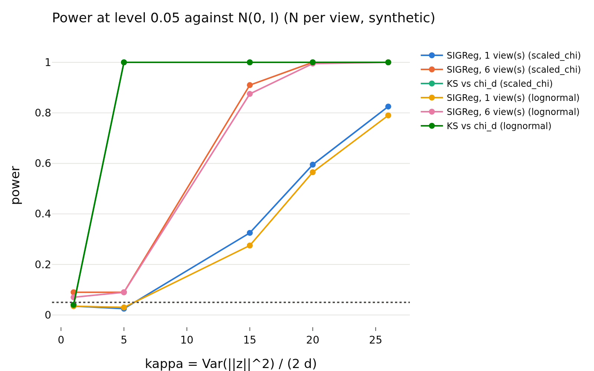
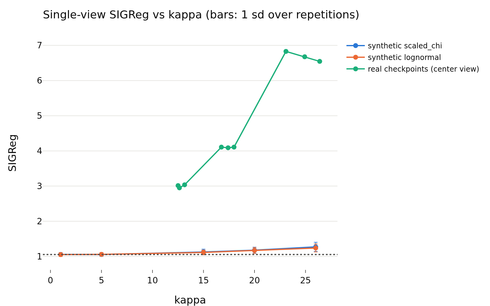

# E4: Why is the radius loosely constrained? SIGReg power study

- **Branch / version:** sigreg-power @ 413e649 (code); the note itself is committed after it
- **Run datetime (UTC):** 2026-10-23T16:57Z (unit jobs), aggregated 2026-10-23T16:59Z
- **Command(s):**
  ```bash
  # one SLURM array task per unit (11 synthetic cells + 9 real runs), job 2237303
  sbatch --export=ALL --array=0-19 slurm/sigreg_power.sbatch configs/base.yaml radius_marginal
  # aggregation (job 2237331, CPU, dev partition; writes this note and the PNGs)
  python apps/analyze.py --sigreg-power --config configs/base.yaml \
      --runs-prefix radius_marginal --note sigreg_power/power.md
  ```
  Each array task runs `python apps/analyze.py --sigreg-power --config configs/base.yaml --runs-prefix radius_marginal --power-unit UNIT` (UNIT from `--power-list-units`) on one GPU.
- **Datasets:** real part: STL-10 test split, projector output `z` of the nine `radius_marginal` checkpoints (embeddings from `apps/embed.py`). Canonical source: [STL-10](https://cs.stanford.edu/~acoates/stl10/); closest HF page: [tanganke/stl10](https://huggingface.co/datasets/tanganke/stl10). The arrays were built by `apps/prepare_data.py`; which of the two sources it read is not re-verified here. The synthetic part uses no data.
- **Backbone:** ResNet-18 built from scratch with timm (architecture [timm/resnet18.a1_in1k](https://huggingface.co/timm/resnet18.a1_in1k); no pretrained weights used). `h` is not analyzed; LeJEPA's product is `z`.

## Question

Why is the radius of `z` only loosely constrained by SIGReg (`kappa_z` = 15-26 against 1 for `N(0, I)`)? Hypothesis: for `z = r u`, a 1-D projection is a scale mixture with kurtosis about `3(1 + 2 kappa / d)` (3.47 at kappa = 20, d = 256), so the sliced Epps-Pulley statistic has little power against such a radial spread and a weak gradient on the radius.

## Setup (deviations from the base config)

Synthetic samples `z = r u` (`u` uniform on the sphere, `E r^2 = d`, `Var(r^2) = 2 d kappa`) with two radial profiles (`scaled_chi`, `lognormal`), kappa in {1, 5, 15, 20, 26}, training settings (d = 256, per-view N = 256, 1024 slices, 17 nodes), 200 repetitions per cell (fresh samples and slice directions), the null is exact `N(0, I)`. "6 views" averages SIGReg over six *independent* synthetic views (what the loss does; real views of one image are correlated, so this is optimistic for power). KS vs `chi_d` is the direct radial contrast. Gradient: single-view SIGReg gradient split into radial and tangential parts, 20 repetitions. Real part: 20 random batches of 256 STL-10 test images per run. Each unit is seeded from the study seed and its name, so the result does not depend on job order. No deviations from `configs/base.yaml`.

## Results

<!-- BEGIN GENERATED: sigreg_power.setup -->
### Synthetic setup

| parameter | value |
|---|---|
| dim | 256 |
| batch_size | 256 |
| num_slices | 1024 |
| num_points | 17 |
| t_max | 3.0 |
| num_views | 6 |
| reps | 200 |
| grad_reps | 20 |
| seed | 0 |
<!-- END GENERATED: sigreg_power.setup -->

<!-- BEGIN GENERATED: sigreg_power.kurtosis -->
### Projection kurtosis: claimed vs exact vs Monte Carlo

| family | kappa | claimed 3(1+2k/d) | exact 3(d+2k)/(d+2) | Monte Carlo |
|---|---|---|---|---|
| scaled_chi | 1 | 3.023 | 3 | 2.963 |
| scaled_chi | 5 | 3.117 | 3.093 | 3.082 |
| scaled_chi | 15 | 3.352 | 3.326 | 3.32 |
| scaled_chi | 20 | 3.469 | 3.442 | 3.528 |
| scaled_chi | 26 | 3.609 | 3.581 | 3.484 |
| lognormal | 1 | 3.023 | 3 | 3.039 |
| lognormal | 5 | 3.117 | 3.093 | 3.075 |
| lognormal | 15 | 3.352 | 3.326 | 3.333 |
| lognormal | 20 | 3.469 | 3.442 | 3.523 |
| lognormal | 26 | 3.609 | 3.581 | 3.516 |
<!-- END GENERATED: sigreg_power.kurtosis -->

<!-- BEGIN GENERATED: sigreg_power.power -->
### SIGReg value and power against N(0, I)

Null (exact Gaussians): single view 1.054 ± 0.0544; 6 independent views 1.05 ± 0.0202. Power is the fraction of repetitions above the 95% null quantile of the same statistic.

| family | kappa | statistic | mean | std | shift / null std | power |
|---|---|---|---|---|---|---|
| scaled_chi | 1 | SIGReg, 1 view(s) | 1.057 | 0.05137 | 0.06565 | 0.035 |
| scaled_chi | 1 | SIGReg, 6 view(s) | 1.053 | 0.02362 | 0.1153 | 0.09 |
| scaled_chi | 1 | KS vs chi_d | 0.05301 | 0.01532 | -0.05365 | 0.04 |
| scaled_chi | 5 | SIGReg, 1 view(s) | 1.056 | 0.0521 | 0.03335 | 0.025 |
| scaled_chi | 5 | SIGReg, 6 view(s) | 1.057 | 0.021 | 0.3197 | 0.09 |
| scaled_chi | 5 | KS vs chi_d | 0.2214 | 0.02645 | 9.688 | 1 |
| scaled_chi | 15 | SIGReg, 1 view(s) | 1.126 | 0.07988 | 1.333 | 0.325 |
| scaled_chi | 15 | SIGReg, 6 view(s) | 1.12 | 0.02737 | 3.437 | 0.91 |
| scaled_chi | 15 | KS vs chi_d | 0.3343 | 0.02822 | 16.22 | 1 |
| scaled_chi | 20 | SIGReg, 1 view(s) | 1.179 | 0.08476 | 2.301 | 0.595 |
| scaled_chi | 20 | SIGReg, 6 view(s) | 1.186 | 0.04064 | 6.727 | 1 |
| scaled_chi | 20 | KS vs chi_d | 0.3644 | 0.03065 | 17.96 | 1 |
| scaled_chi | 26 | SIGReg, 1 view(s) | 1.273 | 0.1302 | 4.033 | 0.825 |
| scaled_chi | 26 | SIGReg, 6 view(s) | 1.281 | 0.05486 | 11.45 | 1 |
| scaled_chi | 26 | KS vs chi_d | 0.3912 | 0.02973 | 19.51 | 1 |
| lognormal | 1 | SIGReg, 1 view(s) | 1.053 | 0.05369 | -0.02307 | 0.035 |
| lognormal | 1 | SIGReg, 6 view(s) | 1.053 | 0.02174 | 0.1377 | 0.07 |
| lognormal | 1 | KS vs chi_d | 0.0555 | 0.01625 | 0.09032 | 0.04 |
| lognormal | 5 | SIGReg, 1 view(s) | 1.058 | 0.05002 | 0.08097 | 0.03 |
| lognormal | 5 | SIGReg, 6 view(s) | 1.056 | 0.02197 | 0.2869 | 0.09 |
| lognormal | 5 | KS vs chi_d | 0.2232 | 0.02597 | 9.79 | 1 |
| lognormal | 15 | SIGReg, 1 view(s) | 1.114 | 0.0672 | 1.108 | 0.275 |
| lognormal | 15 | SIGReg, 6 view(s) | 1.116 | 0.02817 | 3.257 | 0.875 |
| lognormal | 15 | KS vs chi_d | 0.3468 | 0.02941 | 16.94 | 1 |
| lognormal | 20 | SIGReg, 1 view(s) | 1.17 | 0.08407 | 2.141 | 0.565 |
| lognormal | 20 | SIGReg, 6 view(s) | 1.169 | 0.03675 | 5.863 | 0.995 |
| lognormal | 20 | KS vs chi_d | 0.374 | 0.02774 | 18.52 | 1 |
| lognormal | 26 | SIGReg, 1 view(s) | 1.24 | 0.1136 | 3.428 | 0.79 |
| lognormal | 26 | SIGReg, 6 view(s) | 1.244 | 0.0474 | 9.585 | 1 |
| lognormal | 26 | KS vs chi_d | 0.406 | 0.03136 | 20.36 | 1 |
<!-- END GENERATED: sigreg_power.power -->

<!-- BEGIN GENERATED: sigreg_power.gradient -->
### Gradient of single-view SIGReg: radial vs tangential part

| family | kappa | radial_rms | tangential_rms | norm_ratio | restoring_corr |
|---|---|---|---|---|---|
| N(0, I) | 1 | 0.0003478 | 0.0003281 | 0.06661 | -0.09715 |
| scaled_chi | 1 | 0.0002877 | 0.0003302 | 0.05483 | -0.07021 |
| scaled_chi | 5 | 0.0004326 | 0.0003247 | 0.08253 | 0.2123 |
| scaled_chi | 15 | 0.001129 | 0.0003367 | 0.2104 | 0.7681 |
| scaled_chi | 20 | 0.001447 | 0.0003366 | 0.2654 | 0.8824 |
| scaled_chi | 26 | 0.002054 | 0.0003469 | 0.3684 | 0.931 |
| lognormal | 1 | 0.000294 | 0.0003219 | 0.0572 | -0.06254 |
| lognormal | 5 | 0.0003391 | 0.000325 | 0.06446 | 0.1346 |
| lognormal | 15 | 0.001228 | 0.0003316 | 0.2289 | 0.8004 |
| lognormal | 20 | 0.001461 | 0.0003352 | 0.2704 | 0.8655 |
| lognormal | 26 | 0.002168 | 0.0003384 | 0.3982 | 0.9238 |
<!-- END GENERATED: sigreg_power.gradient -->

<!-- BEGIN GENERATED: sigreg_power.real -->
### Real z embeddings (STL-10 test, projector output)

| run | kappa (center views) | kappa (batches of N) | E\|\|z\|\|^2 / d | std(\|\|z\|\|) / mean(\|\|z\|\|) | SIGReg, center view | SIGReg, augmented views | (center - null mean) / null std | synthetic scaled-chi at same kappa | KS vs chi_d (batch of N) | grad radial rms | grad tangential rms | grad restoring corr | training SIGReg (last epoch) |
|---|---|---|---|---|---|---|---|---|---|---|---|---|---|
| radius_marginal_lam0.02_s0 | 23.08 | 22.68 | 0.9924 | 0.209 | 6.828 | 7.187 | 106.1 | 1.249 | 0.4027 | 0.001555 | 0.0007747 | -0.01839 | 4.239 |
| radius_marginal_lam0.02_s1 | 26.39 | 26.67 | 1.004 | 0.2172 | 6.545 | 6.966 | 100.9 | 1.312 | 0.3887 | 0.001291 | 0.0007388 | -0.01931 | 4.246 |
| radius_marginal_lam0.02_s2 | 24.92 | 25.46 | 0.9877 | 0.2147 | 6.677 | 7.245 | 103.4 | 1.263 | 0.3995 | 0.001506 | 0.0007544 | 0.009126 | 4.236 |
| radius_marginal_lam0.05_s0 | 17.41 | 16.97 | 1.021 | 0.1765 | 4.089 | 4.3 | 55.8 | 1.135 | 0.3251 | 0.0008222 | 0.0006294 | -0.0209 | 2.033 |
| radius_marginal_lam0.05_s1 | 17.99 | 18.66 | 1.009 | 0.1812 | 4.108 | 4.298 | 56.14 | 1.154 | 0.3461 | 0.0008818 | 0.0006242 | 0.1155 | 2.037 |
| radius_marginal_lam0.05_s2 | 16.75 | 17.53 | 1.007 | 0.1765 | 4.107 | 4.513 | 56.12 | 1.116 | 0.3508 | 0.0009399 | 0.0006342 | 0.1429 | 2.037 |
| radius_marginal_lam0.1_s0 | 12.64 | 12.55 | 1.001 | 0.1541 | 2.949 | 3.291 | 34.84 | 1.104 | 0.3207 | 0.0007131 | 0.0005522 | 0.2147 | 1.286 |
| radius_marginal_lam0.1_s1 | 13.15 | 12.55 | 1.023 | 0.154 | 3.037 | 3.108 | 36.45 | 1.104 | 0.2914 | 0.0007246 | 0.0005563 | 0.04229 | 1.287 |
| radius_marginal_lam0.1_s2 | 12.51 | 12.34 | 1.01 | 0.1517 | 3.015 | 3.181 | 36.05 | 1.089 | 0.2951 | 0.0006 | 0.0005606 | 0.09013 | 1.283 |
<!-- END GENERATED: sigreg_power.real -->

<!-- BEGIN GENERATED: sigreg_power.figures -->
### Figures




<!-- END GENERATED: sigreg_power.figures -->

## Interpretation

- **Kurtosis formula.** The claimed `3(1 + 2 kappa / d)` is slightly off: the exact value for a uniform direction is `3(d + 2 kappa)/(d + 2)` (3.442 at kappa = 20, claimed 3.469; the claim overstates the excess kurtosis by about 6%). Monte Carlo (20000 samples, so roughly +-0.05 noise) is consistent with the exact formula; at kappa = 20-26 the point estimates scatter on both sides (3.53 and 3.48 against 3.44 and 3.58). The point that the departure of any single marginal is small (excess kurtosis about 0.4-0.6) stands.
- **Power: partly supported, not "little power".** At the training N = 256 a single-view SIGReg reaches power 0.3 (kappa = 15), 0.6 (20) and 0.8 (26), nothing at kappa = 5; averaging six independent views gives 0.9, 1.0 and 1.0. So SIGReg is not blind to kappa = 15-26 in the idealized pure-radial setting; it is far less sensitive than a direct radial test (KS vs `chi_d`: power 1 already at kappa = 5, where SIGReg has none). The shift in SIGReg at kappa = 20 is only 1.18 against a null of 1.05 (standard deviation 0.05-0.08 single view).
- **Gradient: the radial signal is restoring but small in aggregate.** In the synthetic cells the radial component of the gradient correlates with `r - mean(r)` (0.77 / 0.88 / 0.93 at kappa = 15 / 20 / 26, `scaled_chi`), so descent shrinks the spread, and it grows with kappa. But the radial part is one degree of freedom per sample against 255 tangential ones: the norm ratio radial/tangential is 0.21-0.37 at kappa = 15-26 (0.05-0.08 at the null and at kappa = 5). Per sample this is a weak radial pull against much more tangential gradient.
- **Real embeddings contradict the pure-radial story.** The real checkpoints have SIGReg (center view) of 3.0-6.8, 35-106 null standard deviations above the null mean, while a synthetic scaled-chi at the same kappa gives only 1.09-1.31. So the radial spread explains very little of SIGReg's value on real `z`; most of it comes from non-Gaussianity that is not a radial scale mixture, which the training loss (4.2, 2.0, 1.3 at lambda 0.02, 0.05, 0.1, last epoch) is also still seeing. The real gradient's radial part has correlation with `r - mean(r)` of only -0.02 to 0.21 (synthetic 0.77-0.93 at the same kappa), i.e. SIGReg is not currently pulling the radius back at its observed spread; it is busy with other deviations. KS vs `chi_d` of real batches is 0.29-0.40, a large deviation that SIGReg's value does not isolate.
- **Verdict.** The mechanism "SIGReg has little power against a radial spread of this size" is supported only weakly: in isolation SIGReg has moderate single-view power at kappa 15-26 and restoring gradients, while a direct radial test is far more powerful. On real embeddings the picture is mixed to negative for the hypothesis as stated: SIGReg's value is dominated by something other than the radial spread, and its radial gradient is not restoring there. The radius is loosely constrained because the radial restoring signal is small relative to, and mixed with, the other deviations, not because the statistic is blind to it.
- Caveats: the 6-view power is optimistic (independent views); real batches come from 8000 test images, not the training distribution at the last step; the real gradient is on center views of test images, not augmented training views; the synthetic directions are exactly uniform on the sphere, which the real `z` are not; 200 repetitions give power to about +-0.03 (+-0.07 near 0.5).

## Next steps

- Measure the radial vs tangential gradient on the real augmented training views (per-view loss as trained), and the direction non-Gaussianity of real `z` (SIGReg of `u * sqrt(d)` with `r` replaced by an exact `chi_d` sample) to see how much of the real SIGReg value is not radial.
- If the radial gradient is indeed unrelated to the radial spread on real `z`, this motivates the SUSReg / radial-loss variants (M4).
