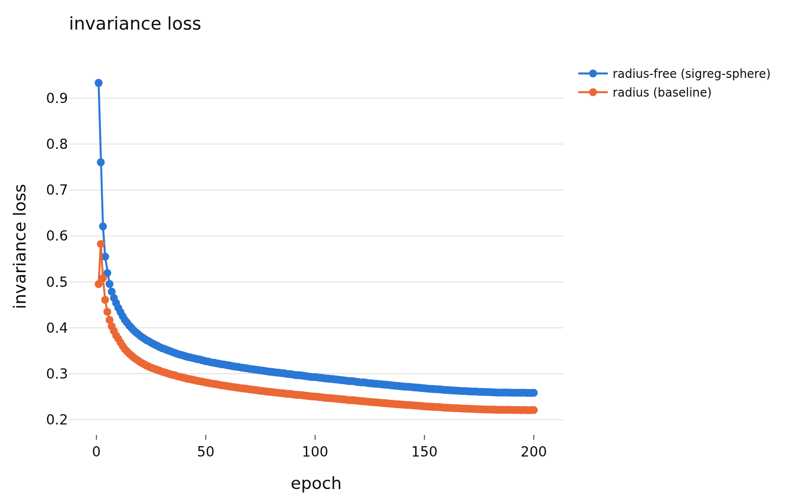
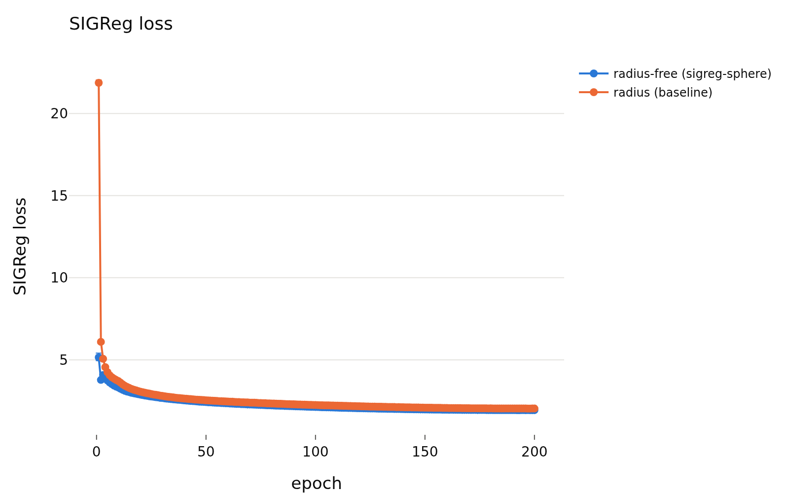
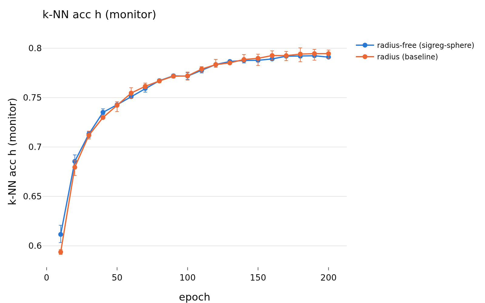
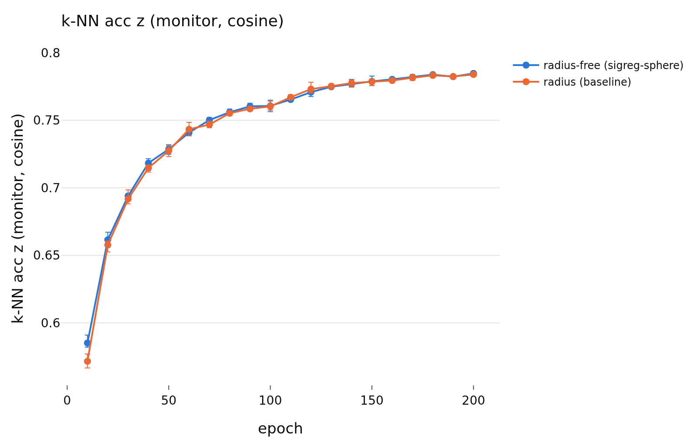
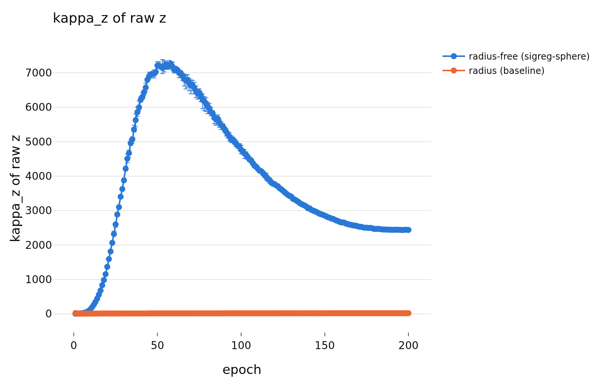
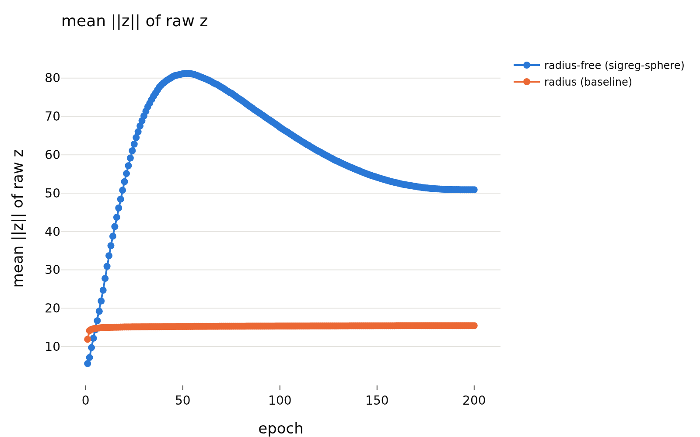
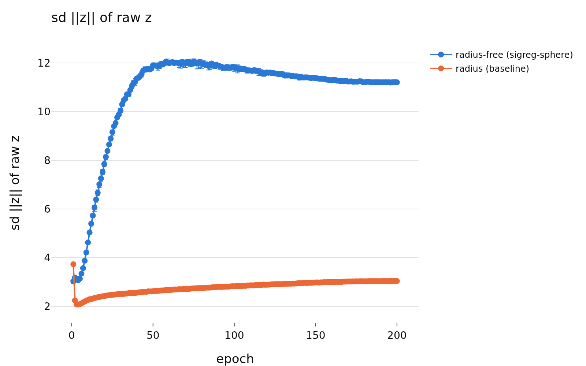

# E3: training without the radius (SIGReg on the sphere) vs the matching radius runs
- **Branch / version:** `sigreg-sphere` @ the commit that contains this file (see git log)
- **Run datetime (UTC):** pre-registration committed 2026-10-26T00:50Z (before any training result or evaluation existed); results: analysis jobs finished 2026-10-26 (aggregate job 2252446)
- **Command(s):** see "Run log" (training, embeds, units, aggregate) below
- **Datasets:** STL-10 unlabeled (100k, pretraining), STL-10 `train`/`test` (bank / queries), STL-10-C (generated from `test`), DTD `test`, SVHN `test`. STL-10: [canonical](https://cs.stanford.edu/~acoates/stl10/), [HF `tanganke/stl10`](https://huggingface.co/datasets/tanganke/stl10); the **canonical Stanford archive was used** (via the prepared arrays), the HF page is linked for reference. DTD: [canonical](https://www.robots.ox.ac.uk/~vgg/data/dtd/), [HF `tanganke/dtd`](https://huggingface.co/datasets/tanganke/dtd). SVHN: [canonical](http://ufldl.stanford.edu/housenumbers/), [HF `ufldl-stanford/svhn`](https://huggingface.co/datasets/ufldl-stanford/svhn); the canonical archives (prepared arrays) were used.
- **Backbone:** ResNet-18 from scratch ([HF architecture reference](https://huggingface.co/timm/resnet18.a1_in1k), weights not used), projector 512 -> 2048 -> 2048 -> 256.
- **Scope:** h is not analyzed; LeJEPA's product is z.

## Question

Is the embedding radius needed *for training*? E1 and the follow-ups found the radius of z (nearly) unused by readers and highly predictable from the direction. Intervention: `loss.radius_free=true` replaces z by `z~ = sqrt(d) z/||z||` before **both** the invariance loss and SIGReg, so the radius of the loss-visible embedding is exactly constant (`sqrt(256) = 16`) and the loss gives the raw radius no gradient. Everything else is `configs/base.yaml` with lambda = 0.05, seeds 0, 1, 2; the comparison runs are `radius_marginal_lam0.05_s{0,1,2}` (same config, `radius_free=false`).

Caveat (documented in `lejepa_norm.losses.lejepa.project_to_sphere`): SIGReg targets N(0, I_d); the 1-D projections of `z~` (uniform on the sphere of radius sqrt(d)) are Gaussian only approximately, with a mismatch of order 1/d (d = 256; kurtosis 3 - 6/(d+2) = 2.977 vs 3). The sliced Epps-Pulley statistic therefore has a small non-zero minimum on the sphere; the direction-only target is "as Gaussian as a sphere can be". The backbone feature h keeps its radius (out of scope). The raw projector output z of a radius-free model has an unconstrained radius (it receives no gradient except through weight decay / optimizer dynamics): **all evaluations of radius-free runs use `z~` (direction only, norm sqrt(d))**; the online k-NN monitor is cosine k-NN and unaffected.

## Pre-registration (written before any result of these runs was computed or looked at)

Compared with the matching radius runs (same lambda and seed index; different trained models, so seed index pairing is only bookkeeping). Equivalence margin **0.5 accuracy points** (`eval.equivalence_margin`) for accuracy, **0.5 points** for retrieval metrics (`eval.retrieval_margin`), **0.01 AUROC** for OOD (`ood_radius.OOD_AUROC_MARGIN`), all from the existing configs and fixed before this experiment. Statistics: paired bootstrap over test images within each training seed (the same images are scored by both models), averaged over the 3 seeds, 1000 replicates, TOST-style verdict (`randomization.verdict`). **Caveat stated in advance: the intervals cover test-image sampling only; training-seed variance of two *different* trained models is not covered beyond averaging 3 seeds.**

Primary reference = the radius model as trained (raw z, with radius). Secondary reference = the radius model with its radius removed at test time (unit-norm z, E1's `constant` condition, retrained readers).

Predictions:

1. **Accuracy equivalent.** Euclidean k-NN, linear probe and MLP accuracy on clean STL-10 test (readers fitted on STL-10 train, E1 protocol) of the radius-free model are equivalent (90% CI within +-0.5 points) to the radius model's, for each of the three readers. Held iff all three verdicts are `equivalent`. Same comparison on STL-10-C (all 50 corruption x severity cells pooled, and per corruption) is reported with the same verdict rule but is not part of the prediction.
2. **Instance retrieval recovers through direction.** View-to-view instance retrieval R@1 and R@5 of the radius-free model are not worse than those of the radius model's *constant-radius* variant (the radius model's direction-only retrieval): held iff the lower end of the 90% CI of (radius-free minus radius-constant) exceeds -0.5 points for both R@1 and R@5 (one-sided non-inferiority at the retrieval margin). (Not predicted either way: the comparison with the radius model's as-trained retrieval.)
3. **OOD (direction-only) is lower than radius-using.** On SVHN (ID = STL-10 test, bank = STL-10 train), the AUROC of the radius-free model's direction-only score (k-NN distance of the normalized z) is lower than the best radius-using score of the radius model, where "best radius-using" = the larger seed-mean AUROC of the two pre-registered deployable scores `kNN raw z` and `direction + radius deviation` (the optimistic best-weight oracle and the post hoc score are reported but not used). Held iff the 95% paired bootstrap CI of the difference lies entirely below 0; "direction of effect only" if the point difference is negative but the CI contains 0. The same comparison on DTD is reported, not predicted.

Secondary expectation (descriptive, from the E1/retrieval results on the radius model, where unit-norm z improved class-level mAP by about 4 points): class-level retrieval mAP of the radius-free model is higher than the radius model's as-trained mAP and close to its constant-radius variant. Not a pre-registered verdict.

Training health (reported, not predicted): 200 epochs completed with finite losses, invariance loss and `knn_acc_h` / `knn_acc_z` curves compared with the radius runs; training is called healthy if all 3 runs complete, no value is non-finite, and the final k-NN monitor accuracy is within 2 points of the radius runs' (a looser, descriptive bar than the equivalence margin because the monitor is a 20-epoch-interval, single-pass estimate).

## Setup (deviations from the base config)

`loss.radius_free=true` only. Runs `sigreg_sphere_lam0.05_s{0,1,2}`, trained with the sweep template in parallel; GPU types and job ids below. GPUs: s0 on node m002 (H100), s1 on q001 (H200), s2 on m002 (H100) for epochs 1-70 and j005-ds (A100) for epochs 71-200 after the resume; the radius baselines were trained on A100s (non-determinism across hardware is expected).

### Run log (job ids, failure)

- Training array `2247702_{0,1,2}` (submitted `LAMBDAS="0.05" SEEDS="0 1 2" sbatch --export=ALL --array=0-2 slurm/sweep.sbatch configs/base.yaml sigreg_sphere --set loss.radius_free=true`), embeds `2247734-36` (afterok on the matching task), per-run units `2248021-23` (`apps/analyze.py --compare-prefix sigreg_sphere --baseline-prefix radius_marginal --compare-unit RUN`, 1 GPU).
- **Failure:** task `2247702_2` (seed 2) FAILED at epoch 70 (~2026-10-26T02:15Z, node m002) with `RuntimeError` in `torch.save` of `last.pt.tmp` (a transient filesystem write error; the disk was not full). `resume.pt` and `epoch_0070.pt` were intact; the stale `last.pt.tmp` was removed by hand. Embed `2247736`, unit `2248023` and the aggregate `2248024` were cancelled (dependency never satisfiable).
- **Resubmission:** training `2252442` (`LAMBDAS="0.05" SEEDS="0 1 2" sbatch --export=ALL --array=2 slurm/sweep.sbatch configs/base.yaml sigreg_sphere --set loss.radius_free=true`, resumes from `resume.pt` at epoch 70), embed `2252443`, unit `2252444`, aggregate `2252446` (`--compare-prefix sigreg_sphere --baseline-prefix radius_marginal --note sigreg_sphere/sphere_vs_radius.md`). Seed 2 is therefore a resumed run (resume from a mid-run checkpoint; CUDA non-determinism may differ at float level).
- Follow-up code change: `checkpoint.save` now retries a failed write (3 attempts); it was not active in the failed job.

## Results

<!-- BEGIN GENERATED: analyze.sphere_inputs -->
### Inputs

Radius-free runs: `sigreg_sphere_lam0.05_s0`, `sigreg_sphere_lam0.05_s1`, `sigreg_sphere_lam0.05_s2`. Radius runs: `radius_marginal_lam0.05_s0`, `radius_marginal_lam0.05_s1`, `radius_marginal_lam0.05_s2`.
<!-- END GENERATED: analyze.sphere_inputs -->

<!-- BEGIN GENERATED: analyze.sphere_readings -->
### Readings of the pre-registered predictions (generated)

- lambda 0.05, prediction 1 (accuracy equivalent): **did not hold** (k-NN (euclidean): -0.24 pts, inconclusive; linear probe: -0.25 pts, inconclusive; MLP (1 hidden layer): +0.23 pts, inconclusive).
- lambda 0.05, prediction 2 (instance retrieval recovers through direction): **held** (R@1: +3.20 pts, 90% CI [+2.97, +3.42], non-inferior; R@5: +2.13 pts, 90% CI [+1.97, +2.29], non-inferior).
- lambda 0.05, prediction 3 (SVHN direction-only AUROC lower than the radius model's best radius-using score, here `direction + radius deviation (equal weights)`): **lower** (difference -0.133 [-0.136, -0.130]).
- Training healthy (descriptive bar): **yes**.
<!-- END GENERATED: analyze.sphere_readings -->

<!-- BEGIN GENERATED: analyze.sphere_accuracy -->
### Accuracy: radius-free minus radius model

Readers fitted on STL-10 train (clean) and applied to STL-10 test and STL-10-C; differences in accuracy points of the radius-free model (z~) minus the reference on the same test images, averaged over the seed pairs; paired bootstrap over images (1000 replicates). Verdict with margin ±0.5 points: `equivalent` if the 90% interval lies inside the margin, `different` if not and the 95% interval excludes 0, else `inconclusive`. The intervals do not cover training-seed variance of the two different trained models beyond averaging the seeds.

| lambda | level | reader | reference | radius-free acc | reference acc | difference (points) | 90% CI (points) | 95% CI (points) | verdict |
|---|---|---|---|---|---|---|---|---|---|
| 0.05 | clean STL-10 test | k-NN (euclidean) | radius model as trained (raw z) | 0.7846 | 0.7870 | -0.24 | [-0.53, +0.05] | [-0.60, +0.10] | inconclusive |
| 0.05 | clean STL-10 test | k-NN (euclidean) | radius model, direction only (unit norm) | 0.7846 | 0.7836 | +0.10 | [-0.15, +0.40] | [-0.21, +0.45] | equivalent |
| 0.05 | clean STL-10 test | linear probe | radius model as trained (raw z) | 0.8151 | 0.8176 | -0.25 | [-0.55, +0.06] | [-0.62, +0.12] | inconclusive |
| 0.05 | clean STL-10 test | linear probe | radius model, direction only (unit norm) | 0.8151 | 0.8167 | -0.16 | [-0.46, +0.14] | [-0.50, +0.20] | equivalent |
| 0.05 | clean STL-10 test | MLP (1 hidden layer) | radius model as trained (raw z) | 0.8178 | 0.8155 | +0.23 | [-0.09, +0.54] | [-0.14, +0.60] | inconclusive |
| 0.05 | clean STL-10 test | MLP (1 hidden layer) | radius model, direction only (unit norm) | 0.8178 | 0.8145 | +0.34 | [+0.03, +0.64] | [-0.03, +0.69] | inconclusive |
| 0.05 | STL-10-C, all 50 cells | k-NN (euclidean) | radius model as trained (raw z) | 0.3564 | 0.3677 | -1.13 | [-1.22, -1.04] | [-1.23, -1.02] | different |
| 0.05 | STL-10-C, all 50 cells | k-NN (euclidean) | radius model, direction only (unit norm) | 0.3564 | 0.3742 | -1.77 | [-1.85, -1.69] | [-1.88, -1.67] | different |
| 0.05 | STL-10-C, all 50 cells | linear probe | radius model as trained (raw z) | 0.3629 | 0.3724 | -0.95 | [-1.06, -0.83] | [-1.08, -0.81] | different |
| 0.05 | STL-10-C, all 50 cells | linear probe | radius model, direction only (unit norm) | 0.3629 | 0.3756 | -1.26 | [-1.38, -1.14] | [-1.40, -1.13] | different |
| 0.05 | STL-10-C, all 50 cells | MLP (1 hidden layer) | radius model as trained (raw z) | 0.3706 | 0.3777 | -0.70 | [-0.82, -0.58] | [-0.84, -0.56] | different |
| 0.05 | STL-10-C, all 50 cells | MLP (1 hidden layer) | radius model, direction only (unit norm) | 0.3706 | 0.3800 | -0.93 | [-1.05, -0.81] | [-1.08, -0.79] | different |
| 0.05 | brightness | k-NN (euclidean) | radius model as trained (raw z) | 0.7299 | 0.7301 | -0.02 | [-0.23, +0.19] | [-0.27, +0.24] | equivalent |
| 0.05 | brightness | k-NN (euclidean) | radius model, direction only (unit norm) | 0.7299 | 0.7335 | -0.35 | [-0.54, -0.15] | [-0.60, -0.10] | different |
| 0.05 | brightness | linear probe | radius model as trained (raw z) | 0.7396 | 0.7451 | -0.55 | [-0.79, -0.31] | [-0.82, -0.28] | different |
| 0.05 | brightness | linear probe | radius model, direction only (unit norm) | 0.7396 | 0.7468 | -0.73 | [-0.96, -0.48] | [-1.00, -0.44] | different |
| 0.05 | brightness | MLP (1 hidden layer) | radius model as trained (raw z) | 0.7406 | 0.7474 | -0.68 | [-0.92, -0.45] | [-0.96, -0.40] | different |
| 0.05 | brightness | MLP (1 hidden layer) | radius model, direction only (unit norm) | 0.7406 | 0.7465 | -0.59 | [-0.83, -0.35] | [-0.89, -0.31] | different |
| 0.05 | contrast | k-NN (euclidean) | radius model as trained (raw z) | 0.5326 | 0.5460 | -1.34 | [-1.56, -1.15] | [-1.61, -1.10] | different |
| 0.05 | contrast | k-NN (euclidean) | radius model, direction only (unit norm) | 0.5326 | 0.5529 | -2.03 | [-2.23, -1.85] | [-2.26, -1.82] | different |
| 0.05 | contrast | linear probe | radius model as trained (raw z) | 0.5345 | 0.5491 | -1.46 | [-1.67, -1.24] | [-1.71, -1.20] | different |
| 0.05 | contrast | linear probe | radius model, direction only (unit norm) | 0.5345 | 0.5521 | -1.76 | [-1.97, -1.54] | [-2.01, -1.50] | different |
| 0.05 | contrast | MLP (1 hidden layer) | radius model as trained (raw z) | 0.5379 | 0.5617 | -2.38 | [-2.60, -2.16] | [-2.64, -2.11] | different |
| 0.05 | contrast | MLP (1 hidden layer) | radius model, direction only (unit norm) | 0.5379 | 0.5597 | -2.18 | [-2.41, -1.95] | [-2.44, -1.90] | different |
| 0.05 | defocus_blur | k-NN (euclidean) | radius model as trained (raw z) | 0.2493 | 0.2890 | -3.97 | [-4.13, -3.80] | [-4.16, -3.77] | different |
| 0.05 | defocus_blur | k-NN (euclidean) | radius model, direction only (unit norm) | 0.2493 | 0.2922 | -4.29 | [-4.45, -4.13] | [-4.49, -4.10] | different |
| 0.05 | defocus_blur | linear probe | radius model as trained (raw z) | 0.2659 | 0.3024 | -3.65 | [-3.83, -3.45] | [-3.87, -3.43] | different |
| 0.05 | defocus_blur | linear probe | radius model, direction only (unit norm) | 0.2659 | 0.3113 | -4.54 | [-4.72, -4.34] | [-4.77, -4.30] | different |
| 0.05 | defocus_blur | MLP (1 hidden layer) | radius model as trained (raw z) | 0.2697 | 0.3155 | -4.58 | [-4.78, -4.39] | [-4.81, -4.36] | different |
| 0.05 | defocus_blur | MLP (1 hidden layer) | radius model, direction only (unit norm) | 0.2697 | 0.3164 | -4.67 | [-4.86, -4.46] | [-4.90, -4.43] | different |
| 0.05 | gaussian_blur | k-NN (euclidean) | radius model as trained (raw z) | 0.3739 | 0.3868 | -1.29 | [-1.43, -1.16] | [-1.45, -1.13] | different |
| 0.05 | gaussian_blur | k-NN (euclidean) | radius model, direction only (unit norm) | 0.3739 | 0.3875 | -1.36 | [-1.49, -1.23] | [-1.51, -1.20] | different |
| 0.05 | gaussian_blur | linear probe | radius model as trained (raw z) | 0.3850 | 0.3947 | -0.97 | [-1.12, -0.83] | [-1.14, -0.79] | different |
| 0.05 | gaussian_blur | linear probe | radius model, direction only (unit norm) | 0.3850 | 0.3995 | -1.46 | [-1.60, -1.32] | [-1.63, -1.28] | different |
| 0.05 | gaussian_blur | MLP (1 hidden layer) | radius model as trained (raw z) | 0.3872 | 0.4019 | -1.47 | [-1.62, -1.32] | [-1.64, -1.30] | different |
| 0.05 | gaussian_blur | MLP (1 hidden layer) | radius model, direction only (unit norm) | 0.3872 | 0.4030 | -1.58 | [-1.74, -1.44] | [-1.77, -1.41] | different |
| 0.05 | gaussian_noise | k-NN (euclidean) | radius model as trained (raw z) | 0.1621 | 0.1715 | -0.93 | [-1.13, -0.74] | [-1.16, -0.71] | different |
| 0.05 | gaussian_noise | k-NN (euclidean) | radius model, direction only (unit norm) | 0.1621 | 0.1733 | -1.12 | [-1.33, -0.93] | [-1.37, -0.91] | different |
| 0.05 | gaussian_noise | linear probe | radius model as trained (raw z) | 0.1812 | 0.1842 | -0.30 | [-0.60, +0.00] | [-0.68, +0.07] | inconclusive |
| 0.05 | gaussian_noise | linear probe | radius model, direction only (unit norm) | 0.1812 | 0.1856 | -0.43 | [-0.75, -0.13] | [-0.81, -0.08] | different |
| 0.05 | gaussian_noise | MLP (1 hidden layer) | radius model as trained (raw z) | 0.1822 | 0.1740 | +0.82 | [+0.53, +1.09] | [+0.49, +1.16] | different |
| 0.05 | gaussian_noise | MLP (1 hidden layer) | radius model, direction only (unit norm) | 0.1822 | 0.1803 | +0.19 | [-0.09, +0.47] | [-0.15, +0.53] | equivalent |
| 0.05 | impulse_noise | k-NN (euclidean) | radius model as trained (raw z) | 0.1605 | 0.1683 | -0.79 | [-1.00, -0.58] | [-1.02, -0.54] | different |
| 0.05 | impulse_noise | k-NN (euclidean) | radius model, direction only (unit norm) | 0.1605 | 0.1680 | -0.75 | [-0.96, -0.54] | [-0.99, -0.50] | different |
| 0.05 | impulse_noise | linear probe | radius model as trained (raw z) | 0.1778 | 0.1752 | +0.26 | [+0.00, +0.53] | [-0.05, +0.59] | inconclusive |
| 0.05 | impulse_noise | linear probe | radius model, direction only (unit norm) | 0.1778 | 0.1771 | +0.07 | [-0.20, +0.34] | [-0.26, +0.40] | equivalent |
| 0.05 | impulse_noise | MLP (1 hidden layer) | radius model as trained (raw z) | 0.1847 | 0.1735 | +1.12 | [+0.86, +1.39] | [+0.81, +1.44] | different |
| 0.05 | impulse_noise | MLP (1 hidden layer) | radius model, direction only (unit norm) | 0.1847 | 0.1790 | +0.57 | [+0.28, +0.85] | [+0.24, +0.90] | different |
| 0.05 | jpeg_compression | k-NN (euclidean) | radius model as trained (raw z) | 0.5791 | 0.5515 | +2.76 | [+2.54, +2.99] | [+2.50, +3.03] | different |
| 0.05 | jpeg_compression | k-NN (euclidean) | radius model, direction only (unit norm) | 0.5791 | 0.5690 | +1.02 | [+0.82, +1.23] | [+0.79, +1.26] | different |
| 0.05 | jpeg_compression | linear probe | radius model as trained (raw z) | 0.5595 | 0.5299 | +2.96 | [+2.73, +3.20] | [+2.69, +3.24] | different |
| 0.05 | jpeg_compression | linear probe | radius model, direction only (unit norm) | 0.5595 | 0.5326 | +2.69 | [+2.45, +2.93] | [+2.41, +2.96] | different |
| 0.05 | jpeg_compression | MLP (1 hidden layer) | radius model as trained (raw z) | 0.5722 | 0.5495 | +2.27 | [+2.05, +2.52] | [+1.99, +2.56] | different |
| 0.05 | jpeg_compression | MLP (1 hidden layer) | radius model, direction only (unit norm) | 0.5722 | 0.5531 | +1.91 | [+1.68, +2.16] | [+1.63, +2.20] | different |
| 0.05 | pixelate | k-NN (euclidean) | radius model as trained (raw z) | 0.3721 | 0.3972 | -2.51 | [-2.70, -2.32] | [-2.74, -2.29] | different |
| 0.05 | pixelate | k-NN (euclidean) | radius model, direction only (unit norm) | 0.3721 | 0.4161 | -4.41 | [-4.59, -4.21] | [-4.63, -4.17] | different |
| 0.05 | pixelate | linear probe | radius model as trained (raw z) | 0.3393 | 0.3710 | -3.17 | [-3.36, -2.99] | [-3.38, -2.97] | different |
| 0.05 | pixelate | linear probe | radius model, direction only (unit norm) | 0.3393 | 0.3711 | -3.18 | [-3.38, -3.02] | [-3.40, -2.99] | different |
| 0.05 | pixelate | MLP (1 hidden layer) | radius model as trained (raw z) | 0.3583 | 0.3906 | -3.23 | [-3.41, -3.04] | [-3.44, -3.02] | different |
| 0.05 | pixelate | MLP (1 hidden layer) | radius model, direction only (unit norm) | 0.3583 | 0.3908 | -3.26 | [-3.44, -3.08] | [-3.47, -3.05] | different |
| 0.05 | shot_noise | k-NN (euclidean) | radius model as trained (raw z) | 0.1654 | 0.1788 | -1.34 | [-1.53, -1.14] | [-1.56, -1.11] | different |
| 0.05 | shot_noise | k-NN (euclidean) | radius model, direction only (unit norm) | 0.1654 | 0.1835 | -1.81 | [-2.00, -1.62] | [-2.03, -1.59] | different |
| 0.05 | shot_noise | linear probe | radius model as trained (raw z) | 0.1878 | 0.1984 | -1.06 | [-1.37, -0.75] | [-1.42, -0.69] | different |
| 0.05 | shot_noise | linear probe | radius model, direction only (unit norm) | 0.1878 | 0.2008 | -1.30 | [-1.61, -0.99] | [-1.66, -0.92] | different |
| 0.05 | shot_noise | MLP (1 hidden layer) | radius model as trained (raw z) | 0.1996 | 0.1905 | +0.92 | [+0.65, +1.22] | [+0.57, +1.27] | different |
| 0.05 | shot_noise | MLP (1 hidden layer) | radius model, direction only (unit norm) | 0.1996 | 0.1950 | +0.46 | [+0.18, +0.76] | [+0.12, +0.82] | different |
| 0.05 | speckle_noise | k-NN (euclidean) | radius model as trained (raw z) | 0.2395 | 0.2580 | -1.86 | [-2.07, -1.65] | [-2.11, -1.61] | different |
| 0.05 | speckle_noise | k-NN (euclidean) | radius model, direction only (unit norm) | 0.2395 | 0.2656 | -2.61 | [-2.82, -2.41] | [-2.86, -2.36] | different |
| 0.05 | speckle_noise | linear probe | radius model as trained (raw z) | 0.2589 | 0.2742 | -1.53 | [-1.82, -1.26] | [-1.87, -1.21] | different |
| 0.05 | speckle_noise | linear probe | radius model, direction only (unit norm) | 0.2589 | 0.2788 | -1.99 | [-2.27, -1.73] | [-2.32, -1.67] | different |
| 0.05 | speckle_noise | MLP (1 hidden layer) | radius model as trained (raw z) | 0.2740 | 0.2719 | +0.21 | [-0.07, +0.51] | [-0.12, +0.57] | inconclusive |
| 0.05 | speckle_noise | MLP (1 hidden layer) | radius model, direction only (unit norm) | 0.2740 | 0.2759 | -0.18 | [-0.46, +0.11] | [-0.54, +0.16] | equivalent |
<!-- END GENERATED: analyze.sphere_accuracy -->

<!-- BEGIN GENERATED: analyze.sphere_retrieval -->
### Retrieval: radius-free minus radius model

Euclidean retrieval in z (radius-free: z~); per-query paired differences in points, margin ±0.5. `non-inferior`: lower end of the 90% interval above minus the margin.

| lambda | task | metric | reference | radius-free (%) | reference (%) | difference (points) | 90% CI (points) | 95% CI (points) | verdict | non-inferior |
|---|---|---|---|---|---|---|---|---|---|---|
| 0.05 | class-level, gallery = test (leave-query-out) | mAP | radius model as trained (raw z) | 44.43 | 40.23 | +4.20 | [+4.11, +4.28] | [+4.10, +4.29] | different | non-inferior |
| 0.05 | class-level, gallery = test (leave-query-out) | mAP | radius model, direction only (unit norm) | 44.43 | 46.25 | -1.82 | [-1.87, -1.77] | [-1.88, -1.76] | different | inferior |
| 0.05 | class-level, gallery = test (leave-query-out) | P@1 | radius model as trained (raw z) | 76.44 | 75.42 | +1.02 | [+0.63, +1.43] | [+0.55, +1.51] | different | non-inferior |
| 0.05 | class-level, gallery = test (leave-query-out) | P@1 | radius model, direction only (unit norm) | 76.44 | 76.49 | -0.05 | [-0.40, +0.31] | [-0.47, +0.38] | equivalent | non-inferior |
| 0.05 | class-level, gallery = test (leave-query-out) | P@5 | radius model as trained (raw z) | 73.38 | 72.43 | +0.95 | [+0.77, +1.13] | [+0.74, +1.17] | different | non-inferior |
| 0.05 | class-level, gallery = test (leave-query-out) | P@5 | radius model, direction only (unit norm) | 73.38 | 73.65 | -0.26 | [-0.43, -0.09] | [-0.46, -0.06] | equivalent | non-inferior |
| 0.05 | class-level, gallery = test (leave-query-out) | P@10 | radius model as trained (raw z) | 71.90 | 70.96 | +0.94 | [+0.79, +1.08] | [+0.77, +1.11] | different | non-inferior |
| 0.05 | class-level, gallery = test (leave-query-out) | P@10 | radius model, direction only (unit norm) | 71.90 | 72.33 | -0.44 | [-0.58, -0.30] | [-0.60, -0.27] | different | undecided |
| 0.05 | class-level, gallery = train | mAP | radius model as trained (raw z) | 44.64 | 40.13 | +4.52 | [+4.43, +4.60] | [+4.42, +4.62] | different | non-inferior |
| 0.05 | class-level, gallery = train | mAP | radius model, direction only (unit norm) | 44.64 | 46.40 | -1.76 | [-1.81, -1.71] | [-1.82, -1.70] | different | inferior |
| 0.05 | class-level, gallery = train | P@1 | radius model as trained (raw z) | 75.58 | 74.43 | +1.15 | [+0.80, +1.52] | [+0.70, +1.59] | different | non-inferior |
| 0.05 | class-level, gallery = train | P@1 | radius model, direction only (unit norm) | 75.58 | 75.83 | -0.25 | [-0.60, +0.11] | [-0.66, +0.18] | inconclusive | undecided |
| 0.05 | class-level, gallery = train | P@5 | radius model as trained (raw z) | 72.14 | 71.07 | +1.07 | [+0.89, +1.26] | [+0.87, +1.29] | different | non-inferior |
| 0.05 | class-level, gallery = train | P@5 | radius model, direction only (unit norm) | 72.14 | 72.56 | -0.41 | [-0.57, -0.25] | [-0.60, -0.21] | different | undecided |
| 0.05 | class-level, gallery = train | P@10 | radius model as trained (raw z) | 70.74 | 69.43 | +1.31 | [+1.17, +1.46] | [+1.15, +1.49] | different | non-inferior |
| 0.05 | class-level, gallery = train | P@10 | radius model, direction only (unit norm) | 70.74 | 71.19 | -0.44 | [-0.57, -0.31] | [-0.59, -0.28] | different | undecided |
| 0.05 | instance-level, view to view | R@1 | radius model as trained (raw z) | 74.68 | 73.00 | +1.68 | [+1.45, +1.89] | [+1.41, +1.94] | different | non-inferior |
| 0.05 | instance-level, view to view | R@1 | radius model, direction only (unit norm) | 74.68 | 71.48 | +3.20 | [+2.97, +3.42] | [+2.91, +3.47] | different | non-inferior |
| 0.05 | instance-level, view to view | R@5 | radius model as trained (raw z) | 89.12 | 88.68 | +0.44 | [+0.28, +0.60] | [+0.24, +0.64] | different | non-inferior |
| 0.05 | instance-level, view to view | R@5 | radius model, direction only (unit norm) | 89.12 | 86.99 | +2.13 | [+1.97, +2.29] | [+1.93, +2.33] | different | non-inferior |
<!-- END GENERATED: analyze.sphere_retrieval -->

<!-- BEGIN GENERATED: analyze.sphere_ood -->
### OOD detection (ID: STL-10 test, bank: STL-10 train)

AUROC / FPR@95TPR of the radius-free model's direction-only score against the radius model's scores (definitions: `lejepa_norm.eval.ood_radius`); paired bootstrap, ID and OOD images resampled separately, the same resamples for both models.

| lambda | OOD set | model | score | AUROC [95% CI] | FPR@95TPR [95% CI] |
|---|---|---|---|---|---|
| 0.05 | dtd_test | radius-free | kNN distance, direction only (unit z) | 0.913 [0.909, 0.917] | 0.415 [0.398, 0.433] |
| 0.05 | dtd_test | radius | kNN distance, direction only (unit z) | 0.901 [0.897, 0.905] | 0.445 [0.426, 0.462] |
| 0.05 | dtd_test | radius | kNN distance, raw z | 0.884 [0.879, 0.888] | 0.506 [0.490, 0.524] |
| 0.05 | dtd_test | radius | direction + radius deviation (equal weights) | 0.795 [0.789, 0.800] | 0.886 [0.874, 0.896] |
| 0.05 | dtd_test | radius | direction + signed log-radius, best weight (optimistic) | 0.911 [0.907, 0.915] | 0.382 [0.366, 0.398] |
| 0.05 | dtd_test | radius | post hoc: direction + low radius (w = -1 on signed log-radius) | 0.807 [0.802, 0.813] | 0.842 [0.827, 0.856] |
| 0.05 | svhn_test | radius-free | kNN distance, direction only (unit z) | 0.504 [0.500, 0.508] | 0.923 [0.918, 0.928] |
| 0.05 | svhn_test | radius | kNN distance, direction only (unit z) | 0.580 [0.575, 0.584] | 0.884 [0.878, 0.890] |
| 0.05 | svhn_test | radius | kNN distance, raw z | 0.500 [0.495, 0.504] | 0.979 [0.977, 0.980] |
| 0.05 | svhn_test | radius | direction + radius deviation (equal weights) | 0.637 [0.633, 0.641] | 0.879 [0.869, 0.888] |
| 0.05 | svhn_test | radius | direction + signed log-radius, best weight (optimistic) | 0.752 [0.748, 0.756] | 0.872 [0.861, 0.881] |
| 0.05 | svhn_test | radius | post hoc: direction + low radius (w = -1 on signed log-radius) | 0.693 [0.689, 0.697] | 0.873 [0.863, 0.881] |

#### Differences (radius-free direction-only minus radius model)

| lambda | OOD set | radius-model score | difference [95% CI] | 90% CI | verdict (margin 0.01) | prediction 3 reading |
|---|---|---|---|---|---|---|
| 0.05 | dtd_test | kNN distance, direction only (unit z) | 0.012 [0.009, 0.015] | [+0.010, +0.014] | inconclusive |  |
| 0.05 | dtd_test | kNN distance, raw z (best deployable) | 0.030 [0.025, 0.034] | [+0.026, +0.033] | radius adds information | not lower |
| 0.05 | dtd_test | direction + radius deviation (equal weights) | 0.119 [0.114, 0.123] | [+0.115, +0.122] | radius adds information |  |
| 0.05 | dtd_test | direction + signed log-radius, best weight (optimistic) | 0.002 [-0.001, 0.005] | [-0.001, +0.004] | does not add (equivalent) |  |
| 0.05 | dtd_test | post hoc: direction + low radius (w = -1 on signed log-radius) | 0.106 [0.102, 0.111] | [+0.102, +0.110] | radius adds information |  |
| 0.05 | svhn_test | kNN distance, direction only (unit z) | -0.075 [-0.077, -0.074] | [-0.077, -0.074] | worse |  |
| 0.05 | svhn_test | kNN distance, raw z | 0.005 [0.002, 0.008] | [+0.002, +0.007] | does not add (equivalent) |  |
| 0.05 | svhn_test | direction + radius deviation (equal weights) (best deployable) | -0.133 [-0.136, -0.130] | [-0.136, -0.130] | worse | lower |
| 0.05 | svhn_test | direction + signed log-radius, best weight (optimistic) | -0.248 [-0.251, -0.245] | [-0.251, -0.246] | worse |  |
| 0.05 | svhn_test | post hoc: direction + low radius (w = -1 on signed log-radius) | -0.189 [-0.191, -0.186] | [-0.191, -0.187] | worse |  |
<!-- END GENERATED: analyze.sphere_ood -->

<!-- BEGIN GENERATED: analyze.sphere_health -->
### Training health

| group | runs | all complete | all finite | final knn_acc_h (mean) |
|---|---|---|---|---|
| radius-free (sigreg-sphere) | 3 | True | True | 0.791 |
| radius (baseline) | 3 | True | True | 0.7946 |

Mean ± sd over seeds of the epoch means (loss, raw-z statistics) and of the k-NN monitor at selected epochs:

| group | quantity | epoch 10 | epoch 50 | epoch 100 | epoch 200 |
|---|---|---|---|---|---|
| radius-free (sigreg-sphere) | invariance loss | 0.4435 ± 0.00099 | 0.3272 ± 0.00058 | 0.2929 ± 0.00071 | 0.2585 ± 0.00024 |
| radius-free (sigreg-sphere) | SIGReg loss | 3.311 ± 0.011 | 2.428 ± 0.0051 | 2.128 ± 0.0022 | 1.938 ± 0.0039 |
| radius-free (sigreg-sphere) | k-NN acc h (monitor) | 0.6115 ± 0.0088 | 0.7428 ± 0.0011 | 0.7718 ± 0.0034 | 0.791 ± 0.0013 |
| radius-free (sigreg-sphere) | k-NN acc z (monitor, cosine) | 0.5851 ± 0.0051 | 0.7286 ± 0.0035 | 0.7607 ± 0.0043 | 0.7847 ± 0.00073 |
| radius-free (sigreg-sphere) | kappa_z of raw z | 136.8 ± 4.3 | 7212 ± 1e+02 | 4764 ± 1.3e+02 | 2437 ± 28 |
| radius-free (sigreg-sphere) | mean \|\|z\|\| of raw z | 27.76 ± 0.2 | 81.13 ± 0.3 | 67.17 ± 0.24 | 50.88 ± 0.042 |
| radius-free (sigreg-sphere) | sd \|\|z\|\| of raw z | 4.625 ± 0.038 | 11.9 ± 0.052 | 11.8 ± 0.14 | 11.2 ± 0.071 |
| radius (baseline) | invariance loss | 0.3761 ± 0.00094 | 0.2808 ± 0.00027 | 0.2504 ± 0.00027 | 0.221 ± 0.00078 |
| radius (baseline) | SIGReg loss | 3.703 ± 0.015 | 2.533 ± 0.0055 | 2.247 ± 0.004 | 2.036 ± 0.0023 |
| radius (baseline) | k-NN acc h (monitor) | 0.5936 ± 0.0025 | 0.7422 ± 0.0055 | 0.772 ± 0.0041 | 0.7946 ± 0.0044 |
| radius (baseline) | k-NN acc z (monitor, cosine) | 0.5716 ± 0.0052 | 0.7275 ± 0.0041 | 0.7603 ± 0.0034 | 0.7839 ± 0.0008 |
| radius (baseline) | kappa_z of raw z | 9.757 ± 0.13 | 14.28 ± 0.098 | 17 ± 0.12 | 20.21 ± 0.069 |
| radius (baseline) | mean \|\|z\|\| of raw z | 14.95 ± 0.004 | 15.24 ± 0.0022 | 15.35 ± 0.0023 | 15.45 ± 0.00098 |
| radius (baseline) | sd \|\|z\|\| of raw z | 2.261 ± 0.013 | 2.62 ± 0.0099 | 2.824 ± 0.012 | 3.041 ± 0.0048 |
<!-- END GENERATED: analyze.sphere_health -->

<!-- BEGIN GENERATED: analyze.sphere_figures -->
### Figures

<!-- END GENERATED: analyze.sphere_figures -->

## Interpretation

Single lambda (0.05), 3 seeds, STL-10 / ResNet-18, z only; intervals cover test-image sampling only (training-seed variance of two different models is not in them). h is not analyzed; LeJEPA's product is z.

- **Training without the radius works.** All 3 runs completed, finite, final backbone k-NN monitor 0.791 vs 0.795 (within the 2-point bar). The raw projector output of the radius-free model has an unconstrained radius that drifts (mean ||z|| 51-81 vs 15 for the radius model, kappa_z of raw z in the thousands): it receives no loss gradient, so it is meaningless and all evaluations use z~.
- **Prediction 1 (clean accuracy equivalent) did NOT hold as pre-registered.** Differences are small (-0.24, -0.25, +0.23 pts vs the model as trained) but the 90% CIs cross the 0.5 margin, so verdicts are `inconclusive`, not `equivalent`. Against the radius model with its radius removed at test time, k-NN and linear are `equivalent` and the MLP is inconclusive (+0.34 [+0.03, +0.64]). Honest reading: no accuracy cost is detectable at the 0.25-point scale, but equivalence at 0.5 is not certified.
- **STL-10-C is a different matter and is not part of the prediction:** pooled over the 50 cells the radius-free model is lower by 0.7-1.8 points for every reader (verdict `different`), with large losses on blur/pixelate (up to -4.5) and gains on JPEG (+1.9 to +3.0) and for the MLP on noise. So the radius-free model is not simply equivalent under shift; the sign depends on the corruption. These per-corruption numbers are single-model-per-seed comparisons and may partly reflect training-run differences rather than the radius.
- **Prediction 2 held, more strongly than predicted:** view-to-view retrieval R@1 +3.2 and R@5 +2.1 points over the radius model's direction-only variant, and +1.7/+0.4 over the model as trained. Training on the sphere makes the direction a better instance signature; it does not need the radius (E1 found constant radius hurt instance retrieval by 1.4 points when the radius was removed post hoc from a model trained with it).
- **Class-level retrieval:** mAP +4.2 over the radius model as trained but -1.8 vs its direction-only variant (inferior); P@1 equivalent to direction-only. So the post hoc normalization gain seen in E1 is not matched by training on the sphere.
- **Prediction 3 held:** on SVHN the radius-free direction-only AUROC is 0.504 vs 0.637 for the best deployable radius-using score (-0.133 [-0.136, -0.130]); it is also below the radius model's own direction-only score (0.580). Direction information alone of the radius-free model is near chance on SVHN, so the SVHN OOD signal of the radius model really sits partly in the radius (or in the geometry that having a radius allows). On DTD the radius-free direction-only AUROC (0.913) is slightly *higher* than the radius model's best deployable score (0.884; difference reported, not predicted).
- **Net:** the radius is not needed to train a LeJEPA encoder of the same clean quality (modulo the inconclusive 0.25-point gaps), and removing it improves instance retrieval, but it is not "free": SVHN OOD detection loses its radius-borne signal and robustness to some corruptions changes in both directions. This supports "not needed for class information" and contradicts "pure nuisance" for OOD.

Caveats: one lambda; seed 2 resumed on different hardware from epoch 70; the sphere has the 1/d Gaussianity mismatch noted above.

## Next steps

- Repeat at lambda 0.02 and 0.1 if the user wants the full sweep; E2 baselines (are radius predictability and OOD signal generic?) and E5 (ViTs, after the ResNet-18 story is final).
- Investigate the STL-10-C corruption-dependent differences (blur/pixelate losses vs JPEG gains) with more seeds before interpreting.
